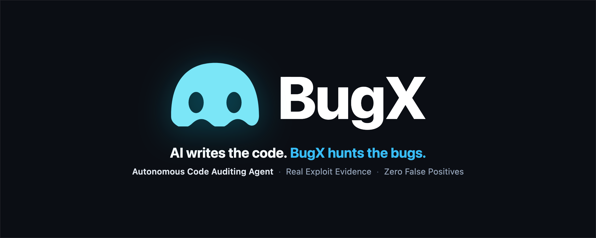

<p align="center">
  <a href="https://bugx.dev">
    
  </a>
</p>

<p align="center">
  <a href="README.md">简体中文</a> · <strong>English</strong> · <a href="https://bugx.dev">Website</a>
</p>

<p align="center">
  <a href="https://bugx.dev"></a>
  <a href="docs/01_guides/01_USER_GUIDE.md"></a>
  <a href="docs/01_guides/01_USER_GUIDE.md"></a>
  <a href="docs/01_guides/01_USER_GUIDE.md"></a>
</p>

# BugX

> **Search summary** — BugX is a local-first AI code auditing and vulnerability hunting CLI for developers and AI coding agents. It connects to MCP/ACP hosts such as Claude Code, OpenAI Codex, OpenCode, Cline, and ZCode to inspect real source code, reproduce bugs, verify findings, and produce evidence-backed security reports.

> **Website:** [bugx.dev](https://bugx.dev)

BugX is a source-available, evidence-driven security tool for auditing real software projects. It combines AI-assisted code review, application security testing, vulnerability hunting, and verified bug reproduction in one local-first workflow.

BugX does not treat a model response, a `ready` status, or a zero exit code as proof that an audit is complete. It keeps project state in a private `.bugx/` directory, coordinates supported AI hosts and worker agents through a local supervisor, and records coverage, lifecycle receipts, Finding decisions, execution artifacts, and recovery state.

In short: BugX helps developers find deep bugs and security defects, reproduce them, and separate verified evidence from model text.

## Why use BugX?

- **Evidence-first auditing:** track coverage, execution receipts, Finding decisions, artifact hashes, and finish-gate state.
- **AI host integrations:** connect supported MCP/ACP coding hosts to a structured audit lifecycle.
- **Reproducible results:** keep project-local state, reports, bug reproduction artifacts, and recovery information together.
- **Local-first control:** make cloud upload, diagnostics, feedback, and synchronization explicit operations.

This repository declares version `0.1.0`. The documentation matches the current source tree, but real host ACP, autonomous end-to-end runs, remote cloud synchronization, and cross-platform installation still require environment-specific verification.

## Host banner and capability matrix

BugX integrates with AI coding hosts, but host capabilities are intentionally separate. An install/detection adapter does not automatically mean that the host has a ready engine plugin, ACP support, or autonomous audit support.

| Capability | Current hosts |
| --- | --- |
| Install and detection adapters | ChatGPT, Claude Code, Cline, OpenAI Codex, DSH, FunIDE, OpenCode, Pi, Qoder, Trea, WorkBuddy, ZCode |
| Ready engine plugins | OpenCode, OpenAI Codex, Cline, DSH, Claude Code, Pi, ZCode |
| ACP ready | Cline, OpenCode |
| Autonomous CLI choices | Claude Code, OpenAI Codex, OpenCode, DSH, Cline, ZCode |

Check the current machine instead of relying on the static matrix:

`bugx hosts --root . --json`

See the complete [Host, MCP, and ACP capability matrix](docs/01_guides/01_USER_GUIDE.md#5-hostmcp-和-acp-能力矩阵).

## Requirements and installation

- Python `>=3.11` for the Python package and CLI.
- Node.js `>=18` when using the npm wrapper.

Declared package entry points:

```bash
python -m pip install bugx-cli
# or
npm install -g bugx-cli
```

Optional Python extras are available for selected capabilities: `tui`, `graph`, and `crypto`. They are not implicitly installed by the base package.

## Safe first run

From the project root, initialize local state first, then install only the host you intend to use:

```bash
bugx init --root . --cloud-sync local
bugx install --root . --agent opencode
bugx doctor --root . --strict
bugx engine --root . status
```

The `--agent` value must be one of the current install/detection adapters. Use `bugx hosts` to inspect the local host matrix. In a non-interactive shell, `bugx init` requires an explicit `--cloud-sync local|sync` choice unless a preset already supplies it.

Host capabilities vary by integration category; use the matrix above and `bugx hosts` output instead of inferring ACP or autonomous support from an install name.

## Run an audit

The public engine entry point is namespaced under `engine`:

```bash
bugx engine --root . pre
bugx engine --root . status --json
bugx engine --root . post
```

For goal-driven execution:

```bash
bugx autonomous --root . --host opencode
bugx goal --root . --host opencode "audit the project"
```

An exit code or model response is not, by itself, a completed audit. Completion requires the recorded lifecycle, coverage, evidence receipts, Finding decisions, and finish gate to agree. `bugx audit` may start a graph flow that is waiting for a native agent; `ready` is not the same as `complete`.

## What BugX records

Each audit keeps the evidence needed to understand what happened and what can be reproduced:

- project scope and coverage;
- lifecycle, worker, and host receipts;
- commands, exit codes, artifact paths, and SHA-256 hashes;
- Finding candidates, independent verification, and confirmed/rejected decisions;
- reports, checkpoints, and recoverable state.

This evidence model is designed to make security review results easier to inspect, reproduce, and hand off.

## Documents

- [User guide](docs/01_guides/01_USER_GUIDE.md): installation, configuration, host capabilities, lifecycle, MCP/ACP, cloud scope, results, and recovery.
- [Command reference](docs/01_guides/02_COMMANDS.md): parser-derived commands, options, defaults, scopes, side effects, and exit behavior.
- [Troubleshooting](docs/01_guides/03_TROUBLESHOOTING.md): symptom-driven diagnosis and recoverable next steps.
- [AI reference](docs/03_ai/01_AI_REFERENCE.md): machine-oriented MCP, lifecycle, state, evidence, and failure contract.
- [Documentation index](docs/README.md): architecture and document navigation.
- [Project website](https://bugx.dev): product overview and public entry point.

## Data and safety boundaries

Project state is stored under `.bugx/`; global engine, credentials, knowledge, cache, telemetry, and cloud configuration use user-level BugX locations unless overridden by the documented environment variables. `auth status` reports credential presence and state, not secret contents. A model name is not a credential.

Cloud upload, feedback, diagnostic log reporting, and sync are explicit operations. Review `--scope`, consent, sensitive-data policy, and detail mode before using them. Reset, uninstall, purge, and `--no-backup` can remove data; use their dry-run and backup behavior deliberately.

## Search keywords

AI code auditing, application security, security code review, vulnerability hunting, bug finding, verified bug reproduction, AI security testing, MCP, ACP, Claude Code, OpenAI Codex, OpenCode, Cline, ZCode, Python CLI, Node.js CLI, npm, PyPI.

## Development policy

Every code commit must update affected documentation (每次提交代码都必须同步更新). The semantic baseline remains `0.1.0`; version transitions require explicit human confirmation with `--confirm-version-transition`.

## License

See [LICENSE](LICENSE) for the repository license terms.
