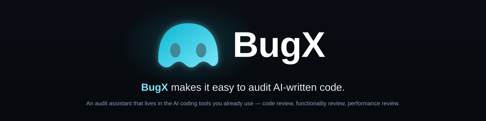
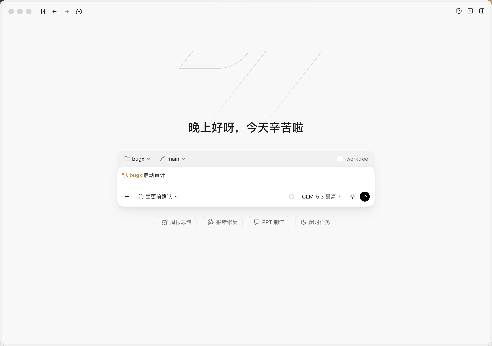
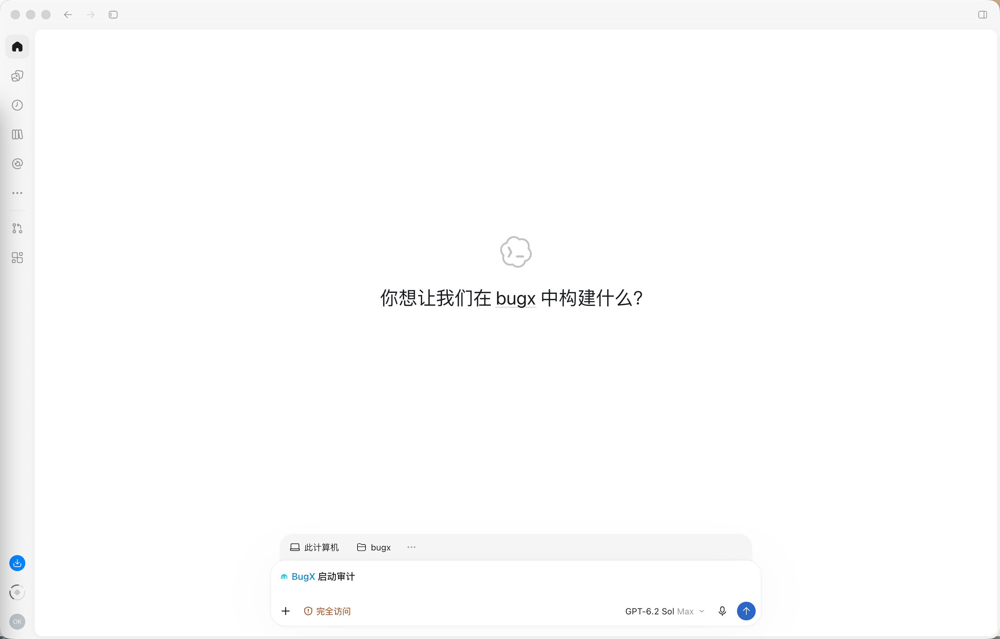
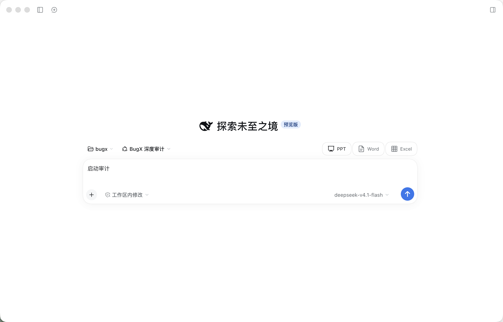
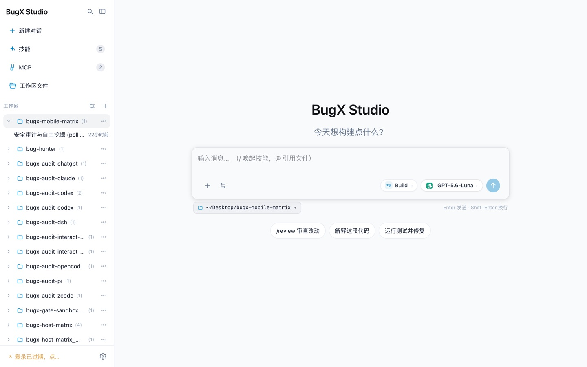
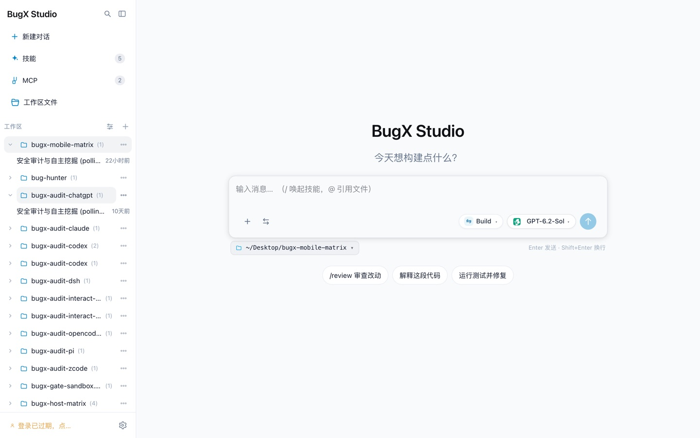
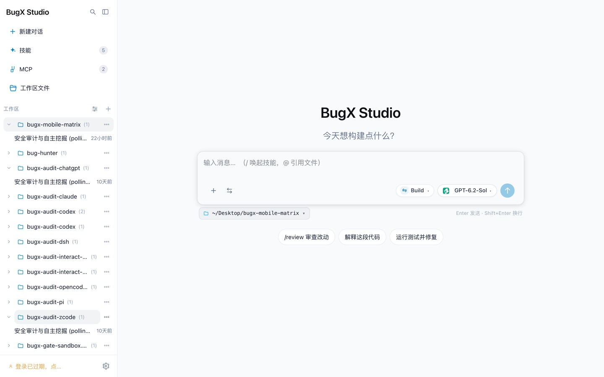
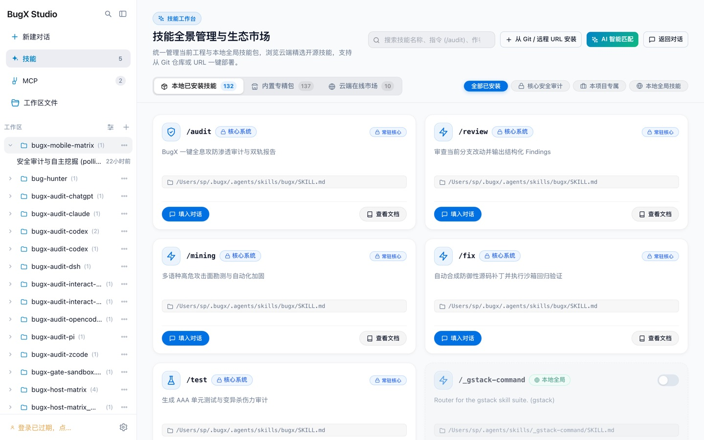

<p align="center">
  <a href="README.md">中文</a> · English
</p>

<p align="center">
  
</p>

# BugX — AI Code Audit Agent for Claude Code, Codex, Cline, OpenCode, and ZCode

BugX is a code-audit agent that lives inside your AI coding assistant. **When you finish a feature or open a pull request, it runs a full audit and tells you what was checked, what wasn't, and where the bugs are — each one with a command you can run yourself to reproduce it.** It works with Claude Code, Codex, Cline, OpenCode, and ZCode today. More tools are on the way.

<p align="center">
  <a href="https://pypi.org/project/bugx-cli/"></a>
  <a href="https://www.npmjs.com/package/bugx-cli"></a>
  
  
  <a href="LICENSE"></a>
</p>

🌐 Website: **https://bugx.dev**

## Contents

- [The problem it solves](#the-problem-it-solves)
- [Quick start](#quick-start)
- [What a full audit looks like](#what-a-full-audit-looks-like)
- [Supported AI coding tools](#supported-ai-coding-tools)
- [Data and security](#data-and-security)
- [Documentation](#documentation)
- [Development](#development)
- [License](#license)

## The problem it solves

AI writes code faster than any human can review it. And the model carries a quirk that makes this worse: it cuts corners. That isn't malice — it's how the model was trained. Three mechanisms stack together:

1. **The grader rewards confidence.** The last stage of training is human raters scoring responses. One answer says "I checked it carefully, nothing found." Another says "I haven't finished reading the files." The first scores better — it sounds reliable and useful. So the model learns that reporting good news earns the reward.
2. **Checking is expensive; claiming is cheap.** Reading a few hundred files takes real work. Replying "no issues found" takes a few words. When both options sit on the table, the cheap one always wins.
3. **It doesn't know what it hasn't checked.** The model can't see its own coverage gaps, and nothing in training taught it to say "half done." So it says "done" — every time.

BugX replaces that with a ledger and four hard rules:

1. **A coverage list.** Your project is split into audit units, each with a real status: checked, blocked, or not yet checked. Coverage is tracked, not assumed.
2. **Reproduction required.** The same attack input must trigger the bug twice; a clean input must trigger nothing. All three runs stay on record before a finding counts.
3. **It picks up where it left off.** Close your AI tool and reopen it later — the audit resumes from the last recorded step instead of starting over.
4. **Every verdict stays reviewable.** Who checked what, when, and on what evidence goes into the ledger line by line, with hash chaining between pages. Nothing gets edited quietly.

## Quick start

Python `>=3.11`; the npm wrapper needs Node.js `>=18`.

Install from PyPI:

```bash
python -m pip install bugx-cli
```

Or install from npm:

```bash
npm install -g bugx-cli
```

Then run this once from any directory:

```bash
bugx install
```

It lists every AI host it detects on your machine and walks you through picking one. To install everywhere at once, use `bugx install --agent all`.

### Option 1: use it inside your AI assistant (recommended)

No terminal and no commands to remember. Open your AI assistant in any project — Claude Code, Codex, Cline, OpenCode, ZCode — and just tell it what to check:

**ZCode**


**Codex**


**DSH**


> "Audit this project"
> "Check the login module for vulnerabilities"
> "Review the changes on this branch for security issues"

The AI inside your host calls BugX on its own: it builds the coverage list, dispatches concurrent workers, runs probes, verifies the findings, and writes the report. To watch an audit live, run `bugx report serve` in a terminal and open **http://127.0.0.1:8080** — that's the full web report.

### Option 2: run it from the command line

On the command line, the AI still comes from your installed hosts: BugX reuses the model and credentials you already configured there and never takes over your API keys (`--model` / `--provider` default to your host's configuration).

The first time you enter a project, sign in to the cloud, initialize, and self-check:

```bash
bugx auth login                # sign in to the cloud account (for lesson and experience sync)
bugx init --cloud-sync sync    # enable cloud sync so the project works across devices
bugx doctor --strict
```

Run a full audit:

```bash
bugx engine pre        # build the coverage list and the audit plan
bugx engine status     # check progress
bugx engine post       # settle up: cross-check coverage, evidence, and verdicts
```

Or let BugX run the whole thing while you do something else:

```bash
bugx autonomous --host opencode    # model and credentials come from your OpenCode setup
# or give it a target:
bugx goal --host opencode "audit this project's login and payment flows"
```

Fixes and outputs are command-line work too:

```bash
bugx test-generate ...     # generate AAA tests or a self-contained PoC for a unit
bugx test-verify ...       # mutate the code to prove your tests catch real bugs
bugx patch-forge --from-issue <id> --diff fix.diff --repro repro.md --test test_ok.py --dry-run
```

`patch-forge` builds a patch bundle and runs static checks on it. It produces the bundle but commits nothing — remove `--dry-run` once you've reviewed it.

Open the web UI for reports (during or after an audit):

```bash
bugx report serve     # then open http://127.0.0.1:8080 for live coverage, evidence, and findings
```

For offline archives, export a static report:

```bash
bugx report both --format html --out report.html
```

See the host table below for valid `--agent` values; `bugx hosts` lists every environment detected on this machine with its capabilities.

## What a full audit looks like

1. **pre (with the game plan).** BugX enumerates your source and configuration files, then builds a minimal list of audit units (single modules plus cross-module business flows). Before anything runs, you get a plan with five decisions in one pass: **cloud sync** (sync across devices or stay local), **review mode**, **polling strategy**, **fix mode**, and **commit handling**. Each has a default — accept them or set your own.
2. **Workers fan out.** The host hands audit units to concurrent workers. Each worker takes a lease, sends heartbeats, runs probes, and commits checkpoints.
3. **Evidence lands on disk.** Every worker conclusion carries the command it ran, the exit code, and the artifact hash. Coverage is only ever `covered` or `blocked` — "roughly checked" doesn't exist here.
4. **Findings get adjudicated.** Candidate bugs first go through the engine's verification channel: two positive runs plus a negative control, executed for real. Only then are they confirmed or rejected, and a rejection needs a stated reason.
5. **post.** Coverage and findings are cross-checked and the audit settles. Whether it's actually done is decided by the state machine's final state — the model saying "done" doesn't count.
6. **The report.** `bugx report both --format html --out report.html` produces the formal and visual reports; `bugx report serve` starts the live preview.

## A look at the interface

BugX ships with BugX Studio, a web workbench. Run `bugx report serve` and open http://127.0.0.1:8080:

<p align="center">
  
</p>

The workspace covers every connected host, and each host keeps its own audit sessions (the sidebar shows ChatGPT, ZCode, Claude, Codex, DSH, OpenCode, Pi, and more):

<p align="center">
  
  
</p>

The skill marketplace ships with `/audit` (one-shot full-surface audit with a dual-track report), `/review` (structured findings for branch changes), `/mining` (attack-surface survey and hardening), `/fix` (defensive patches with sandboxed regression), and `/test` (AAA tests with mutation-kill scoring):

<p align="center">
  
</p>

## What it can do

**Audit**
- **Code review**: bugs and defects, classified by logic / state / boundary / exception / concurrency / performance / resource.
- **Functionality review**: business-flow audit plus a behavior diff — feed the same inputs to your implementation and a reference implementation, then compare what differs.
- **Performance and memory**: performance and resource bugs, plus dedicated memory checks for six target families: native, Python, JVM, Electron, Android, and Apple.
- **UI audit**: layout, contrast, keyboard paths, and design tokens on a running web page (`bugx probe ui`).

**Reproduce and verify**
- Every finding ships with a command or input you can run yourself: the same bad input breaks it twice, a clean input breaks nothing, and all three runs stay on record.
- Your tests get graded too: `bugx test-verify` mutates your code to check whether the tests actually catch the bugs.

**Fixes and outputs**
- Generate AAA test cases or self-contained PoCs (`bugx test-generate`).
- Build patch bundles with static checks, delivered for your review — never committed for you (`bugx patch-forge`).
- Write reports (`bugx report`).

**Long term**
- **A lessons base**: project-level and global experience accumulates in `bugx lesson` / `bugx knowledge`; sync it to the cloud explicitly with `bugx cloud`.
- **Unattended runs**: follow your host (`bugx autonomous`), run toward a goal (`bugx goal`), or keep a resident daemon (`bugx daemon`).
- **Diagnostics**: `bugx doctor` / `bugx log` / `bugx stats` for installation, logs, and usage.

## FAQ

**What is BugX?**
An autonomous code-audit agent that lives inside AI coding assistants: it runs via MCP in Claude Code, Codex, Cline, OpenCode, and ZCode, or as a standalone CLI, tracks audit coverage per unit, and verifies every finding with real executions.

**What is Vibe Coding security and PR review automation?**
Vibe coding leverages LLMs to produce large volumes of code quickly, but models tend to cut corners and sound confident even when gaps remain. BugX is built specifically for vibe coding workflows and automated PR reviews: trigger deterministic, coverage-driven audits and real PoC reproductions directly within your AI assistant before merging.

**How does BugX guarantee Zero False Positives?**
BugX enforces the 3-Run Reproduction Rule: every candidate vulnerability must be proven by executing the attack input twice to reproduce the defect, followed by a clean input that triggers zero defects. Any finding without concrete commands, exit codes, and artifact hashes is rejected.

**How does the independent blind verification protocol work?**
In 0.1.2, BugX introduces an independent blind verification protocol (`stage_verify.md`). A dedicated verifier agent reproduces issues in an isolated sandbox with minimal prompt leakage, AST negative controls, and bounded self-correction loops, eliminating confirmation bias.

**Which AI coding tools does BugX support?**
Claude Code, OpenAI Codex, Cline / Roo Code, OpenCode, and ZCode are supported today; DeepSeek Harness (DSH), WorkBuddy, Cursor / Windsurf, and more are being adapted.

**How does BugX verify a vulnerability?**
The same attack input must reproduce the finding twice, and a clean input must produce nothing. All three runs (two positive, one negative control) are recorded with commands, exit codes, and artifact hashes.

**Does BugX send my code to the cloud?**
The audit itself runs locally. Cloud sync of lessons and experience is an explicit operation (`bugx init --cloud-sync sync` / `bugx cloud`); nothing is uploaded unless you run it.

**Does BugX replace human review?**
No. It gives you a reviewable ledger — what was checked, what wasn't, and reproducible evidence per finding — so human review starts from facts instead of the model's self-report.

**What languages does BugX audit?**
Multi-language static and behavioral analysis (Python, JavaScript/TypeScript, Java, Go, Rust, and more via tree-sitter), plus dedicated memory checks for native, Python, JVM, Electron, Android, and Apple targets.

## Supported AI coding tools

| AI coding tool | Integration | Install |
| :--- | :--- | :--- |
| **Claude Code** | native MCP / autonomous lifecycle | `bugx install --agent claude` |
| **OpenAI Codex** | workspace subagents / native plugin | `bugx install --agent codex` |
| **OpenCode** | headless ACP / native MCP | `bugx install --agent opencode` |
| **Cline / Roo Code** | MCP chat sessions (single-claim serial) / CLI multi-process concurrency | `bugx install --agent cline` |
| **ZCode** | native MCP / user-level MCP registration | `bugx install --agent zcode` |

Other tools — DeepSeek Harness, WorkBuddy, Cursor / Windsurf, and more — are on the way.

Run `bugx hosts` to see every environment detected on this machine.

## Data and security

- Project state lives in the project's `.bugx/` directory; the global engine, credentials, knowledge base, and caches live in a user-level BugX directory.
- Credentials are written to a controlled sandbox when needed (readable only by the current user by default). `bugx auth status` reports whether credentials exist — it never prints them. A model name is not a credential.
- Cloud uploads, feedback, diagnostic log reporting, and sync are all explicit operations: each states its `--scope`, its sensitive-data policy, and its verbose mode before it runs.
- `reset` / `uninstall` / `purge` / `--no-backup` delete data. Check each command's dry-run and backup behavior first.

## Documentation

The documentation is written in Chinese:

- [User guide](docs/01_guides/01_USER_GUIDE.md): installation, configuration, host capabilities, lifecycle, MCP/ACP, cloud scope, results, and recovery.
- [Command reference](docs/01_guides/02_COMMANDS.md): every command, argument, default, scope, side effect, and exit behavior.
- [Troubleshooting](docs/01_guides/03_TROUBLESHOOTING.md): find problems by symptom, with a recoverable next step.
- [UI audit (probe ui)](docs/01_guides/02_COMMANDS.md#63-probe): responsive layout, contrast, keyboard paths, and design tokens on a running web UI.
- [AI reference](docs/03_ai/01_AI_REFERENCE.md): MCP, lifecycle, state, evidence, and failure contracts for hosts and agents.
- [Docs index](docs/README.md): architecture and documentation navigation.

## Development

Repository conventions (docs sync, version contract, verification gates) live in [AGENTS.md](AGENTS.md); architecture and internal design live in [docs/02_architecture/](docs/02_architecture/). Before committing, run `python3 scripts/bump_version.py --check`.

## Keywords

vibe coding · vibe coding security · pr review · pull request review · zero false positive · poc generator · mcp security · automated code audit · ai code audit · automated code review · code review agent · ai agent · security audit · vulnerability scanner · vulnerability mining · sast · static analysis · mcp server · claude code · openai codex · opencode · cline · zcode · coding agent · llm code review · autonomous audit · behavior diff · memory leak detection · python security · javascript security · devsecops

## License

[Business Source License 1.1](LICENSE).
