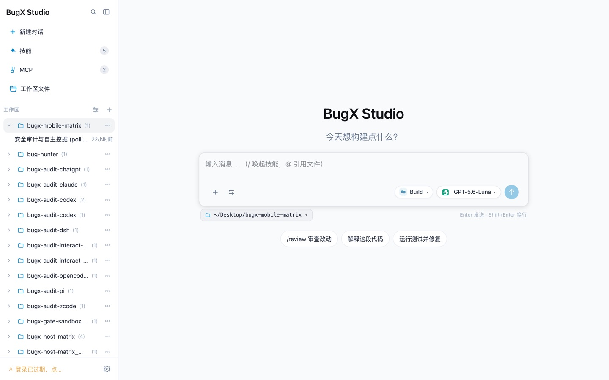

<p align="center">
  
</p>

<p align="center">
  中文 · <a href="README_EN.md">English</a>
</p>

# BugX — 自动帮你查 Bug、跑测试的 Agent

BugX 可以装在你的 AI 编程工具或命令行里，专门用来**排查代码里的隐藏 Bug、自动补测试并跑通验证**。

它会把项目拆成小块逐一检查，发现可疑问题后不会只靠“嘴说”，而是**真的在本地跑一遍复现脚本或测试，确认能触发才上报**。这样既不容易漏掉长文件里的边界问题，也不会报一堆假漏洞浪费时间。

<p align="center">
  <a href="https://pypi.org/project/bugx-cli/"></a>
  <a href="https://www.npmjs.com/package/bugx-cli"></a>
  
  
  <a href="LICENSE"></a>
</p>

🌐 官网：**https://bugx.dev**

---

### ✨ 核心特点

- 🛡️ **真跑验证，少报假问题**：找到可疑 Bug 后会实际运行复现脚本或测试用例，附上执行的命令、退出码和输出日志，有据可查。
- 📋 **进度可追踪，中断可续**：按模块和文件记录已查/未查进度，长项目不怕查一半漏掉，随时可以接着跑。
- 🔌 **主流 AI 编程工具开箱即用**：一条命令自动适配 Antigravity、Claude Code、Cursor、Trae、Codex、OpenCode、Cline、Qoder、DSH、Kimi、MiniMax、ZCode、Agnes Code 等。
- 📊 **本地 Web 报告看板**：提供可视化页面查看漏洞详情、调用路径、复现记录与测试结果。

---

### 🚀 快速开始

#### 1. 安装 CLI（任选其一）

```bash
# Python 环境 (>= 3.11)
pip install bugx-cli

# 或 Node.js 环境 (>= 18)
npm install -g bugx-cli
```

#### 2. 一键装配 AI 宿主

在用户主目录或待审计项目下运行，BugX 会自动识别本机已有的 AI 编程助手并完成 MCP / 插件配置：

```bash
bugx install
```

> 💡 **提示**：安装完成后请**完全退出并重启你的 AI 编程助手/IDE**。如需高级配置，请参阅 [宿主矩阵与分发指南](docs/01_guides/05_HOST_MATRIX_AND_DISPATCH.md)。

---

### 💬 使用方式

#### 方式一：在 AI 编程助手中直接使用（推荐）

打开任意已配置的项目工作区，在你的 AI 助手（如 Cursor、Claude Code、Antigravity、ZCode 等）中直接对话：

> “审计一下这个项目”  
> “检查登录模块是否存在并发安全漏洞或异常吞噬”  
> “把当前分支的改动审一遍，输出可复现的 PoC 验证命令”

AI 会自动调度 BugX 编排 Worker 并发深挖、运行探针并在沙箱内执行验证。

#### 方式二：在命令行自主长跑

```bash
# 全自主闭环长跑（自动复用宿主配置好的模型与凭据）
bugx autonomous --host opencode

# 启动本地实时 Web 报告预览（打开 http://127.0.0.1:8080）
bugx report serve
```

---

### 🖥️ BugX Studio Web 工作台

审计进行中或结束后，运行 `bugx report serve` 即可在浏览器中查看全息交互工作台：

<p align="center">
  
</p>

---

### 🔌 支持的 AI 编程宿主

| AI 编程助手 | 接入机制 | 安装命令 |
| :--- | :--- | :--- |
| **Google Antigravity（反重力）** | 原生 Agent/Worker、Skill、项目级 Supervisor/Worker/docs MCP | `bugx install --agent antigravity` |
| **Claude Code** | 原生 MCP / 自治生命周期 | `bugx install --agent claude` |
| **OpenAI Codex** | 工作区子 Agent / 原生插件 | `bugx install --agent codex` |
| **OpenCode** | 原生 ACP / 多 Agent 并发 / 项目级 MCP | `bugx install --agent opencode` |
| **Cline / Roo Code** | 独立数据沙箱 / 项目级 Agent / 用户级 MCP | `bugx install --agent cline` |
| **Qoder AI** | 原生 Agent/Worker、Subagent 并发、用户级/项目级 MCP 注入 | `bugx install --agent qoder` |
| **Trae / Trae CN** | 项目级 Agent、多变体 MCP 同步镜像 | `bugx install --agent trae` |
| **DeepSeek Harness (DSH)** | 支持官方插件市场安装，自带 Skill、命令与 MCP 工具（[官方插件市场](https://github.com/awesome-dsh-plugin/awesome-dsh-plugin)） | `bugx install --agent dsh` |
| **Kimi Code** | 支持官方插件市场安装，内置 BugX 智能体与 MCP 工具（[官方插件市场](https://github.com/MoonshotAI/kimi-code)） | `bugx install --agent kimi` |
| **MiniMax Code** | 支持官方插件市场安装，内置审查智能体、Skill 与 MCP（[官方插件市场](https://github.com/MiniMax-AI/MiniMax-Code-Plugins)） | `bugx install --agent minimax` |
| **ZCode** | 支持官方插件市场安装，内置 BugX 智能体、Skill 与 MCP（[官方插件市场](https://github.com/zai-org/zcode-plugins)） | `bugx install --agent zcode` |
| **Agnes Code** | 支持官方插件市场安装，终端内直接发起 BugX 审查（[官方插件市场](https://github.com/AgnesAI-Labs/agh-plugin-market)） | `bugx install --agent agnescode` |
| **WorkBuddy / CodeBuddy** | 原生 Skill、桌面端多变体镜像、项目级 MCP | `bugx install --agent workbuddy` |
| **GitHub Copilot** | 项目级 Agent/指令注入、用户级 Agent、项目级 MCP | `bugx install --agent copilot` |
| **Cursor / Windsurf** | 项目级 / 用户级 MCP 标准接入 | `bugx install` 自动检测装配 |

---

### 📚 文档导航

- [用户完整指南](docs/01_guides/01_USER_GUIDE.md)：涵盖从配置、生命周期、MCP/ACP 到故障恢复全流程。
- [命令手册 (CLI Reference)](docs/01_guides/02_COMMANDS.md)：全部命令与参数定义。
- [宿主矩阵与分发指南](docs/01_guides/05_HOST_MATRIX_AND_DISPATCH.md)：各 AI 宿主特化支持与高级配置。
- [故障排查手册](docs/01_guides/03_TROUBLESHOOTING.md)：常见问题快速定位与自愈方案。
- [系统架构与内部设计](docs/02_architecture/01_ARCHITECTURE.md)：BugX 状态机、防伪账本与验证架构。

---

### 💬 交流群

欢迎加入 BugX 官方交流群反馈问题、探讨 AI 代码审计最佳实践：

<p align="center">
  
</p>

---

### 🔍 搜索关键词 (Keywords)

Google Antigravity · 反重力 · 反重力智能体 · Gemini 4 · Gemini 4 Carbon · Gemini 4 Neon · Gemini · Gemini 编程助手 · Gemini Code Assist · G4 模型 · Claude 5.5 · Claude Sonnet 5.5 · Claude Opus 5.5 · Claude Code 审计 · GPT-4o 代码审计 · 自动代码审计 · AI 代码审计 · 自动化 Code Review · Code Review · 代码审查 Agent · 代码审计智能体 · AI Agent · Vibe Coding 安全 · 氛围编程审计 · PR 自动审查 · 零误报 · 真实 PoC 复现 · 盲审验证 · 安全审计 · 漏洞扫描 · 漏洞挖掘 · 静态分析 · MCP 服务 · MCP 安全 · Cursor 审计 · Windsurf 审计 · Trae 审计 · Codex 审计 · OpenCode 审计 · Cline 审计 · Qoder 审计 · GitHub Copilot 审计 · DeepSeek Harness 审计 · 编程助手安全 · 自主审计 · 行为差分 · 内存泄漏检测 · Python 安全 · JavaScript 安全 · DevSecOps

---

### 📄 许可

本项目采用 [Business Source License 1.1](LICENSE)。
