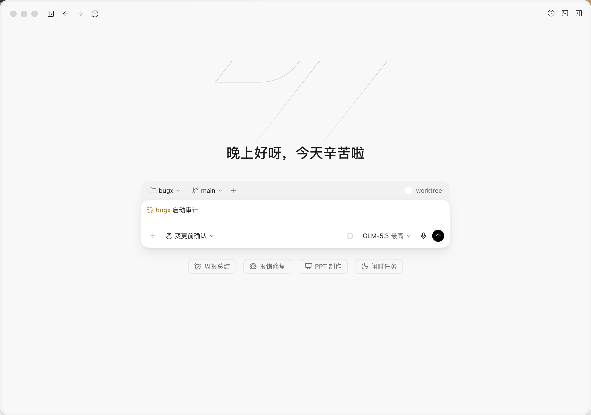

<p align="center">
  
</p>

<p align="center">
  中文 · <a href="README_EN.md">English</a>
</p>

# BugX — 自主代码审查与智能测试智能体（Autonomous Code Review & Automated Testing Agent）

BugX 是一款装在 AI 编程助手与智能体开发环境里的**自主代码审查与自主测试智能体（Agent）**，严把代码交付关：**它帮助开发人员在写完代码后自动排查隐藏的深层 Bug，减少反复排错与返工；帮助测试人员自动化运行黑盒测试、功能验证与性能测试，自动覆盖手工盲测难以覆盖的极端场景；确保代码功能完全符合要求、在各种复杂环境下都能稳定运行、不崩溃不卡死，上线放心不翻车。** 

目前已原生适配全球主流 AI 编程助手与智能体开发平台：**Google Antigravity（反重力）、Gemini Code Assist / Gemini CLI、Agnes Code、Claude Code、OpenAI Codex、Cursor、Trae、Windsurf、Cline、OpenCode、Kimi Code、ZCode、MiniMax Code、DSH、WorkBuddy、Qoder**；全面支持以 **Google 最新 Gemini 4 体系（Gemini 4 Carbon / Neon / Hydrogen）、Claude 5.5（Sonnet 5.5 / Opus 5.5）、G4 旗舰大模型**为底座的深层代码推理与漏洞发现。静态分析、行为差分、内存检查与 UI 测试全部自动化执行；通过标准化 MCP 协议接入宿主，测试审查过程断点可续、透明可查。

<p align="center">
  <a href="https://pypi.org/project/bugx-cli/"></a>
  <a href="https://www.npmjs.com/package/bugx-cli"></a>
  
  
  <a href="LICENSE"></a>
</p>

🌐 官网：**https://bugx.dev**

## 目录

- [它解决什么问题？](#它解决什么问题？)
- [快速开始](#快速开始)
- [一次完整审计长什么样](#一次完整审计长什么样)
- [支持的 AI 编程宿主](#支持的-ai-编程宿主)
- [数据与安全边界](#数据与安全边界)
- [文档](#文档)
- [交流群](#交流群)
- [开发与贡献](#开发与贡献)
- [许可](#许可)

## 它解决什么问题？

AI 写代码的速度，早就超过人眼审代码的速度。更麻烦的是，模型还藏着一个问题：爱偷懒。这不是它坏，是训练方式决定的，三条机制叠在一起：

1. **打分偏好：** 模型训练的最后一步，是让人类评分员给回答打分。一个版本说"我仔细查过了，没发现问题"，另一个说"这个文件我还没看完"——评分员多半给前者高分，因为听着踏实、有用。模型由此学会：报喜不报忧才拿分。
2. **成本不对等：** 检查代码是体力活，几百个文件得一个个读；回一句"没发现问题"只要几个字。两条路摆在那，省事的那条永远更划算。
3. **不知道"没查完"：** 模型既不知道哪块没查，也没被教过怎么说。所以它给不出"部分完成"，只会给你"完成"。

Bugx的审计能依靠账本和四条规矩实现：

1. **代码覆盖清单** 项目拆成一个个审计单元，每个都有明确状态：查完了、卡住了、还没查。达到全面覆盖。
2. **独立盲审与真实复现** 发现的疑点由隔离的独立验证员盲审，同一段攻击输入实跑两次触发漏洞、正常输入一次零触发，三份真实记录在案才算数；证伪案例入误报账本不再骚扰。
3. **排查可以续杯** 退出AI工具后再次打开可以接着干之前的活儿。
4. **记录全部可查** 谁、什么时候、凭什么下的结论，一笔一笔记进账本，每页盖骑缝章（哈希链），谁也改不了，逐条可查。

## 快速开始

Python `>=3.11`；用 npm 封装时需要 Node.js `>=18`。
Pip安装
```bash
# 任选其一
python -m pip install bugx-cli
```
npm 安装
```bash
npm install -g bugx-cli
```

检查与更新使用当前安装来源对应的服务端制品：

```bash
bugx update --check          # 只检查；0=无需更新，1=有更新，2=检查失败
bugx update                  # pip 或 npm wrapper 的实际全局更新
bugx update --channel alpha  # 明确选择预发布通道
```

更新会联网下载并校验服务端返回的 `release_id`、SHA-256 和制品类型，随后刷新全局 BugX 引擎、已登记宿主并执行安装诊断。源码 checkout 或 editable 安装不会被自动覆盖；更新失败时请先查看 `~/.bugx/update/receipts/` 和 `bugx doctor --installation-only`，不要用 `--force` 掩盖未知状态。启动阶段的版本提示可用 `BUGX_DISABLE_VERSION_CHECK=1` 临时关闭，但不影响显式 `bugx update --check`。

装好后先完成用户级或项目级安装：

```bash
# 1. 在用户主目录 (~) 运行：执行用户全局安装（全局引擎、必需核心依赖 codebase-memory + tree-sitter、宿主用户级入口）
bugx install

# 2. 进入待审计项目目录运行（或显式传 --root <项目目录>）：绑定当前项目工作区
bugx install --root .
```

> ⚠️ **重要提示（配置生效必须重启）**：配置或更新宿主 MCP 后，**必须完全退出并重启宿主 IDE / AI 编程助手**（如 Cursor、Trae、VSCode、Kimi Code、MiniMax Code、ZCode、DSH 等），宿主进程重新加载 MCP 服务配置后方可识别并调用 BugX 工具。

- **必装核心能力 direct-ready**：`bugx install` 与 `bugx doctor --repair` 会直接安装与校验通用必需依赖（`codebase-memory-mcp==0.12.1` 语义图谱与 `tree-sitter-language-pack==1.14.3` AST 解析、已选宿主核心 MCP 通道），绝不沉默降级放行；其余与项目技术栈相关的可选能力（`playwright`、`postmcp`、`dbhub`、`redis`、`mobile`、`semgrep`、`bandit`、效率工具等）延迟到进入实际项目审计时由 AI 与用户按需决定启用。
- 命令行里的布尔选项都是开关：启用时直接写 `--force`、`--json` 等选项，关闭时删除该选项；不要写 `--force=True`、`--json=False` 或 `force=True`。
- 它会列出本机检测到的 AI 宿主，按提示选择即可；想跳过选择一次全装，用 `bugx install --agent all`。
- 用户主目录安装不会污染 `~` 或删除 `~/.bugx/core`，其中 DSH 全局配置文件会写入动态无 `--root` 参数；需要把安装直接绑定到某个仓库时传入 `--root <项目目录>`（如 `bugx install --agent dsh --root <项目目录>`）。

在 Qoder Desktop 的项目根目录运行 `bugx install --agent qoder`，将 BugX 连接器和项目绝对路径写入 `.mcp.json`。Windows 使用安装时的 Python 绝对路径启动连接器。安装后重新打开工作区并启动新会话，在 Qoder 提示时批准该项目的 BugX 连接器。

Kimi Code 会自动注册到当前 Kimi Code 数据根：默认是 `~/.kimi-code`，也可以用
`KIMI_CODE_HOME` 指定。插件文件位于 `plugins/managed/bugx`，启用状态位于
`plugins/installed.json`；Windows、macOS、Linux 使用同一契约，不需要手动复制旧的
`daimon-share` 目录。

运行 `bugx install --agent minimax` 后，可在 MiniMax Code 的 **Agents** 页找到带官方头像的 `BugX`，
在 **插件** 页找到配套的 `BugX` 插件。插件提供 Worker、Skill 和 MCP。安装契约已在
Windows MiniMax Code 3.1.17 上验证。可用 `MINIMAX_DATA_DIR` 指定隔离安装目录。

运行 `bugx install --agent antigravity` 后，可在 **Google Antigravity（反重力）**智能体开发平台的 Agent 选择器中直接选用 `BugX`。用户级插件提供专属主 Agent、Worker Agent、审查 Skill 与官方头像；同时为当前项目工作区自动配置 `bugx-supervisor`、`bugx-supervisor-worker` 与 `bugx-docs` 三条核心 MCP 服务通道，完美适配 Google 最新 Gemini 4（Gemini 4 Carbon / Neon）与 Claude 5.5 级大模型进行全生命周期的代码审查与真实漏洞验证。

DSH 有一条额外的安全边界：安装器始终先把 BugX UI 包暂存到
`~/.dsh/plugins/bugx-ui`。只有能确认是 DSH Desktop 自带的 launcher 时，才会调用
`dsh plugin --profile web add` 注册 Web UI；普通 npm/Python `dsh` CLI 不支持该插件管理
操作，安装器会保持 `staged` 而不会启动它，避免 Windows 宿主进程崩溃。DSH 的 Agent、
Skill、MCP 和 preset 不依赖这个可选 UI 包，仍可正常使用。
Windows Desktop 的 `app.asar` 运行时包名会在有界安装候选中递归读取 ASAR 文件树，
兼容当前 `files/dsh/files/node_modules` 的嵌套布局；不做全盘扫描。

用 `bugx help install` 或 `bugx supervisor install --help` 查看用法。发现安装资源缺失时，CLI 会报告错误，需要修复时单独运行 `bugx update --repair-assets`。Windows 用户级 wheel 与旧系统级 Python 资源并存时，CLI 优先使用当前发行版自带的资源，避免旧引擎被误判为当前版本。

### 首次使用，先接通云端

进入目标仓库，确认要登录的 BugX 云账号、同步范围和敏感数据策略，然后登录并核验账号：

```bash
bugx auth login --root .
bugx auth status --root . --verify --json
```

确认 `auth_verified=true`。如果账号全局知识和当前项目知识均已授权，新项目执行 `bugx init --root . --cloud-sync sync`，随后用 `bugx cloud sync --root . --scope all` 验证首次推拉。`bugx init` 会把标准通用 Skill 安装到项目的 `.agents/skills/bugx/SKILL.md`，可在支持该目录的宿主里调用 `/bugx` 或按需运行 `bugx guide "<关键词>"` 查询操作步骤。已有项目在授权全量范围后直接用 `bugx cloud sync --root . --scope all`，并用 `bugx cloud status --root . --scope all --json` 核对绑定和状态。全量范围包含项目登记与画像、项目知识和账号全局知识。只授权部分数据时停止同步。

### 方式一：在 AI 编程助手里用（推荐）

装完之后不用进终端、不用记命令。在任意项目里打开你的 AI 助手（Claude Code、Codex、Cline、OpenCode、ZCode），直接告诉它要查什么：

**ZCode**


**Codex**


**DSH**


> "审计一下这个项目"
> "查一下登录模块有没有漏洞"
> "把这次的改动审一遍，看看有没有安全问题"

宿主里的 AI 会自动调用 BugX：建覆盖清单、派发并发 Worker、跑探针、验证漏洞、出报告。审计过程想实时看，终端跑一句 `bugx report serve`，浏览器打开 **http://127.0.0.1:8080** 就是完整的 Web 报告界面。

### 方式二：在命令行里直接跑

命令行方式的 AI 同样来自你已装好的宿主——模型和凭据用宿主里自己配好的，BugX 直接复用，不接管你的 Key（`--model` / `--provider` 缺省自动读取宿主配置）。

先用 `bugx doctor --root . --strict` 核对当前项目的宿主和连接。走分阶段 CLI 时，按[完整生命周期](docs/01_guides/01_USER_GUIDE.md#8-从-pre-到-post-的完整生命周期)从准备、执行和核查一直到收尾。用 `bugx engine --root . status --json` 查看当前进度和下一步。

也可以让 BugX 自己跑完全程，不用守在终端：

```bash
bugx autonomous --host opencode    # 模型/凭据自动复用 OpenCode 里已配好的
# 或带目标：
bugx goal --host opencode "审计这个项目的登录与支付链路"
```

修复与产出也在命令行完成：

```bash
bugx test-generate ...     # 为指定单元生成 AAA 测试或自包含 PoC
bugx test-verify ...       # 变异验证测试用例的抓 Bug 能力
bugx patch-forge --from-issue <id> --diff fix.diff --repro repro.md --test test_ok.py --dry-run
```

`patch-forge` 生成补丁包并静态校验，默认只出包不提交；审过没问题再去掉 `--dry-run`。

打开 Web UI 看报告（审计中、审计后都能看）：

```bash
bugx report serve     # 浏览器打开 http://127.0.0.1:8080，实时看覆盖、证据与漏洞
```

需要离线归档时导出静态报告：

```bash
bugx report both --format html --out report.html
```

`--agent` 的取值见下方宿主表；`bugx hosts` 会列出本机检测到的所有环境和各自能力。

## 一次完整审计长什么样

1. **pre（含作战方案）**：枚举源码与配置资产，生成最小审计单元清单（内部单元 + 跨模块业务链路）。开跑前先给你一份作战方案，五个选择一次定：**云同步**（登录后同步错题和经验，离线运行需明确选择）、**审查方式**、**轮询策略**、**修复方式**、**提交方式**。按启动门禁确认本轮的同步范围和执行策略。
2. **派发 Worker**：宿主把审计单元派给并发 Worker；每个 Worker 领租约、发心跳、跑探针、提交 checkpoint。
3. **证据落盘**：Worker 的每条结论都带命令、退出码、artifact 哈希；覆盖状态只能是 `covered / blocked`，没有"大概查了"。
4. **Finding 裁决**：候选漏洞先由引擎验证通道实跑双正例 + 负对照，再进入确认/驳回；驳回需要理由。
5. **post**：核对 coverage 与 findings 是否自洽，结账。审计完成与否以状态机终态为准——模型的一句"完成了"不算数。
6. **出报告**：`bugx report both --format html --out report.html` 生成正式 + 可视化报告；`bugx report serve` 起本地实时预览。

## 看一眼界面

BugX Studio 是自带的 Web 工作台——跑 `bugx report serve`，浏览器打开 http://127.0.0.1:8080：

<p align="center">
  
</p>

工作区覆盖所有已接入的宿主，每个工作区独立记录自己的审计会话（截图左侧可见 ChatGPT、ZCode、Claude、Codex、DSH、OpenCode、Pi 等）：

<p align="center">
  
  
</p>

技能市场内置 `/audit`（一键全息攻防审计与双轨报告）、`/review`（分支改动结构化 Findings）、`/mining`（攻击面勘测与加固）、`/fix`（防御性补丁 + 沙箱回归）、`/test`（AAA 测试与变异杀伤力审计）：

<p align="center">
  
</p>

## 它能干什么

**审计**
- **代码审查**：漏洞与缺陷，按逻辑 / 状态 / 边界 / 异常 / 并发 / 性能 / 资源分类。
- **功能审查**：业务链路审计 + 行为差分——同一批输入分别喂给你的实现和参考实现，比出行为差异。
- **性能与内存**：性能/资源类缺陷，外加 native / Python / JVM / Electron / Android / Apple 六类目标的内存专项检查。
- **UI 审计**：对运行中的网页做布局、对比度、键盘路径与设计 Token 检查（`bugx probe ui`）。

**复现与验证**
- **独立盲审与真实复现**：每个漏洞都由独立验证员执行隔离盲审与环境验证，给出你能亲手运行的 PoC 验证命令。同一段坏数据跑两次都出事，换正常数据跑一次零触发，外加 AST 语法反空壳断言，三份真实记录留案才算数。
- **误报账本学习**：实跑被证伪的假阳性案例自动沉淀入误报账本（FP Ledger），代码未改动前不再重复报假警；文件被修改后自动解除过时守卫。
- **模型风控与多模型底座自适应（Gemini 4 / Claude 5.5 / G4 / GPT）**：深度适配 Google 最新 Gemini 4 体系（Gemini 4 Carbon / Neon / Argon）、Claude 5.5 旗舰系列（Claude Sonnet 5.5 / Opus 5.5）与 OpenAI GPT-4o 系列，内置声明式提示词策略引擎，针对不同模型自动切换防御性 QA 视角，彻底解决漏洞审查触发平台 `cyber policy` / Daybreak 拦截的痛点。
- **测试变异检验**：测试用例的战斗力也能验：`bugx test-verify` 用代码变异检验测试真的抓得住 Bug。

**修复与产出**
- 自动生成 AAA 测试用例或自包含 PoC（`bugx test-generate`）。
- 生成补丁包并做静态校验，交给你审，不替你提交（`bugx patch-forge`）。
- 输出报告（`bugx report`）。

**长期使用**
- **错题集**：将本轮核实后写入账本的错题和经验按授权范围推拉到云端（`bugx cloud sync`）。下一轮可用 `bugx lesson retrieve` 按故障症状或模块检索。
- **无人值守**：跟着宿主跑（`bugx autonomous`）、带目标长跑（`bugx goal`）、常驻守护（`bugx daemon`）。
- **诊断与反馈**：`bugx doctor` / `bugx log` / `bugx stats` 查安装、日志与消耗；遇到异常或改进建议时运行 `bugx issue report` 或 `bugx feedback`，支持本地安全脱敏打包并直接一键反馈。
- **官方文档支持 (Remote-First)**：内置 `bugx-docs` MCP 服务与 `bugx guide` 命令，默认直连官方端点获取最新官方文档与最佳实践；离线时毫秒级自动降级至随包离线文档。

## 常见问题

**BugX 是什么？**
一款装进 AI 编程助手的自主代码审计 Agent：通过 MCP 在 Claude Code、Codex、Cline、OpenCode、ZCode、MiniMax Code 内运行，也可作为独立 CLI 使用；按单元跟踪审计覆盖，并对每条发现做真实执行验证。

**支持哪些 AI 编程工具与大模型？**
原生支持 **Google Antigravity（反重力）**、**Gemini Code Assist / Gemini CLI**、**Agnes Code**、Claude Code、OpenAI Codex、Cursor、Trae、Windsurf、Cline / Roo Code、OpenCode、Kimi Code、ZCode、MiniMax Code、DeepSeek Harness (DSH)、WorkBuddy、Qoder 等主流 AI 编程助手与 Agent 开发平台；深度兼容 **Google 最新 Gemini 4 体系（Gemini 4 Carbon / Neon / Hydrogen）、Claude 5.5（Sonnet 5.5 / Opus 5.5）、G4 旗舰模型等全系列主力模型**。

**如何验证一个漏洞？**
不靠首发模型的自说自话，由独立的验证员执行盲审验证：一段攻击输入必须两次成功触发该漏洞，一段正常输入必须零触发；三次执行（两正例一负对照）连同命令、退出码与产物哈希全部记录在案，并通过 AST 语法断言防止空壳测试。

**我的代码会被上传到云端吗？**
目标代码和审计执行仍在本地完成；知识同步、项目画像、诊断日志、反馈和 bundle 仍是各自的显式网络路径。另有独立的安装/心跳遥测：遥测门禁未配置时默认开启，普通 CLI 命令每天最多记录一次并尽力发送脱敏的安装元数据。若不希望产生任何新遥测，先执行 `bugx config set telemetry.data_sharing false`，或对当前命令设置 `BUGX_TELEMETRY_ENABLED=0`。安装遥测不包含用户名、主机名、项目绝对路径、凭据或安装密钥；是否真正到达服务端仍以 HTTP 2xx 和服务端统计为准。

**BugX 能替代人工审查吗？**
不能。它提供一份可复查的账本——查了什么、没查什么、每条发现的复现证据——让人工审查从事实开始，而不是从模型的自述开始。

**审计支持哪些语言？**
基于 tree-sitter 的多语言静态与行为分析（Python、JavaScript/TypeScript、Java、Go、Rust 等），外加 native / Python / JVM / Electron / Android / Apple 六类目标的内存专项检查。

## 支持的 AI 编程宿主

| AI 编程助手 | 接入方式 | 安装命令 |
| :--- | :--- | :--- |
| **Claude Code** | 原生 MCP / 自治生命周期 | `bugx install --agent claude` |
| **OpenAI Codex** | 工作区子 Agent / 原生插件 | `bugx install --agent codex` |
| **OpenCode** | Headless ACP / 原生 MCP | `bugx install --agent opencode` |
| **Agnes Code** | 终端原生 TUI / 智能体与原生 MCP 注入 | `bugx install --agent agnescode` |
| **Cline / Roo Code** | MCP 交互会话（单 Claim 串行）/ CLI 多进程池并发 | `bugx install --agent cline` |
| **Kimi Code** | Headless ACP / 原生 MCP | `bugx install --agent kimi` |
| **ZCode** | 原生 MCP / 用户级 MCP 注册 | `bugx install --agent zcode` |
| **MiniMax Code** | 自定义 Agent、Plugin V1 Worker、Skill 和 MCP | `bugx install --agent minimax` |
| **Google Antigravity（反重力）** | 原生 Agent/Worker、Skill、项目级 Supervisor/Worker/docs MCP、ACP 直通 | `bugx install --agent antigravity` |
| **Gemini / Gemini Code** | 原生 MCP 连接 / 自动化审查管道（全面支持最新 Gemini 4 体系） | `bugx install --agent gemini` 或标准 MCP 接入 |

其余宿主（DeepSeek Harness、WorkBuddy、Cursor / Windsurf 等）持续适配中。

运行 `bugx hosts` 查看本机可检测的宿主。


## 数据与安全边界

- 项目状态存放在项目内的 `.bugx/` 目录；全局引擎、凭据、知识库、缓存使用用户级 BugX 目录。
- 凭据按需写入受控沙箱（默认仅当前用户可读）；`bugx auth status` 只报告凭据是否存在，不输出内容。模型名不等于凭据。
- 知识同步、项目画像、反馈、诊断日志和 bundle 上传都是显式操作；独立安装/心跳遥测默认开启，可用 `telemetry.data_sharing=false` 或 `BUGX_TELEMETRY_ENABLED=0` 关闭。任何网络动作都应按实际数据面核对 scope、敏感数据策略、详细模式和服务端证据。
- `reset / uninstall / purge / --no-backup` 会删除数据，请留意各自的 dry-run 与备份行为。

## 文档

- [用户指南](docs/01_guides/01_USER_GUIDE.md)：安装、配置、宿主能力、生命周期、MCP/ACP、云端范围、结果与恢复。
- [命令参考](docs/01_guides/02_COMMANDS.md)：全部命令、参数、默认值、作用域、副作用与退出行为。
- [故障排查](docs/01_guides/03_TROUBLESHOOTING.md)按症状定位问题与可恢复的下一步。
- [BugX 极简 Skill](skills/platform/bugx/SKILL.md) 配合 `bugx guide` 提供秒级操作检索、云同步、审查收尾与自愈指引。
- [UI 审计（probe ui）](docs/01_guides/02_COMMANDS.md#63-probe)：对运行中的 Web UI 做响应式布局、对比度、键盘路径与设计 Token 审计。
- [AI 参考](docs/03_ai/01_AI_REFERENCE.md)：面向宿主/Agent 的 MCP、生命周期、状态、证据与失败契约。
- [文档索引与官方知识库](docs/README.md)：架构与文档导航（内置 `bugx-docs` 远程优先 MCP 与随包离线速查知识库，支持宿主直接调用 `search_docs` / `fetch_doc` 查询全套操作指南）。

## 交流群

加入 Bugx 交流群，反馈问题、交流用法：


## 开发与贡献

仓库开发规范（文档同步、版本契约、验证门禁）见 [AGENTS.md](AGENTS.md)；架构与内部设计见 [docs/02_architecture/](docs/02_architecture/)。提交前请跑 `python3 scripts/bump_version.py --check`。

## 关键词

Google Antigravity · 反重力 · 反重力智能体 · Gemini 4 · Gemini 4 Carbon · Gemini 4 Neon · Gemini · Gemini 编程助手 · Gemini Code Assist · G4 模型 · Claude 5.5 · Claude Sonnet 5.5 · Claude Opus 5.5 · Claude Code 审计 · GPT-4 代码审计 · 自动代码审计 · AI 代码审计 · 自动化 Code Review · Code Review · 代码审查 Agent · 代码审计智能体 · AI Agent · Vibe Coding 安全 · 氛围编程审计 · PR 自动审查 · 零误报 · 真实 PoC 复现 · 盲审验证 · 安全审计 · 漏洞扫描 · 漏洞挖掘 · 静态分析 · MCP 服务 · MCP 安全 · Codex 审计 · 编程助手安全 · 自主审计 · 行为差分 · 内存泄漏检测 · Python 安全 · JavaScript 安全 · DevSecOps

## 许可

[Business Source License 1.1](LICENSE)。
