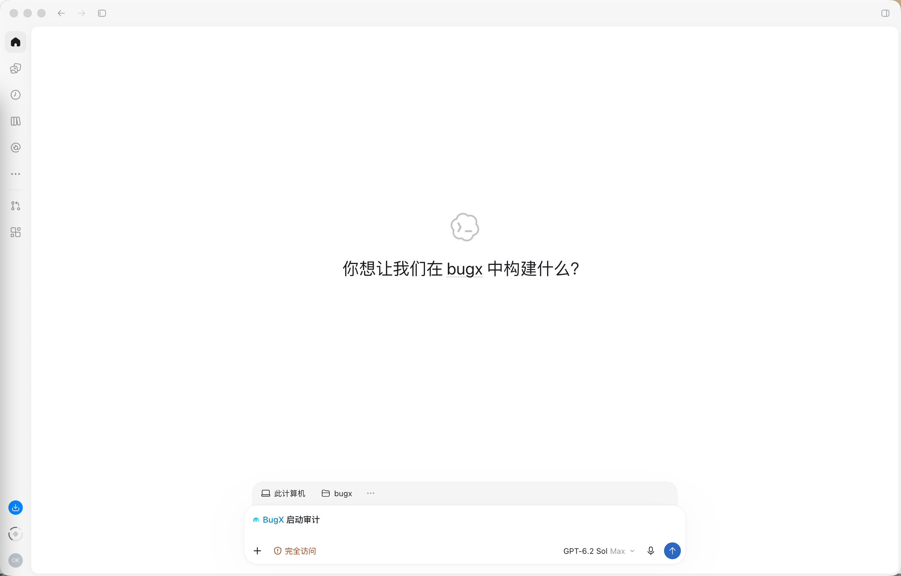
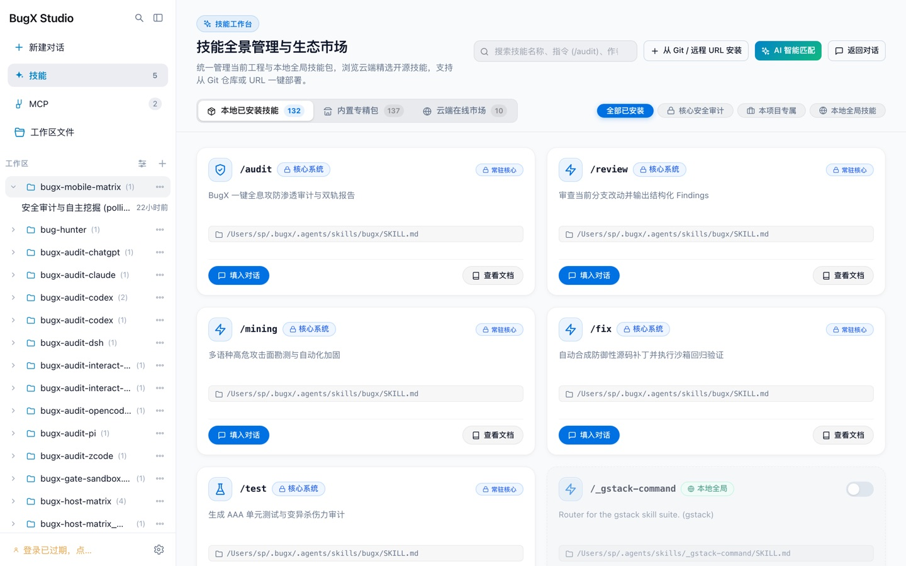

<p align="center">
  
</p>

<p align="center">
  中文 · <a href="README_EN.md">English</a>
</p>

# BugX — AI 代码审计 Agent（AI Code Audit Agent）

BugX 是一款装在 AI 编程助手里的代码审计 Agent。**写完功能或提 PR 时让它跑一遍，它会自动完成审计，然后告诉你：查了哪些地方、哪些还没查、哪有漏洞——每个漏洞都附一条你能亲手复现的命令。** 目前已适配宿主：Claude Code、Codex、Cline、OpenCode、ZCode；其余宿主持续适配中。 静态分析、行为差分、内存检查与 UI 无障碍审计全部本地执行；通过 MCP 接入宿主，审计过程可断点续跑、逐条可复查。

<p align="center">
  <a href="https://pypi.org/project/bugx-cli/"></a>
  <a href="https://www.npmjs.com/package/bugx-cli"></a>
  
  
  <a href="LICENSE"></a>
</p>

🌐 官网：**https://bugx.dev**

## 目录

- [它解决什么问题？](#它解决什么问题？)
- [快速开始](#快速开始)
- [一次完整审计长什么样](#一次完整审计长什么样)
- [支持的 AI 编程宿主](#支持的-ai-编程宿主)
- [数据与安全边界](#数据与安全边界)
- [文档](#文档)
- [开发与贡献](#开发与贡献)
- [许可](#许可)

## 它解决什么问题？

AI 写代码的速度，早就超过人眼审代码的速度。更麻烦的是，模型还藏着一个问题：爱偷懒。这不是它坏，是训练方式决定的，三条机制叠在一起：

1. **打分偏好：** 模型训练的最后一步，是让人类评分员给回答打分。一个版本说"我仔细查过了，没发现问题"，另一个说"这个文件我还没看完"——评分员多半给前者高分，因为听着踏实、有用。模型由此学会：报喜不报忧才拿分。
2. **成本不对等：** 检查代码是体力活，几百个文件得一个个读；回一句"没发现问题"只要几个字。两条路摆在那，省事的那条永远更划算。
3. **不知道"没查完"：** 模型既不知道哪块没查，也没被教过怎么说。所以它给不出"部分完成"，只会给你"完成"。

Bugx的审计能依靠账本和四条规矩实现：

1. **代码覆盖清单** 项目拆成一个个审计单元，每个都有明确状态：查完了、卡住了、还没查。达到全面覆盖。
2. **漏洞问题复现** 同一段攻击输入跑两次，两次都能真的把漏洞触发出来；换成正常输入再跑一次，什么也触发不出。这三份记录都留在案，漏洞才算数。
3. **排查可以续杯** 退出AI工具后再次打开可以接着干之前的活儿。
4. **记录全部可查** 谁、什么时候、凭什么下的结论，一笔一笔记进账本，每页盖骑缝章（哈希链），谁也改不了，逐条可查。

## 快速开始

Python `>=3.11`；用 npm 封装时需要 Node.js `>=18`。
Pip安装
```bash
# 任选其一
python -m pip install bugx-cli
```
NMP安装
```bash
npm install -g bugx-cli
```

装好后，任意目录跑一次：

```bash
bugx install
```

它会列出本机检测到的 AI 宿主，按提示选择即可；想跳过选择一次全装，用 `bugx install --agent all`。

### 方式一：在 AI 编程助手里用（推荐）

装完之后不用进终端、不用记命令。在任意项目里打开你的 AI 助手（Claude Code、Codex、Cline、OpenCode、ZCode），直接告诉它要查什么：

**ZCode**


**Codex**


**DSH**


> "审计一下这个项目"
> "查一下登录模块有没有漏洞"
> "把这次的改动审一遍，看看有没有安全问题"

宿主里的 AI 会自动调用 BugX：建覆盖清单、派发并发 Worker、跑探针、验证漏洞、出报告。审计过程想实时看，终端跑一句 `bugx report serve`，浏览器打开 **http://127.0.0.1:8080** 就是完整的 Web 报告界面。

### 方式二：在命令行里直接跑

命令行方式的 AI 同样来自你已装好的宿主——模型和凭据用宿主里自己配好的，BugX 直接复用，不接管你的 Key（`--model` / `--provider` 缺省自动读取宿主配置）。

首次进入项目，登录云端、初始化并自检：

```bash
bugx auth login                # 登录云端账号（云端错题/经验同步用）
bugx init --cloud-sync sync    # 开启云端同步，跨设备可用
bugx doctor --strict
```

跑一次完整审计：

```bash
bugx engine pre        # 建立覆盖清单与审计计划
bugx engine status     # 看进度
bugx engine post       # 结账：核对覆盖、证据与裁决是否自洽
```

也可以让 BugX 自己跑完全程，不用守在终端：

```bash
bugx autonomous --host opencode    # 模型/凭据自动复用 OpenCode 里已配好的
# 或带目标：
bugx goal --host opencode "审计这个项目的登录与支付链路"
```

修复与产出也在命令行完成：

```bash
bugx test-generate ...     # 为指定单元生成 AAA 测试或自包含 PoC
bugx test-verify ...       # 变异验证测试用例的抓 Bug 能力
bugx patch-forge --from-issue <id> --diff fix.diff --repro repro.md --test test_ok.py --dry-run
```

`patch-forge` 生成补丁包并静态校验，默认只出包不提交；审过没问题再去掉 `--dry-run`。

打开 Web UI 看报告（审计中、审计后都能看）：

```bash
bugx report serve     # 浏览器打开 http://127.0.0.1:8080，实时看覆盖、证据与漏洞
```

需要离线归档时导出静态报告：

```bash
bugx report both --format html --out report.html
```

`--agent` 的取值见下方宿主表；`bugx hosts` 会列出本机检测到的所有环境和各自能力。

## 一次完整审计长什么样

1. **pre（含作战方案）**：枚举源码与配置资产，生成最小审计单元清单（内部单元 + 跨模块业务链路）。开跑前先给你一份作战方案，五个选择一次定：**云同步**（sync 跨设备可用 / local 纯本地）、**审查方式**、**轮询策略**、**修复方式**、**提交方式**——都给出默认值，也可以跳过让默认值生效。
2. **派发 Worker**：宿主把审计单元派给并发 Worker；每个 Worker 领租约、发心跳、跑探针、提交 checkpoint。
3. **证据落盘**：Worker 的每条结论都带命令、退出码、artifact 哈希；覆盖状态只能是 `covered / blocked`，没有"大概查了"。
4. **Finding 裁决**：候选漏洞先由引擎验证通道实跑双正例 + 负对照，再进入确认/驳回；驳回需要理由。
5. **post**：核对 coverage 与 findings 是否自洽，结账。审计完成与否以状态机终态为准——模型的一句"完成了"不算数。
6. **出报告**：`bugx report both --format html --out report.html` 生成正式 + 可视化报告；`bugx report serve` 起本地实时预览。

## 看一眼界面

BugX Studio 是自带的 Web 工作台——跑 `bugx report serve`，浏览器打开 http://127.0.0.1:8080：

<p align="center">
  
</p>

工作区覆盖所有已接入的宿主，每个工作区独立记录自己的审计会话（截图左侧可见 ChatGPT、ZCode、Claude、Codex、DSH、OpenCode、Pi 等）：

<p align="center">
  
  
</p>

技能市场内置 `/audit`（一键全息攻防审计与双轨报告）、`/review`（分支改动结构化 Findings）、`/mining`（攻击面勘测与加固）、`/fix`（防御性补丁 + 沙箱回归）、`/test`（AAA 测试与变异杀伤力审计）：

<p align="center">
  
</p>

## 它能干什么

**审计**
- **代码审查**：漏洞与缺陷，按逻辑 / 状态 / 边界 / 异常 / 并发 / 性能 / 资源分类。
- **功能审查**：业务链路审计 + 行为差分——同一批输入分别喂给你的实现和参考实现，比出行为差异。
- **性能与内存**：性能/资源类缺陷，外加 native / Python / JVM / Electron / Android / Apple 六类目标的内存专项检查。
- **UI 审计**：对运行中的网页做布局、对比度、键盘路径与设计 Token 检查（`bugx probe ui`）。

**复现与验证**
- 每个漏洞都给一条你能亲手复现的命令或输入：同一段坏数据跑两次都出事，再换正常数据跑一次没事，三份记录留案。
- 测试用例的战斗力也能验：`bugx test-verify` 用代码变异检验测试真的抓得住 Bug。

**修复与产出**
- 自动生成 AAA 测试用例或自包含 PoC（`bugx test-generate`）。
- 生成补丁包并做静态校验，交给你审，不替你提交（`bugx patch-forge`）。
- 输出报告（`bugx report`）。

**长期使用**
- **错题集**：项目级与全局经验积累（`bugx lesson` / `bugx knowledge`），需要时可显式同步云端（`bugx cloud`）。
- **无人值守**：跟着宿主跑（`bugx autonomous`）、带目标长跑（`bugx goal`）、常驻守护（`bugx daemon`）。
- **诊断**：`bugx doctor` / `bugx log` / `bugx stats` 查安装、日志与消耗。

## 常见问题

**BugX 是什么？**
一款装进 AI 编程助手的自主代码审计 Agent：通过 MCP 在 Claude Code、Codex、Cline、OpenCode、ZCode 内运行，也可作为独立 CLI 使用；按单元跟踪审计覆盖，并对每条发现做真实执行验证。

**支持哪些 AI 编程工具？**
Claude Code、OpenAI Codex、Cline / Roo Code、OpenCode、ZCode 已适配；DeepSeek Harness（DSH）、WorkBuddy、Cursor / Windsurf 等持续适配中。

**如何验证一个漏洞？**
同一段攻击输入必须两次复现该漏洞，一段正常输入必须零触发；三次执行（两正例一负对照）连同命令、退出码与产物哈希全部记录在案。

**我的代码会被上传到云端吗？**
审计全程本地执行。错题与经验的云端同步是显式操作（`bugx init --cloud-sync sync` / `bugx cloud`），不运行就不上传。

**BugX 能替代人工审查吗？**
不能。它提供一份可复查的账本——查了什么、没查什么、每条发现的复现证据——让人工审查从事实开始，而不是从模型的自述开始。

**审计支持哪些语言？**
基于 tree-sitter 的多语言静态与行为分析（Python、JavaScript/TypeScript、Java、Go、Rust 等），外加 native / Python / JVM / Electron / Android / Apple 六类目标的内存专项检查。

## 支持的 AI 编程宿主

| AI 编程助手 | 接入方式 | 安装命令 |
| :--- | :--- | :--- |
| **Claude Code** | 原生 MCP / 自治生命周期 | `bugx install --agent claude` |
| **OpenAI Codex** | 工作区子 Agent / 原生插件 | `bugx install --agent codex` |
| **OpenCode** | Headless ACP / 原生 MCP | `bugx install --agent opencode` |
| **Cline / Roo Code** | MCP 交互会话（单 Claim 串行）/ CLI 多进程池并发 | `bugx install --agent cline` |
| **ZCode** | 原生 MCP / 用户级 MCP 注册 | `bugx install --agent zcode` |

其余宿主（DeepSeek Harness、WorkBuddy、Cursor / Windsurf 等）持续适配中。

运行 `bugx hosts` 查看本机可检测的宿主。


## 数据与安全边界

- 项目状态存放在项目内的 `.bugx/` 目录；全局引擎、凭据、知识库、缓存使用用户级 BugX 目录。
- 凭据按需写入受控沙箱（默认仅当前用户可读）；`bugx auth status` 只报告凭据是否存在，不输出内容。模型名不等于凭据。
- 云端上传、反馈、诊断日志上报和同步都是显式操作：执行前会明确 `--scope`、敏感数据策略与详细模式。
- `reset / uninstall / purge / --no-backup` 会删除数据，请留意各自的 dry-run 与备份行为。

## 文档

- [用户指南](docs/01_guides/01_USER_GUIDE.md)：安装、配置、宿主能力、生命周期、MCP/ACP、云端范围、结果与恢复。
- [命令参考](docs/01_guides/02_COMMANDS.md)：全部命令、参数、默认值、作用域、副作用与退出行为。
- [故障排查](docs/01_guides/03_TROUBLESHOOTING.md)：按症状定位问题与可恢复的下一步。
- [UI 审计（probe ui）](docs/01_guides/02_COMMANDS.md#63-probe)：对运行中的 Web UI 做响应式布局、对比度、键盘路径与设计 Token 审计。
- [AI 参考](docs/03_ai/01_AI_REFERENCE.md)：面向宿主/Agent 的 MCP、生命周期、状态、证据与失败契约。
- [文档索引](docs/README.md)：架构与文档导航。

## 开发与贡献

仓库开发规范（文档同步、版本契约、验证门禁）见 [AGENTS.md](AGENTS.md)；架构与内部设计见 [docs/02_architecture/](docs/02_architecture/)。提交前请跑 `python3 scripts/bump_version.py --check`。

## 关键词

AI 代码审计 · AI 代码审查 · 代码审查 Agent · 安全审计 · 漏洞扫描 · 静态分析 · MCP 服务 · Claude Code 审计 · Codex 审计 · 编程助手安全 · 自主审计 · 行为差分 · 内存泄漏检测 · Python 安全 · JavaScript 安全

## 许可

[Business Source License 1.1](LICENSE)。
