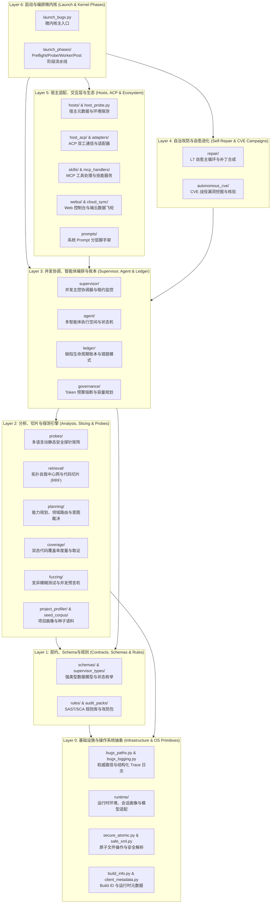

# BugX 微内核与核心领域系统 (Core Microkernel & Domain Architecture)

> **版本契约**: `0.1.0` | **调度微内核**: `core/launch_bugx.py` + `core/supervisor/`  
> **公开架构说明**: 参见 [`docs/02_architecture/01_ARCHITECTURE.md`](../docs/02_architecture/01_ARCHITECTURE.md) 与 [`docs/02_architecture/03_BUGX_AUDIT_FLOW.md`](../docs/02_architecture/03_BUGX_AUDIT_FLOW.md)。

本文档为 BugX `core/` 目录的唯一权威架构全景与物理文件索引字典。记录了微内核分层架构、34 个专业领域子系统、核心底层资产及全部物理文件索引。

---

## 1. 核心微内核全景目录拓扑树 (Panoramic Directory Topology)

```text
core/
├── 1. 35 个专业领域子系统 (35 Subsystems Across 7 Architectural Layers)
│   ├── [Layer 0: 基础设施与操作系统抽象]
│   │   ├── infra/                # 核心纯净基础设施与底层操作系统原语子系统
│   │   ├── runtime/              # 核心运行时配置、会话画像、模型适配与持久化同步
│   │   ├── assets/               # 静态资源、报告模板与预置样式的资产包
│   │   ├── dev_harness/          # 本地开发调试轻量级沙箱与模拟测试夹具环境
│   │   └── locales/              # 国际化语言包 (zh-CN, en-US) 与终端渲染词条
│   │
│   ├── [Layer 1: 契约规范、Schema与安全规则]
│   │   ├── contracts/            # 核心执行协议、宿主交互契约与智能体工作流指南
│   │   ├── schemas/              # JSON Schema 与强类型数据契约定义
│   │   ├── supervisor_types/     # Supervisor 状态机事件、租约状态与生命周期强类型枚举
│   │   ├── rules/                # 静态分析语义规则、正则模式与漏洞特征库
│   │   └── audit_packs/          # Web/Mobile/Desktop 垂直领域攻防规则包集合
│   │
│   ├── [Layer 2: 分析、切片与攻防探测矩阵]
│   │   ├── probes/               # 多语言多维度动态/静态攻防探针矩阵
│   │   ├── retrieval/            # 拓扑自我中心网、代码切片与倒数排名融合 (RRF) 检索引擎
│   │   ├── planning/             # 能力规划裁剪、领域路由、代码切片与意图裁决流水线
│   │   ├── coverage/             # 双态代码覆盖率度量、两阶段取证与防恶化棘轮门禁
│   │   ├── fuzzing/              # 变异模糊测试、有状态状态机推演与并发差分预言机
│   │   ├── project_profiler/     # 目标工程画像扫描器、技术栈指纹识别与攻击面建模
│   │   └── seed_corpus/          # 模糊测试种子用例、历史漏洞变异样本与边界语料库
│   │
│   ├── [Layer 3: 并发协调、智能体编排与账本]
│   │   ├── supervisor/           # 并发主控协调器、Worker 租约仲裁、心跳与 Checkpoint 管道
│   │   ├── agent/                # 智能体协同微内核、多 Agent 工作空间与执行状态机
│   │   ├── ledger/               # 缺陷全生命周期账本、错题集与自动化模式物化引擎
│   │   └── governance/           # Token 预算监控、并发容量动态规划与安全脱敏守卫
│   │
│   ├── [Layer 4: 自治攻防战役与自愈进化]
│   │   ├── repair/               # L7 智能自愈主循环、RSI 递归提升、补丁合成与测试生成
│   │   └── autonomous_cve/       # 真实世界 CVE 漏洞自动挖掘、利用链构造与修复验证流水线
│   │
│   ├── [Layer 5: 宿主适配、交互层与生态协议]
│   │   ├── hosts/                # 主流宿主 (Claude, OpenCode, Codex, Pi, Cursor) 特征定义
│   │   ├── host_acp/             # Agent Client Protocol (ACP) 双工长连接通信状态机
│   │   ├── host_runtime/         # 宿主依赖沙箱、文件系统写保护与隔离进程管理器
│   │   ├── adapters/             # 外部 IDE 与第三方工具交互底层桥接适配器
│   │   ├── skills/               # MCP 协议标准工具服务、技能生命周期与动态加载运行时
│   │   ├── mcp_handlers/         # MCP 核心工具指令、上下文资源读取与提示词路由处理器
│   │   ├── mcp_runtime_support/  # MCP 双向通信通道保活、心跳检测与异常熔断机制
│   │   ├── webui/                # 本地嵌入式 Web 审计工作台静态资源与前端模板
│   │   ├── cloud_sync/           # 端云协同数据飞轮、审计日志上报与跨设备增量同步
│   │   └── prompts/              # LLM 系统提示词模板系统与分层规则切片脚手架
│   │
│   └── [Layer 6: 阶段化启动微内核]
│       └── launch_phases/        # DOC-132 阶段化启动流水线 (Preflight, Probe, Worker, Post)
│
└── 2. 8 个根目录核心微内核资产 (8 Core Root Microkernel Assets)
    ├── [微内核启动与核心协议基石]
    │   ├── launch_bugx.py        # 微内核主入口，负责阶段编排与生命周期调度
    │   └── bugx.md               # BugX 核心架构与功能设计规范基线（全系统版本真源）
    │
    ├── [基础设施单源真理与受控文件IO]
    │   ├── bugx_paths.py         # 权威单源真理：全局缓存、会话、持久化与沙箱路径拓扑
    │   ├── secure_atomic.py      # 基于临时文件与原子重命名保障文件写入零损坏
    │   └── i18n.py               # 终端输出与日志消息的多语言翻译与本地化路由
    │
    └── [完整性签名、目录契约与知识种子]
        ├── engine-integrity.json # 核心引擎 600+ 文件的 SHA-256 完整性哈希校验清单
        ├── CATALOG.json          # 官方支持能力、插件与攻防规则包权威目录清单
        ├── metadata.txt          # 打包 wheel 必须携带的版本与构建元数据声明
        └── lesson-ledger.json    # 持久化的经验教训内置知识种子模板
```

---

## 2. 7 层架构拓扑与交互数据流 (7-Layer Microkernel Architecture)



---

## 3. 34 个专业领域子系统索引清单 (34 Subsystems Inventory)

`core/` 下包含 **34 个高内聚专业领域子系统**，全部实现模块化封装并配备独立的 `README.md` 与 100% 覆盖索引：

| 子目录 | 架构分层 | 核心职责说明 | 关联子系统文档 |
| :--- | :--- | :--- | :--- |
| `adapters/` | Layer 5 | 外部 IDE、CLI 与智能体交互的底层适配器桥接实现 | [adapters/README.md](adapters/README.md) |
| `agent/` | Layer 3 | 多 Agent 协作调度微内核、任务执行状态机与隔离工作空间 | [agent/README.md](agent/README.md) |
| `assets/` | Layer 0 | 报告生成、样式注入及预置配置的静态资产资源包 | [assets/README.md](assets/README.md) |
| `audit_packs/` | Layer 1 | 收拢 `web-audit`, `mobile-audit`, `desktop-audit` 等垂直攻防规则包 | [audit_packs/README.md](audit_packs/README.md) |
| `autonomous_cve/` | Layer 4 | 真实世界 CVE 漏洞自动发现、利用链构造与修复验证流水线 | [autonomous_cve/README.md](autonomous_cve/README.md) |
| `cloud_sync/` | Layer 5 | 云端多设备协同、审计日志上报与分布式数据飞轮同步协议 | [cloud_sync/README.md](cloud_sync/README.md) |
| `contracts/` | Layer 1 | 核心执行协议、宿主交互契约与智能体工作流指南 | [contracts/README.md](contracts/README.md) |
| `coverage/` | Layer 2 | 最小审计单元递归发现、证据链核验、防恶化门禁与双态覆盖率子系统 | [coverage/README.md](coverage/README.md) |
| `dev_harness/` | Layer 0 | 本地开发调试轻量级沙箱容器与测试夹具模拟环境 | [dev_harness/README.md](dev_harness/README.md) |
| `fuzzing/` | Layer 2 | 变异模糊测试、有状态状态机推演、并发时序探针与双跑差分验证器 | [fuzzing/README.md](fuzzing/README.md) |
| `governance/` | Layer 3 | Token 预算、并发容量动态规划、目标控制、只读与脱敏治理守卫 | [governance/README.md](governance/README.md) |
| `host_acp/` | Layer 5 | 宿主 Agent Client Protocol (ACP) 双工会话、握手与流式事件转发 | [host_acp/README.md](host_acp/README.md) |
| `host_runtime/` | Layer 5 | 宿主依赖环境探测、文件系统写保护沙箱与隔离进程管理 | [host_runtime/README.md](host_runtime/README.md) |
| `hosts/` | Layer 5 | 包含 Claude, OpenCode, Codex, Pi, Cursor 等主流宿主特征与元数据声明 | [hosts/README.md](hosts/README.md) |
| `infra/` | Layer 0 | 核心基础设施原语：Build ID、客户端元数据、安全 XML 与受控解释器 | [infra/README.md](infra/README.md) |
| `launch_phases/` | Layer 6 | DOC-132 阶段化启动编排器（Preflight, Probe, Worker, Post） | [launch_phases/README.md](launch_phases/README.md) |
| `ledger/` | Layer 3 | 漏洞、会话、断点与任务状态的物理磁盘持久化与错题本学习闭环 | [ledger/README.md](ledger/README.md) |
| `locales/` | Layer 0 | 多语言（zh-CN, en-US）国际化提示词与终端渲染词条 | [locales/README.md](locales/README.md) |
| `mcp_handlers/` | Layer 5 | Model Context Protocol 核心工具指令、资源读取与提示词路由处理器 | [mcp_handlers/README.md](mcp_handlers/README.md) |
| `mcp_runtime_support/` | Layer 5 | MCP 协议双向 stdio/SSE 通道、心跳保活与异常熔断机制 | [mcp_runtime_support/README.md](mcp_runtime_support/README.md) |
| `planning/` | Layer 2 | 能力规划裁剪、领域路由、代码切片、规格采集与意图裁决流水线 | [planning/README.md](planning/README.md) |
| `probes/` | Layer 2 | 包含 C/C++, Go, Java, Python, Web 等细分语言维度的动静态探针矩阵 | [probes/README.md](probes/README.md) |
| `project_profiler/` | Layer 2 | 自动扫描目标项目拓扑、识别技术栈、依赖库与安全攻击面 | [project_profiler/README.md](project_profiler/README.md) |
| `prompts/` | Layer 5 | 面向 LLM 的系统 Prompt 模板、上下文动态切片组装脚手架 | [prompts/README.md](prompts/README.md) |
| `repair/` | Layer 4 | 缺陷自动修复、RSI 递归自提升、补丁合成与运行时就地自愈子系统 | [repair/README.md](repair/README.md) |
| `report_engine/` | Layer 5 | 将审计结果渲染为高可读 Markdown、交互式 HTML 及标准 PDF 报告 | [report_engine/README.md](report_engine/README.md) |
| `retrieval/` | Layer 2 | 基于拓扑自我中心网、代码切片与 RRF 融合的高精度检索引擎 | [retrieval/README.md](retrieval/README.md) |
| `rules/` | Layer 1 | 静态代码分析语法规则、正则模式与漏洞特征库 (SAST/SCA) | [rules/README.md](rules/README.md) |
| `runtime/` | Layer 0 | 运行环境预检、项目初始化、模型适配、日志遥测与持久化同步子系统 | [runtime/README.md](runtime/README.md) |
| `schemas/` | Layer 1 | JSON Schema 与强类型数据结构契约定义 | [schemas/README.md](schemas/README.md) |
| `seed_corpus/` | Layer 2 | 模糊测试用例种子、已知漏洞变异样本与边界测试语料 | [seed_corpus/README.md](seed_corpus/README.md) |
| `skills/` | Layer 5 | 技能包生命周期、动态技能合成、安全工具知识库与 MCP 协议服务 | [skills/README.md](skills/README.md) |
| `supervisor/` | Layer 3 | 独立 Supervisor 监控线程、Worker 租约仲裁与故障自愈决策中心 | [supervisor/README.md](supervisor/README.md) |
| `supervisor_types/` | Layer 1 | Supervisor 状态机事件、租约状态与生命周期强类型枚举定义 | [supervisor_types/README.md](supervisor_types/README.md) |
| `webui/` | Layer 5 | 嵌入式 Web 控制台的前端模板、静态样式与交互脚本 | [webui/README.md](webui/README.md) |

---

## 4. 8 个根目录核心微内核资产索引清单 (Root-Level Core Assets Inventory)

### 4.1 微内核启动与核心协议基石
| 物理文件 | 架构定位 | 核心职责说明 |
| :--- | :--- | :--- |
| `launch_bugx.py` | 启动微内核 | 微内核主入口，负责阶段编排（Preflight $\rightarrow$ Probe $\rightarrow$ Worker $\rightarrow$ Post） |
| `bugx.md` | 核心协议总纲 | BugX 核心架构与功能设计规范基线（全系统版本权威真源 DECLARATIONS[0]） |

### 4.2 基础设施单源真理与受控文件 IO
| 物理文件 | 架构定位 | 核心职责说明 |
| :--- | :--- | :--- |
| `bugx_paths.py` | 路径权威真理 | 统一解析全局缓存、会话、持久化账本与工作区路径拓扑（绝对单源真理） |
| `secure_atomic.py` | 原子文件写入 | 基于临时文件与原子重命名保障全生命周期文件写入零截断损坏 |
| `i18n.py` | 国际化门面 | 终端输出与日志消息的多语言翻译与本地化路由 |

### 4.3 完整性签名、目录契约与知识种子
| 物理文件 | 架构定位 | 核心职责说明 |
| :--- | :--- | :--- |
| `engine-integrity.json` | 完整性清单 | 核心引擎 600+ 文件的 SHA-256 完整性哈希校验清单 |
| `CATALOG.json` | 能力目录契约 | 官方支持能力、插件与攻防规则包目录清单 |
| `metadata.txt` | 构建元数据 | 打包 wheel 必须携带的版本与构建元数据声明 |
| `lesson-ledger.json` | 经验账本种子 | 持久化经验教训内置知识种子模板，项目初始化时以此构建错题库 |

---

## 5. 架构演进与防平铺架构红线 (Architecture Guardrails)

为了长期保持 `core/` 目录的整洁度与高内聚，确立以下**四项工程级不可违背硬约束**：

1. **严禁在 `core/` 根目录随意新建平铺文件**：
   - 任何新增的探针必须放入 `core/probes/`；
   - 任何新增的 MCP 处理逻辑必须放入 `core/mcp_handlers/`；
   - 任何新增的 Schema 必须放入 `core/schemas/`；
   - 任何新增的报告模板必须放入 `core/report_engine/`。
2. **强制语义分词命名前缀**：
   - 探针类必须带 `_probe` 或 `probe_`；
   - 覆盖率类必须以 `coverage_` 开头；
   - 缺陷类必须以 `finding_` 开头；
   - Worker 类必须以 `worker_` 开头；
   - L7 修复类必须以 `l7_` 或 `rsi_` 开头。
3. **单向依赖与禁止循环引用 (Unidirectional Graph Axiom)**：
   - 低层基础设施（`bugx_paths.py`, `bugx_logging.py`）严禁反向导入高层编排引擎；
   - 依赖方向严格保持从上到下：`Interfaces -> Orchestrator -> Worker -> Probes -> Infrastructure`。
4. **文档同步防漂移 (Living Doc Invariant)**：
   - 任何在 `core/` 下的新增、重命名或删除文件，必须同步更新本文档对应的表格说明；
   - `scripts/verify_directory_indices.py --check` 会对本文档进行 100% 逐条断言守护，任何遗漏将直接阻断 CI 提交流水线！

---

## 6. 快速查询与排查指南 (Navigation & Search Guide)

当你在开发或排查过程中需要定位代码时，推荐以下路径：

```text
遇到问题类型                    推荐优先阅读与定位的源文件
──────────────────────────────────────────────────────────────────────────
启动流程报错 / 门禁卡点       → core/launch_bugx.py, core/launch_phases/
Worker 崩溃 / 无法通信        → core/supervisor/worker_runtime.py, core/supervisor/worker_handoff.py
测试覆盖率统计不准            → core/coverage/
漏洞误报 / 意图裁决失败       → core/planning/intent_adjudicator.py, core/planning/judge_pipeline.py
L7 自愈修复陷入死循环         → core/repair/rsi_rounds.py, core/repair/rsi_scope.py, core/repair/l7_repair_loop.py
宿主集成 / MCP 工具未注册     → core/skills/mcp_runtime.py, core/host_runtime/host_registry.py
路径找不到 / 缓存写错目录     → core/bugx_paths.py
```
