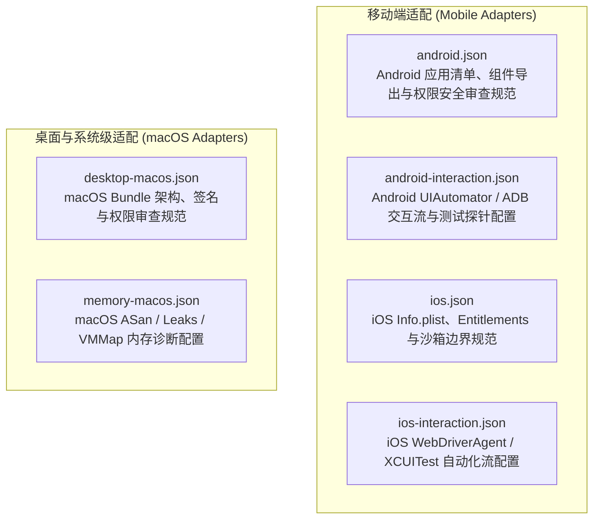

# BugX Mobile & Platform Adapters (多端原生适配配置资产)

`core/adapters/` 包含了 BugX 针对移动端（Android / iOS）及桌面端（macOS）原生应用的深度交互、权限配置、内存检测与逆向审查适配器配置。

---

## 1. 适配矩阵 (Platform Adapters)

---

## 2. 配置文件物理索引与职责清单 (File Inventory)

| 配置文件 | 目标平台 | 核心审查与交互能力 |
| :--- | :--- | :--- |
| `android.json` | Android 原生 | 检查 AndroidManifest.xml 导出组件（Activity/Service/Provider）、权限过度声明、网络明文传输配置 |
| `android-interaction.json` | Android 自动化 | 定义 ADB 截图、点击、输入与无障碍树解析行为，支持真机/模拟器交互攻防 |
| `desktop-macos.json` | macOS 桌面 | 检查 macOS App 沙箱（Sandbox）、硬化运行时（Hardened Runtime）、动态库注入防御 |
| `ios.json` | iOS 原生 | 检查 ATS 策略、URL Schemes 劫持、KeyChain 共享组、Info.plist 敏感隐私权限请求 |
| `ios-interaction.json` | iOS 自动化 | 定义 XCUITest / IDB 自动化驱动协议，支持 iOS 真机/模拟器界面的深度探索 |
| `memory-macos.json` | macOS 诊断 | 配合 macOS 系统的 `leaks`、`vmmap`、`malloc_history` 执行底层内存泄漏与越界分析 |
