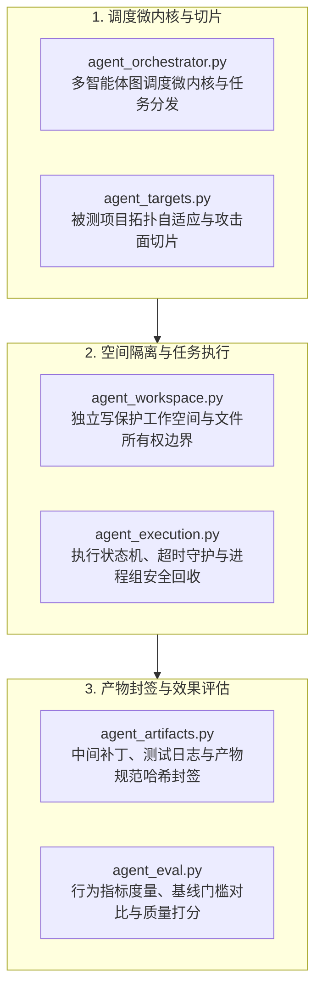

# BugX Agent Engine (智能体编排与工作区领域子系统)

`core/agent/` 收拢与自主智能体（Agent）生命周期直接相关的核心能力，包括多 Agent 协作调度微内核、任务执行状态机与进程回收、独立工作空间隔离、攻击面切片与效果评估打分体系。

---

## 1. 架构拓扑与生命周期 (Agent Lifecycle & Architecture)

---

## 2. 模块文件物理索引与职责清单 (File Inventory)

| 文件名 | 职责与功能定位 | 关键类 / 函数 |
| :--- | :--- | :--- |
| `__init__.py` | 智能体领域子包入口与核心符号导出 | `AgentOrchestrator`, `AgentWorkspace`, `AgentArtifact` |
| `agent_artifacts.py` | 统一管理 Worker 生成的中间补丁、测试日志与证据文件规范与哈希封签 | `AgentArtifact`, `BugCandidate`, `ReproCase`, `PatchCandidate`, `seal_artifact` |
| `agent_eval.py` | 对 Agent 执行输出进行一致性度量与质量评估打分 | `score`, `validate_cases`, `validate_findings`, `metrics_record` |
| `agent_execution.py` | Agent 执行管道，驱动任务状态机并在超时时安全回收子进程组 | `execute_check_plan`, `CheckPlan`, `ExecutionObservation` |
| `agent_orchestrator.py` | 多 Agent 协作调度微内核，负责任务拆解、拓扑依赖与工作分配 | `AgentOrchestrator`, `assemble_task_prompt` |
| `agent_targets.py` | 被测代码库攻击面切片与多 Worker 并发分配算法 | `adapt_project`, `adapt_python_project`, `adapt_node_project` |
| `agent_workspace.py` | 为每个自主 Agent 构建独立且受限的文件系统工作空间 | `AgentWorkspace`, `TargetDriftError`, `OriginWriteViolationError` |

---

## 3. 核心设计契约与公理 (Design Axioms)

1. **写保护与零越界公理**：`agent_workspace.py` 必须严格约束 Worker 只能修改被分配的分片与测试用例，绝对禁止侵入工作区外的敏感系统路径与父会话状态。
2. **进程组彻底回收公理**：`agent_execution.py` 在任务超时或异常终止时，必须在独立 POSIX session / Windows Job Object 中对整棵进程树执行可靠回收，杜绝悬挂孤儿进程。
3. **产物确定性封签公理**：`agent_artifacts.py` 生成的候选 Bug、PoC 与 Patch 必须通过规范化 JSON 序列化与 SHA-256 摘要封签，确保跨环境比对可重现。
