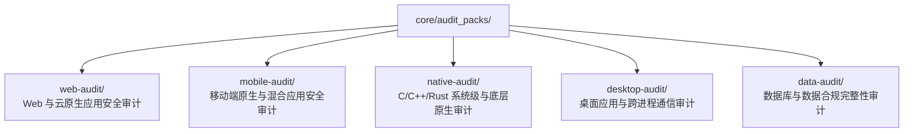

# BugX Domain Audit Packs (领域级攻防规则包)

`core/audit_packs/` 封装了针对不同应用形态与技术领域的开箱即用审计规则包（Audit Packs）。每个规则包均包含声明清单（`manifest.json`）与分阶段攻防指导规范（`stages/` 及 `modules/`）。

---

## 1. 规则包拓扑矩阵 (Pack Matrix)

---

## 2. 规则包物理索引与职责清单 (Inventory)

| 规则包名称 | 适用领域与场景 | 核心攻防阶段与模块 |
| :--- | :--- | :--- |
| `web-audit` | Web 应用程序、REST/GraphQL API、云原生服务 | 发现 (`10-discovery`)、认证会话 (`20-auth-session`)、越权与业务逻辑 (`30-authz-business`)、输入过滤 (`40-input-output`)、异步状态 (`50-state-async`)、SSRF/反序列化 (`60-file-ssrf-deser`)、依赖供应链 (`70-config-dependency`)、回归证据 (`80-evidence-regression`) |
| `mobile-audit` | Android / iOS 原生应用、React Native、Flutter、微信小程序、H5/WebView | 平台盘点 (`10-platform-inventory`)、MASVS 静态扫描 (`20-masvs-static`)、组件暴露与意图劫持 (`30-component-exposure`)、设备交互与动态行为 (`40-device-behavior`) |
| `native-audit` | C / C++ / Rust / Go 系统级服务、驱动、高性能组件 | 白盒静态分析 (`10-static-white-box`)、内存与并发竞争 (`20-memory-concurrency`)、黑盒模糊测试 (`30-behavior-black-box`)、回归测试 (`80-evidence-regression`) |
| `desktop-audit` | Electron / Tauri / macOS Cocoa / Windows 原生桌面应用 | 进程通信模型 (`10-process-model`)、打包签名与分发完整性 (`20-package-integrity`)、UI 行为与剪贴板权限 (`30-ui-behavior`) |
| `data-audit` | SQL/NoSQL 数据库模型、数据流水线、合规性脱敏 | 数据表与 Schema 盘点 (`10-schema-inventory`)、查询优化与注入漏洞 (`20-query-and-integrity`)、回溯验证 (`80-evidence-regression`) |
| `platform-testing.md` | 桌面端与移动端测试核心规则 | 跨平台多目标（Electron/Android/iOS/Flutter/Web）审计前置、平台预检通道与验证矩阵 |
| `memory-testing.md` | 应用软件内存审计核心规约 | 针对内存泄漏、持续增长、OOM、越界访问、Use-After-Free 的针对性工作负载与证据规则 |

---

## 3. 规范要求

- **阶段性流转**：执行各规则包时，Worker 必须严格按 `stages` 从 `00-scope` 按序推进至 `80-evidence-regression`，严禁跨越阶段产生虚假断言。
