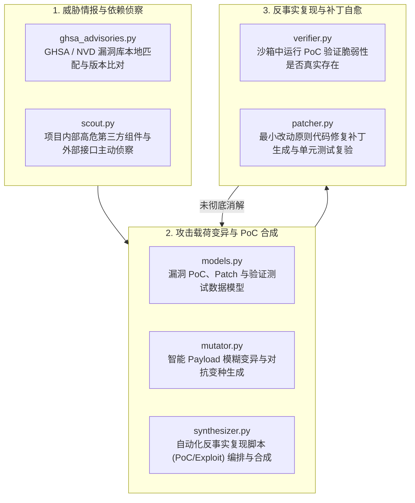

# BugX Autonomous CVE (自主脆弱性发现与漏洞修复引擎)

`core/autonomous_cve/` 是 BugX 针对已知与未知 CVE/GHSA 漏洞开展自主探索、对抗变异、自动化 PoC 合成与修复补丁生成的专用攻防子引擎。

---

## 1. 架构拓扑与攻防循环 (Autonomous CVE Lifecycle)

---

## 2. 模块文件物理索引与职责清单 (File Inventory)

| 文件名 | 职责与功能定位 | 关键类 / 函数 |
| :--- | :--- | :--- |
| `__init__.py` | Python 包初始化与核心模块符号导出 | `__all__` |
| `attack_graph.py` | 动态多跳攻击图谱状态机，跟踪攻击路径与前提/后置条件推演 | `LivingAttackGraph`, `StreamingEventBus` |
| `attack_graph_store.py` | 攻击图谱快照持久化、增量更新与磁盘存储 | `AttackGraphStoreError`, `graph_dir` |
| `audit_campaign.py` | 多阶段漏洞战役编排器，协调探测、复现与验证生命周期 | `CampaignError`, `validate_campaign` |
| `behavior_graph.py` | 基于动态执行轨迹与静态调用的程序行为图分析器 | `BehaviorGraphError`, `build_behavior_graph` |
| `ghsa_advisories.py` | GitHub Security Advisories 与开源 CVE 规则库离线索引与版本匹配器 | `GHSAAdvisoryMatcher` |
| `INTERFACE.md` | 自主攻防引擎外部调用契约，定义输入配置与产物规范 | 漏洞接口契约 |
| `models.py` | 漏洞实体、PoC 脚本、变异载荷与补丁元数据强类型数据模型 | `CVEFinding`, `PatchCandidate` |
| `mutator.py` | 语法树与数据流驱动的模糊变异器，自动探索绕过防御机制的边界用例 | `PayloadMutator` |
| `patcher.py` | 自动化安全修复补丁生成器，遵循最小影响面与防御性编码公理 | `SecurityPatcher` |
| `scout.py` | 攻击面侦察器，自动分析路由、网络输入点与不安全反序列化点 | `CVEScout` |
| `SPEC.md` | 自动化 CVE 挖掘与验证的技术规格书 | 攻防模型与规范说明 |
| `synthesizer.py` | PoC 可执行测试用例合成器，将抽象漏洞描述转化为自动化验证脚本 | `PoCSynthesizer` |
| `verifier.py` | 物理级反事实验证器，在隔离沙箱中执行 PoC 并断言漏洞复现与修复消解 | `PoCVerifier` |

---

## 3. 核心设计契约与公理 (Design Axioms)

1. **反事实证据闭环公理**：漏洞判定必须满足两阶段验证：补丁前 PoC 必定失败/崩溃（证明漏洞存在）；打入补丁后 PoC 必定通过且原有业务测试不退化（证明修复有效）。
2. **零引入新安全风险**：`patcher.py` 生成的补丁严禁引入未经授权的新第三方依赖，严禁使用粗暴的吞噬异常（`except: pass`）作为假性修复。
