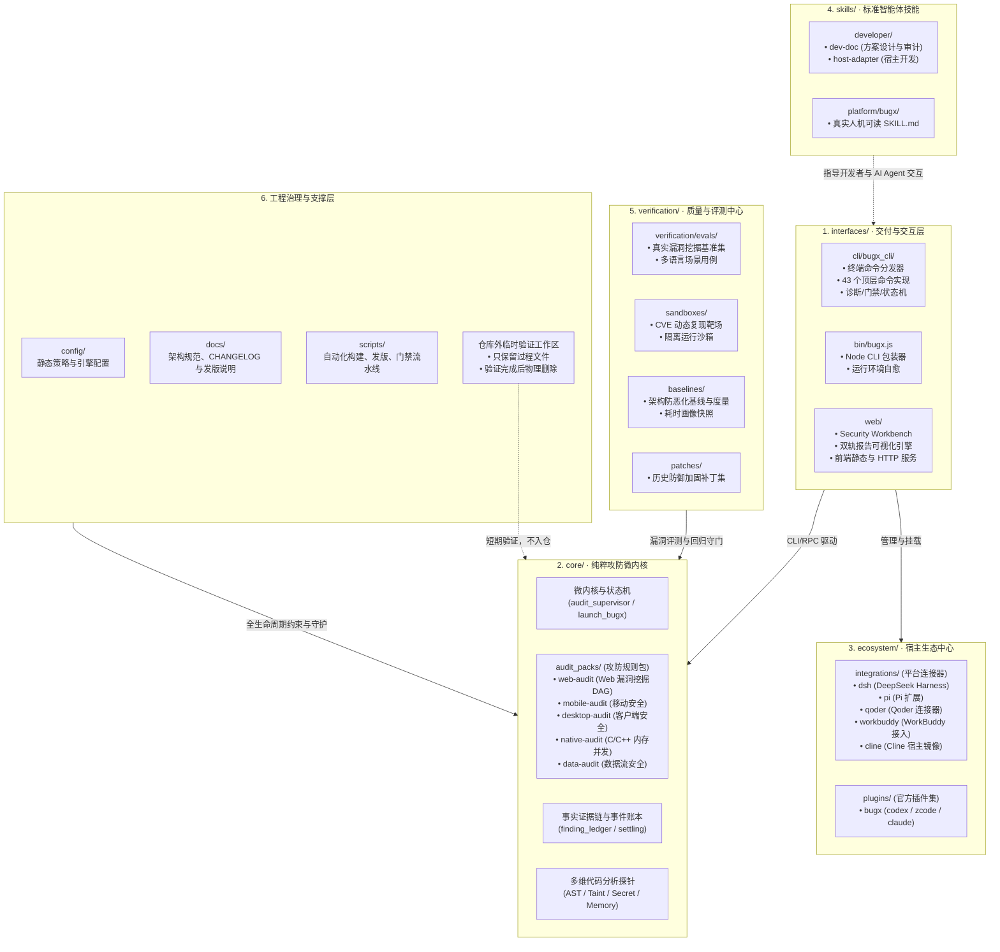

# 全域全景架构与权威目录拓扑 (System Architecture & Repository Topology)

> **文档编号**: `DOC-TOPOLOGY` | **基线版本**: `0.1.4` | **更新日期**: 2026-11-25
> **文档定位**: Diátaxis - Explanation (工程拓扑、架构正交性与目录层级权威白皮书)  
> **关联规范**: ``docs/02_architecture/01_ARCHITECTURE.md`` (`docs/02_architecture/01_ARCHITECTURE.md`) (系统高层架构设计), ``docs/02_architecture/02_DESIGN_SPEC.md`` (`docs/02_architecture/02_DESIGN_SPEC.md`) (设计规约总账), ``AGENTS.md`` (`AGENTS.md`) (工程开发宪法)

---

## 🏛️ 一、 架构设计哲学：六大正交领域模型 (Hexagonal Domain Architecture)

针对历史迭代中产生的概念实体混淆、界面与生态割裂、评测靶场漫延等深层结构病灶，BugX 遵循现代六边形微内核架构（Hexagonal Microkernel Architecture）与清晰架构（Clean Architecture）的第一性原理，确立了**面向人类直觉自解释与机器严密正交的六大顶级领域**：



---

## 🌲 二、 权威全景目录层级树 (Directory Hierarchy)

```text
bug-hunter/
├── 1. interfaces/                 # ★【交付与交互层】所有人机与终端呈现交互逻辑 (详情见 interfaces/README.md)
│   ├── cli/                      #   - 统一命令行界面与命令分发树 (interfaces/cli/README.md)
│   ├── bin/                      #   - Node CLI 跨平台包装器 (interfaces/bin/README.md)
│   └── web/                      #   - 统一可视化控制台与报告系统 (interfaces/web/README.md)
│
├── 2. core/                       # ★【纯粹攻防微内核】核心调度、状态机与攻防规则，零前端生态杂质 (core/README.md)
│   ├── launch_phases/            #   - 审计生命周期流水线 (core/launch_phases/README.md)
│   ├── supervisor/               #   - 并发协调与智能体调度中心 (core/supervisor/README.md)
│   ├── hosts/                    #   - 多宿主 AI 插件适配层 (core/hosts/README.md)
│   ├── host_runtime/             #   - 宿主运行时与自主执行引擎 (core/host_runtime/README.md)
│   ├── host_acp/                 #   - ACP 宿主协议适配层 (core/host_acp/README.md)
│   ├── ledger/                   #   - 攻防复盘账本与错题经验库 (core/ledger/README.md)
│   ├── webui/                    #   - 内置攻防工作台与实时大屏服务 (core/webui/README.md)
│   ├── project_profiler/         #   - 目标代码画像与技术栈自动探测 (core/project_profiler/README.md)
│   ├── mcp_handlers/             #   - MCP RPC 服务端与工具分发 (core/mcp_handlers/README.md)
│   ├── report_engine/            #   - 攻防成果与漏洞报告生成引擎 (core/report_engine/README.md)
│   ├── retrieval/                #   - 代码切片、拓扑与混合检索增强 (core/retrieval/README.md)
│   ├── autonomous_cve/           #   - 自主脆弱性发现与修复引擎 (core/autonomous_cve/README.md)
│   ├── seed_corpus/              #   - 多语言攻防高危模式种子语料库 (core/seed_corpus/README.md)
│   ├── adapters/                 #   - 移动端与多平台原生交互配置 (core/adapters/README.md)
│   ├── assets/                   #   - 官方品牌视觉与图形资产 (core/assets/README.md)
│   ├── audit_packs/              #   - 领域级攻防规则包 (core/audit_packs/README.md)
│   ├── dev_harness/              #   - 开发与测试桩运行夹具 (core/dev_harness/README.md)
│   ├── locales/                  #   - 多语言国际化文案字典 (core/locales/README.md)
│   ├── mcp_runtime_support/      #   - MCP 运行时支撑工具库 (core/mcp_runtime_support/README.md)
│   ├── probes/                   #   - 多形态目标运行时探针 (core/probes/README.md)
│   ├── prompts/                  #   - 提示词体系与对抗防御规则 (core/prompts/README.md)
│   ├── rules/                    #   - 静态安全分析与攻防规则集 (core/rules/README.md)
│   ├── schemas/                  #   - 核心数据契约与 JSON Schema (core/schemas/README.md)
│   ├── supervisor_types/         #   - 协调层强类型定义与类型守护 (core/supervisor_types/README.md)
│   └── cloud_sync/               #   - 云端飞轮协同与跨端知识同步 (core/cloud_sync/README.md)
│
├── 3. ecosystem/                  # ★【宿主生态中心】一站式管理所有第三方 AI 平台接入 (ecosystem/README.md)
│   ├── integrations/             #   - 宿主与平台连接工程 (ecosystem/integrations/README.md)
│   └── plugins/                  #   - 各宿主官方插件发布包 (ecosystem/plugins/README.md)
│
├── 4. skills/                     # ★【标准 Agent 技能库】给人与 AI 助手阅读的标准 SKILL.md
│   ├── developer/                #   - 面向开发者的工程技能（dev-doc, host-adapter, directory-governance 等）
│   └── platform/bugx/            #   - BugX 平台通用自主审查技能
│
├── 5. verification/               # ★【质量与评测中心】统一管理基准评测、靶场与基线
│   ├── evals/                    #   - 真实漏洞挖掘评测套件与场景案例
│   ├── sandboxes/                #   - CVE 复现动态沙箱与运行时靶场
│   ├── baselines/                #   - 架构防恶化基线与耗时画像快照
│   └── patches/                  #   - 历史攻防验证补丁集
│
├── 6. 工程支撑层 (标准工程规范)
│   ├── config/                   # ★【静态配置中心】系统策略、引擎完整性与注册表配置
│   ├── docs/                     # ★【文档与自述中心】系统设计、CHANGELOG、多语言与发版自述
│   ├── scripts/                  # ★【自动化流水线】构建、打包、发版与质量门禁脚本 (scripts/README.md)
│   └── （仓库外临时验证工作区）   # ★【过程文件】验证完成后物理删除，不进入 Git
│
└── 7. 根目录法定受控非隐藏清单 (严格仅保留 7 项，杜绝任何杂乱碎屑)
    ├── pyproject.toml            #   - Python 项目与打包配置
    ├── package.json              #   - Node 项目与包装器配置 (已内联 files 白名单)
    ├── Jenkinsfile               #   - 自动化 CI/CD 流水线声明
    ├── MANIFEST.in               #   - Python 发版清单
    ├── AGENTS.md                 #   - 全局智能体开发宪法与行为约束
    ├── LICENSE                   #   - 开源许可证 (BSL-1.1)
    └── README.md                 #   - ★ 唯一且权威的项目主自述
```

---

## 🔍 三、 领域职责边界与接口规约

### 1. 交付与交互层 (`interfaces/`)
- **定位**：对外沟通的门户与壳层，负责命令行解析、跨语言环境适配与可视化报表呈现。
- **边界约束**：
  - 严禁在 `interfaces/` 中实现底层的漏洞挖掘、符号解析或状态机推进算法；
  - 统一通过 `interfaces/cli/bugx_cli/infra/security.py` 的动态解析器 `_find_repo_root()` 定位引擎资源。

### 2. 纯粹攻防微内核 (`core/`)
- **定位**：漏洞挖掘引擎的大脑与状态机中心。
- **正名规范**：将过去混淆命名为 `skills/` 的攻防知识库物理正名为 **`core/audit_packs/`**（包含 `web-audit`, `mobile-audit`, `desktop-audit`, `native-audit`, `data-audit` 5 大攻击规则集），从概念上彻底消除与外部 Agent Skill 的命名冲突。
- **边界约束**：彻底剥离任何 HTML/CSS/JS 静态资产或宿主私有代码。

### 3. 宿主生态中心 (`ecosystem/`)
- **定位**：一站式收敛第三方 AI 平台接入。
- **集成矩阵**：
  - `ecosystem/integrations/`：宿主深度连接器（如 DSH 原生 UI、Pi 扩展、WorkBuddy 插件、Cline 镜像等）；
  - `ecosystem/plugins/`：遵循各宿主规范打包的插件发布物（Codex 插件、ZCode 插件、Claude Code 插件等）；
- **边界约束**：严禁在仓库根目录下为单个宿主保留私货点目录（如 `.cline/`, `.dsh/`, `.zcode/` 已彻底清零）。

### 4. 标准智能体技能 (`skills/`)
- **定位**：供人类开发者与 AI 编程助手直接查阅和调用的标准 Prompt 与操作规范（带 YAML Frontmatter 的标准 `SKILL.md`）。
- **细分**：
  - `skills/developer/`：面向项目开发者的工程规范 Skill（如 `dev-doc`, `host-adapter`）；
  - `skills/platform/bugx/`：BugX 平台对外统一呈现的核心自主审查技能。

### 5. 质量与评测中心 (`verification/`)
- **定位**：工程质量、模型能力与漏洞挖掘有效性的证伪防御体系。
- **资产构成**：
  - `evals/`：真实攻防 Benchmark 评测集与典型 PoC 用例（物理路径为 `verification/evals/`）；
  - `sandboxes/`：CVE 漏洞复现沙箱靶场；
  - `baselines/`：耗时画像与防恶化架构基线（`arch-baseline.json`）；
  - `patches/`：已验证的历史修复补丁。

---

## 📋 四、 根目录物理纯洁性宪法

根目录下严格执行**法定白名单原则**，严禁任何未授权文件长期滞留：

1. **法定 7 项非隐藏文件**：
   - 包管理与工程构建：`pyproject.toml`, `package.json`, `MANIFEST.in`, `Jenkinsfile`；
   - 规范、法务与主自述：`AGENTS.md`, `LICENSE`, `README.md`。
2. **法定 3 项隐藏环境文件**：
   - `.gitignore`（唯一 Git 忽略配置）；
   - `.nvmrc`（Node 24 运行时声明）；
   - `.python-version`（Python 3.14.6 运行时声明）。
3. **彻底绝迹的违规杂质**：
   - 严禁任何本地测试产生的隐藏目录（`.pytest_cache`, `.ruff_cache`, `.idea`, `.bugx`）提交进版本库；
   - 严禁任何多语言或发版专用 README 平铺在根目录（已全部归档至 `docs/` 与 `docs/07_distribution/`）；
   - 严禁任何临时测试碎片（如 `.bugx-project.json`, `chk_req.json`, `ev*.json`）。
