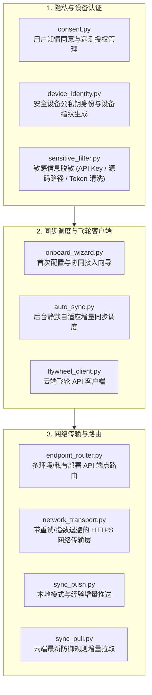

# BugX Cloud Sync (云端飞轮协同与跨端知识同步)

`core/cloud_sync/` 负责 BugX 攻防知识经验、匿名对抗模式与安全规则与 BugX 云端飞轮（Flywheel）的双向安全同步。它内置严格的知情同意、敏感凭据脱敏以及设备指纹认证机制。

---

## 1. 架构拓扑与同步时序 (Sync Flow)

---

## 2. 模块文件物理索引与职责清单 (File Inventory)

| 文件名 | 职责与功能定位 | 关键类 / 函数 |
| :--- | :--- | :--- |
| `__init__.py` | Python 包初始化与核心模块符号导出 | `__all__` |
| `auto_sync.py` | 自动化增量同步引擎，在会话结算后触发非阻塞后台同步 | `AutoSyncCoordinator` |
| `cloud_client.py` | 云端 OpenAPI 客户端，封装鉴权请求、协议序列化与异常转换 | `CloudClient`, `CloudClientError` |
| `cloud_onboard.py` | 云端入网注册与登录控制器，处理授权状态与凭据绑定 | `onboard_project`, `CloudOnboardError` |
| `cloud_schema.py` | 云端交互数据 Schema 强类型定义与结构校验器 | `validate_cloud_payload` |
| `consent.py` | 隐私授权与合规授权控制器，记录并验证用户是否明确同意同步 | `ConsentManager` |
| `device_identity.py` | 设备身份签名器，生成 ED25519 密钥对并管理全局唯一匿名设备 ID | `DeviceIdentity` |
| `endpoint_router.py` | 云端服务端点动态路由器，支持公有云与企业私有化部署地址切换 | `EndpointRouter` |
| `flywheel_client.py` | 飞轮系统业务客户端，封装模式上报、规则拉取与认证刷新 | `FlywheelClient` |
| `INTERFACE.md` | 云同步子系统对外部提供的标准 API 接口与传输模型契约 | 同步接口契约说明 |
| `network_transport.py` | 高可靠 HTTP/REST 网络传输层，支持 TLS 证书校验与重试熔断 | `NetworkTransport` |
| `onboard_wizard.py` | 终端交互式入网向导，引导用户完成授权同意与凭据配置 | `OnboardWizard` |
| `sensitive_filter.py` | 敏感信息过滤器，物理级扫描并剥离 API Key、私人绝对路径与敏感代码 | `SensitiveDataFilter` |
| `SPEC.md` | 云端数据同步架构与安全加密设计规范文档 | 加密与脱敏规范 |
| `sync_pull.py` | 增量拉取操作器，下载云端最新提炼的攻击特征与防御模式并合入本地 | `pull_cloud_updates` |
| `sync_push.py` | 增量推送操作器，将本地脱敏后的成功防御经验加密推送至飞轮系统 | `push_local_lessons` |

---

## 3. 核心设计契约与公理 (Design Axioms)

1. **知情同意绝对先验 (Explicit Consent First)**：未经用户通过 `consent.py` 显式确认授权，严禁任何网络请求向公网外发数据。
2. **源码物理零外发**：`sensitive_filter.py` 确保向云端推送的仅为抽象后的抽象语法模式与规则签名，严禁任何被测仓库的原生源代码落入上报报文。
