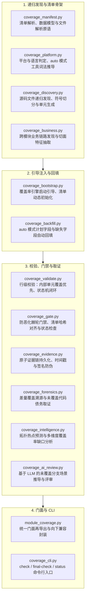

# BugX Coverage Engine (代码覆盖度量、证据链与分析引擎)

`core/coverage/` 构成了 BugX 针对被测工程的“全覆盖外部门禁”与分析能力核心。它不轻信 Agent 口头自报，而是通过机械可验证的最小审计单元递归发现、业务逻辑链路提取、防伪证据链校验、防恶化棘轮门禁、AI覆盖复核以及跨语言平台适配，实现真实可审计的代码攻防覆盖闭环。

---

## 1. 架构拓扑与覆盖生命周期 (Coverage Lifecycle Flow)

---

## 2. 模块文件物理索引与职责清单 (File Inventory)

| 文件名 | 职责与功能定位 | 关键类 / 函数 |
| :--- | :--- | :--- |
| `__init__.py` | Python 包初始化与核心模块符号导出 | `__all__` |
| `coverage_ai_review.py` | 利用大模型分析未覆盖逻辑，推导潜在漏洞场景与复核评审 | `apply_verdicts`, `write_review_packages` |
| `coverage_backfill.py` | 自动补齐历史测试未覆盖区域，在 auto 模式下诚实回填计划字段 | `auto_backfill_rows` |
| `coverage_bootstrap.py` | 覆盖率引擎启动引导，动态注入探针与追踪拦截器，初始化两阶段清单 | `CoverageBootstrapError`, `bootstrap`, `inspect` |
| `coverage_business.py` | 业务覆盖率分析，抽取特征面与跨模块业务逻辑链路 | `business_discovery`, `extract_feature_surface` |
| `coverage_cli.py` | 覆盖率分析 CLI 子命令封装（`check`, `final-check`, `status`, `suggest_hits`） | `main`, `check`, `status` |
| `coverage_discovery.py` | 运行时动态发现新加载模块与代码执行路径，递归枚举源码并生成最小单元清单 | `discover_minimum_unit_paths`, `discovery_rows` |
| `coverage_evidence.py` | 收集并打包覆盖率证据链，管理证据存储库，附加时间戳与 SHA-256 签名 | `EvidenceStore`, `attach_attack_graph_snapshot` |
| `coverage_forensics.py` | 差量覆盖率溯源，准确定位未被测试触达的薄弱分支与代码覆盖债务 | `converge_forensics`, `coverage_debt_units` |
| `coverage_gate.py` | 覆盖率防恶化棘轮门禁，阻止测试覆盖率指标倒退并校验清单哈希 | `manifest_gate_errors`, `startup_gate_errors` |
| `coverage_intelligence.py` | 基于代码历史与缺陷分布智能预测重点测试覆盖区，归一化多维覆盖缺口 | `CoverageError`, `coverage_gaps`, `merge_reports` |
| `coverage_manifest.py` | 覆盖率清单数据模型与解析原语，记录被测源文件清单、插桩行号与排除项 | `ModuleRow`, `parse_manifest`, `default_manifest_for_root` |
| `coverage_platform.py` | 屏蔽各语言平台（Python, Go, JS 等）底层覆盖率工具差异，推导 auto 工具 | `unit_platform`, `host_platform`, `derive_auto_tool` |
| `coverage_validate.py` | 校验覆盖率报告数据完整性，强制内部单元覆盖优先于跨模块业务阶段 | `validate_rows`, `internal_scope_errors` |
| `module_coverage.py` | 模块统计与外部门禁统一门面，汇集各簇叶子模块能力 | `discover_minimum_unit_paths`, `check`, `main` |

---

## 3. 核心设计契约与公理 (Design Axioms)

1. **先内部后业务**：必须先把全部「内部」最小单元标为已覆盖，才能进入「业务」阶段的跨模块数据流/状态流审计。
2. **证据闭环不相信口头自报**：覆盖清单中的每一条已覆盖记录必须绑定由真实测试或独立执行产出的证据文件与哈希签名，防清单造假。
3. **单向无环分层**：叶子模块之间严格保持单向向下依赖拓扑（platform ← discovery/backfill ← business ← validate ← gate ← cli ← module_coverage），杜绝回边。
