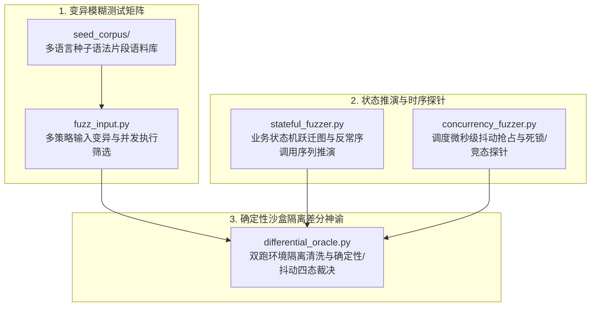

# BugX Fuzzing & Differential Oracle (模糊测试与差分预言机引擎)

`core/fuzzing/` 是 BugX 核心引擎中负责动态变异、业务状态机序列推演、并发竞态时序探测与确定性沙盒隔离双跑差分验证的专用领域子系统。

---

## 1. 架构拓扑与执行流水线 (Fuzzing & Oracle Pipeline)

---

## 2. 模块文件物理索引与职责清单 (File Inventory)

| 文件名 | 职责与功能定位 | 关键类 / 函数 |
| :--- | :--- | :--- |
| `__init__.py` | Python 包初始化与核心模块符号导出 | `__all__` |
| `concurrency_fuzzer.py` | 并发竞态与异步时序死锁专项探针，模拟高并发与微秒级抢占窗口 | `ConcurrencyOracle`, `SchedulePerturber`, `fuzz_command` |
| `differential_oracle.py` | 确定性沙盒隔离双跑差分验证器，消除环境假阳性与偶发抖动 | `DifferentialOracleError`, `verify_poc`, `verify_differential_poc` |
| `fuzz_input.py` | 变异模糊测试矩阵工具，智能变异输入载荷并并发批量筛查异常样本 | `mutate`, `fuzz_target`, `fuzz_once`, `shell_argv` |
| `stateful_fuzzer.py` | 基于状态机跃迁拓扑的有状态序列突变推演器，捕获越权与业务逻辑违规 | `StatefulOracle`, `StatefulSequenceGenerator`, `Transition` |

---

## 3. 核心设计契约与公理 (Design Axioms)

1. **确定性双跑差分公理**：针对可疑异常 Finding，必须在两个完全独立的隔离临时沙盒中完成两次独立双跑复验。剥离 PID、内存地址（0x...）与时间戳等噪音后，两次运行一致崩溃才裁决为真实缺陷（`CONFIRMED_DETERMINISTIC`），避免环境假阳性与偶发抖动污染账本。
2. **微秒级抢占时序控制**：`concurrency_fuzzer.py` 通过精细的线程上下文切换间隔（`sys.setswitchinterval`）进行调度时序扰动，放大 TOCTOU 与竞态条件窗口，但执行结束必须确保恢复原始切换间隔与清理非 daemon 线程。
3. **输入边界防御**：`fuzz_input.py` 对待变异目标路径执行受控边界校验（`read_confined_bytes`），严禁跨工作区任意文件读取。
