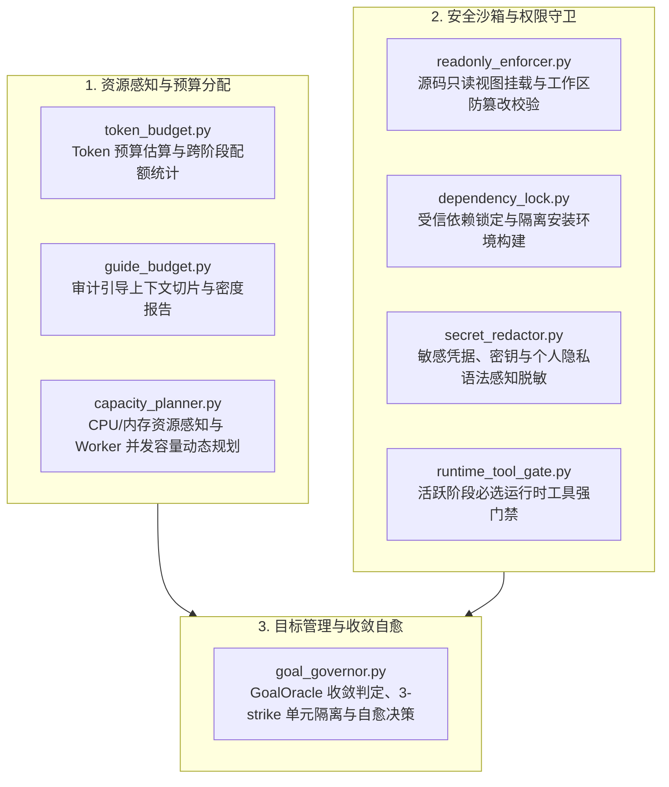

# BugX Governance Engine (核心预算、容量规划与治理守卫子系统)

`core/governance/` 构成了 BugX 运行时的资源管控、并发规划与安全隔离治理能力，确保在大规模代码审计与对抗验证过程中系统稳定、资源可控、权限收敛且敏感信息零泄露。

---

## 1. 架构拓扑与治理流向 (Governance Topology)

---

## 2. 模块文件物理索引与职责清单 (File Inventory)

| 文件名 | 职责与功能定位 | 关键类 / 函数 |
| :--- | :--- | :--- |
| `__init__.py` | Python 包初始化与治理领域核心类及函数导出 | `__all__` |
| `capacity_planner.py` | 系统硬件资源（CPU、内存）感知与 Worker 最优并发容量规划 | `effective_worker_concurrency` |
| `dependency_lock.py` | 依赖锁定文件解析、受信哈希校验与隔离 pip 安装环境构建 | `install_locked`, `load_trusted_lock`, `sanitized_pip_env` |
| `goal_governor.py` | 审计目标完成度（GoalOracle）判定、故障分类、3-strike 坏单元隔离与自愈控制器 | `GoalOracle`, `GoalSpec`, `QuarantineManager`, `SelfHealingController` |
| `guide_budget.py` | 知识与规范切片上下文预算守卫、模态密度分析与合规性检查 | `slice_guide_context`, `recommend_budget`, `check_budget_compliance` |
| `readonly_enforcer.py` | 被测项目源码只读安全挂载与多点快照对比，严防审计流程污染源工程 | `snapshot_source_state`, `verify_untouched`, `prepare_readonly_view` |
| `runtime_tool_gate.py` | 运行期工具可用性强校验，确保当前活跃阶段所需的工具集就绪 | `required_tool_ids_for_active_stages`, `enforce_required_runtime_tools` |
| `secret_redactor.py` | 敏感 Token、API Key、身份证、银行卡等高危数据语法与正则脱敏引擎 | `SecretRedactor`, `redact_text`, `redact_payload`, `contains_unredacted_secrets` |
| `token_budget.py` | 基于启发式规则与字符密度的 Token 消耗估算与多阶段配额台账 | `estimate_tokens`, `budget_summary` |
| `lockdown.sh` | 敏感工作区权限锁死 (chmod 0700/0600) 与应急环境加固脚本 | `chmod 0700` |

---

## 3. 核心设计契约与公理 (Design Axioms)

1. **零污染与零泄露 (Zero Pollution & Zero Leakage)**：
   - 审计过程对源工程实行只读约束 (`readonly_enforcer.py`)，禁止任何破坏性写入；
   - 所有输出证据、控制台日志与持久化记录必须经过脱敏引擎 (`secret_redactor.py`) 净化，严防敏感凭据外溢。
2. **闭环收敛与弹性自愈 (Closed Convergence & Self-Healing)**：
   - 目标执行由 `goal_governor.py` 的 `GoalOracle` 进行数学级收敛判定；
   - 遭遇坏单元或反复失败时启动 3-strike 隔离机制与自愈重试，保证长程自主任务不卡死。
3. **资源守恒与动态弹性 (Resource Conservation & Dynamic Elasticity)**：
   - `capacity_planner.py` 动态适配宿主机算力，避免并发雪崩；
   - `token_budget.py` 与 `guide_budget.py` 严格限制 Prompt 膨胀，确保上下文窗口始终处于最高信噪比区间。
