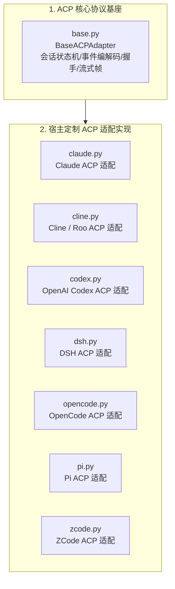

# BugX Host ACP (Agent Client Protocol 宿主协议适配层)

`core/host_acp/` 实现了对 Agent Client Protocol (ACP) 协议规范的标准支持与扩展，负责将 BugX 的攻防任务、上下文及 Worker 调度包装为通用的 ACP 会话协议，赋能各类兼容 ACP 的宿主客户端。

---

## 1. 架构拓扑与协议流转 (ACP Protocol Flow)

---

## 2. 模块文件物理索引与职责清单 (File Inventory)

| 文件名 | 职责与功能定位 | 关键类 / 函数 |
| :--- | :--- | :--- |
| `__init__.py` | Python 包初始化与核心模块符号导出 | `__all__` |
| `base.py` | ACP 协议抽象基座，实现客户端/服务端双向通信握手、消息编解码与心跳保活 | `BaseACPAdapter` |
| `claude.py` | Claude 系列宿主的 ACP 扩展适配，处理专属会话流与认证注入 | `ClaudeACPAdapter` |
| `cline.py` | Cline 宿主的 ACP 扩展适配，对接 VS Code 扩展通信通道 | `ClineACPAdapter` |
| `codex.py` | OpenAI Codex 智能体的 ACP 扩展适配，支持任务流分发与上下文刷新 | `CodexACPAdapter` |
| `dsh.py` | DSH 环境的 ACP 协议实现，支持 Shell 会话双向流转 | `DshACPAdapter` |
| `INTERFACE.md` | ACP 接口契约说明文档，定义数据帧与错误码 | 协议格式定义 |
| `opencode.py` | OpenCode 标准 ACP 协议实现，处理通用智能体事件通道 | `OpenCodeACPAdapter` |
| `pi.py` | Pi 智能体 ACP 协议实现，支持轻量级边缘环境适配 | `PiACPAdapter` |
| `SPEC.md` | ACP 架构设计规范与长连接稳定性保障标准 | 规范与重连策略 |
| `zcode.py` | ZCode 平台专属 ACP 协议实现，满足高安全内网环境合规需求 | `ZCodeACPAdapter` |

---

## 3. 核心设计契约与公理 (Design Axioms)

1. **协议向前兼容与降级**：当宿主不支持高阶 ACP 协议帧时，`base.py` 必须提供标准 JSON-RPC 降级回退机制，确保命令不中断。
2. **幂等握手与断线重连**：所有 ACP 客户端实现均具备会话 Session ID 恢复能力，网络波动发生时无缝重连并恢复检查点。
