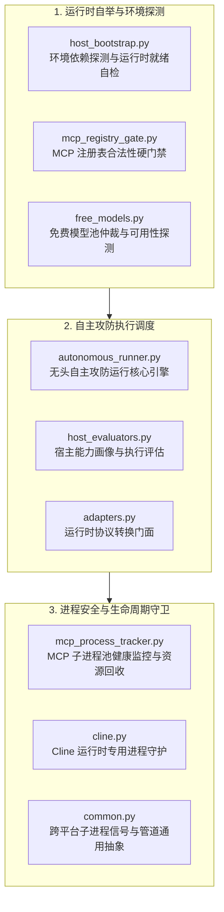

# BugX Host Runtime (宿主运行时与自主执行器引擎)

`core/host_runtime/` 提供了宿主在无头（Headless）与自主（Autonomous）执行场景下的底层运行基础设施。它负责智能体子进程拉起、免费模型仲裁与轮换、MCP 进程追踪、环境评估与启动自举。

---

## 1. 架构拓扑与交互时序 (Host Runtime Flow)

---

## 2. 模块文件物理索引与职责清单 (File Inventory)

| 文件名 | 职责与功能定位 | 关键类 / 函数 |
| :--- | :--- | :--- |
| `__init__.py` | Python 包初始化与核心模块符号导出 | `__all__` |
| `adapters.py` | 宿主运行时适配器转接层，抹平不同宿主在 CLI / API 交互上的协议差异 | `RuntimeAdapterFactory` |
| `autonomous_runner.py` | 自主攻防运行器主干，驱动无头环境下的全自动循环（Pre $\rightarrow$ Run $\rightarrow$ Post） | `AutonomousRunner` |
| `cline.py` | Cline / Roo Code 运行时特定扩展，处理专用会话注入与命令执行 | `ClineRuntimeAdapter` |
| `common.py` | 运行时共享工具函数，包括超时保护、跨平台管道封装与环境变量清洗 | `run_with_timeout`, `sanitize_env` |
| `free_models.py` | 免鉴权或公共大模型提供商轮换选择器，保障无商业 Key 场景下的冷启动 | `FreeModelArbitrator` |
| `host_bootstrap.py` | 宿主自举引导器，在首次运行或插件加载时自动完成环境依赖初始化 | `bootstrap_host_runtime` |
| `host_evaluators.py` | 宿主环境能力评估器，检测宿主是否支持 ACP 协议、多行文本或流式输出 | `HostCapabilityEvaluator` |
| `host_probe.py` | 宿主进程祖先链唯一权威探针，从进程树真实证据识别宿主身份 | `probe_active_host` |
| `host_provider_arbitrator.py` | 宿主模型与通道五级阶梯裁决引擎，负责模型能力评估与多候选智能分流 | `ProviderArbitrator` |
| `host_registry.py` | 宿主身份注册中心与唯一真源，管理受支持宿主清单、标记与侦察命令装配 | `SUPPORTED_HOSTS`, `detect_host` |
| `host_usage.py` | 宿主用量与 Token 消耗审计探针，收集各宿主执行阶段指标 | `collect_for_report` |
| `INTERFACE.md` | 运行时模块间协议接口规范 | 运行时状态与生命周期契约 |
| `mcp_process_tracker.py` | MCP 守护进程追踪器，记录每个拉起的 MCP Server PID，防止孤儿进程泄漏 | `MCPProcessTracker` |
| `mcp_registry_gate.py` | MCP 注册表门禁校验器，确保 MCP 服务配置完整有效，防止假死启动 | `verify_mcp_registry` |
| `SPEC.md` | 运行时技术设计规范文档 | 子进程模型与信号传播规则 |

---

## 3. 核心设计契约与公理 (Design Axioms)

1. **孤儿进程物理级零残留**：`mcp_process_tracker.py` 必须注册系统退出钩子（`atexit` 与信号处理器）；会话结束或异常终止时，必须物理杀死全部拉起的 MCP 子进程。
2. **免商业 Key 友好策略**：`free_models.py` 确保在开发者无商业大模型 API Key 时，能够自动 Fallback 至经审计的免费/本地模型端点，保障基础审查可用。
3. **反挂起超时防卫**：所有无头调用均由 `common.py:run_with_timeout` 守卫，单次宿主交互最大超时时间为 120 秒，超时即时熔断。
