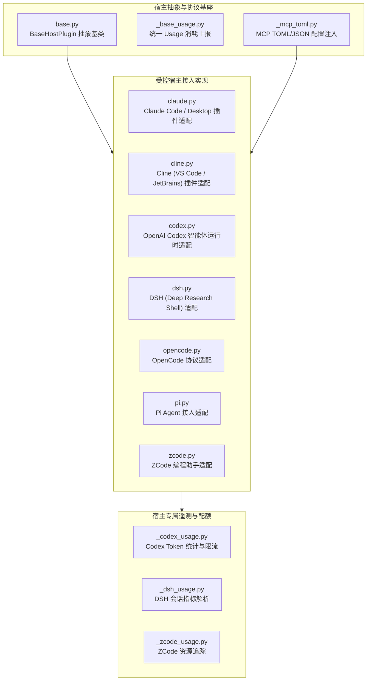

# BugX Host Adapters (多宿主 AI 插件适配层)

`core/hosts/` 负责 BugX 与业界主流 AI IDE、智能编程代理及外部 Host 平台的多向接入与协议转换。无论是标准 MCP（Model Context Protocol）、CLI 包装还是专用扩展，本层提供统一抽象与开箱即用的插件接入方案。

---

## 1. 架构拓扑与宿主矩阵 (Host Matrix)

---

## 2. 模块文件物理索引与职责清单 (File Inventory)

| 文件名 | 职责与功能定位 | 关键类 / 函数 |
| :--- | :--- | :--- |
| `__init__.py` | Python 包初始化与核心模块符号导出 | `__all__` |
| `_base_usage.py` | 宿主资源与 Token 消耗统计基类，统一各宿主的遥测格式 | `BaseUsageTracker` |
| `_codex_usage.py` | OpenAI Codex 专有 Token 解析与计费消耗追踪实现 | `CodexUsageTracker` |
| `_dsh_usage.py` | DSH 环境专有调用链耗时与交互次数统计实现 | `DshUsageTracker` |
| `_mcp_toml.py` | MCP 客户端配置注入器，安全写入或更新 `.codex/mcp.toml` / `.vscode/cline_mcp.json` | `inject_mcp_toml_config` |
| `_zcode_usage.py` | ZCode 平台专有资源配额与请求频率追踪器 | `ZCodeUsageTracker` |
| `base.py` | 宿主插件核心契约定义，提供探针注入、MCP 服务拉起与生命周期钩子 | `BaseHostPlugin` |
| `claude.py` | Claude Desktop / Claude Code 宿主接入适配器，生成 MCP 配置与技能包 | `ClaudeHostPlugin` |
| `cline.py` | Cline 插件适配器，实现 Roo Code / Cline 的 MCP 注入与规则提示词联动 | `ClineHostPlugin` |
| `codex.py` | OpenAI Codex 适配器，管理 Codex CLI 交互式与无头会话 | `CodexHostPlugin` |
| `dsh.py` | DSH (Deep Shell) 适配器，支持终端交互代理与工作流联动 | `DshHostPlugin` |
| `INTERFACE.md` | 宿主插件公共接口设计与契约规范文档 | 宿主生命周期协议说明 |
| `opencode.py` | OpenCode 智能体适配器，提供标准 JSON-RPC MCP 挂载与环境发现 | `OpenCodeHostPlugin` |
| `pi.py` | Pi 智能体平台接入适配器，实现扩展注册与事件桥接 | `PiHostPlugin` |
| `SPEC.md` | 多宿主架构设计规格书，阐述各宿主环境差异与统一语义模型 | 规范与技术考量 |
| `zcode.py` | ZCode 平台接入适配器，支持专用 IDE 插件与安全上下文分发 | `ZCodeHostPlugin` |

---

## 3. 核心设计契约与公理 (Design Axioms)

1. **零污染环境隔离公理**：向宿主注入 MCP 配置或技能包时，必须使用安全的合并算法（`_mcp_toml.py`），严禁静默覆盖用户原有的其他 MCP 服务配置。
2. **就地探针自愈机制**：当目标宿主环境缺失依赖或配置文件未初始化时，宿主适配器必须具备就地自愈与自动修复能力，严禁直接报假性致命错误。
3. **统一能力分级与降级**：所有宿主统一继承自 `base.py:BaseHostPlugin`，当宿主不支持高阶交互特性时，平滑降级为标准 MCP 工具调用模式。
