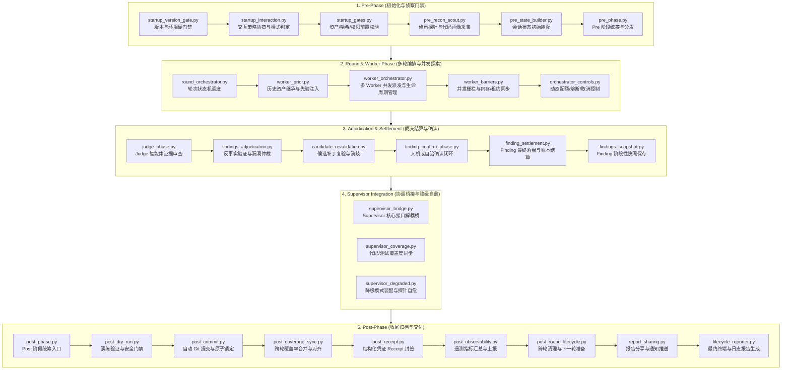

# BugX Launch Phases (生命周期流水线与阶段状态机)

`core/launch_phases/` 承载 BugX 自主攻防生命周期的五大执行阶段与核心状态机。它负责从启动门禁校验、上下文侦察装配、多轮迭代调度、Worker 并发编排与裁决、直到收尾结算与交付物固化的完整端到端生命周期治理。

---

## 1. 架构拓扑与状态机时序 (Lifecycle Pipeline)

---

## 2. 模块文件物理索引与职责清单 (File Inventory)

| 文件名 | 职责与功能定位 | 关联核心接口 / 符号 |
| :--- | :--- | :--- |
| `__init__.py` | Python 包初始化与核心模块符号导出 | `__all__` |
| `candidate_revalidation.py` | 候选缺陷与修复补丁复验器，执行反事实测试与验证断言 | `revalidate_candidate_findings` |
| `common.py` | 生命周期阶段共享基础设施、上下文提取与运行态通用函数 | `LifecycleContext`, `resolve_phase_env` |
| `finding_confirm_phase.py` | 缺陷人机交互确认与自治确认策略执行阶段 | `run_finding_confirm_phase` |
| `finding_settlement.py` | Finding 最终结算逻辑，将有效 Finding 沉淀至状态账本 | `settle_findings_to_ledger` |
| `findings_adjudication.py` | 攻防结果仲裁中心，执行双重验证并防范虚假自洽通过 | `adjudicate_findings` |
| `findings_snapshot.py` | 阶段性缺陷快照持久化与脏状态版本管理 | `create_findings_snapshot` |
| `INTERFACE.md` | 生命周期内部组件间解耦契约定义文档 | 阶段间类型签名与事件规范 |
| `judge_phase.py` | Judge 阶段调度，调起 Judge Agent 审查 Worker 提交证据 | `run_judge_phase` |
| `lesson_context.py` | 复盘错题集上下文抽取器，提取历史经验注入当前轮次提示词 | `inject_lesson_context` |
| `lifecycle_reporter.py` | 生命周期摘要报告生成器，输出 Markdown 与控制台终端汇总 | `generate_lifecycle_summary` |
| `orchestrator_controls.py` | 编排器运行控制策略（熔断阈值、超时重试、用户中断信号处理） | `OrchestratorControlGate` |
| `post_commit.py` | Post 阶段 Git 提交守门员，处理原子提交策略与提交消息格式化 | `execute_post_commit` |
| `post_coverage_sync.py` | Post 阶段覆盖率增量计算与历史快照合并 | `sync_post_coverage` |
| `post_dry_run.py` | Post 阶段演练保护模式，验证不污染真实工作树 | `verify_post_dry_run` |
| `post_observability.py` | Post 阶段耗时度量、令牌消耗与调用链遥测导出 | `record_post_metrics` |
| `post_phase.py` | Post 收尾阶段总入口，协调提交、凭据生成、归档与清理 | `run_post_phase` |
| `post_receipt.py` | 结构化审计凭证生成器，输出加密 SHA-256 Receipt 证明文件 | `generate_post_receipt` |
| `post_round_lifecycle.py` | 单轮生命周期收尾与多轮轮转状态流转管理器 | `advance_round_lifecycle` |
| `pre_phase.py` | Pre 初始化阶段总入口，统筹门禁、环境感知与侦察状态 | `run_pre_phase` |
| `pre_recon_scout.py` | 前置主动侦察探测器，扫描目标项目架构、依赖与攻击面 | `scout_target_project` |
| `pre_state_builder.py` | 前置会话状态构建器，初始化 `.bugx` 会话目录与配置注入 | `build_initial_session_state` |
| `report_sharing.py` | 审计与攻防报告外发分发器（Webhook、钉钉/企微、文件导出） | `dispatch_report_share` |
| `round_orchestrator.py` | 轮次迭代编排器，驱动多轮 Worker -> Judge -> Settle 循环推进 | `orchestrate_rounds` |
| `session_runtime.py` | 会话级运行态上下文管理器，守卫会话持久化与单例实例 | `SessionRuntimeContext` |
| `SPEC.md` | 生命周期规范设计与状态迁移状态机真理文档 | 阶段规范与失败处理契约 |
| `startup_gates.py` | 启动前置安全门禁（文件树白名单、脏工作区检查、权限拦截） | `verify_startup_gates` |
| `startup_interaction.py` | 交互式问答决策引擎，根据终端能力与配置解析交互模式 | `resolve_startup_interaction` |
| `startup_version_gate.py` | 版本硬门禁校验器，确保运行时版本严格等于 `0.1.0` 绝不漂移 | `assert_version_integrity` |
| `supervisor_bridge.py` | Supervisor 模块间解耦桥接层，提供轻量化调用门面 | `SupervisorBridge` |
| `supervisor_coverage.py` | 覆盖率生命周期继承器，支持空闲历史会话继承与动态分发 | `SupervisorCoverageSync` |
| `supervisor_degraded.py` | 降级容灾与探针就地自愈控制器，无损处理缺失依赖与环境 | `SupervisorDegradedCoordinator` |
| `worker_barriers.py` | Worker 并发执行同步栅栏，保障多 Worker 事务与租约一致性 | `WorkerBarrierGate` |
| `worker_orchestrator.py` | Worker 编排中心，按攻击面分配 Worker 智能体并监控心跳 | `orchestrate_workers` |
| `worker_prior.py` | Worker 先验知识与候选种子生成器，注入领域规则与代码指纹 | `compile_worker_priors` |

---

## 3. 核心设计契约与公理 (Design Axioms)

1. **版本绝对固化公理**：`startup_version_gate.py` 必须在任何业务逻辑启动前执行，基线版本严格锁定在 `0.1.0`，杜绝任何环境版本漂移。
2. **状态机单向流转与幂等性**：生命周期从 `Pre` $\rightarrow$ `Round` $\rightarrow$ `Worker` $\rightarrow$ `Judge` $\rightarrow$ `Settlement` $\rightarrow$ `Post` 严格单向流动，禁止逆流操作；重试必须走显式的轮次迭代（`advance_round_lifecycle`）。
3. **证据零伪造公理**：在 `findings_adjudication.py` 与 `candidate_revalidation.py` 中，所有缺陷判定必须有可执行的反事实测试证据，严禁仅凭模型推理文本定性。
4. **工作树物理安全红线**：`post_dry_run.py` 与 `post_commit.py` 严格遵守工作树保护宪法，未授权时绝对禁止覆盖用户未暂存的修改。
