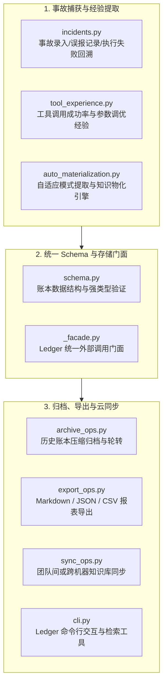

# BugX Ledger (攻防复盘账本与错题经验库)

> **版本契约**: `0.1.0` | **所属分层**: `Layer 3: 并发协调、智能体编排与账本`  
> **公开架构说明**: 参见 [`docs/02_architecture/01_ARCHITECTURE.md`](../../docs/02_architecture/01_ARCHITECTURE.md)。

`core/ledger/` 是 BugX 的知识沉淀与复盘中枢。它不仅记录历史漏洞与误报事故（Incidents），更通过自动化物化（Auto-Materialization）将过往踩坑教训提炼为对抗模式（Patterns）与工具经验（Tool Experience），形成越战越强的智能免疫闭环。

---

## 1. 账本子系统全景目录拓扑树 (Subsystem Directory Topology)

```text
core/ledger/
├── 1. 缺陷生命周期与确认门禁 (Finding Lifecycle & Verification)
│   ├── finding_lifecycle.py     # 缺陷生命周期状态机核心 (OPEN -> VERIFYING -> CONFIRMED -> FIXED)
│   ├── finding_confirmation.py  # Finding 确认状态机、Oracle 验证与反事实门禁
│   ├── finding_verification.py  # 缺陷复现配方 (Recipe) 执行与真实利用性判定
│   ├── finding_io.py            # 缺陷条目安全读写、结构强校验与原子落盘原语
│   ├── receipt_contract.py      # 审计结果回执、证明封条与覆盖完整性契约守卫
│   └── life_ledger.py           # 智能体全生命周期审计流水台账与 Finding 结算数据结构
│
├── 2. 事故复盘、错题沉淀与自适应物化 (Incidents, Lessons & Materialization)
│   ├── incidents.py             # 攻防事故与漏报/误报实体管理器，记录发生根因与反思
│   ├── auto_materialization.py  # 自动化物化引擎，将同质事故聚类提炼为防御规则
│   ├── patterns.py              # 提炼形成的攻击模式、代码脆弱性规则与避坑指南知识库
│   ├── tool_experience.py       # 工具调用经验库，记录各语言与框架下的最佳参数
│   ├── lesson_ledger.py         # 错题集主管理门面，支持模式匹配与经验检索
│   └── lesson_replay.py         # 历史错题与回归用例离线重放引擎
│
├── 3. 数据规范、契约与统一调用门面 (Schema, Facade & Verification)
│   ├── schema.py                # 账本数据强类型 Schema 校验器与实体数据类
│   ├── _facade.py               # Ledger 统一外部调用门面，屏蔽底层存储与物化细节
│   ├── verify_life.py           # 寿命记账防篡改核验、幽灵消耗回滚与结算核算器
│   ├── INTERFACE.md             # 账本子系统对外公共接口与实体契约文档
│   └── SPEC.md                  # 账本与持续学习系统架构设计规格书
│
├── 4. 导入导出、归档与跨端同步 (Ops, Export & Sync)
│   ├── archive_ops.py           # 历史复盘日志与归档操作，清理过期临时条目
│   ├── export_ops.py            # 知识库导出工具集，支持导出 Markdown/JSON/CSV 格式
│   ├── sync_ops.py              # 跨实例或远程云端知识同步器，保障多设备经验拉齐
│   └── cli.py                   # 账本管理 CLI 交互调试命令实现
│
└── 5. 包初始化与导出门面
    └── __init__.py              # 模块符号统一导出
```

---

## 2. 架构拓扑与经验沉淀时序 (Ledger Engine)



---

## 3. 模块文件物理索引与职责清单 (File Inventory)

| 文件名 | 职责与功能定位 | 关键类 / 函数 |
| :--- | :--- | :--- |
| `__init__.py` | Python 包初始化与核心模块符号导出 | `__all__` |
| `_facade.py` | Ledger 顶层统一门面接口，向上层屏蔽复杂存储与物化细节 | `LedgerFacade` |
| `archive_ops.py` | 历史复盘日志与归档操作，清理过期临时记录并持久化精华条目 | `archive_old_entries` |
| `auto_materialization.py` | 自动化物化引擎，基于大模型分析将同质事故聚类为通用对抗防御规则 | `materialize_patterns` |
| `cli.py` | 账本管理 CLI 交互命令实现（`bugx ledger list/inspect/export`） | `ledger_cli_main` |
| `export_ops.py` | 知识库导出工具集，支持导出安全审计报告或团队共享格式 | `export_ledger_records` |
| `finding_confirmation.py` | Finding 确认状态机、Oracle 验证与反事实门禁 | `ConfirmationState`, `validate_remediation` |
| `finding_io.py` | 缺陷结果安全读取、结构校验与原子落盘共享原语 | `read_finding`, `write_finding` |
| `finding_lifecycle.py` | 缺陷跨轮次生命周期流转、指纹追踪与状态维护 | `FindingLifecycle` |
| `finding_verification.py` | 缺陷复现配方（Recipe）执行与真实利用性判定器 | `FindingVerifier` |
| `incidents.py` | 攻防事故与漏报/误报实体管理器，记录发生根因与反思教训 | `IncidentManager` |
| `INTERFACE.md` | 账本子系统公共接口与实体契约文档 | 数据类型与接口契约 |
| `lesson_ledger.py` | 错题集主管理门面，支持模式匹配、事故关联与经验检索 | `LessonLedger` |
| `lesson_replay.py` | 历史错题与回归用例离线重放引擎 | `LessonReplayRunner` |
| `life_ledger.py` | 智能体生命周期账本与 Finding 结算数据结构 | `FindingLedger`, `finding_fingerprint` |
| `patterns.py` | 提炼形成的攻击模式、代码脆弱性规则与避坑指南知识库 | `PatternRegistry` |
| `receipt_contract.py` | 审计结果回执、证明封条与覆盖完整性契约守卫 | `validate_receipt_contract` |
| `schema.py` | 账本数据 Schema 校验器与强类型数据类定义 | `IncidentSchema`, `PatternSchema` |
| `SPEC.md` | 账本与持续学习系统架构设计规格书 | 学习流与知识闭环模型 |
| `sync_ops.py` | 跨实例或远程云端知识同步器，保障多设备经验拉齐 | `sync_ledger_with_remote` |
| `tool_experience.py` | 工具调用经验库，记录哪些工具/参数在特定语言与框架下最有效 | `ToolExperienceTracker` |
| `verify_life.py` | 寿命记账防篡改核验、幽灵消耗回滚与结算核算器 | `verify_life_ledger` |
| `bug-log.md` | 只记录模式下的历史 Bug 清单，作为勘察去重与防重复报告依据 | `bug-log` |
| `mistake-book.md` | 由 SQLite 错题账本自动导出的只读 Markdown 经验手册快照 | `export-book` |
| `lesson-replay-cases.json` | 沉淀的历史教训回放验证测试用例集合 | `replay_cases` |

---

## 4. 典型使用场景与代码调用示例 (Common Usage Scenarios)

### 4.1 场景 1：录入误报事故并触发经验模式物化
当某条 Finding 被判定为业务特意设计的预期行为（非真实漏洞）时，将其作为事故录入并自动提取防御规则：

```python
from core.ledger.incidents import IncidentManager
from core.ledger.auto_materialization import materialize_patterns

# 1. 录入误报事故
mgr = IncidentManager()
incident_id = mgr.record_incident(
    kind="false_positive",
    rule_id="SEC-0042",
    target_path="auth/jwt.py",
    root_cause="JWT 校验已在上一级网关层拦截，本地函数属于内网受信任端点",
    session_id="session-audit-2026",
)

# 2. 自动化提炼防御规则
patterns = materialize_patterns(incidents=[incident_id])
print(f"已提炼出通用防御模式: {patterns[0].title}")
```

### 4.2 场景 2：不可篡改生命账本核算与结算校验
在审计战役结束时，校验全量 Finding 状态跃迁哈希链，防止幽灵篡改：

```python
from pathlib import Path
from core.ledger.life_ledger import FindingLedger
from core.ledger.verify_life import verify_life_ledger

# 加载生命周期账本
ledger_path = Path(".bugx/ledger/life.json")
ledger = FindingLedger.load(ledger_path)

# 执行不可篡改哈希审计核验
verification = verify_life_ledger(ledger)
if verification.is_valid:
    print(f"账本通过完整性校验，有效 Finding 数: {len(ledger.accepted_findings)}")
else:
    raise RuntimeError(f"账本哈希链断裂或被篡改: {verification.errors}")
```

---

## 5. 核心设计契约与公理 (Design Axioms)

1. **不可篡改性与审计溯源**：所有录入的 `incidents.py` 条目必须绑定真实会话 ID、时间戳与复现代码，禁止手工伪造无依据经验。
2. **知识自愈反哺机制**：`auto_materialization.py` 生成的防御模式必须在下一轮攻防会话的 `pre_recon_scout.py` 与 `worker_prior.py` 中自动生效，形成越战越强的智能进化闭环。
3. **单向依赖规约**：Ledger 作为 Layer 3 核心状态库，向上由 Supervisor 调用，向下使用 Layer 0~1 的存储与 Schema，绝对禁止导入 Layer 5 宿主实现。
