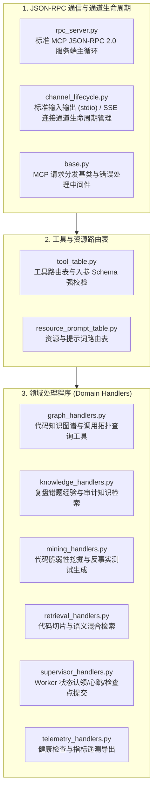

# BugX MCP Handlers (Model Context Protocol RPC 服务端与工具分发层)

`core/mcp_handlers/` 承载了 BugX 作为标准 Model Context Protocol (MCP) 服务端的核心实现。它统一管理所有暴露给宿主大模型（如 Claude / Codex / Cline / Cursor 等）的工具（Tools）、资源（Resources）与提示词模板（Prompts）。

---

## 1. 架构拓扑与 RPC 分发流水线 (MCP Server Architecture)

---

## 2. 模块文件物理索引与职责清单 (File Inventory)

| 文件名 | 职责与功能定位 | 关键类 / 函数 |
| :--- | :--- | :--- |
| `__init__.py` | Python 包初始化与核心模块符号导出 | `__all__` |
| `base.py` | MCP 处理器抽象基类，提供统一的入参格式化、上下文解包与异常捕获 | `BaseMCPHandler` |
| `channel_lifecycle.py` | 客户端通信连接通道管理，支持 stdio、TCP 与 HTTP-SSE 协议状态监控 | `ChannelLifecycleManager` |
| `graph_handlers.py` | 图谱相关 MCP 工具处理程序（如 `search_graph`, `trace_path`, `query_graph`） | `GraphMCPHandler` |
| `INTERFACE.md` | MCP 服务端接口与全量 Tool 契约规格说明文档 | JSON Schema 清单 |
| `knowledge_handlers.py` | 历史错题库、防御模式与规则包相关的 MCP 读写工具处理器 | `KnowledgeMCPHandler` |
| `mining_handlers.py` | 深度攻防挖掘与用例合成 MCP 工具（如 `generate_test`, `run_proof`） | `MiningMCPHandler` |
| `resource_prompt_table.py` | MCP Resources 与 Prompts 注册表，动态分发预置攻防模板 | `ResourcePromptTable` |
| `retrieval_handlers.py` | 代码切片、RRF 混合检索与上下文检索工具处理器 | `RetrievalMCPHandler` |
| `rpc_server.py` | 标准 MCP JSON-RPC 2.0 服务端入口，驱动主事件循环与并发请求调度 | `MCPServer` |
| `SPEC.md` | MCP 服务端与客户端通信协议技术标准与设计约束 | 协议交互标准 |
| `supervisor_handlers.py` | Supervisor 协调工具处理器，供外部智能体认领任务、上报检查点与同步状态 | `SupervisorMCPHandler` |
| `telemetry_handlers.py` | 遥测与健康检查工具处理器，对外暴露运行耗时与 Token 使用度量 | `TelemetryMCPHandler` |
| `tool_table.py` | MCP 工具集中注册表，严格校验每个工具的名称、描述与 JSON Schema | `ToolTable` |

---

## 3. 核心设计契约与公理 (Design Axioms)

1. **强类型 Schema 严格对齐**：`tool_table.py` 声明的每一个工具入参，必须 100% 具备标准的 JSON Schema 声明，且与实际 Python 函数参数严格逐字对齐。
2. **零静默吞噬异常**：工具内部发生未捕获异常时，必须由 `base.py` 封装为标准 JSON-RPC 错误对象（含明确错误码与错误堆栈），严禁假装成功返回空结果。
3. **快速响应防挂起**：耗时较长的操作（如跑全量测试）必须异步返回执行 Handle 或提供进度汇报，单次同步工具响应不得阻塞客户端超过 30 秒。
