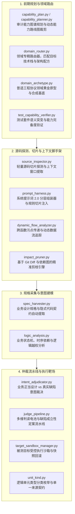

# BugX Planning & Slicing Engine (能力规划、领域路由、代码切片与仲裁流水线)

> **版本契约**: `0.1.0` | **所属分层**: `Layer 2: 分析、切片与探测引擎`  
> **公开架构说明**: 参见 [`docs/02_architecture/01_ARCHITECTURE.md`](../../docs/02_architecture/01_ARCHITECTURE.md)。

`core/planning/` 汇聚了 BugX 微内核针对目标项目的核心能力编排、领域路由、静态/动态切片提取、业务规格采集与多维缺陷仲裁能力。它构成了审计前期阶段决策、提示词上下文合成与审计后期裁决闭环的关键中枢。

---

## 1. 规划引擎全景目录拓扑树 (Subsystem Directory Topology)

```text
core/planning/
├── 1. 前期能力图谱规划与领域路由 (Pre-Recon & Routing)
│   ├── capability_plan.py       # 审计能力图谱规划数据模型，定义阶段依赖与路线
│   ├── capability_planner.py    # 动态分析被测工程，按需裁剪生成最优审计能力路线
│   ├── domain_router.py         # 领域路由器，将任务分发至对应技术栈的专精子系统
│   ├── domain_archetype.py      # 普适工程协议领域黄金原型与合成基准
│   └── test_capability_verifier.py # 测试套件语义变异与业务特性完备性验证
│
├── 2. 源码探测、切片与提示词脚手架 (Slicing & Prompt Harness)
│   ├── source_inspector.py      # 轻量级源码结构化探测与上下文精准切片提取器
│   ├── prompt_harness.py        # 动态组合审计目标、代码切片与规则的 Prompt 2.0 组装器
│   ├── dynamic_flow_analyzer.py # 跨函数污点传递与动态数据流追踪器
│   └── impact_pruner.py         # 结合 Git Diff 与依赖图的精准剪枝引擎
│
├── 3. 规格采集与业务逻辑建模 (Spec Harvester & Logic)
│   ├── spec_harvester.py        # 自动分析源码与文档注释，提取业务设计规格与隐式契约
│   └── logic_analysis.py        # 分析业务状态机流转与执行拓扑，识别逻辑越权漏洞
│
├── 4. 仲裁流水线、沙箱与单元契约 (Adjudication & Sandboxes)
│   ├── intent_adjudicator.py    # 业务正当设计 vs 真实缺陷意图裁决器，生成反事实断言
│   ├── judge_pipeline.py        # 漏洞判定仲裁流水线，多维电池证据定案
│   ├── target_sandbox_manager.py # 被测目标受控执行沙箱与快照管理器
│   └── unit_kind.py             # 逻辑单元类型分类枚举与单一来源契约
│
└── 5. 包初始化与导出门面
    └── __init__.py              # 模块符号统一导出
```

---

## 2. 架构拓扑与规划流水线 (Planning & Adjudication Topology)



---

## 3. 物理条目与核心职责索引 (Physical Module Directory)

| 物理文件 | 架构层级 / 角色 | 核心职责说明 |
| :--- | :--- | :--- |
| `__init__.py` | 统一导出门面 | 聚合导出能力规划、领域路由、切片分析与仲裁流水线核心接口与实体 |
| `capability_plan.py` | 能力规划模型 | 审计能力图谱规划数据结构，描述阶段与能力依赖路线 |
| `capability_planner.py` | 动态规划器 | 动态分析被测目标，按需裁剪生成最优审计能力路线图 |
| `domain_archetype.py` | 领域原型基准 | 落实普适工程协议，强制比对成熟工业领域黄金原型并生成合成测试底座 |
| `domain_router.py` | 领域路由器 | 根据项目类型将审计任务路由至最专业的领域子系统与提示词切片 |
| `dynamic_flow_analyzer.py` | 动态污点追踪 | 跟踪未经过滤的外部输入在系统函数与跨模块调用间的传递路径 |
| `impact_pruner.py` | 影响面剪枝 | 结合 Git Diff 剪枝无关模块与调用链，实现精准最小覆盖分析 |
| `intent_adjudicator.py` | 意图裁决器 | 裁决代码异常是正当业务设计还是真实安全缺陷，提供反事实断言 |
| `judge_pipeline.py` | 裁决流水线 | 漏洞判定仲裁流水线，综合多维电池证据判定缺陷成立性 |
| `logic_analysis.py` | 业务逻辑分析 | 分析业务状态机流转与执行拓扑，推导越权、未授权与逻辑绕过缺陷 |
| `prompt_harness.py` | 提示词脚手架 | 动态组合审计目标、代码切片与攻防规则的 Prompt 2.0 组装器 |
| `source_inspector.py` | 源码探针 | 轻量级源码结构化探测与上下文精准切片提取器 |
| `spec_harvester.py` | 规格采集 | 自动分析代码与注释，提取业务设计规格与隐式契约 |
| `target_sandbox_manager.py` | 沙箱管理 | 为被测目标创建并隔离受控执行工作树沙箱与快照管理器 |
| `test_capability_verifier.py` | 能力验证器 | 验证当前测试套件对核心业务特性的语义变异与覆盖完备性 |
| `tools-kb.md` | 工具知识库 | 通用安全与质量测试命令行工具速查指南与 30 天有效规格定义 |
| `unit_kind.py` | 单元分类契约 | 定义代码逻辑单元、组件粒度与测试维度的分类枚举单一事实来源 |

---

## 4. 典型使用场景与代码调用示例 (Common Usage Scenarios)

### 4.1 场景 1：动态规划与领域路由
根据目标项目的技术栈特征，规划审计路线并路由到对应的领域策略：

```python
from pathlib import Path
from core.planning.capability_planner import CapabilityPlanner
from core.planning.domain_router import DomainRouter

# 1. 动态生成审计能力路线
planner = CapabilityPlanner()
plan = planner.plan_capabilities(project_root=Path.cwd())
print(f"规划的核心审计阶段: {[phase.name for phase in plan.phases]}")

# 2. 领域路由
router = DomainRouter()
recipe = router.resolve_recipe(tech_stack=["python", "fastapi", "sqlalchemy"])
print(f"分配的最佳攻防配方: {recipe.name}")
```

### 4.2 场景 2：意图裁决与漏洞成立判定
对初步扫描到的异常进行意图判定，区分“正当业务设计”与“真实安全缺陷”：

```python
from core.planning.intent_adjudicator import IntentAdjudicator
from core.planning.judge_pipeline import JudgePipeline

# 1. 意图裁决：检查是否为框架默认行为或正当设计
adjudicator = IntentAdjudicator()
verdict = adjudicator.adjudicate(
    file_path="api/routes.py",
    finding_type="UNAUTHENTICATED_ACCESS",
    code_context="def public_health_check(): return {'status': 'ok'}",
)

if verdict.is_intentional:
    print(f"裁决结果: 预期正当设计，原因: {verdict.justification}")
else:
    # 2. 提交仲裁定案流水线
    pipeline = JudgePipeline()
    final_decision = pipeline.evaluate(verdict.finding)
    print(f"仲裁定案: {final_decision.status}")
```

---

## 5. 核心设计契约与防御性公理 (Design Axioms)

1. **零冗余别名 (No Legacy Aliases)**：遵循 `AGENTS.md` 规范，不保留向后兼容别名；所有调用方必须统一重定向至 `core.planning`。
2. **单一事实来源 (Single Source of Truth)**：`unit_kind.py` 为全系统内部/业务单元前缀判定提供唯一来源，杜绝字面量硬编码。
3. **确定性证据定案 (Deterministic Verdict)**：`judge_pipeline.py` 与 `intent_adjudicator.py` 必须以机器实测证据或反事实断言为准，禁止口头自证与假性放行。
4. **单向依赖规约**：Planning 属于 Layer 2 分析层，严禁反向引入 Layer 5 宿主交互或 WebUI 代码。
