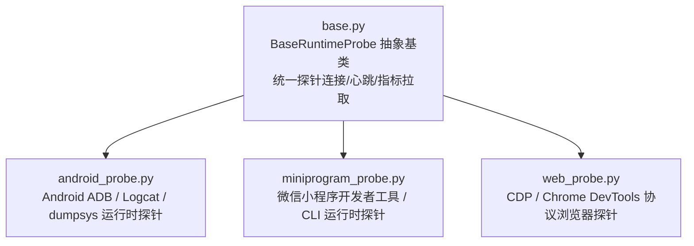

# BugX Runtime Probes (多形态目标运行时探针)

`core/probes/` 为 BugX 提供了深入运行中应用内部的主动探针能力，支持对 Android 进程、微信小程序沙箱以及 Web 浏览器的运行态上下文、日志、网络请求与 DOM/视图树进行实时探测。

---

## 1. 架构拓扑 (Probe Matrix)

---

## 2. 模块文件物理索引与职责清单 (File Inventory)

| 文件名 | 职责与功能定位 | 关键类 / 函数 |
| :--- | :--- | :--- |
| `__init__.py` | Python 包初始化与核心模块符号导出 | `__all__` |
| `android_probe.py` | Android 真实设备或模拟器探针，提取 Logcat 崩溃栈、当前顶层 Activity 与 IPC 交互 | `AndroidRuntimeProbe` |
| `base.py` | 运行时探针统一抽象基类，规范探针连接、数据流监听与平稳断开逻辑 | `BaseRuntimeProbe` |
| `codebase_memory_probe.py` | Codebase Memory MCP 知识图谱与语义索引探针 | `CodebaseMemoryProbe` |
| `desktop_probe.py` | 桌面端应用（Electron/Qt/Native）运行环境与安全配置探针 | `DesktopProbe` |
| `differential_probe.py` | 差分黑盒执行探针，对比不同版本或环境的行为差异 | `DifferentialProbe` |
| `efficiency_probe.py` | 系统基准算力与环境执行效率评测探针 | `EfficiencyProbe` |
| `INTERFACE.md` | 探针对外暴露的事件与指标契约规范文档 | 探针接口定义 |
| `ios_binary_probe.py` | iOS 二进制包（IPA/Mach-O）安全特征与签名结构探针 | `IOSBinaryProbe` |
| `memory_probe.py` | 运行时内存画像、泄漏检测与对象分布探针 | `MemoryProbe` |
| `miniprogram_probe.py` | 微信小程序专用探针，读取编译态产物、配置、路由表以及运行时网络请求 | `MiniProgramRuntimeProbe` |
| `mobile_probe.py` | 移动端（Android/iOS）自动化测试环境与设备可用性探针 | `MobileProbe` |
| `native_probe.py` | 原生 C/C++/Rust 工程编译工具链与 Sanitizer 能力探针 | `NativeProbe` |
| `openwiki_probe.py` | 开源知识库与外部漏洞情报检索探针 | `OpenWikiProbe` |
| `pattern_probe.py` | 历史高频缺陷模式与规则违规特征扫描探针 | `PatternProbe` |
| `platform_probe.py` | 跨平台操作系统工具链与依赖环境适配探针 | `PlatformProbe` |
| `probe_registry.py` | 探针插件注册中心，统一管理探针生命周期与预算调度 | `ProbeRegistry`, `run_preflight_probes` |
| `sast_probe.py` | 多引擎静态代码安全扫描与规则匹配探针 | `SASTProbe` |
| `sast_rules.py` | 内置 SAST AST 规则集与轻量模式匹配引擎 | `SASTRuleMatcher`, `BUILTIN_RULES` |
| `sca_scanner.py` | 依赖软件成分分析（SCA）与已知脆弱性依赖检测器 | `SCAScanner` |
| `SPEC.md` | 探针系统技术设计规范，阐述无侵入性检测与性能损耗边界 | 探针规范标准 |
| `web_probe.py` | 现代浏览器 Web 探针，通过 Chrome DevTools Protocol 捕获 Console 报错与 Network 异常 | `WebRuntimeProbe` |

---

## 3. 核心设计契约与公理 (Design Axioms)

1. **非侵入与低损耗公理**：探针运行对目标应用主线程性能损耗必须小于 3%，严禁因探针自身异常导致被测宿主崩溃。
2. **连接断开物理自愈**：当审计结束或被测进程退出时，探针必须无残留平稳断开，清理临时转发端口（如 `adb forward`）。
