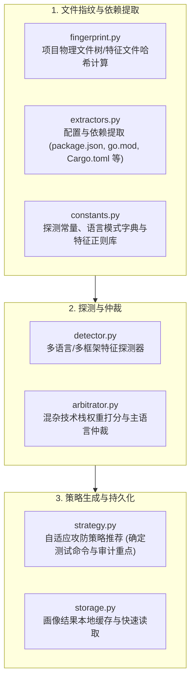

# BugX Project Profiler (目标代码画像与技术栈自动探测)

`core/project_profiler/` 负责对被测目标仓库执行全方位、非侵入式的多语言与技术栈特征画像。它能毫秒级识别编程语言、测试框架、包管理器、敏感路径以及攻击面特征，为后续攻防策略制定提供精准输入。

---

## 1. 架构拓扑与探测时序 (Profiler Pipeline)

---

## 2. 模块文件物理索引与职责清单 (File Inventory)

| 文件名 | 职责与功能定位 | 关键类 / 函数 |
| :--- | :--- | :--- |
| `__init__.py` | Python 包初始化与核心模块符号导出 | `__all__` |
| `arbitrator.py` | 主次语言与架构模式权重仲裁器，处理微服务或全栈混合仓库的主流技术栈判定 | `ProjectArbitrator` |
| `constants.py` | 项目探测全量规则字典与模式特征常量定义 | `LANGUAGE_SIGNATURES`, `FRAMEWORK_MAP` |
| `detector.py` | 核心探测器，基于特征文件和 AST 深度扫描目标工程的技术栈属性 | `ProjectDetector` |
| `extractors.py` | 各语言包管理器和构建工具解析器，提取依赖库与版本信息 | `DependencyExtractor` |
| `fingerprint.py` | 项目指纹生成器，结合 Git 提交哈希与依赖指纹判断项目是否发生结构变化 | `calculate_project_fingerprint` |
| `INTERFACE.md` | 画像系统对外提供的类型接口与探测产物契约说明 | `ProjectProfile` 数据结构 |
| `SPEC.md` | 技术画像设计规格书，定义探测算法优先级与启发式打分规则 | 规则与判定矩阵 |
| `storage.py` | 画像数据本地快照与缓存持久化，加速后续多轮审计启动速度 | `ProfileStorage` |
| `strategy.py` | 攻防调度策略建议生成器，根据画像自动选择最适配的 Worker 技能包 | `recommend_audit_strategy` |

---

## 3. 核心设计契约与公理 (Design Axioms)

1. **零暴力全盘扫描公理**：探测范围严格限制在目标项目根目录内，严禁发散到操作系统根目录或 `$HOME`。
2. **毫秒级极速画像**：探测器采用由粗到细的短路判定算法，95% 以上的项目探测必须在 300ms 内完成。
