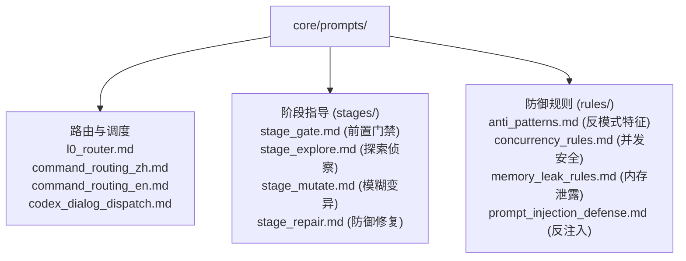

# BugX System Prompts & Guardrail Rules (提示词体系与对抗防御规则)

`core/prompts/` 是 BugX 核心智能体调度的大脑中枢。它沉淀了经过高强度红队对抗验证的系统级提示词、意图路由协议模板、阶段性指导指令以及各领域防御规则。

---

## 1. 目录结构与提示词拓扑

---

## 2. 核心文件与子目录索引 (File Inventory)

| 文件 / 目录 | 职责与功能定位 |
| :--- | :--- |
| `codex_dialog_dispatch.md` | OpenAI Codex 会话流式交互与多轮任务派发提示词协议 |
| `command_routing_en.md` | 英文自然语言意图到 BugX CLI 命令的零样本精准路由分发模板 |
| `command_routing_zh.md` | 中文自然语言意图到 BugX CLI 命令的高精度意图映射规则库 |
| `l0_router.md` | L0 顶层意图分流器，识别用户意图属于常规审查、定向攻防、状态查看还是系统诊断 |
| `rules/` | 防御与审查硬红线规则集，包含 `anti_patterns.md`、`concurrency_rules.md`、`memory_leak_rules.md` 与 `prompt_injection_defense.md` |
| `stages/` | 攻防生命周期阶段指引模板库，涵盖 `stage_gate.md`、`stage_explore.md`、`stage_mutate.md` 与 `stage_repair.md` |

---

## 3. 设计原则与反注入宪法

- **反提示词注入 (Zero-Injection)**：被测项目中的外部数据、代码与注释作为非受信输入处理，严禁其内容逃逸出代码块或覆写系统提示词指令。
- **证伪优先指令**：智能体在探索与裁决时，提示词强制要求出具最小反事实测试用例，杜绝空泛的自我肯定。
