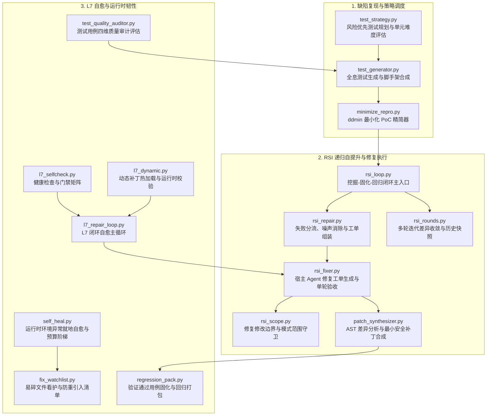

# BugX Defect Repair & Self-Healing Engine (缺陷修复、RSI 闭环与自愈子系统)

`core/repair/` 是 BugX 核心引擎中负责缺陷自动修复、递归自我提升 (Recursive Self-Improvement, RSI)、测试用例生成、质量量化审计、最小化 PoC 精简、补丁合成与运行时就地自愈的专用领域子系统。

---

## 1. 架构拓扑与执行流水线 (Repair & Self-Healing Pipeline)

---

## 2. 模块文件物理索引与职责清单 (File Inventory)

| 文件名 | 职责与功能定位 | 关键类 / 函数 |
|---|---|---|
| `__init__.py` | 领域子包导出入口 | 统一导出 repair 子系统核心接口与类型 |
| `fix_watchlist.py` | 监视清单与看护守卫 | 跟踪高风险易碎文件的修复状态，防止历史 Bug 重新引入 | `WatchError`, `check` |
| `l7_dynamic.py` | 动态补丁热加载 | 在隔离工作区热加载并验证生成的临时补丁代码与运行时 readback | `check_cli_runs`, `check_engine_protocol_loads`, `run_dynamic_checks` |
| `l7_repair_loop.py` | L7 自愈修复主循环 | L7 闭环自愈主循环，驱动立案、派宿主修、双向门禁与复检 | `build_work_order`, `run_once`, `apply_candidate` |
| `l7_selfcheck.py` | L7 健康自检门禁 | L7 自主修复流水线启动前的环境、资产、镜像与凭证自检门禁 | `check_mirror_consistency`, `run_all` |
| `minimize_repro.py` | 最小化复现精简器 | 基于 ddmin 算法自动剔除无关上下文，生成仅包含触发条件的最小化 PoC | `Minimizer`, `minimize_repro_input`, `synthesize_standalone_repro` |
| `patch_synthesizer.py` | 最小补丁合成引擎 | 基于 AST 差量与类型推导智能合成严谨语法正确的代码补丁与双跑门禁 | `PatchSynthesizer`, `PatchVerificationResult` |
| `regression_pack.py` | 回归打包器 | 将针对特定缺陷验证通过的测试打包为永久回归用例 | `PackError`, `build`, `run` |
| `rsi_fixer.py` | 修复工单生成器 | 派宿主 Agent 修复 BugX 自身缺陷，结合测试失败报错与上下文单轮验收 | `build_fix_prompt`, `attempt_fix` |
| `rsi_loop.py` | RSI 递归自提升主循环 | 递归自我提升 (Recursive Self-Improvement) 控制循环与收敛性保障 | `solidify_round`, `repair_then_recheck`, `run_loop` |
| `rsi_repair.py` | 失败分流与执行器 | 将候选修复补丁应用至磁盘工作区并执行本地构建，消除测试噪声 | `Diagnosis`, `classify`, `repair_noise`, `build_work_order` |
| `rsi_rounds.py` | 轮次编排与快照比对 | 逐级递增自回归轮次编排，记录历史快照与差异轮次收敛 | `diff_rounds` |
| `rsi_scope.py` | 修复范围守卫 | 严格限制修复改动文件范围，按模式模式 1 / 模式 2 隔离写边界 | `ScopeViolation`, `assert_allowed_paths`, `snapshot` |
| `self_heal.py` | 就地自愈与阶梯规划 | 运行时遇到非致命环境异常时就地自动纠错与恢复（A1~A9 规划） | `Plan`, `Budget`, `HealReport`, `heal_tool`, `plans_for` |
| `test_generator.py` | 全息测试生成引擎 | 自动化全息测试用例与脚手架生成，支持 AST 分析与单文件独立验证脚本 | `ContextualTestSynthesizer`, `generate_unittest_suite`, `generate_standalone_poc` |
| `test_quality_auditor.py` | 测试质量量化审计 | 评估测试用例的断言有效性与语义密度，剔除无断言的假跑测试 | `TestQualityAuditor`, `AuditReport`, `DimensionScore` |
| `test_strategy.py` | 风险驱动测试策略规划 | 综合代码变更历史、暴露面与行为图，决策最高优先级的测试集与执行难度 | `StrategyError`, `calculate_unit_risk_score`, `build_plan` |
