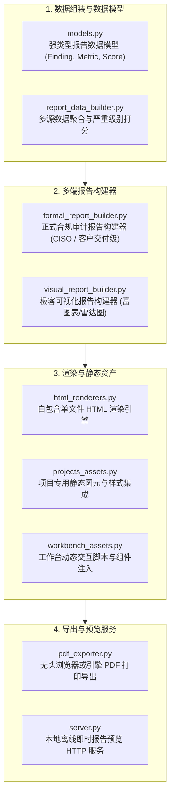

# BugX Report Engine (攻防成果与漏洞报告生成引擎)

`core/report_engine/` 负责将攻防生命周期产出的结构化 Finding、覆盖率指标、调用链证据及复盘建议，编译渲染为权威、高可读性的工业级审计报告（支持交互式 HTML、离线 PDF 与 Markdown 多端交付）。

---

## 1. 架构拓扑与报告构建流水线 (Report Pipeline)

---

## 2. 模块文件物理索引与职责清单 (File Inventory)

| 文件名 | 职责与功能定位 | 关键类 / 函数 |
| :--- | :--- | :--- |
| `__init__.py` | Python 包初始化与核心模块符号导出 | `__all__` |
| `attestation.py` | **报告会签门禁**：把「实际测量的指标」翻译成 PASS/FAIL/NOT-EXERCISED，决定报告能否出具官方会签印章；零变异、零已验证发现或门禁阻断时一律拒绝会签 | `Attestation`, `from_bundle` |
| `authority.py` | **权威状态加载器**：只从当前生命周期的 Supervisor 状态读取已确认发现与验证执行次数；状态缺失时显式报错而不是回退到任何演示数据 | `Authority`, `load`, `AuthorityUnavailable` |
| `sast_bridge.py` | SAST 命中到报告发现条目的唯一映射，只搬运扫描器给出的字段（不补 CVE/CVSS/PoC），状态固定为 `SAST-REPORTED` | `finding_from_sast` |
| `finding_report.py` | 缺陷结果格式化器，组装标准化漏洞生命周期与收据报告报文 | `final_payload`, `normalized_payload` |
| `formal_report_builder.py` | 针对合规、管理层与客户交付的正式审计报告生成器，输出标准章节与整改建议 | `FormalReportBuilder` |
| `html_renderers.py` | 现代化 HTML5 报告渲染引擎，内嵌所有 CSS/JS，生成单文件开箱即用的交互报告 | `HTMLReportRenderer` |
| `INTERFACE.md` | 报告引擎数据结构与渲染器扩展契约说明 | 报告结构契约 |
| `models.py` | 报告核心数据结构定义，包括漏洞危害分级、CVSS 计算模型与时间线条目 | `ReportDataModel`, `FindingSummary` |
| `pdf_exporter.py` | PDF 导出引擎，支持通过无头 Chromium 或内置渲染器导出纸质排版文档 | `PDFExporter` |
| `projects_assets.py` | 项目概览看板与技术栈图标等静态图元封装 | `ProjectAssetsBundle` |
| `report_client.py` | 报告客户端，提供云端/平台凭据加载与报告上传交互 | `ReportResult`, `installation_secret_path` |
| `report_data_builder.py` | 审计结果聚合器，从会话账本与检查点中提取原始数据并计算得分 | `ReportDataBuilder` |
| `report_share.py` | 报告跨平台分享服务，打包环境特征、画像与分享链接 | `detect_project_profile`, `build_environment_info` |
| `server.py` | 本地报告轻量级预览服务器，支持自动唤起系统默认浏览器 | `start_report_preview_server` |
| `SPEC.md` | 报告样式体系与视觉规范，定义配色、间距与严重级别色值标准 | 视觉设计标准 |
| `visual_report_builder.py` | 技术极客可视化看板构建器，包含攻击路径图、覆盖率热力图与雷达图 | `VisualReportBuilder` |
| `web-conformance.md` | Web 界面与报告前端合规性检验与无障碍规范白皮书 | 前端合规白皮书 |
| `web_conformance.py` | 自动化 Web 标准合规与无障碍可访问性审计器 | `WebConformanceError`, `detect_web_project` |
| `workbench_assets.py` | 工作台交互资产包（Mermaid 图表渲染引擎、Prism 代码高亮、折叠控件） | `WorkbenchAssetsBundle` |

---

## 3. 核心设计契约与公理 (Design Axioms)

1. **单文件零依赖交付**：生成的 HTML 报告必须自包含全部 CSS、SVG 图标与 JavaScript，严禁依赖外网 CDN 资源，确保在纯隔离内网环境下完美渲染。
2. **证据可交互穿透**：每个漏洞条目必须能直接查看反事实复现脚本、输入 Payload 与修复前后代码 Diff，杜绝模糊不清的虚假上报。
