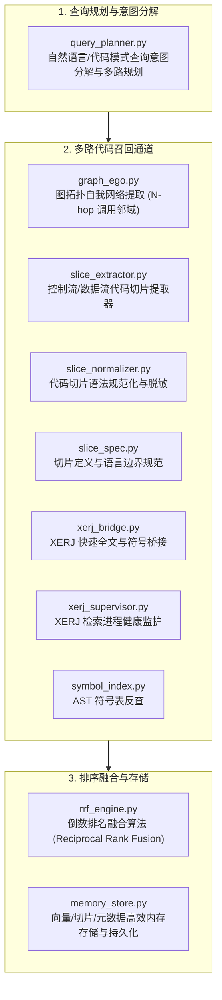

# BugX Retrieval Engine (代码切片、拓扑与混合检索增强引擎)

> **版本契约**: `0.1.0` | **所属分层**: `Layer 2: 分析、切片与探测引擎`  
> **公开架构说明**: 参见 [`docs/02_architecture/01_ARCHITECTURE.md`](../../docs/02_architecture/01_ARCHITECTURE.md)。

`core/retrieval/` 构成了 BugX 在海量代码工程中实现精准上下文检索的核心能力。它融合了图拓扑自我中心网（Graph Ego-Network）、代码依赖切片（Slicing）、以及倒数排名融合（RRF, Reciprocal Rank Fusion），为大模型攻防决策提供信噪比最高的上下文。

---

## 1. 检索引擎全景目录拓扑树 (Subsystem Directory Topology)

```text
core/retrieval/
├── 1. 查询意图分解与多路规划 (Query Planning & Intent)
│   ├── query_planner.py         # 检索查询规划器，将审计目标拆解为精确符号、语义向量与调用拓扑
│   └── INTERFACE.md             # 检索引擎对外公开的标准查询接口与输入输出契约说明
│
├── 2. 拓扑图与代码切片提取 (Graph Ego-Network & Slicing)
│   ├── graph_ego.py             # 提取指定函数或符号的 N-hop 自我中心子图 (Ego Network)
│   ├── slice_extractor.py       # 基于 AST 控制流与数据流抽取最小关联代码切片
│   ├── slice_normalizer.py      # 代码切片规范化、注释剥离与行号对齐
│   ├── slice_spec.py            # 多语言（Python/Go/C/Java/JS）切片边界规范定义
│   ├── symbol_index.py          # AST 级工程符号表提取与精确反查索引树
│   └── universal_code_matcher.py # 通用多语言代码模式模糊匹配器
│
├── 3. 多路召回融合与向量存储 (Ranking Fusion & Storage)
│   ├── rrf_engine.py            # 倒数排名融合算法 (RRF) 实现，消除各路评分量纲差异
│   ├── memory_store.py          # 嵌入向量、代码片段与元数据高效内存存储与持久化
│   └── SPEC.md                  # 检索引擎技术规格书，详述超参数与算法数学原理
│
├── 4. 符号桥接与进程监护 (External Bridges & Supervisors)
│   ├── xerj_bridge.py           # 高性能符号索引器 XERJ 快速全文与符号桥接
│   ├── xerj_supervisor.py       # XERJ 底层本地索引进程生命周期与内存监护
│   └── codebase_memory_bridge.py # codebase-memory-mcp 知识图谱服务桥接与反查
│
├── 5. 知识沉淀与外部语料 (Knowledge Sync & Corpus)
│   ├── knowledge_auto.py        # 从历史漏洞与成功修复中自动提炼对抗模式与先验
│   ├── knowledge_sources.py     # 知识来源拓扑解析与分层路径映射
│   ├── knowledge_sync.py        # 多项目/云端安全知识库增量双向同步
│   ├── corpus_fetch.py          # 种子测试语料与开源高质量安全样本抓取
│   └── code_analyzer.py         # 多语言代码静态语义分析与复杂度度量器
│
└── 6. 包初始化与导出门面
    └── __init__.py              # 模块符号统一导出
```

---

## 2. 架构拓扑与多路检索时序 (Retrieval Pipeline)



---

## 3. 模块文件物理索引与职责清单 (File Inventory)

| 文件名 | 职责与功能定位 | 关键类 / 函数 |
| :--- | :--- | :--- |
| `__init__.py` | Python 包初始化与核心模块符号导出 | `__all__` |
| `code_analyzer.py` | 多语言代码静态语义分析器，支持复杂度与结构度量 | `analyze_code`, `is_test_file` |
| `codebase_memory_bridge.py` | codebase-memory-mcp 知识图谱服务桥接与反查 | `inspect`, `KnowledgeGraphError` |
| `context_assembler.py` | 定向上下文装配器，按预算拼装符号摘要与规则提示 | `assemble_context`, `extract_symbols` |
| `corpus_fetch.py` | 种子测试语料与开源高质量代码样本抓取与检索 | `search_repos`, `search_repo_details` |
| `graph_ego.py` | 基于代码图谱提取指定函数或符号的自我中心子图（Ego Network），捕捉局部调用拓扑 | `extract_ego_graph` |
| `INTERFACE.md` | 检索引擎对外提供的标准查询接口与召回结果契约说明 | 检索接口规范 |
| `knowledge_auto.py` | 从历史漏洞与审计结果中自动沉淀提取模式知识与事件先验 | `build_incident_payload`, `build_pattern_payload` |
| `knowledge_sources.py` | 知识来源拓扑解析与分层范围路径映射 | `source_paths`, `path_for_source` |
| `knowledge_sync.py` | 多项目/云端安全知识库增量双向同步与一致性校验 | `KnowledgeSyncError`, `sync_knowledge` |
| `memory_store.py` | 嵌入向量与代码片段内存轻量级存储器，支持余弦相似度与元数据过滤 | `MemoryStore` |
| `query_planner.py` | 检索查询规划器，将复杂的审计问题拆解为符号精确查找、语义向量检索与调用拓扑追踪 | `QueryPlanner` |
| `rrf_engine.py` | 倒数排名融合（RRF）算法实现，将多路召回（关键词 + 语义 + 图拓扑）无量纲加权融合 | `rrf_score_fusion` |
| `slice_extractor.py` | 代码依赖切片提取器，基于 AST 与污点传播抽取与漏洞相关的最小代码子集 | `SliceExtractor` |
| `slice_normalizer.py` | 切片规范化器，去除注释冗余、规整缩进并对齐行号，降低 Token 开销 | `normalize_slice` |
| `slice_spec.py` | 多语言切片规范规范定义（支持 Python, Go, C/C++, Java, JS/TS 等） | `SliceSpecification` |
| `SPEC.md` | 检索系统架构规格书，详述 RRF 超参数、召回截断与去重设计 | 技术规格文档 |
| `symbol_index.py` | AST 级工程符号提取器，构建全局函数、类与调用索引树 | `Symbol`, `SourceDiscoveryError` |
| `universal_code_matcher.py` | 通用多语言代码模式匹配器，支持跨语言模式搜索 | `UniversalCodeMatcher`, `CodeSpan` |
| `xerj_bridge.py` | 高性能符号索引器 XERJ 的调用桥接层，提供微秒级符号反查 | `XerjBridge` |
| `xerj_supervisor.py` | XERJ 守护监控器，管理底层本地索引进程的拉起与内存限制 | `XerjSupervisor` |

---

## 4. 典型使用场景与代码调用示例 (Common Usage Scenarios)

### 4.1 场景 1：多路查询规划与代码切片提取
当审计模型需要深入调查某个危险输入点时，提取其污点切片：

```python
from pathlib import Path
from core.retrieval.query_planner import QueryPlanner
from core.retrieval.slice_extractor import SliceExtractor
from core.retrieval.slice_normalizer import normalize_slice

# 1. 规划查询意图
planner = QueryPlanner()
plan = planner.plan_query("查找处理用户上传文件的反序列化调用链")

# 2. 提取目标代码的精确切片
extractor = SliceExtractor(project_root=Path.cwd())
raw_slice = extractor.extract_slice(
    target_file="app/handlers/upload.py",
    symbol_name="handle_upload",
    hops=2,
)

# 3. 规范化切片以节省 Token 开销
clean_slice = normalize_slice(raw_slice)
print(f"生成的最小上下文切片:\n{clean_slice}")
```

### 4.2 场景 2：倒数排名融合 (RRF) 聚合多通道候选集
将图拓扑搜索结果与关键词匹配结果进行无量纲排序融合：

```python
from core.retrieval.rrf_engine import rrf_score_fusion

# 渠道 A：图拓扑自我中心网召回
graph_results = ["core/supervisor/lease_manager.py", "core/supervisor/budget_governor.py"]
# 渠道 B：AST 符号精确搜索召回
symbol_results = ["core/supervisor/budget_governor.py", "core/runtime/session_profile.py"]

# 融合排序 (k=60)
fused_ranked_list = rrf_score_fusion(
    ranked_lists=[graph_results, symbol_results],
    weights=[0.6, 0.4],
    k=60,
)
print("RRF 最佳匹配文件:", fused_ranked_list[0])
```

---

## 5. 核心设计契约与公理 (Design Axioms)

1. **Token 效率第一**：通过 `slice_extractor.py` 与 `slice_normalizer.py` 提取最小相关切片，严禁一股脑将万行源码全量塞入 Prompt 造成上下文污染与模型注意力涣散。
2. **多路融合抗衰退**：检索必须结合符号精确图拓扑与向量语义，`rrf_engine.py` 保证无论目标代码命名规范与否均能稳定召回高危逻辑。
3. **单向调用契约**：检索引擎作为 Layer 2 计算分析模块，严禁反向引入 Layer 3 Supervisor 或 Layer 5 Host 状态。
