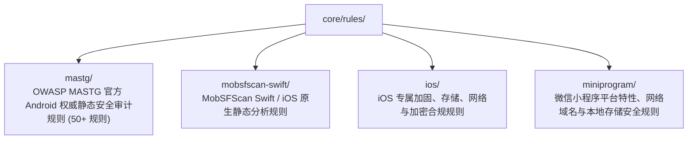

# BugX Static Security Rules (静态安全分析与攻防规则集)

`core/rules/` 存放针对移动端（Android / iOS）、微信小程序以及 Swift 原生应用的静态代码安全检测规则，兼容 OWASP MASTG（Mobile Application Security Testing Guide）与 MobSFScan 行业安全标准。

---

## 1. 规则集矩阵 (Rules Matrix)

---

## 2. 目录结构与规则清单 (File Inventory)

| 目录名 | 覆盖领域与标准 | 包含的核心规则文件 / 分类 |
| :--- | :--- | :--- |
| `mastg/` | OWASP 移动安全测试指南 (MASTG) Android 规则库 | 涵盖生物识别、密钥生成、ContentProvider 暴露、DeepLink 参数校验、Intent 泄露、PendingIntent 可变性、WebView 本地访问等 50+ 项 YAML 规范，配有 `LICENSE` 与 `PROVENANCE.json` |
| `mobsfscan-swift/` | MobSFScan Swift 原生审计规则 | 包含 `auth.yaml`, `crypto.yaml`, `jailbreak.yaml`, `keyboard.yaml`, `logging.yaml`, `network.yaml`, `resilience.yaml`, `secrets.yaml`, `storage.yaml`, `webview.yaml`，配有 `LICENSE` 与 `PROVENANCE.json` |
| `ios/` | iOS 平台专属合规与安全规则 | 包含 `crypto.yaml`, `network.yaml`, `resilience.yaml`, `storage.yaml`，配有 `PROVENANCE.json` |
| `miniprogram/` | 微信小程序安全规范 | 包含 `network.yaml`, `platform.yaml`, `storage.yaml`，配有 `PROVENANCE.json` |

---

## 3. 合规与溯源保障 (Provenance)

- 所有引用的外部规则集均保留其原始开源许可（`LICENSE`）与权威溯源元数据（`PROVENANCE.json`），明确上游仓库版本与哈希，确保在商业交付中法律与合规风险为零。
