# BugX Core Runtime Subsystem (核心运行时、环境与基础设施)

> **版本契约**: `0.1.0` | **所属分层**: `Layer 0: 基础设施与操作系统抽象`  
> **公开架构说明**: 参见 [`docs/02_architecture/01_ARCHITECTURE.md`](../../docs/02_architecture/01_ARCHITECTURE.md)。

`core/runtime/` 汇聚了 BugX 核心微内核的运行时环境配置、会话画像与恢复、模型执行适配、全链路日志遥测、进程同步存储及安全评测挖掘基础设施。

---

## 1. 运行时全景目录拓扑树 (Subsystem Directory Topology)

```text
core/runtime/
├── 1. 运行环境探测与工程画像 (Environment & Project Profiling)
│   ├── startup_environment.py   # 宿主与执行环境探测、Git 状态核验与前置门禁断言
│   ├── setup_ui_env.py          # UI 与无头浏览器 (Playwright/Puppeteer) 驱动环境初始化
│   ├── project_init.py          # 审计工程骨架初始化与 .bugx.json 配置模板生成
│   ├── prep_validate.py         # 测试套件完备性与真实导入源前置核验
│   ├── project_graph.py         # AST 级代码拓扑依赖图构建与业务调用流分析
│   ├── project_profile.py       # 技术栈自动识别、工程指纹分析与依赖画像归档
│   ├── project_settings.py      # 项目级与全局配置加载、合并与强类型校验
│   ├── platform_adapter.py      # 移动真机与模拟器 (ADB/iOS Simulator) 底层命令桥接
│   └── tool_install_targets.py  # 动态分析与外部分析工具自动安装策略与目标配置
│
├── 2. 模型执行、交互调度与频控 (Model Runner, Interaction & Windows)
│   ├── model_runner.py          # 多大模型 CLI 适配器、调用执行容器与统一输出解析
│   ├── provider_window.py       # Provider 滑动窗口限流与请求频次保护守卫
│   ├── interaction.py           # 统一终端/Web 交互问答、单选多选与确认流程协议
│   ├── interaction_store.py     # 交互请求持久化信箱（非交互宿主答案回灌）
│   └── interactive_menu.py      # 终端交互式菜单渲染与 curses/rich 选项列表
│
├── 3. 会话状态、锁与持久化 (Session State, Locks & Persistence)
│   ├── session_profile.py       # 审计任务会话特征、预算配额快照与环境元数据
│   ├── resume_ticket.py         # 审计断点续跑票据签发、持久化与原子消费验证
│   ├── sync_store.py            # 跨进程排他文件锁与键值持久化存储
│   └── daemon_runner.py         # 后台守护进程无阻塞保活与异常平滑重启
│
├── 4. 日志遥测、评测与质量保障 (Observability, Telemetry & Evaluation)
│   ├── bugx_logging.py          # 全链路结构化 Trace 日志系统，统一注入 Trace ID
│   ├── log_analytics.py         # 审计日志聚类、关键词过滤与流式实时分析
│   ├── global_telemetry.py      # 本地 SQLite 审计遥测与性能统计持久化
│   ├── self_audit.py            # BugX 自身代码质量、门禁与探针健康度自审工具
│   ├── seed_drill.py            # 种子用例演练与脆弱路径下钻
│   ├── scenario_eval.py         # 场景级阶梯化自动化评测套件 (L1~L4)
│   ├── incident_eval.py         # 历史真实事故用例库评测回放与打分器
│   ├── mining_quality_framework.py # 攻防挖掘质量度量与高危表面探索覆盖度评估
│   └── fixture_solidify.py      # 真实用例固化为防退化测试夹具与种子资产
│
└── 5. 包初始化与导出门面
    └── __init__.py              # 模块符号统一导出
```

---

## 2. 架构拓扑与执行时序 (Runtime Lifecycle Pipeline)

```mermaid
flowchart TD
    subgraph Env["1. 运行环境与工程画像"]
        SE["startup_environment.py<br/>宿主与执行环境探测"]
        SUI["setup_ui_env.py<br/>UI与无头浏览器驱动环境"]
        PI["project_init.py<br/>审计工程骨架与初始化"]
        PV["prep_validate.py<br/>测试集与依赖前置核验"]
        PG["project_graph.py<br/>代码拓扑与业务流图"]
        PP["project_profile.py<br/>技术栈识别与工程指纹"]
        PS["project_settings.py<br/>项目配置加载与路由"]
    end

    subgraph Exec["2. 模型执行与交互调度"]
        MR["model_runner.py<br/>多模型适配与调用执行器"]
        PW["provider_window.py<br/>Provider 限流与滑动窗口"]
        PA["platform_adapter.py<br/>真机/模拟器/跨平台适配器"]
        IA["interaction.py<br/>人机交互输入与单选问卷"]
        IM["interactive_menu.py<br/>终端交互式菜单渲染"]
        TIT["tool_install_targets.py<br/>自动化依赖与工具安装目标"]
    end

    subgraph State["3. 会话状态与持久化"]
        SP["session_profile.py<br/>审计会话画像与配额快照"]
        RT["resume_ticket.py<br/>断点续跑凭证与状态恢复"]
        SS["sync_store.py<br/>跨进程排他锁与键值存储"]
        DR["daemon_runner.py<br/>后台守护进程保活与重启"]
    end

    subgraph Observability["4. 日志遥测与评测挖掘"]
        BL["bugx_logging.py<br/>结构化Trace日志系统"]
        LA["log_analytics.py<br/>日志聚类与实时Tail分析"]
        GT["global_telemetry.py<br/>本地SQLite遥测聚合库"]
        SA["self_audit.py<br/>引擎内部自检与探针测试"]
        SD["seed_drill.py<br/>种子用例演练与脆弱面下钻"]
        SCE["scenario_eval.py<br/>场景分级基准评测"]
        IE["incident_eval.py<br/>历史事故用例评测回放"]
        MQF["mining_quality_framework.py<br/>攻防挖掘质量度量框架"]
        FS["fixture_solidify.py<br/>真实用例固化为防退化夹具"]
    end

    Env --> Exec
    Exec --> State
    State --> Observability
```



---

## 3. 模块文件物理索引与职责清单 (File Inventory)

| 文件名 | 职责与功能定位 | 关键类 / 函数 |
| :--- | :--- | :--- |
| `__init__.py` | Python 包初始化与核心模块符号导出 | `__all__` |
| `bugx_logging.py` | 统一结构化日志门面，自动注入 Trace ID、耗时画像与时间戳 | `global_log_root`, `is_initialized_project` |
| `daemon_runner.py` | 支撑后台守护进程无阻塞运行及异常平滑重启 | `DaemonRunner`, `resolve_project_root` |
| `fixture_solidify.py` | 将已验证的 Finding 固化为长期防退化测试夹具与种子资产 | `SolidifyError`, `build_fixture` |
| `global_telemetry.py` | 基于 SQLite 的轻量级本地全局审计遥测与性能统计持久化 | `init_db`, `record_round_telemetry` |
| `incident_eval.py` | 历史真实事故用例库评测回放与打分器 | `load_fixtures`, `score` |
| `interaction.py` | 统一终端/Web交互问题、单选选项与门禁预设配置交互流 | `InteractionOption`, `InteractionQuestion` |
| `interaction_store.py` | **交互请求持久化信箱**：门禁问题落盘 `.bugx/state/interaction/`，非交互宿主（DSH/CI/远程 Worker）用 `bugx interaction answer` 回灌，答案按 `question_id`+`phase` 双匹配且消费后即失效 | `InteractionStore`, `record_question`, `submit_answer`, `consume_answer` |
| `interactive_menu.py` | 终端交互式列表与单选/多选菜单渲染器 | `select_one` |
| `log_analytics.py` | 审计日志聚类、关键词过滤与流式实时分析器 | `get_log_records`, `tail_logs` |
| `mining_quality_framework.py` | 攻防挖掘质量度量、高危表面拓扑探测与探索覆盖评估 | `MineableSubject`, `MiningSurfaceExplorer` |
| `model_runner.py` | 多模型 CLI 适配器、调用执行容器与统一输出解析器 | `ProviderAdapter`, `RunnerAdapterError` |
| `platform_adapter.py` | 移动真机与模拟器（ADB/iOS Simulator）底层命令桥接与状态提取 | `AdapterError`, `parse_adb_devices` |
| `prep_validate.py` | 目标项目测试套件执行完备性与导入源真实性前置校验 | `default_record_for_root`, `check_test_import_source` |
| `project_graph.py` | 基于 AST 与静态引用的项目调用图谱生成与业务流抽取 | `GraphError`, `build_graph` |
| `project_init.py` | 新项目初始化引导、生成 `.bugx.json` 配置骨架与依赖安装 | `is_uninitialized_project`, `prepare_project` |
| `project_profile.py` | 被测项目指纹提取、技术栈自动识别与依赖画像归档 | `project_profiler`, `ALIASES` |
| `project_settings.py` | 加载、合并与强类型校验项目级与全局配置项 | `get_project_settings`, `resolve_project_dir_by_hash` |
| `provider_window.py` | 大模型 Provider 滑动窗口限流与频次控制守卫 | `record`, `active` |
| `resume_ticket.py` | 审计断点续跑票据签发、持久化与原子消费验证 | `create_resume_ticket`, `consume_resume_ticket` |
| `scenario_eval.py` | 场景级自动化评测套件，支持 L1-L4 阶梯化能力验证 | `LevelResult`, `run_l1_empty` |
| `seed_drill.py` | 种子测试用例自动化下钻、变异演练与脆弱路径验证 | `DrillError`, `build`, `verify` |
| `self_audit.py` | BugX 引擎自身代码质量、门禁与探针健康度自审自愈工具 | `SelfAuditError`, `run_audit` |
| `session_profile.py` | 单次审计任务会话特征、预算配额与环境上下文快照管理 | `LegacySharePolicyError`, `profile_path` |
| `setup_ui_env.py` | 初始化 UI 自动化与浏览器测试所需的前端驱动与无头环境 | `node_ok`, `sh` |
| `startup_environment.py` | 启动前运行环境探测、Git状态断言与执行环境预检 | `StartupEnvironment`, `detect_git` |
| `sync_store.py` | 提供线程安全与进程安全的文件锁及全局/项目键值持久化存储 | `SyncStore`, `SyncStoreError` |
| `tool_install_targets.py` | 动态分析与探针所需外部第三方工具自动安装策略与目标配置 | 工具安装目标规范 |

---

## 4. 典型使用场景与代码调用示例 (Common Usage Scenarios)

### 4.1 场景 1：项目环境探测与指纹识别
在审计任务启动阶段，探测目标技术栈并初始化工程配置：

```python
from pathlib import Path
from core.runtime.startup_environment import StartupEnvironment
from core.runtime.project_profile import project_profiler
from core.runtime.project_settings import get_project_settings

# 1. 探测宿主与运行时环境
env = StartupEnvironment(Path.cwd())
env.assert_ready()

# 2. 识别项目指纹与依赖
profile = project_profiler(Path.cwd())
print(f"检测到项目技术栈: {profile.languages}, 主框架: {profile.frameworks}")

# 3. 加载合并后的配置项
settings = get_project_settings(Path.cwd())
```

### 4.2 场景 2：安全排他存储与跨进程锁
在并发 Worker 读写共享审计数据时，使用 `sync_store.py` 保证强一致性：

```python
from core.runtime.sync_store import SyncStore

store = SyncStore(storage_dir=Path(".bugx/storage"))

# 安全写入带进程排他锁的键值项
with store.locked_session():
    current_claims = store.get("active_claims", default=[])
    current_claims.append("worker-audit-01")
    store.set("active_claims", current_claims)
```

### 4.3 场景 3：断点续跑票据流转
当审计会话因预算耗尽或人为中断时签发票据，后续重新挂载：

```python
from core.runtime.resume_ticket import create_resume_ticket, consume_resume_ticket

# 中断时签发续跑票据
ticket_id = create_resume_ticket(session_id="session-xyz", checkpoint_id="cp-0042")

# 下次启动时原子消费并校验
snapshot = consume_resume_ticket(ticket_id)
print(f"已恢复至断点: {snapshot.checkpoint_id}")
```

---

## 5. 核心设计契约与公理 (Design Axioms)

1. **环境与运行时完全解耦**：所有外部宿主、操作系统或环境变量的探测均通过 `startup_environment.py` 与 `platform_adapter.py` 完成标准化，微内核不直接嵌入平台特化代码。
2. **状态落盘幂等与可恢复**：所有中间态变更与断点恢复严格依赖 `sync_store.py` 与 `resume_ticket.py`，杜绝孤立文件或破坏性截断。
3. **日志与遥测零污染**：结构化日志与遥测数据经由 `bugx_logging.py` 和 `global_telemetry.py` 落盘至私有受控目录，严禁向被测工程目录泄漏敏感凭据或临时垃圾。
