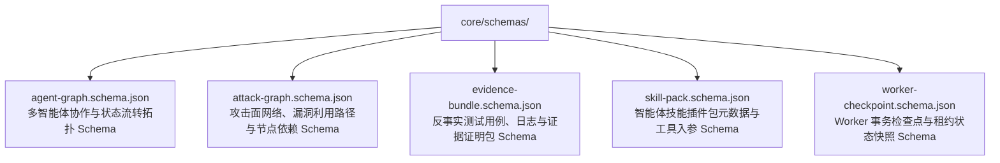

# BugX Data Schemas (核心数据契约与 JSON Schema 规范)

`core/schemas/` 提供了 BugX 核心数据资产、图谱、攻击面拓扑、证据链包与检查点的强类型 JSON Schema 校验文件，为系统跨进程、跨宿主通信与持久化落盘提供绝对契约守卫。

---

## 1. Schema 契约拓扑 (Schema Topology)

---

## 2. 文件物理索引与职责清单 (File Inventory)

| 文件名 | 对应实体 / 资产 | 核心校验字段与职责 |
| :--- | :--- | :--- |
| `agent-graph.schema.json` | 智能体协作图 | 校验智能体节点 ID、角色类型（Worker/Judge/Orchestrator）、边关系与当前状态 |
| `attack-graph.schema.json` | 攻击面图谱 | 校验脆弱点节点、调用路径、受影响资产范围、严重程度及置信度 |
| `evidence-bundle.schema.json` | 审计证据包 | 校验可执行测试脚本路径、标准输出/错误、断言失败堆栈、SHA-256 签名 |
| `skill-pack.schema.json` | 扩展技能包 | 校验技能唯一标识、版本、依赖宿主、MCP 导出函数及提示词模板 |
| `worker-checkpoint.schema.json` | Worker 检查点 | 校验 Worker UUID、租约过期时间戳、已完成任务列表、暂存 Finding 列表 |

---

## 3. 核心设计契约与公理 (Design Axioms)

1. **Fail-Closed 校验公理**：任何数据在写入磁盘或经由 MCP 跨进程分发前，必须通过对应 Schema 的全量校验，未知或类型不匹配字段必须直接抛出异常，杜绝脏数据污染系统状态。
