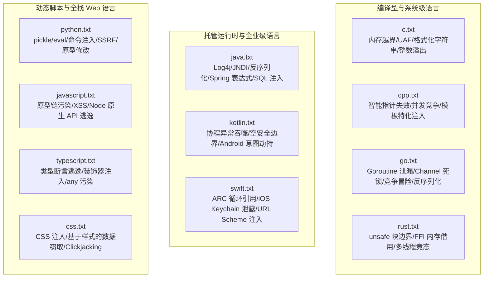

# BugX Seed Corpus (多语言攻防高危模式种子语料库)

`core/seed_corpus/` 存放了覆盖主流工业级编程语言的预置脆弱性模式、敏感 API 列表以及高危攻击面种子语料。这些语料由 BugX 在启动冷探测与 Worker 先验知识装配时直接加载，极大提高探索收敛速度。

---

## 1. 架构拓扑与多语言覆盖 (Language Coverage)

---

## 2. 语料文件物理索引与职责清单 (File Inventory)

| 文件名 | 对应语言 / 生态 | 核心种子规则覆盖领域 |
| :--- | :--- | :--- |
| `c.txt` | C 语言 | 缓冲区溢出、未初始化内存、空指针解引用、字符串格式化漏洞、Double Free |
| `cpp.txt` | C++ 语言 | 虚表劫持、RAII 资源泄露、多线程竞态、并发锁乱序、C 风格强制类型转换 |
| `css.txt` | CSS / 样式表 | 属性选择器数据探针、CSS 表达式注入、字体盗取、界面劫持攻击 |
| `go.txt` | Go 语言 | 并发竞态 (Race Condition)、Goroutine 泄漏、SQL 拼接、unsafe 逃逸、JWT 伪造 |
| `java.txt` | Java / JVM | Java 反序列化 (Fastjson/Jackson)、XXE、SSTI 模板注入、JNDI 注入、Spring 漏洞 |
| `javascript.txt` | JavaScript (Node/Web) | 原型链污染 (Prototype Pollution)、Node 子进程命令注入、XSS 注入、path 穿越 |
| `kotlin.txt` | Kotlin / Android | 协程上下文未捕获异常、Android 导出组件暴露、隐式 Intent 劫持、WebView 漏洞 |
| `python.txt` | Python 生态 | 命令执行 (`subprocess`/`os.system`)、不安全反序列化 (`pickle`/`yaml`)、Path Traversal、SSRF |
| `rust.txt` | Rust 语言 | `unsafe` 代码块指针操作、并发数据竞争、内存泄漏、边界检查绕过 |
| `swift.txt` | Swift / Apple 生态 | 强引用循环 (Memory Leaks)、Deep Link 处理不当、本地数据明文存储、桥接头漏洞 |
| `typescript.txt` | TypeScript 生态 | 运行时类型擦除导致的逻辑绕过、不安全类型强转、服务端 SSR 注入 |

---

## 3. 使用规范与维护原则

- **格式统一性**：每行一条模式，支持正则或符号关键字；井号（`#`）开头的行为注释。
- **纯粹性与通用性**：种子语料只收录具有普适性、工业界公认的高危代码模式，避免引入特定小众库的临时特化。
