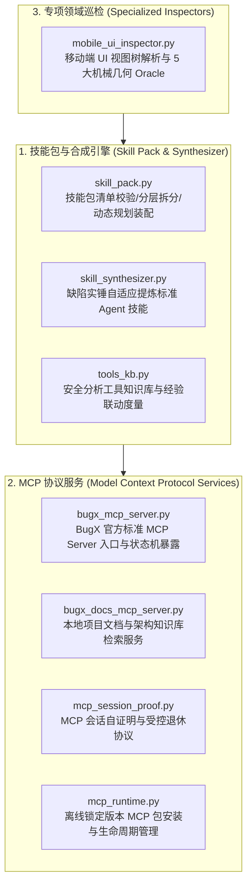

# BugX Skills & MCP Subsystem (技能包与 MCP 协议子系统)

`core/skills/` 统一收拢 BugX 的技能包管理、动态技能合成、安全工具知识库、标准 Model Context Protocol (MCP) 服务端实现、离线 MCP Runtime 与移动端 UI 几何巡检能力。公开架构说明见 [`docs/02_architecture/01_ARCHITECTURE.md`](../../docs/02_architecture/01_ARCHITECTURE.md)。

---

## 1. 架构拓扑与交互时序 (Skills & MCP Architecture)

---

## 2. 模块文件物理索引与职责清单 (File Inventory)

| 文件名 | 职责与功能定位 | 关键类 / 函数 |
| :--- | :--- | :--- |
| `__init__.py` | 技能与 MCP 子系统聚合导出与包入口 | `__all__` |
| `bugx_docs_mcp_server.py` | 文档 MCP 服务端，基于 SQLite FTS5 提供本地代码库架构与知识检索 | `DocsMcpError`, `index_documents`, `call_tool`, `serve` |
| `bugx_mcp_server.py` | BugX 核心 Supervisor MCP 服务端，向外部 Agent 暴露审计状态机 | `BugxMcpService`, `SERVER_NAME`, `SERVER_VERSION` |
| `mcp_runtime.py` | 离线 MCP 运行时，负责包隔离安装、版本回滚与沙箱启动 | `install_runtime`, `rollback_runtime`, `start_server`, `doctor_runtime` |
| `mcp_session_proof.py` | MCP 会话自证明与安全退役握手协议，防止 PID 复用与状态竞争 | `write_proof`, `read_proof`, `validate_proof`, `retire_target` |
| `mobile_ui_inspector.py` | 移动端 UI 几何巡检器，执行 Overlap/Clipping/Safe Area 等 5 大 Oracle | `parse_uiautomator_xml`, `parse_wda_json`, `run_oracles` |
| `skill_pack.py` | 技能包生命周期管理、Manifest 校验、L1/L2 阶段拆分与规划装配 | `SkillPackLoader`, `load_skill_pack`, `compile_skill_plan` |
| `skill_synthesizer.py` | 智能技能合成器，从已确认实锤漏洞自动化提炼生成标准 Skill 资产 | `SkillSynthesizer`, `synthesize_skill_from_incident` |
| `tools_kb.py` | 安全工具知识库验证器，检测可用工具命令与新鲜度时效 | `read_entries`, `check`, `experience`, `Entry` |

---

## 3. 核心设计契约与公理 (Design Axioms)

1. **确定性契约驱动**：所有导出类与函数均需满足强类型声明，严禁在无类型约束的情况下隐式传递参数。
2. **离线与零泄露边界**：MCP 服务与本地技能包在未获得显式授权前，严禁发起公网连接或向外部发送敏感凭据。
