# BugX Supervisor (并发协调与智能体调度仲裁中心)

> **版本契约**: `0.1.0` | **所属分层**: `Layer 3: 并发协调、智能体编排与账本`  
> **公开架构说明**: 参见 [`docs/02_architecture/01_ARCHITECTURE.md`](../../docs/02_architecture/01_ARCHITECTURE.md)。

`core/supervisor/` 是 BugX 针对多智能体（Worker / Judge / Orchestrator）并发攻防执行的核心协调器。它实现了租约仲裁、预算熔断、检查点事务持久化、Finding 状态流转机、以及抗崩溃灾备恢复闭环。

---

## 1. 协调中心全景目录拓扑树 (Subsystem Directory Topology)

```text
core/supervisor/
├── 1. 会话守护与资源治理 (Daemon & Budget Governance)
│   ├── audit_supervisor.py      # 会话守护主进程，协调 Worker 租约、执行与状态流转机
│   ├── budget_governor.py       # 运行预算监护人，监控 Token 消耗与网络调用，超标即时熔断
│   ├── round_governor.py        # 攻防多轮迭代控制机，基于收益衰减曲线动态决策轮数
│   ├── finish_policy.py         # 完工状态与终止判定规则（完备覆盖/预算耗尽/零未决）
│   ├── finish_sync.py           # 会话完工结算同步器，协调所有子任务平稳退出并释放锁
│   ├── systemic_failure.py      # 系统级灾难熔断器（全量超时、宿主失联、磁盘耗尽保护）
│   └── serial_authorization.py  # 串行关键区（如写文件、跑测试）许可授权管理器
│
├── 2. Worker 租约与生命周期 (Lease & Worker Lifecycle)
│   ├── lease_manager.py         # Worker 动态租约管理器，支持毫秒级心跳检测与失联回收
│   ├── worker_lifecycle.py      # 单个 Worker 实例状态追踪与异常捕获容器
│   ├── worker_runtime.py        # Worker 运行时环境管控与执行环境隔离保障
│   ├── worker_execution.py      # Worker 进程沙箱执行器，提供超时控制与优雅终止
│   ├── worker_handoff.py        # 智能体 Worker 移交协议与任务数据包分发
│   ├── worker_sync.py           # Worker 总体运行拓扑同步器，维护活跃 Worker 池视图
│   ├── start_sync.py            # Worker 启动同步器，建立子进程环境与通信管道连接
│   ├── claim_sync.py            # 跨进程任务认领互斥锁与租约争抢消解机制
│   └── claim_events.py          # Worker 任务认领（Claim）事件定义与事件总线管道
│
├── 3. 检查点持久化与灾难恢复 (Checkpoints & State Recovery)
│   ├── state_store.py           # 会话状态持久化存储库底层实现，提供带锁读写与原子更新
│   ├── checkpoint_pipeline.py   # 检查点持久化管道，提供原子化落盘与防断电损坏保障
│   ├── checkpoint_handler.py    # 检查点控制器，处理单次 Worker 任务提交的快照与校验
│   ├── checkpoint_sync.py       # 检查点同步器，协调宿主环境与内部状态机之间的快照同步
│   ├── worker_checkpoint.py     # Worker 检查点快照提交与前置合法性校验入口
│   └── recovery_sync.py         # 进程崩溃或强杀后的状态自愈与现场恢复同步器
│
├── 4. Finding 工作流与跨任务同步 (Finding Workflow & Sync)
│   ├── finding_workflow.py      # 缺陷完整生命周期状态机管理器 (OPEN -> VERIFYING -> ACCEPTED)
│   ├── finding_sync.py          # Finding 发现同步中心，按文件与攻击类型执行跨 Worker 智能去重
│   ├── finding_commit.py        # Finding 提交前守门员，校验反事实测试用例与漏洞证明
│   ├── rejection_remedies.py    # 被拒 Finding 的补救与二次验证启发式策略生成器
│   ├── coverage_sync.py         # 代码覆盖度实时同步引擎，收集并合并 AST 探针命中率
│   ├── graph_sync.py            # 代码知识图谱与调用链关系内存缓存同步器
│   ├── context_sync.py          # 共享会话上下文同步器，分发全局配置与环境指纹
│   ├── next_round_sync.py       # 轮次迭代递进同步器，重置临时租约并计算下一轮探索种子
│   └── task_scheduler.py        # 任务执行优先级调度器，按敏感攻击面与覆盖度动态排期
│
├── 5. 宿主协同、可观测性与规范 (Host Integration, Observability & Specs)
│   ├── supervisor_host.py       # 宿主交互治理与 MCP 服务生命周期调度器
│   ├── supervisor_models.py     # Supervisor 统一数据结构定义、状态枚举与序列化协议
│   ├── observability.py         # Supervisor 全链路可观测性打点，记录耗时与心跳指标
│   ├── cli.py                   # Supervisor 专用命令行调试入口，支持状态诊断与故障注入
│   ├── lifecycle_blocks.py      # 生命周期阶段强阻断器，确保必须通过前置阶段才能流转
│   ├── INTERFACE.md             # Supervisor 外部集成与宿主 RPC 接口契约说明文档
│   └── SPEC.md                  # Supervisor 核心机制详细技术设计规范
│
└── 6. 包初始化与导出门面
    └── __init__.py              # 模块符号统一导出
```

---

## 2. 架构拓扑与交互时序 (Supervisor Topology)

```mermaid
flowchart TD
    subgraph Governance["1. 资源治理与配额仲裁"]
        G1["budget_governor.py<br/>Token/调用预算熔断控制"]
        G2["round_governor.py<br/>多轮轮次跃迁与退出决策"]
        G3["finish_policy.py<br/>完工状态与终止判定规则"]
        G4["serial_authorization.py<br/>串行执行许可与并发限流"]
    end

    subgraph LeaseWorker["2. 租约管理与 Worker 生命周期"]
        L1["lease_manager.py<br/>Worker 租约分配/续租/心跳回收"]
        L2["worker_lifecycle.py<br/>Worker 状态机与错误隔离"]
        L3["worker_sync.py<br/>Worker 状态同步与事件分发"]
        L4["claim_sync.py<br/>任务认领申明与冲突消解"]
        L5["claim_events.py<br/>认领事件流与发布订阅"]
    end

    subgraph StateCheckpoint["3. 检查点与状态持久化"]
        S1["state_store.py<br/>持久化状态存储 (JSON/SQLite)"]
        S2["checkpoint_pipeline.py<br/>事务检查点落盘管道"]
        S3["checkpoint_handler.py<br/>检查点创建/校验与快照"]
        S4["checkpoint_sync.py<br/>内存态与持久化态双向同步"]
        S5["recovery_sync.py<br/>崩溃唤醒与状态灾备恢复"]
    end

    subgraph FindingSync["4. Finding 工作流与代码覆盖度"]
        F1["finding_workflow.py<br/>Finding 状态机 (Open->Verifying->Accepted)"]
        F2["finding_sync.py<br/>跨 Worker 发现同步与去重"]
        F3["finding_commit.py<br/>缺陷确认落盘与原子提交"]
        F4["rejection_remedies.py<br/>误报排查与补救重试策略"]
        F5["coverage_sync.py<br/>实时代码探针与覆盖度聚合"]
        F6["graph_sync.py<br/>调用拓扑图与代码上下文同步"]
    end

    Governance --> LeaseWorker
    LeaseWorker --> StateCheckpoint
    StateCheckpoint --> FindingSync
```



---

## 3. 模块文件物理索引与职责清单 (File Inventory)

| 文件名 | 职责与功能定位 | 关联核心接口 / 符号 |
| :--- | :--- | :--- |
| `__init__.py` | Python 包初始化与核心模块符号导出 | `__all__` |
| `audit_supervisor.py` | 会话守护主进程，协调 Worker 租约、执行与状态流转机 | `Supervisor`, `RunBudget` |
| `budget_governor.py` | 运行预算监护人，监控 Token 消耗、网络调用与超时预算，超标即时熔断 | `BudgetGovernor` |
| `checkpoint_handler.py` | 检查点控制器，处理单次 Worker 任务提交的快照与完整性校验 | `CheckpointHandler` |
| `checkpoint_pipeline.py` | 检查点持久化管道，提供原子化落盘与防断电损坏保障 | `CheckpointPipeline` |
| `checkpoint_sync.py` | 检查点同步器，协调宿主环境与内部状态机之间的快照同步 | `sync_checkpoint_state` |
| `claim_events.py` | Worker 任务认领（Claim）事件定义与事件总线管道 | `ClaimEvent`, `ClaimEventDispatcher` |
| `claim_sync.py` | 跨进程任务认领互斥锁与租约争抢消解机制 | `ClaimSynchronizer` |
| `cli.py` | Supervisor 专用命令行调试入口，支持状态诊断与手动故障注入 | `main` |
| `context_sync.py` | 共享会话上下文同步器，分发全局配置与环境指纹给所有 Worker | `ContextSynchronizer` |
| `coverage_sync.py` | 代码覆盖度实时同步引擎，收集并合并 AST 探针命中率 | `CoverageSynchronizer` |
| `finding_commit.py` | Finding 提交前守门员，校验反事实测试用例与漏洞证明完整性 | `FindingCommitGate` |
| `finding_sync.py` | Finding 发现同步中心，按文件与攻击类型执行跨 Worker 智能去重 | `FindingSynchronizer` |
| `finding_workflow.py` | 缺陷完整生命周期状态机管理器（OPEN $\rightarrow$ VERIFYING $\rightarrow$ ACCEPTED $\rightarrow$ REJECTED） | `FindingWorkflowEngine` |
| `finish_policy.py` | 运行终止策略仲裁，判断是否满足全部退出条件（完备覆盖/预算耗尽/零未确认） | `FinishPolicyDecider` |
| `finish_sync.py` | 会话完工结算同步器，协调所有子任务平稳退出并释放锁 | `FinishSynchronizer` |
| `graph_sync.py` | 代码知识图谱与调用链关系内存缓存同步器 | `GraphSynchronizer` |
| `INTERFACE.md` | Supervisor 外部集成与宿主 RPC 接口契约说明文档 | 契约签名与事件总线说明 |
| `lease_manager.py` | Worker 动态租约管理器，支持毫秒级心跳检测、租约回收与失联摘除 | `LeaseManager` |
| `lifecycle_blocks.py` | 生命周期阶段强阻断器，确保必须通过前置阶段才能流转 | `LifecycleBlocker` |
| `next_round_sync.py` | 轮次迭代递进同步器，重置临时租约并计算下一轮探索种子 | `NextRoundSynchronizer` |
| `observability.py` | Supervisor 全链路可观测性打点，记录任务耗时、心跳与异常度量 | `SupervisorObservability` |
| `recovery_sync.py` | 进程崩溃或强杀后的状态自愈与现场恢复同步器 | `RecoverySynchronizer` |
| `rejection_remedies.py` | 被拒 Finding 的补救与二次验证启发式策略生成器 | `RejectionRemedyPlanner` |
| `round_governor.py` | 攻防多轮迭代控制机，基于收益衰减曲线与探索增量动态决策轮数 | `RoundGovernor` |
| `serial_authorization.py` | 串行关键区（如写文件、跑测试）许可授权管理器，防止竞态冲突 | `SerialAuthorizer` |
| `SPEC.md` | Supervisor 核心机制详细技术设计规范 | 状态机模型与租约数学模型 |
| `start_sync.py` | Worker 启动同步器，建立子进程环境与通信管道连接 | `StartSynchronizer` |
| `state_store.py` | 会话状态持久化存储库底层实现，提供带锁读写与原子更新 | `StateStore` |
| `supervisor_host.py` | 宿主交互治理与 MCP 服务生命周期调度器 | `SupervisorHostManager` |
| `supervisor_models.py` | Supervisor 统一数据结构定义、状态枚举与序列化协议 | `RunState`, `WorkerClaim`, `Status` |
| `systemic_failure.py` | 系统级灾难熔断器（全量超时、宿主失联、磁盘耗尽），提供紧急保护 | `SystemicFailureGuard` |
| `task_scheduler.py` | 任务执行优先级调度器，按敏感攻击面与覆盖度动态排期 | `TaskScheduler` |
| `worker_checkpoint.py` | Worker 检查点快照提交与前置合法性校验入口 | `submit_checkpoint` |
| `worker_execution.py` | Worker 进程沙箱执行器，提供超时控制与优雅终止管道 | `run_bounded`, `terminate_group` |
| `worker_handoff.py` | 智能体 Worker 移交协议与任务数据包分发 | `prepare_handoff` |
| `worker_lifecycle.py` | 单个 Worker 实例状态追踪与异常捕获容器 | `WorkerLifecycleTracker` |
| `worker_runtime.py` | Worker 运行时环境管控与执行环境隔离保障 | `WorkerRuntime` |
| `worker_sync.py` | Worker 总体运行拓扑同步器，维护全局活跃 Worker 池视图 | `WorkerSynchronizer` |

---

## 4. 典型使用场景与代码调用示例 (Common Usage Scenarios)

### 4.1 场景 1：Worker 租约申领与心跳续租
Worker 启动后通过租约管理器申领任务执行租约，并周期性发送心跳保活：

```python
from core.supervisor.lease_manager import LeaseManager

# 1. 初始化租约管理器 (租约超时时间 30 秒)
manager = LeaseManager(lease_ttl_seconds=30)

# 2. 申领目标任务租约
lease = manager.acquire_lease(worker_id="worker-sast-01", task_id="task-auth-scan")
if not lease.is_granted:
    raise RuntimeError("任务已被其他 Worker 占用")

# 3. 定期发送心跳保活
is_renewed = manager.heartbeat(lease_id=lease.lease_id)
assert is_renewed, "租约已失效或被回收"
```

### 4.2 场景 2：预算熔断与轮次控制
在每轮攻防对抗迭代开始前，评估预算消耗与边际收益：

```python
from core.supervisor.budget_governor import BudgetGovernor
from core.supervisor.round_governor import RoundGovernor

# 1. 预算监护断言
budget = BudgetGovernor(max_tokens=1_000_000, max_seconds=3600)
budget.record_usage(tokens=45_000, cost=0.12)
if budget.is_exhausted():
    print("触发预算熔断，平稳终止后续 Worker 调度")

# 2. 多轮收益衰减评估
round_gov = RoundGovernor()
should_continue = round_gov.should_proceed_to_next_round(
    current_round=3,
    new_findings_count=0,  # 收益衰减为 0
    coverage_delta=0.001,
)
if not should_continue:
    print("探索收益趋近零，提前退出审计战役")
```

---

## 5. 核心设计契约与公理 (Design Axioms)

1. **租约零悬空公理**：Worker 必须在租约有效期内通过心跳主动续租；一旦超时，`lease_manager.py` 必须物理回收租约并重置任务状态，杜绝僵尸 Worker 占有系统资源。
2. **检查点原子事务公理**：所有检查点状态写入必须经过进程间文件锁与原子替换，保障断电或进程强杀场景下的状态自洽与零损毁。
3. **单向依赖规约**：Supervisor 作为 Layer 3 调度中心，向下驱动 Layer 2 分析器与 Layer 0 运行时，向上与 Layer 5 宿主解耦交互。
