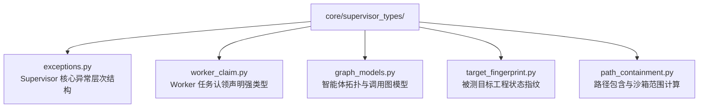

# BugX Supervisor Types (协调层强类型定义与类型守护)

`core/supervisor_types/` 提取了 Supervisor 及其关联组件的核心实体、异常基类、任务认领声明与图谱数据结构，消除循环导入并提供纯粹的类型契约。

---

## 1. 类型依赖拓扑

---

## 2. 文件物理索引与职责清单 (File Inventory)

| 文件名 | 职责与功能定位 | 关键类 / 函数 |
| :--- | :--- | :--- |
| `__init__.py` | Python 包初始化与核心模块符号导出 | `__all__` |
| `exceptions.py` | Supervisor 专用强类型异常集（租约过期、任务冲突、预算耗尽、系统熔断等） | `LeaseExpiredError`, `BudgetExceededError`, `ClaimConflictError` |
| `graph_models.py` | 智能体图谱节点、边关系与拓扑结构的强类型数据模型（Dataclasses） | `AgentNode`, `AgentEdge`, `AgentTopology` |
| `path_containment.py` | 路径包含断言器与沙箱安全检查器，精确判定子路径是否在根作用域内 | `is_path_contained`, `assert_contained` |
| `target_fingerprint.py` | 目标项目代码指纹与依赖哈希计算器，用于感知工作区代码变更 | `TargetFingerprint` |
| `worker_claim.py` | Worker 任务认领申明强类型，定义认领的文件范围、角色与预期时长 | `WorkerClaim` |

---

## 3. 设计原则

- **零业务循环依赖**：本目录所有文件仅依赖 Python 标准库，严禁反向引用上层 `core/supervisor/` 或 `core/launch_phases/`。
