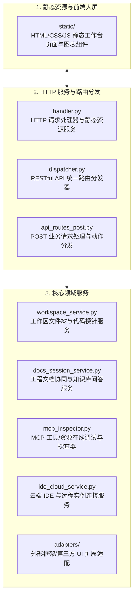

# BugX WebUI (内置攻防工作台与实时大屏服务)

`core/webui/` 提供了 BugX 独立运行的本地/远程 Web 工作台服务。它支持实时的攻击面大屏监控、Finding 可视化审查、MCP 工具调用审计、文档会话交互以及 IDE 云端协同。

---

## 1. 架构拓扑与交互时序 (WebUI Architecture)

---

## 2. 模块文件物理索引与职责清单 (File Inventory)

| 文件名 / 目录 | 职责与功能定位 | 关键类 / 函数 |
| :--- | :--- | :--- |
| `__init__.py` | Python 包初始化与核心模块符号导出 | `__all__` |
| `adapters/` | 外部第三方前端组件与可视化适配器目录 | 子目录适配组件 |
| `api_routes_post.py` | 处理状态变更相关的 POST 请求（启动审计、确认 Finding、触发测试等） | `handle_post_api` |
| `dispatcher.py` | WebUI 路由分发中心，实现类似微框架的 URL 映射与中间件过滤 | `WebUIDispatcher` |
| `docs_session_service.py` | 文档会话服务，支撑开发者在 Web 界面上实时浏览与治理工程文档 | `DocsSessionService` |
| `handler.py` | 基于 Python 标准库 `http.server` 的高可靠零第三方依赖 HTTP 服务处理器 | `WebUIRequestHandler` |
| `ide_cloud_service.py` | IDE 云端同步与远程工作空间配对管理服务 | `IDECloudService` |
| `INTERFACE.md` | WebUI API 接口契约说明文档，包含完整 REST 端点清单与返回格式 | HTTP 端点规范 |
| `mcp_inspector.py` | MCP 工具检查器，提供可视化测试 MCP 工具、查看 Schema 和状态的能力 | `MCPInspectorService` |
| `SPEC.md` | Web 工作台设计规范，包括安全凭据认证与 CORS 限制规范 | 设计规范说明 |
| `static/` | 嵌入式前端工作台静态资源（SVG 矢量图标、响应式样式、离线运行时） | 前端静态资产 |
| `workspace_service.py` | 工作区状态服务，实时拉取文件变更、Git 状态与覆盖率数据给前端渲染 | `WorkspaceService` |

---

## 3. 核心设计契约与公理 (Design Axioms)

1. **零外部重型依赖**：`handler.py` 基于标准库实现，严禁强依赖 Flask、FastAPI 等重量级外部框架，确保在极简沙箱或生产容器内开箱即用。
2. **严格本地回环安全门禁**：默认仅监听 `127.0.0.1`，任何跨域或公网暴露必须通过显式 Token 鉴权，严禁未授权远程写文件或执行命令。
