# BugX 用户使用指南

BugX 是面向 AI 辅助开发的证据驱动代码审计与缺陷挖掘工具。它把项目状态、任务租约、覆盖率、证据 receipt、Finding 决策和报告消费状态持久化到项目的 `.bugx/` 目录，并通过本地 MCP Supervisor 协调 Host 与 Worker。

本指南描述当前源码真正支持的使用方式。它不会把“模型输出了结论”“命令返回了 `ready`”或“某个 Host 有安装适配器”写成审计完成。

## 0. 使用总览与流程图

从第一次安装到最终报告，先按用户旅程图理解入口，再按生命周期图核对证据。图下方保留 Mermaid 源文件，后续修改流程时必须先改源图再重新导出。



[用户主流程 Mermaid 源文件](../06_diagrams/02_bugx-user-journey.mmd)



[生命周期与证据闭环 Mermaid 源文件](../06_diagrams/03_bugx-lifecycle-evidence.mmd)

遇到命令、项目、宿主、Worker、同步或报告问题时，进入[故障排查与恢复手册](03_TROUBLESHOOTING.md)，按症状路由图收集证据后再执行恢复动作。

## 1. 证据和状态约定

| 标记 | 含义 |
|---|---|
| `源码已确认` | 当前 CLI、路径模型或协议实现直接支持；不代表你的机器已经运行成功。 |
| `环境相关` | 取决于本机 Host、Provider、凭据、网络或操作系统；必须看本机命令输出。 |
| `未验证` | 本轮没有执行真实 Host ACP、自治闭环、远端同步或破坏性操作；不能据此宣称产品验收。 |
| `阻塞` | 系统有明确的 gate、缺失依赖、未回答交互或失败状态；应按故障手册恢复，不要用删除状态文件绕过。 |

BugX 的交付状态应优先看结构化状态和 receipt：

```
COMPLETE
ABORTED
BLOCKED
INCOMPLETE
RECOVERY_REQUIRED
BUDGET_EXHAUSTED
```

不同命令的 JSON 字段可能还有命令专属状态。`exit 0` 只能按该命令的契约解读，不能替代生命周期和 finish gate。

## 1.1 主要流程验收卡

下面的表把每条主要路线压缩成同一套判断格式。没有列出确切字段的地方，说明当前实现只保证退出码或阶段状态，用户必须把实际 JSON、receipt 和 artifact 路径保存下来，不能用猜测补齐输出。

| 流程 | 前置条件与命令 | 预期输出与退出码 | 成功判定 | 本地/联网/目标代码副作用 | 失败恢复与停止条件 |
|---|---|---|---|---|---|
| 安装 Host 和全局引擎 | 已确认 `<ROOT>`、`<HOST>`、安装授权；`bugx install --root <ROOT> --agent <HOST> --non-interactive --json` | JSON 应包含安装结果、engine/Host 资产状态；退出码 0 只表示本次安装命令成功 | `hosts --json` 与 `doctor --strict --json` 显示目标 Host 的实际状态；ready、ACP、自治能力仍分别核对 | 写全局 `~/.bugx/`、项目注册/布局和 Host 配置；可能访问网络；可能要求重启 Host | 保留 stderr、JSON 和已有配置；先读 `doctor`/`log`；不要因为缺资产直接加 `--force`；出现 Host 入口不一致时标 `RESTART_REQUIRED` |
| 初始化项目 | `<ROOT>` 已存在且授权写入；非交互必须选择同步范围：`bugx init --root <ROOT> --cloud-sync local` | 成功时 stdout 会报告“初始化完成”、运行目录和写入/保留数量；实现会写 `.bugx/manifest.json`、项目 state/ledger/生命状态，并在 `.bugx/logs/bugx.jsonl` 记录初始化事件；非交互缺少同步选择时返回 2 | `engine status --json` 不再是 `UNINITIALIZED`，manifest identity、布局和 engine 来源一致；不要把普通初始化日志当成生命周期 settlement receipt | 写项目 `.bugx/`、全局 engine/knowledge/缓存；`sync` 会联网，`local` 不等于撤销全局同意 | 先保存 stderr、stdout 和目录清单；不要先 `init --force`、reset 或手改 manifest；布局冲突时转排障手册 |
| 源码 Dev 模式 | 必须是 BugX 真实源码 checkout；先确认 engine 来源；纯源码运行使用 `BUGX_DEV_MODE=1`，不要把它和 `--dev` 混为一谈 | `bugx engine --root <ROOT> path --name launch_bugx.py` 应输出 `<BUGX_CHECKOUT>/core/launch_bugx.py`；随后 `pre` 的退出码 0/2/3 分别表示门禁就绪/待交互/需重启 | 引擎路径指向当前 checkout 的 `core/`，且 `pre` 状态和 receipt 绑定同一 engine 来源；路径仍在 `~/.bugx/core` 时 Dev 未生效 | 环境变量只影响本进程；`pre --dev` 还会启用自动审查、自动修复、自动轮询和按轮次提交，写 `.bugx/`，可能改目标代码和 Git | 先检查 `BUGX_GLOBAL_ENGINE_ROOT`、`BUGX_ASSET_ROOT` 和 checkout 条件；路径不匹配立即停止；普通开发改用 `--fix-mode log-only --commit-policy manual` |
| 普通生命周期 | 已初始化、Host/MCP 和预算门禁就绪；`bugx engine --root <ROOT> pre` | 0=启动门禁就绪；2=读取交互请求并等待选择；3=安装/加载 Host 后重启会话；其他非零=失败 | 只能判定进入下一阶段；还必须有 Worker、coverage、Finding、post 和 settlement receipt 才能交付 | 写 polling/lifecycle、快照、日志和 Supervisor 状态；后续 Worker 可能执行目标代码 | 读取状态、日志和 `BUGX_INTERACTION_REQUEST`；同一 gate 未改变前不重复重试；2/3 不得当作挖掘完成 |
| Worker / MCP / ACP | 项目布局有效，Host 真实建立 MCP session；Host 先 start，Worker 再 claim | `claim` 返回 `execution_state=claimed`、`start_required=true`；接着必须有 `worker-start`、tool-call/heartbeat 和执行 receipt | 真实 session proof、runtime/Supervisor/Worker identity、tool-call、artifact SHA-256 和 checkpoint 全部可追溯；仅 tools/list/schema 不够 | 本地 stdio、租约、checkpoint、日志和 artifact；受控 probe 可能执行目标代码 | claim 后没有 worker-start、heartbeat 丢失、session proof 缺失时进入 recovery；不能把模型文本或协议模拟写成执行成功 |
| Checkpoint / Coverage / Finding | Worker 已有 claim epoch；checkpoint 使用稳定 ID；Finding 由 Host 独立验证 | checkpoint receipt 必须绑定 coverage/evidence/findings；Finding 依次为 candidate → verify → confirmed/rejected | 每个 evidence 有 command、exit code、artifact path/SHA-256、target fingerprint 和 Worker/run/lease；open Finding 已处理 | 写 lifecycle 事件、coverage ledger、Finding 和验证 artifact；验证命令可能执行目标代码 | checkpoint 失败用同一 `checkpoint_id` 重试或 salvage；缺 verify receipt、coverage debt 或 open Finding 时只能 `INCOMPLETE` |
| Post / Report | 生命周期已满足 finish gate；`bugx engine --root <ROOT> post`，再按需 `bugx report --root <ROOT> --source project --format both` | 应生成 `conclusion.json`、`report.md`、`integrity.json` 和 report-consumption 状态；报告可能是 `NOT ATTESTED` | `post`/settlement receipt、报告哈希、coverage/Finding/attestation 一致；报告文件存在或命令 0 不能单独证明完成 | 写报告和消费状态；`share/submit/log-report` 可能联网；报告可能包含目标代码摘要 | 先读 post/report receipt 和状态；分享失败标 `RECOVERY_REQUIRED`；不要重新生成报告覆盖原始证据 |
| Cloud 同步和数据上传 | 先明确同意、scope、detail mode、sensitive policy；知识同步使用 `bugx cloud sync --root <ROOT> --scope project`，项目指标使用 `bugx project sync --root <ROOT> --json`，其他上传必须单独选择 | `cloud sync` 输出每个 scope 的 baseline/push/pull 摘要；`project sync --json` 应有 `status=ok`、`project_id`、`synced=true`；退出码 0 仍只代表该命令返回成功 | 读取 `cloud status --scope all --json`，确认目标 scope 的 cursor/error/pending/dead_letter/conflicts_open；同时核对本次实际网络动作，不把“本地状态已写入”当成远端成功 | 知识同步读写本地 SyncStore 并联网；`project sync` 上传紧凑项目画像/指标；`telemetry upload`、`cloud upload`、`feedback`、`log-report` 是不同的额外网络动作 | scope、同意、payload 或 TLS 不明确时停止；先保存 status/log/JSON，再按冲突、死信、ACK pending 或认证路径恢复，不要盲目重试或直接 purge |
| Reset / Uninstall / 恢复 | 先 dry-run、确认备份位置和活动 lease；例如 `bugx reset --scope project --root <ROOT> --dry-run --json` | dry-run 应列出目标、备份和拟删除项；实际动作必须有授权和可追溯结果 | 备份可读、目标范围与预期一致、状态进入明确终态；不是“目录消失”就算成功 | reset/uninstall 可能删除项目状态、全局资产或 Host 配置；purge 不可逆性更高 | 备份缺失、目标范围扩大或活动状态不明时立即停止；不要以 reset 绕过 gate，先走 `status/log/recover` |

任何一行只完成了“命令返回 0”而没有达到“成功判定”列，都只能报告为 `UNVERIFIED` 或该流程的中间状态。

## 2. 安装前准备

### 2.1 运行时

- Python `>=3.11`：Python 包和 `bugx` CLI 的运行时要求。
- Node.js `>=18`：仅在使用 npm wrapper 时需要。
- 可选 Python extra：
  - `tui`：终端交互相关依赖；
  - `graph`：Tree-sitter 语言包；
  - `crypto`：加密相关依赖。

可选 extra 不会由基础包自动安装。仓库声明的两个分发入口是：

```
python -m pip install bugx-cli
npm install -g bugx-cli
```

这两个命令只说明当前包元数据声明的入口；是否能从你使用的包源获取版本，仍由你的环境和包源决定。

安装后先确认 CLI 本身存在：

```
bugx --version
bugx help
```

`bugx help` 和 `bugx --version` 属于 CLI 自身查询。不要用会进入 handler 的嵌套 `--help` 替代源码或本手册核对，某些子命令的完整行为包含初始化、修复或外部动作。

### 2.2 项目根目录

BugX 的项目根必须是已存在的目录。建议从要审计的仓库根目录执行命令，并始终显式传递 `--root .`，这样不会把上层目录或错误工作目录当成项目。

## 3. 初始化项目

最小的本地初始化路径：

```
cd /path/to/project
bugx init --root . --cloud-sync local
bugx doctor --root . --strict
bugx hosts --root . --json
```

初始化会：

1. 校验项目根和 `.bugx/` 的安全性；
2. 创建项目 manifest、polling/lifecycle 初始状态和私有运行目录；
3. 注册项目身份；
4. 准备全局 engine、CLI 入口和项目所需的静态材料；
5. 创建本地知识、索引、日志和备份目录；
6. 把可执行 engine 放在全局 BugX engine 根，项目只保存状态和配置。

非交互 shell 中，`bugx init` 必须显式给出 `--cloud-sync local` 或 `--cloud-sync sync`，除非已有 preset 提供这个选择。`local` 不会把全局数据分享同意改成撤销；它表示这次初始化采用本地同步模式。要永久拒绝云端推送，使用：

```
bugx config set telemetry.data_sharing false
```

`bugx init --force` 只用于更新受 BugX 管理的静态 Agent 文件，不等于覆盖运行态，也不等于确认云端同步。初始化可能清理旧的项目级 `.bugx/core` 可执行布局；布局迁移失败时应保留错误现场并按排障手册处理。

## 4. 项目布局和作用域

### 4.1 项目级状态

项目状态位于：

```
<project>/.bugx/
├── manifest.json
├── pollings/<polling-id>/
│   ├── state.json
│   └── lifecycles/<lifecycle-id>/
├── state/
│   ├── life.json
│   ├── runtime.json
│   ├── supervisor.json
│   ├── coverage-evidence.json
│   ├── snapshots/
│   └── locks/
├── artifacts/
├── backups/
├── index/
├── logs/bugx.jsonl
└── knowledge/
```

实际生命周期目录还包含 `events.jsonl`、`conclusion.json`、`report.md` 和 `integrity.json` 等产物。`.bugx/` 默认使用私有目录权限；不要把凭据、完整日志或未审查的 artifact 提交到项目仓库。

### 4.2 全局状态

默认的用户级根目录是 `~/.bugx/`，包括：

- `core/`：全局可执行 engine；
- `knowledge/`：全局知识；
- `skills/`：全局 skill；
- `cache/`：缓存；
- `telemetry/`：遥测统计；
- `cloud-config.json`：云端配置和数据分享同意；
- `cloud-credentials.json`：凭据；
- `cloud-device-id`：设备身份。

这些位置可以由源码声明的 `BUGX_GLOBAL_*`、`BUGX_CLOUD_*` 环境变量覆盖。文档只保证当前实现的默认路径和覆盖入口，不保证系统钥匙串或其他操作系统凭据服务会代管 BugX 文件。

环境变量不是隐含的项目配置文件。设置语法、项目/用户全局/远端作用域、可操作变量、Host 注入变量和敏感边界见[环境变量参考](../04_reference/01_ENVIRONMENT_VARIABLES.md)。其中 `BUGX_PROJECT_ROOT` 只能指向已存在目录；`BUGX_GLOBAL_*` 会影响所有项目；`BUGX_CLOUD_*` 可能改变用户级云状态或远端目的地。优先使用命令的显式 `--root`、`--scope`、`--privacy` 和 `--cloud-sync` 参数，不要把所有 `BUGX_*` 变量一并导出。

### 4.3 项目和全局 reset

作用域不是标签，而是实际数据边界：

| 作用域 | 典型内容 | 命令 |
|---|---|---|
| `project` | 当前项目 polling、lifecycle、运行态、日志、索引、可选项目 knowledge | `bugx reset --scope project --root .` |
| `global` | 全局 knowledge、身份、credentials、MCP runtime、备份 | `bugx reset --scope global` |
| `all` | 只在支持该值的 cloud/status/sync 等命令中使用；不要把它当作 reset 的隐含默认 | `bugx cloud ... --scope all` |

## 5. Host、MCP 和 ACP 能力矩阵

BugX 当前有四套有意不同的 Host 列表。使用前先确定你需要的是哪一种能力。

| 能力层 | 当前源码事实 |
|---|---|
| 安装/检测适配器 | `chatgpt`、`claude`、`cline`、`codex`、`dsh`、`funide`、`opencode`、`pi`、`qoder`、`trea`、`workbuddy`、`zcode` |
| ready engine plugin | `opencode`、`codex`、`cline`、`dsh`、`claude`、`pi`、`zcode` |
| ACP ready | `cline`、`opencode` |
| ACP todo | `chatgpt`、`workbuddy`、`qoder`、`trea`、`funide` |
| ACP unavailable | `claude`、`codex`、`dsh`、`pi`、`zcode` |
| autonomous CLI choices | `claude`、`codex`、`opencode`、`dsh`、`cline`、`zcode` |

因此，“可安装”不等于“有 ready engine plugin”，更不等于“支持 ACP 或自治闭环”。`bugx hosts --json` 是当前机器检测结果；源码矩阵是能力上限，不能代替本机 Host 的安装和登录状态。

### 5.1 安装指定 Host

```
bugx install --root . --agent opencode
bugx install --root . --agent cline --non-interactive --json
bugx doctor --root . --agent opencode --strict
```

`bugx install` 的作用是写入或更新 BugX 所有权范围内的 Host 配置；`--force` 只在你确认由 BugX 管理的静态资产可以更新时使用。`--allow-missing` 允许安装流程在缺少某些可选 Host 资产时继续，但不会把缺失能力变成 ready。`--agent` 可以重复传入；不指定时不要假定会自动配置全部 Host。

卸载时，普通 `bugx uninstall` 只应移除记录的 owned files，并尽量保留用户文件或已变更文件。`--all`、`--purge-data` 和 `--purge-global-data` 是范围更大的动作，见第 13 节。

## 6. Provider、Model、凭据和隐私

### 6.1 Model 名称不是凭据

`--model` 只描述模型选择，不能证明 Provider 已认证。即使传入模型名，也不能跳过 credential、租约、预算、Provider rate-limit 或 Host 能力 gate。

自治运行示例：

```
bugx autonomous --root . --host opencode --provider <provider> --model <model>
bugx goal --root . --host opencode --max-turns 20 --max-wall-time 3600
```

当前实现会把自治命令中的 provider 写入运行上下文；`--model` 对 OpenCode 有运行期环境覆盖语义，不应泛化成所有 Host 的统一模型配置。不要把 API key 写在 shell 历史、项目文件、prompt 或报告中。

### 6.2 Cloud 认证

```
bugx auth status
bugx auth status --verify
bugx auth login
bugx auth set-key --api-key '<key>'
bugx auth logout
```

`auth status` 只显示是否存在、认证状态、来源和验证结果等元信息，不打印 token。`--verify` 可能访问网络，并可能返回 `valid`、`expired`、`local_network_blocked`、`tls_untrusted` 或 `unavailable`。`logout` 清理登录凭据，但保留设备身份和本地同步状态。

凭据文件由实现拒绝 symlink，并采用原子写入。请不要把凭据文件内容粘贴到 issue、聊天、日志或本手册中；遇到认证问题只提供状态字段和错误码。

### 6.3 数据分享和敏感数据策略

全局 CLI 可以使用：

```
bugx --privacy standard ...
bugx --privacy strict ...
bugx --accept-data-sharing ...
```

配置项：

```
bugx config set telemetry.data_sharing true|false
bugx config set cloud.sync_detail_mode full|summary
bugx config set cloud.sensitive_policy block|redact|allow
bugx config set cloud.sync_scope_default all|project|global
```

数据分享同意是三态：明确允许、明确拒绝、未决定。

- 明确允许：允许进入云端 push/pull 和显式上传路径，但仍受命令、scope 和敏感策略约束。
- 明确拒绝：`cloud sync` 的 push/pull 在网络请求和同步状态变更前硬阻断；不能通过删除配置、换 scope 或调用 `pre` 绕过。设置为 `false` 时还会清空本地飞轮遥测 outbox。
- 未决定：交互模式可能进入授权流程；headless/非交互模式没有用户答案时必须停止，不得把 `BUGX_NON_INTERACTIVE=1` 当成同意。

三类选项必须分开看：

| 配置 | 作用 | 不能推断出的结论 |
|---|---|---|
| `cloud.sync_scope_default=all|project|global` | 未显式传 `cloud sync --scope` 时选择同步层；当前默认是 `all` | 不会限制 `onboard on` 或某些启动路径的全部行为；`pre` 仍需核对实际 onboarding 策略 |
| `cloud.sync_detail_mode=full|summary` | 控制知识记录的详细程度；`summary` 会去掉部分 pattern/incident 详情字段 | `summary` 不是脱敏保证，也不等于不上传业务内容 |
| `cloud.sensitive_policy=block|redact|allow` | `block` 检测到敏感形状即拒绝，`redact` 替换后再扫描，`allow` 按原内容发送 | `allow` 可能发送完整内容；`redact`/`summary` 也不能替代凭据轮换 |

设置敏感策略后，按源码实际审计文件检查策略记录：

```text
~/.bugx/logs/sync-policy-audit.jsonl
```

不要把 API key、token、refresh token、密码、完整诊断日志或未审查 bundle 放入项目仓库。云端配置和凭据是用户级文件，不是项目 `.bugx/` 的普通业务文件；环境变量的设置、优先级和清理见[环境变量参考](../04_reference/01_ENVIRONMENT_VARIABLES.md)。

### 6.4 架构中的其他独立路径

BugX 的“项目画像、知识账本、Skill、探针和运行时”不是 cloud sync 的隐藏步骤，遇到问题要分别取证：

| 组件 | 入口 | 主要写入/副作用 | 完成不能只看 |
|---|---|---|---|
| 项目画像 | `bugx project analyze|show|refresh|list|rebind|settings` | 画像、项目登记表或项目设置；`rebind --migrate` 可能改身份 | 画像文件存在或 `show` 有输出 |
| 知识账本 | `bugx lesson ...`、`bugx knowledge ...` | ledger、事件、FTS、bundle 或候选知识状态 | 模型生成的 lesson 文本 |
| Skill 包 | `bugx skill list|status|validate|import|pull|rollback` | 全局/项目 Skill 包和版本状态；`pull` 可能联网 | Skill 出现在列表中 |
| MCP runtime | `bugx capability plan|install`、`bugx mcp-runtime verify|install|start|rollback` | 本机 runtime、锁文件、服务进程 | plan 或 `--print-command` 输出 |
| 探针/验证 | `bugx probe <kind>`、`bugx test-verify verify` | 可能执行目标代码、写 artifact 或创建隔离进程 | 命令提示词、测试草稿或部分 stdout |
| 后台任务 | `bugx daemon status|start|stop|attach` | 长运行进程和 lease；`attach` 会连接已有会话 | 进程存在或“已启动”文本 |

通用原则是：先用对应组件的 `status/show/verify/list` 建立边界，再执行唯一的写入或联网动作；失败后保留 JSON、日志、artifact/hash 和退出码，不能用 `init`、`reset`、`rollback` 或删除状态文件做猜测性修复。无法区分“配置已经写入”“工具可枚举”“目标代码真实执行”“远端已接收”时，状态必须保持 `UNVERIFIED`。

## 7. 选择运行方式

### 7.1 Engine 生命周期

当前公开的 engine 入口是：

```
bugx engine --root . pre
bugx engine --root . status --json
bugx engine --root . workers --count 2
bugx engine --root . post
```

`bugx engine` 不带生命周期参数时默认为 `status`。旧的顶层 `bugx pre`、`bugx status`、`bugx post` 等入口不再作为公开入口；CLI 会返回错误并提示迁移到 `bugx engine --root <project> <command>`。

常用 engine 阶段包括 `pre`、`status`、`workers`、`heartbeat`、`polling`、`pause`、`resume`、`abort`、`bootstrap-coverage`、`findings-confirm`、`revalidate-candidates` 和 `post`。`pre` 会执行项目、版本、运行时、交互、权限和其他启动 gate；不要把“进程启动”当成 `pre` 通过。

### 7.1.1 Dev 模式：源码引擎与生命周期快捷开关

BugX 有两个名字相近但作用不同的 Dev 开关，必须分开判断：

| 开关 | 作用 | 什么时候用 | 不是它的作用 |
|---|---|---|---|
| `BUGX_DEV_MODE=1` | 当前进程在真实 BugX 源码 checkout 中运行时，让全局 engine 解析到仓库 `core/` | 修改 BugX 引擎源码后，希望不重新安装就验证源码 | 不会自动启动自治、不代表 Host/ACP 已就绪，也不会替你批准生命周期策略 |
| `BUGX_DEV_ASSET_ROOT=1` | `BUGX_DEV_MODE` 的兼容别名 | 只有旧脚本仍使用别名时才用；新配置优先 `BUGX_DEV_MODE` | 不是资产路径；值必须是字符串 `1` |
| `pre --dev` | 生命周期快捷模式：自动审查、自动修复、自动轮询、按轮次提交、resume、自动批准策略，并跳过策略类交互 | 已确认使用隔离/可回滚的开发项目，并明确授权自动修复和提交 | 不是只读模式，也不是“只使用源码 engine”的开关 |

源码 Dev engine 的前置条件是当前进程能识别到真实 checkout：仓库根目录需要存在 `.git` 和 `scripts/bump_version.py`，仓库 `core/` 还必须包含 `bugx.md` 与 `launch_bugx.py`。只把 shell 的 cwd 切到源码目录，并不能保证当前 `bugx` 进程来自该 checkout。

先用只读路径确认 engine 来源：

```sh
env -u BUGX_GLOBAL_ENGINE_ROOT \
    BUGX_DEV_MODE=1 \
    bugx engine --root <PROJECT_ROOT> path --name launch_bugx.py
```

纯源码运行的期望结果是：

```text
<BUGX_SOURCE_CHECKOUT>/core/launch_bugx.py
```

如果结果仍是 `~/.bugx/core/launch_bugx.py` 或其他安装目录，先停止，不要运行 `pre`。检查当前 `bugx` 来源、`BUGX_GLOBAL_ENGINE_ROOT` 和 `BUGX_ASSET_ROOT`；后者是资产覆盖，不是 Dev 模式，混用时可能加载不同来源的文件。

#### 保留人工决策的源码开发

如果只是验证当前源码，不希望自动修复和自动提交，不要使用 `--dev`：

```sh
env -u BUGX_GLOBAL_ENGINE_ROOT \
    BUGX_DEV_MODE=1 \
    bugx engine --root <PROJECT_ROOT> pre \
    --fix-mode log-only \
    --commit-policy manual \
    --cloud-sync local
```

`BUGX_DEV_MODE` 只设置当前进程的 engine 来源；`--fix-mode log-only` 和 `--commit-policy manual` 才是本次生命周期的安全策略。`--cloud-sync local` 是本次启动的显式本地选择；如果项目 profile 或命令明确指定了其他 cloud policy，必须以实际状态和用户授权为准。

#### 明确接受自动化的极速开发

只有在目标项目可丢弃、已有备份或已在授权的隔离分支中时，才使用：

```sh
env -u BUGX_GLOBAL_ENGINE_ROOT \
    -u BUGX_ASSET_ROOT \
    BUGX_DEV_MODE=1 \
    bugx engine --root <PROJECT_ROOT> pre \
    --dev \
    --cloud-sync local
```

`--dev` 当前会默认设置以下生命周期策略：

```text
autonomous=true
review-mode=mcp-auto
fix-mode=auto
polling=auto
commit-policy=round
session-recovery=resume
startup-action=start
strategy-plan=approve
```

它可能调用 MCP、执行目标代码、写入 `.bugx/`、修改目标文件并按轮次提交。`--dev` 没有绕过 Git、版本、MCP、预算、凭据或证据门禁；门禁失败仍必须停止。默认使用本地 cloud policy 只在没有显式 `--cloud-sync` 且 profile 没有 cloud policy 时成立，显式参数或已保存 profile 优先。

#### Dev 模式成功和失败判定

- `engine path` 指向当前 checkout 的 `core/launch_bugx.py`：只证明 engine 来源选择正确。
- `pre` 退出码 `0`：只证明启动门禁就绪；仍需完成 Worker、coverage、Finding、post 和 settlement。
- `pre` 退出码 `2`：仍有交互决策；读取问题并停止等待，不要把 `--dev` 以外的模型文本当回答。
- `pre` 退出码 `3`：需要重新安装/加载 Host 入口并重启宿主会话；重启后只重跑一次 `pre`。
- 任意非零、`BLOCKED`、`RECOVERY_REQUIRED`、路径来源不一致或出现未授权代码修改：保留状态、日志、receipt 和 diff，停止重试。

结束源码开发会话时只清理本次设置的进程环境；如果原先有固定的全局 engine 或 asset override，恢复原值而不是盲目删除：

```sh
unset BUGX_DEV_MODE BUGX_DEV_ASSET_ROOT
```

详细的变量优先级、PowerShell 写法和冲突排查见[环境变量参考](../04_reference/01_ENVIRONMENT_VARIABLES.md)与[故障排查手册](03_TROUBLESHOOTING.md)的 Dev 模式章节。

### 7.2 自治运行

```
bugx autonomous --root . --host opencode
bugx autonomous --root . --host cline --workers 4 --max-turns 30
```

自治命令会先尝试为目标 Host 安装或更新受管理资产，再创建运行上下文。`--workers 0` 表示由 Host 能力和运行时自适应；显式数量必须落在 Host 的并发边界内。`--agent-timeout`、`--max-turns` 和 `--max-wall-time` 都是硬边界。

自治输出可能以 `complete`、`aborted`、`blocked` 或其他终态结束。只有结果状态为 complete 时才返回成功退出码；中断、阻塞或预算/时间耗尽都需要读 JSON 和 `.bugx/` 产物，而不是重试同一命令。

### 7.3 Goal

```
bugx goal --root . --host opencode "审计认证和权限边界"
```

Goal 默认目标覆盖率是 `100.0`，默认不允许 open findings；允许 quarantine 是默认策略，使用 `--disallow-quarantine` 可收紧。可以用 `--allow-open-findings` 放宽 Finding gate，但这会改变完成条件，必须在交付报告中明确记录。Provider rate-limit 是单独的阻塞错误，不应用删除状态文件来绕过。

### 7.4 Audit 与 Report

```
bugx audit --root . --goal find_bugs --scope src
bugx audit --root . --deep --format both --out .bugx/reports
bugx report --root . --source project --format both
bugx report serve --root . --host 127.0.0.1 --port 8080 --once
```

`bugx audit` 的普通 graph 流程可能只建立状态并返回 `awaiting_native_agent`；这表示等待目标宿主的原生 Agent，不是漏洞挖掘已完成。`--deep` 是一次性的深度流程，报告输出和实际结果仍以项目 receipt、Finding 和 gate 为准。

`bugx report --source project` 读取项目的 Supervisor state，是项目实际 Finding 的权威来源；`--source eval` 读取 eval receipt；`--source auto` 只有在项目来源被阻塞且存在可用 eval 时才回退。没有足够 state 时，报告应显示 not attested，而不是生成看似完整的结论。

## 8. 从 Pre 到 Post 的完整生命周期

下表是 Host/Worker 协作的最小闭环。每一步都应有结构化结果或持久化产物。

| 阶段 | 执行者 | 关键动作 | 观察结果 / 产物 |
|---|---|---|---|
| `pre` | Host/engine | 校验 root、版本、布局、运行时、交互和预算，建立 polling/lifecycle | `state/prep-record.md`、`state/life.json`、`runtime.json`、startup gate |
| `start` | Host | 调用 `bugx_supervisor_start`，绑定 lifecycle/run/round | `supervisor.json`、运行身份和 lease |
| `claim` | Worker | 调用 `bugx_supervisor_claim` 领取一个工作单元 | `execution_state=claimed`；此时还不是 running |
| `worker-start` | Worker | 紧跟 claim 调用 `bugx_supervisor_worker_start` | Worker 身份、claim epoch、运行状态 |
| `tool-call` | Worker | 每次受控探针或工具调用记录 `bugx_supervisor_tool_call` | 工具名、参数摘要、开始/结束和结果状态 |
| `heartbeat` | Worker | 长任务按 Host 规定续租；Host 心跳间隔当前为约 5 秒 | lease 更新；丢失会触发过期或回收 |
| `checkpoint` | Worker | 用稳定 `checkpoint_id` 提交 coverage、findings、evidence、notes | `checkpoint` receipt；重试复用同一 ID |
| `submit-finding` | Worker | 提交候选 Finding，不直接确认 | Finding candidate、指纹、epoch/claim 校验 |
| `verify` | Host | 用两条独立正向用例和固定 negative control 验证 | 带命令、退出码、artifact/hash 的 verify receipt |
| `confirm` | Host | 调用 `confirm_finding` 或拒绝并写原因 | Finding confirmed/rejected；确认必须有 verify receipt |
| `gate` | Host | 检查 coverage、open findings、确认、预算、并发和报告状态 | `COMPLETE`、`INCOMPLETE`、`BUDGET_EXHAUSTED` 或 recovery 分支 |
| `next-round` | Host | gate 未满足时创建下一轮或返回 recovery | `NEXT_ROUND` 或 `GATE_UNSATISFIED` |
| `post` | Host/engine | 冻结结论、写报告、处理分享和 settlement | `conclusion.json`、`report.md`、`integrity.json`、report consumption phase |

### 8.1 关键协议边界

- `claim` 和 `worker-start` 是两个动作；只有 claim 不能证明 Worker 已执行。
- Worker 自报 Finding 不等于 Host 确认；确认路径必须有独立验证 receipt。
- checkpoint 是 coverage、Finding 和 evidence 的来源；checkpoint 失败时应使用相同 `checkpoint_id` 重试或走 host salvage/recover。
- `run_sandboxed_probe` 只限制 argv、shell 操作符和时间边界，不等于操作系统级文件系统 sandbox。
- MCP server 是本地 stdio、有限请求处理器，不会替 Host 长轮询，也不会自动替你启动 Worker。

## 9. MCP 和 ACP

### 9.1 启动本地 MCP

项目必须已初始化，MCP 不会隐式创建 `.bugx/`：

```
bugx mcp serve --root . --role host
bugx mcp serve --root . --role worker
bugx mcp schema --role host
bugx mcp schema --role worker
```

Host 角色拥有 Supervisor 控制面动作，例如 start、finish、recover、verify/confirm；Worker 角色拥有 claim、worker-start、tool-call、heartbeat、checkpoint、submit-finding 以及受控探针动作。部分查询工具为 shared。Worker 需要由宿主注入真实的 native agent identity；不要用固定字符串冒充多个 Worker。

真实宿主接入应至少观察一次 `tools/list` 握手、session proof、lifecycle/run 身份和 checkpoint receipt。仅打印 MCP schema、提示词或模型文本，不构成真实 ACP 验收。

### 9.2 ACP 状态

ACP 目前按三态处理：

- `ready`：插件实现了 ACP 启动契约，可进入探活；
- `todo`：仓库尚未适配该 Host，探测必须返回 blocked；
- `unavailable`：目标产品没有可用 ACP 入口，探测不适用。

当前 ACP ready 只有 Cline 和 OpenCode。其他 Host 可能仍能安装、运行 engine 或以非 ACP 方式工作，但不能据此声称 ACP 可用。

## 10. Coverage、Evidence 和 Finding

### 10.1 Coverage 状态

覆盖状态包括：

```
pending, covered, blocked, unverified, partial,
not_applicable, stale, removed, superseded, corrupted
```

`pending`、`partial`、`unverified`、`stale`、`blocked` 是覆盖债务；`corrupted` 是全局阻塞；`covered`、`not_applicable`、`removed`、`superseded` 是终态集合。`covered` 是覆盖值，不是 evidence status。

### 10.2 Evidence 状态

Evidence 独立使用：

```
passed, failed, error, skipped, blocked
```

一个 receipt 至少应能追溯到 command、exit code、artifact path、artifact SHA-256、target fingerprint、timestamp、worker/run/round/lease 和 evidence status。缺少这些绑定时，应标记为未验证或错误，不应仅凭自然语言结论补齐。

### 10.3 Finding gate

Finding 的推荐流转是：

```
candidate → verify → confirmed/rejected → report/post
```

存在 open findings、缺少 verify receipt、存在未处理的 Finding decision 或报告尚未持久化时，finish policy 不应给出 `COMPLETE`。需要下一轮时，`bugx_supervisor_next_round` 会明确返回 gate 不满足和下一步；不要用“强行 finish”替代决策。

## 11. 结果、报告和产物

项目级关键产物通常位于：

- `.bugx/pollings/<polling-id>/lifecycles/<lifecycle-id>/events.jsonl`
- `.bugx/pollings/<polling-id>/lifecycles/<lifecycle-id>/conclusion.json`
- `.bugx/pollings/<polling-id>/lifecycles/<lifecycle-id>/report.md`
- `.bugx/pollings/<polling-id>/lifecycles/<lifecycle-id>/integrity.json`
- `.bugx/state/supervisor.json`
- `.bugx/state/coverage-evidence.json`
- `.bugx/logs/bugx.jsonl`
- `.bugx/artifacts/`

报告命令可以生成 formal、visual 或 both；默认报告文件名由报告引擎决定，常见输出包括：

```
BUGX_ENTERPRISE_SECURITY_AUDIT_REPORT_FORMAL.html|md|pdf
BUGX_AESTHETIC_VISUAL_DELIVERY_REPORT.html|md|pdf
```

`report serve` 默认只绑定 `127.0.0.1:8080`；公开绑定、反向代理、跨设备访问不属于当前默认安全边界。报告中的 attestation 可能是 `COUNTERSIGNED` 或 `NOT ATTESTED`，必须展示真实值。

## 12. Cloud 同步和数据上传

云相关功能不是一个“上传开关”，而是五条不同的路径。执行前先确定你要做的是哪一条：

| 路径 | 命令 | 上传什么 | 是否双向 | 是否默认发生 |
|---|---|---|---|---|
| 知识同步 | `bugx cloud sync` | V2 知识记录：全局/项目的 pattern、incident、tool experience、consumption、tombstone 等；项目层还会过滤基线 seed 等本地初始化内容 | 是：baseline pull → push → post-push pull | 否；显式 `cloud sync` 才执行，但 `onboard on`、`init --cloud-sync sync` 或已持久化的启动策略可能在 `pre` 中触发 onboarding 同步 |
| 项目画像同步 | `bugx project sync` | 紧凑的项目画像和代码规模指标；完整画像仍保存在本地 | 否，单向 POST | 否，必须显式调用 |
| 飞轮遥测 | `bugx telemetry flush` / `upload` | 独立遥测 outbox 中的脱敏事件/指标；严格隐私模式会进一步收缩字段 | 否，发送成功后删除已发送队列项 | 不等于知识同步；是否入队由 `telemetry.data_sharing` 控制 |
| 诊断日志报告 | `bugx cloud log-report` | 当前项目诊断日志尾部，默认最多 256 KB，`--tail-kb` 实际限制在 1..1024 KB；请求还带 device、client version、kind | 否 | 否，命令默认不上报 |
| Lesson 反馈 | `bugx cloud feedback` | 本地 lesson feedback 的 `lesson_id/outcome` 条目，单次最多 100 条，可附 `run_id/project` 上下文 | 否 | 否；`--dry-run` 不联网 |

`bugx cloud export` / `upload` 是另一组显式 bundle 操作：`export` 只在本地生成 JSON，`upload` 才把指定文件发到云端，并在成功后尝试让本地同步基线收敛。不能把它们当成 `cloud sync` 的别名。

### 12.1 先确认授权、范围和配置

云端操作前，按以下顺序建立证据：

```sh
bugx cloud status --root <ROOT> --scope all --json
bugx auth status --root <ROOT> --json
bugx auth status --root <ROOT> --verify --json
bugx cloud config --root <ROOT> --json
bugx cloud onboard status --root <ROOT> --json
```

这些命令的含义不同：

- `cloud status` 是本地只读状态，不登录、不主动网络探测、不创建同步数据库；它显示认证元数据、onboarding、绑定项目、cursor、队列、错误、死信和 open conflicts。
- `auth status` 只读本地认证元数据；只有 `--verify` 才会访问云端，可能刷新登录态，但不创建业务数据。
- `cloud config` 读取或修改云端 Base URL、路由缓存和版本检查；修改配置是本地写入，不是网络连通性证明。
- `cloud onboard status` 读取项目级自动同步状态。`on` 会立即按当前实现同步 global + project；它不是 project-only 开关。`off` 只切换本地 onboarding 状态。

同意状态可以是允许、拒绝或未决定。没有用户明确授权时，不要设置 `--accept-data-sharing` 或 `BUGX_ACCEPT_DATA_SHARING=1`。`telemetry.data_sharing=false` 是硬拒绝：会清空本地飞轮 outbox，并阻断知识同步的 push/pull；`cloud sync --scope project` 不能绕过这个状态。

范围必须显式记录：

| 范围 | 本地状态位置 | 远端边界 | 操作注意 |
|---|---|---|---|
| `project` | `<ROOT>/.bugx/cloud-sync/state.sqlite3` | 当前账号下的项目知识空间；项目绑定在 `<ROOT>/.bugx/cloud-project.json` | 需要项目身份/绑定；适合只授权当前项目的同步 |
| `global` | 默认 `~/.bugx/cloud-sync/state.sqlite3`；全局知识根被覆盖时跟随当前全局根 | 当前账号的跨项目知识空间 | 可能影响多个项目；不要因 project 同步成功就默认授权 global |
| `all` | 上述两处 | global + project | `cloud sync` 未指定 scope 时，默认读取 `cloud.sync_scope_default`，缺省值是 `all` |
| 远端账号/项目 | 不属于 `<ROOT>` 的普通文件 | `BUGX_CLOUD_API_BASE` 或持久化 Base URL 指向的云端 | 这是网络目的地，不是本地 scope；必须单独核对账号、TLS 和权限 |

`onboard on` 和启动 onboarding 可能固定执行 global + project；因此，执行完 `cloud sync --scope project` 后，不要无条件再执行 `engine pre` 并声称后续仍只同步项目。若用户只授权项目范围，遇到这种启动策略必须停在门禁，改用明确的 project-only 路径或重新确认授权。

### 12.2 知识同步：`cloud sync`

典型的项目级命令：

```sh
bugx cloud sync \
  --root <ROOT> \
  --scope project \
  --detail-mode summary
```

参数和默认值：

- `--scope {project,global,all}`：显式范围；省略时读取用户级 `cloud.sync_scope_default`，配置缺失时默认为 `all`。
- `--detail-mode {full,summary}`：省略时读取 `cloud.sync_detail_mode`，配置缺失时默认为 `full`。
- `--calibrate`：只在状态显示可恢复的 cursor/baseline 不一致、或排障明确要求时使用；它会重置失效游标、修剪已收敛冲突并重新建立基线，不是通用“重试”按钮。
- `--project-slug`：项目登记时使用的 slug；缺省按当前项目身份解析。
- `--accept-data-sharing` / `--privacy`：当前调用的授权/隐私入口；不能代替用户真实同意，也不能扩大用户未授权 scope。

源码实现对每个选中的层执行：

1. 确认数据分享未被显式撤销；撤销时在网络和同步状态变更前返回拒绝。
2. project 层确认或创建项目身份，登记远端项目，写入 `<ROOT>/.bugx/cloud-project.json`；同时可上传一份紧凑项目 profile。
3. `pull baseline`：以已提交 cursor 拉取远端快照，校验、去重、处理 tombstone/conflict，并在事务中导入本地 ledger。
4. `push`：从本地 ledger 构造 V2 records，按 `detail-mode` 和 `sensitive_policy` 过滤，写入本地 outbox 后向云端提交；失败重试/冲突 rebase 受实现上限约束，不能无限重试。
5. `pull`：再次拉取服务端版本，提交 cursor/快照并 ACK；成功后修剪已收敛冲突。

数据粒度必须如实理解：

- `full` 可能包含 pattern/incident 的详细字段、工具经验、消费事件和 tombstone。
- `summary` 会清掉部分 pattern/incident 细节字段，但仍可能发送知识内容、工具经验、统计和状态；它不是“无敏感数据”保证。
- `block` 遇到敏感形状拒绝发送；`redact` 替换匹配片段并重新扫描；`allow` 按原记录发送。配置缺失时当前实现的敏感策略缺省为 `allow`，生产使用前应显式选择策略。
- 非 `allow` 策略会把决策摘要写入 `~/.bugx/logs/sync-policy-audit.jsonl`；审计文件不应上传到公开位置。

成功和失败判定：

- stdout 的每层 baseline/push/pull 摘要、退出码 0 和 `ok` 只表示这次 handler 没有报告错误；交付前仍需读取 `cloud status --json`，确认目标层没有 `last_error`、未处理 dead-letter 或 open conflicts。
- `cloud sync` 的实现返回 0 仅在汇总 `ok` 时成立；同步失败通常返回 1，参数/CLI 解析错误属于 2。`cloud status` 在本地 store 有读取错误时返回 1，否则通常返回 0；0 仍不证明远端健康。
- `ACK` 失败可能返回 `ok=false, committed=true, ack_pending=true`：本地导入/cursor 已提交，但云端确认未完成。此时先保存状态和日志，不要盲目重复整个同步；先验证认证、网络和服务端 ACK 状态，再由下一次明确同步恢复。
- 任何 `data_sharing_revoked`、认证失败、TLS 失败、project binding 不一致、快照校验失败或服务端拒绝，都标记为 `BLOCKED` 或 `RECOVERY_REQUIRED`，不能写成“本地同步成功”。

### 12.3 本地 bundle 导出与显式上传

先在本地导出，检查文件内容和敏感策略，再决定是否联网：

```sh
bugx cloud export \
  --root <ROOT> \
  --scope project \
  --detail-mode summary \
  --output ./bugx-project-bundle.json

# 只有用户明确授权把这个文件上传到当前云端账号时才执行
bugx cloud upload \
  --root <ROOT> \
  --input ./bugx-project-bundle.json \
  --mode merge \
  --json
```

`export` 的默认 scope 是 `project`、默认 detail mode 是 `full`，`--output` 必填；它是本地原子写文件，不联网。检查 bundle 时不要把完整内容粘贴到聊天或 issue，优先记录 scope、记录计数、manifest/hash 和敏感扫描结果。

`upload` 的 `--mode` 默认是 `merge`；`local_authoritative` 表示按本地权威方向处理导入。两种模式都不是只读动作：成功响应必须包含可信的 `snapshot_id`/`snapshot_version`，客户端随后会采用导入快照并强制 baseline pull 让本地状态收敛；如果收敛失败，命令返回非零，即使远端已经接受了部分请求，也不能报告为完成。

上传证据至少包括：输入 bundle 的绝对路径和 SHA-256、scope、mode、当前 Base URL/账号元数据、命令退出码、JSON 响应中的 snapshot 字段，以及上传后的 `cloud status --scope <scope> --json`。只有“服务器返回 JSON”或“CLI 返回 0”而没有基线收敛状态时，仍是 `UNVERIFIED`。

### 12.4 项目画像/指标上传：`project sync`

这条路径与知识同步完全分开：

```sh
bugx project analyze --root <ROOT> --json
bugx project show --root <ROOT> --json
bugx project sync --root <ROOT> --json
```

`analyze`/`show` 会在本地生成或读取项目画像；`project sync` 需要云端认证，必要时会打开登录/设备登记流程，登记项目身份并写 `<ROOT>/.bugx/cloud-project.json`，然后调用项目 profile endpoint 上传紧凑投影。源码明确保留完整 profile 在本地，不把它等同于代码仓库上传；但它仍是联网和业务指标披露，必须单独授权。

成功 JSON 应至少能看到 `status=ok`、`project_id`、`synced=true` 和服务端 `result`；失败通常返回 `status=unauthenticated` 或 `status=error` 并退出 1。不要因为 `cloud sync --scope project` 成功就认为 `project sync` 已执行，也不要因为项目绑定文件存在就认为指标已上传。

### 12.5 飞轮遥测上传：`telemetry`

飞轮是独立的单向 outbox，不使用知识同步的五类 V2 ledger schema：

```sh
bugx telemetry inspect --latest --json
bugx telemetry export --out ./bugx-telemetry.bundle
bugx telemetry flush --batch-size 20
# upload 是 flush 的显式别名
bugx telemetry upload --batch-size 20
```

当前默认本地位置是：

```text
~/.bugx/telemetry/flywheel_outbox.sqlite3
~/.bugx/telemetry/egress_audit.log
```

`inspect` 只读本地出网审计；`export` 生成加密离线包，密码来自 `--passphrase`、`BUGX_TELEMETRY_PASSPHRASE` 或交互输入，不能写入 shell history/日志；`flush/upload` 才会向 telemetry endpoint 发送，成功发送的队列项会被清除，失败项保留并增加重试次数。默认批量大小是 20。

`flush/upload` 的 CLI handler 在没有抛出异常时可能返回 0，即使本次 `sent` 为 0 或仍有剩余队列；最终判断必须看本地 outbox/audit 和 `inspect` 的 sent/remaining/circuit 状态，不能把 0 当成“云端已接收全部事件”。

遥测 payload 会经过脱敏；`BUGX_PRIVACY_STRICT=1`/strict privacy 会进一步只保留 schema、event type、quality tier、metrics 和 privacy 等字段。但“脱敏”不等于用户已同意，也不等于知识同步完成。`config set telemetry.data_sharing false` 会清空当前飞轮 outbox，并阻止正常生产者继续入队；源码中的 CLI `telemetry flush/upload` handler 会以 `data_sharing=True` 刷新现有 outbox，因此这个命令本身不是 consent 校验器。用户未明确授权时，AI/用户必须自行停止，不得把命令可执行或退出 0 当成允许上传。

### 12.6 诊断日志和 Lesson 反馈上传

这两条路径都默认不上报，且内容不是知识同步：

```sh
# 先只预览本地反馈，不联网
bugx cloud feedback --root <ROOT> --dry-run --json

# 用户明确允许后才上传
bugx cloud feedback --root <ROOT> --limit 100 --run-id <RUN_ID> --project <NAME> --json
bugx cloud log-report --root <ROOT> --tail-kb 256 --kind cli-diagnostics --json
```

- `feedback` 从项目 lesson ledger 读取反馈结果，默认最多 100 条；当前客户端接受 `hit|use|false_positive|miss|rejected`。`--dry-run` 打印条目和数量并保证不联网；没有条目时退出 0 且不联网。非 dry-run 成功输出 `updated/missing`，失败退出 1。
- `log-report` 读取 BugX 诊断日志的尾部，而不是任意文件；默认 `--tail-kb=256`，有效范围被限制为 1..1024 KB，`--kind` 默认 `cli-diagnostics`。空日志/不存在日志时不上传并退出 0；有内容时会把日志 payload 发到诊断报告接口，成功/配额不足/认证失败均应保留输出和退出码。

诊断日志可能包含路径、错误上下文和参数摘要。上传前必须人工确认尾部内容不含凭据或业务秘密；若不能确认，停止并改为本地 `bugx log --errors --json` 或 `bugx telemetry export` 收集。

### 12.7 冲突、死信和上传失败恢复

先观察，不要直接删除：

```sh
bugx cloud status --root <ROOT> --scope all --json
bugx cloud conflicts list --root <ROOT> --scope all --json
bugx cloud dead-letter list --root <ROOT> --scope all --json
bugx log --root <ROOT> --errors --timing --json
```

按故障类型恢复：

1. 认证/TLS/权限失败：先 `auth status --verify`，修复认证或 `BUGX_CLOUD_API_BASE`/CA 配置，再只重试一次对应的 scope。不要以换成 `all` 或删除凭据文件来“修复”。
2. `data_sharing_revoked`：停止全部 push/pull；只有用户重新明确授权后才设置为 true 并重试。`--cloud-sync local` 只影响当前启动选择，不是永久撤销。
3. open conflict：先 `conflicts list`，再明确选边：

   ```sh
   bugx cloud conflicts resolve <CONFLICT_ID> --side local --scope project --reason-filter content_diverged
   bugx cloud conflicts resolve <CONFLICT_ID> --side remote --scope project
   ```

   `local` 主要是本地离线决议；`remote` 会联网拉取权威内容。解析失败时冲突应保持 open，不要手改 SQLite。
4. dead-letter：先阅读 `dead-letter list` 的错误和重试次数；后续明确同步会按实现尝试可重试项。只有确认无需恢复且已保存证据时才使用：

   ```sh
   bugx cloud dead-letter purge --scope project --older-than-days 30 --confirm --json
   ```

   purge 会先把待删行归档到 `.bugx/cloud-sync/dead-letter-archive-<timestamp>.json`，再删除已归档行；没有 `--confirm` 时只是预览。归档存在且可读前不要继续扩大清理。
5. cursor/baseline 可恢复不一致：保存 status 后才考虑 `cloud sync --scope <scope> --calibrate`。`--calibrate` 不是普通网络失败的通用重试，也不能用来掩盖账号/项目绑定错误。
6. `ack_pending=true`：把它记录为“本地已提交、远端 ACK 未完成”，不要先 reset 或重复 upload；先检查网络、认证和服务端状态，再执行一次明确的同 scope sync。

任何恢复动作前都要保留 `.bugx/cloud-sync/state.sqlite3` 的备份/路径、命令、退出码、stdout/stderr、`cloud status --json` 和相关日志。无法证明远端是否接受、scope 是否正确或本地是否收敛时，最终状态只能是 `UNVERIFIED` 或 `RECOVERY_REQUIRED`。

### 12.8 证据位置和最终判断

云端命令没有一个可以替代完整生命周期的通用 settlement receipt。当前可检查的证据是：

- `<ROOT>/.bugx/cloud-sync/state.sqlite3`：项目 scope 的 cursor、outbox、inbox snapshot、conflict 和 dead-letter 状态；默认权限由实现设置为私有。
- `~/.bugx/cloud-sync/state.sqlite3`：全局 scope 的同类状态。
- `<ROOT>/.bugx/cloud-project.json`：项目绑定，不等于知识同步成功。
- `<ROOT>/.bugx/cloud-onboard.json`：项目 onboarding 状态，不等于本次同步成功。
- `~/.bugx/logs/sync-policy-audit.jsonl`：非默认敏感策略的审计摘要。
- `<GLOBAL_KNOWLEDGE_ROOT>/cloud-synced.json` 或 `<ROOT>/.bugx/knowledge/cloud-synced.json`：同步落地诊断摘要；它不是运行时知识检索的权威来源，不能替代 SyncStore/ledger 状态。
- `~/.bugx/telemetry/flywheel_outbox.sqlite3`、`egress_audit.log`：遥测队列和出网审计。
- `.bugx/logs/bugx.jsonl` 或实现选择的诊断日志路径：命令/阶段错误与耗时。

最终只能在以下条件同时成立时报告“本次云操作已完成”：命令与 scope/mode/policy 与授权一致；网络请求有可追溯结果；对应 SyncStore/项目同步 JSON 状态收敛；没有未解释的 error、open conflict 或 dead-letter；上传内容的边界和敏感策略已记录。模型文本、工具列表、配置文件写入、服务器返回任意 JSON 或单独的退出码 0 都不是充分证据。

## 13. Reset、卸载和恢复

### 13.1 生命周期恢复

先读状态和日志：

```
bugx engine --root . status --json
bugx log --root . --errors --timing --json
bugx supervisor --root . status
```

根据状态选择明确动作：

```
bugx engine --root . abort --reason "operator recovery"
bugx supervisor --root . recover
bugx supervisor --root . reset-budget --force
```

`reset-budget` 只在确认预算耗尽且允许重新开始时使用；它不是通用解锁命令。lease 过期、checkpoint 失败和 open finding 应优先走对应 salvage/recover、重试同一 checkpoint ID 或 Finding 验证路径。

### 13.2 Reset

先预览：

```
bugx reset --scope project --root . --dry-run --json
bugx reset --scope global --dry-run --json
```

实际 reset 默认会创建外部备份，并要求 `--yes`；`--no-backup`/`--skip-backup` 会放弃这层保护。项目 reset 默认保留项目 knowledge，除非显式 `--reset-knowledge`；全局 reset 可分别处理 identity、credentials、MCP runtime 和 backups。活动 blocker 会先尝试自动 abort，仍不能解除时再按输出决定是否人工执行 `engine abort` 或在确认后使用 `--force`。

### 13.3 Uninstall

```
bugx uninstall --root . --agent opencode --dry-run --json
bugx uninstall --root . --agent opencode --yes --json
```

`--self` 是机器级 BugX 自身卸载；没有 `--agent` 或 `--all` 时会进入指导流程，不要假定它是 no-op。`--all` 不能与 `--agent` 同时使用。`--purge-data` 需要 `--all`；`--purge-global-data` 还需要 `--purge-data`；purge 必须显式 `--yes`，除非是 dry-run。正常卸载尽量保留非 owned 或已被用户修改的文件；全局 engine 的删除边界与普通项目 purge 不同。

## 14. 安全边界和不应做的事

- 不要把 model 名称当成 credential。
- 不要把 `ready`、`awaiting_native_agent`、模型文本或单个退出码当成完成。
- 不要把 `claim` 当成 `worker_start`，也不要让 Worker 自己确认 Finding。
- 不要删除 `.bugx/state/provider-window.json`、lease、checkpoint、manifest 或 credential 文件来绕过 gate。
- 不要在不清楚 scope、consent、detail mode 和 sensitive policy 时执行 cloud upload、feedback 或 log-report。
- 不要用 `--no-backup`、purge、`reset --force` 作为第一步排障。
- 不要把 `.bugx/`、凭据文件、完整 MCP wire log 或未审查 artifact 提交到公开仓库。
- `BUGX_DEV_MODE=1` 只切换源码 engine 来源；`pre --dev` 不是只读模式，默认可能自动修复和按轮次提交，只能在隔离、可回滚且已授权的项目使用。
- 不要同时保留来源不明的 `BUGX_GLOBAL_ENGINE_ROOT`、`BUGX_ASSET_ROOT` 和源码 Dev 设置；先用 `engine path --name launch_bugx.py` 确认实际来源。

## 15. 最短交付检查清单

在把一次审计交给其他人之前，至少确认：

1. `bugx engine --root . status --json` 显示的 project、polling、lifecycle、runtime 和 supervisor 身份一致；
2. Worker 有 claim、worker-start、tool-call/heartbeat 和 checkpoint 证据；
3. 每个要交付的 Finding 有独立 verify receipt 和 Host decision；
4. Coverage 没有未解释的 `pending`、`partial`、`unverified`、`stale` 或 `blocked`；
5. finish/post 已持久化 conclusion、report、integrity 和 report-consumption 状态；
6. 报告明确显示 attestation 和任何 `INCOMPLETE`/`RECOVERY_REQUIRED` 原因；
7. 若涉及 cloud，已记录 consent、scope、detail mode、sensitive policy 和实际网络结果。

本手册本身的交付状态为 `DOCUMENTATION_UNVERIFIED`：源码契约和文档边界已对齐，但真实宿主 ACP、自治闭环、远端同步和跨平台安装仍需在目标环境中单独验收。
