# BugX 故障排查与恢复

本手册按“症状 → 证据 → 最小动作 → 终态”组织。每次排障先保存第一份错误输出，再做下一步；不要连续盲目重试、删除状态文件或把降级开关当成修复。

## 0. 排障总流程



[BugX 故障排查路由图（Mermaid 源文件）](../06_diagrams/04_bugx-troubleshooting-router.mmd)

先判断问题属于 CLI/安装、项目布局、Host/MCP/ACP、生命周期、Provider/凭据、Cloud、报告还是破坏性恢复；然后只执行对应分支的最小动作。

## 1. 先建立安全证据

在项目根执行以下只读检查：

    bugx --version
    bugx hosts --root . --json
    bugx doctor --root . --json
    bugx engine --root . status --json
    bugx log --root . --errors --timing --json

同时记录：

- 实际项目根、polling、lifecycle、runtime、supervisor ID；
- 命令完整参数、退出码、stdout/stderr；
- 是否使用了 provider/model、Host、网络或 cloud scope；
- .bugx/logs/bugx.jsonl 中对应的时间段；
- 是否有 checkpoint、Finding verify receipt、artifact SHA-256 和最终状态。

不要记录或粘贴 credential 文件、API key、refresh token、完整 cookie、MCP wire log 原文或包含业务源代码的 artifact。只提供 auth 状态字段、错误码和脱敏后的路径。

常见终态：

| 状态 | 处置 |
|---|---|
| COMPLETE | 仍需核对 coverage、Finding、receipt、report 和 integrity |
| INCOMPLETE | 交付不完整；处理 coverage/open finding/confirmation debt |
| BLOCKED | 找到 gate、依赖、认证、Host、交互或网络阻塞；按本手册恢复 |
| ABORTED | 运行被中止；保留原因和残留 runtime，再决定 recover 或新轮次 |
| BUDGET_EXHAUSTED | 预算耗尽；只在明确允许重新开始时 reset budget |
| RECOVERY_REQUIRED | 不能继续正常状态机；先走 Host recovery/salvage，不要直接删状态 |

## 2. 命令不存在、版本异常或入口不匹配

### 症状

- shell 找不到 bugx；
- bugx --version 失败或版本不是预期；
- 直接输入 bugx pre、bugx post、bugx watch 被拒绝；
- Python 或 Node runtime 不满足要求。

### 证据

    command -v bugx
    bugx --version
    python3 --version
    node --version

### 最小动作

确认 Python 至少 3.11；使用 npm wrapper 时确认 Node 至少 18。按当前声明的包入口安装：

    python -m pip install bugx-cli
    npm install -g bugx-cli

如果是源码工作树，先确认当前工作树和包入口没有混用，再重新执行 bugx --version。不要用旧版本的顶层 lifecycle 命令；当前入口是：

    bugx engine --root . pre
    bugx engine --root . status
    bugx log --root . --watch

### 终态

版本查询能够返回声明版本，且命令使用当前 parser 的入口。若 shell 仍指向另一份安装，状态是 BLOCKED，先修正 PATH/安装来源后再进入项目排障。

## 2.5 Dev 模式未生效、引擎来源错误或启动行为过于激进

### 适用范围

本节处理两类容易混淆的问题：

- 设置 `BUGX_DEV_MODE=1` 后，BugX 仍使用 `~/.bugx/core` 或其他安装目录；
- 使用 `pre --dev` 后出现自动修复、自动轮询、自动提交、没有交互提问或 cloud policy 与预期不同。

`BUGX_DEV_MODE=1` 只选择源码 engine；`pre --dev` 是生命周期快捷模式。两者可以同时使用，也可以只使用其中一个。`BUGX_DEV_ASSET_ROOT=1` 是前者的兼容别名，不是路径值；`BUGX_ASSET_ROOT=<PATH>` 是另一条资产覆盖路径。

### 症状

- `engine path --name launch_bugx.py` 输出不在当前 checkout 的 `core/`；
- 修改源码后运行结果没有变化；
- 已设置 Dev 变量，但 `pre` 仍加载旧 build；
- `pre --dev` 未询问策略却自动修复或生成 Git commit；
- `--dev` 预期 local，但实际进入 cloud onboarding 或同步；
- 资源错误要求重新安装，或提示 `BUGX_ASSET_ROOT` 无效/不安全。

### 证据

先执行不修改项目状态的来源确认。不要把 token、完整 `BUGX_CLOUD_*` 值或 credential 内容打印出来：

```sh
command -v bugx
git rev-parse --show-toplevel
env | grep -E '^BUGX_(DEV_MODE|DEV_ASSET_ROOT|GLOBAL_ENGINE_ROOT|ASSET_ROOT|PROJECT_ROOT)=' || true
test -f scripts/bump_version.py && echo checkout-marker-ok
test -f core/bugx.md && test -f core/launch_bugx.py && echo core-assets-ok
bugx engine --root <ROOT> path --name launch_bugx.py
bugx engine --root <ROOT> status --json
```

正常源码 Dev engine 的 `path` 结果必须类似：

```text
<BUGX_SOURCE_CHECKOUT>/core/launch_bugx.py
```

如果输出是 `~/.bugx/core/launch_bugx.py`、wheel、npm 包或其他目录，不能继续执行 `pre` 并声称正在测试当前源码。

### 处置

| 证据 | 根因 | 最小恢复 |
|---|---|---|
| checkout marker 或 `core/` 入口缺失 | 当前目录不是完整源码 checkout | 切换到正确 checkout；不要把任意目录设置为 `BUGX_ASSET_ROOT` |
| `BUGX_GLOBAL_ENGINE_ROOT` 已设置 | 显式全局 engine 覆盖 Dev engine | 仅在本次纯源码验证中用 `env -u BUGX_GLOBAL_ENGINE_ROOT`，不要覆盖用户长期配置 |
| `BUGX_ASSET_ROOT` 已设置且来自另一份安装 | 资产候选混用 | 保存原值；确认目标后再用 `env -u BUGX_ASSET_ROOT` 做一次纯源码诊断 |
| `BUGX_DEV_MODE` 值不是精确的 `1` | 开关未生效 | 改为 `BUGX_DEV_MODE=1`，或旧脚本使用 `BUGX_DEV_ASSET_ROOT=1`；二选一即可 |
| `path` 已指向 checkout，但 `pre --dev` 行为超出预期 | `--dev` 默认 `fix=auto`、`commit=round`、`polling=auto`、`strategy=approve` | 不要再用 `--dev`；改用 `--fix-mode log-only --commit-policy manual --cloud-sync local` |
| Dev 预期 local 但进入 cloud onboarding | 显式 `--cloud-sync` 或 profile cloud policy 优先于 Dev local 缺省 | 读取 profile、`cloud status` 和 consent；没有联网授权时停止，不要设置 `BUGX_ACCEPT_DATA_SHARING=1` |
| 资源目录缺 `bugx.md` 或 `launch_bugx.py` | 资产不完整或安装来源不一致 | 恢复到完整受信资源目录或重新安装正确版本；不要用 `--force` 覆盖未知目录 |

安全的源码验证命令是：

```sh
env -u BUGX_GLOBAL_ENGINE_ROOT \
    BUGX_DEV_MODE=1 \
    bugx engine --root <ROOT> pre \
    --fix-mode log-only \
    --commit-policy manual \
    --cloud-sync local
```

只有用户明确授权在隔离项目中进行自动修复和按轮次提交时，才使用：

```sh
env -u BUGX_GLOBAL_ENGINE_ROOT \
    -u BUGX_ASSET_ROOT \
    BUGX_DEV_MODE=1 \
    bugx engine --root <ROOT> pre --dev --cloud-sync local
```

### 什么时候停止

- engine path 不是当前 checkout 的 `core/launch_bugx.py`；
- 同时存在不明来源的 engine/asset override；
- `pre` 返回 2、3 或其他非零而没有完成对应交互/重启/根因定位；
- 目标文件出现未授权修改或自动提交；
- 状态进入 `BLOCKED`、`RECOVERY_REQUIRED`、`STALLED` 或证据缺少 artifact/hash；
- 同一命令失败且没有新的外部事实。

停止时保留 `status --json`、错误输出、`bugx.jsonl`、Git diff、当前 engine path 和已有 receipt。不要第一时间执行 `reset`、删除 `.bugx/`、手改 manifest 或重复 `pre`。

### 终态

只有同时满足以下条件，才可以报告“源码 Dev 启动门禁就绪”：

1. engine path 指向当前 checkout；
2. `pre` 返回 0，且没有未处理交互或 restart gate；
3. `status --json` 的 engine、project、runtime 和 supervisor 身份一致。

这仍然不是完整审计完成。完整完成还必须有 Worker `claim → worker-start → tool_call/heartbeat → checkpoint`、coverage、Finding verification、post 和 settlement receipt。

## 3. init 不能完成

### 症状

- 非交互 shell 提示缺少 cloud-sync 决策；
- 项目根不存在或不是目录；
- .bugx 是 symlink、布局不安全、manifest 损坏或项目身份不一致；
- 初始化过程中遇到旧项目级 .bugx/core；
- 初始化完成但 doctor 仍提示布局或 runtime 错误。

### 证据

    pwd
    test -d . && echo project-root-ok
    bugx init --root . --cloud-sync local
    bugx doctor --root . --installation-only --json
    bugx project show --root . --json

### 处置

1. 在真实项目根执行，并显式指定 --root。
2. 非 TTY 明确选择 --cloud-sync local 或 --cloud-sync sync；不要用空值猜测。
3. 不要手工删除 .bugx/core、manifest 或 state。先保存错误，确认是否需要项目 rebind 或 init 迁移。
4. 身份已经绑定错误根目录时，使用：

       bugx project rebind --root . --json

   只有明确需要迁移并已确认目标时才使用 --migrate。
5. init --force 只更新受管理的静态 Agent 文件，不是万能修复。

### 终态

doctor 不再报告 unsafe layout、identity mismatch 或 missing lifecycle；如果 layout 尚未初始化，engine status 只能是有限只读结果，不能当成 pre 通过。

## 4. Host 未检测到或安装不生效

### 症状

- bugx hosts 找不到目标 Host；
- install 报缺少 Host 资产；
- install --allow-missing 成功但 Host 仍不是 ready；
- 安装后用户原有配置不见或被覆盖；
- autonomous --host 拒绝 Host。

### 证据

    bugx hosts --root . --json
    bugx doctor --root . --agent opencode --strict --json
    bugx install --root . --agent opencode --non-interactive --json

替换 opencode 为实际目标，不要一次配置全部 Host。

### 处置

先区分四套能力：

- 安装/检测适配器 12 个；
- ready engine plugin 7 个；
- ACP ready 只有 cline、opencode；
- autonomous CLI choices 是 claude、codex、opencode、dsh、cline、zcode。

可安装不等于 ACP ready。--allow-missing 只允许缺失可选资产时继续，不会制造插件 facet。--force 只在确认 BugX-owned 静态资产可以更新时使用；普通 install 不应擅自覆盖用户文件。

### 终态

如果目标 Host 只在 install 列表而不在 autonomous 或 ACP 列表，正确状态是 BLOCKED/UNVERIFIED，不是“安装成功所以支持”。如果 doctor 报受管理文件被用户修改，先保留文件并检查 owned/preserved 结果。

## 5. MCP server 找不到、角色错误或 session proof 缺失

### 症状

- Host 找不到 bugx MCP tools；
- worker 看到 host-only 工具，或 Host 看到 worker 状态不一致；
- tools/list 成功但没有 session proof；
- MCP 启动时提示项目未初始化；
- stale lease、重复 server 或旧 polling 残留。

### 证据

    bugx mcp schema --role host
    bugx mcp schema --role worker
    bugx doctor --root . mcp-runtime --json
    bugx engine --root . status --json

### 处置

项目级 MCP 必须使用已初始化项目的配置；MCP 不会隐式创建 .bugx：

    bugx mcp serve --root . --role host
    bugx mcp serve --root . --role worker

Host 只能执行控制面动作；Worker 应由宿主注入真实 native agent identity。claim 不是 running，worker 必须紧接 worker-start。若明确是过期的本地服务租约，先保存状态后使用：

    bugx mcp prune --root . --older-than 1800 --yes

prune 是清理动作，只在确认目标是过期实例时执行。--takeover 会改变服务所有权，不要在未知活跃会话上直接使用。

### 终态

至少观察到 tools/list、role、session/lifecycle/run 身份和一次 checkpoint receipt。只有 schema 输出、提示词或模型文本时，状态仍是 UNVERIFIED。

## 6. ACP 被阻塞或不适用

### 症状

- ACP 探活返回 BLOCKED；
- Host 有 install adapter 但没有 ACP；
- Host 进入 todo/unavailable；
- 真实宿主没有建立会话或没有调用 MCP。

### 证据

    bugx hosts --root . --json
    bugx doctor --root . --agent cline --strict --json

### 解释

ACP 状态的含义是：

- ready：实现了 ACP 启动契约，可以探活；
- todo：仓库尚未适配，探测应 BLOCKED；
- unavailable：产品没有 ACP entry，探测不适用。

当前源码的 ACP ready 只有 Cline 和 OpenCode。Claude、Codex、DSH、Pi、ZCode 的 ACP 状态不是 ready；ChatGPT、WorkBuddy、Qoder、Trea、FunIDE 处于 todo。不要通过修改项目 MCP 文本或伪造 native agent identity 绕过。

### 终态

没有目标宿主真实 ACP session、tools/list、worker identity 和 checkpoint 的结果时，只能报告 ACP UNVERIFIED/BLOCKED。

## 7. engine pre、worker 或 post 卡住

### 症状

- pre 返回非零；
- status 显示 RUNNING/STALLED/INCOMPLETE；
- worker claim 后没有 worker-start；
- heartbeat 丢失、lease 过期；
- post 不能结算或 report consumption 进入 recovery。

### 证据

    bugx engine --root . status --json
    bugx supervisor --root . status
    bugx supervisor --root . gate --json
    bugx log --root . --timeline --timing --json

先判断是 gate、租约、预算、checkpoint、Finding 或 report 状态，不要先 reset。

### 处置

1. claim 后没有 worker-start：停止把该 Worker 当作运行中，检查宿主是否真正接到 task。
2. heartbeat/lease 失败：保留最后一份 receipt，使用 Supervisor 的 recover/salvage 路径；不要直接删除 lease。
3. 明确需要中止时：

       bugx engine --root . abort --reason "operator recovery"

4. Supervisor 进入 recovery required 时：

       bugx supervisor --root . recover

5. 只有结构化状态明确为 BUDGET_EXHAUSTED 且允许新一轮时，才使用：

       bugx supervisor --root . reset-budget --force

6. post 预览可以先使用：

       bugx engine --root . post --dry-run

   dry-run 只评估冻结 snapshot，不会替代真正 post。

### 终态

系统应进入 COMPLETE、ABORTED、INCOMPLETE、BUDGET_EXHAUSTED 或 RECOVERY_REQUIRED 之一；不能无限等待，也不能把“稍后由用户决定”当作自治完成。

## 8. Coverage 不完整、Evidence 缺失或 Finding 未确认

### 症状

- coverage 是 pending、partial、unverified、stale 或 blocked；
- checkpoint 有 findings 但没有 artifact/hash；
- Worker 提交 Finding 后 finish 不通过；
- report 显示 open findings 或 NOT ATTESTED。

### 证据

    bugx engine --root . status --json
    bugx supervisor --root . coverage --json
    bugx supervisor --root . findings --json
    bugx report --root . --source project --format md --json

### 处置

Coverage 和 evidence 是两套状态。Coverage 的债务状态包括 pending、partial、unverified、stale、blocked；Evidence 的状态是 passed、failed、error、skipped、blocked。不要用 evidence passed 代替 coverage covered，也不要用 covered 代替验证 receipt。

checkpoint 重试必须复用稳定 checkpoint_id，并补齐 command、exit_code、artifact_path、artifact_sha256、target fingerprint、timestamp、worker/run/round/lease/status。Finding 按以下流转：

    candidate -> verify -> confirmed/rejected -> report/post

Worker 自报不能确认 Finding。Host verify 需要两条独立正向用例和固定 negative control；确认必须绑定 verify receipt。

### 终态

要报告 COMPLETE，coverage、open findings、confirmation、预算/期限、报告持久化和并发 gate 都必须满足。任何未解释的 coverage debt 或 open Finding 都只能是 INCOMPLETE/UNVERIFIED。

## 9. Provider、Model 或凭据失败

### 症状

- 传了 model 仍提示未认证；
- auth status 显示 expired/unavailable；
- --verify 返回 TLS 或 local network blocked；
- provider rate limit 阻塞自治；
- 用户把 API key 写进了项目或日志。

### 证据

    bugx auth status
    bugx auth status --verify
    bugx autonomous --root . --host opencode --json

只收集状态字段，不收集 credential 内容。

### 处置

Model 名称不是凭据。先确认 Provider、Host 和认证来源，再按需要执行：

    bugx auth login
    bugx auth set-key --api-key '<key>'

auth status 只显示 presence 和状态；--verify 可能访问网络。provider rate limit 有持久化的 .bugx/state/provider-window.json；先等待窗口结束或根据结构化输出恢复，不要删除该文件绕过限制。检查 shell history、项目 diff 和日志是否已经泄露 key；若已泄露，按 Provider 的撤销/轮换流程处理，并只保留脱敏证据。

### 终态

认证状态为 valid、Provider window 不再阻塞、Host 具备对应能力，并且一次真实 tool/checkpoint receipt 成功。仅有 model 字符串时仍是 BLOCKED/UNVERIFIED。

## 10. Cloud sync、scope 或网络失败

### 症状

- sync 被 consent 拒绝；
- scope 处理了错误层级；
- auth valid 但 TLS/network blocked；
- upload 后出现 conflict 或 dead-letter；
- 用户不确定命令是否会发送数据。

### 证据

    bugx cloud status --scope all --json
    bugx cloud config --json
    bugx auth status --verify
    bugx cloud conflicts list --scope all --json
    bugx cloud dead-letter list --scope all --json
    bugx cloud onboard status --root . --json

### 处置

1. `cloud status` 是本地只读状态，不等于网络验证；`auth status --verify` 才是网络认证检查。先保存两者的 JSON、退出码和 `.bugx/logs/bugx.jsonl` 相关错误。
2. 核对 `telemetry.data_sharing`、`cloud.sync_scope_default`、`cloud.sync_detail_mode`、`cloud.sensitive_policy`，并记录本次真实 scope。缺省 `cloud sync` scope 读取配置，配置缺失时是 `all`；`onboard on` 和启动 onboarding 可能直接同步 global + project。
3. 显式拒绝状态会在网络和 SyncStore 变更前硬阻断 push/pull；不要通过删配置或换 scope 绕过。`--cloud-sync local` 只影响当前启动策略，不会撤销用户级同意。
4. 先用本地导出检查边界，不会联网：

       bugx cloud export --scope project --detail-mode summary --output ./bugx-bundle.json

   检查 bundle 的 scope、记录数量、manifest/hash 和敏感策略，不要把完整 bundle 粘贴到聊天或 issue。
5. 确认 payload 和授权后再 upload；这是显式网络动作，成功后还会尝试采用 snapshot 并拉取基线：

       bugx cloud upload --input ./bugx-bundle.json --mode merge

6. `project sync` 是另一条网络路径，只上传紧凑项目画像/指标；`telemetry flush/upload` 是独立的飞轮 outbox；`log-report` 上传诊断日志尾部；非 dry-run `feedback` 上传 lesson feedback。它们不能互相替代，也不能用一条路径的成功证明另一条路径成功。
7. conflict `resolve --side remote` 会联网拉取远端权威内容，`local` 主要是本地决议；dead-letter `purge` 先 list，再确认 reason、范围和归档路径。不要以 `cloud status` 的本地 pending=0 推断远端已经可见。
8. 如果出现 `ack_pending=true`，按“本地导入/游标可能已提交、云端 ACK 未完成”处理：不要先 reset、删除 SQLite 或重复 upload，先恢复认证/网络，再做一次同 scope 的明确同步。
9. 只有在错误明确属于可恢复 cursor/baseline 失配时才使用：

       bugx cloud sync --scope project --calibrate

   普通 TLS、认证、权限、payload 拒绝或项目绑定错误不能靠 `--calibrate` 修复。

### 10.1 数据上传边界

按命令收集最小证据：

| 命令 | 发送内容 | 本地证据 | 无法确认时 |
|---|---|---|---|
| `cloud sync` | V2 knowledge records；`full/summary` 与 `block/redact/allow` 共同决定内容 | 每层 summary、SyncStore cursor/error/outbox/inbox/conflict/dead-letter、policy audit | 停止在 `UNVERIFIED`，不把 `ok` 或 0 当远端收敛 |
| `cloud upload` | 指定 JSON bundle；`merge/local_authoritative` 还会影响基线采用 | bundle SHA-256、JSON response snapshot、上传后 status | 保存 bundle 和 response；无法确认 snapshot/收敛时 `RECOVERY_REQUIRED` |
| `project sync` | 紧凑项目画像和代码指标，不是 knowledge ledger | `--json` 中 `status/project_id/synced/result`、绑定文件 | 不因绑定文件存在而报告已上传 |
| `telemetry flush/upload` | 独立脱敏飞轮队列 | `telemetry inspect --latest --json`、本地 outbox/audit | 未明确 consent 或队列状态时不上传 |
| `cloud log-report` | 诊断日志尾部，默认 256 KB，可能含路径/上下文 | 上传前人工审查尾部、`--json` bytes/lines、退出码 | 无法脱敏就只保留本地日志 |
| `cloud feedback` | lesson_id/outcome，最多 100 条 | `--dry-run --json` 预览和条目数 | 先 dry-run；空列表不联网 |

`summary` 不是“不会上传业务内容”，`redact` 不是凭据轮换，`telemetry` 也不是 cloud knowledge。用户只授权项目范围时，任何可能触及 global 的 onboarding 路径必须停止并重新确认。

### 终态

报告中记录 consent、scope、detail mode、sensitive policy、网络验证状态、上传/同步退出码和冲突处理结果。网络不可用不是“本地已同步”，应标记为 `UNVERIFIED`/`BLOCKED`；存在 ACK pending、open conflict、dead-letter 或本地/远端 project identity 不一致时应标记 `RECOVERY_REQUIRED`。

## 11. Report 未认证、来源不对或浏览器打不开

### 症状

- 报告显示 NOT ATTESTED；
- report source=auto 使用了意外的 eval；
- 报告没有 Finding 或覆盖记录；
- report serve 启动但浏览器无法访问。

### 证据

    bugx report --root . --source project --format both --json
    bugx report serve --root . --host 127.0.0.1 --port 8080 --once
    bugx engine --root . status --json

### 处置

项目实际 Finding 以 source=project 的 Supervisor state 为准；source=eval 只适用于 eval receipt；source=auto 只有项目阻塞且存在 eval 时才回退。项目 state 缺失时，正确行为是 NOT ATTESTED，不是补写报告。

serve 默认绑定 127.0.0.1:8080。先确认端口占用和本机访问，再考虑显式 host/port；不要为了跨设备访问直接暴露未审查报告。

### 终态

报告应展示真实 attestation、coverage、Finding decision、receipt/hash、integrity 和任何 gate blocker。浏览器能打开但这些字段缺失时，报告仍未完成。

## 12. Reset、uninstall 或迁移失败

### 症状

- reset 前不确定会删什么；
- reset 被活动 runtime blocker 拒绝；
- uninstall 删除后需要恢复；
- purge 或 no-backup 造成不可逆风险；
- global/project scope 混淆。

### 证据

先只做 dry-run：

    bugx reset --scope project --root . --dry-run --json
    bugx reset --scope global --dry-run --json
    bugx uninstall --root . --agent opencode --dry-run --json

### 处置

- reset 默认生成外部 backup；只有明确接受风险时才使用 --no-backup/--skip-backup。
- project reset 默认保留项目 knowledge，除非显式 --reset-knowledge。
- global reset 的 identity、credentials、MCP runtime、backups 是不同开关，不要混用。
- 活动 blocker 先使用 engine abort 或 Supervisor recover；不要直接 force。
- uninstall 的 --purge-data 必须配 --all；--purge-global-data 还必须配 --purge-data；实际 purge 需要 --yes。
- 普通 uninstall 尽量保留非 owned/已修改文件；检查 JSON 中 removed、preserved、backup。
- 如果 reset/install 发现项目根身份错误，先使用 project rebind；只有已确认迁移目标时才加 --migrate。

### 终态

JSON 明确给出 scope、backup、recreated、preserved、removed 和状态。无法证明 backup 或目标边界时，停止并标记 BLOCKED，不继续扩大删除范围。

## 13. 交互请求一直 pending

### 症状

- pre/自治停在 startup interaction；
- Host 等待用户选择 review、tooling、share 或 recovery；
- Agent 自己给出一个答案但系统没有消费。

### 证据和动作

    bugx interaction list --root . --json
    bugx interaction show QUESTION_ID --root . --json

只把真实用户决定作为 answer：

    bugx interaction answer QUESTION_ID --value VALUE --root . --json

错误或过期问题需要取消时：

    bugx interaction cancel QUESTION_ID --root . --reason "stale request" --json

不要让 Agent 猜测 consent、report policy、repair strategy 或 destructive action 的答案。

### 终态

问题变为 answered/cancelled，后续 gate 重新计算；没有用户决定时保持 BLOCKED/等待交互，而不是 COMPLETE。

## 14. 宿主输出被截断、MCP 失败或 checkpoint 重试

### 症状

- Host 返回文本但没有结构化 receipt；
- MCP 工具调用超时或部分成功；
- checkpoint 失败后重复提交导致冲突；
- heartbeat 中断后 Worker 仍自称运行。

### 处置

1. 用 status、log 和 supervisor findings/coverage 保存最后一致状态。
2. 区分 MCP request 失败、工具本身 error、heartbeat lease 失效和宿主输出截断。
3. checkpoint 使用原 checkpoint_id 重试；不要用新 ID 伪装同一个 checkpoint。
4. 过期 claim 由 Host 走 salvage/recover；Worker 不得自行恢复控制租约。
5. 输出截断时，缺少 command/exit code/artifact/hash 的证据标记 error 或 unverified，不能补写 passed。
6. 不能恢复时调用 Host recovery，最终状态应是 ABORTED、RECOVERY_REQUIRED 或 BLOCKED。

## 14.1 项目画像、项目绑定或项目列表异常

### 症状

- `project show` 没有画像，或自动分析失败；
- `project sync` 报未认证、项目绑定不一致或服务端拒绝；
- 项目被移动/改名后，`project rebind` 提示 identity 不一致；
- `project list`/`refresh` 与当前工作区不一致。

### 证据和处置

    bugx project show --root . --json
    bugx project analyze --root . --json
    bugx project list --root . --json
    bugx project rebind --root . --json

先区分本地画像、全局受管项目列表和云端项目绑定。`project analyze` 会重新扫描并写入画像；`show` 在没有缓存时也可能就地分析并持久化，不能按纯只读命令理解。`project sync` 是独立联网动作，只上传紧凑画像/指标；看到 `<ROOT>/.bugx/cloud-project.json` 只能证明本地绑定存在。

只有在已经确认项目是搬移/改名、而不是错误地打开了别人的 `.bugx/` 时，才使用：

    bugx project rebind --root . --migrate --json

不要在 identity、账号或目标根不明确时使用 `--migrate`，也不要手改绑定 JSON。项目画像和云端同步无法对应时，停止在 `BLOCKED/RECOVERY_REQUIRED`，保留本地画像、binding、status 和 JSON 输出。

### 终态

`project show/list` 的 project identity、当前 root、画像版本和受管项目映射一致；若执行了 `project sync`，还必须有 `status=ok`、`project_id`、`synced=true` 的 JSON 和实际网络结果。仅有本地画像或绑定文件时仍是 `UNVERIFIED`。

## 14.2 知识账本、Knowledge bundle 或 Skill 状态异常

### 症状

- lesson ledger 校验失败、FTS 缺失、事件链或 receipt 不一致；
- `knowledge export/import/rollback` 的 bundle 版本或来源不接受；
- Skill 在列表中但 `status/validate` 失败，或 pull/import 后版本不一致；
- 用户想用 seed/rebuild 直接覆盖当前知识。

### 证据和处置

    bugx knowledge status --root . --json
    bugx lesson validate --root . --deep --json
    bugx skill list --root . --json
    bugx skill status --root . --skill web-audit --json
    bugx skill validate --root . --skill web-audit --json

先做本地备份/导出，再根据结果选择窄动作：

    bugx knowledge export --root . --output <BUNDLE>
    bugx lesson backup --root . --output <BACKUP>

`lesson init` 只适用于 layout 有效、seed/SQLite/manifest 都真正缺失的全新账本；marker 已存在但数据库缺失时不要 init 或 rebuild 覆盖现场。`lesson rebuild --from-seed --confirm-data-loss` 是明确的数据恢复/替换动作，不是常规修复。Skill 的 `pull/import/rollback` 可能联网或覆盖本地包，先核对包来源、版本、签名和目标范围。

### 终态

`validate --deep`、bundle manifest/hash、Skill status/validate 和本地 ledger 状态互相一致；任何无法定位的 schema、来源或 revision 冲突都保持 `RECOVERY_REQUIRED`，不把导入成功文本当成可检索知识已生效。

## 14.3 Capability、MCP runtime 或 daemon 异常

### 症状

- capability plan 显示缺失 runtime；
- `mcp-runtime verify` 失败、服务启动后立刻退出或锁文件不一致；
- daemon 显示运行但没有当前 lifecycle/lease，或 attach 接到了错误项目；
- 用户把 `--print-command` 当作服务已启动。

### 证据和处置

    bugx capability plan --root . --json
    bugx mcp-runtime verify --root . --json
    bugx doctor --root . mcp-runtime --json
    bugx daemon status --root . --json

先固定 runtime root、lock、server 和 project root，再决定是否安装：

    bugx mcp-runtime install --root . --json
    bugx mcp-runtime start --root . --server <SERVER> --print-command

`capability plan` 只生成计划，`verify` 只核对已有 runtime，`install`/`rollback` 会修改本机环境，`start --print-command` 只打印命令而不启动服务。daemon 的 `start/stop/attach` 影响长任务和运行态；活动 lease 或未知 runtime 时不要直接 stop、rollback 或 prune。

### 终态

runtime 文件/hash、server、project root、MCP session proof 和 daemon/lifecycle identity 一致，并观察到真实服务握手及结构化 receipt。只有 plan、工具列表或进程 PID 时仍是 `UNVERIFIED`。

## 14.4 Probe、测试验证或补丁验证异常

### 症状

- probe 只返回计划或提示词，没有执行 receipt；
- `test-verify verify` 修改/执行了意外目标；
- `patch-forge --submit` 或 `--test-red-green` 的网络/执行范围不清；
- 用户把 test-audit、mutate 或报告模板当成漏洞复现通过。

### 证据和处置

    bugx log --root . --errors --timing --json
    bugx engine --root . status --json
    bugx supervisor --root . findings --json
    bugx report --root . --source project --format md --json

执行前确认 probe kind、目标 root、argv、超时、artifact root 和授权；Worker probe 不是 OS 文件系统沙箱，目标程序仍可能访问项目外路径。`test-audit` 和 `test-verify mutate` 属于分析/预览，不能证明目标行为；`test-verify verify`、`patch-forge --test-red-green` 可能实际执行目标/测试代码，`patch-forge --submit` 还会联网。

若缺少目标命令、退出码、stdout/stderr 摘要、artifact 路径/SHA-256、target fingerprint 或 receipt，停止并标记 `UNVERIFIED`；不要补写 evidence，也不要用新命令覆盖第一次失败。

### 终态

只有实际执行回执与审计生命周期的 execution/checkpoint/Finding 绑定一致，才可把 probe/test 结果用于 Finding verification；孤立测试绿、mutation 预览、patch 包存在或报告生成均不能替代该绑定。

## 15. 最终排障报告模板

交付排障结果时至少包含：

1. 项目根的脱敏标识、BugX 声明版本、Host 和 Provider；
2. command、开始/结束时间、退出码和原始状态字段；
3. project/polling/lifecycle/runtime/supervisor/run/worker 身份映射；
4. 受影响的 coverage、evidence、Finding、report-consumption 状态；
5. artifact 路径和 SHA-256（不附带敏感内容）；
6. 已尝试的恢复动作及其副作用；
7. 最终 COMPLETE、INCOMPLETE、ABORTED、BLOCKED、BUDGET_EXHAUSTED 或 RECOVERY_REQUIRED；
8. 未验证边界：真实 Host ACP、远端同步、跨平台安装、硬件或无法自动化的部分。

如果报告缺少其中一项，不能把“命令没有报错”升级为功能验收。
