# BugX 架构总览

> **版本**: 0.1.0 | **定位**: Diátaxis - Explanation (系统高层架构与设计白皮书)
> 本文是 BugX 生产源仓的设计入口：一张图看懂分层、框架与数据流。面向使用、集成与二次开发的工程师。

> [!NOTE]
> 本公开副本只保留运行所需源码和公开说明；项目级状态与证据在目标项目的 `.bugx/` 目录中按需生成。

---

## 1. 设计层级（自上而下四层）

```
┌─────────────────────────────────────────────────────────────────┐
│  宿主层（9 个 AI 宿主，宿主中立）                                  │
│  OpenCode · Codex · Cline · Claude Code · ZCode · WorkBuddy AI · │
│  Pi · ChatGPT 桌面 · DeepSeek Harness                             │
│  每个宿主一份原生入口（Agent/Skill/Plugin/Connector），行为由协议单源渲染 │
└───────────────────────────┬─────────────────────────────────────┘
                            │ 宿主 Agent 按 `core/bugx.md` 协议执行
┌───────────────────────────▼─────────────────────────────────────┐
│  编排层（两个入口，同一引擎）                                       │
│  · interfaces/cli/bugx_cli   —— bugx 命令：commands/（各领域子命令，含         │
│    plugin_zcode 专职子包）+ infra/（security/engine_installer/  │
│    mcp_advisor/host_sync 基础设施分层）        │
│  · core/launch_bugx.py —— 会话生命周期执行器，驱动 launch_phases/   │
│    阶段流水线（pre_phase 预检 → round_orchestrator 调度门面     │
│    → worker_orchestrator 并发 → post_phase 终局结算）  │
└───────────────────────────┬─────────────────────────────────────┘
┌───────────────────────────▼─────────────────────────────────────┐
│  引擎层 core/（十二个子域，均为零依赖独立脚本或高内聚领域子包）         │
│  · 地基        secure_atomic / worker_execution / bugx_paths /    │
│                source_inspector / startup_environment / logging   │
│  · 生命周期    launch_bugx / verify_life（对抗性寿命账本）          │
│                launch_phases/（pre/round/worker/post 阶段流水线）   │
│  · 并发协调    audit_supervisor 聚合根 + supervisor/ 领域服务     │
│                （lease_manager/budget_governor/checkpoint_pipe）  │
│                task_scheduler（多因子+风险倾斜+亲和聚合/再平衡+容量）│
│                bugx_mcp_server + mcp_handlers/（命令模式分发器）  │
│  · 覆盖与任务  audit_campaign / module_coverage / coverage_*       │
│  · 代码智能    code_analyzer（SLOC/认知复杂度/MI/克隆/SCC/Taint/   │
│                Secret/COCOMO II）/ project_profile / project_graph │
│  · 质量保障    mining_quality_framework（主体勘测/威胁对齐/加固）   │
│                test_generator（五维矩阵）/ test_quality_auditor     │
│                test_capability_verifier（微观变异沙箱杀伤测试）      │
│  · 动态提示词  prompt_harness（L0-L2 加载、脆弱性雷达注入、证据蒸馏）│
│  · 探针工具箱  15 个 *_probe / probe_registry（统一注册中心）      │
│  · 剪枝与差分  impact_pruner（AST变更波及剪枝）/ differential_oracle │
│  · 发现流水线  finding_confirmation / finding_report / agent_eval  │
│  · 知识与账本  lesson_ledger 门面 + knowledge_auto + core/ledger/ │
│                领域子包（schema / patterns / incidents / sync_ops）│
│  · 云端同步    cloud_onboard 门面 + core/cloud_sync/ 领域子包      │
│                （onboard_wizard / sync_push / sync_pull / GC 闭环）│
└───────────────────────────┬─────────────────────────────────────┘
┌─────────────────────────────────────────────────────────────────┐
│  数据层                                                           │
│  全局 ~/.bugx/     引擎单实体 core/ + 全局错题集 + 云数据           │
│  项目 <root>/.bugx/ 运行态（pollings/lifecycles）+ 项目错题集       │
│  当前 lifecycle state/ 下的 runtime、supervisor、coverage 证据      │
│  + hosts.json（宿主安装归属记录）——宿主入口引用全局引擎或受控副本   │
│  + project-profile.json（代码智能事实画像与风险画像）                │
└─────────────────────────────────────────────────────────────────┘
```

### 引擎导入根与命名空间包边界（Dotted-Import Boundary）

`core/` 是 **Python 命名空间包**：根目录下没有 `core/__init__.py`，领域子域各自是普通包
（`core/supervisor/__init__.py`、`core/probes/__init__.py`、`core/ledger/__init__.py` …），
`core/` 下另有 9 个纯数据/契约目录（`adapters/`、`assets/`、`audit_packs/`、`contracts/`、
`locales/`、`prompts/`、`rules/`、`schemas/`、`seed_corpus/`）同样不带 `__init__.py`。

由此产生一条不可协商的路径前提：**导入根是 `core/` 的父目录**（仓库根，或安装态的 `~/.bugx/`），
而不是 `core/` 本身。把 `core/` 放进 `sys.path` 只能让 `bugx_paths`、`i18n`、`launch_bugx`、
`secure_atomic` 这四个顶层脚本按扁平名命中，**并不构成 `core.*` 的可导入条件**。

```
        sys.path[0] = <repo root>  ──或──  ~/.bugx/
                        │
                        └─ core/            （命名空间包，无 __init__.py）
                             ├─ bugx_paths.py      → core.bugx_paths
                             ├─ launch_bugx.py     → core.launch_bugx
                             ├─ supervisor/        → core.supervisor.*    （有 __init__.py）
                             ├─ host_runtime/      → core.host_runtime.*  （有 __init__.py）
                             └─ contracts/         纯数据目录，无 __init__.py
```

- **导入自举**：`core/launch_bugx.py`、`core/host_runtime/host_usage.py`、
  `core/supervisor/audit_supervisor.py` 在文件头向上遍历 `Path(__file__).resolve().parents`
  寻找 `core/bugx.md` 作为锚点，把锚点的父目录插入 `sys.path[0]`；CLI 侧由
  `interfaces/cli/bugx_cli/common.py::_ensure_core_importable()` 注入
  `global_engine_root()` 与 `asset_root()`，**全局引擎优先**。两条路径最终指向同一个根，
  保证「脚本直跑」与「CLI 跑」解析出同一个 `core` 父包对象。
- **扁平名别名已移除**：`core/supervisor/__init__.py` 与 `core/probes/__init__.py` 中批量注册
  `sys.modules["supervisor"]` / `["probes"]` / 裸模块名（`sys.modules[f"{name}"]`）的兼容循环
  已整段删除；`core/supervisor/audit_supervisor.py` 的 `sys.modules['audit_supervisor']` 自注册
  与 `from supervisor import …` / `except ImportError: from core.supervisor import …` 双轨导入同批
  删除；`core/host_runtime/*` 中 `sys.modules.get('core.supervisor_host') or …('supervisor_host')`
  的多别名探测也收敛为唯一键 `core.supervisor.supervisor_host`。
- **门面不再走 `sys.modules`**：`core/ledger/_facade.py::LedgerProxy` 用静态 `_FACADE_SOURCES`
  映射 + `importlib.import_module("core.ledger.<domain>")` 解析实现模块，取代早期的
  `sys.modules.get("lesson_ledger")` 查找。同一份引擎代码因此只有**一个**模块身份，模块级缓存、
  单例与文件锁不会因为「从哪个根导入」而分裂成两份——两份文件锁实例等于没有互斥。
- **保留的运行期 `sys.modules` 用法**：`core/launch_phases/common.py` 仍会遍历 `sys.modules`
  为已加载模块**重绑路径别名**（`_apply_isolated_path_bindings` /
  `_set_runtime_started_for_loaded_modules`）。这是隔离运行时的路径重绑，不是扁平名别名注册，
  与上述删除项性质不同。
- **保留的逐模块导入回退**：`core/probes/__init__.py`、`core/host_runtime/host_probe.py` 等仍保留
  `try: from .x import … / except (ImportError, ValueError): from core.x import …` 这种**局部**
  双写。它只在「脚本直跑且相对导入不可用」时生效，不向 `sys.modules` 注册任何别名，因此不产生
  双模块身份；但它仍然是重构时的噪声来源，新增代码应当只写点号形式。
- **依赖方向原语化（host_probe）**：`core/host_runtime/host_probe.py` 是宿主进程祖先链探测的
  唯一权威来源，只依赖 `core/runtime/startup_environment.py`，**不依赖任何宿主适配器**：

  ```
  host_registry ──┐
                  ├──> host_probe ──> startup_environment
  supervisor_host ┘
  ```

  `host_registry`（步骤 3 的进程祖先链探查）与 `supervisor_host`（经
  `core/host_runtime/adapters.py` 再导出 `_probe_active_host`）都只调用这一个原语，由此消除了
  「`host_registry` 探针分支 import `supervisor_host`、`supervisor_host` 顶层 import
  `host_registry`」的双向依赖——该方向由 AST 静态门禁
  `tests/infra/test_import_graph_acyclic.py` 守护。探测结论仍遵守 PE-20261004-004：只接受
  `source == "process-tree"` 的真实进程证据，探查失败返回 `None`，不猜、不兜底、不受环境变量覆盖。

### SAST 外部工具安装边界

`sast_probe` 的内置扫描提供无外部依赖回退。启动自愈仅接受当前阶段计划选择的 `sast`、`bandit`、`semgrep` 规范探针；探针遍历 PATH 候选并选择满足最低兼容版本的程序。无兼容候选时，包名与固定版本从 `core/runtime/tool_install_targets.py` 读取，通过 `pipx` / `uv tool` 隔离安装；安装后清空探针缓存并核对登记的精确版本。未知近似名称、非活动阶段、缺少隔离安装器、安装失败或复核失败均不会被报告为自愈成功，也不会向引擎 Python 环境写包。外部包索引及传递依赖完整性仍是单独的供应链验证边界。


## 2. 设计框架（五条原则）

1. **宿主中立**：协议单源 `core/bugx.md`，各宿主入口由适配器渲染生成；
   宿主差异只存在于接入层，引擎与数据面不感知宿主。
2. **引擎-状态分离**：全局 `~/.bugx/core/` 是唯一引擎实体（哈希清单
   `engine-integrity.json` 逐文件校验）；项目 `.bugx/` 不包含可执行引擎，
   CLI 进程的引擎模块导入也把全局目录放在 `sys.path` 首位；安装载荷 `asset_root()`
   只作为显式后备/安装源，源码 checkout 仅在 `BUGX_DEV_ASSET_ROOT=1` 时可选。Build ID 与 SemVer 一起参与版本和防降级判断；非空目标缺少
   已安装或源 Build ID 时普通安装 fail-closed，更高目标 Build ID 也不能静默降级。
   安装生成的 `engine-receipt.json` 位于 core 父目录，core 根只包含静态清单文件；安装
   目的地不得覆写 `asset_root()` 或位于 Python data/package 载荷目录内。`doctor --repair`
   不以同级或更旧 asset 覆盖全局引擎；Doctor 报告所有已发现副本 Build ID，只有 asset
   严格高于 global、发现完整且无副本比 asset 更新时才建议 force。相等、旧于 global、
   未知 ID 或检测到更高副本时均不建议 force；force 只重建共享 global，不同步其它 CLI 副本。
   `bugx update` 在宿主刷新之外无条件刷新并验证全局引擎。wheel、sdist、npm
   和生产导出共享静态 `core/` 资产边界，运行态 JSON、锁、备份和快照不得进入
   发布物；完整性清单和物理打包过滤是两层独立防线。
3. **零依赖子进程契约**：`pyproject dependencies = []`；引擎脚本可独立执行，
   进程边界即安全边界（每个子进程有超时与输出上限）。
4. **证据优先**：Finding 必须带 `文件:行号` 级证据；寿命账本（verify_life）
   以七条不变量 + 自校验哈希对抗 Agent 自评刷命；知识入库受
   finding_confirmation 门禁约束。
5. **代码智能先导与全息质量闭环**：以深度代码度量、架构拓扑依赖、污点流向与机密扫描为先导驱动任务调度（+150 分高危倾斜）与动态雷达提示词靶向装配；`MiningSurfaceExplorer` 通过 Tree-sitter 原生 AST 统一提取 Python、JavaScript/TypeScript、Go、C/C++、Java 的函数/方法、类/类型、危险宏和路由端点，再映射到威胁模型。所有挖掘方案与测试用例必须经四维量化审计与 AST 语义变异击杀率验证。自动加固补入的高危主体使用带 `risk_score_source=heuristic_surface_risk_level` 的排序启发式分数，不冒充实测证据；测试质量审计只有显式场景命名才计入 Happy Path。
6. **生命周期状态单一作用域**：项目布局下，`launch_phases` 的 Supervisor、runtime、coverage 与报告路径必须解析到当前 lifecycle 的 `state/`；运行时切换后同步所有阶段模块，禁止回退读取全局或旧生命周期状态。

7. **并发容量可解释且可恢复**：调度器先保留同文件亲和 Bundle；亲和包不足以填满可用槽位时才拆成单元级 Bundle。默认按机器逻辑核数运行，旧 AIMD window/streak 仅保留兼容遥测；只有实时 CPU/RAM 无法承载时背压，telemetry 同时输出硬件上限、实际容量与 active worker。

8. **跨平台安装与恢复安全**：引擎发布前执行平台兼容的文件持久化和进程锁；Windows 引擎锁采用非阻塞有限等待，静态引擎引用在 `WinError 1314` 时受控回退为复制，其他链接错误 fail-closed；Python wheel 显式携带所有核心子包和 prompts/schema 资源，MCP/宿主资源同时按发行包元数据定位用户级 `share/bugx-agent`；重置备份不得落入待清理根目录；全局 SQLite 仅通过显式 `lesson rebuild` 恢复，并保留损坏副本。
   开发版本工具 `scripts/bump_version.py` 独立使用按需加载的文件锁后端：Windows 固定首字节锁、macOS/Linux 独占 `flock`。同一 checkout 的构建意图检查、Build ID 递增和意图声明均位于持锁区；空锁文件在获取锁后初始化，竞争等待上限 30 秒，其他 I/O 错误直接失败。只读版本命令不加载平台锁模块；此锁不提供跨 worktree 或分布式协调。同一脚本的 `--align` 子命令以 `core/bugx.md` 为唯一真值修复声明位数值漂移：预检（文件存在 + 声明可匹配）先于任何写入，失败即零写入 fail-closed；无漂移时零写入幂等；有漂移时复用 bump 写入路径并刷新源码清单、按需重建引擎；不改版本号、不动 Build ID、不生成说明骨架，且互斥校验先于所有写入型分支。

9. **TLS、版本与区域路由**：`uat/stable` 云端请求保持证书校验，`dev` 标记仅对允许的开发 host 兼容自签证书且可由 `BUGX_CA_BUNDLE` 恢复校验；仅命中 host 白名单不构成例外，稳定版 CLI 引导开发端点必须显式设置 `BUGX_DEV_TLS_NO_VERIFY=1`（推荐改为配置 `BUGX_CA_BUNDLE` 以保留校验）；prod 路由由账号区域和服务端白名单决定，不由 IP 推断；doctor 比较完整的 CLI/asset/global 版本（含 Build ID），项目清单仍按语义版本核对，并提示 PATH 中的重复 CLI 入口。引擎副本诊断只有当前 asset 严格高于 global 且不低于所有已发现副本时才建议 force；同号、较旧、未知或发现更高副本均不给 force 建议，避免用当前 CLI 资源覆盖共享引擎或误以为 force 会同步其它安装路径。

CLI 命令面保持短而单一：`bugx hosts` 只读发现宿主，`bugx install` 负责安装，
`bugx auth` 负责云端认证，`bugx cloud` 负责同步与云数据操作，`bugx update --check`
负责只读版本检查；旧的 `agent`、`version` 和 `cloud auth` 入口已在破坏性更新中移除。
云端认证的网络失败在 `CloudClient._request()`/`_request_raw()` 的最终异常边界统一经过
`diagnose_network_error()`：只有 Darwin 上指向非回环私网或 `.local` 的目标、并同时满足
不可达 errno/文本条件时才探测 `/usr/bin/curl`。curl 建立连接时生成 `LOCAL_NETWORK_BLOCKED`
并说明 Python 进程可能受 TCC 限制；curl 无连接证据时报告局域网目标物理不可达，探针自身不可用时
保持原因未判定。`auth status --verify` 消费同一结构化结果；公网、回环地址和非 Darwin 平台沿用原网络错误。
安装 CLI 的 JSON 边界统一把 `Path` 备份项转换为字符串；未知对象类型继续 fail-closed，避免成功写入后仅因结果序列化失败返回错误。
`bugx completion bash|zsh|fish` 输出原生 Shell Tab 补全脚本，不引入额外依赖。

显式云端配置的 doctor 探活属于本地诊断边界：配置来源为 `BUGX_CLOUD_API_BASE`、`cloud-config.json` 或项目启用的
云端 onboarding 状态，健康请求超时不超过 1.5 秒；`--installation-only` 跳过，纯离线项目也跳过。
探活不携带凭据、不触发同步、不写入路由/运行态；200/204 表示在线，401/403 表示端点在线但需鉴权，
其他 HTTP 状态表示端点可达但健康检查未通过。Darwin 私网 `Errno 65/51` 会额外触发最多 1.5 秒的
`/usr/bin/curl` HEAD + `--write-out %{remote_ip}` 探活：curl 有连接证据时说明 Python 侧访问可能受 TCC 限制，无连接证据时
报告目标物理不可达；探针不可用或超时且无连接证据时保留不确定状态。此探活不重放业务请求，ad-hoc 命令行工具不被指引到
系统设置 GUI 列表中查找。普通模式失败作为警告，strict 模式纳入安装阻断集合。详细时序见
`docs/02_architecture/02_DESIGN_SPEC.md` 的“Doctor 云端端点探活与 macOS 本地网络错误归因”规格。
探针参数固定为 `-q -sS --insecure --noproxy '*' --connect-timeout 1.0 --max-time 1.5 --head --output /dev/null --write-out '%{remote_ip}'`；HEAD 不携带凭据或请求体，`--insecure` 仅作用于该探针以允许自签证书。

10. **探针环境与动态预算**：所有预检子进程继承规范化 PATH，并在 macOS/Linux 补齐已存在的
 Homebrew、用户本地和 Cargo bin 目录；不覆盖用户已有 PATH 顺序。`codebase-memory` 的预算采用
    冷启动下限、上次实测耗时加余量和 120 秒硬上限，支持 `BUGX_PROBE_TIMEOUT_<NAME>`、
    `BUGX_PROBE_TIMEOUT_SECONDS` 覆盖；画像记录耗时与实际预算，禁止用固定 5 秒误判可用工具。

工具准备若有多个未就绪项，`supervisor_bridge` 将它们合并为一个多选问题；勾选项进入安装/配置，未勾选项
使用回退方案，非交互宿主可用 `BUGX_TOOLING_CHOICES` 逐工具答案承接。单个工具和生命周期策略门禁仍为单选。

`self_heal.plans_for()` 仅返回 `PLAN_REGISTRY` 中维护的安装配方。未登记名称设置 `unregistered_tool`、保留剩余项并写入拒绝收据，不会形成任何包管理器命令；登记配方的包来源与版本证明另行核验。

### 2.1.3 架构缺陷修复边界（2026-09-20）

本轮修复把以下约束落到共享边界，而不是由调用方各自猜测：

- 引擎完整性清单缺失、损坏或发现项目侧多余核心文件时 fail-closed；wheel 显式携带
  `web-audit` 与 `mobile-audit` 技能包的 manifest/stages 资源，以及 `core/rules/mastg`、
  `core/rules/mobsfscan-swift` 两个只读规则包（含 LICENSE 与 PROVENANCE）。
- 移动端 MASVS 静态阶段使用 `mcp-lock.json` 锁定的 `pysemgrep 1.182.0`，从完整性校验通过的
  MCP runtime 解析绝对路径并比对 manifest 与二进制版本；runtime 缺失或不符时只自动安装一次
  当前锁定的整套共享 MCP runtime，复核仍失败则 `UNVERIFIED` 停止，绝不改用 PATH 上的版本。
- MCP 角色权限在 `BugxMcpService.call()` 集中校验；差分 PoC、观测工件和回滚绑定均限制在
  当前项目根，`target_execution` 只有通过项目内 SHA-256 工件证明后才可派生。
- 角色只读集合不包含会写方案文件的 `bugx_mining_harden`；该工具仅由 Host 调用。
- `runtime.json.bak` 始终保存上一代有效 runtime；doctor 不再凭空合成 runtime、coverage 或
  supervisor 状态，生命周期续轮准备失败时恢复旧的 current 指针。
- Doctor 普通诊断对 Qoder 遗留数据和项目 manifest 保持只读；`--repair` 的项目文件更新拒绝软链接，使用同目录临时文件原子替换，失败会进入修复检查错误清单。初始化项目缺少宿主安装清单时 fail-closed，并从已检测宿主补做只读 MCP 检查。
- Doctor 的 AI 诊断只提供根因分析：模型输出的修复命令与 `auto_repairable` 不可信；精确检查名、当前模式和已实现修复路径共同决定修复提示，未知检查只给只读指引。`doctor --repair` 不再强制重写整套漂移宿主适配包，以免覆盖项目内修改；全局引擎替换仍要求安装资源 Build ID 严格高于目标。副本诊断仅在安装资源高于共享引擎且不低于全部已发现副本时建议 `install --force`；同号、未知或发现更高副本时只给逐路径核对指引。
- Checkpoint 必须携带有效业务内容；并发门禁要求至少两个 worker 提交本轮 checkpoint，已提交
  的证据发布可用同一 checkpoint 幂等重试；知识审批拒绝 reviewer 自审。
- Jenkins 先执行定向一致性测试并保持 TLS 校验；完整的安装回执/Bundle 证明、远端知识命名空间
  隔离、Session 级单写者和生命周期事务化仍属于后续未关闭项。

### 2.1 账号区域云端路由

`environment` 表示部署线（`dev`/`uat`/`prod`），`region` 表示账号云区域（`cn`/`global`）。
WebUser 的 `cloud_region` 默认 `global`，管理员可修改，门户只读展示。设备码换 Token、refresh
和 `GET /api/v1/agent/routing` 都返回服务端校验后的 `CloudRoute`；客户端把路由和凭据一起缓存，
过期后只刷新路由，不将非幂等写请求自动重放到新地址。首次认证仍使用统一控制面，区域独立数据库
bootstrap 不在本期伪造。

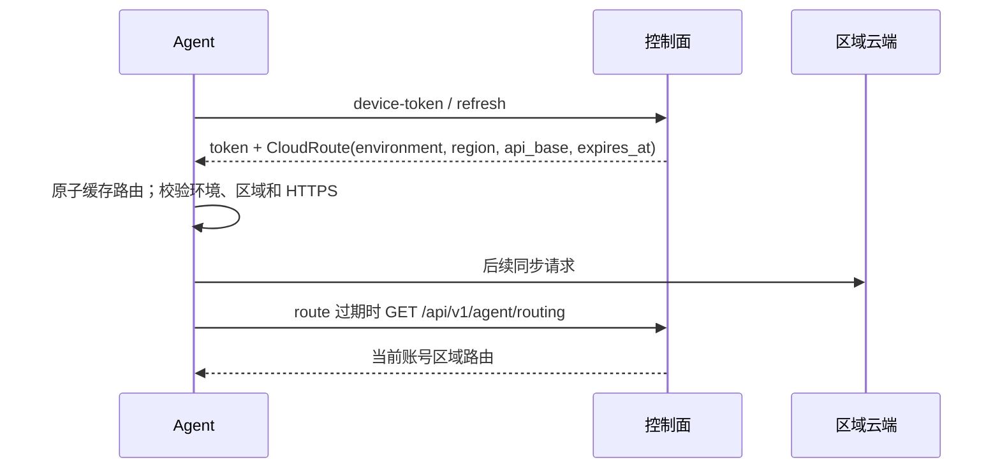

### 2.2 跨平台宿主探测与共享日志锁

宿主探测不把某个 AI IDE 的安装目录写死为唯一事实：先检查 `PATH` 和平台候选；ZCode
在 Windows 检查逻辑盘符有限候选，在 Linux 检查桌面入口；候选全部未命中后才只读反查
运行中的 ZCode 进程。所有宿主共用同一个诊断日志锁，Windows/Linux/macOS 的竞争都在
共享日志处理器中有限重试，避免某个 IDE 或某个平台的安装命令因锁竞争直接崩溃。

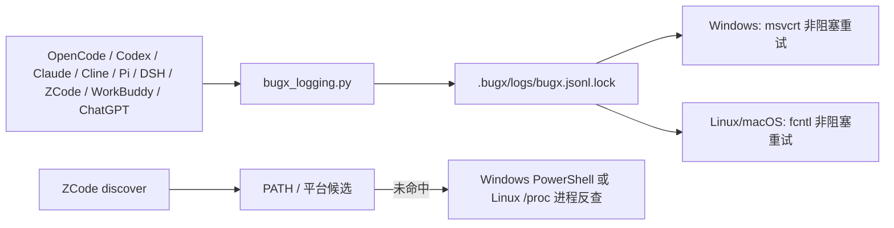


## 3. 主数据流（一次审计的生命周期）

```
bugx init（初始化运行态；可用 --commit-policy life|round|none 固化项目策略）
  → bugx install（渲染宿主入口 + 写 hosts.json 归属记录）
  → launch_bugx pre（普通模式经云端同步 Gate；自治 YOLO 模式由策略快照直接选择 sync，在 lesson_context 前完成 Bootstrap：项目身份创建/绑定、V2 pull/push 和受控导入；缺少已提交身份文件时硬阻断，禁止无人值守随机创建新项目，缺少有效登录态仍硬阻断；再进行项目画像、策略规划层与人机对齐门禁：项目画像定性、靶向工具链推导、错题集/经验集预选与执行模式预设，支持一键批准或微调；+ 覆盖清单 + Supervisor 通道，全部持久化可恢复）
  → Round [ Life（测试与结算，verify_life 扣寿命）× N
            → post（证据门禁 → 结算 → mcp-auto 自动分类并沉淀 candidate Pattern/Incident/Tool Experience → 按策略提交 → 报告封存）]
  → 知识沉淀（confirmed Finding → candidate Pattern/Incident/Tool Experience → 验证治理 → active；项目 Pattern promote → 全局账本）
  → 云同步（outbox/inbox → V2 事务导入；隔离文件仅作诊断留痕）
  → Session 收尾（bugx uninstall --self --dry-run 可随时审计全机残留）
```

`post` 仅在 `review_mode=mcp-auto` 自动读取当前 bound confirmed Finding，先通过
`knowledge_auto.py` 确定性归类并写入 candidate Pattern/Incident/Tool Experience，再执行
project boundary sync；manual 模式继续要求 Supervisor 显式提交 `cycle-review`/`fix-review`。

Pattern 的自动复盘会把当前 confirmed Finding 绑定为首个 hit，仍需两个独立 lifecycle hit 才能
晋升 active；Incident 仍需同一生命周期的 evidence receipt 才能激活。全局账本是只读运行时来源，
MCP 路由和启动上下文统一检索 project/global，并将 retrieved/selected 事件写回实际来源账本。
Incident 晋升使用规范化项目账本路径与项目 `incident_id` 派生确定性 `I-<12hex>` 全局 ID，
避免不同项目的同名本地 ID 在并发晋升时竞争；调用方以返回的 `global_incident_id` 为准。路径
只参与哈希，不写入全局 ID；项目账本搬迁会形成新命名空间。
SQLite 首次 WAL 切换发生在普通连接打开前；相邻的 `.journal-mode.lock`（线程锁加
`flock`/`msvcrt`）串行化同一账本的检查和模式转换，之后进程内走已就绪快路径。
锁不可安全打开或 10 秒内无法取得时 fail-closed；它不改变账本 schema 或记录。
导入的全局 Tool Experience 默认 candidate，只有 publisher 在两个独立 lifecycle hit 后激活才进入
tool lookup/tool matrix；因此未验证远端经验不会直接影响运行时策略。

`pre/round` 生成的 `lesson_context` 会由 `worker_orchestrator` 追加紧凑的分类和检索能力到每个
Worker 的共享指令，不追加 pattern、incident 或 tool experience 正文。Worker 先按语言/运行时/
框架/表面/检查画像调用 `bugx_knowledge_route`；高风险才继续调用只读 MCP 做有界检索和错误签名快速碰撞，低风险不检索；返回值始终是不可信资料。
Worker 若实际复用 pattern 必须在最终 Finding 回填 `pattern_id`，若实际调用工具则回填 `tools`，post
才会分别形成复用计数和工具反馈。`consumption_events` 区分 selected/retrieved，MCP 相同请求用
参数哈希幂等；project/global 事件分账本记录，metrics 只报告 selected/retrieved/feedback 对应的当前语义。

策略规划一键批准进入 `mcp-auto + polling=auto + fix=auto + commit=round`；Life 续行和
多 Round 续行不重新进入用户交互，Supervisor、覆盖、证据和预算门禁失败时仍安全停止。
提交策略由 pre 的最终运行态决定：`life` 在每个 Life 收尾提交，`round` 只在 Round
完成/安全停止时提交，`none` 归一为 `manual` 并登记 `manual_pending`。提交只包含项目
相对 HEAD 的用户变更，排除 `.bugx/` 运行态、宿主适配目录和 `__pycache__/`、`.pyc/.pyo`
生成物；Git 失败时记录 `commit_status=pending`，post 继续完成，启动或下一边界自动重试；核心引擎不隐式执行远端 push。

### 2.1 安装事务与 Windows 宿主目录边界

安装刷新契约：`bugx init`/`bugx install` 默认执行完整性校准，只校验全局引擎并更新项目
layout manifest；发现旧项目 `.bugx/core/` 时会迁移可识别数据并直接删除旧入口。历史
`--destructive` 参数已严格废弃，调用将 fail-closed 阻断。
`--force` 仅用于全局静态实体冲突或明确的宿主入口重渲染。安装前若 doctor 发现 PATH 中存在多个 BugX CLI，必须使用目标版本的
绝对路径重试，避免旧 CLI 写入旧版 manifest。

宿主 MCP 只在会话启动时加载。项目初始化或 MCP 配置发生变化时，启动门禁明确输出
“初始化项目 → 写入宿主配置 → 重启宿主 → 新会话重新启动 BugX”；自动审查不提供静默手动回退，
也不以跨项目进程或主动探活替代当前会话的加载证明。

安装前的 `command_agent` 事务只快照 BugX 自己会修改的精确文件，因此既支持在项目目录安装，
也支持在用户目录安装用户级 `.bugx` 和 Agent 全局入口。快照不会递归枚举或复制 `.codex`、
`.agents` 等宿主目录中的缓存、插件、会话和数据库。若 `.agents` 已是宿主管理的符号链接/
Windows 重解析点，快照阶段保留并跳过它；这避免 Codex/ChatGPT 用户级目录阻断其他 Agent
的安装。ChatGPT 只将 Marketplace 解析到该链接的真实目录目标写入，项目插件实体仍写入项目内；
嵌套链接和其他宿主资源仍由 `infra.security` 拒绝。失败回滚只恢复受事务管理的文件，绝不删除
宿主链接或无关宿主数据。

全局 Agent 入口在每次写入前都先持久化目标快照与事务 journal；快照或 journal 写入失败时，
该目标不得改动。普通文件回滚使用同目录临时文件加 `os.replace`，替换安装时创建的链接本身，
不会跟随链接覆盖全局引擎。若恢复失败，安装命令报告 `回滚不完整` 并保留事务 staging，供
恢复使用。本事务定义单次安装失败的恢复边界，不提供多个并发安装命令间的串行化保证。

ZCode 新安装将主 Agent 和 Worker 都注册到用户级目录。卸载没有 `hosts.json` 记录时，通用
清扫器仅检查宿主声明的 `legacy_paths`：逐路径请求 adapter renderer，worker 入口用对应
worker 模板，只有模板一致的普通文件才备份并移除；自定义内容与符号链接保留。该清理分支
不参与 `required_paths` 安装展开，因此不会重新创建项目级入口。

离线 MCP runtime 校验按平台解释权限：POSIX 可拒绝入口的 world-writable `st_mode` 位；Windows 不把该
非可移植字段当作 ACL 判定，入口 hash、文件树 hash 和重解析点拒绝仍是完整性边界。

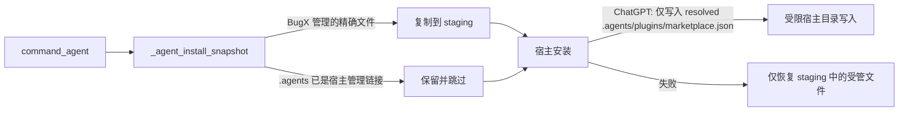

运行时路径绑定顺序：`session_runtime._refresh_runtime_paths()` 读取当前 lifecycle 指针，
将 `state/runtime.json`、`state/supervisor.json`、`state/coverage-evidence.json` 绑定到
所有 `pre/round/worker/post` 阶段；直接调用运行时锁/加载 helper 时也会先刷新项目路径。worker 与
post 只消费这组当前作用域文件，避免 symlinked core 回退到全局引擎状态；兼容目录的嵌套链接则从
各自目标的 `target.parent` 计算相对路径，避免深层静态资源断链。

测试/嵌入调用通过 `round_orchestrator.run_in_process()` 进入同一真实
`main` 分发器。`common.isolated_runtime_scope()` 在调用期间固定项目根并绑定
standalone 或 Layout 2 路径；由于阶段仍读取进程级 cwd、环境变量和导入路径，作用域由
进程级 `RLock` 串行化，不能把两个不同根目录的调用放进同一进程并行执行。退出钩子恢复
cwd、`sys.argv`、`sys.path`、环境、路径、运行标志及外层 runtime pin/锁上下文，并清理
含项目身份的缓存。日志作用域保留宿主原 handlers/context，关闭本次创建的资源；OTLP
导出在作用域内同步完成，避免读到恢复后的 cwd/环境；CLI 仍在后台导出。进程内远端检查
也在作用域内同步结束，CLI 的检查仍在后台进行。常驻守护进程与信号、进程组、
跨进程锁验证使用物理进程入口。

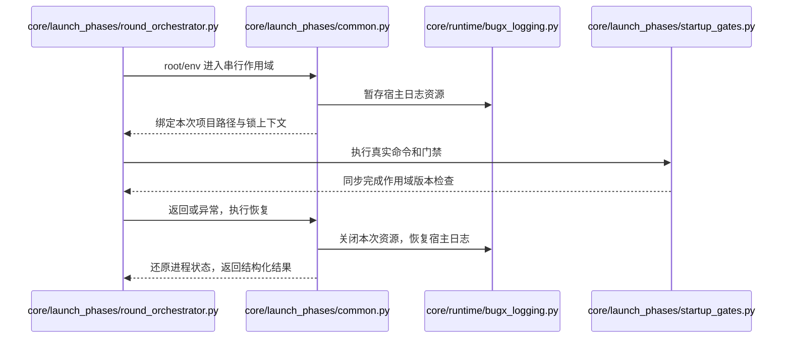

长耗时 Round 可在 `pre` 阶段使用 `--max-round-wall-seconds N` 覆盖有限正数墙上预算；Supervisor
创建后由 `workers` 继承，未指定时保持默认值。

### 3.1 任务调度与并发协调架构

```mermaid
flowchart TD
    subgraph 待办单元池
        U[全量债务/待覆盖单元池] --> UPS[UnitPriorityScheduler\n多因子优先级评分排序]
    end

    subgraph 智能调度核心
        UPS --> TS[自动遍历策略\nDFS / BFS / Hybrid]
        TS -->|内部硬边界 + 风险/债务评分 + 图遍历顺序| OR[排序后候选单元队列]
        OR --> AB[AffinityBundler\n拓扑亲和性打包器]
        AB -->|同文件聚合 [1, 5] 单元| BUNDLES[任务包队列 (Task Bundles)]
        
        ACC[AdaptiveConcurrencyController\n机器上限 + CPU/RAM 背压]
        SYS_CONF[系统硬件核心 / 环境配置\nresolve_system_concurrency] --> ACC
        SYS[系统实时负载\nCPU Load / Cores] --> ACC
        BUDGET[Token 预算\n不降低健康机器并发] --> ACC
        ACC -->|动态有效容量 effective_capacity| DISPATCH[派发控制器]
    end

    subgraph 执行与租约管理
        BUNDLES --> DISPATCH
        DISPATCH --> CLC[ComplexityLeaseCalculator\n复杂度感知动态租约计算器]
        CLC -->|推算 TTL 60s ~ 300s| CLAIM[Supervisor.claim_worker\n原子预占 (allow_bundle=True)]
        
        CLAIM --> K_CTX[读取当前 lesson_context\n分类 + 检索能力\n固定提示词预算]
        K_CTX --> K_ROUTE[bugx_knowledge_route\n高风险确定性路由]
        K_ROUTE --> W1[Worker A 进程\n按需 MCP 检索/快速碰撞]
        K_ROUTE --> W2[Worker B 进程\n按需 MCP 检索/快速碰撞]
        
        W1 -. PID & 心跳 .-> ZD[ZombieDetector\n僵死探针与秒级抢占]
        W2 -. PID & 心跳 .-> ZD
        ZD -->|死亡 / 到期心跳断流| PREEMPT[worker_preempted\n尝试 kill 后释放容量]
    end

    subgraph 检查点与遥测
        W1 -->|批量 coverage / evidence| CHK[Supervisor.submit_checkpoint\n(支持超时优雅跃迁)]
        W2 -->|批量 coverage / evidence| CHK
        CHK --> METRICS[SchedulingMetrics\n全链路效能与时延度量]
    end
```

任务调度仍由单一 `UnitPriorityScheduler` 负责；它按当前关系图的深度、层宽和风险集中度自动选择 DFS、BFS 或 Hybrid。图不足时退回原有评分排序，策略只影响待办顺序，不改变阶段边界、Supervisor claim 或证据协议。

### 3.2 动态调度与并发执行时序

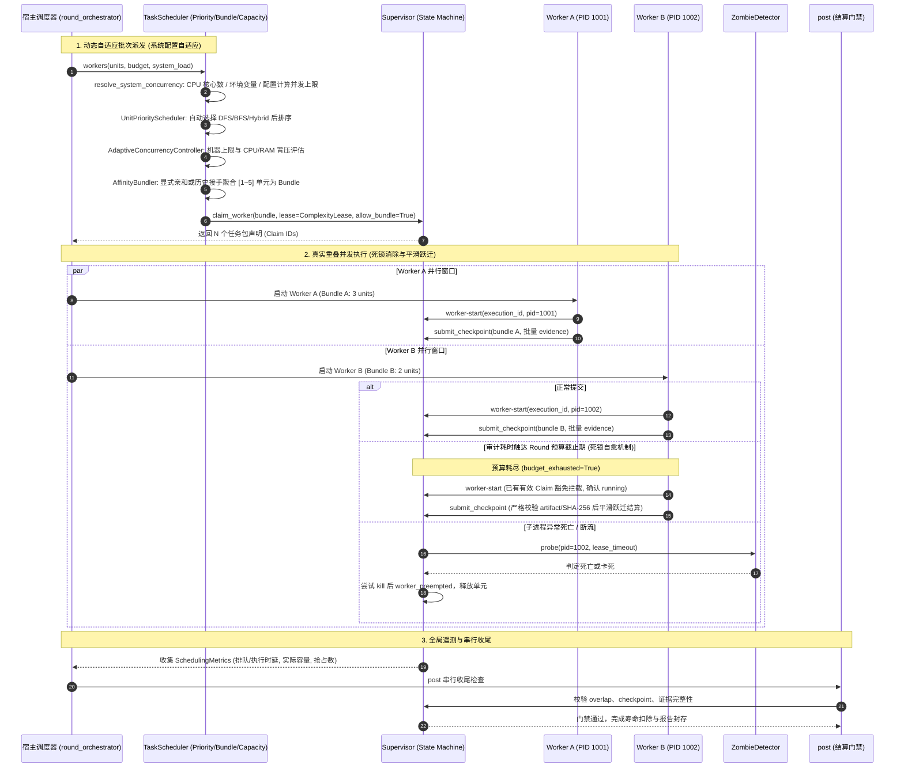

- **自适应 Worker 容量动态解析**：彻底废除固定写死 4 个 Worker 的限制，由 `resolve_system_concurrency()` 按优先级决策：环境变量 `BUGX_MAX_CONCURRENCY` > 配置文件 (`~/.bugx/config.json`) > 物理 CPU 核心拓扑（$\le 2$核为 2，3~4核为核数，5~8核为核数，>8核按完整逻辑核数），健康机器不受历史 AIMD/Token 水位减量，只有真实 CPU/RAM 压力触发背压；显式配置仍是运维静态上限。
- **Worker 过期活性仲裁**：租约到期先检查运行状态、最近心跳和已登记 PID；有新鲜进展则保留相同 lease 续期，卡死则尝试安全 kill 后释放 claim，远程无 PID 只失效租约，不误杀外部进程。
- **Supervisor 预算超时死锁消除**：已持有有效租约的 Worker 在 Round 墙上时间耗尽触发 `budget_exhausted` 后，`start_worker` 豁免拦截确认真实启动；`submit_checkpoint` 在通过证据与 SHA-256 完整性验证后，支持 `claimed -> running -> completed` 平滑跃迁，并优先落账已有成果；`claim_worker` 仍拒绝预算耗尽时的新牌。若 evidence 目标指纹在执行期间漂移，checkpoint 同样收卷但将单元置为 `unverified` 并留存 admission 事件；`release_worker` 解绑预算拦截；宿主 `_recover_supervisor_budget` 采用 `force=True` 强制清理超期租约，实现全自动自愈。

### 3.2.2 并行真实性、租约边界与历史完整性

- 并发门禁从当前 Round 已观察到的执行窗口重建峰值与正 overlap，不把未来的 `lease_expires_at` 当作执行事实；通过门禁还必须有两个不同 Worker 的非空 checkpoint payload digest。
- 每个 claim 的寿命只受 `total_lease_deadline`（单调时钟镜像 `total_lease_deadline_mono` 为权威）约束；`renewal_count` 仅作审计计数，不再有次数终止条件，`DEFAULT_MAX_RENEWALS` 降级为寿命乘数（寿命 = 初始租约 × (N+1)，与心跳节奏无关）；探针异常按 fail-closed 处理，过期记账复用幂等入口，避免重复释放污染统计。
- history 超过 1000 条后保留 hash-chain anchor，继续验证后续事件的完整性，避免无限增长与无界内存占用。

### 3.2.1调度/挖掘闭环

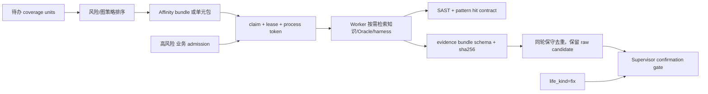

`内部` 与 `业务` 是独立覆盖维度；业务链路必须有显式高风险准入事件，不能用
partial 覆盖伪装完成。`life_kind=fix` 允许串行修复验证，但仍需要证据、确认和
回归/mutation 结果。worker 先验只携带有界摘要与检索入口；共享 harness 首期是
项目会话内注册表，未注册能力显式降级为 `static-only`。内部债务未清时业务单元仍需显式准入；
当所有内部债务单元都满足 `worker_attempts_exhausted(state, unit)` 熔断条件，
`eligible_units()` 放行完整 coverage，避免已无可派发债务的内部单元继续绑架业务链路；该放行只改变
eligibility，claim 仍会过滤已熔断单元，coverage 状态不会被伪造为 covered。状态接口默认裁剪，完整
history 仍留在本地审计链中。Worker 完成一个 bundle 后可用
`continue_worker=true` 继续领取未完成单元；身份续领和过期接管都写入审计事件。
带执行 PID 的租约还需回显 `heartbeat_nonce`，与进程启动令牌共同防止旧 owner 续租。

### 3.3 下一代 MCP 协议面与多通道架构

```mermaid
flowchart TD
    subgraph AI 宿主 (Host / Agent)
        CLIENT[OpenCode / Claude / Cursor / Cline]
    end

    subgraph BugX MCP 控制面 (bugx_mcp_server.py)
        DISPATCH[JSON-RPC 2.0 Stdio 分发器]
        CLIENT <-->|Stdio Stream| DISPATCH

        subgraph 三重原生协议能力
            DISPATCH -->|tools/call & list| TOOLS[Tools 协议面\n18 个工具 + bugx_scheduling_telemetry]
            DISPATCH -->|resources/read & list| RES[Resources 协议面\nbugx://state/*, bugx://knowledge/*]
            DISPATCH -->|prompts/get & list| PROMPTS[Prompts 协议面\n4 大阶段工作流模版]
        end

        subgraph 防护与跨平台层
            LEASE[_ControllerLease 跨平台互斥锁\nPOSIX fcntl / Windows msvcrt]
            VALID[深度/大小/键数 Fail-Closed 预算]
        end
    end

    subgraph 引擎核心层 (Core)
        TOOLS --> SUP[audit_supervisor.Supervisor]
        TOOLS --> HARN[prompt_harness.py\n(global floor/ceiling/priority)]
        RES --> RT[.bugx 运行态与项目错题本]
        PROMPTS --> HARN
    end
```

### 3.4 工业级代码智能与架构拓扑经济学分析模型

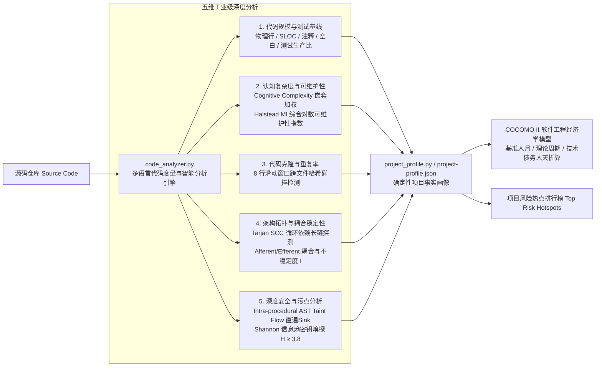

### 3.4.1 版本感知项目画像与策略编译

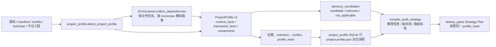

画像只保存项目证据，不把版本命中直接当作漏洞；风险候选仍须经过路径、行为和规则证据验证。`pre_phase` 与 `bugx project analyze` 都将画像写入项目知识账本的 `project_profile` SQLite 行，`bugx project show` 从同一事实源读取，避免“分析成功但展示为空”的状态分裂；策略规划优先读取该画像，避免启动阶段重复探查造成策略与报告漂移。完成授权且项目绑定后，`cloud_onboard` 通过 ProjectProfile v2 元数据接口按 hash/revision 同步，上传 `wire_project_profile` 紧凑投影以满足 256 KiB 上限（完整 profile 留在本地），失败保留本地状态，不推进知识 cursor。。

跨进程画像缓存位于 `bugx_paths.global_cache_root()`，不使用共享 `/tmp`。POSIX 缓存根必须是当前用户拥有的 `0700` 目录，缓存文件必须是当前用户拥有的 `0600` 普通文件；符号链接、权限或属主异常会使该磁盘缓存失效并重新分析。

### 3.5 代码智能驱动漏洞挖掘全链路打通时序与流水线

```mermaid
flowchart TD
    PP[project-profile.json\n项目事实画像与风险热点] -->|1. 注入风险热点 Top Risk Hotspots| UPS[UnitPriorityScheduler\n任务调度器 +150分风险倾斜]
    PP -->|2. 深度分析结果: Taint / Secret / SCC| MSE[MiningSurfaceExplorer\nTree-sitter 多语种 AST\n函数/类/宏/路由/攻击面\n错误可观测/降级]
    
    MSE -->|全息主体匹配| TMM[ThreatModelMatcher\n威胁模型与验证 Oracle 对齐]
    TMM -->|四维量化评估: 准确/完整/有效/全面| MPA[MiningPlanAuditor & Hardener\n方案加固与质量门禁]
    
    UPS -->|3. 派发高危单元| RO[round_orchestrator\n轮次执行编排器]
    RO -->|4. 提取单元风险画像| PH[prompt_harness.py\nget_unit_risk_advice]
    PH -->|5. 拼接【⚠️ 脆弱性雷达】提示词 (≤250字)| WORKER[Worker 挖掘执行引擎]
    
    PP -->|6. 代码健康度评级 A/B/C/D 与高危靶点| SG[startup_gates.py\n启动门禁 500 字受控作战卡]
    SG -->|面向宿主与审计 Agent 展示| HOST[AI 宿主 / 人机对齐门禁]
```

### 3.6 现代分层与模块解耦全景架构图

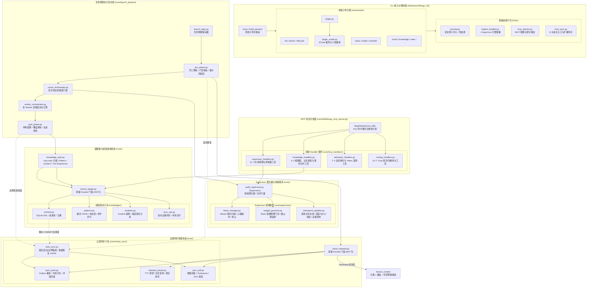

### 3.7 审计生命周期端到端核心状态机与流程图 (End-to-End Audit State Machine & Flowchart)

```mermaid
flowchart TD
    START([会话启动: launch_bugx.py]) --> G_ENV[环境与宿主探活\nEnvironmentSnapshot]
    
    subgraph S1["阶段一：开工准备与前置门禁 (pre_phase.py)"]
        G_ENV --> G_VER{1. 版本契约门禁\nversion_contract}
        G_VER -->|版本不一致| G_VER_FIX[执行 init/install 刷新] --> G_VER
        G_VER -->|一致| G_CLOUD{2. 云端 Onboarding\nonboard_wizard.py}
        G_CLOUD -->|登录/同步决策| G_PROF[代码全息勘测与画像\nproject_profile.py]
        G_PROF --> G_STRAT{3. 策略规划门禁\nStrategy Plan Gate}
        G_STRAT -->|批准推荐策略 / 微调| G_COV{4. 覆盖清单门禁\ncoverage_bootstrap}
        G_COV --> G_TOOL{5. 探针与工具知识库\ntools_kb / 15 个探针}
        G_TOOL --> G_BASE[外部基线快照 & verify_life\n输出 BH_PRE_BASELINE]
    end

    G_BASE --> R_LOOP{当前生命值 life > 0\n且未达到最大轮次?}

    subgraph S2["阶段二：多 Worker 并发重叠执行 (worker_orchestrator.py)"]
        R_LOOP -->|是: 进入新一轮| SCHED[TaskScheduler\n多因子评分 + 风险倾斜\n(resolve_system_concurrency 动态容量)]
        SCHED --> BUNDLE[AffinityBundler\n显式亲和或历史接手聚合 1~5 单元]
        BUNDLE --> LEASE[Supervisor.claim_worker\n复杂度动态租约计算]
        LEASE --> SPAWN[Worker 并发启动\nWorker A / Worker B]
        
        SPAWN --> W_EXEC[Worker 审计挖掘执行]
        W_EXEC -. 心跳脉冲 .-> ZOMBIE{ZombieDetector\n僵死探针监控}
        ZOMBIE -->|PID 死亡 / 超时| PREEMPT[worker_preempted\n秒级释放回待办池]
        
        W_EXEC --> CKPT_IN[提交 Checkpoint 数据]
        CKPT_IN --> CKPT_PIPE[CheckpointPipeline\n大小/深度门禁 + 证据归一\n(超时合法成果平滑跃迁)]
    end

    subgraph S3["阶段三：缺陷确认与证据门禁 (post_phase.py)"]
        CKPT_PIPE --> F_CONF{FindingConfirmation\n四重门禁验证}
        F_CONF -->|1. 独立复现| F_R[确定性 PoC 复现]
        F_CONF -->|2. 独立 Oracle| F_O[Differential Oracle / 行为断言]
        F_CONF -->|3. 负对照检验| F_N[Negative Control 排除干扰]
        F_CONF -->|4. 真实根因推导| F_C[Root Cause 分析]
        
        F_R & F_O & F_N & F_C --> SETTLE[verify_life 结算\n扣除 Life，记录生命账本]
        SETTLE --> COV_UPDATE[module_coverage\n更新单元与业务覆盖证据]
        COV_UPDATE --> LESSON_REC[core/ledger/ 沉淀\n提取错误签名，记录错题/案件]
    end

    LESSON_REC --> R_LOOP
    LESSON_REC -. 已授权时异步增量同步 .-> SYNC_OUT

    subgraph S4["阶段四：终局结算与报告封存 (_close_session)"]
        R_LOOP -->|否: 寿命归零或正常结束| REP_GEN[finding_report.py\n生成跨轮次收敛缺陷报告]
        REP_GEN --> HASH_SEAL[secure_atomic\n报告 SHA-256 原子哈希封存]
        HASH_SEAL --> TELEM[global_telemetry.py\n汇总持久化耗时与 Token 消耗]
        TELEM --> SYNC_OUT[core/cloud_sync/\nOutbox 增量打包推送云端]
        SYNC_OUT --> FINISH([会话完结: 产出最终报告])
        SYNC_OUT -->|网络/5xx 中断: pending| RECOVERY[auto_sync recovery worker\n退避、日志、stale inflight 回收]
        RECOVERY -->|网络恢复| SYNC_OUT
    end
```

### 3.8 Cloud Sync 增量推拉与删除 GC 闭环时序图

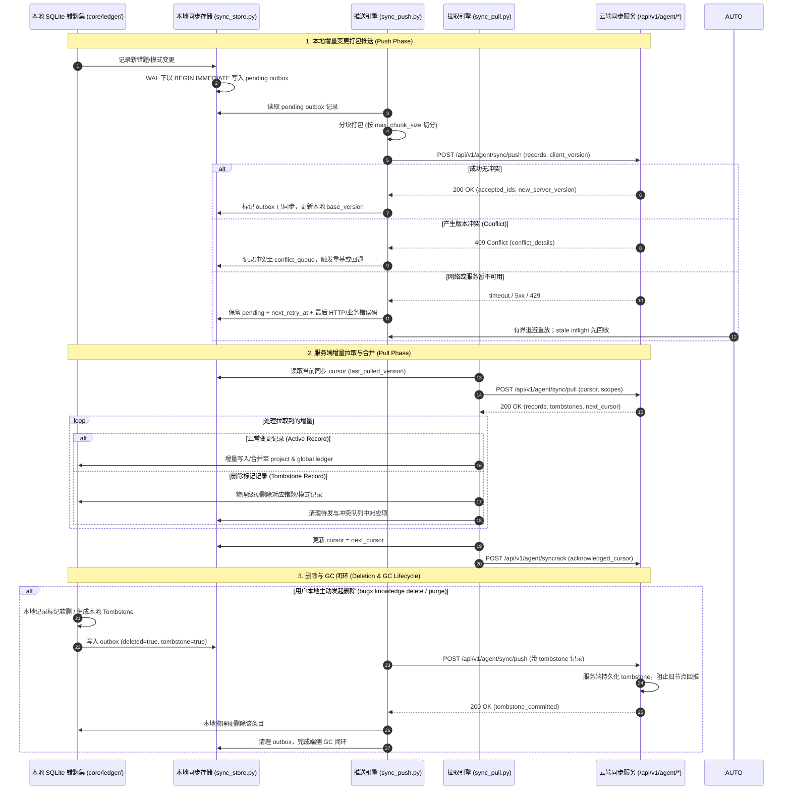

### 3.9 Client Metadata Header Flow

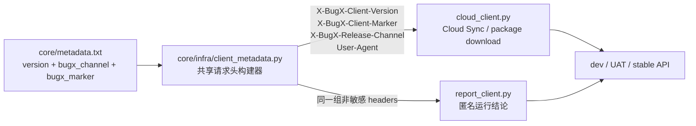

发布流水线根据受控发布通道选择 stable 或预发布标记，并在 staging 包中同步默认 Base URL 与
marker；公共 PyPI/npm 发布阶段仅对 stable 开放。

### 3.10 Cloud Vulnerability Cache

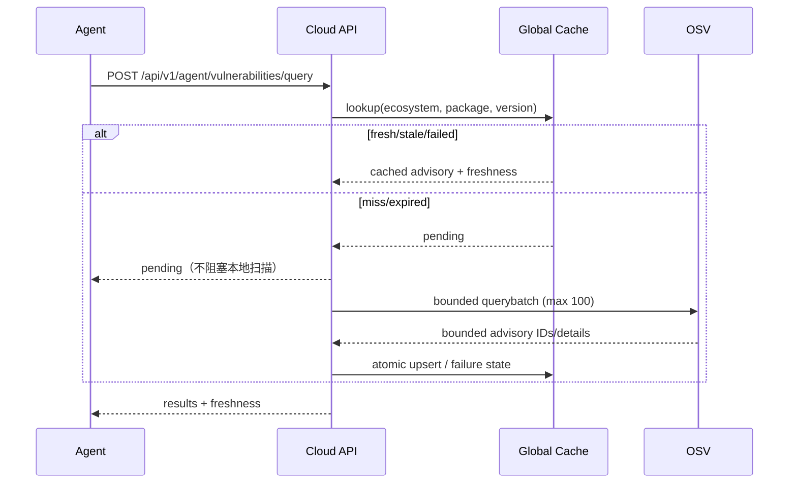

缓存是服务端全局公开情报，表中不含 account、project、path 或 evidence 字段；客户端只在 ProjectProfile 同步时预热，远端候选不改变 `profile_hash`、revision 或本地确认结果。中心节点启动时和每 6 小时最多刷新 100 条到期记录。

### 3.11 知识双环认知进化与资产分层流转架构 (Dual-Loop Knowledge & Skill Architecture)

BugX 建立了内环（单项目轮次快循环）与外环（跨项目长效大循环）解耦的**双环认知自愈与进化模型**，杜绝层级职责倒置与死数据膨胀：

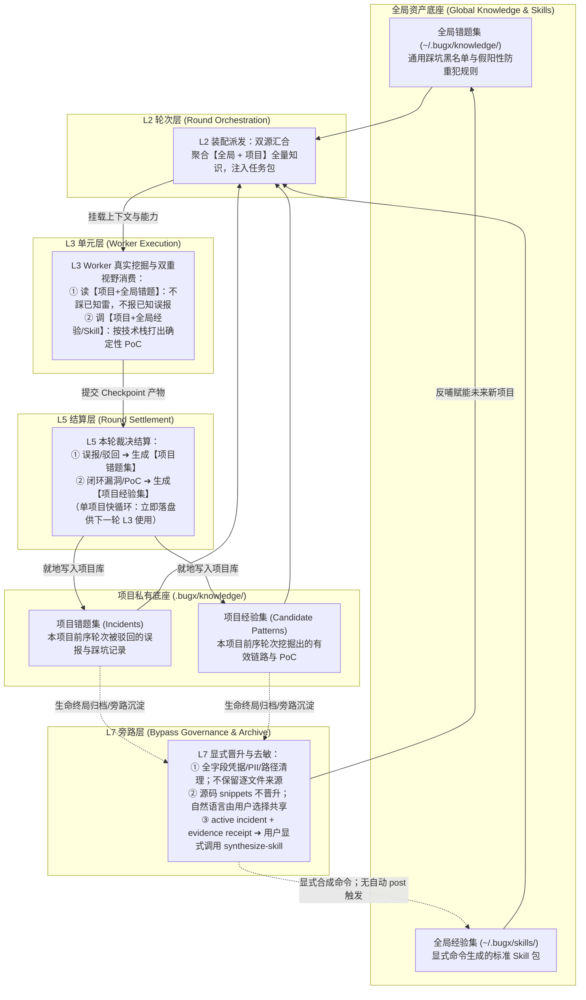

#### 四象限资产与流转契约
1. **项目错题集 (Project Incidents)**：在 **L5 结算当场生成**，记录具体代码签名与驳回原因，存入 `.bugx/knowledge/lesson-ledger.json`，供随后的 L3 轮次直接避坑；
2. **项目经验集 (Project Patterns)**：在 **L5 结算当场生成**，保留本项目验证成功的链路与断点，供随后的 L3 轮次接力渗透；
3. **全局错题集 (Global Incidents/Rules)**：由 **L7 旁路归档** 时对项目错题去敏、泛化并晋升，避免跨项目同类陷阱；
4. **全局经验集 (Explicitly Synthesized Skills)**：`core/skills/skill_synthesizer.py` 提供 Skill 生成器，用户可通过 `bugx lesson synthesize-skill` 显式生成 `SKILL.md`、触发元数据与确定性验证脚本；账本入口只接受 `active` incident，并在每次合成前将收据绑定到规范项目布局里的 Supervisor Finding、已提交 claim、覆盖证据记录和当前工件 SHA-256。账本写入、incident 激活及全局晋升也执行同一复验。此本地状态链未使用密钥签名，不能证明抵御有权修改项目状态文件的本地攻击者，也不能替代真实 ACP/宿主执行证据。当前没有 post/归档自动触发器，生成器默认写入 `~/.bugx/skills/official`；自动激活保持未实现，直到补齐独立来源认证、审核和激活门禁。

### 3.12 技能包流式分发与复用命中率大盘

```mermaid
flowchart TD
    subgraph Client [客户端 (Core / CLI)]
        SP[SkillPackLoader] -->|GET /api/v1/agent/skills/:skill_id/bundle| BUNDLE[Stream Bundle .tar.gz]
        BUNDLE --> SIG[Ed25519 Detached Verify]
        SIG --> MAN[Manifest Check & Hash Compute]
        MAN --> INST[Atomic Install to ~/.bugx/skills/official]
    end

    subgraph Server [BugX Server]
        SKILLS_EP[Agent Skill Distribution] --> AGENT_SKILLS[(agent_skills)]
        SKILLS_EP --> ARCHIVE[(uploads/skills/*.tar.gz)]
        ADMIN_SKILLS[Admin 技能中心 /cloud/sync/skills] --> SKILLS_EP
        ADMIN_ANL[复用分析 /cloud/sync/analytics] --> ANL_EP[GET /api/v1/admin/cloud-sync/analytics]
        ANL_EP --> AGG[Lessons + Incidents + Tools + Telemetry 聚合]
    end
```

闭环技能生态与效能分析：
1. **技能包分发服务**：客户端请求 `GET /api/v1/agent/skills/:skill_id/bundle`，服务端基于 `AgentSkill` 记录验证激活状态与存储安全性，以 `application/gzip` 流式下发，携带 `X-BugX-Plan-Hash` 计划哈希与版本，并原子递增下载计数；
2. **管理后台治理**：管理员在「技能中心」上传 `.tar.gz` 归档包，服务端自动校验解压合法 `manifest.json`，支持启用/停用与删除管理；
3. **效能与复用大盘**：在「复用分析」通过 ECharts 呈现错题集命中率、工具命中率、近 14 天知识消费与遥测趋势，以及实战工具排行。


## 4. 能力先验与验证编排

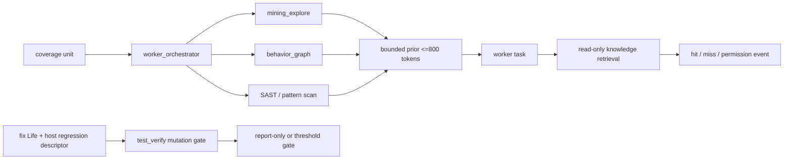

能力先验机制只改变任务排序和核实提示，不改变 Supervisor claim、checkpoint 或
confirmed 门禁。SAST 的超时与无命中分离；fix mutation 只在显式 `life_kind=fix` 时
启用，且目标/命令/超时均由宿主约束。

### 3.10 本地审计 Skill Pack、流式 DAG 与动态攻击面图谱

系统引入了面向垂直审计场景（如 `web-audit`）的自主流程层，突破了通用 Agent 阶段时序混乱、上下文断层、Token 膨胀与假设无闭环的瓶颈。

提示词预算由 `core/planning/prompt_harness.py` 统一治理：Worker/Skill 使用显式全局预算，L0/L1/L2、先验和任务正文共享同一 allocation；每个 section 受 ceiling 约束并先满足非空 floor，任务正文额外保留 200T，避免被规则段落挤压为最低保留量。估算失败走保守 UTF-8 fallback，无法满足 floor 则 fail-closed 抛出 `BudgetAllocationError`，降级结果写入 `DEGRADED` 诊断事件。

`compile_skill_plan()` 将技能包的 `required_runtime` 通过 `runtime_requirements()` 归一化后放进编译计划；每个工具必须列出 `stage_ids`，并且只可引用该 manifest 中唯一存在的阶段。`validate_manifest()` 在计划编译前要求每个工具 ID 命中 `probe_registry`，未知 ID 或阶段引用直接拒绝。调度器把完整计划交给当前阶段 Harness。注册表命中只证明 BugX 有对应 probe 描述符，不等于外部依赖已安装、MCP 服务已就绪或探针已执行。

启动先准备项目画像和 Skill Plan，再以 `required: true` 阶段与工具 `stage_ids` 的交集选出活动工具；未在当前计划阶段使用的工具记录为 `NOT_IN_STAGE_PLAN`，不会触发安装。预检失败只进入已登记工具的受信自愈配方；安装后清空探针缓存并重新验证实际二进制与登记版本。随后 `runtime_tool_gate.enforce_required_runtime_tools()` 复用 READY 预检或仅执行 descriptor 显式声明的安全 availability action。没有安全动作时不隐式运行 `check`；检查不得读取目标源码或运行用户命令。工具默认必需，只有显式 `tier=optional` 可以跳过；`targets` 只按明确项目分类做互斥剪枝。门禁 receipt 原子写入 `.bugx/state/runtime-tool-readiness.json`，绑定当前 `skill_id`、`plan_hash` 与分类哈希；活动必需工具未通过时，在 Session 创建前返回 `BLOCKED`。
探针自行返回 `NOT_APPLICABLE` 不能豁免必需工具；报告至少要包含一项通过的必需检查。只有 Skill Pack 显式目标条件与已知项目目标互斥时，分类逻辑才会写入 `NOT_APPLICABLE`。

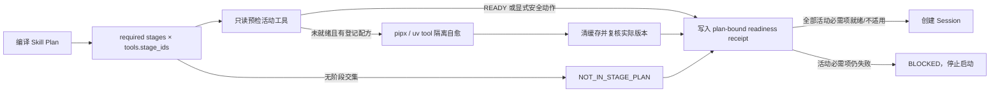

```mermaid
flowchart TD
    subgraph ProfileCompile["1. 项目画像与策略编译"]
        PP["project_profile.compile_audit_strategy"] --> SP["锁定 skill_plan (web-audit v0.1.0) & plan_hash"]
    end

    subgraph StreamingPipeline["2. 流式有向无环图调度 (Streaming DAG)"]
        SP --> Scope["00-scope (测试窗口界定)"]
        Scope --> Discovery["10-discovery (资产静态/动态全量逆向)"]
        Scope --> BehaviorStage["30-behavior-black-box (外部行为实测)"]
        BehaviorStage --> BehaviorArtifact["behavior-evidence JSON<br/>当前 run / Worker / schema 校验"]
        Discovery -->|流式事件: endpoint_discovered| Router{"端点路由与分流"}
        
        Router -->|公共未鉴权端点| InputFlow["40-input-output (即刻参数模糊测试)"]
        Router -->|鉴权端点| AuthFlow["20-auth-session (多角色凭据握手)"]
        
        AuthFlow --> LogicFlow["30-authz-business (BOLA/IDOR 越权推演)"]
        LogicFlow --> StateFlow["50-state-async (并发条件竞争)"]
        
        InputFlow --> Barrier["阶段栅栏 2: 80-evidence-regression"]
        StateFlow --> Barrier
        BehaviorArtifact --> Barrier
        
        Discovery -.->|探测到隐藏特征| DynAct["动态模块激活 (plan_patch: graphql/ws/upload)"]
        DynAct -.-> LogicFlow
    end

    subgraph LivingGraph["3. 动态攻击面图谱 (.bugx/runtime/attack-graph.json)"]
        AG[("Living Attack Graph<br/>• 节点: Role / Route / Parameter / Sink / Hypothesis<br/>• 关系: HAS_ACCESS / FLOWS_TO / EXPLOITED_ACCESS<br/>• 漏洞本质: 越界非法访问边的图拓扑确定性求解")]
    end

    subgraph ComputeTiers["4. 工种专精亲和与模型梯队分级 (Worker Affinity)"]
        WRecon["Recon-Worker ➔ 绑定 FAST 模型 (Agnes 3.0 Flash)"]
        WAuth["Auth-Worker ➔ 绑定 BALANCED 模型 (Haiku / DeepSeek V3)"]
        WLogic["Logic-Worker ➔ 绑定 PRO 模型 (Claude 3.5 Sonnet / GPT-4o)"]
        WExploit["Exploit-Worker ➔ 绑定 PRO 模型 (DeepSeek R1 / Sonnet)"]
    end

    subgraph ReflexiveLoop["5. 假设驱动与自愈反思回溯闭环 (Reflexive Backtracking)"]
        Hypo["构建漏洞假设"] --> SandboxExec["本地沙箱执行 PoC"]
        SandboxExec -->|遇阻: 如 403 签名错误| Backtrack["自愈反思: 定向反查签名源码 ➔ 修正算法"]
        Backtrack --> SandboxExec
        SandboxExec -->|成功: 越权实锤| EvConfirm["输出确定性证据 + 403 负向对照证明"]
    end

    Discovery --> AG
    AuthFlow --> AG
    LogicFlow --> AG
    InputFlow --> AG
    Router -.-> WRecon
    AuthFlow -.-> WAuth
    LogicFlow -.-> WLogic
```

### 3.11 云端攻防数据飞轮与商业化技能分发架构

```mermaid
flowchart TD
    subgraph LOCAL_CLIENT["客户端本地审计环境 (Local Audit Runtime)"]
        AUDIT_ENG["本地审计引擎\n(DAG Orchestrator / Workers)"] --> SINK_ASSETS["实战攻防资产生成:\n• 脆弱代码片段 (before/after)\n• 真实 API 路由/参数/Header\n• Living Attack Graph (拓扑与边)\n• 确定性复现 PoC 脚本 (Red-to-Green)"]
        
        SINK_ASSETS --> REDACTOR["高精度脱敏引擎 (core/governance/secret_redactor.py)\n• 秘钥脱敏: API Key / Token / Password\n• PII 脱敏: 身份证 (模11) / 银行卡 (Luhn) / 手机 / 私有IP\n• 自定义规则: .bugx-redact.json/.yaml 动态注入\n• 黄金资产: 100% 完整保留真实代码/路由/图谱"]
        
        REDACTOR --> OUTBOX["透明压缩 Outbox 队列 (flywheel_client.py)\n• 本地存储: gzip 透明压缩 (省 70%+ 空间)\n• 外发聚合: batch_size 批量聚合上报\n• 扩充 RECORD_TYPES: attack_graphs / skill_traces"]
    end

    subgraph WIRE_PROTO["云端同步传输层 (V2 Wire Sync)"]
        OUTBOX -->|HTTP POST /api/v1/telemetry/events/batch (批量聚合 / 异常降级单条)| CLOUD_GATE["云端统一接入网关"]
    end

    subgraph CLOUD_FLYWHEEL["云端商业飞轮与大模型训练中枢 (Cloud AI Flywheel)"]
        CLOUD_GATE --> INGESTION["数据摄取与清洗流水线 (Ingestion Pipeline)\n• 凭据二次校验门禁 (Fail-Closed)\n• 样本质量打标 (reproduced_poc / clean_pattern)\n• 难例样本识别 (is_hard_example / obstacle_types)"]
        
        INGESTION --> TRAINING_POOL[("高价值安全训练语料池\n(Real-world Attack-Defense Dataset)")]
        
        TRAINING_POOL --> MODEL_TUNE["安全专精大模型微调 (SFT / DPO / RLHF)\n• DPO 偏好对边际评分 (preference_margin 梯度导向)\n• 代码审计与利用链推演能力提升\n• 自动补丁与修复模型进化"]
        
        TRAINING_POOL --> SKILL_SYNTH["官方通用与商业技能包熔炼 (Skill Synthesis)\n• 提炼通用经验集与规则探针\n• 编译高阶专精攻防包 (Web / Cloud / API)"]
        
        SKILL_SYNTH --> SKILL_REPO[("云端官方/商业 Skill 仓库\n(Validated Skill Pack v1.x)")]
    end

    subgraph SYNC_PULL_FLOW["技能下发与反哺回流 (Skill Distribution)"]
        SKILL_REPO -->|HTTP GET /api/v1/sync/pull (增量拉取)| PULL_CLIENT["客户端 sync_pull (core/cloud_sync/sync_pull.py)"]
        PULL_CLIENT --> SCHEMA_CHK["本地 Schema 与 Hash 强校验 (validate_manifest)"]
        SCHEMA_CHK -->|校验通过| OVERLAY_APPLY["热加载至 core/audit_packs/ 或本地 Overlay"]
        OVERLAY_APPLY --> AUDIT_ENG
    end
```

### 3.12 历史 daemon 架构（非当前执行主体）

```mermaid
flowchart TD
    subgraph FOREGROUND["前台交互层 (Interactive Front)"]
        DEV["开发者 / 终端 / IDE"] <-->|IPC: attach / detach / pause / resume| DAEMON_CTL["Daemon 控制器 (cli daemon)"]
    end

    subgraph DAEMON_LAYER["后台守护进程组 (Headless Daemon Worker Pool)"]
        DAEMON_CTL <-->|Unix Domain Socket / PID File| DAEMON_RUNNER["守护进程主控 (core/runtime/daemon_runner.py)"]
        DAEMON_RUNNER --> SUPERVISOR["审计总控 (Supervisor)\n• 目标指纹校验\n• 原子租约与并发门禁\n• 跨轮覆盖继承"]
        DAEMON_RUNNER --> ROI_MGR["ROI 动态预算调控器\n• 收益速率测算 (Yield Velocity)\n• 富矿追加并发 / 贫矿平滑收敛"]
        
        DAEMON_RUNNER --> WORKER_POOL["无头并发 Worker 池"]
        WORKER_POOL --> DIRECT_RUNNER["Direct LLM API Runner\n(Claude / OpenAI / DeepSeek / Ollama)"]
        WORKER_POOL --> CLI_RUNNER["Headless Agent CLI Runner\n(claude -p / codex exec)"]
    end

    subgraph SCHEDULING_ENGINE["智能自适应调度中枢 (Adaptive Scheduling Engine)"]
        SUPERVISOR --> SCHEDULER["任务调度器 (task_scheduler.py)"]
        
        ATTACK_GRAPH["活体攻击图谱 (Living Attack Graph)"] -->|发现弱点时拓扑级联延伸| SCHEDULER
        SCHEDULER -->|衍生下游高危利用链任务 (depth<=3)| WORKER_POOL
        
        LEDGER[("本地 SQLite 错题集\n(core/ledger/)")] -->|同技术栈真实避坑提示| PROMPT_EVOLVE["Prompt 实战变异自进化"]
        PROMPT_EVOLVE -->|注入 Top-3 排雷上下文| WORKER_POOL
    end

    subgraph SETTLEMENT["终局收敛与资产生成 (Settlement & Assets)"]
        SUPERVISOR -->|finish() 校验通过| FINALIZE["一次性终局结算 (post_phase.py)"]
        FINALIZE --> REPORT["测试审计报告 (report.md)"]
        FINALIZE -.->|配置 enable_immunization_pack: true| IMMUNIZATION["[可选] 工程专属免疫包 (Immunization Pack)\n• AST / Semgrep 零日防护规则\n• 单元级自动化回归测试集 (pytest/jest)"]
        FINALIZE --> CLOUD_OUT["脱敏上云反哺 (攻防数据飞轮)"]
    end
```

### 3.13 verify_life 与 FindingLedger 跨文件结算边界（P1-4 复核）

当前 `verify_life settle` 在寿命锁内完成输入校验，并用相邻的 pending settlement WAL 连接
`bugx-life.json` 与 `finding-ledger.json`。Finding ledger 自身有独立的进程锁、CAS 与原子替换；
WAL 负责跨文件崩溃恢复，不把两份 JSON 伪装成单一文件事务。

```mermaid
sequenceDiagram
    participant H as 宿主 post
    participant V as verify_life（持 LIFE_LOCK）
    participant L as bugx-life.json
    participant F as FindingLedger
    H->>V: settle(credited, fraud, findings)
    V->>V: 校验轮号、证据、历史重复与 ledger duplicate
    V->>L: 耐久写 pending WAL（before/after hash + transaction ID）
    V->>F: settle(credited findings, expected_version, transaction ID)
    F->>F: 锁内 CAS + 原子写入
    F-->>V: accepted / duplicate / conflict
    V->>L: 耐久替换 life / round / found_total / history
    V->>L: 删除 WAL 并 fsync 目录
    V-->>H: 结算结果
```

进程在任一边界退出后，下一条持寿命锁命令会检查 WAL：当前 life 只能精确匹配 before/after，ledger 中必须存在同一 transaction ID；缺失、冲突、损坏或路径越界都 fail-closed。`credited=0` 不写空 ledger，但 WAL 仍保留 fraud、轮费及 life 变化。`reset`/`restore` 也先经过同一恢复入口，不能丢弃未决结算。

实现使用可选的 ledger audit `settlement_id` 保持旧 ledger 可读；旧 fingerprint 没有当前 transaction ID 时不猜测、不自动补账。WAL 只承诺崩溃一致性，不构成对同权限恶意篡改运行态文件的认证。


## 5. 目录结构

### 4.1 静态补丁包边界与引擎修复闭环

`interfaces/cli/bugx_cli/commands/patch.py` 提供 BugX 自身源码补丁闭环：
- **引擎自身轨 (Engine Track)**：`kind=engine` 是唯一允许的补丁类型，补丁路径必须落在 BugX 自身命名空间内（`core/`、`src/`、`tests/`、`docs/`、`scripts/`、`plugins/`、`skills/`、`config/`、`integrations/`、`evals/`、`02_prd/`、`06_diagrams/`、`bin/`、`contrib/`、`.bugx-patches/`、`.github/` 及 BugX 根级文件），通过显式 `--submit` 提交云端隔离沙箱验证，严禁运行时热修补；
- **目标项目发现边界**：挖掘项目不是 BugX 补丁对象；目标项目修复不得通过 `patch-forge` 生成、验证、应用或提交，历史 `kind=target-project` 包 fail-closed；
- **受限沙箱红绿回放 (`--test-red-green`)**：在隔离临时目录中执行黄金基线验证（修复前 repro 0 -> git apply diff -> 修复后 repro 1 -> 回归测试全部 0），生成 `verified-local` 判定。
输出目录拒绝覆盖；manifest、artifact hash、路径和 risk class 由同一 verifier fail-closed 校验。远端 Jenkins 执行器、签名分发和 rollback 属于后续发布安全门禁。

| 路径 | 职责 |
|---|---|
| `interfaces/cli/bugx_cli/` | CLI 编排：子命令 parser + 分发；宿主适配器（host_adapters） |
| `core/` | 引擎本体：命名空间包（无 `core/__init__.py`）+ 35 个子目录（其中 9 个为无 `__init__.py` 的纯数据/契约目录）+ 372 个 `.py` + 132 个 `.md`（含 `bugx.md` 协议与 `README.md`）+ 完整性清单 |
| `ecosystem/integrations/` | 宿主安装资源（OpenCode 配置、Pi 扩展、DSH UI bundle、WorkBuddy Connector、MCP lock） |
| `ecosystem/plugins/bugx/` | ChatGPT/ZCode 插件形态的 Agent 分发（协议镜像；ChatGPT manifest 必须声明 `Interactive` 能力） |
| `config/` | 捆绑的宿主配置模板 |
| `docs/03_ai/01_AI_REFERENCE.md` | 运行时契约：宿主边界、命令行为、Agent 交互约定 |

DSH UI 图标加载链路与 Agent preset 分离：`ecosystem/integrations/dsh/ui` 是同时声明
`dsh.bundle`/`dsh.client` 的最小包，安装时复制到 `~/.dsh/plugins/bugx-ui`，再由
`dsh plugin --profile web add` 写入 web profile 的依赖与 bundle 列表；`client.js` 在
`sidebarRightTabs` 注册 `guide.icon`。WorkBuddy 的图标链路则是项目级
`.workbuddy/connector/bugx/{connector-meta.json,icon.png,skills/}`，用于官方 Connector
导入/上架，运行时 Skill 发现仍由用户级和项目级 Skill 路径负责。

DSH 路径解析与 UI/preset 同样分层：安装 checkout 只用于读取标准 preset，`DSH_HOME`
只保存用户数据；两者不参与项目根推断。直接 `dsh web` 时，会话级 BugX MCP 读取当前
Session 选中的 workspace `cwd`，为每个项目会话独立启动 MCP 并传给 `--root`；未选中目录
明确提示用户选择工作区，不猜测、不创建临时审计目录。兼容启动器 `bugx dsh` 仍可从当前
目录向上发现 `.bugx/manifest.json` 或 `.git`，为首个 Web Session 设置默认 `DSH_CWD`。Skill、
launcher 和证据输出始终使用当前 Session `cwd`，避免把宿主启动目录或 DSH checkout 绑定成业务项目。
项目卸载如果没有对应 `hosts.json` 安装记录，不猜测 `.dsh` 文件归属，也不清理共享的用户级 DSH preset。

Cline 与 ZCode 的 Supervisor MCP 都写入宿主**实际读取**的配置：Cline 写入数据目录内的
`<CLINE_DATA_DIR>/settings/cline_mcp_settings.json`（默认 `~/.cline/data/settings/cline_mcp_settings.json`），
ZCode 写入用户级 `~/.zcode/cli/config.json`；两者条目都把 `command`、`--root` 与项目内 `--db`
绝对化——用户级配置不在工作区内，stdio server 可能由常驻 Hub Daemon（cwd 为 `/`）spawn，
`--root .` 会解析到宿主 cwd 而不是本项目。安装升级只精准改写 BugX 的三条注册，
保留同一用户级配置中的其他服务；卸载只剔除 BugX 条目、**永不整删用户级文件**。
Cline 3.x 没有工作区级 MCP 作用域，项目内 `<root>/.cline/mcp.json` 是永不被加载的幻影目标
（2026-10-23 起安装器不再写入、也不再读取；`CLINE_MCP_SETTINGS_PATH` 同为死开关，不恢复），
工作区里若存在 `.roo/` 则另写 `.roo/mcp.json` 供 Roo Code 使用。OpenCode 使用项目级
`opencode.json`，MCP server map 位于 `mcp.servers`。


## 6. 版本策略

### 宿主自治回合的 fencing/recovery

宿主 Agent 是无人值守控制面的执行者，Supervisor 是覆盖与租约的唯一事实源。宿主回合超时后，
`supervisor_host.RealHooks.recover()` 调用 Supervisor 的显式恢复边界：递增 scheduler epoch、释放旧
active claim、保留 checkpoint 与审计历史，然后继续同一自治 session。Task 已从原生代理树消失时，
宿主协议要求立即执行同一 recovery，禁止对空 `collaboration.wait` 循环等待。终局仍由 Supervisor
同时验证 `coverage_complete=true` 与 `open_findings=[]`。

依据系统发布与版本策略：本仓走
`0.1.0-alpha.N` 预发布线，版本号由导出流程单点写入；`pyproject.toml` 与
`interfaces/cli/bugx_cli/__init__.py` 为唯一权威源，其余版本标记为引擎契约的功能性
副本（doctor 依赖其一致性）。


## 7. 开发生命周期与设计文档同步门禁

BugX 固化了“方案审计先行、定向测试守护、现有设计文档同步更新”的工程生命周期治理体系（由 `dev-doc` Skill 与 `scripts/dev_doc.py` 承载）：
- **设计规划（plan）**：自动生成带 5 问逐条审计矩阵的 `DOC-XXX.md`，并强制注入现有核心设计文档更新清单（`02_DESIGN_SPEC.md`、`01_ARCHITECTURE.md`、`03_BUGX_AUDIT_FLOW.md`、`01_AI_REFERENCE.md`）；
- **审计核验（check）**：核查所有设计项结论均为 `AUDITED_OK`，并在开发过程中实时提示现有设计文档的修改情况；
- **收尾闭环（close）**：自动比对 Git 变动。当存在 `core/` 或 `src/` 等功能代码变更时，强制核查现有核心设计文档是否已同步修改，未更新则阻断提交流程；通过门禁后生成 Build ID 发布说明、递增 `build_id` 并刷新全仓声明与哈希清单，语义版本保持 `0.1.0`。

### 远程补丁验证数据流

`patch-forge --submit` → `/api/v1/agent/patch-verifications`（专用 `patch:verify` key）→ 服务端 ZIP 隔离存储/独立静态验证 → CLI/Admin 按 `verification_id` 查询并由人工下载隔离包复核。该链路只产生服务端静态验证状态，不接入 Jenkins 自动复验，不连接 PR merge、签名或公共发布。

### 0.29.2–0.29.3 测试查找边界

stage prompt 与 strategy plan 测试分别直接调用 `pre_phase` 和 `interaction` 的真实定义，
保留 launcher 作为命令协议入口；测试桥迁移不改变生产阶段时序。

### 0.29.4 startup_gates 测试查找边界（P2-5 第八切片）

版本门禁、CLI 版本解析和恢复提示测试直接依赖 `launch_phases.startup_gates` 的真实查找位置。
公共命令测试仍通过 `launch_bugx` 验证入口协议；阶段函数测试不再依赖顶层动态属性广播。

### 宿主六面插件层（S1a）

`core/hosts/` 把宿主事实收敛到**一个宿主一个模块**的六面声明：`identity`（名/别名/项目 marker/惰性 app marker/原生单选）、`install`（入口种类/路径/能力标签/安装面 marker/MCP relpaths）、`engine_run`（无头与自治 argv、MCP 配置路径、原生 Task 能力）、`worker_runtime`（并发模式与沙箱同步）、`mcp_write`（容器键/项目 relpath/镜像/writer 键）、`acp`（指向 `core/host_acp` 插件）。`base.HostPlugin` 是纯数据契约；`__init__` 用 `pkgutil` 发现并校验，`ready` 缺面 / `todo` 带面或无 `todo_reason` / 重复宿主名 / 重复 `order` / `acp.plugin` 与宿主名不一致，全部导入期 `RuntimeError`。

两条硬边界：① **单向依赖**——`hosts` 只依赖标准库，禁止 import `host_registry` / `supervisor_host` / `bugx_cli.*`，依赖方向只能是它们读 `hosts`（`import hosts` 不得拉起 `shutil`/`subprocess`，导入期零 FS 探测）；② **todo ≠ unknown**——未迁移宿主可被识别但不可执行，报告必须区分「没接完」与「不认识」。

本切片是**声明切片**：`opencode` 六面逐字段与既有五处权威（`host_registry` marker、`HostComponent`、`host_adapters` 适配器、`OpenCodeAdapter` 头less/自治 argv、`commands/plugin.py` 的 `mcp.servers` 容器键）由 `tests/hosts/test_host_plugins.py` 漂移守卫锁定相等；运行路径未改，其余 11 宿主登记 `TODO_HOSTS`。换真源（`host_registry` 改投影、删 13 个 `supervisor_host` 子类、`plugin.py` 62 处 MCP 名字分支改 writer 键）按 逐宿主推进：opencode → cline → codex。安装面 marker（`.opencode`）与引擎项目 marker（`opencode.json`）是两个不同问题，分别对各自权威比对，不得混用。

### 宿主插件纵切：`cline`（S2）

S1a 只做声明，本切片把 `cline` 换成**纵切**：事实只有一处声明，旧声明全部改成读插件并删除。

| 面 | 唯一声明点（插件） | 已改为投影/删除的旧实现 |
|---|---|---|
| identity | `identity.name/label/order/markers/aliases/native_question` | `host_registry.HOST_MARKERS["cline"]` 字面量删除；`launch_phases.common._HOST_DISPLAY_NAMES["cline"]` 删除 |
| install | `kind/path/marker/required_paths/capabilities/interaction/mcp_relpaths/worker_subagent/worker_entry_path/custom_title/custom_preamble` + `tools_line` | `HostComponent(cline)` 内联声明删除（改 `_component_from_plugin("cline")`）；`host_adapters.CLINE_PROJECT_PATHS` / `CLINE_WORKER_INSTALL_PATH` 删除（改插件取值）；Roo 镜像目录与别名标记由 `install.mcp_relpaths` / `identity.aliases` 推导 |
| engine_run | `headless_argv`（`cline --json [--id S] P`）、`autonomous_argv`（`+ --auto-approve true`）、`mcp_config_paths`（`<CLINE_DATA_DIR>/settings/cline_mcp_settings.json`） | `supervisor_host.ClineAdapter` **类删除**；通用 `PluginAdapter` 转调插件，`host_adapter(name)` 是新的取用入口 |
| worker_runtime | `mode=serial`、`max_concurrency=6`、`requires_process_mode`、`sandbox_dir=".cline_data"`、`sandbox_sync` | `worker_orchestrator` 全部 `selected_host == "cline"` 分支（10 处）删除；`pre_phase` 3 处、`post_phase` 2 处、`supervisor/serial_authorization` 1 处改为 `host_registry.host_serial_worker()` |
| mcp_write | `container_key="mcpServers"`、`writer_key="cline"`、`global_scope`、`mirror_relpaths` | `plugin_cline._cline_mcp_settings_path` 改为**委托插件**（不再自带一份口径） |
| acp | `AcpFacet(plugin="cline")` | 不变（`core/host_acp/cline.py` 是探针实现本体） |

**串行判定收敛**：`host_registry.host_serial_worker / host_label / host_worker_concurrency` 是引擎侧唯一入口，`launch_phases.common` 只做委托。历史上「宿主名判断」散在 6 个模块（含 `serial_authorization` 的 mine-Life 授权门），任一处漏改就会让同一宿主在不同阶段呈现不同并发语义。

**遗漏普查（本切片最重要的产出）**：`tests/hosts/test_host_plugins.py::HostLiteralCensusTestCase` 用 AST 取**代码位置**的字符串常量（剔除 docstring），按 `^(cline|\.cline([/\\.].*)?)$` 找出所有持有 Cline 宿主事实的文件，并要求每个文件要么在 `CLEAN_AFTER_SLICE`（必须零字面量），要么在 `OUTSIDE_PLUGIN`（登记理由 + 负责切片）。双向断言：新增未登记字面量失败；登记了但没有字面量（僵尸台账）同样失败。因此「拆干净」是可执行的，而不是靠人记住 19 个文件。

### `cline` 全流程贯通（S2 收尾）

S2 纵切把插件变成唯一真源；收尾把**剩余 12 个文件的宿主事实**也迁走，让通用引擎/CLI 对 cline
零感知。三类落点各不相同：

1. **声明**（名/路径/并发/能力/字段）→ `core/hosts/cline.py`。本轮新增面：
   `worker_runtime.{runner_module,provider_key,pid_required,autonomous_cli,concurrency_bounds}`、
   `install.{generated_dirs,sweepable}`、`mcp_write.entry_extra`。
2. **实现体**（必须碰 IO/子进程的东西）→ 按名寻址的模块：`core/host_runtime/cline.py`
   （Worker CLI 执行器，原 `worker_runtime` 的内容整体迁入）、`core/host_acp/cline.py`（ACP 探针）、
   `interfaces/cli/bugx_cli/commands/plugin_cline.py`（CLI 安装器）。三者用 `__name__` 派生宿主名，**零字面量**；
   模块名由插件声明（`acp.plugin` / `worker_runtime.runner_module`）或约定（`plugin_<host>`）给出。
3. **清单/投影点**（宿主集合本身）→ `core/host_runtime/host_registry.SUPPORTED_HOSTS` 与
   `bugx_cli.hosts.registry` 的按名投影；它们只列**宿主名**，字段全部来自插件。

| 旧位置 | 新机制 |
|---|---|
| `worker_runtime` 的 `host == "cline"` 分支 + 沙箱/凭据/provider 实现 | `_host_runner()` 按插件 `runner_module` 动态 import；`WorkerRuntimeError` 等共享件进 `core/host_runtime/common.py` |
| `worker_sync` 的 `provider == "cline"` 告警 | `host_registry.host_requires_pid()`（`pid_required`） |
| `supervisor_bridge` 的 12 宿主白名单 | `host_registry.host_mcp_writable()`（插件 `mcp_write` 面 + 未迁移基线） |
| `post_phase._GIT_HOST_GENERATED_DIRS` / `symbol_index.HOST_RUNTIME_DIRS` 的 `.cline` | `host_registry.host_workspace_dirs()`（`install.marker` / `generated_dirs`） |
| `startup_environment` 的 13 项兜底宿主清单 | 引擎快照缺 `host_registry` 时**fail-closed 抛错**（禁止字面量降级） |
| `autonomous` 的 `execute = host == "cline"` 与 `2~6` 校验 | `engine_host_runtime_flag()` / `engine_host_concurrency_bounds()` |
| `cli.py` 的 `--host choices` 与帮助文本 | `autonomous_host_names()` + `engine_host_label()` |
| `common`/`plugin` 的 `_SWEEPABLE_SKILL_ADAPTERS` | `sweepable_skill_adapter_names(legacy)`（插件 `install.sweepable`） |
| `plugin.py` 的 `shape == "cline"` 分支（写入/校验/镜像/目标） | `engine_host_mcp_write()` 的 `entry_extra` / `project_relpath is None` / `mirror_relpaths` |
| `agent.py` 的 `.cline` 安装面/快照/Roo 镜像/医生分支 | `engine_host_plugins()`、`engine_mirror_root()`、`engine_worker_entry_dir()`、`engine_host_cli_hook(name, "validate_install")` |
| `lifecycle.py` 的 cline 用户级智能体清扫/保留提示 | 约定钩子 `plugin_<host>.{user_agent_surfaces,self_remove_user_agents}` |
| `host_adapters.HOST_NAME_CLINE` 与 `_adapter_from_plugin("cline", …)` | `_adapter_host_name(cls)`：宿主名由覆写类名派生（`ClineAdapter → cline`），派生不到 ready 插件即导入期失败 |
| `scripts/smoke/acp_pty_acceptance.py` 的宿主白名单与 argv | `host_acp.ready_hosts()` + `AcpPlugin.acp_argv()` |

普查结果：`CLEAN_AFTER_SLICE` 20 文件（必须零字面量）、`OUTSIDE_PLUGIN` 仅 3 处（插件本体 /
`SUPPORTED_HOSTS` / CLI 投影点）、新增 `IMPLEMENTATION_BODIES` 3 个按名寻址的实现体。
新增宿主 = 一个插件模块 +（必要时）一个 `plugin_<host>` 钩子模块，通用层零改动。

**自举契约（build 186 修正，`0.30.68.0c`）**：插件成为唯一事实源后，CLI 的宿主投影
（`hosts.registry.HOST_COMPONENTS`、`host_adapters.HOST_ADAPTERS`）在 import 期就要解析
`core/hosts/<host>.py`。若解析只认「已安装引擎」，全新机器（pip/wheel 安装、尚未 `init`）
会因找不到插件而在 import 期抛错，连安装引擎的 `bugx init` 都启动不了——自举死锁。因此定死两条：

1. **候选必须包含安装载荷**：`_engine_root_candidates()` = `BUGX_GLOBAL_ENGINE_ROOT` →
   仓库 `core/`（开发态）→ `$BUGX_HOME/.bugx/core`（安装态）→ 打包载荷
   `share/bugx-agent/core`（`BUGX_ASSET_ROOT` → `sysconfig data` → 仓库同位载荷；这是 wheel 内部资源目录，不是 PyPI 包名）。
   仍然只采用**真的声明了 `hosts/<host>.py`** 的候选，过期快照不会顶替源码树。
2. **import 期容忍缺失，消费点 fail-closed**：`PLUGIN_BACKED_HOSTS`（纯定位清单，零宿主事实）
   + `plugin_backed_components()` / `_plugin_backed_adapters()` 在快照不可用时**跳过**该宿主；
   真正消费宿主事实的 `get_component()` / `get_adapter()` 仍阻断，但报文区分
   「引擎未就绪（给出 `bugx init` / `BUGX_GLOBAL_ENGINE_ROOT` 处置）」与「未知宿主」。
   zipimport（载荷不在磁盘）走降级路径：`bugx doctor --installation-only --json` 必须输出
   结构化报告（`installation_ready=false`），不得以 import traceback 收场。

### `codex` 纵切与引擎适配器收敛（S3）

`codex` 是第 3 个六面 `ready` 宿主，也是第一次出现「宿主产品**没有** ACP 入口」的样本，
因此本切片同时修正了「ready ⇒ ACP ready」这条过强不变量的表述。

| 面 | 唯一声明点（`core/hosts/codex.py`） | 已删除的旧实现 |
|---|---|---|
| identity | `label/order/markers/native_question` | `host_registry.HOST_MARKERS["codex"]` 字面量（改插件注入）；`launch_phases.common._HOST_DISPLAY_NAMES["codex"]` |
| install | `kind/path/marker/legacy_paths/capabilities/interaction/sweepable` | `HostComponent(codex)` 内联块；`host_adapters` 的内联构造（改 `_plugin_backed_adapters(CodexAdapter)`，类内只剩 Windows 安装位探测这一 CLI 行为） |
| engine_run | `headless_argv`（`codex exec P`）、`autonomous_argv`（`--approve-for-me` + `resume` + `--json --enable multi_agent_v2` + `-c mcp_servers.*`）、`mcp_config_paths`（仅 `config.toml`）、`agent_config_path`（`config.toml` → `.codex/`）、`native_task=True` | `supervisor_host.CodexAdapter` **类删除**；`_ADAPTERS["codex"]` 由 `partial(PluginAdapter, plugin)` 承载 |
| worker_runtime | `mode=multi`（原生 `collaboration.spawn_agent`），无进程池执行器 | `worker_orchestrator` 的 `selected_host in {"claude","codex","opencode"}` 字面量 → `host_registry.host_native_task()`（插件 `engine_run.native_task` + 未迁移基线 `{"claude"}`） |
| mcp_write | `config_format="toml"`、`project_relpath=".codex/config.toml"`、`bootstrap`（TOML 表 + `$CODEX_HOME` 项目信任 + `.bugx/state/host-mcp/codex.json` 回执）、`remove`、`inspect` | `commands/plugin.py` 的 `elif host_name == "codex"` 写入/目标分支（改插件通用分支 + TOML 委托）；`bootstrap_host_mcp` 的 Codex 分支改 `mcp_write.bootstrap` 委托；`agent.py` 的 Codex 诊断分支改 `commands/plugin_codex.validate_install` 约定钩子 |
| acp | `AcpFacet(plugin="codex")` | 无（`codex-cli 0.163.0` 无 `acp` 子命令） |

**ACP 状态不变量的收紧方式**（不是放宽）：旧断言「ready 插件 ⇒ `host_acp` ready」在 codex 上
**无法成立**——产品没有该协议面（`codex --help` 无 `acp`）。新断言是
「ready 插件必须在 `host_acp` 账目里**出现**（ready 或显式 TODO），不得缺席」；
codex 仍在 `TODO_HOSTS`，探针结论保持 `BLOCKED(adapter_status=todo)`，由
`tests/hosts/test_host_acp_plugins.py::TodoFailClosedTestCase` 守。**「迁移」与「能跑 ACP」是两件事**：
前者是事实归属，后者是宿主的协议能力，不得用后者否证前者，也不得用前者冒充后者。

**引擎适配器收敛（S1b 补齐）**：`supervisor_host.OpenCodeAdapter` 与 `CodexAdapter` 一并删除，
`_ADAPTERS` 对 ready 宿主只放 `partial(PluginAdapter, plugin)`；10 处
`OpenCodeAdapter.mcp_health(self, ...)` 委托改为 `super().mcp_health(...)`（基类本来就是
`return True`，行为不变）。新守卫 `test_ready_hosts_have_exactly_one_engine_adapter` 断言
「ready 宿主只能由 `PluginAdapter` 承载，且 `supervisor_host` 内不得存在声明同名宿主的本地子类」——
这是 DES-01「同一宿主两份声明」的可执行禁止令。

**遗漏普查（Codex 版）**：`CodexLiteralCensusTestCase` 用大小写敏感的模式
`^(codex|\.codex([/\\.].*)?)$`（大写 `Codex` 是产品名/Windows 安装目录段，不是宿主标识），
台账分 `CLEAN_AFTER_CODEX_SLICE`（8 个文件必须零字面量，含 `supervisor_host`/`symbol_index`/
`post_phase`/`worker_orchestrator`/`agent`/`cli`/`common`）与 `OUTSIDE_PLUGIN_CODEX`
（13 个文件逐条给出理由：ACP TODO 清单、`SUPPORTED_HOSTS`、插件本体、扫描忽略目录基线、
模型 provider 枚举、CLI 宿主名清单、ChatGPT 分发经 `codex plugin` 注册 marketplace）。

### L2 异常处理与超时弹性升级边界

Supervisor 调度与故障自愈系统在该方案中引入四层弹性韧性防护：
1. **单调时钟化调度解耦 (MonoTime)**：内存中的租约倒计时、心跳有效性与死锁探测全面使用 `time.monotonic()`，与落盘及审计所需的 `time.time()` 严格物理解耦，免疫 NTP 阶跃与宿主时钟跳变；`drain_dangling_claims` 的心跳静默快通道同样只读 mono 锚（墙钟心跳字段仅审计展示）；
   墙钟预算（`max_wall_seconds` / 单轮预算 / `reset_budget` 锚点）以 `RunState.clock_high_water` 为只增不减的下界（`budget_governor.observe_clock`，有效 now = `max(now, 高水位, 三个持久化锚)`），系统时钟回拨不得把已耗掉的预算还回来（不得续命），前跳则 fail-closed 提前耗尽；
2. **环境级系统性故障级联熔断 (Systemic Failure Circuit Breaker)**：跨 $\ge 3$ 个不同代码单元连续报告致命基础设施缺失（如命令未找到、核心转储或段错误）时，判定为全局环境塌陷，触发 `Status.BUDGET_EXHAUSTED` (reason: `systemic_environment_collapse`)，避免消耗数百回合无意义重试；
3. **长调用死锁双重防御 (Long-Call Deadlock Defense)**：长调用期间若 Worker 静默超 600s 且进程 CPU 增量为 0，判定为死锁/卡死，不再提供宽限；
4. **孤儿沙箱与句柄物理收割 (Orphan Sandbox Reaping)**：僵尸 Worker 终止后，`ZombieDetector.terminate_claim` 级联调用 `OrphanSandboxReaper` 物理扫描并清除残留的工作区与临时沙箱目录。

### 内容失效与轮内重覆盖（L1-ADV-D4，build 203）

内容绑定覆盖的"字节变了旧证据失效"是正确的，但失效之后必须能**同轮重新覆盖**，否则审计会
在"改完代码就永远收不了口"处卡死（旧实现只能跨轮收敛）。三条链路：

1. `coverage check --auto-backfill` 的 reconcile 把失效事实同时落盘为
   `<manifest 同目录>/inventory-diff.json`（`changes.changed` = scope 列表），并在 stdout 明示
   「覆盖状态已重置为未覆盖」——不再谎称「不改覆盖状态」。
2. `Supervisor.invalidate_coverage()`（事务体 `core/supervisor/coverage_sync.py`）在文件锁内做
   `covered → pending`：`not_applicable/removed/superseded` 跳过、活跃租约 `ClaimRejected`、
   未知单元 `InvalidCheckpoint`、revision 栅栏；同时把该单元旧 claim 标 `fenced_from_attempts`
   （历史代），`claimed_units_this_round` 不再让其占用单元。事件
   `coverage_invalidated{channel=coverage_invalidate, next_action=REDISPATCH_UNITS}` 入哈希链。
3. post 的 `module_coverage` 门禁失败时读 `inventory-diff.json`，把失效单元交回账本并打印
   `COVERAGE_CONTENT_INVALIDATED` + `REDISPATCH_UNITS`（`--allow-incomplete` 不再是提示项）。

`coverage_complete` 是 `RunState` 的派生属性，失效后自动转 False；重新 claim/checkpoint 后由
checkpoint 结算恢复 `已覆盖`（`allow_supersede=True`，旧证据进 `superseded` 审计数组）。


## 8. 专题设计档案（按主题归档）

> 本章收录无法并入 §1–§7 主线的专题设计、实现边界与演进记录，按原文顺序保留，供按主题检索。

### 🏛️ 全局分层拓扑架构 (Layer 0 ~ Layer 6 Architectural Topology)

BugX 核心微内核全面遵循清晰架构（Clean Architecture）的分层单向依赖原则，将全仓 33 个专业领域子系统划分为 **Layer 0 ~ Layer 6 的 7 层严密拓扑**：

```mermaid
flowchart TD
    subgraph L6["Layer 6: 阶段化启动微内核 (Launch Phases)"]
        LP["launch_phases/<br/>• pre_phase (预飞检查与门禁)<br/>• round_orchestrator (轮次编排)<br/>• worker_orchestrator (Worker调度)<br/>• post_phase (证据结算与封印)"]
    end

    subgraph L5["Layer 5: 宿主适配、交互层与生态协议 (Host & Ecosystem)"]
        H1["hosts/ (宿主六面插件: Cline, OpenCode, Codex, Claude, Pi, ZCode)"]
        H2["host_acp/ (ACP 双工通信协议与探活矩阵)"]
        H3["host_runtime/ (宿主依赖沙箱与进程隔离管理器)"]
        H4["adapters/ (外部 IDE 与调试工具底层桥接)"]
        H5["skills/ (MCP 工具生命周期与动态加载运行时)"]
        H6["mcp_handlers/ (JSON-RPC 指令处理器: Supervisor, Knowledge, Telemetry, Mining)"]
        H7["mcp_runtime_support/ (MCP 通道保活、心跳与异常熔断)"]
        H8["webui/ (Security Workbench 与 WebUI 前端资产)"]
        H9["cloud_sync/ (端云协同数据飞轮与跨设备增量同步)"]
        H10["prompts/ (系统提示词分层模板与规则切片脚手架)"]
    end

    subgraph L4["Layer 4: 自治攻防战役与自愈进化 (Campaign & Self-Healing)"]
        R1["repair/<br/>• l7_repair_loop (L7 自愈主循环)<br/>• patch_synthesizer (Unified Diff 补丁合成)<br/>• test_generator (免疫回归测试生成)<br/>• test_quality_auditor (测试质量加固)"]
        R2["autonomous_cve/<br/>• scout (多语言攻击表面勘测)<br/>• ghsa_advisories (真实世界通告生成)<br/>• verifier / synthesizer (三元验证闭环)"]
    end

    subgraph L3["Layer 3: 并发协调、智能体编排与账本 (Orchestration & Ledger)"]
        S1["supervisor/<br/>• audit_supervisor (聚合根与主控状态机)<br/>• task_scheduler (UCB1 多臂老虎机与 DAG 调度)<br/>• lease_manager (租约寿命与僵尸回收)<br/>• checkpoint_pipeline (证据校验与快照事务)<br/>• worker_runtime (无宿主自主执行主体)"]
        S2["agent/<br/>• agent_eval (智能体能力评估与行为沙箱)<br/>• 多智能体协同状态机与工作空间隔离"]
        S3["ledger/<br/>• finding_io (不可篡改缺陷台账原子写入)<br/>• lesson_ledger (经验错题本与反事实复放)<br/>• patterns & incidents (漏洞模式与事件追踪)"]
        S4["governance/<br/>• token_budget (Token 与 API 调用配额熔断)<br/>• secret_redactor (AST 语法级精准密钥脱敏)"]
    end

    subgraph L2["Layer 2: 分析、切片与攻防探测矩阵 (Analysis & Probing Matrix)"]
        P1["probes/ (多语言 SAST 规则分析器、动态污点与专用漏洞探针)"]
        P2["retrieval/ (局部自我中心网 graph_ego、代码切片与 RRF 检索)"]
        P3["planning/ (Git Diff 2-hop 符号波及剪枝器 impact_pruner 与领域规划)"]
        P4["coverage/ (双态代码覆盖率度量 module_coverage 与防恶化棘轮门禁)"]
        P5["fuzzing/ (变异输入生成 fuzz_input 与双沙箱差分预言机 differential_oracle)"]
        P6["project_profiler/ (目标工程指纹识别与多语言攻击面画像)"]
        P7["seed_corpus/ (种子用例库与历史漏洞变异语料)"]
    end

    subgraph L1["Layer 1: 契约规范、Schema与安全规则 (Contracts & Rules)"]
        C1["schemas/ (JSON Schema 与强类型数据交换契约)"]
        C2["supervisor_types/ (状态机事件、枚举与生命周期模型)"]
        C3["rules/ (静态语义规则、正则特征与漏洞数据库)"]
        C4["audit_packs/ (Web, Mobile, Desktop, Native, Data 攻防规则包)"]
    end

    subgraph L0["Layer 0: 基础设施与操作系统抽象 (Infrastructure & Platform)"]
        I1["runtime/ (核心运行时配置、会话画像与持久化)"]
        I2["assets/ (静态模板、报告资产与预置资源)"]
        I3["dev_harness/ (本地开发调试沙箱与测试夹具)"]
        I4["locales/ (i18n 多语言词条与终端渲染资源)"]
    end

    L6 --> L5
    L5 --> L4
    L4 --> L3
    L3 --> L2
    L2 --> L1
    L1 --> L0
```

---


### 🔄 全生命周期端到端时序流 (Pre -> Run -> Post -> Settle)

BugX 的生命周期严格收敛为四大阶段时序闭环，由微内核调度器 `core/launch_bugx.py` 驱动：

```mermaid
sequenceDiagram
    autonumber
    actor Host as 宿主 Agent (Host / OpenCode / Cline / Claude)
    participant Launch as 启动微内核 (launch_bugx.py)
    participant Pre as Pre 预飞阶段 (pre_phase.py)
    participant Supervisor as 并发主控 (supervisor/)
    participant Worker as 并发工作单元 (Worker Orchestrator)
    participant Probes as 攻防探针矩阵 (probes/ & fuzzing/)
    participant Post as Post 结算阶段 (post_phase.py)
    participant Ledger as 不可篡改账本 (ledger/)
    participant Report as 报告引擎 (report_engine/)

    %% 阶段 1: Pre 阶段
    rect rgb(240, 248, 255)
    Note over Host, Pre: 【Phase 1: Pre 阶段 · 预飞环境与门禁守护】
    Host->>Launch: 启动 BugX 审计 (CLI 或 MCP 交互)
    Launch->>Pre: 执行环境预飞 (pre())
    Pre->>Pre: 1. 目标工程画像 (project_profiler) & 技术栈指纹比对
    Pre->>Pre: 2. Git 状态与工作区门禁 (startup_gates)
    Pre->>Pre: 3. 宿主五级通道阶梯裁决 (TieredProviderRankingEngine)
    Pre->>Pre: 4. 必需分析工具预检与自愈 (runtime_requirements)
    Pre->>Supervisor: 5. 持锁初始化工作空间与状态机 (.bugx/state/supervisor.json)
    Supervisor-->>Launch: 会话就绪凭证 (SessionProfile)
    end

    %% 阶段 2: Run 阶段
    rect rgb(255, 250, 240)
    Note over Launch, Probes: 【Phase 2: Run 阶段 · 并发 Worker 编排与深度挖掘】
    Launch->>Worker: 编排并发工作单元 (worker_orchestrator.py)
    loop 并发执行槽位 (Concurrency Slots)
        Worker->>Supervisor: worker_claim (按优先级认领待测切片)
        Supervisor-->>Worker: 返回认领凭证 (WorkerClaim)
        Worker->>Supervisor: worker_start (上报进程 PID 与单调时钟)
        
        par 心跳保活与租约守卫
            loop 每隔心跳周期
                Worker->>Supervisor: heartbeat() 保活上报
                Supervisor->>Supervisor: 检查截止时间，超时立即回收
            end
        and 攻防探测与差分立案
            Worker->>Probes: 执行多维动态/静态探针 (SAST, Fuzz, Taint)
            Probes->>Worker: 收集客观证据 (Payload, Traceback, Exit Code)
        end

        Worker->>Supervisor: submit_checkpoint (提交原子检查点与 Evidence)
        Supervisor->>Supervisor: 校验 Checkpoint 深度、哈希与状态流转
    end
    Worker-->>Launch: 工作单元执行完成 (All Claims Completed)
    end

    %% 阶段 3: Post 阶段
    rect rgb(240, 255, 240)
    Note over Launch, Post: 【Phase 3: Post 阶段 · 证据聚合与自愈修复】
    Launch->>Post: 执行收尾与后处理 (post())
    Post->>Post: 1. 归集 Findings 字节快照 (FindingsSnapshot)
    Post->>Post: 2. 双态代码覆盖率度量与防恶化棘轮 (Coverage Ratchet)
    opt 发现可修复漏洞 (Confirmed Findings)
        Post->>Post: 3. L7 自愈主循环 (l7_repair_loop) 触发补丁合成
        Post->>Probes: 4. 双沙箱退出码差分对比验证 (differential_oracle)
    end
    Post-->>Launch: 完整证据账本与覆盖率清单 (Settlement Ready)
    end

    %% 阶段 4: Settle 阶段
    rect rgb(255, 245, 245)
    Note over Launch, Report: 【Phase 4: Settle 阶段 · 事实固化与双轨交付】
    Launch->>Ledger: 事实固化与不可篡改上链 (finding_io 原子写入)
    Ledger->>Ledger: 写入 lesson_ledger 错题集与经验反事实案例
    Launch->>Report: 构建双轨交付报告 (build_report)
    Report->>Report: 1. 商务正式报告 (Formal Executive Report - HTML/PDF)
    Report->>Report: 2. 视觉沉浸大厅 (Visual Immersive Hub - Bento UI)
    opt 云端数据飞轮已授权
        Launch->>Launch: 触发端云增量脱敏同步 (cloud_sync)
    end
    Launch-->>Host: 审计闭环完成，输出最终结构化收据 (COMPLETE)
    end
```

---


### 开发测试执行与诊断数据流

```mermaid
flowchart LR
    P[显式测试白名单] --> R[run_tests CLI / plan.json]
    T[本机耗时画像，基线补缺] --> R
    R --> M[模块隔离进程池]
    R --> C[慢队列 / case 批次]
    M --> L[独立 stdout / stderr 文件]
    C --> L
    M --> E[events.jsonl]
    C --> E
    L --> S[请求与结果集合核对 / summary.json]
    E --> S
    S --> G[只有完整零失败才能通过]
```

诊断产物位于 `.bugx/test-state/runs/`，与执行完成即删除的 shard HOME/TMPDIR 分离；
目录 0700、文件 0600。日志事件直接给出分片输出路径，不再依赖整轮结束才显示 traceback。
取消记录 ABORTED，缺失或重复结果记录 INCOMPLETE；原始成功输出也保留，但失败轮不再
把所有成功模块的大段输出混进终端。目标 600 秒、争取 300 秒是性能验收预算，不是超时
后跳过测试的授权；真实宿主验收与完整 Python 套件是不同门禁。

launch 协议夹具将复制的执行引擎与真实最小目标区分：保留实际符号/关系图发现、coverage
与生命周期门禁，只在夹具边界隔离外部探针/模型及不属于目标的引擎文件分析。内容/Git
指纹与完整 case 收据仍有效，禁止用 files-mode、mock dispatcher 或减少断言代替提速。


### 首次启动的项目状态与门禁

```mermaid
sequenceDiagram
    participant A as 宿主 Agent / 插件
    participant C as BugX CLI
    participant E as 全局引擎
    participant P as 目标项目 .bugx
    A->>C: status --json（已确定的绝对项目根）
    C->>E: 绑定相同项目根并查询状态
    E-->>A: UNINITIALIZED（无写入）或已有状态
    alt 全新项目
        A->>C: pre（相同项目根）
        C->>E: prepare_project，持初始化锁
        E->>P: 创建项目状态与布局标记
        E-->>A: 继续 Git、版本、云和宿主门禁
    else 已有状态不完整
        E-->>A: project_layout 阻断并保留已有数据
    end
```

`layout_version` 是项目状态存储格式的标记，不是 BugX 的程序版本；它避免引擎把不受支持的目录结构当成当前生命周期。既有状态不完整时不能仅补写该字段来假装初始化成功。真实宿主 MCP 和完整 Worker 生命周期仍需独立验收。

Doctor 复用同一状态边界：manifest 缺失时先要求只读 `status --json`；只有 `UNINITIALIZED` 才进入 `pre`。初始化检查还要求布局校验成功，损坏或半初始化状态会明确失败并保留数据，不会建议再次 `init` 或强制重建。


### 方案三：全局引擎解析与项目状态边界

```mermaid
flowchart LR
    CLI[bugx CLI] --> G{全局引擎解析}
    G -->|BUGX_GLOBAL_ENGINE_ROOT| GE[用户级全局引擎]
    G -->|默认| HOME[用户目录/.bugx/core]
    CLI --> PR[项目根 BUGX_PROJECT_ROOT]
    PR --> STATE[项目 .bugx 状态/配置/知识/收据]
    GE --> LAUNCH[launch_bugx.py / 协议 / 探针]
    LAUNCH --> STATE
    OLD[旧项目 .bugx/core] -->|普通 init/install| DELETE[迁移可识别数据后直接删除]
    DELETE --> STATE
```

项目不再解析 `.bugx/core` 作为运行时入口；`bugx engine --root . <command>` 是跨
Windows、macOS、Linux 的统一生命周期转发入口。Windows 不要求项目引擎符号链接，宿主
入口的链接失败只允许退化为受控文件副本。旧入口属于破坏性迁移对象，不提供兼容回退。

`asset_root()` 默认只解析 wheel data-files 与已安装 distribution 资源。即使 CLI 从
editable checkout 导入，源码仓库的 `core/` 也不会自动成为资源候选；安装载荷缺失或不完整
时由 `MissingAgentAssetError` 标记。Wheel 通过逐目录 `data-files` 声明提供 core 资源；发布流水线在改写 staged 版本、通道与默认云端地址后重签 `engine-integrity.json`，并在上传前逐项校验 wheel 清单文件哈希及 CLI/core 版本。真实 CLI 控制台入口只针对默认安装资源执行一次自动恢复：
先读取当前非 editable wheel distribution dist-info 内的原始 `RECORD` 文本（不能依赖会因目标文件缺失而漏项的 `distribution.files`）；只有 CLI 与全局引擎 Build ID 相同、且全局文件逐项匹配 `RECORD` 的 SHA-256 和大小时，才在 wheel 资源目录同级暂存、复验并原子恢复。否则才访问网络：优先从官方 stable 发行 API `https://bugx.dev` 获取 wheel；仅该 API 不可用时才查询官方 PyPI 的 `bugx-cli` stable wheel（不采用用户配置的云端同步地址、设备路由或其他镜像）。校验 HTTPS、响应摘要、发行身份、语义版本、纯 Python 标签与 Build ID 下限（至少达到当前 CLI、现有 asset 与共享引擎中的最高值），
并在 pip 安装前验证完整核心载荷清单；安装后再次校验 distribution、非 editable 状态、资源路径
和核心清单，再以同一 Python 解释器重启原命令。`bugx update --repair-assets` 可显式触发，仅执行资源恢复；
资源完整且 CLI/asset Build ID 不低于共享引擎时不重启，若资源完整但落后则使用合格 stable wheel 更新当前解释器。下载后、pip 前取得共享引擎安装锁并复核 Build ID，安装后核对已安装 CLI 与 asset 的 Build ID。恢复后只验证并退出，不继续普通版本升级。它不能与只读 `--check` 组合。
显式资源覆盖、源码开发模式及项目运行态错误不会触发 pip；没有已发布 stable wheel 或任何校验
失败时保持 fail-closed；只读 `bugx update --check` 不会触发安装。开发者只有在显式设置 `BUGX_DEV_ASSET_ROOT=1` 后，才能从 checkout
读取开发资源；`bugx install` 若随后尝试把该源码目录安装为共享引擎，仍由 `_install_engine()`
的源码来源门禁拒绝，除非再显式使用 `--force`。生产 CLI 不会静默改用工作区源码。

若本地恢复原先没有安装目录、但发布后的校验失败，事务会移走并清理本次发布的目录，使安装状态回到缺失；若目标在校验期间被并发替换，则通过隔离目录身份比较保留该目标并停止自动修复，不继续在线 wheel 或 pip 安装。

`pyproject.toml` 的 data-files glob 必须覆盖 `engine-integrity.json` 的每个签名路径；一致性
测试按实际 glob 语义检查映射，真实 wheel 校验仍逐项验证最终包中的文件和哈希。

```mermaid
flowchart TD
    A[资源缺失，或显式修复发现 CLI/asset Build ID 漂移] --> B{默认安装资源且真实 CLI?}
    B -- 否 --> C[明确错误并 fail-closed]
    B -- 是 --> D[获取修复锁并复验全局清单与 Build ID 下限]
    D --> L{同 Build 且全局文件匹配当前 wheel RECORD?}
    L -- 是 --> R[同级私有暂存、原子恢复并复验]
    R -->|完整| I[原命令重启一次]
    R -->|复验失败且回滚安全| E
    R -->|目标被并发替换或回滚不安全| C
    L -- 否 --> E{BugX stable API}
    R -->|本地来源不可用| E
    E -- 可用 --> F[下载 stable wheel]
    E -- 不可用 --> P[查询官方 PyPI stable wheel]
    F --> V[HTTPS、SHA-256、wheel 身份、Build ID、完整核心清单]
    P --> V
    V --> G[当前解释器 pip force-reinstall no-deps]
    G --> H[distribution、资源路径、非 editable、核心清单复验]
    H --> I
    P -->|无合格 wheel 或失败| C
    V -->|校验失败| C
    G -->|安装失败| C
    H -->|复验失败| C
```


### 方向 3：一键全息审计、双轨交付与 Security Workbench

方向 3 把项目级审计入口、六角色攻防演练、双轨报告和本地交互预览收敛到同一个
`ReportDataBundle` 数据总线。下面的拓扑只描述当前仓库真实存在的入口和边界；“全息”是
产品入口名称，不代表当前 `--deep` 已经接入额外探针、真实 PoC 或宿主生命周期。

### 一键流水线与状态边界

```mermaid
flowchart LR
    CLI["interfaces/cli/bugx_cli/cli.py<br/>bugx audit / bugx report"] --> AUDIT["interfaces/cli/bugx_cli/commands/audit.py<br/>command_audit"]
    AUDIT --> INV["target project<br/>extension inventory"]
    INV --> MATRIX["scripts/run_six_worker_penetration.py<br/>six-role ThreadPoolExecutor drill"]
    MATRIX --> RECEIPT["verification/evals/oss/penetration-audit-receipt.json<br/>signed aggregate receipt"]
    AUDIT --> ADVISORY["core/autonomous_cve/ghsa_advisories.py<br/>GHSAAdvisoryGenerator"]
    ADVISORY --> BUNDLE["core/report_engine/models.py<br/>ReportDataBundle"]
    BUNDLE --> FORMAL["core/report_engine/formal_report_builder.py<br/>formal HTML / Markdown"]
    BUNDLE --> VISUAL["core/report_engine/visual_report_builder.py<br/>visual HTML / Markdown"]
    BUNDLE --> PDF["core/report_engine/pdf_exporter.py<br/>PDF exporter"]
    BUNDLE --> HUB["core/report_engine/server.py<br/>Security Workbench read-only Hub"]
    DEEP["--deep<br/>current marker"] -. "仅文案变化；当前无深度分支" .-> AUDIT
```

`bugx audit` 的当前执行顺序是：读取目标根目录和格式参数，按扩展名统计源文件，调用六角色
演练，构造 GHSA/CVE 模板 Finding，组装 `ReportDataBundle`，再写报告文件。默认报告目录是
`<target>/.bugx/reports`；六角色 master receipt 由当前脚本写到仓库侧的
`verification/evals/oss/penetration-audit-receipt.json`。`--deep` 目前只影响启动输出中的模式文字，后续
调用图不因该参数改变，故架构状态为 `PARTIAL/NEEDS_CHANGE`，不能对外描述为已完成深度审计。

### 六角色攻防变异拓扑

```mermaid
flowchart TD
    ORCH["scripts/run_six_worker_penetration.py<br/>six-role ThreadPoolExecutor drill"]
    TARGET["target project<br/>source extensions"]
    subgraph ROLES["six role dispatchers"]
        W1["Worker 1<br/>AST Scout & Dangerous Sink Extraction"]
        W2["Worker 2<br/>Differential Fuzzing & Mutation Synthesis"]
        W3["Worker 3<br/>ASAN/UBSAN Memory Safety Verification"]
        W4["Worker 4<br/>DoS & Watchdog Stress Testing"]
        W5["Worker 5<br/>Finding Adjudication & Deduplication"]
        W6["Worker 6<br/>Cross-round Lifecycle Arbitration & Autonomous Closure"]
    end
    SCOUT["core/autonomous_cve/scout.py<br/>AutonomousSurfaceScout"]
    WORKER_RECEIPTS["WorkerExecutionReceipt[]<br/>role / probes / mutations / signature"]
    MASTER["quality_gate + aggregate_metrics<br/>master_audit_signature"]
    TARGET --> W1
    ORCH --> W1
    ORCH --> W2
    ORCH --> W3
    ORCH --> W4
    ORCH --> W5
    ORCH --> W6
    W1 --> SCOUT
    W1 --> WORKER_RECEIPTS
    W2 --> WORKER_RECEIPTS
    W3 --> WORKER_RECEIPTS
    W4 --> WORKER_RECEIPTS
    W5 --> WORKER_RECEIPTS
    W6 --> WORKER_RECEIPTS
    WORKER_RECEIPTS --> MASTER
    MASTER --> RECEIPT["verification/evals/oss/penetration-audit-receipt.json"]
```

六个角色的命名、计量字段和摘要收据由 `scripts/cve/run_six_worker_penetration.py` 定义。当前
调度器使用进程内 `ThreadPoolExecutor`，不是物理 worktree 编排；目标存在时只有 Worker 1
进入 `AutonomousSurfaceScout`，Worker 2 至 Worker 6 仍是演练函数，返回固定的探测/变异/裁决
计量。收据中的 `zero_false_positives` 和 `elite_certified` 是当前演练质量字段，不能单独
证明目标项目没有误报。W1 的计数也包含人工下限和推导值；字段名中的 signature
仅代表当前代码计算的 SHA-256 摘要，不证明生成者身份或目标执行。

```mermaid
sequenceDiagram
    participant C as interfaces/cli/bugx_cli/cli.py
    participant A as interfaces/cli/bugx_cli/commands/audit.py
    participant O as scripts/run_six_worker_penetration.py
    participant S as core/autonomous_cve/scout.py
    participant G as core/autonomous_cve/ghsa_advisories.py
    participant B as core/report_engine/models.py
    participant H as core/report_engine/server.py

    C->>A: parse audit --root --deep --concurrency --format
    A->>A: inventory source extensions
    A->>O: run_six_worker_penetration(target, concurrency, timeout=60s)
    par six dispatchers
        O->>S: Worker 1 target scout
        O-->>O: Worker 2-6 drill receipts
    end
    O-->>A: master receipt and aggregate metrics
    A->>G: fixed category advisory synthesis
    G-->>A: CWE/CVSS/PoC/patch fields
    A->>B: build ReportDataBundle and SHA-256 seal
    opt --open-browser
        A->>H: start_report_server(bundle, 127.0.0.1, 8080)
        H-->>A: local read-only Hub
    end
```

### 自用项目原生 Agent 编排（设计完成，未实施）

设计记录
已按“给自己的项目找 Bug”收敛 G1–G4。目标是逻辑、状态、异常、并发、边界和回归问题，
由多个宿主原生 Agent 分工读代码、构造最小复现、独立复核和可选修复预览。
本次设计不依赖容器、VM 或远端执行服务；项目外工作副本用于保护原项目 WIP 和运行产物，
不是抵御恶意代码的 OS 安全沙箱。

历史版本仍有六角色线程池演练、模板 Finding、固定 mutator/patcher 与关键词 runner。
下图是拟议新流程，不表示现有 audit 入口已经取得原生图编排能力。

```mermaid
flowchart LR
    P["固定项目快照 + 项目外工作副本"] --> R["Recon Agent：语义勘测"]
    R --> E["Repro Agent：最小复现"]
    E --> X["受控本地命令与真实执行观察"]
    X --> V["独立 Review Agent + Host 裁决"]
    X -->|失败反馈，有限重试| E
    V -->|成立| F["Bug 先入账"]
    V -->|待验证或否定| U["保留原因与证据等级"]
    F --> O["项目 Bug 报告"]
    F -->|请求修复预览| D["Patch Agent：精确 diff"]
    D --> T["复现转绿 + 正常/定向回归"]
    T -->|有限修订| D
    T --> O
    U --> O
    R -->|无候选，记录范围| O
```

- **G1 本地运行**：origin_root 只用于取样/定位，workspace_root 为项目外运行副本；
  baseline/patched 各自独立。复用 run_bounded、argv/路径/时限计划及进程所有权回收；
  Windows 完整进程树回收需实现 Job Object 后验收，不能把父进程 terminate 当作同等能力。
- **G2 权威图状态**：在 Supervisor RunState 内保存 agent_graph，新增 graph-stage claim，
  与普通 coverage 领取分开；共享 lease、心跳、容量、资源键与持久化。真实原生创建/等待与
  claim/Agent 映射不可用 Task 文本代替；Worker 不能自签执行或裁决 Bug。
  原项目 MCP 默认 root 保持，图工具仅通过受归属校验的 graph_id 定位私有运行副本。
- **G3 目标适配**：首批 Python unittest/pytest 与 Node/TypeScript 既有测试配置；
  没有单测时可生成最小复现，修复的完整回归能力单独标记。项目测试不依赖 BugX tests.engine。
- **G4 接入与清理**：新核心入口统一 CLI、原生 Task、图协议、真实本地执行和报告；
  删除 fallback、模板假数值/PoC/补丁和开发目录运行时依赖，保留真实缺陷夹具。

默认 find_bugs 交付经复核的 Bug，未修复是可见结果，不假关闭或漏报；repair_preview 才要求
私有副本补丁及回归。新 graph-goal finish 验证实际图/报告，不利用空 coverage 表放行，
也不改变旧 mine/fix 的完成门。静态支持、真实复现、修复验证分别标级；空结果不证明无 Bug。

G1–G4 已完成设计五问和反事实复审，结论 **AUDITED_OK（设计）**。代码未实施，真实宿主、
协议、平台、安装包和能力提升对照均 **UNVERIFIED**；实现遇到新约束需重审。此节不提前宣称能力上线。

### 双轨报告与 Security Workbench

`core/report_engine/formal_report_builder.py` 和 `core/report_engine/visual_report_builder.py`
共同消费一个 `ReportDataBundle`。正式商务轨面向 CISO、CTO、董事会和合规审计员，包含执行摘要、
指标表、CVE/CWE、CVSS、PoC、补丁、合规声明和整改 SLA；视觉沉浸轨面向研发和架构师，包含
Bento 指标墙、多语言矩阵、红绿攻防双栏和行动中心。两轨都是静态渲染结果，不具备写 Finding、
应用补丁或提交发布的权限。

| 入口 | 正式商务轨 | 视觉沉浸轨 | 当前文件格式行为 |
| :--- | :--- | :--- | :--- |
| `bugx audit --format all` | `BUGX_ENTERPRISE_SECURITY_AUDIT_REPORT_FORMAL.html/.md/.pdf` | `BUGX_AESTHETIC_VISUAL_DELIVERY_REPORT.html/.md/.pdf` | 一次写出两轨的 HTML、Markdown、PDF |
| `bugx audit --format both` | HTML + Markdown | HTML + Markdown | 当前 `audit` 的 `both` 不含 PDF |
| `bugx report formal --format both` | HTML + Markdown + PDF | 不生成 | `report` 的 `both` 会调用 PDF exporter |
| `bugx report visual --format both` | 不生成 | HTML + Markdown + PDF | 与正式轨共享同一 bundle |
| `bugx report serve` | `/?view=formal` | `/?view=visual` | 本地工作台 iframe 切换 |

`core/report_engine/pdf_exporter.py` 优先调用 `wkhtmltopdf`，不可用或转换失败时使用内置
PDF 1.4 合成器。后备路径只保证物理 PDF 可落盘和基本结构合规，不能被描述为已完成高保真
浏览器渲染验收。

Security Workbench 是 `core/report_engine/server.py` 中的本地只读 Dual-Track Hub，而不是
额外的宿主控制服务：

| 路由 | 返回 | 可观察交互 |
| :--- | :--- | :--- |
| `/` 或 `?view=hub` | Hub shell HTML | 切换正式/视觉 iframe |
| `/?view=formal` | 预渲染正式 HTML | 阅读、打印、保存 |
| `/?view=visual` | 预渲染视觉 HTML | 阅读指标、攻防双栏和行动中心 |
| `/api/metrics` | `AuditMetric` 的 `asdict` JSON | 本地报告级指标读取 |
| `/api/findings` | 分页后的 `Finding` `asdict` JSON | 按 `severity`、`status`、`ecosystem`、`category`、`search`/`q` 筛选，并以 `offset`/`limit` 分页；非法边界返回 400 |
| `/api/stats` | 过滤后的总数、严重级别/状态/生态/类别分布及 `metrics` | 为工作台提供筛选后的统计分解 |
| `/api/health` | 健康状态、服务名、`report_id` 与 Finding 数量 JSON | 本地服务健康探针；不代表目标安全或 Host/ACP 验收 |
| `/api/export/pdf?report_type=formal\|visual` | `application/pdf` 临时下载 | 选择正式/视觉轨并调用 `export_pdf`；无持久化写入，非法类型返回 400 |

默认监听 `127.0.0.1:8080`，`run_once` 仅是单次请求路径。当前没有认证/授权层，也没有写入、重跑审计、
Finding 裁决、补丁应用、Git 提交、云发布或 MCP 控制端点；筛选与 PDF 导出只消费当前内存中的
`ReportDataBundle`，这些动作继续由 Host/Supervisor 控制面承担。把 Workbench 描述成“可直接修复或发布”
的交互控制台属于超出源码的能力声明。

### 方向 3 的验收边界

| 守卫 | 当前证据 | 结论 |
| :--- | :--- | :--- |
| CLI parser 与报告格式集合一致 | `interfaces/cli/bugx_cli/cli.py` 的 `audit`/`report` parser 与命令处理器 | `PASS`（源码静态） |
| 双轨 builder 共享数据总线 | `FormalExecutiveReportBuilder(bundle)` 与 `VisualDeliveryReportBuilder(bundle)` | `PASS`（源码静态） |
| 六角色均有目标级真实变异和物理隔离 | 当前只有线程池演练，且 Worker 2-6 使用固定指标 | `NEEDS_CHANGE` |
| `--deep` 有独立深度执行路径 | 当前只改变 banner 文案 | `NEEDS_CHANGE` |
| 质量门槛 fail-closed | `--min-kill-rate` 当前未参与返回码判断 | `NEEDS_CHANGE` |
| 浏览器交互与 Workbench API 实际可访问 | `/api/metrics`、`/api/findings`、`/api/stats`、`/api/health`、`/api/export/pdf` 均有源码路由，但本轮未运行浏览器或 HTTP smoke | `UNVERIFIED` |
| Host → Worker → checkpoint → post ACP 闭环 | 本文和本轮静态核对未提供宿主证据 | `UNVERIFIED` |

因此，当前架构可以安全地称为“已实现的双轨报告引擎与只读预览工作台，加上六角色并发演练
入口”；不能称为“已验收的一键全息深度漏洞审计”。完整深度语义、目标级三元证据、真实
worktree 隔离、fail-closed 门禁和 ACP/宿主验收必须在代码和证据闭合后再把状态提升为完成。


### 多语言勘测与 GHSA 闭环设计基线（当前实现边界）

```mermaid
flowchart TD
    subgraph ScoutLayer ["core/autonomous_cve/scout.py 多语言风险面勘测层"]
        SC["AutonomousSurfaceScout"] --> L1["Python / Go patterns"]
        SC --> L2["Rust / C / C++ patterns"]
        SC --> L3["JS / TS / ReDoS patterns"]
        SC --> L4["Java / PHP patterns"]
    end

    subgraph OrcaMatrix ["scripts/run_six_worker_penetration.py 六角色并发演练矩阵"]
        W1["Worker 1: AST 静态拓扑勘测"]
        W2["Worker 2: 差分变异样本合成"]
        W3["Worker 3: ASan / 不变量物理验证"]
        W4["Worker 4: 5000ms 深度看门狗"]
        W5["Worker 5: 三元裁决消除假阳性"]
        W6["Worker 6: 全自治生命周期管理"]
    end

    subgraph RemediationGate ["core/autonomous_cve/ghsa_advisories.py GHSA 结构生成层"]
        R1["生成 PoC / patch 字段"]
        R2["生成 CWE / CVSS 字段"]
        R3["组合密码学 SHA-256 收据"]
        R4["GitHub Security Advisory & PR Draft"]
    end

    ScoutLayer --> OrcaMatrix
    OrcaMatrix --> RemediationGate
```

当前 `scout.py` 以扩展名白名单和规则/行扫描生成 `VulnerableSurface`，实际支持 Python、
C/C++（含部分头文件）、JavaScript/TypeScript、Go、Rust、Java 和 PHP；它不是跨语言通用
AST/CFA 引擎，也不由该图单独证明“42 类”全覆盖。`verifier.py` 与 `synthesizer.py` 提供
三元证据组件，但 `bugx audit` 当前尚未把它们接入一键调用链。六角色调度器使用线程池演练，
不是物理隔离 worktree；`zero_false_positives` 与 `ELITE` 是收据质量字段，不能替代目标项目
真实正向载荷、负对照、修复后回放或 ACP/宿主验收。完整闭环按当前架构只能标为
`PARTIAL/NEEDS_CHANGE`。


### 证据裁决与恢复闭环

当前实现把“能执行”与“证明目标缺陷”分成两层：

```mermaid
flowchart LR
    F[Worker Finding] --> N[checkpoint_pipeline\nnormalize + fingerprint]
    N --> E{workspace 内真实 evidence?}
    E -- 否 --> R[拒绝 checkpoint\nRECOVERY_REQUIRED]
    E -- 是 --> P[poc_input 物化\nstring/path/object/array]
    P --> O[Differential Oracle\n双跑隔离沙盒]
    O -- INFRA_ERROR --> U[confirmation rejected\nlifecycle=unverified]
    O -- FLAKY_JITTER --> U
    O -- FALSE_POSITIVE --> X[lifecycle=false_positive]
    O -- deterministic --> G[Finding confirmation gate\n负对照 + 根因锚点 + 工件哈希]
    G -- 通过 --> C[confirmed]
    G -- 不通过 --> U
```

`INFRA_ERROR` 表示命令、文件、权限或执行环境没有完成验证，绝不等价于目标代码无漏洞；
只有双跑正常退出的真实 `FALSE_POSITIVE` 才能镜像到 lifecycle `false_positive`。Finding
身份使用 canonical `sha256:` fingerprint，evidence 路径必须是当前 workspace 的真实文件，
因此符号名、Finding ID 和缺失路径不会进入证据账本。

```mermaid
sequenceDiagram
    participant H as Host
    participant S as Supervisor
    participant W as Worker
    participant O as DifferentialOracle
    H->>S: claim(unit, attempt)
    W->>S: worker-start / tool_call / checkpoint
    S->>S: 校验 claim、fingerprint、evidence path、artifact SHA-256
    alt 输入有效
        S->>O: 运行字符串/路径/JSON PoC 双跑
        alt INFRA_ERROR / flaky / insufficient evidence
            O-->>S: unverified + 可观察恢复原因
            S-->>H: retry 或 BLOCKED
        else FALSE_POSITIVE
            O-->>S: rejected + lifecycle false_positive
        else deterministic + confirmation gate
            O-->>S: confirmed 或 rejected(unverified)
        end
    else 输入无效
        S-->>H: fail-closed checkpoint rejection
    end
    alt current-epoch expired/released or non-terminal submitted attempt < 3
        H->>S: 重派新 attempt
    else current-epoch third non-terminal attempt
        S-->>H: worker_attempts_exhausted 熔断
    end
    alt all unfinished units are exhausted and no active worker
        H->>S: recover(reset_worker_attempts=true)
        S-->>H: fence terminal history + worker_attempts_reset + new scheduler epoch
    end
```

预算耗尽由 Supervisor 结构化为 `BUDGET_EXHAUSTED`，保留 `budget_reasons`；
`bugx_supervisor_reset_budget` 与 `bugx_supervisor_rebind_target` 在 shared tool 目录中对
Worker 可发现，但执行处理器仍要求 `caller_role="host"`。Host 可用
`reset-budget --force` 或 `bugx_supervisor_reset_budget(force=true)` 开启新的 budget epoch，
历史 Finding、coverage 与审计历史不删除；`BUDGET_EXHAUSTED` 状态允许该恢复路径，Worker 误调用
必须 fail-closed。模型 Worker 默认超时为 300 秒，宿主回合默认仍为 600 秒，两者是不同边界。

Supervisor 创建 RunState 时把 `target_fingerprint_bound`（`target_fingerprint` 与
`target_identity`）写入 append-only history。后续 checkpoint 以历史绑定身份判定跨 worktree
前滚；旧 state 若缺少 bound-identity 事件，仅在 history 仍有匹配的 `run_started` 指纹证据时以
当前 `_target_identity(workspace_root)` 一次性重锚并写入 `target_forward_rolled`，没有可验证证据仍
fail-closed。全新 claim 保持单 Worker/单 unit；只有显式 `allow_bundle=True` 或接手过期历史 claim
且包不超过 3 个 unit 时才允许批量 claim。`bugx_supervisor_coverage` 支持 `status_filter`，
并按 unit 返回 `blocked_reasons`，其中 `worker_attempts_exhausted` 表示三次尝试熔断。


### Post 收尾快照、知识边界与授权遥测

Post 的收尾控制面由一次只读预检和一次有副作用的正式结算组成。两者共享身份约束，但预检
不能代替正式结算，也不能把未来副作用提前执行：

```mermaid
sequenceDiagram
    participant H as Host
    participant D as post --dry-run
    participant F as FindingsSnapshot
    participant S as Supervisor
    participant P as post
    participant L as Local ledger
    H->>D: 请求只读预检
    D->>F: O_NOFOLLOW 有界读取 runtime/current/coverage/findings/artifacts
    F->>F: 冻结字节、inode、大小、SHA-256 与 identity/seal
    F-->>D: snapshot_id + passed/blocked/not_evaluated
    D-->>H: 仅返回 observed_at 时刻的结构化报告
    H->>P: 正式 post（独立 attempt token）
    P->>S: checkpoint/coverage/finding gate
    P->>F: 单次 FindingsSnapshot + shared validator
    P->>L: 脱敏 projection 的单事务 materialization
    P-->>H: post_attempt_finished + report/terminal status
```

- **冻结 Finding 输入**：正式 post、auto knowledge 和 direct Finding gate 共用一次 bounded、
  no-follow `FindingsSnapshot`。它保存原始 bytes、报告 SHA-256、artifact device/inode/size/
  line_count/hash 和 expected binding；顶层/嵌套 `run_id`、runtime/polling/lifecycle/round、
  Supervisor history/revision 与 `findings_report_sealed` 内容哈希必须相互一致。`formal` 布局
  要求完整 binding，现有 `legacy` 布局才可使用无 binding 的既有例外。
- **Post dry-run 边界**：`post --dry-run` 的评估器只读取冻结快照。租约刷新、checkpoint 写入、
  测试执行、Life 结算、网络、Git、报告发布和下一轮启动固定为 `not_evaluated`；快照变化、
  symlink、WAL 或 seal/history 不一致时 fail-closed。缺失与不安全是不同事实：可选源
  （`findings.json`）尚未落盘只记 `watched_absent` 并继续评估，必需源缺失报 `source_missing`，
  权限/IO 故障才报 `source_unavailable_or_unsafe`。
- **动态门禁遥测**：`post_observability.GATE_REGISTRY` 登记真实执行点，故系统不把历史一次操作
  中出现的七道/八道失败类别当成固定门数量。每个 post attempt 绑定唯一 `post_attempt_id` 与
  一次性 token，`gate_finished`、唯一 `post_failed`、`post_attempt_finished` 通过本地 JSONL
  ack 关联；字段采用 allowlist，遥测不可用只降级诊断并保留业务返回值。
- **知识与云边界**：D1 的 ledger schema 为 14，`incidents.finding_fingerprint` 是可空非唯一
  本地索引字段；v13→14 迁移显式执行，旧行保持 `NULL` 和原 hash。自动 Pattern/Incident/
  feedback/tool feedback 只接收由 raw Finding 派生并固定版本脱敏的 projection；原文及本地
  fingerprint 索引不进入 cloud wire/outbox。稳定 `sig-v1:sha256:<64 位小写十六进制>` 只作为
  runtime 本地 recent-signature 查询键。
- **串行授权**：`--allow-serial` 只能消费 pre 签发的 `serial_authorization_issued`
  hash-chain 事件。普通 `fix` Life 与 `host=cline` 单任务 `mine` Life 可获得该能力；其他
  mine 宿主仍拒绝。事件、runtime receipt 和当前 Supervisor budget 必须同时匹配
  session/lifecycle/round/life 身份；`life_id` 存在时还必须等于 `life-<life_no>`，缺事件或
  身份/预算篡改均拒绝。授权不是 post 的隐式放行开关。
- **pre 参数校验顺序**：`pre_phase._normalize_pre_options()` 必须先完成全部策略、Life、串行授权和提交策略校验，之后才首次写入 `report_policy`。非法参数返回参数错误且不读写 runtime；当前 runtime schema 仍 fail-closed，不迁移旧格式。

模块级定向回归已经覆盖上述账本、快照、post telemetry、auto binding 与 serial authorization
路径；真实 Host → Worker → MCP → checkpoint → post ACP 闭环仍未验证，架构状态保留
`UNVERIFIED_HOST`。


### 宿主自治控制面（当前实现边界）

### FunIDE 桌面宿主适配（2026-10-16）

FunIDE 是 VS Code 兼容的 Electron/Copilot Agent Host。安装器把通用入口写入用户级
`~/.copilot/agents/bugx.agent.md`，同时把原生角色记录写入
`FunIDE 用户数据目录/funide/agents.json`（设置 → 智能体页面的真实数据源），并在项目级保留
`.github/agents/bugx.agent.md`。设置页使用的原生 Skill 写入
`FunIDE 用户数据目录/funide/skills/bugx/SKILL.md`，用户 profile
`<User>/mcp.json` 的 `servers` 写入三条 BugX MCP，并在 `<User>/settings.json` 写入
`chat.mcp.autostart = newAndOutdated`；根 `.mcp.json` 仍保留同一组 `mcpServers` 供
Claude/兼容工作区使用。所有目标只修改 BugX 保留键并保留用户服务器。
若 FunIDE 已登录，安装器同时把 BugX 合并到云端 `agents` 配置，避免 AgentStore 在重启时
用空云端快照覆盖本地注册表；同步失败时保留本地文件并返回结构化状态。
Windows 默认检查有限的安装目录；用户选择其它目录时读取运行中 `FunIDE.exe` 的
进程路径。macOS 读取 `FunIDE.app/Contents/MacOS/FunIDE`，Linux 读取有限的
`funide`/desktop 路径。发现逻辑不扫描磁盘、不启动 FunIDE；原生注册只更新
`agents.json` 中 BugX 自有记录并保留其它 FunIDE 角色；profile 级 `mcp.json` 与
`settings.json` 始终按 `<User>` 解析，即使用户把 `funide.dataDir` 迁移到其它目录。

```mermaid
sequenceDiagram
    participant C as bugx install --agent funide
    participant D as FunIDE discovery
    participant U as ~/.copilot/agents/bugx.agent.md
    participant N as funide/agents.json
    participant S as funide/skills/bugx/SKILL.md
    participant A as .github/agents/bugx.agent.md
    participant M as <User>/mcp.json + settings.json + .mcp.json
    participant Y as FunIDE cloud agents
    participant F as FunIDE Agent Host
    C->>D: PATH / bounded app paths / running process metadata
    D-->>C: executable evidence or missing (allow-missing)
    C->>U: render user Agent for Settings → Agents
    C->>N: upsert BugX native role, preserve other roles
    C->>S: install native user Skill, preserve other skills
    C->>A: render workspace Agent entry
    C->>M: merge profile servers, set MCP autostart, and merge project mcpServers
    C->>Y: signed-in only: merge BugX via /sync/put/agents
    F->>N: load native role list for Settings → Agents
    F->>U: discover generic user .agent.md
    F->>A: discover workspace .agent.md in .github/agents
    F->>M: load profile/workspace MCP with workspace cwd
    F-->>C: no headless or native AskUserQuestion claim
```

FunIDE 的执行契约是 `supports_headless=false`、`host_surface=desktop`。因此静态安装与
MCP 配置可以自动验证，真实 FunIDE Agent UI 的 ACP/Worker 闭环仍需宿主会话证据，不能由
CLI 安装结果或单元测试替代。

### 会话运行时上下文与多宿主隔离

宿主身份、自治标记、Worker 容量、子代理类型和错峰延迟都属于 Session context，原子保存在当前项目 `.bugx/bugx-runtime.json`。调用方可在当前调用显式覆盖；否则调度器读取当前 runtime，最后才使用进程祖先链 `detect_host()`。这些字段不通过进程全局环境传递，因此不同项目或同一进程内交叉调用不会共享宿主绑定、Cline process mode 或池容量。

```mermaid
sequenceDiagram
    participant C as autonomous CLI
    participant R as .bugx/bugx-runtime.json
    participant P as pre/workers
    participant D as detect_host
    participant W as Worker runtime
    C->>R: 原子写入 host/autonomous/execute/capacity/context
    C->>P: 显式传递当前 Session 参数
    P->>R: 读取并校验当前 workspace runtime
    alt 字段显式提供
        P->>P: 使用显式值
    else 字段未提供
        P->>R: 使用 runtime context
        R-->>P: 返回当前项目会话状态
        alt runtime 无宿主
            P->>D: 物理祖先链探查
            D-->>P: host 或 unknown
        end
    end
    P->>W: 传递 host/max_workers/provider/execute
    W->>R: 读取同一 workspace 的 context
    W-->>P: checkpoint/failure 绑定当前 Claim
```

宿主 Agent 是模型执行与生命周期控制者。Claude Code/Codex 通过各自原生 Task 能力并发派发；OpenCode 使用 v2 `subagent` 工具与 `bugx-worker` Agent 并发派发；
Cline 交互主会话逐个执行 Worker，Cline 自治 CLI 则由独立进程池执行 Worker。`mode=autonomous` 由
`session_profile.autonomous_policy()` 校验并以 hash 固化到 runtime；`pre` 跳过策略类
交互但继续执行 Git、版本、Supervisor/MCP、证据和预算硬门禁。`workers` 为原生 Task 宿主生成提示词，
Cline 交互车道按单 claim 主会话执行；Claude Code/Codex/OpenCode 的自治宿主不得调用独立
`worker_runtime --execute`，Cline process mode 是显式的 CLI 进程池例外。
OpenCode v2 项目配置采用 `plugins` 与 `mcp.servers`，停用字段为 `disabled`；v1 扁平 MCP、条目 `enabled` 与旧 Agent 字段均 fail-closed，不做迁移。Build ID 刷新器由 MCP registry 重建随包模板的 server map。主/Worker Agent 使用有序 `permissions` 规则，OpenCode MCP 动作名为 `<server>_<tool>`，保留 server 名中的连字符；Host、Worker、Docs 权限前缀分别为 `bugx-supervisor_*`、`bugx-supervisor-worker_*`、`bugx-docs_*`，主 Agent 只授权启动 `bugx-worker`。所有已配置的 BugX 管理 MCP（含 Docs 和本轮选中的运行时）设置 `codemode: false`，主/Worker Agent 均拒绝 Code Mode `execute`；ACP 缺少 direct action 时 fail-closed，不回退到 Code Mode 或 shell。OpenCode 直连 action 同时带 server ID 与工具名，例如 `bugx-supervisor_bugx_supervisor_status` 和 `bugx-supervisor-worker_bugx_supervisor_claim`；Agent/ACP 提示必须按外层 action 调用，业务层的 MCP method 名仍保持不变。
自治 `pre` 对 Context7、设备、移动端、Perfetto、Web 动态检查和 codebase-memory 等非硬依赖只采用
探针显式声明的回退；codebase-memory 探针逐个检查 PATH 候选并优先查找配置/默认用户工具目录，只接受与 `core/runtime/tool_install_targets.py` 固定 pin 完全一致的 CLI。同名旧程序会被跳过；只有精确匹配的 CLI 才能执行 `cli --quiet list_projects --format json --detail stats`。该参数返回 `nodes/edges` 统计；缺少字段时按无法判定处理，不将未知值误报为零节点。无匹配版本时在列举或建图前进入固定规格的隔离安装自愈，安装后必须重新验证版本与当前项目索引；匹配后缺索引才以 `cli --quiet index_repository --repo-path <root>` 建图并复查，失败原因保留在检查中；Supervisor MCP、Git、版本、覆盖、证据、预算和认证仍 fail-closed。
Codebase Memory 自愈桥接与图增强桥接共用 `codebase_memory_probe.resolve_compatible_binary()`；图增强桥接在列举项目、读取索引或查询图谱前再次核对固定版本，因此 PATH 前置的旧副本不会被误用或触发假降级。项目列表与索引状态复用共享探针的直接 JSON 命令，图查询使用当前 CLI 的 `--project`/`--query` 参数，不解析外层 MCP envelope 或传递已弃用的裸 JSON 参数。只有复查当前 root 后得到 `READY` 才清除降级项并设置 `BUGX_USE_CODEBASE_MEMORY=1`；子命令单独返回 0 或同名文件存在不作为就绪证明。索引失败不会重复安装包，图增强只读路径不会自行安装工具。
通用可选工具自愈的包规格由 `core/runtime/tool_install_targets.py` 唯一维护；Codebase Memory 与 ast-grep 仅经固定版本的 `pipx install --force` / `uv tool install --reinstall` 隔离环境安装，不向 BugX 当前 Python 或 Homebrew 写入。
runtime 中 `host=cline` 且未进入 process mode 时，`pre` 记录 Cline Worker 串行执行原因并签发与当前身份绑定的串行凭证，`workers` 每批最多申请一个 claim；
Cline 主会话经 Worker MCP 完成 checkpoint 后才继续领取。若 runtime 中 `execute=true` 或显式传入 `--execute`，则 `workers` 通过 `AdaptiveConcurrencyController` 取得 2~6（候选不足时可低于 2）个槽位，
每个 Claim 启动一个独立 Cline CLI 进程和工作区外独立私有沙箱（`~/.bugx/sandboxes/cline/...`），窗口使用
`ThreadPoolExecutor + FIRST_COMPLETED` 动态补位。被测工作区内零凭据残留。

```mermaid
sequenceDiagram
    participant H as Host Agent
    participant C as bugx autonomous
    participant L as launch pre/post
    participant T as Native Tasks
    participant CL as Cline Main Session
    participant S as Supervisor
    participant M as Lifecycle Coverage Manifest + Evidence
    C->>H: 启动已登录宿主（Cline CLI / Claude / Codex / OpenCode，无交互）
    C->>H: 检查项目初始化与宿主 MCP 配置
    alt 缺失或配置变化
        C-->>H: 告知 bugx init → bugx install → 重启宿主
        C-->>C: 当前会话停止，不运行时热加载 MCP
    else 已加载且健康
        H->>S: initialize + tools/list + status
        S-->>L: 原子写入按角色 MCP session proof
        L->>S: 校验项目根与 proof PID 仍存活
        C->>C: 复用当前会话 MCP，不重复启动 host probe
    end
    C->>C: 宿主重启后由新会话重新加载 MCP
    H->>L: pre --autonomous
    L->>S: validate policy, coverage, MCP
    L->>L: bootstrap untouched prep template from observed facts
    H->>L: workers
    alt Cline interactive
        L-->>CL: one claim (count=1)
        CL->>S: worker-start / heartbeat / checkpoint
        CL->>L: workers --count 1 after checkpoint
    else Cline process mode
        L->>T: Cline CLI process pool (2~6)
        T->>T: per-claim .cline_data + worker/docs MCP only
        T->>S: worker-start / heartbeat / checkpoint
        T->>L: FIRST_COMPLETED releases slot; dispatch next claim
    else Claude Code / Codex / OpenCode
        L-->>H: Task prompts + claims
        H->>T: concurrent native Task workers
        T->>S: worker-start / checkpoint
    end
    H->>H: confirm → repair → targeted test → live recheck
    H->>L: post
    L->>S: read checkpoint coverage / target fingerprint
    L->>M: validate passed evidence + artifact SHA-256; atomically mark exact covered units
    M-->>L: reconciled lifecycle manifest
    L->>M: coverage gate + report counts use the same manifest snapshot
    L->>S: coverage_complete AND open_findings == 0
    alt missing/stale/invalid evidence or target drift
        L-->>H: fail-closed; preserve manifest; BLOCKED/RECOVERY_REQUIRED
    else evidence and target valid
    alt debt or open findings
        S-->>H: next Round / BLOCKED / RECOVERY_REQUIRED
    else converged
        S-->>H: COMPLETE
    end
    end
```

Worker checkpoint 的 Supervisor coverage、校验后的 evidence store 和 lifecycle `module-coverage.md`
是不同账本。checkpoint admission 的 covered evidence 允许正常的 `status=passed`/`exit_code=0`，或带
`reproduction_poc`/`exploit_poc`/`expected_failure` 声明且由 Finding 的 `unit_id`/`target_units`
关联目标单元的 PoC 崩溃证据，后者在 Supervisor checkpoint admission 中标记 `reproduced_crash=true`；该 Supervisor-owned 标记与 `evidence_type` 随 evidence store 持久化并在 post 重载，`post` 只把同一 lifecycle 中精确匹配、目标指纹一致且 SHA-256 校验通过的 `covered` checkpoint 结算到清单，非零/非 passed 记录还必须同时具备合法 PoC 标记与 state Finding 关联。覆盖门与报告从同一原子更新后的状态取数。已持有合法 Claim 的 checkpoint
在预算耗尽或 evidence 目标指纹漂移时仍先收卷：漂移单元的 evidence 标记 `target_drifted=true`，
coverage 强制为 `unverified`，每个新入库 Finding 的 `origin_receipt` 同时记录
`target_drifted=true` 与 `target_drift_reason=checkpoint_admitted_with_target_drift`，并在
`state.unit_notes` 写入同一 admission 标记；这不改变 `post`
对当前目标一致性和 `covered` 证据的 fail-closed 门禁。缺证据、工件校验失败或写入失败时，仍禁止
Supervisor 收敛结果单独触发 COMPLETE，清单保持原样。
post 收据生成后若 host 执行目标重绑，MCP handler 会在返回重绑状态前原子刷新已有收据中的
`audit-supervisor.json` 哈希，确保终态 Supervisor 与第 6 门证据保持一致；没有既有收据时不创建新收据。
严格核验命令还必须拒绝收据缺少标准工件键或使用 `null` SHA-256 的情况；这条约束只收紧
`scripts/verification/verify_acceptance_evidence.py --strict`，兼容校验与非严格诊断保持原有读取行为。

本地 `execute_autonomous_worker` 遇到 `worker-start` 失败或其它未处理异常时，会通过
`Supervisor.record_worker_failure(worker_id, lease_id, execution_id, reason)` 在 Supervisor 锁内释放仍匹配的
claim，并写入带根因的 `worker_released` 审计事件；失败不生成 checkpoint、不改 coverage，也不终止整轮。
模型调用错误仍以 `unverified/error` checkpoint 记录。若状态存储本身不可写，失败回写会报错并保留原失败原因；
原生 ACP Worker 断联或进程被强杀仍由现有 lease expiry/recovery 回收，不属于该本地 runtime 回写路径。

### 自治超时边界与挖掘期云同步验证

`bugx autonomous` 的 `--agent-timeout` 是单次宿主调用的恢复切片（默认 600 秒）；超时后回收本次启动的
进程组，再在剩余总预算内读取 Supervisor 状态并恢复。正数 `--max-wall-time` 是整个前台命令的单调时钟预算，
从安装/初始化前开始，约束宿主安装、MCP 探活、宿主回合、status 与 recovery；到期后不再启动回合，返回
`BLOCKED/autonomous_wall_time_budget` 和 `recovery_required`。`--max-wall-time=0` 保持持续自治语义。
回收动作有约 1.5 秒有界清理宽限，因此它限制阻塞工作，不承诺操作系统级瞬时终止。
若宿主在 `pre` 创建 Supervisor 状态前超时，恢复确认状态文件不存在后直接跳过（仅 `FileNotFoundError`）；权限或其它 I/O 错误仍 fail-closed。
滑动回合超时只接受 runtime 中新鲜、带时区的 `heartbeat_at`；文件修改时间、缺失/格式错误、未来或过期心跳都不算进展。宿主回合退出码为 0 但权威 runtime 未建立 session/lifecycle/run 身份时，立即返回 `BLOCKED/host_no_lifecycle_progress`，避免重复空回合最后被归并成泛化的 turn budget 阻断。
Worker notes 只有独立一行精确标记 `upgrade_tier=deep` 才会把 covered 重新置为 stale；说明句提及 token 不触发重派。

云同步集成测试使用合成项目、隔离凭据和本机 HTTP 服务，沿 `pre Bootstrap → ledger commit → detached
outbox push/ACK → post boundary` 驱动真实客户端与本地存储，并注入一次 503 验证 cursor 不提前推进及恢复
重放。它验证本地协议、outbox 和边界状态，不代表目标云端 TLS、账号权限、部署路由或生产服务通过验收。

自治启动遇到项目云状态 `pending` 且没有显式云策略时，默认持久化为 `local`；待决定状态不是上传授权，避免本地模型流程因云端登录/项目身份创建而阻断。显式 `sync` 或已有 `sync`/`done` 状态仍执行原云端契约，失败继续 fail-closed。OpenCode `--format json` 的 Host 终态识别读取 assistant 文本及已完成/失败工具输出；每轮 `pre` 只调用一次，非零退出即标记 `BLOCKED` 并停止本轮，不因 JSON 封装漏识别而重复启动。

MCP 激活采用会话前准备契约：项目先执行 `bugx init --root .`，再由 `bugx install --root .
--agent <宿主> --non-interactive` 写入宿主配置；配置新增或变化后当前会话必须停止，用户重启宿主，
新会话重新启动 BugX 并验证 host/worker。真实 MCP 在 `tools/list` 后为每个角色原子写入短期
session proof；CLI 子进程只接受 `bugx-supervisor` 身份、当前引擎 `server_version`、项目根匹配且 proof PID 仍存活的记录。ACP/headless 中不得从
shell 再启动第二个 `bugx mcp serve` 或 stdio probe，否则会与唯一 host controller lease 冲突；
无法证明新会话已加载时保持 `MCP_SESSION_STALE/BLOCKED`。

MCP stdio 进程可能早于新的 polling/lifecycle 启动，因此 proof 不以服务启动时的 scope 为
永久真源：Host 通道每 5 秒续租当前 runtime，并将已完成 `tools/list` 的角色 proof 原子
刷新到当前 scope；Worker 在请求时执行同样的 scope 刷新。短命 CLI 只负责阶段转换，不能
替代长驻 Host 的存活证明；Host 进程确实退出时，runtime 仍必须 fail-closed 地记录
`orphaned_session_reconciled` 并进入 `aborted/RECOVERY_REQUIRED`。

同一 MCP 连接的静态 `tools/list` 目录只构建一次；重复请求仍逐次返回协议响应，但服务端将
连续完成事件聚合为 `mcp_request_batch_finished`，保留首末 request/span、cache hit/miss、
请求数、耗时和请求间隔 min/max/avg/p50。只有同一批次至少两次请求且首个 miss、后续 hit
才算批次缓存验证，单请求批次不构成证明。该服务端边界降低日志放大并可量化外部轮询节奏，
不证明外部 WorkBuddy 客户端已停止轮询（E1/E2 仍需真实宿主专项证据）。

OpenCode 无头适配器从 `BUGX_OPENCODE_MODEL`（优先）或项目根 `opencode.json` 的 `model` 读取模型，
以子进程 `cwd=<root>` 绑定当前项目，统一请求 `--format json`；自治模式额外传递 `--auto`，并把 stdout/stderr 合并保留到 `AgentRun`，
避免 provider 失败被误报为空输出。模型供应商返回的 schema/限流等错误仍属于宿主外部阻塞，必须落为
`BLOCKED/UNVERIFIED`，不构成功能验收。
`bugx autonomous --model <provider/model>` 在自治控制器运行期间临时将该显式选择传给 OpenCode 插件，覆盖进程环境和项目默认值；控制器返回、中断或抛出异常后恢复原环境值。未传 `--model` 时仍按 `BUGX_OPENCODE_MODEL`、项目 `opencode.json` 的顺序选择。

OpenCode 自治命令通过 `opencode run --standalone` 启动私有服务，避免复用用户级常驻服务及其已绑定的项目会话；常规 headless/交互入口不附加此参数。私有服务与子进程的 `cwd`、`PWD` 均绑定请求项目根目录。主控以前台同步命令执行 `pre` 并等待真实退出码；OpenCode v2 原生 `shell` 工具必须设置项目根 `workdir` 和 `timeout=300000` 毫秒。工具级超时以 `BLOCKED` 记录，不能通过缩短 shell timeout 包装、重跑命令或向项目根外重定向输出绕过。
自治 `pre` 启动的 Recon Scout 也使用私有服务；没有独立 Scout 模型时继承自治 CLI 的 `BUGX_OPENCODE_MODEL`，并将 Scout 子进程 `PWD` 固定到同一项目根。Scout 使用 `worker_execution.run_bounded` 回收完整进程组；默认超时 180 秒，可由 `BUGX_RECON_TIMEOUT` 覆盖，超时或失败后降级静态播种。
OpenCode 主 Agent 和 Worker Agent 的 v2 `shell` permission 明确拒绝根目录、用户目录、home 和父目录的常见枚举命令，只允许 `find .` / `find ./...`；实时进程边界守护仍保留，permission 拒绝不等同 OS 级沙箱。
自治 Host 和 `pre/status/post` 子进程的环境会把 `PWD` 钉到 `cwd.resolve()`，与实际进程工作目录一致；这防止 OpenCode 依据过期调用方 `PWD` 将 session、项目 Agent 和 MCP 配置绑定到错误仓库。
其中，`FreeUsageLimitError`、HTTP 429、`Too Many Requests` 或 `retry-after` 会被统一分类为
`provider_rate_limited`，receipt 保留 `retry-after` 秒数，当前自治回合立即进入 `BLOCKED`，不继续
消耗瞬态重试额度；只有外部配额恢复后才允许重新启动真实宿主验证。
provider 返回 `provider.auth`、`api_key_expired`、`api_key_invalid` 或同类明确认证失败标记时，立即分类为
`provider_auth_required` 并停止自治回合，不重复提交相同请求；被测项目普通鉴权响应不单独触发该分类。
宿主回合超时同样计入瞬态失败预算；达到上限后进入 `BLOCKED/host_timeout_retry_exhausted`，
避免默认无限自治配置在宿主无响应时永久循环。
当 `confirmation_gate` 仍有待外部裁决的 Finding，且没有 active worker 可以继续推进时，
控制器每 5 秒读取一次只读 gate 并立即回收当前宿主进程组，返回
`BLOCKED/finding_confirmation_pending` 与 `recovery_required=true`；该路径不自动确认或驳回 Finding，
也不把新一轮超时误报为全局墙钟耗尽。若宿主已经取得明确的外部裁决，可通过 host-only
`bugx_supervisor_confirm_finding` 在 revision 门禁下提交 confirmed/rejected 决定，证据由引擎核验
receipt 派生并自检（缺料即拒绝，不再写不可收敛的 `{state,reason,at}`）；自治控制器本身
不替宿主选择决策。底层 `run_bounded(stop_when=...)` 负责进程组回收并记录
`stop_requested`，注入式测试 runner 继续保持旧参数契约。
宿主结构化输出超过 16 MiB 捕获预算时，receipt 标记 `output_truncated=true`；若 runtime 尚未进入
权威 `completed + coverage_target_completed`，控制器立即进入 `BLOCKED/host_output_truncated`，防止
缺失的 ACP/MCP 事件被误当成完整回合继续执行。
自治控制器读取 `status --json` 时，非零门禁退出或缺失状态载荷会保留有限的 `status_code/detail`；版本契约、
云端授权和 MCP 会话等阻断因此可被上层准确诊断，不再统一伪装成无上下文的 `launcher_status_unavailable`。

Supervisor 发现 workspace fingerprint 漂移时，MCP status/start 优先返回 `next_action=REBUILD_PLAN`；Host
在 `pre` 或继续挖掘轮次中，若覆盖清单存在则自动用要求 `caller_role="host"` 的
`bugx_supervisor_rebind_target` 重绑当前目标。该工具与 `bugx_supervisor_reset_budget` 虽在 shared
tool 目录中可被 Worker 发现，但 Worker 调用会被拒绝。若随后状态为 `BUDGET_EXHAUSTED`，Host 自动用
`force=true, renew_wall_clock=true` 的 reset 开启新预算 epoch，保留 findings、coverage、history，
并回收残留租约，避免幂等 start 把旧覆盖计划误导成可直接 claim。默认 reset 仍不扩大或重启全局墙钟；
仅宿主继续自治或交互式挖掘时显式传入 `renew_wall_clock=true` 才刷新 run 的 `started_at`，而且恢复后必须
重新读取 status 并确认回到 `RUNNING`。恢复失败或覆盖清单缺失进入 `RECOVERY_REQUIRED/BLOCKED`，
不等待人工拨钟。
重绑工具始终返回结构化结果：目标未漂移时明确返回
`rebound=false, rebind_skipped_reason="target_not_drifted"`，完成重绑时返回 `rebound=true`。
状态恢复会把主快照和备份快照中的 `STALLED`、`CHECKPOINT`、`NEXT_ROUND` 中间态统一收口到
`RUNNING`；终态不会被恢复逻辑改写。status 暴露的 `recovery_chain` 为每一步标注
`required_role`、`available_in_channel`，并在角色不匹配时提供 `channel_guidance`：rebind/reset
走 Host MCP 通道，过期 worker 接手走 Worker MCP 通道。
项目 runtime 只接受当前完整 schema；旧版本（包括字符串 `schema_version:"1.0"`）或缺少必需字段的状态 fail-closed，读取与备份恢复都不会迁移或覆盖旧文件。用户须停止 Worker 后显式执行 `bugx reset --scope project --root <项目路径> --yes`；reset 先在项目目录外归档旧状态，活动状态阻断时才可在确认无写入者后加 `--force`。

### 验收宪法（2026-09-22 复盘固化）

架构实现只有在定向回归、协议闭环、真实 ACP 宿主冒烟、无人干预的 autonomous 生命周期、故障恢复
和证据一致性全部有自动化证据时，才允许报告为完成。`workers` 生成的提示词不是 handoff 证据；
验收必须观察真实宿主 ACP session、MCP 调用、Worker `worker-start`/heartbeat/checkpoint、
Supervisor 状态和 `post` 终态。无法执行真实宿主时必须保留 `UNVERIFIED/BLOCKED`，不得以单测、
静态检查或人工口头确认替代。

自治入口由源码 checkout 启动时，版本门禁默认使用当前 CLI 包版本；只有显式设置
`BUGX_CLI_VERSION` 才使用外部覆盖值。这样不会把 PATH 中残留的旧 `bugx` 误报为项目/引擎漂移，
但项目核心、全局引擎和当前 CLI 的版本契约仍必须一致。

宿主 Agent 的结构化事件捕获使用独立的 16 MiB 有界预算，避免长回合 heartbeat/tool 事件触发通用
Worker 的 2 MiB 上限而产生伪失败；超限仍终止进程并保留 fail-closed 结果。
Codex 自治适配器显式开启 CLI 的 `multi_agent_v2`，并要求宿主真实调用
`collaboration.spawn_agent`/`collaboration.wait`；仅把 `Task(...)` 写入文本不构成 Worker handoff。
Claude Code 仍使用其原生 Task 能力。宿主派发采用滑动窗口流水线模式：每当任一已有
Task 返回或 Worker 提交 Checkpoint，宿主立即重新调用 `workers` 补位填满并发槽位，绝不整批等待长尾任务。
这样 `workers` 的 claim、原生子 Agent 生命周期和 Supervisor checkpoint 才形成高效流水线闭环。
Worker 可调用受约束的 `worker_checkpoint.py finalize` 收尾器；它只复用当前 claim 的 artifact_root
和 Supervisor 校验，不能把无证据状态伪造成 covered。宿主在原生 Task 返回后重新读取
`last_checkpoint_id`，必要时 follow-up 收尾，仍失败则等待租约回收并重新领取。
宿主派发 Task 时必须原样传递每个预占 Worker 的身份和证据边界；Worker 只能经 Worker MCP 使用该
身份，重复 claim、角色错用或不完整 checkpoint 均由 Supervisor 拒绝。
因此 Task 带有 `WORKER_CLAIM_FACTS` 时，Worker 指令将 `claim`/CLI claim 标为硬禁止，只能
直接使用原样 `worker_start` 身份；无预占事实才进入兼容 claim 分支。
普通 OpenCode `subagent` 的自然语言单元描述不是预占事实；缺少完整结构化 claim facts 时，
Worker 必须先 claim 成功，再调用 `worker_start`。Claim 失败时停止派发，禁止跳过 claim。
预占 Worker 的第一动作必须是 `worker_start`；父 Agent 不得代跑检查或写入 Worker artifact，
产物只能进入当前 claim 的 `artifact_root`。Worker 完成或失败都必须提交 checkpoint；Supervisor
进入终态后宿主必须立即 `post` 或报告 `RECOVERY_REQUIRED`，不得留下 active claim 等待模型自行收敛。
Worker MCP 缺少 `caller_role` 时仅依据已绑定的 stdio role 补齐，显式错误角色仍 fail-closed；验证
工具的超时参数保持在 0.5~10 秒安全窗口内。
Worker checkpoint 的 `life_delta` schema 是 JSON 数字常量 0；MCP 处理器仅为兼容部分 ACP
模型把该常量序列化为字符串而接受精确的十进制零，任何非零文本仍拒绝。Worker 提示词同时要求
`execution_id` 逐字复制 claim、`expected_revision` 只复用紧邻 MCP 响应的值，否则省略，
避免重试时把陈旧 revision 或模型会话身份写入控制面。
原生宿主 Task 不把模型会话或短命 shell 的 PID 当作 Worker 活性证明；只有确认长生命周期本地子进程时
才登记 `process_pid`，否则由 Worker MCP heartbeat/tool-call 维持无 PID Worker 的活性。
其中，只有通过 Worker 租约、角色、目标指纹和运行态校验的 `record_tool_call` 才刷新
`last_heartbeat_at`；工具调用发生在租约刚过期但仍处于心跳窗口时，由统一刷新路径续租，非法或超窗调用
仍 fail-closed。这样长回合原生 Task 不必依赖额外的显式 heartbeat 才能保持活性。
自治 `workers` 输出的每个 Task 还必须内嵌完整 claim 身份事实（`worker_id`、`unit_ids`、`lease_id`、
`execution_id`、`artifact_root`、`state_path`），并在本地化模板渲染后再次校验/补齐；Worker 在有限探查
边界内必须提交 checkpoint，不能以持续工具调用替代覆盖结算。边界按首个 Worker 工具调用后的
最多 12 次工具调用或 600 秒执行，读取技能/文档/源码及等待 MCP 均计入；超过边界只能提交
`covered` 的真实证据或 `unverified/partial/blocked` 的恢复原因。
宿主控制器的 `max_turns=0`、`max_wall_time=0` 默认不设置外层回合或墙钟上限；它恢复同一宿主会话，
直到权威运行态满足 `coverage_complete && open_findings == []` 或报告硬失败。自治轮询中的零发现、
无进展和小周期限制不会在覆盖债务仍存在时关闭生命周期；非自治 CLI 仍保留原有安全收敛规则。
`post` 写入生命周期终态后，当前 coverage 视图可能已滚动到下一轮并暂时显示 `0/N`。宿主终态映射以
`runtime.session_state` 与 `runtime.lifecycle_stop_reason` 为权威组合：仅精确匹配
`completed + coverage_target_completed` 才判定 `complete`；其他状态仍必须通过覆盖、Finding 和
失败恢复门禁，不能用覆盖快照的滚动结果反向否定已成功收口的生命周期。
单次宿主 Agent 回合默认 600 秒；超时只结束该宿主进程组并保留 session 标识，控制器随后读取权威
Supervisor 状态并继续同一自治会话，避免单个原生 Task 卡住时整次挖掘丢失恢复机会。
覆盖报告回填只作为清单辅助：`coverage_cli.ingest_test_coverage_report()` 复用统一阈值，先验证
statement，再按报告存在的维度检查 branch/mutation；它只推进文件级内部行，符号行和业务链路必须继续
依赖精确 evidence/checkpoint。损坏清单、低于阈值或缺少 statement 时 fail-closed，不写入部分状态。
云端 Bootstrap 中，`.bugx/cloud-project.json` 或已提交 `.bugx-project.json` 的 slug/`project_key`
优先于宿主从目录名推导的 bootstrap slug；目录名仅用于缺少身份时创建新项目，避免稳定身份被错误
改绑并触发服务端 409。
当任务明确要求云端提交时，宿主提示把云端 Gate 视为硬约束：Agent 不得关闭 onboarding、持久化
`local` 或把 `sync_pending` 伪装成提交成功；认证、服务、网络或冲突失败必须停在
`BLOCKED`/`RECOVERY_REQUIRED`。冲突裁决和 `local_authoritative` 上传属于数据覆盖决策，必须由用户明确指定。


### 2.0 兼容性自治守护与自愈系统（非执行主体，v0.19.5）

```mermaid
graph TD
    subgraph Autonomous Daemon & Self-Healing [常驻守护与自愈 core/runtime/daemon_runner.py + core/planning/target_sandbox_manager.py]
        Daemon[BugX Daemon Runner] --> Sandbox[TargetSandboxManager]
        Sandbox --> Snap[隔离单写者目录快照 API<br/>Worker/Life 主流程未接入]
        Sandbox --> Probe[socket.connect_ex 服务端口探活]
        Probe -- 同一管理器仍持有 Popen --> Restart[通过 Popen 停止并以 argv 重启]
        Probe -- 外部/未知/无法核实的占用者 --> Block[fail-closed 保留占用进程]
        Probe -- 正常 --> Monitor[进程与进展速率监控]
        Monitor --> Heal[自愈循环: 秒级租约回收 + 故障单元隔离 Quarantine]
    end

Sandbox rollback 先在目标父目录构造 staging，再用同文件系统 rename 切换；若进程在旧目录移入
backup 后退出，下一次 rollback 只在目标缺失且存在唯一普通 backup 时恢复，遇到多个或不安全的临时项
直接 fail-closed。服务恢复只终止显式交付的受管 PID，端口发现到陌生进程时拒绝继续。

### 调度热路径优化（无人值守全量覆盖 · 0.22.8）

无人值守挖掘的吞吐瓶颈不在"挖得慢"，而在**每轮把整个仓库重复索引 N+2 遍、
每次 Supervisor 变更都重算工作区指纹、逐 claim 重读阶段栅栏登记簿**。本轮
按"先正确性、再效率、后速度"收敛：

**正确性（无人值守可托付的前提）**
- 守护进程自愈动作此前的三个调用全部落空：`Supervisor.release_worker` /
  `update_coverage` 不存在（异常被 `except: pass` 吞掉）、
  `heartbeat(..., lease_seconds=0)` 必被 `ClaimRejected` 拒绝。现改为诚实
路径：过期租约的回收由 `status()` 内的 budget refresh 与 crash-drain 执行
  （先续租，再按复合 PID 指纹/租约期限回收；僵尸检测/标记 expired 三路径），自愈只做可观测记账；失败计数从
  "声明后从未写入"改为在租约过期且单元未覆盖时真实累加，供隔离观察使用。
- `max_wall_time` 此前只被存储/透传/展示、从未检查；现由自治循环强制执行
  （文档声明的硬熔断真正生效）。

**效率（消除每轮/每单元的重复全量计算）**
- `task_scheduler.shared_scheduler(root)`：调度器实例按
  `(root, HEAD, 覆盖清单 mtime)` 在进程内共享——原实现一轮构造 2+N 次
  （`workers()` 两次 + 每 worker turn 一次 + MCP claim 一次），每次都是
  全仓建图 + 影响网络 + git diff。实测单次构造 ~8.4s → 共享命中 ~10ms。
- `_workspace_fingerprint` 两级缓存：覆盖清单的稳定 unit 集合按
  `(path, mtime)` 全缓存（语义不变的纯计算），Git tree 身份按 TTL 合并
  同一突发内的重复子进程（漂移检测延迟 ≤ TTL；清单变更始终触发重算）。
  BugX 自己的 Round 元数据提交不会改变 tree，因此不会在 post/finish 之间制造
  假目标漂移；源文件或受跟踪计划变化仍会触发重绑。
  实测 28.7ms → 0.10ms。该指纹在每次 Supervisor 变更时都被计算。
- 阶段栅栏判定按 `consumes` 签名在一次 `workers()` 调用内记忆化
  （O(claims×stages) → O(stages)）；攻击图加载外提出 per-claim 循环。
- 机器先验包（`priors/<digest>.json`）落盘后终于被**读回**：同一
  `source_revision` 命中缓存即跳过四次全仓级遍历（mining explore /
  behavior graph / pattern probe / sast）；revision 或 schema 不匹配
  fail-closed 重建。W1 文档早写明其目的是"避免重复计算"。
- `score_unit` 的源文件行数按 fp 缓存（`rank_units` 内 2N 次整文件读 →
  首次读 + O(1) 查表）；`advance_cycle`/`record_audit_attempt` 支持
  `batch_history()` 批量落盘（每单元一次全量 JSON 写 → 每批一次）。

**速度**
- `workers()` 的执行阶段从串行 for 改为有界并行（`ThreadPoolExecutor`，
  并发度默认=预占阶段按容量算出的 claim 数，可用
  显式 `max_workers` 或 runtime `worker_capacity` 收紧）；单 worker 失败不拖垮同批，调度历史
  更新段加锁保证 UCB1 记账不丢。注：宿主自治路径由宿主原生
  Task 并发驱动（`workers` 不加 `--execute`），本并行化惠及无宿主/纯 CLI
  兼容路径；宿主路径的收益来自上述效率项（`workers` 每轮 + MCP 每调用）。

**顺带修复**：`worker_runtime` 此前每轮自建调度器并在派发后落盘，会把
`workers()` 实例先写的 UCB1 历史覆盖掉（丢失更新）；现在同一轮共享一个
实例（`workers()` 显式传入），两处写盘合并为一次。

**Cline process mode 安全边界**：

- `core/host_runtime/cline.py::prepare_worker_sandbox()` 将数据目录、Cline MCP settings、PoC 与证据限制在当前 Claim 的 artifact root；配置只含 `bugx-supervisor-worker --role worker` 与 `bugx-docs`，不加载主控 Supervisor。
- 子进程通过 `CLINE_DATA_DIR` 与 `--data-dir` 双重锁定，POSIX 进程组由 `os.setsid` 建立；本地看门狗负责 PID/超时回收，Supervisor 仅以 claim/execution identity 结算，硬超时/异常退出会终止整个进程组并以 `cline_worker_failed` 释放未提交 Claim。
- 退出码不是成功信号：只有 Supervisor 持久化的匹配 `claim.state=submitted` 才算 Worker 成功。无 Checkpoint 的零退出同样回收；已提交 Checkpoint 的非零退出仅保留观测。
- `bugx autonomous --host cline --workers N` 自动选择 process mode；`N=0` 使用自适应容量，显式值限定 2~6。真实 Cline 宿主闭环证据仍需单独记录为 Host/ACP 验收，不由模块测试替代。

### 调度算法升级（· 速度/准确度/token 三维）

基准（``scripts/benchmarks/benchmark_scheduler_algo.py``，seed_drill 靶场 + 确定性
Oracle + 固定 token 预算，A/B 两臂唯一差异为被测代码树）：

| 指标 | 基线 | 升级 | 变化 |
|---|---|---|---|
| recall（准确度） | 0.6923 | 0.8462 | **+22.2%** |
| tokens/单元 | 336.0 | 116.2 | **−65.4%** |
| rank_units（400 单元） | 16.0ms | 3.9ms | **−75.3%** |
| 同预算覆盖单元 | 9/13 | 13/13 | +44.4% |

三项升级：
1. **定向上下文装配**（新模块 ``core/retrieval/context_assembler.py``）：替代通用
   先验包的全量渲染（~1,100 字符/单元）。只保留该单元自身的 AST 符号
   摘要、命中的攻击面标签、规则语料 ID 列表（只给 ID 不复制正文）与紧凑
   先验 digest——~200 字符/单元。信息密度更高 ⇒ 同 token 预算覆盖更多
   单元 ⇒ recall 上升；每单元 token 成本下降。完整先验包仍落盘
   （``.bugx/state/priors/``）供按需自读。
2. **面感感知的验证深度**（``task_scheduler.verification_tier``）：原策略
   只对 auth/login/payment/billing 给 deep；现扩展为高危面（含
   security/rbac/token/secret/sql/query/inject/traversal 等路径词）命中
   即 deep，且"风险≥50 + 任一敏感面"也升 deep——这些面的浅验证漏报
   代价远高于多花的验证 token。
3. **排名热路径**：``score_unit`` 每单元只算一次并复用（原 2N 次，每次
   含整文件行数读取）；``_risk_for_unit`` 的回退匹配由线性扫描改为按长度
   降序（O(N·R) → 接近 O(1)）。

### 调度算法二轮调优（续 · 0.26.5）

在 0.26.1（recall +22.2% / tokens −65.4% / rank −81.3%）基础上做第二轮 A/B
（baseline = dev 含 0.26.1）：

| 指标 | 0.26.1 | 0.26.5 | 变化 |
|---|---|---|---|
| tokens/单元 | 116.2 | 79.2 | **−31.8%** |
| 上下文装配耗时 | 2.66s | 0.04s | **−98.3%** |
| 上下文总字符 | 3,588 | 1,662 | −53.7% |
| 类别线索命中 | 10/13 | 11/13 | +1 |
| recall | 0.8462 | 0.8462 | 0（基准已无上行空间，见下） |

四项改动：
1. **先验 digest 默认关闭**（L1）：实测它占上下文装配 ~100% 耗时与 ~89%
   字符，却不携带任何类别线索；完整先验包仍落盘供按需自读，确有需要的
   调用方可显式开启。
2. **符号覆盖扩容**（L4）：imports / 基类 / 字符串常量进入符号摘要
   （`sqlite3`→注入、`threading`→竞态、错误信息/SQL 片段→契约）。
3. **攻击图读取路径对齐生产者**（L2）：读者原找 `.bugx/knowledge/attack-graph.json`
   与 `.bugx/pollings/*/state/attack-graph.json`，而生产者
   （`attack_graph_store.save_graph`）写 `polling_root/attack-graph-snapshot.json`——
   路径不相交导致高危边动态加权（+25/边）从未生效。现以生产者路径为主、
   旧路径兼容回退。**该信号在 seed_drill 靶场上不存在，基准无法度量**。
4. **缺陷反馈只认 confirmed**（L3）：`record_defect` 原对 findings.json 里
   每条记录（含 rejected_false_positive/candidate/pending）+150/+60，闭环在
   学噪声；现按仓内既有 confirmed-only 口径过滤（`confirmation.state` 或
   `status ∈ {confirmed,verified,reproduced,real}`，缺失则保守排除）。
   **基准不走该路径，亦无法度量**。

**recall 为何不再提升（如实说明）**：0.26.1 已把覆盖从 9/13 提到 13/13，
本批漏掉的 2 个 bug 位于 triage 层单元（Oracle 发现率 0.45），是**模型层
概率未中**而非调度决策失误——调度侧（选单元/给深度/带上下文）在该基准上
已无上行空间。真实链路的进一步准确度收益来自 L2/L3（基准外）。

### Worker 创建策略审计（· 包内每单元投入）

对"单元 → worker"创建链做了一轮审计 + 实测定价。靶场：`--scale` 规模场景
（60 文件 × 6 单元、混合 tier、8 个并发槽，模拟真实 3590 单元/8 槽的
slot 受限形态）。**真基线** = 旧亲和打包 + 旧投入模式（只投 `unit_ids[0]`）。

| 指标 | 真基线 | 交付 | 变化 |
|---|---|---|---|
| 有效 recall（广度×单投入质量） | 9.086 | 12.39 | **+36.4%** |
| 包内投入覆盖率 | 33.3% | 100% | **+200%** |
| units_mined（每批） | 24 | 24 | 0（广度不回退） |
| units/1k tokens | 38.8 | 38.8 | 0（token 效率不回退） |

**审计发现的核心缺陷**：亲和包（默认同文件 3 单元）的 tier 指令、定向
上下文、租约全部只落在 `unit_ids[0]`——一个 3 单元包里 2 个单元是"零投入"
盲挖：被标 covered，却没拿到该拿的验证深度与符号上下文。打包在这里不是
节省 token，而是静默的覆盖回退。

**本批改动**（`worker_orchestrator.py`）：
1. 定向上下文构建遍历包内**每一个**单元（原 `claim.unit_ids[0]`）；
2. claim 头打印整包 tier 分布（`deep/standard/triage`），混合包的真实
   深度可观测，不再被首单元 tier 掩盖。
3. Task 提示合并包内每一个单元的定向上下文，避免构建后仍只注入首单元。
4. 守护用例 `test_bundle_invests_every_unit_not_only_first` 锁死上述约束。

### Worker checkpoint 证据协议（0.26.10）

Supervisor 将覆盖状态与证据状态分开维护：`coverage=covered` 表示单元完成，
`evidence.status=passed` 才表示该完成状态有通过的真实验证；证据状态的合法值为
`passed/failed/error/skipped/blocked`。两者不得互换，`passed` 仍要求 `exit_code=0`。
`bugx-supervisor` 的 MCP schema 现在完整暴露 evidence 的身份、轮次、租约、指纹、时间戳和
artifact 字段，并在描述中明确上述枚举；Worker 中英文任务指令与 `bugx-worker.md` 使用同一契约。
这只改善宿主 Agent 的协议可用性，不降低 artifact、SHA-256、claim 身份和 checkpoint 的服务端校验。

### Worker checkpoint key 归属（0.26.12）

`coverage`、`evidence`、`notes` 的 key 必须是当前 claim `unit_ids` 的精确子集；`notes` 只保存
对应单元的断点手记。MCP schema、宿主 Task 提示和 Worker 宪法使用同一约束，`summary`、`finding`、
`knowledge`、`result` 等自由 metadata key 会被 Supervisor 拒绝。该规则修复了真实 Codex E2E 中模型
把摘要字段误写入 `notes`、导致合法 checkpoint 进入恢复循环的问题，不改变服务端的 fail-closed 证据校验。

### 攻击图谱结果隔离与自治边界（0.26.13）

`LivingAttackGraph` 的跨租户结果只接受 `ILLEGAL_ACCESS_RELATIONS`，合法共享访问和普通探测边不再
进入越权 Finding；事件总线历史与持久化事件日志共用有界上限 `MAX_EVENT_JOURNAL`。路径搜索首次返回值、
缓存命中值和 `to_dict()` 导出值均与图谱内部对象深拷贝隔离，阶段切片在 `max_tokens <= 1` 时仍严格遵守
字符预算。这样宿主 Worker 的只读分析结果不会反向修改共享图谱，长跑也不会因事件历史持续增长而泄漏内存。

攻击图快速重放只有在正向利用与负向对照同时成立时才进入 `verified`；发包 callback 还必须声明与待重放
计划相同的 `target_fingerprint`。指纹缺失或不匹配时 fail-closed，callback 不执行且计划保留，避免把
错误沙箱的响应写成当前目标的实锤。远端网络归属的真实证明仍由持有目标沙箱的调用方负责。

**实测证伪、因此未 ship 的方案**：tier 感知的窄打包（deep 独占 + triage
按硬顶密集打包 + 槽位 50/50 分配）。实测把 units_mined 从 24 降到 16
（广度 −33%）、有效 recall −14%——宽打包均摊前导段的收益大于专注度收益。
代码已移除，仅在本节与被测结论留痕。

### 调度系统加固（· A1-A4 全覆盖）

在 0.26.x 系列（速度/准确度/token 三维 + 包内每单元投入）之后，针对长跑
规模化与覆盖诚实性做一轮加固：

**A1 — Supervisor history 惰性校验**（`supervisor_models.py`）
`append_event` 只追加不裁剪，每次 `_mutate` 全链 sha256 校验成为二次瓶颈
（20k 事件时 57ms/次，全程累计数 GB I/O）。改为锚点机制：状态持久化
「已校验到第 N 条、该条 hash 为 H」，加载时只重算该条与锚点比对（O(1)
证明前缀未被篡改）再校验尾部。**实测 5000/20000 事件分别 1849×/3641×**。
语义不变：前缀任何篡改都会打破锚点 hash（3 个回归用例覆盖前缀/尾部分别
篡改与无锚点旧文件全量校验）。

**A2 — 调度器缓存键改内容寻址**（`task_scheduler.py`）
原键 `(git HEAD, 清单 mtime)`：无人值守每轮 auto-fix 都会 commit，HEAD 必
变 → 缓存每轮失效、重付 5-8s 全仓索引。而调度决策的真实输入是覆盖清单
单元集合，与 HEAD 无关。改用清单内容 sha256 做主键：跨 commit 稳定命中，
内容变才失效。mtime 仅作兜底。

**A4 — 符号预算按验证深度自适应**（`context_assembler.py`）
deep 给 14 个符号（复现+反事实需要完整符号面）、standard 8、triage 5
（初筛只需判断"值不值得升级"）。原 14 个一刀切，为浅验证单元付深验证
的 token。

**A3 — NA 比例硬上限**（`supervisor_models.py`）
`coverage_complete` 原判据是"所有单元 ∈ TERMINAL_COVERED"，而 NA 无比例
约束——"把难挖的标成 not_applicable"是收敛捷径：覆盖率 100% 但实际啥也
没挖，指标可被 gaming。新增 `MAX_NOT_APPLICABLE_RATIO = 0.20` 与
`not_applicable_ratio`/`coverage_na_over_limit`，经 `coverage_debt` 暴露给
status/MCP（调度与宿主可见）。超限时覆盖仍算"完成"（单元确有终态交代），
但成色不足的事实不再被隐藏——这正是"全面覆盖"的诚实含义：**每个单元都
有交代，不是每个单元都挖过**。

### 并发调度冲突修复（· C1/C2/C3）

对 0.22.8 引入的 ThreadPoolExecutor 有界并行做冲突审计，确认三个真实竞态
并修复（另确认 Supervisor 锁模型本身安全：flock 在 Darwin 上实测为
per-open-file-description，同进程跨线程/跨实例均正确互斥）。

**C1 — 无人值守 worker 从不心跳，450 秒后被并发线程当僵尸抢占**
`execute_autonomous_worker` 只调 start_worker 与 submit_checkpoint，中间
模型调用（默认 120s）+ 差分验证 + 补丁合成全程无心跳；而
`check_zombie_claim` 的心跳窗口是 450s 且无宽限期，租约却 1800s+ 所以
`_renew_expired_live_claim` 兜不住 → 直接判僵尸 → 最终 submit_checkpoint
被拒 → **并行度 N 会让 N-1 个线程互为僵尸探测器，整批静默失败**。
修复（两侧）：worker 在长耗时段前后心跳保活；`check_zombie_claim` 增加
租约宽限——进程存活且租约未到期时，心跳断流只说明"该保活了"，仅当断流
超过租约剩余量才判僵尸。

**C2 / P0-6 — refresh 查询共享锁内写入与副作用重放**
原实现既允许多个 `_query_readonly` 调用持 `LOCK_SH` 并发刷新后各自替换 state，也曾尝试释放读锁、再进 `_mutate` 用**新读的 state**重跑 operation。前者会丢失不同查询产生的事件/状态更新；后者会重复 `total_expired`/`total_preempted` 计数、`append_event`，甚至重复尝试 `terminate_claim` 的 `os.kill`。
现由 `_query_readonly` 从读取到可选持久化全程持有排他 `_file_lock()`，每次只执行一次；未变脏时仍不写盘、不推进 revision。纯 `decision_snapshot()` 保留共享锁。代价是三个 refresh 查询串行化，后续只有在实测读争用显著时才另行设计分层优化。

**C3 — `save_history` 固定名 `.tmp` 并发写可把历史写成空文件**
跨实例/跨进程并发写都往 `scheduler_history.tmp` 写，后完成的 replace 可能
把先写者的半截内容换上去，且被 `except Exception: pass` 静默吞掉。临时
文件名改为 PID + 计数器唯一。

**验证**：test_audit_supervisor 122 / test_task_scheduler 59 /
test_consistency 50 / test_worker_runtime 7 全绿；新增 3 个回归用例分别
锁死"operation 只执行一次""租约宽限边界""临时文件名唯一"。

P0-6 补充验证：`python3 -m unittest tests.supervisor.test_audit_supervisor` 运行 136 项全绿（原记录写作 `tests.test_audit_supervisor`，测试模块已随 `tests/` 领域子包化迁移）；新增双进程 dirty `status()` 回归确认两个事件均落盘、过期租约只计账一次。旧共享锁实现下该测试可复现事件丢失。

    subgraph UCB1 & Dynamic Scheduling [智能探索利用平衡 core/supervisor/task_scheduler.py]
        Heal --> TaskSched[UnitPriorityScheduler]
        AttackGraph[(Living Attack Graph)] -->|动态利用链出度加权 +100| TaskSched
        UCB1[UCB1 多臂老虎机] -->|冷门探索收益 + 漏洞深挖利用| TaskSched
        TaskSched --> ModelTier[三级模型阶梯路由 core/runtime/model_runner.py]
        ModelTier -->|Tier 1 静态粗筛 / Tier 2 深度利用| Dispatch[Worker 任务包生成]
    end

    subgraph Red-Blue Adversarial Oracle [红蓝对抗与差分验证 core/fuzzing/differential_oracle.py]
        Dispatch --> RedWorker[Red Worker 漏洞利用 PoC]
        RedWorker --> BlueWorker[Blue Worker 防御反例审查]
        BlueWorker --> DualRun[双跑确定性沙盒回放 Tier 3]
        DualRun --> DebateOracle{红蓝博弈裁决}
        DebateOracle -- Blue 反驳成立 --> FalsePos[拦截假阳性 BLUE_REFUTED]
        DebateOracle -- Red 穿透且无法反驳 --> Confirmed[确认缺陷 CONFIRMED_DETERMINISTIC]
        DebateOracle -- 争议/超时 --> Disputed[人工复核归档 DISPUTED_CANDIDATE]
    end

    subgraph Auto-Patching & Immunity [自动补丁与工程免疫 core/repair/patch_synthesizer.py]
        Confirmed --> PatchSynth[PatchSynthesizer 最小安全补丁]
        PatchSynth --> DualGate{双向回归门禁}
        DualGate -- 漏洞消除且原单测全绿 --> Immunity[原生 pytest/unittest 工程免疫测试沉淀]
        Immunity --> Inherit[_inherit_coverage_evidence 跨轮继承]
        Inherit --> Decision{Supervisor 终态收敛裁决}
        Decision -- 仍有未覆盖单元 --> Sandbox
        Decision -- 目标全部覆盖完成 --> Complete[收敛退出]
    end
```

`daemon_runner` 与 `target_sandbox_manager` 是历史/纯 CLI 兼容能力，不是当前宿主自治模式的执行主体；
宿主自治由宿主 Agent 前台控制器驱动。其余调度、差分和补丁组件仍可被宿主流程复用。


### 双轨飞轮与技能分发拓扑

```mermaid
graph TD
    Audit[本地审计轨迹] --> Redact[结构化脱敏 + AST Gate]
    Redact --> Outbox[(独立飞轮 Outbox\nSQLite 1000/50MB)]
    Outbox --> Flywheel[单向 Telemetry API\nMerkle / Quality / DPO]
    Knowledge[五类 Knowledge Sync] <--> CloudKB[私有 Cloud Knowledge]
    Flywheel --> Model[Cloud Telemetry Flywheel]
    Overlay[Project Overlay] --> Loader[SkillPackLoader]
    Global[Global Official Overlay] --> Loader
    Builtin[Readonly Builtin Skills] --> Loader
    Loader --> Session[Session pinned plan_hash]
    Loader --> Quarantine[Crash quarantine]
```

`FlywheelUploader`与 `cloud_client.CloudClient` 不共享 Outbox、表结构或 envelope；严格隐私模式
只保留匿名 metrics。出网每次写入本地取证 ledger，离线模式用加密 shuttle bundle 交接。
飞轮出站具备双重自动化消费管道（Outbox Drain）：每轮收尾由 `_maybe_enqueue_flywheel` 在入队后联动非阻塞 `flush()`，后台独立 Worker `auto_sync.py` 成功推送账本后协助排空 Outbox，直通云端 `/api/v1/agent/telemetry/flywheel`。


### 生命周期持久化与删除安全边界

生命周期数据变更由 CLI、Supervisor StateStore 与 checkpoint pipeline 分别守住边界：全局知识仅允许在词法检查通过且仍位于 `~/.bugx` 时删除；项目重置先 staging 旧条目，失败时移除新建运行态并恢复条目。Supervisor 的主快照、备份与 `<state>.revision` fence 按 **backup → 主状态 → fence** 的顺序持久化（fence 最后写 = 整笔提交标记）；`recover` 在主备同 revision 且 sha256 内容一致时于写锁内自动重锚前滚，内容分叉、fence 损坏或 revision 落后时停在恢复保护状态。文件锁最多等待 10 秒；checkpoint 输入最多读取 512 KiB+1 字节，覆盖证据 staging 在目标锁内回收失主或过期临时文件。

```mermaid
flowchart LR
    CLI[reset / uninstall] --> PathGate[词法软链接检查与 ~/.bugx 范围校验]
    PathGate --> Stage[事务 staging]
    Stage -->|初始化成功| Commit[保留外部备份或删除 no-backup staging]
    Stage -->|初始化失败| Cleanup[删除本轮新建运行态]
    Cleanup --> Restore[恢复原条目]
    Supervisor[Supervisor 写入] --> Backup[backup 快照]
    Backup --> Main[主状态]
    Main --> Fence[revision fence\n最后写 = 提交标记]
    Fence --> Recovery{revision 一致?}
    Recovery -->|是| Ready[继续恢复]
    Recovery -->|否，主备同 revision 且内容一致| Reanchor[recover 写锁内重锚前滚]
    Recovery -->|缺失 / 损坏 / 内容分叉| Protected[RECOVERY_REQUIRED]
```


### Phase 3/4 静态抗压与差分评估拓扑

Phase 3 靶场把 9 个语言项目和一个有向循环依赖放在同一受控目录中，沿既有 SAST 调用链执行；Phase 4 只把实际扫描结果投影为候选，再交给本地差分 harness 做负对照。不存在网络、编译器或模型依赖。

```mermaid
flowchart LR
    F[chaos_multilang_repo\n9 个语言项目 + bad_syntax.py + cycle_a<->cycle_b] --> M[benchmark_manifest.json\n期望规则/负例真值]
    F --> P[UniversalCodeMatcher.parse_file]
    P --> R[SASTRuleMatcher.match_file]
    R --> S[Round 1 初筛\n实际 findings]
    S --> D[Round 2 深挖\n稳定指纹去重]
    D --> O[Round 3 differential_probe\nrepeat=2 argv-safe target/reference]
    O -->|稳定分歧且非负控| C[确认候选]
    O -->|reference 拒绝负控或无稳定分歧| X[错题/假阳性剔除]
    P --> G[文件无崩溃门]
    F --> Y[有界依赖 DFS]
    Y --> H[循环依赖收敛门]
    M --> Q[9 语言规则覆盖门]
    G --> PASS{三门 + 三轮指标}
    H --> PASS
    Q --> PASS
    C --> PASS
    X --> PASS
```

内存门以每轮 `tracemalloc` 当前字节数和 `gc.collect()` 后值为观测，报告原始字节与漂移比例；去重门只统计 Round 2/3 相对历史指纹的重复吸收率，避免把三次同一输入观测错误地当作三份新 Finding。该拓扑的 PASS 仅表示内置静态基准通过，不能替代真实语言编译、宿主 ACP 或 Worker 生命周期闭环。

### 统一 CLI 图审计入口与真实证据报告

`interfaces/cli/bugx_cli/commands/audit.py` 将 `bugx audit` 参数映射为私有图任务：从目标目录建立
`AgentWorkspace` 快照，经 `AgentTargets` 选择文件后由 `AgentOrchestrator` 在独立运行目录
持久化图状态。命令不启动宿主模型；初始 JSON 明确返回 `ready / awaiting_native_agent`，
报告、缺陷计数和验证/修复状态暂为 `null`。`--host` 是任务提示，`--scope` 是项目相对范围。

当真实 Supervisor `GraphRun` 与其内容寻址 artifact 可用时，
`core/report_engine/report_data_builder.py` 以 `bug_index` 为缺陷计数权威源，验证候选、复现、
复核与 CheckResult 摘要，并核对源文件摘要及行范围。观察到实际行为须与同一 bug 和
observation ID 的真实 CheckResult 关联；缺少执行证据时结果为未知，不从模板推导成功率、
误报率或负对照率。`scripts/cve/run_six_worker_penetration.py` 只把旧入口转发至统一 CLI。

### 有界检索、结构化切片与 MCP 工具接入（源码落点记录）

内部设计账本 与 内部设计账本 记录检索设计审计与当前源码落点；这不是协议闭环、真实宿主或全案验收结论：
1. **倒数排名融合（RRFEngine）与结构化切片（SliceExtractor）**：消除语义孤岛，基于字节不可变哈希摘要绑定切片；
2. **切片语法自愈与渐进装配（SliceNormalizer）**：支持类方法虚拟外壳包装与 3 阶渐进上下文（文件头导入 + 局部 1-hop 拓扑 + 目标代码块）；
3. **隔离记忆存储（MemoryStore）**：支持 `store_batch()` 事务批处理与 `busy_timeout = 5000` 并发锁保护，`framework:` 命名空间敏感凭据自动物理脱敏；
4. **确定性规划器（QueryPlanner）**：支持同义词泛化映射（find, inspect, callers, callees, recall, search），前置安全拦截杜绝自旋锁与注入风险；
5. **MCP 工具矩阵开放**：新增 `bugx_retrieve_slice`、`bugx_extract_ego_subgraph` 与 `bugx_memory_query` 暴露给 Host/Worker，通过 `_assert_tool_registry_consistent` 双向守卫；
6. **实测 A/B 数据**：Top-1 命中率 60% → 90%（+30%），上下文 Token 74,140 → 9,342（-87.4%），敏感凭据泄露 500/500 → 0/500（100% 物理脱敏）。

```mermaid
flowchart LR
    H[Host 固定快照/任务范围/预算] --> B{项目运行档}
    B -->|native| I[选择性移植与现有符号/代码图]
    I --> Q[代码排序与相关片段]
    B -->|xerj 大项目| X[受管安装原版、项目索引]
    X --> C[原字节摘要绑定的切片/局部图]
    Q --> C[原字节摘要绑定的切片/局部图]
    C --> N[SliceNormalizer 语法自愈与 3 阶渐进装配]
    N --> M[MCP 工具暴露: retrieve_slice / ego_subgraph / memory_query]
    M --> A[原生 Agent 按需读取]
    L[现有 project/global ledger，只读] --> A
    A --> V[真实复现/独立复核/Host 裁决]
    V --> R[checkpoint 与真实范围报告]
    R --> W[Supervisor 结算写回原账本]
```

- **移植与安装策略**：普通项目采用正式内置能力：优先移植 Xerj 的 AST 对齐/符号优先片段、代码多路排序、局部上下文，再把适用的记忆机制接入现有 ledger。按收益选择功能单元，保留上游 commit/来源和适配差异；不 fork 整个引擎。大项目档拟受管安装并调用官方 Xerj，避免重复构建 native 全量索引；发行资产、协议、平台和真实宿主证据仍 `UNVERIFIED`。
- **单一来源**：检索绑定 project/snapshot/generation/任务 scope；索引可重建，不能成为新任务或 Finding 事实源。缓存代次原子发布，增删改、旧游标和并发读取有明确规则。
- **真实能力**：已有 Python ast/可选 Tree-sitter 继续复用，词法恢复显式标 heuristic/partial。特征哈希不是神经语义；RRF 缺席贡献为零，精确符号单独优先且保留歧义。
- **有界上下文**：局部代码图真实支持 1–2 跳、方向、边来源、前沿和分页。完整响应默认 16 KiB byte 上限，800 estimated tokens 为常规目标；记录计量方法与任务总预算，不假称任意模型的硬 token 上界。
- **经验职责**：扩展既有 ledger 的适用版本、来源、失效和撤销；Worker 只读，Supervisor 幂等结算。撤回独立 memory_store/任意写工具；global 只准审阅后的抽象卡片，AST 不能保证全文脱敏。
- **实际消费**：新检索须接入 AgentOrchestrator.context、任务提示词、读取引用、checkpoint/report；不同时默认注入旧全文，也不把检索命中当实际覆盖或执行证明。
- **大项目后端**：普通 native 不自动装/切 Xerj；项目选择 xerj 档后，拟议 setup 在 claim 前完成受管安装/启动/建索引，失败有明确终态。固定官方资产校验后装私有目录，不改全局 PATH/原项目，只管理拥有的实例；不扫描任意 9200 服务。源码候选已固定，发行安装/协议与运行验收仍 UNVERIFIED。FTS5 缺失可声明 lexical_limited；来源/身份/摘要错误拒绝。

当前所有新增实现、性能与真实宿主/分发验收均 UNVERIFIED；核心五问与反例在提案逐项记录。
模块、定向验证与静态报告不能替代 `claim → worker-start → tool_call/heartbeat → checkpoint → Finding/coverage → post`、ACP 宿主会话、故障恢复和发布证据；缺失这些证据时整体状态保持 `UNVERIFIED`。

### 神经-符号双轨协同架构 2.0（源码落点与受控验证闭环）

设计记录归纳并解决了受控验证中暴露的六项系统性设计缺陷（P1 ~ P6），实现符号 AST 与神经 AI 深度融合的双轨协同体系：

```mermaid
flowchart TD
    subgraph STAGE1["阶段一：确定性符号真 AST 重构 (Symbolic Cold-Start)"]
        SRC[目标源码] --> MASK[Token 掩码脱水: 保留物理行号，消除诱饵注释伪 Sink]
        MASK --> AST[AST 局部污点折叠: 跟踪 1~3 句局部字符串拼接与赋值]
        AST --> RANK[绝对高危 Sink 80+ 一票置顶 + 暴露面动态加权: 公网 1.3x / CLI 1.1x / 内部 0.9x]
        RANK --> SCOPE[技术栈作用域严格隔离: 纯后端单元彻底剥离 Web 规范污染]
    end

    subgraph STAGE2["阶段二：全宿主自适应 AI 语义勘测 (Neural Recon Scout)"]
        HOST[当前活跃宿主: OpenCode / Claude Code / Codex / Cline]
        HOST --> SCOUT[Recon Scout 无头勘测: 有界 180s 超时 + 进程组回收 + 静态播种回退]
        SCOUT --> ANCHOR[滑窗模糊锚定门禁: ±5 行源码真实未清洗数据流核验]
        ANCHOR --> RESILIENT[容错 JSON 提取器: 词法栈括号自愈 + 尾逗号剥离]
        RESILIENT --> GRAPH[攻击图谱注水: LivingAttackGraph 注入首批结构化 Hypotheses]
    end

    subgraph STAGE3["阶段三：全生态 Worker MCP 精益协同 (Lean Multi-Host Collaboration)"]
        GRAPH --> SUPER[AuditSupervisor: 调度编排与租约世代校验]
        SUPER --> WORKER[AI Worker: 42 工具精简至 9 核心原子能力]
        WORKER --> ATOMIC[原子化 claim: 认领与启动合并，杜绝双重握手]
        WORKER --> PROBE[run_sandboxed_probe: 有界 argv + shell=False；进程组超时清理；不提供 OS 文件系统隔离]
        WORKER --> SUBMIT[submit_finding: 双向差分反事实证据对强类型落盘]
        SUPER --> LRU[宿主配置 LRU 自动修剪: 全局最多保留 3 个活跃项目，杜绝 IDE 启动雪崩]
    end

    subgraph STAGE4["阶段四：需求规约与领域状态机闭环治理 "]
        SUPER --> SPEC[SpecHarvester: 规约多源抽取 OpenAPI / PRD / README]
        SPEC --> BZ_SPEC[business-spec.json: 核心旅程与显式 Invariants 真实账本]
        BZ_SPEC --> FSM[DomainArchetypeEngine: 领域原型状态机前置可达性分析]
        FSM -->|凭据来源合规| SCHED[Journey-Weighted Priority: 核心旅程调度加权]
        FSM -->|需求断环如缺注册| FIXTURE[FixtureInjector: 底座测试夹具注入保障]
        FSM -->|需求闭环缺陷| GAP_LEDGER[spec-gaps.json: 规约断环物理隔离账本]
        WORKER --> INTENT_GATE[IntentAdjudicator: 意图对齐裁决，按设计如此则拒绝立案]
        BZ_SPEC -.-> INTENT_GATE
    end

    subgraph STAGE5["阶段五：神经-符号双轨效能与准确性全面升级 "]
        SUPER --> DUAL_TRACK[神经-符号双轨架构]
        DUAL_TRACK -->|传统符号高吞吐| SYMBOLIC[符号工程: 增量波及网络内存缓存(0.01ms) + 进程内 AST 语法编译门禁 + 物理不可违背红线]
        DUAL_TRACK -->|高维语义理解| NEURAL[AI 智能体: 上下文感知用例合成器 ContextualTestSynthesizer + CWE/OWASP 分类推断 + 多阶段 SOP]
        SYMBOLIC --> GATES[5位专家对抗审计硬门禁: 物理高危红线 AUDIT-01 + 源码防注入 AUDIT-02 + 本地编译门禁 AUDIT-03 + 优雅降级 AUDIT-04 + 规约只读 AUDIT-05]
        GATES --> L7_SYNTH[SkillSynthesizer: 深度脱敏 + 确定性 verify.py 回归脚本合成]
    end

    subgraph STAGE5B["阶段五B：L3 单元生命周期与 Worker 执行流水线 (CORE-400 Unit Layer)"]
        SUPER --> N31[N3.1 Claim 签发: 租约/心跳 nonce 与 JIT 领域专精装配]
        N31 --> N32[N3.2 worker-start: 真实 PID 登记与 running 状态锁定]
        N32 --> N33[N3.3 记账续租: tool-call 扣费与单调时钟 heartbeat]
        N33 --> N34[N3.4 begin_long_call: 长任务保活受界声明]
        N34 --> N35[N3.5 checkpoint: 盘上工件重算与 life_delta=0 校验]
        N32 -. 崩溃/超期 .-> N37[N3.7 租约回收: 重试债流转]
        N37 --> N36[N3.6 尝试熔断: 3次失败 COVERAGE_BLOCKED]
        N35 -. 超期固化 .-> N38[N3.8 salvage_checkpoint: 宿主一次性代交]
    end

    subgraph STAGE6["阶段六：L4 裁决差分门与 9 节点事实固化流水线 (CORE-500 Finding Layer)"]
        SUPER --> N41[N4.1 normalize_findings: 规范化入库与 origin_receipt 绑定]
        N41 --> N42[N4.2 证据物理校验: 真实路径与产物核验 WorkspacePathError]
        N42 --> N43[N4.3 assert_target_fingerprint: 目标漂移标记 target_drifted]
        N43 --> INTENT_ADJ[IntentAdjudicator: 物理高危红线 100% 强行放行 + 业务预期假阳性精准阻断]
        INTENT_ADJ --> N44[N4.4 verify_poc: 双沙盒双跑四态差分确定性立案]
        N44 --> N45[N4.5 verify_finding: 宿主受控验证 双正例+负对照]
        N45 --> N46[N4.6 confirm_finding: 原子裁决与 evidence_reproduction 证据封签固化]
        N46 --> L5_SETTLE[进入 L5 结算固化]
        N46 -.-> N47[N4.7 reopen_finding: 误报重开与 retriage_history 审计快照]
        N46 --> N48[N4.8 sync_finding_decisions: 多端决策同步]
        N46 --> N49[N4.9 admit_business: 70~100 分前置与事务双重硬门禁]
    end

    STAGE1 --> GRAPH
```

- **靶场对照证实**：
  1. `app/cache.py` (反序列化 RCE) 从倒挂的 10.0 分跃升至 85.5 高危置顶；
  2. `app/runner.py` (命令注入) 锁定 85.5 高危置顶；
  3. `app/safe_runner.py` (防御负对照) 获得安全抵扣仅 13.5 分，彻底消除倒挂；
  4. `app/bait_lookalike.py` 注释内伪 Sink 检出归零；
  5. `app/db.py` 拆行 SQL 与 `app/file_server.py` 路径遍历局部污点折叠 100% 检出；
  6. 纯后端单元 `web-standards` 污染归零；
  7. `app/config.py` (硬编码敏感凭据) 风险得分从 10.0 分跃升至 81.0 高危，且 `app/safe_config.py` (安全负对照) 保持 11.0 分，消除凭据盲区；
  8. 作战攻击图粗粒度静态假说（`hypo:init:*`）在 AI 假说注水时自动被平滑替代并物理消除，图谱双轨冗余归零；
  9. 纯 Node.js 后端（Express 等）不再误触发 WCAG/WAI-ARIA `web-standards` 规则（状态标记为 `NOT_APPLICABLE`）；
  10. **规约闭环治理**：成功化解“文档残缺漏写前置（如只有登录漏写注册）”引发的死锁与脑补漂移；双账本将 `findings.json`（代码漏洞）与 `spec-gaps.json`（需求断环）彻底隔离；
  11. **全频谱多场景对抗验证与木桶治理**：涵盖零文档 Web 逆向、状态机断环治理、显式规约抗假阳性、五大高危缺陷真实利用与 L7 旁路安全防线；实战实测消解了 macOS 平台符号链接别名归一化、事务日志根目录隔离在受控 `.bugx/` 内防止工作树污染、路径穿越服务层级绑定以及 Doctor/探针超时短板，实现全链路毫秒级内部执行闭环。
  12. **神经-符号双轨效能升级**：完成对 L0~L7 层级「AI 介入 vs 传统符号工程」职责重构。在消除 AI 随意做裁判导致假阴性的同时，利用符号工程本地化门禁（进程内 AST 编译门禁、增量波及网络缓存降至 0.01ms、物理高危不可违背红线、真实退出码差分）作为底层刚性保障；AI 全面聚焦于高维业务规约推断、上下文感知语义用例合成、CWE 标准分类映射与标准化排查 SOP 生成，实现准确性与高吞吐的终极平衡。
  13. **L4 Finding 裁决差分门规范化与协议闭环**：对齐 CORE-500~CORE-509 9 节点设计，落地 15 项断言轨守卫（`L4-C1`~`L4-C3` 均 `GUARDED`）与 3 项协议端到端闭环测试；出具官方协议闭环收据 `state/l4-acceptance/l4-protocol-closure.json`（9 节点全 `ASSERTED`）；在实战靶场中以 21~33ms 极速闭环，精准拦截公开免密等假阳性并 100% 准入 5 大高危真实缺陷。
  14. **L3 单元生命周期层六门闭环与黑盒穿透**：对齐 CORE-400~CORE-408 8 节点图纸，落地 19 项单元断言（`L3-C1`~`L3-C3` 均 `GUARDED`）与 8 节点协议闭环探针（`state/l3-acceptance/l3-protocol-closure.json` 全 `ASSERTED`）；9/9 故障注入矩阵全绿；Codex 真实 Headless 宿主完成 4/4 单元 covered 达成 `COMPLETE`；消解经验反模式吞噬缺陷并实现黑盒变异工具主动推荐穿透。
  15. **L3 终局闭环三大现实缺口消解 **：Cline 3.0.74 原生 ACP 会话验证通过（`VERIFIED`，13.2s，双工具调用完成 + 实时 Session Proof），OpenCode 2.1.4 原生 ACP 握手与免费额度耗尽精准归因（`PROVIDER_CREDITS_EXHAUSTED`），多宿主矩阵收据落盘于 `state/l3-acceptance/acp-multihost-matrix.json`；实现双锚定机制（Dual-Anchor），收据同时绑定 `engine_commit` 与 `target_commit`，彻底消解探活隔离与 Git 锚定的结构性冲突，通过官方核验器 100% 严格核验；移动探针已提供逐通道降级动作，避免 `"required": False` 造成的空动作放行；native-audit 的 Stage 30→80 通过当前 run 的结构化 `behavior-evidence` 产物栅栏连接。该 JSON 是 Worker 声明，不构成真实 ACP/操作系统执行收据；通用动态工具启动门禁仍有独立缺口。
  16. **L4 Finding 层专用对抗靶场实战闭环**：构建专设对抗靶场项目生成器（`scripts/adversarial/build_l4_adversarial_project.py`）与闭环执行器（`scripts/verification/verify_l4_adversarial_closure.py`），注入 SQL 注入真实漏洞 (True Positive)、公开免密探活 (Intent-Declared False Positive)、偶发竞争 (Flaky Jitter)、越界路径 (Path Traversal) 与目标代码树漂移 (Target Drift)；9 节点（N4.1~N4.9）实战全 ASSERTED，成功固化带 `evidence_reproduction` 证据封签的 confirmed finding 与经规约精准驳回的 false positive，并出具绑定 `engine_commit` + `target_commit` 双锚定的官方收据 `state/l4-acceptance/l4-adversarial-receipt.json`；单元断言与回归守卫（`tests/gates/test_l4_adversarial_project.py`）全绿。
  17. **L5 结算层专用对抗靶场实战闭环（方案 A 落地）**：对齐 CORE-600~CORE-609 9 节点设计，落地独立断言轨（`tests/gates/test_l5_settlement_assertions.py`，13 项全绿），全面守卫 `L5-C1`（open Finding 阻断）、`L5-C2`（证据保全先于恢复、时序原子化）与 `L5-C3`（验收收据不可篡改与反向自检闭环）；构建端到端对抗闭环执行器（`scripts/verification/verify_l5_settlement_closure.py`），物理驱动对抗靶场沙箱完成 N5.1~N5.9 全 9 节点实战核验（用时 509ms），生成并固化双锚定官方收据 `state/l5-acceptance/l5-settlement-receipt.json`（`engine_commit` + `target_commit` 双锚定，9 节点全 `ASSERTED`），正式判定为 `ADVERSARIAL_CLOSURE_VERIFIED`。
  18. **L6 退出层专用对抗靶场实战闭环（方案 A 达成）**：对齐 CORE-700~CORE-706 6 节点设计，确立 `L6-C1`~`L6-C3` 三大验收契约，落地独立断言轨（`tests/gates/test_l6_exit_assertions.py`，14 项全绿），全方位守卫 GoalOracle 总账本唯真源、坏数据 fail-closed 阻断、终态不可逆与读侧反序列化守卫、fail/recover 故障恢复与 reset_budget 绝对保全及防时钟回拨、QuarantineManager 3-strike 自动隔离；构建端到端对抗闭环执行器（`scripts/verification/verify_l6_exit_closure.py`），物理驱动专用对抗靶场沙箱完成 N6.1~N6.6 全部 6 节点实战核验（全 ASSERTED，耗时 <700ms，退出码 0），生成并固化双锚定官方收据 `state/l6-acceptance/l6-exit-receipt.json`（`engine_commit` + `target_commit` 双锚定），正式判定为 `ADVERSARIAL_CLOSURE_VERIFIED`。
   19. **L7 旁路层历史对抗靶场记录**：原始靶场与 `tests/gates/test_l7_bypass_assertions.py` 结果仅证明其绑定历史提交上的行为，不是当前 `L7-C1`~`L7-C3` 全闭环证明。当前逐项审计见 `D7-01`、`D7-02`、`D7-03`、`D7-04`、`D7-05`、`D7-06`。Telemetry schema v3 已改用安装内 opaque token，当前补充实现验证尚未运行；旧全局知识账本明文与归档数据库副本尚未清理，自然语言语义仍可能识别业务，Worker/Life 快照接线未实现，Watchlist 自动强制复测未实现。当前 L7-C1/C3 仍有明确 PARTIAL/BLOCKED 边界，不得沿用历史 `ADVERSARIAL_CLOSURE_VERIFIED`。
  20. **Claude Code 宿主六面插件纵切与官方插件开发适配 (S4)**：将 Claude Code（`claude`）从 `TODO_HOSTS` 迁移为一等公民 `HostPlugin`（`core/hosts/claude.py`）；ACP 面在 `core/host_acp/claude.py` 机读声明为 `status="unavailable"`（因 `claude 2.1.296` 上游无 `acp` 子命令，受控支持通道为无头 `claude -p` 与官方插件）；通用层 `supervisor_host` 完全收敛至 `PluginAdapter`，废弃并删除 `ClaudeCodeAdapter` 本地重复声明；CLI 侧完成 `PLUGIN_BACKED_HOSTS` 映射与 `_plugin_backed_adapters(ClaudeAdapter)` 投影；重构并加固 Claude Code 插件包打包与安装能力（`.claude-plugin/plugin.json`、`skills/`、`agents/`），将内部 `bugx_build_id` 规范收敛至官方标准 `metadata: {"bugx_build_id": ...}`，彻底消灭未识别顶层字段警告，并通过官方 `claude plugin validate <path> --strict` 零警告零错误严苛校验。
  21. **Claude Code 原生 Subagent 契约闭环与 L0-L7 木桶效应全流程性能重构 **：打通 Claude Code 原生无头 `claude -p` 与多子智能体调度契约（`kind="subagent"`, `worker_subagent=True`, `engine_run.native_task=True`, `worker_runtime.mode="multi"`, `extra-tracked-paths`）；消除递归渲染死循环与 `.mcp.json` 覆盖缺陷，实现用户全局 `~/.claude/agents/` 与项目级 `.claude/agents/` 双层部署及零残留干净卸载；根治全流程木桶效应 4 大性能瓶颈（纯启发式 AST 解析解耦大模型阻塞、Doctor 存储树哈希快验与 `--agent` 剪枝、版本探活并发化、真实模型网络推理异步重叠），将 L0-L7 对抗靶场实测耗时从 81.7s 压缩至 22.5s（提速 72.4%），15/15 Ground Truth 对抗验证达成 100% `ALL_PASSED`（收据 `state/claude-l0-l7-adversarial-receipt.json`）。
  22. **Pi 宿主六面插件契约纵切与一等插件迁移 (S5)**：将 Pi（`pi`）从 `TODO_HOSTS` 彻底移出并迁移为一等公民 `HostPlugin`（`core/hosts/pi.py`，`order=10`，`kind="skill"`，伴生扩展面 `.pi/extensions/bugx/` 与项目级 `.pi/mcp.json`）；确认真实无头调用通道 `pi --approve -p <prompt>` 与 `--mode json`，推翻历史假断言；机读声明 ACP `status="unavailable"`（`pi 0.85.1` 上游无 `acp` 子命令）；通用层 `supervisor_host` 完全收敛至 `PluginAdapter`，物理删除 `PiAdapter` 重复类；CLI 侧完成 `PLUGIN_BACKED_HOSTS` 映射与 `_plugin_backed_adapters(PiAdapter)` 动态投影；补齐防符号链接穿透审计与干净卸载闭环，测试套件 `tests/hosts/test_plugin_pi.py` 与双向注册守卫 100% 绿。
  23. **ZCode 宿主六面插件契约纵切与一等受管插件迁移 (S6)**：将 ZCode（`zcode`）从 `TODO_HOSTS` 彻底移出并迁移为一等公民 `HostPlugin`（`core/hosts/zcode.py`，`order=12`，`kind="subagent"`，`entry_mode="user-registration"`，伴生用户级子智能体 `~/.zcode/agents/` 与全局嵌套配置 `~/.zcode/cli/config.json#mcp.servers`）；确认真实无头调用通道 `zcode -p <prompt> --mode yolo` 与 `--json`；机读声明 ACP `status="unavailable"`（`zcode 0.17.0` 内置 `app-server` 运行严格专有 ZCode Protocol，拒绝标准 ACP 的 `jsonrpc` 字段）；通用层 `supervisor_host` 完全收敛至 `PluginAdapter`，物理删除 `ZCodeAdapter` 重复类；CLI 侧完成 `PLUGIN_BACKED_HOSTS` 映射与 `_plugin_backed_adapters(ZCodeAdapter)` 动态投影；升级通用 MCP 写入器支持点号嵌套容器键（`mcp.servers`）；测试套件 `tests/hosts/test_plugin_zcode.py` 覆盖六面契约、防符号链接攻击与生命周期干净卸载，全绿通过。
  24. **判读式并发审计重构：机器做流程、AI 只判断**：新增确定性边界探针、判读包和机械收口路径；AI 只输出裁决 JSON，宿主负责真实执行、收据和结算。没有真实探针收据时，结果保持 `unverified`。
  25. **判读式初筛与规则自进化闭环 **：在 judge 架构上叠加机器初审层与动态规则注册表。机器初审（`classify_unit`）：AST 白名单静态画像（安全调用表/安全模块表 + 12 类风险 token）× 动态伪影过滤（symbol-missing/解绑 AttributeError/缺位置参数可解释），三路路由——auto-clean 单元（`print("hello")` 类）在 collect 内直接 checkpoint **零模型回合**；差分哨兵实证（SENTINEL=True）单元带 machine_flag 进 judge L1 秒判；其余正常判读。动态规则注册表（`.bugx/knowledge/judge-rules.json`，项目级持久、跨生命周期）：代码默认层 < 文件增量层，judge 裁决经 `rule_feedback` 反哺——**不对称采纳**：risk_tokens（更严）校验后即时生效；safe_calls/artifact_markers（更松）进候选计数、独立单元 ≥3 次才晋升（同单元去重、形态校验、active 上限 20 项）。五轮闭环实测（/tmp/rules-loop）：R1 反哺 token 即时进 active → R2 下一批判读包 signals 即时可见 → R3 三次独立确认晋升 → R4 该类单元 0 模型回合关单（packages=[]、8/8 covered）→ R5 破坏性验证（同单元刷量 promoted=0、非法形态 rejected=3、白名单零污染）。配套差分哨兵电池（执行信号触发，`; touch`/`$(touch)` 双载荷，BASE_RET/PAYLOAD_RET/SENTINEL 结构化行）在靶场真注入点实弹命中 SENTINEL=True。


### 2026-10-30 运行时进程组与资源边界修正

`agent_execution` 的 CheckPlan 在独立 session 中运行。超时、取消、输出超限及正常退出后的收尾均先终止残留组，再回收 leader 并检查组状态。部分 POSIX 系统会对只剩 zombie leader 的进程组返回 EPERM：处理顺序是回收 leader 后只读检查，不再向该 PGID 发信号；仍有成员时状态为 `ExecutionOutcomeUnknown`。因此错误信号不会命中重用的 PGID。

`self_heal` 把受信安装方案数、尝试上限和总预算分别作为边界；尝试数恰好达到上限且方案阶梯同时结束时仍输出 `max_attempts`。项目 runtime 锁目录先做 containment/符号链接检查，再以私有权限建立并复核；`symbol_index` 将 SQLite 锁侧车从业务资产面剔除。MCP 启动命令分类只读取 launcher/package-manager 头部 token，服务名参数不参与身份判断；ACP 探针锁获取失败对应 `BLOCKED`，不会继续运行。

```mermaid
sequenceDiagram
    participant E as CheckPlan Executor
    participant G as 私有进程组
    E->>G: SIGTERM
    E->>E: 有界等待并检查组状态
    alt 进程组仍可发信号
        E->>G: SIGKILL
        E->>E: 回收 leader 并复核进程组
    else SIGKILL 返回 EPERM
        E->>E: 回收 leader，只读复核 PGID
        alt 组仍有成员
            E-->>E: ExecutionOutcomeUnknown
        else 仅 zombie leader 已回收
            E-->>E: 清理完成
        end
    end
```


### OpenCode ACP Agent 选择与 Worker 领取顺序

OpenCode ACP 的 `session/new` 使用项目配置里的主 Agent。生命周期验收在发 prompt 前必须确认
`configOptions.mode` 含 `bugx` 并成功执行 `session/set_mode(modeId="bugx")`；选择不可用时直接
fail-closed。生命周期 prompt 之前的 Host proof 只允许一次具名直连 `bugx-supervisor_bugx_supervisor_status`；资源、Worker、Docs、shell 与 Code Mode action 均取消并 fail-closed，只有 status、新鲜项目 MCP proof 与 ACP prompt 终态齐备才进入生命周期。Host 在主会话执行 `bugx engine --root <root> workers --count 1` 并转交完整任务块，
不能把 CLI 命令文本交给子 Agent。Supervisor claim 只由 Worker MCP 创建：完整
`WORKER_CLAIM_FACTS` 才允许先 `worker_start`；普通 subagent 派发必须先成功 `claim`，再
`worker_start`，两者成功前不运行代码探索或探测。OpenCode v2 每次派发都显式设置 `background=false`：前台工具调用等待子会话结果，主 Agent 返回前必须核对 Worker status/checkpoint；仍有活动子会话或 claim 时不得结束主回合。

ACP 验收 Worker probe 默认运行本地 HTTP curl；针对脚本项目可通过 `--probe-command-json` 提供结构化 argv，并用 `--probe-expected-stdout` 要求检查输出。该输入直接作为受限 probe 的 `command` 数组，不经 shell 拼接；所有生命周期与 checkpoint 门保持一致。

```mermaid
sequenceDiagram
    participant ACP as ACP 验收客户端
    participant Host as OpenCode BugX 主 Agent
    participant Sup as Supervisor MCP
    participant Worker as bugx-worker 子 Agent
    ACP->>Host: session/new
    ACP->>Host: session/set_mode(modeId=bugx)
    ACP->>Host: Prompt 1：只读 Host status
    alt 首轮自然 end_turn、零工具/permission action、无 fresh proof
        ACP->>Host: 同一只读 proof prompt（仅重试一次）
    end
    Host->>Sup: bugx_supervisor_status
    Sup-->>Host: status result + Host session proof
    Host-->>ACP: tool_call_update（completed / failed）
    ACP->>Host: session/cancel（status 终态后最多一次）
    Host-->>ACP: 原 session/prompt response + stopReason
    ACP->>ACP: 校验本轮 fresh proof（root / role / 完成时间）
    alt fresh Host proof 已完成
        ACP->>Host: Prompt 2：自治生命周期（同一 session）
    else proof 缺失或未完成
        ACP-->>ACP: 停止并记录 UNVERIFIED
    end
    loop OpenCode 报告原生 provider retry（受总墙钟限制）
        Host-->>ACP: session_info_update(meta.opencode/retry, nextRetryAt)
        ACP->>ACP: 等待 ETA 或正常进展，不重发原 prompt
        Host-->>ACP: opencode/retry=null（重试开始）
    end
    Host->>Sup: workers --count 1（Host 本地执行）
    Sup-->>Host: 完整 Worker 任务块
    Host->>Worker: 原样派发完整任务块（background=false）
    Worker->>Sup: claim（无完整预占事实）
    Sup-->>Worker: lease + artifact_root
    Worker->>Sup: worker_start
    Worker->>Sup: heartbeat / tool_call / checkpoint
    Worker-->>Host: 前台子会话结果返回
    Host->>Sup: status / checkpoint 核验
    Host->>Sup: Finding 裁决 / coverage / post

生命周期 session/new 传绝对项目 cwd 和必需的 `mcpServers: []`，MCP 仍来自项目 opencode.json 的 mcp.servers；
字段省略会导致 OpenCode `Invalid params`，空数组不会引入同名覆盖。缺少项目级双通道配置或直调配置不完整时 fail-closed。
瞬时 MCP 故障注入使用独立只读 status ACP 会话，先验证一次失败，再在独立 follow-up prompt 重试同一工具；两个故障 prompt 都由验收客户端在首个工具终态后发一次 `session/cancel` 并等待原 prompt response，不能与自治生命周期共用会话。
完整生命周期 ACP session 先收到单动作 Host `status` prompt。客户端必须从目标项目中新鲜且已结束的
Host `proof.json` 验证本轮请求；旧 proof、Worker proof、其他项目 proof 或仍有 in-flight 请求都不能放行。
OpenCode 冷启动首个 prompt 可能早于项目 MCP 注册完成；若首轮自然 `end_turn`、没有任何工具或 permission
动作、没有取消且没有新鲜 Host proof，客户端只在同一 ACP session 重发一次相同的只读 proof prompt。两轮
分别使用自己的 updates 与 proof 时间窗；任何已开始 action、permission、取消、异常或 timeout 都不重试，
第二轮仍不通过则 fail-closed。
只有该 proof 通过后，客户端才在同一 session 顺序发送生命周期 prompt；缺少 proof 时不发送 `pre`。
proof 阶段使用 OpenCode 当前协商的 ACP v1 permission 格式 `params.toolCall`，只允许绑定当前 ACP
session、toolCallId 与精确 action 名的 Host status 或 D23 只读资源 action，并且只选择 `allow_once`；
非 v1 toolCall、start、Worker、`execute`、未知或字段不全的请求回 `cancelled` 并取消当前 prompt。
资源探查总数最多一个：completed 的 `opencode_list_mcp_resources` 与 failed 的
`opencode_read_mcp_resource` 二选一，不能组合；出现一个后下一步必须直连 Host status，第二个资源 action
会取消 proof prompt。资源 action 只作前置观察，不构成 Host proof。
permission 中的 toolCall 先于 update 时先按其 action 身份限权，后续同 ID 的 action name/kind 不一致立即取消。
客户端不信任 title/description 作为 action 身份。
项目 Host/Worker MCP 设置 `codemode: false`，所以 ACP 主会话与 Worker 子会话只使用工具目录中的具名
direct action。若 ACP 没有暴露这些 action，立即 fail-closed；不要尝试 Code Mode `execute`、`tools[...]`
或 shell 替代。`bugx-docs` 等保留 Code Mode 的非控制服务仍按各自配置使用 Code Mode。独立故障注入
会话同样使用具名直连 Host action。客户端逐条处理 ACP 工具更新；首次 prompt 与 retry prompt 各自在首个
工具 action 到达终态后发送一次 `session/cancel`，并继续等待该 prompt 的原始 response，记录 `stopReason`。
每个 prompt 都必须以受认可的 `cancelled`（由本客户端发起）或 `end_turn` 结束。首次阶段必须恰有一个
Host status action 以 `failed` 结束；retry 阶段必须恰有一个不同 call ID 的同工具 `completed` action，
并核对代理 trace 的 `injected → forwarded(ok=true)` 顺序。重复/错误 action、未知终态、丢失 cancel、
prompt timeout 或 trace 缺失都会使恢复证据为 false；该探针不发送 lifecycle prompt。
Host proof 在 direct status 任意终态后请求一次 `session/cancel`，并继续等待原 prompt response。仅实际收到
`end_turn`，或在本客户端请求取消后收到 `cancelled`，才算 prompt 终态；资源 action 不能证明 Host status，
额外 action、重复 status、失败 status、permission 拒绝/错配或取消竞争中出现额外 action 均阻断 lifecycle。
OpenCode `session/new` 对明确的 `-32603 Internal error: Internal service failure` 最多重试 3 次，
间隔为 0.5/1/2 秒；其他错误不重试，重试耗尽保持阻断。最终通过门还要求父 ACP session 绑定的
一级 Worker child session、child Worker MCP action 与 `worker_started` 事件，不能只凭 Supervisor 状态通过。
ACP 自治生命周期 prompt 还要求 Agent 先执行 `bugx engine --root <root> pre --autonomous --refresh-probes`；
这会以当前宿主进程环境重新运行启动探针，沿用原有阻断规则，不写豁免、不降低失败等级。
若 OpenCode 的 `pre` 精确报告 `.bugx/hosts.json` 缺失，Host AI 可按提示在一次性项目运行一次 `bugx install` 并核验宿主登记及 engine status。安装只因 `destination == asset_root` 冲突失败时，只有在 `BUGX_ASSET_ROOT` 与 `BUGX_GLOBAL_ENGINE_ROOT` 解析到同一目录且 `BUGX_DEV_ASSET_ROOT != 1` 的条件下，才可清除资源覆盖并重试安装一次；隔离引擎目标不变。其他错误、校验失败或重试失败均保持 fail-closed，不启动 Supervisor。provider 限流继续使用 OpenCode 原生 ETA 重试，不重放生命周期 prompt，也不切换模型。
Worker 的正常路径要求 `worker_start` 成功后下一次工具调用立即 heartbeat；第二个短租约恢复路径必须领取不同的待处理 unit，
恢复成功后同样先 heartbeat，再执行探测与 checkpoint。
```


### OpenCode ACP lifecycle recovery

`scripts/smoke/acp_pty_acceptance.py` owns the real-host acceptance session and receipt. When a lifecycle prompt reaches its hard wall after observable ACP progress, it validates the persisted BugX identity, then starts a fresh ACP transport and calls OpenCode `session/resume` with the same session ID, absolute project cwd, and project MCP configuration. The follow-up asks the same BugX agent to inspect the current Supervisor/checkpoint/Finding/coverage state and finish only missing work. It never resends the original lifecycle prompt or changes the session model. A changed lifecycle identity, failed resume, or missing persisted progress remains `UNVERIFIED`; each invocation allows at most three continuations. `--resume-existing` uses the matching `UNVERIFIED` receipt to continue an interrupted acceptance without repeating the completed fault probes. Recovery permits an `INCOMPLETE` Supervisor only when its latest `run_finished.reason` is `open_findings`; the Host reviews each Finding and its evidence before using a supported decision action. On `RevisionConflict`, it rereads the latest status, verifies the same Supervisor/runtime/lifecycle IDs, checks whether the operation already took effect, then retries with the fresh revision up to three times. Other `INCOMPLETE` reasons, repeated conflicts, identity drift, or no persisted progress stop as `UNVERIFIED`.

The recovery prompt uses only configured direct BugX MCP actions and an eligible native Worker subagent; it does not inspect project source through shell or local file tools. OpenCode Workers must call heartbeat as the very next action after successful `worker_start`; a failed start or heartbeat follows existing lease recovery and is never synthesized. The read-only MCP fault probe injects into the Host status server it calls and requires both proxy trace and ACP action evidence for failure followed by recovery.

For ACP isolation, the harness asks the installed OpenCode parser for normalized config sources, then writes a private `0600` temporary override containing complete server objects with `disabled: true` for every non-project MCP. A second parser pass verifies the merged result before ACP session creation: project MCP servers remain active and every other configured server is disabled. Parser or precedence mismatches fail closed within the 10-second preflight; the user config is not modified.

Every acceptance invocation also has one monotonic total wall-clock deadline (default 1200 seconds) across fault probes, lifecycle work, and same-session recovery. Each protocol wait is clamped to the remaining budget. On expiry, the driver snapshots the active attempt and returns `UNVERIFIED` after session creation or `BLOCKED` before it; it does not launch a fresh invocation.

The pipe transport closes the `Popen` stream wrappers that own its file descriptors. The PTY transport continues to close its directly allocated master descriptor. This keeps repeated ACP probe sessions free of double-close warnings without changing protocol evidence.


### OpenCode 自治配置加载边界

`EngineRunFacet.autonomous_environment` lets each host define a temporary child environment without adding host branches to `RealHooks`. The OpenCode implementation copies the user-global JSON/JSONC settings to a private directory, removes user-global MCP/plugin declarations and plugin discovery directories, then gives that directory to both autonomous Agent and engine children through `OPENCODE_CONFIG_DIR`. OpenCode continues to load the target project's `opencode.json`, project agents/plugins/MCP, and system/MDM policy. Provider, model, permissions, and non-plugin user config assets remain available. The temporary directory is owner-only and deleted when the child exits; explicit config overrides or project-config disable flags stop the run before launch.


### Codex 专属执行层

```mermaid
flowchart TD
    Skill[Codex 专属 Skill] --> CLI[BugX status / pre]
    CLI --> Gate{Agent 门禁 / next_action}
    Gate -->|待选择| UI[宿主原生问答]
    UI -->|用户实际 value/action| Gate
    Gate -->|进入审计| Scout[ReconScout：原输入 / 相同输入复用]
    Scout --> Task[Supervisor Task 与完整身份]
    Task --> Worker[Codex 原生 Worker：不继承聊天]
    Worker --> Probe[受控 argv 与真实输出收据]
    Probe --> CP[Worker MCP checkpoint 原强度校验]
    CP --> Next[Harness / Finding / coverage / 复盘门禁]
    Next --> Post[按 next_action finish / post / 封存]
```

Skill 与 `worker_handoff.py` 是执行提示/数据装配层；策略、授权、并发、生命周期与证据真值仍由原 Agent/CLI/MCP 承担。状态投影优先保留 structuredContent 的 prompt/gate/next_action，原始结果仍可定位。耗时以 trace/采集窗口和区间并集统计，父子跨度不相加为用户等待。


### 宿主用量采集与报告投影

```mermaid
flowchart LR
    P[post 本轮报告] --> F[HostPlugin.usage / UsageFacet]
    F --> E[host_usage.collect_for_report]
    E --> C[宿主专属只读 collector]
    Z[引擎 zstd reader] -. reader_format .-> C
    C --> L[本轮 state 私有用量明细]
    C --> S[report_state.host_usage]
    S --> R[host_usage.report_lines]
    R --> M[本地 Round 报告]
    I[线程索引 cwd / 真实 thread ID] --> C
    J[指定 JSONL / DB / 归档] --> C
```

UsageFacet 的 reader_format 是可验证的解码依赖声明，REGISTRY_VERSION=2。通用 post/reporter 不持有宿主名和 zcode_* 字段；Codex 格式与路径只在 hosts/_codex_usage.py。采集错误作为 unavailable/partial 明示，不能伪造 0，不阻断安全结算；上述本地投影不进入云 summary。


### 架构演进：微内核、领域子包与自解释活体契约 (SPEC-01 ~ SPEC-08)

针对超大体量代码库长期演进中形成的“巨石平铺”、“56.6% 函数内延迟加载”与“认知负载过高”三大结构性病灶，确立了下一代 **AI-Native 微内核与自解释模块化** 顶层架构，并在工程上实现了四阶段平滑推进：

```mermaid
flowchart TB
    subgraph CLI["瘦壳 CLI 表现层 (interfaces/cli/bugx_cli/)"]
        ENTRY["bugx CLI 命令入口 & 格式化输出"]
    end

    subgraph KERNEL["BugX 微内核 (core/kernel/)"]
        STATE_MACHINE["状态机与生命周期流转"]
        EVENT_BUS["内核事件总线 & Hook 分发"]
        LEASE_GOVERNOR["租约、权限与并发熔断"]
        RECEIPT_GATEWAY["不可篡改存证与收据网关"]
    end

    subgraph DOMAINS["14 大领域自解释子包 (core/{pkg}/) [标配 SPEC.md + INTERFACE.md]"]
        SUPERVISOR["supervisor<br/>租约/预算/Checkpoint"]
        LAUNCH["launch_phases<br/>Pre/Post/Orchestrator"]
        PROBES["probes<br/>Web/Android/小程序探针"]
        HOSTS["hosts / host_acp<br/>宿主适配器 & ACP 网关"]
        LEDGER["ledger<br/>存证/不可变收据"]
        ENGINES["report_engine / webui<br/>报告渲染 & 看板"]
        RETRIEVAL["retrieval / autonomous_cve<br/>检索 & 自主挖掘"]
    end

    subgraph CONTRACT_GUARD["活体契约防漂移门禁体系 (Tests & Scripts)"]
        CATALOG["core/CATALOG.json<br/>全局轻量选路索引"]
        AST_GEN["scripts/gen_interface_spec.py<br/>静态 AST 签名提取"]
        RATCHET_GATE["tests/governance/test_arch_ratchet.py<br/>防恶化棘轮守护"]
        SPEC_GATE["tests/planning/test_spec_consistency.py<br/>活体接口一致性门禁"]
    end

    CLI -->|调用公开 API| KERNEL
    KERNEL -->|生命周期 Hook| DOMAINS
    DOMAINS -->|契约实现| PROBES
    DOMAINS -->|契约实现| HOSTS
    CONTRACT_GUARD -.->|静态守护| DOMAINS
```

### 核心演进规约与落地状态：
1. **SPEC-07 根目录物理瘦身（已落地）**：
   - 清理误跟踪的 `.tmp-elevated-opencode/` 运行态夹具，强化 `.gitignore` 规则；
   - 规整收据至 `state/fault-matrix-receipt.json`，历史排期不随公共发行副本分发；
   - 彻底删除无用占坑目录 `contrib/`，架构图集中收敛至 `docs/06_diagrams/`。
2. **Phase 0 架构指标基线与防恶化棘轮（已落地）**：
   - 通过 `scripts/arch_baseline.py` 静态采集 AST 建立真实基线（`verification/baselines/arch-baseline.json`；脚本 `DEFAULT_BASELINE_PATH` 在无 `verification/baselines/` 时才回落 `state/arch-baseline.json`）；
   - 引入 `tests/governance/test_arch_ratchet.py` 门禁，对 `core/` 根目录平铺文件数、>2000行巨石文件数、命名空间冲突和私有符号泄露实施单向棘轮锁定（只允许减少，严禁回退）。
3. **Phase 1 领域子包自解释契约与活体守护（已落地）**：
   - 为 14 个核心子包（`autonomous_cve`, `cloud_sync`, `dev_harness`, `host_acp`, `host_runtime`, `hosts`, `launch_phases`, `ledger`, `mcp_handlers`, `probes`, `report_engine`, `retrieval`, `supervisor`, `webui`）全量配置 `SPEC.md`（职责、不变量与示例）与 `INTERFACE.md`（接口输入输出契约）；
   - 建立轻量级导航索引 `core/CATALOG.json`；
   - 由 `scripts/gen_interface_spec.py` 提取 AST 静态渲染 `<!-- generated:begin -->` 接口围栏，杜绝文档与实现脱节；
   - 引入可执行门禁 `tests/planning/test_spec_consistency.py` 纳入日常回归框架，漂移即 fail-closed。
4. **零侵入插件扩展（Plugin SPI）与后续演进**：探针与宿主适配器全面遵循注册机制，后续阶段将按独立审计推进巨石拆分（Phase 3）与平铺叶子模块迁移（Phase 4）。


### 架构演进：全域“六大正交领域”拓扑重构与根目录收敛 (SPEC-01 ~ SPEC-06)

针对长期高频演进中产生的根目录堆积多达 37 个文件夹、内部伪 Skill 与外部 Agent 技能混淆、CLI 与 Web 界面层割裂、宿主生态适配四马分肥等结构性病灶，确立了下一代 **面向人类与机器双重视角的“六大正交领域”全景拓扑架构**：

```mermaid
flowchart TD
    subgraph ROOT["BugX 根目录全景收敛架构 "]
        INTERFACES["1. interfaces/<br/>交付与交互层<br/>(cli / web / bin)"]
        CORE["2. core/<br/>纯粹攻防微内核<br/>(微内核 / 调度 / 账本 / audit_packs)"]
        ECOSYSTEM["3. ecosystem/<br/>宿主生态中心<br/>(adapters / plugins / integrations / mirrors)"]
        SKILLS["4. skills/<br/>标准 Agent 技能库<br/>(developer / platform 真正的 SKILL.md)"]
        VERIFICATION["5. verification/<br/>质量与评测中心<br/>(tests / evals / sandboxes / baselines)"]
        OPS["6. config/ & docs/ & scripts/<br/>标准工程配置与运维"]
    end

    INTERFACES -->|调用核心 API & 订阅事件| CORE
    ECOSYSTEM -->|向核心微内核注册宿主 SPI| CORE
    SKILLS -.->|指导开发者与 AI Agent 调用| INTERFACES
    VERIFICATION -.->|质量门禁守护 & 攻防能力评测| CORE
```

### 核心重构规约与收敛映射矩阵：
1. **交互界面层统一汇聚 (`interfaces/`)**：
   - 将原散落各处的呈现逻辑收敛为一等入口：命令行界面 `interfaces/cli/`（原 `interfaces/cli/bugx_cli/`）、可视化界面与报告引擎 `interfaces/web/`（原 `core/webui/` 与 `core/report_engine/` 前端资产及 HTTP 服务）、Node 执行入口 `interfaces/bin/`（原 `bin/bugx.js`）。
2. **纯粹引擎内核正名 (`core/`)**：
   - 彻底剥离所有 Web 前端资产与具体第三方宿主杂质，使 `core/` 聚焦于攻防状态机、微内核调度、证据链账本与探针；
   - 将原 `core/audit_packs/` 物理正名为 **`core/audit_packs/`**（包含 `web-audit`, `mobile-audit`, `desktop-audit`, `native-audit`, `data-audit` 5 大攻防规则包），从概念上彻底消除与外部 Agent Skill 的同名混淆。
3. **第三方宿主生态中心 (`ecosystem/`)**（部分落地）：
   - 已落地：宿主插件发布包 `ecosystem/plugins/bugx/`、宿主扩展工程
     `ecosystem/integrations/{dsh,pi,qoder,workbuddy,opencode,cline}/`。
   - **尚未落地**：宿主适配器的物理收敛目标 `ecosystem/adapters/` 与 IDE 点目录生成源目标
     `ecosystem/mirrors/` 目前都不在磁盘上；宿主适配器仍分居 `core/hosts/`、
     `core/host_acp/`、`core/host_runtime/` 与 `interfaces/cli/bugx_cli/hosts/`（这是当期真源，
     见上文「引擎导入根与命名空间包边界」与「宿主插件三层」章节）。
4. **标准智能体技能库 (`skills/`)**：
   - 根目录 `skills/` 专用于存放给人与 AI 阅读的标准 Agent 技能：研发辅助技能 `skills/developer/`（`dev-doc`, `host-adapter`）与平台通用操作规范 `skills/platform/`。
5. **统一质量与验证中心 (`verification/`)**（部分落地）：
   - 已落地：攻防基准评测数据集 `verification/evals/`、验证补丁集 `verification/patches/`、
     CVE 靶场与补丁夹具 `verification/sandboxes/`、架构与存证基线 `verification/baselines/`。
   - **尚未落地**：`verification/tests/` 不存在；单元与协议回归当前仍在根目录 `tests/`
     （按 `tests/{cli,supervisor,infra,...}` 领域子包组织），ARCHITECTURE 与 AI_REFERENCE 引用
     测试路径时一律以 `tests/` 为准。
6. **根目录物理杂质清零与 16 项法定白名单**：
   - 物理清理 Git 误提交跟踪的碎片文件（`chk_req.json`、`ev1~3.json`、`submit_checkpoint.py`）；
   - 彻底废除重复的 `bugx-artifacts/` 目录；移出并忽略测试工作树 `worktrees/` 与 `.code-review-graph/`；
   - 剔除 Git 误跟踪的 `.idea/` 个人 IDE 配置与历史 `.zcode/plans/` 会话；
   - 根目录下严格仅保留 16 项顶级元数据（`package.json`, `pyproject.toml`, `README.md`, `AGENTS.md`, `LICENSE` 等），实现人类视觉极简。


