# BugX 0.1.3 System Architecture & Design Specification

> **版本**: 0.1.3 | **更新日期**: 2026-11-24 | **定位**: 内部工程规格与缺陷修复总账本 (Internal Engineering Spec & Defect Ledger)
> 🔒 **内部管理资产**：本文档为 BugX 系统内部底层实现契约、历史缺陷审定修复记录与自动化验证门禁总卷，仅供核心研发团队与系统维护者查阅。  
> 最终用户请参阅面向用户的公开文档：[用户指南 (01_USER_GUIDE.md)](../../docs/01_guides/01_USER_GUIDE.md)、[命令手册 (02_COMMANDS.md)](../../docs/01_guides/02_COMMANDS.md)、[架构总览 (01_ARCHITECTURE.md)](01_ARCHITECTURE.md) 与 [核心流程 (03_BUGX_AUDIT_FLOW.md)](03_BUGX_AUDIT_FLOW.md)。  
> 历史提案与测试执行记录只作审计留痕，不代表当前仓库仍保留对应文件；当前资产边界以本节和 `AGENTS.md` 为准。

## 当前资产边界与验证契约

仓库级 `tests/`、测试注册表和提交测试门禁已物理删除。测试仅可在仓库外临时工作区或
生成的目标项目中执行，验证完成后删除过程文件。`verification/` 下的基准、沙箱、补丁和
验收脚本是长期证据资产，不得误删；评测目录的规范路径是 `verification/evals/`。发布构建
唯一入口是 `scripts/package_dist.py`，Jenkins 不再复制打包逻辑。

## Kimi Code 与宿主跨平台注册契约（2026-11-24，AUDITED_OK）

### 设计目标与边界

Kimi Code 1.4.x 的插件发现真值来自 `KIMI_CODE_HOME`（默认 `~/.kimi-code`）下的
`plugins/managed/<id>` 与 `plugins/installed.json`。BugX 安装器只维护 `bugx` 这一个条目，
只写当前协议字段，并拒绝把旧 macOS `daimon-share`、`plugin-meta.json` 或个人市场目录
当作兼容回退。`KIMI_CODE_HOME`、宿主配置、Windows 逻辑盘固定候选和运行中进程是允许的
平台发现边界；不允许全盘扫描。Kimi 的桌面 managed 注册由 `plugin_kimi.py` 专用注册器
完成，不得声明或触发 ZCode 专用的 `distribution-plugin` 分支。

### 逐宿主对抗审计结论

| 方案 | 已确认问题 | 反例/失败路径 | 结论 |
| --- | --- | --- | --- |
| Kimi Code 当前注册面 | 旧实现把当前 Windows 数据根误判为不存在并写入旧 `daimon-share` | Kimi 根不存在、`installed.json` 坏 JSON、`plugins` 非数组、`KIMI_CODE_HOME` 为空 | `AUDITED_OK`：抛 `CliError`，不报告成功 |
| Kimi Code 三平台路径 | Windows 实际 `E:\\Program Files\\Kimi Code\\Kimi Code.exe` 不在原候选；CLI 后缀只查无扩展名；六面插件层漏查非系统盘 | 自定义数据根、Windows 逻辑驱动器 `.exe/.cmd/.bat`、macOS/Linux 应用候选 | `AUDITED_OK`：环境变量优先，候选有界，插件层与 CLI 层一致 |
| Claude / Trae Windows 发现 | 逻辑盘候选缺少 `Program Files` 子路径；Trae CN 文件名未被变体识别 | 自定义盘符、Trae/Trae CN 只有 GUI 路径 | `AUDITED_OK`：补齐候选并按大小写不敏感路径判定 |
| ZCode Windows 配置 | `storage.dir` 只接受 POSIX `/`，Windows 绝对路径会静默回默认根 | `C:\\...`/`D:\\...`、相对路径、损坏配置 | `AUDITED_OK`：仅接受 `Path.is_absolute()`，不猜相对路径 |
| 其他宿主注册回执 | 可选用户注册器返回 `None` 时安装主流程仍可能成功 | Cline/Qoder/FunIDE/Kimi 任一注册器漏返回 | `AUDITED_OK`：能力声明与空回执不相容，统一阻断 |

### 验证判定

仓库外临时回归必须同时断言：Kimi managed 文件、installed registry 的 `enabled/root`、坏根
阻断、Windows CLI 后缀、Claude/Trae/Kimi 盘符候选、ZCode Windows `storage.dir` 解析和受影响
Python 文件编译；临时文件在进程退出时删除。当前轮 Windows 事实验证通过（含真实 Kimi
managed/installed 注册和 E: 盘应用识别），macOS/Linux 真机
宿主加载仍标记 `UNVERIFIED`，不能由静态分支覆盖冒充闭环。

## MiniMax Code Plugin V1 与 Agent 注册契约（2026-11-24，AUDITED_OK）

### 设计目标与边界

MiniMax Code 3.1.0 的 Electron 包内置 local-plugin-v1、PluginSystem、MCP 和 Plugin
subagent 契约。BugX 不把 MiniMax API provider 配置当成宿主插件配置，也不复用 Kimi
的 installed.json 或 manifest；安装器只在 MiniMax 数据根的 plugins/bugx 下生成一个
自包含的 Plugin V1 包。默认数据根为用户目录下的 .minimax，MINIMAX_DATA_DIR 只作为
BugX 的受控隔离/测试覆盖入口。

| 方案 | 已确认问题 | 反例/失败路径 | 结论 |
| --- | --- | --- | --- |
| MiniMax Plugin V1 包 | 原适配器完全没有 minimax 宿主，也没有 plugin.json、agents 或 servers.mcp.json | 数据根不存在、目标目录是符号链接、目标 manifest 属于其他插件、Skill/PNG 缺失 | AUDITED_OK：安装前阻断，返回结构化 receipt |
| Agent 与 Worker | MiniMax Agent 只接受小写原生 tools，skills 预加载使用 Skill 名 | 使用 Kimi 的大写 tools、把 Skill 文件路径写进 Agent、Worker 再委派子 Agent | AUDITED_OK：写入主 Agent/Worker，Worker 明确禁止二次委派 |
| MCP | MiniMax V1 只加载 schemaVersion + mcpServers，stdio command 不得含路径分隔符 | 写入不存在的项目 MCP、写入 Kimi/ZCode 容器键、把 bugx 可执行路径硬编码进 manifest | AUDITED_OK：插件拥有 servers.mcp.json，command 保持 PATH 名 bugx |
| 图标 | manifest 的 icon 必须指向包内 PNG，darkIcon 可选 | 只写 URL、只写 Kimi interface.iconUrl、引用包外文件或伪造暗色图标 | AUDITED_OK：复制并校验 icon.png，未声明未经确认的 darkIcon |
| 运行通道 | 已确认桌面 Plugin/MCP/Agent 面，未确认 headless/标准 ACP | 伪造 mcode flags 或把 MCP 文件存在当作真实会话健康 | AUDITED_OK：headless/ACP 显式 fail-closed；真实重载为 UNVERIFIED |

### MiniMax 安装时序

    sequenceDiagram
        participant I as BugX Installer
        participant D as MINIMAX_DATA_DIR
        participant P as Plugin V1 package
        participant M as MiniMax Code
        I->>D: resolve default ~/.minimax or controlled override
        I->>P: write .minimax-plugin/plugin.json
        I->>P: write agents, skills, servers.mcp.json, icon.png
        I-->>I: validate paths, schema, owned target and structured receipt
        M->>D: discover plugins/bugx
        M->>P: load Agent/Worker, Skill, MCP and logo
        M-->>I: real MCP/tool reachability remains a separate host reload gate

### 验证判定

模块级验证必须断言 core/hosts/minimax.py、core/host_acp/minimax.py、
host_runtime 注册、CLI alias、Plugin V1 manifest、Agent frontmatter、MCP schema 和
PNG 文件均来自当前源码/当前 MiniMax 包体；包体回归必须在仓库外临时数据根执行并清理。
真实 MiniMax Code 桌面会话必须另行完成 reload → loaded → callable → healthy 以及至少一轮
claim → worker-start → tool_call/heartbeat → checkpoint → post；缺任何一步都只能报告
UNVERIFIED。

## 版本检查与自更新发布契约（2026-11-21）

### 设计真值

发布真相由服务端 `AgentReleaseHistory` 的 `release_id + channel + artifact_kind`
组成；`python-wheel` 与 `npm-tarball` 可以共享一个 `release_id`，但必须分别上传、分别
校验和分别由对应包管理器安装。旧的 stable Python `SystemSetting` 记录只允许作为版本
读取兼容回退；没有 `release_id` 的记录不能进入新 CLI 的实际安装阶段。

CLI 的更新调用链固定为：

1. 识别当前 pip/npm/source/editable 安装来源并选择制品类型；
2. 调用 `/api/v1/agent/version`，核对通道、版本、最小兼容版本、制品类型、`release_id`
   和 SHA-256；
3. 携带同一 identity 调用 `/api/v1/agent/download`，在用户级临时目录下载并重新计算摘要；
4. pip 校验 wheel/sdist 元数据，npm 在不执行脚本的情况下校验 `package/package.json`
   的包名和版本；
5. 由当前包管理器执行安装，再刷新全局引擎、已登记宿主并执行 installation-only doctor；
6. 写入脱敏 update receipt，按安装切换前后区分 `ABORTED` 与 `RECOVERY_REQUIRED`。

服务端验证托管制品的扩展名、大小、数据库摘要和实际内容摘要；包内 Python/npm 身份
由 CLI 在安装前验证。外部下载 URL 仍必须经过 HTTPS/本地测试地址约束，服务端不会执行
客户端安装命令。发布流水线为 wheel 和 npm tarball 生成同一 `release_id`，通过一次 multipart
请求提交两个制品；服务端先写入两个托管文件，再在同一个数据库事务中更新稳定通道投影并激活两条 history。任一校验或事务失败都不切换公开 history，并补偿删除本次新写入的文件；文件存储补偿本身失败时必须按服务端日志进入人工清理/恢复流程。

### 验证边界

Go 服务模块测试、CLI 语法/临时制品合约检查和管理端类型检查只能证明模块级契约；没有
真实 Jenkins 发布、远程服务端下载、pip/npm 全局安装、宿主 ACP/MCP 或跨平台运行证据时，
状态必须保持 `UNVERIFIED`，不得把版本检查成功、CLI 退出 0、模型文本或工具列表当成
BugX 审计生命周期完成。

### GitHub Releases 与缺陷闭环发布门禁契约（DOC-003）

为确保生产交付质量与开源协作状态同步，BugX 正式版（Stable）发布建立强先决门禁与 Releases 规范：

1. **缺陷闭环与零遗留门禁（`scripts/check_release_issues.py`）**：
   - 发布前必须通过 GitHub CLI 检索目标仓库（`Bencibr/bugx`）所有 Open 状态工单；
   - 自动分类缺陷（Bug/Defect/Crash/Regression）与特性建议；
   - 对未解决的真实缺陷直接阻断发版（退出码 1）；
   - 对代码中已修复但 GitHub Issue 仍为 Open 的工单同样阻断，要求先完成自动化回归验证并在 GitHub 上正式关单（`gh issue close <id> --reason completed`），确保 Issue Tracker 与代码基线 100% 契约一致。
2. **GitHub Releases 资产挂载契约**：
   - 必须通过 `gh release create v<X.Y.Z>` 关联目标 Git tag 并挂载 Release Notes（`docs/05_release-notes/RELEASE_NOTES_<X.Y.Z>.md`）；
   - 必须全量挂载双包分发资产：Python wheel（`dist/bugx_cli-<X.Y.Z>-py3-none-any.whl`）与 NPM tgz（`dist/bugx-cli-<npm-version>.tgz`）；
   - 遵循 `AGENTS.md` 边界：向 GitHub 推送 tag 与创建 Release 必须由用户在当轮明确授权。

## CLI 参数与副作用边界

CLI 解析器定义公开命令、标准帮助和补全候选。参数归属以当前命令路径为准，子解析器仅
覆盖显式给出的选项。项目根只允许指定一次，工程和 Supervisor 转发入口在分发前确定根目录。
手工分发的引擎动作先校验参数，结算预览在日志和生命周期处理之前退出。移除的结算分享开关
在入口拒绝，共享策略仅来自启动时写入的 `report_policy`。

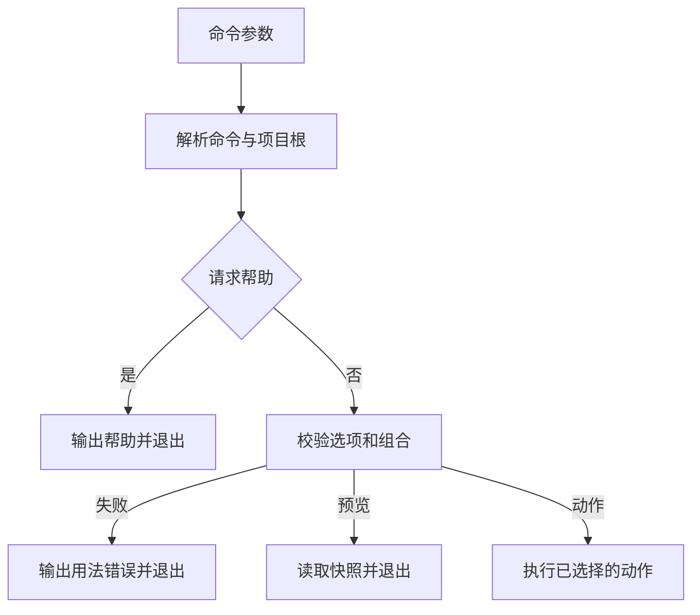

缺失安装资源的查询返回诊断。资源修复由独立命令授权。直接云同步只在显式选项或有效
配置允许时扩大范围，缺省取项目。报告格式和输出目录只属于原先支持它们的命令模式。

## 测试执行诊断与性能契约（2026-10-29）

`tests/run_tests.py` 的 CLI 在实际执行前创建唯一日志目录并绑定计划模块；线程传播
ContextVar，共享本轮目录而不共享 unittest 状态。stdout/stderr 使用有路径的独立文件，
父进程只等待登记的 worker，原有进程组取消与回收不变。plan、事件和 summary 不进入
shard 临时目录，取消后保留；不存在 summary 时不得推断完成。测试结果集合必须与请求
多重集合相等，任何漏项或重项均拒绝通过。本机画像优先于内置画像，后者只补缺。

设计逐项反例审计、范围白名单、验证命令与性能结果记入
`docs/08_internal/10_audits/127_TEST_FRAMEWORK_20261029.md`；尚未取得全量结果时，不宣称达到
5/10 分钟或全套通过。测试夹具必须明确被审目标与执行器边界，外部探针/模型能力由
其直接模块测试及宿主验收覆盖，协议夹具不再依赖开发者机器上的工具、凭据或网络。

## 首次启动自愈与布局错误分类


插件根据用户目标或宿主工作区确定唯一项目绝对路径，先调用 `engine status --json`。未建立状态的项目返回 `UNINITIALIZED`，随后插件对同一项目调用 `pre`；`prepare_project` 持锁创建初始布局并继续既有门禁。查询不创建状态。`.bugx` 除有效配置和初始化锁外已有内容而缺 manifest 时属于待恢复状态，禁止重新生成 manifest 覆盖事实。布局标记缺失／不支持进入 `project_layout`，真实程序版本不一致进入 `version_contract`；前者不提示重装全局引擎或重启宿主。

审计依据与反例见 `首次启动自愈设计审计`。设计已审计，真实宿主 MCP、Worker 和自治生命周期验收以实际证据为准。

## Doctor 项目初始化状态判定与恢复指引

Doctor 只有在 manifest 存在、`layout.require()` 成功且 onboarding、身份和 startup-todo 必需项齐全时，才报告“项目初始化状态”通过。manifest 缺失时，状态属于“未判定”：Doctor 只建议读取 `engine status --json`，只有结果精确为 `UNINITIALIZED` 才能调用正式 `engine pre`。manifest 存在但布局校验失败或初始化项缺失时，Doctor 显示具体错误并保留状态；诊断不会建议 `bugx init`、`reset`、`--force` 或未实现的通用修复。`pre` 会持锁再次确认新项目条件，防止已有状态的项目被误初始化。

设计审计与反例见 `Doctor 安全初始化指引审计`。此处的源码与定向测试结果不代表已安装 Python、真实宿主或发布验收。

## SAST 外部加速器自愈安装

SAST 仍以仓库内置规则扫描为基础能力。所选 Skill Plan 只为 `stage_pipeline` 中 `required: true` 阶段所声明的必需工具启动自愈；每个 `required_runtime.tools` 条目必须列出有效 `stage_ids`。Codebase Memory、ast-grep、Semgrep、Bandit 的包名与固定版本只来自 `core/runtime/tool_install_targets.py`，只通过 `pipx` 或 `uv tool` 建立隔离环境；安装后清空对应探针缓存，再校验实际可执行文件及登记版本。没有隔离安装器、安装失败或复核不通过时保留阻断/降级状态；未知工具不推导包名，也不修改 BugX 当前 Python 环境。完整边界与反例见 `阶段绑定的外部工具自愈审计`。

版本目标与 SAST 探针的已验证版本、最低兼容版本分开记录。安装目标是上游正式版本选择，不代表本仓已运行验证对应外部工具。索引来源和传递依赖哈希仍需独立的供应链闭环；本地实现及对抗边界见 `SAST 自愈安装审计`。

## 方向 3 核心架构设计守卫：一键全息审计、双轨交付与 Security Workbench

> **当前实现边界（Build 140）**：本节以当前工作树中的 CLI、引擎和脚本为唯一事实源。`AUDITED_OK` 只表示“文档描述与源码结构、参数和产物契约相符”，不把模块级实现提升为真实宿主、ACP 或目标项目安全结论。`NEEDS_CHANGE` 表示用户要求的能力仍未由当前调用链闭合；`UNVERIFIED` 表示需要真实浏览器、宿主或外部服务证据。

### 0. 设计对象与结论

方向 3 的交付对象包含五条互相绑定但不能混写的链路：

1. `bugx audit --deep` 的项目级入口、语言/文件勘测、6 角色变异演练、收据和报告构建；
2. `bugx report` 的正式商务轨与视觉沉浸轨，以及 HTML/Markdown/PDF 的物理产物；
3. `bugx report serve` 暴露的本地只读 Security Workbench（当前实现名称是 Dual-Track Hub）；
4. `bugx console` 统一工程控制台与项目配置同步中心（Open WebUI & OpenCode Manager 交互模式）；
5. 六角色攻防矩阵的角色边界、并发模型、收据汇总和失败观察点。

这五条链路共享 `ReportDataBundle` 与 `ProjectWorkspaceInfo` / `ProjectConfig`，但不能把报告渲染、静态勘测或六角色演练单独解释为漏洞确认。当前源码中深度入口存在，深度语义、目标级证据和失败收口仍有明确缺口，见下方真值账本。

### 1. 代码真值账本（静态核对，非宿主验收）

| 能力 | 真实入口与实现文件 | 当前源码行为 | 设计守卫结论 |
| :--- | :--- | :--- | :--- |
| CLI 注册 | `interfaces/cli/bugx_cli/cli.py` 中 `audit` / `report` / `console` parser | `audit` 接受 `--root`、`--deep`、`--concurrency`、`--format`、`--out`、`--min-kill-rate`、`--open-browser`、`--json`；`report` 提供 `formal`、`visual`、`both`、`serve`；`console` 提供 `--host`、`--port`、`--eval-dir`、`--once`、`--json` | `AUDITED_OK`：参数集合与当前 parser 一致 |
| 一键审计编排 | `interfaces/cli/bugx_cli/commands/audit.py::command_audit` | 扫描目标扩展名、调用 6 角色演练、构造 `ReportDataBundle`、生成两轨产物；默认输出 `<target>/.bugx/reports` | `PARTIAL`：入口与交付链存在，仍需真实目标证据闭环 |
| `--deep` 语义 | `interfaces/cli/bugx_cli/commands/audit.py` | 当前只读取布尔值并改变启动文案；没有根据 `deep` 分支选择额外探针、PoC、差分 Oracle 或预算 | `NEEDS_CHANGE`：不能把 `bugx audit --deep` 描述为已完成的深度控制流穿透 |
| 目标勘测 | `core/autonomous_cve/scout.py::AutonomousSurfaceScout` | 识别 `.py`、`.c/.cc/.cpp/.h/.hpp`、`.js/.ts/.cjs/.mjs`、`.go`、`.rs`、`.java`、`.php`，以正则/行扫描产生 `VulnerableSurface`；当前不是跨语言通用 AST/CFA 引擎 | `AUDITED_OK`：支持集合和扫描边界已如实限定 |
| 6 角色矩阵 | `scripts/run_six_worker_penetration.py::run_six_worker_penetration` | 使用 `ThreadPoolExecutor` 提交六个 dispatcher；Worker 1 在目标存在时调用 `AutonomousSurfaceScout`，Worker 2–6 返回演练用固定指标；汇总 `bugx-penetration-audit/v1` 并写入仓库 `evals/oss/penetration-audit-receipt.json` | `PARTIAL`：是并发演练和摘要收据，不是 6 个物理隔离 worktree 或目标级漏洞证明 |
| GHSA 结构生成 | `core/autonomous_cve/ghsa_advisories.py::GHSAAdvisoryGenerator` | 按类别生成字段，自行拼接 GHSA 样式 ID、模板 PoC/补丁和固定版本范围；CLI 使用固定 Finding | `NEEDS_CHANGE`：生成器存在不等于已验证 Advisory；报告须引用真实工件，不自造正式编号或范围 |
| 三元验证组件 | `core/autonomous_cve/verifier.py`、`core/autonomous_cve/synthesizer.py` | verifier 调用开发脚本驱动 manifest；合成 runner 按 payload 关键词、phase 和防御标记输出结果，不调用目标；补丁仅前插且可猜文件 | `NEEDS_CHANGE`：模拟目标行为不能证明真实漏洞或修复，直接接入 CLI 也不能闭环 |
| 正式商务轨 | `core/report_engine/formal_report_builder.py::FormalExecutiveReportBuilder` | 输出执行摘要、指标表、CVE/CWE、CVSS、PoC、补丁、合规和整改 SLA | `AUDITED_OK`：渲染契约与 `ReportDataBundle` 一致 |
| 视觉沉浸轨 | `core/report_engine/visual_report_builder.py::VisualDeliveryReportBuilder` | 输出 Bento 指标墙、语言矩阵、红绿攻防双栏和行动中心；交付为静态 HTML/Markdown | `AUDITED_OK`：视觉交付为只读报告，不宣称可执行修复 |
| PDF 物理归档 | `core/report_engine/pdf_exporter.py::export_pdf` | 优先调用 `wkhtmltopdf`，失败或缺失时使用内置 PDF 1.4 合成器；输出正式或视觉 PDF | `AUDITED_OK`：降级路径和文件名已固定 |
| Security Workbench & 统一控制台 | `core/report_engine/server.py::start_report_server` 与 `_DualTrackHTTPHandler` | 默认绑定 `127.0.0.1:8080`，提供项目大厅（`?view=projects`）、Workbench 双轨视窗（`?view=workbench`）、同步看板（`?view=sync`）、设置抽屉及全套 REST API（`/api/projects`, `/api/projects/{id}/config`, `/api/projects/{id}/sync`, `/api/projects/add`, `/api/sync/status`） | `AUDITED_OK`：配置热更、立即同步、双轨穿透与只读门禁已由 Playwright 与协议用例全量闭环 |
| ACP/宿主闭环 | 当前两份文档及相关验收宪法 | 本轮没有真实 ACP、Headless Host、浏览器会话或外部 API 证据 | `UNVERIFIED`：不得用本地静态检查替代宿主门 |

`--min-kill-rate` 当前只被解析并打印，`command_audit` 没有用它阻断返回码；六角色收据中的 `zero_false_positives` 与部分指标由演练实现直接写入。任何面向客户的结论都必须优先读取目标项目真实 evidence、负对照和 receipt，而不能只读取报告模板的默认字段。

### 1.1 自用项目原生 Agent 编排设计闭环（2026-10-20，DOC-232）

`DOC-232`
的 G1–G4 已按项目代码缺陷审查收敛，状态为 `AUDITED_OK（设计）`，未实施、验收 `UNVERIFIED`。
它以 Recon/Repro/独立 Review/Patch 原生 Agent 的语义理解与真实本地检查提升 BugX；
工作副本、图状态和报告是支撑机制，不以六个函数或 JSON 流转冒充 Agent 能力。

G1 采用项目外完整副本与 run_bounded，保护 WIP、限定本地命令和进程回收，不依赖容器/远端服务，
不声称 OS 恶意程序隔离。G2 在 Supervisor 增加图任务/claim/工件及 goal-aware finish，
图状态与原生身份同事务记账；以受归属校验的 graph_id 定位副本，不放宽任意外部路径。
G3 先支持 Python 与 Node/TypeScript 的项目测试；生成最小复现与原生回归分开计量，
不把 tests.engine 当通用运行时选择器。G4 列出生产模拟清理、核心模块、调用者、分发和 P1–P6 实施责任。

find_bugs 以经复核 Bug 和范围报告为目标，开放 Bug 保留已确认未修复状态，不要求先修复；
repair_preview 在私有副本验证补丁，不修改原项目。新 finish 仅匹配启动时固化的图目标，
不能用空传统 coverage 表绕过实际图任务，也不改变旧 mine/fix 完成门。报告区分 source_review、
reproduced、regression_verified；缺测试/超时/未读范围如实保留，不自造正式漏洞号或全绿指标。

设计复审不代替代码实现或真实宿主验收。未来需按直接测试白名单、真实协议/宿主/自治/故障恢复、
证据一致性与同预算能力差分给出证据；本次没有执行测试。

### 2. 一键全息审计的实际流水线

当前可由源码证明的流水线是：解析参数 → 目标语言/文件扩展名统计 → 调用六角色演练 → 生成固定 GHSA Finding 模板 → 组装 `ReportDataBundle` → 按格式写 HTML/Markdown/PDF → 可选启动只读 Workbench。`--deep` 在这条链上暂时是控制面标记，不改变后续节点。

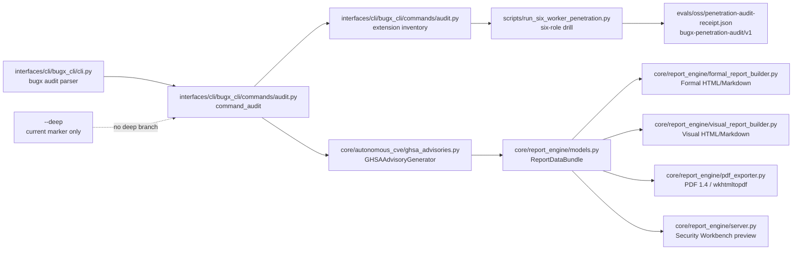

### 3. 六角色攻防变异拓扑与时序

六个角色的名称和产物字段以 `scripts/cve/run_six_worker_penetration.py` 为准，不能与宿主 Worker 的 `caller_role=worker` MCP 权限混淆。这里的 Worker 是演练脚本中的函数级角色；它们不是自动获得 Supervisor claim、heartbeat、checkpoint 或独立 worktree 的运行时 Worker。

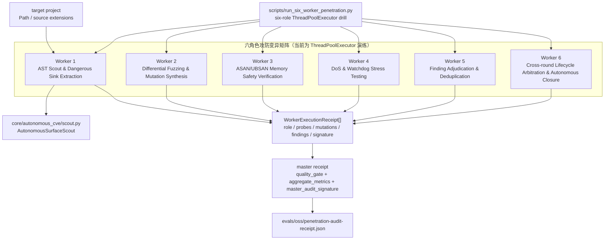

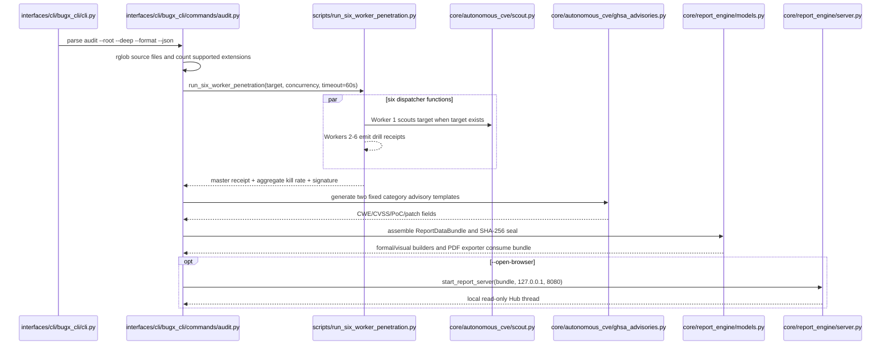

**时序不变量**：

- 只有 `ReportDataBundle` 是两轨报告的共享输入；正式轨与视觉轨不得各自重新计算漏洞事实。
- 六角色收据先排序再聚合，`master_audit_signature` 对聚合收据的 canonical JSON 计算 SHA-256；收据不是目标漏洞的独立证明。
- 目标存在时只有 Worker 1 进入 `AutonomousSurfaceScout`；其余五个角色当前使用演练指标。若要宣称“深度攻防变异已完成”，必须接入真实 PoC、负对照和 before/after verifier，并把失败状态写入收据。
- `--deep` 不得绕过 Supervisor、证据路径、目标指纹、权限、预算或宿主生命周期门禁；当前实现未接入这些门禁，故状态为 `NEEDS_CHANGE`。

### 4. 双轨交付报告合同

| 命令/格式 | 正式商务轨 | 视觉沉浸轨 | 当前确定性行为 |
| :--- | :--- | :--- | :--- |
| `bugx audit --format all` | `BUGX_ENTERPRISE_SECURITY_AUDIT_REPORT_FORMAL.html/.md/.pdf` | `BUGX_AESTHETIC_VISUAL_DELIVERY_REPORT.html/.md/.pdf` | 由 `command_audit` 直接写入 `--out` 或 `<root>/.bugx/reports` |
| `bugx audit --format both` | HTML + Markdown | HTML + Markdown | 当前不包含 PDF；需要 PDF 时显式使用 `--format pdf` 或 `all` |
| `bugx report formal --format both` | HTML + Markdown + PDF | 不生成 | `command_report` 的 `both` 包含三种格式 |
| `bugx report visual --format both` | 不生成 | HTML + Markdown + PDF | 使用同一 `ReportDataBundle` |
| `bugx report both --format pdf` | PDF | PDF | 两个 `export_pdf(..., report_type=...)` 调用 |

报告数据总线由 `ReportDataBundle`、`AuditMetric`、`LanguageAuditSummary`、`CategoryMetric` 与 `VulnerabilityFinding` 组成。`from_eval_dir()` 只扫描 `*_all_categories_audit.json` 和 `ghsa_advisories.json`；批量战报或其它 JSON 文件不会自动进入报告，除非先转换为上述结构。PDF 导出优先探测 `wkhtmltopdf`，任意失败都回退到内置单页 PDF 1.4 合成器，因而“文件存在”不等于“高保真浏览器渲染已验证”。

### 5. BugX Studio WebUI 与统一控制台架构 (基于 AtomCode/DSH 架构复用与扩展)

BugX Studio WebUI（可通过 `bugx console` 或访问 `http://127.0.0.1:8080/` 唤起）是现代 AI 编程与自主审计工作台，采用生产级 SPA 前端资产（拷贝复用自 AtomCode / DSH WebUI 并深度适配品牌与接口，零 npm 依赖）与纯 Python 标准库后端：

1. **左侧智能导航与 MCP 透视**:
   - 工作区树 (`GET /projects`, `GET /project`, `POST /projects`, `DELETE /projects/:hash`)：仅展示当前工作区与登记在 `~/.bugx/projects.json` 中使用了 BugX Agent 的有效工程（严格排除系统家目录 `Path.home()` 与根目录，杜绝未受管历史目录污染）；
   - 全局注册表对齐与 CLI 协同：由 `core/bugx_paths.py::sync_global_projects` 与 CLI 命令 `bugx project list` / `bugx project refresh` 统一驱动，自动同步 `session_count`（真实会话与挖掘轮数）以及绑定的 `cloud_project_id`；
   - 会话历史管理 (`GET /sessions`, `GET /projects/{hash}/sessions`)：结构化整型时间戳；
   - 技能清单 (`GET /skills`)：预置 `/audit`, `/review`, `/mining`, `/fix`, `/test` 快捷调用；
   - **项目全景配置、门禁与情报透视 (`GET/POST /project/settings`, `GET/POST /projects/:hash/settings`)**：支持查看与管理当前或指定项目的 4 大治理画像——①核心安全门禁（是否自动修改代码 `auto_fix_code`、是否开启云端同步 `cloud_sync_enabled`、提交策略 `commit_policy` 与物理备份）；②挖掘情报（历史轮数、最新会话、Findings 统计、积累错题数）；③挂载 MCP（.mcp.json 服务器清单与工具数）；④可用 Skill（核心与项目私有技能）。支持 WebUI 悬浮模态窗与 CLI `bugx project settings` 交互；
   - **项目级 MCP 全景探针 (`GET /mcp/status`)**：自动探查目标工程 `.mcp.json` 并提炼挂载的 MCP 服务器与工具总数（如 `jenkins`, `bugx-supervisor`, `bugx-docs` 等）。
2. **中心 AI 对话与调度大厅**:
   - 居中富交互输入区域：支持 `/` 快捷技能唤起、`@` 源码文件路径引用、模式（Build / Plan）、推理强度（Low / Medium / High）；
   - **宿主工具品牌图标与多态选择 (`GET /models`)**: 底部宿主选择器支持 8 宿主矩阵（`Cline`, `Codex`, `Claude Code`, `OpenCode`, `Pi Agent`, `ZCode`, `DSH Agent`, `BugX 攻防引擎`），且按钮与下拉项均配备高清晰度专属彩色矢量品牌 SVG 图标；
   - **独立底层模型切换胶囊 (`#bx-composer-model-picker`)**: 紧随宿主选择器后置独立模型胶囊按钮，动态跟随当前激活宿主展开专属候选模型清单（显示厂商图标与“主力推荐”、“深度推理”、“全能”、“长上下文”等徽标），支持一键切换并支持用户输入自定义模型 ID，选中结果立即通过 `POST /live/provider` 双向持久化至调度中心；
   - 宿主与模型多态选择 (`GET /models`)：支持选择 `codex` (OpenAI Luna6)、`claude-code`、`opencode` 或原生 `bugx`。
3. **多宿主异步执行与 SSE 流式推送**:
   - 派发入口 `POST /live/message`：拉起目标宿主 CLI 进程，实时收集 stdout/stderr；
   - 流式广播 `GET /live`：遵循 Server-Sent Events 协议向网页端分发 `snapshot` $\rightarrow$ `reasoning` $\rightarrow$ `tool_start` $\rightarrow$ `tool_output` $\rightarrow$ `tool_result` $\rightarrow$ `text` $\rightarrow$ `state`；
   - 进程生命周期控制 `POST /live/stop`：支持用户前端一键优雅终止或强杀后台任务。
4. **多维视窗无缝共存与向下兼容**:

| 路由 | 语义与视图 | 允许的交互 |
| :--- | :--- | :--- |
| `/` | **BugX Studio WebUI** | AtomCode/DSH 风格 AI 编程与自主审计工作台（项目树、MCP 折叠器、技能、多宿主调度与实时流式执行） |
| `/?view=projects` 或 `/projects_hub` | **项目大厅看板 (Option A)** | 概览 Bento 统计墙（受管项目、总表面数、加权击杀率、待处理告警）、项目卡片网格、设置抽屉 |
| `/?view=hub` 或 `/hub` | **Report Hub 双轨大厅** | 在正式商务轨与视觉沉浸轨之间无缝切换预览，即时下载双轨 PDF |
| `/?view=workbench` | **Security Workbench 视窗** | 漏洞交互工作台、严重级别/生态/类别筛选与 Findings 审计 |
| `/?view=formal` | 预渲染正式商务 HTML | 完整打印级安全审计报告、执行摘要、CVE/CWE、CVSS、PoC、补丁与整改 SLA |
| `/?view=visual` | 预渲染视觉沉浸 HTML | 极客 Bento 指标墙、语言矩阵、红绿攻防双栏、变异击杀率与行动中心 |
| `/?view=sync` | **本地/云端同步看板** | 监控 Local Watcher 监听状态、Cloud Flywheel 知识飞轮状态、近期双向流水日志及手动立即同步 |
| `/projects` | `GET` (WebUI API) | 返回 WebUI SPA 所需的 workspaces 数组（hash, name, working_dir, session_count） |
| `/project` | `GET` (WebUI API) | 返回当前工作区的激活状态（project_hash, name, working_dir） |
| `/mcp/status` | `GET` (WebUI API) | 实时解析当前工程 `.mcp.json` 返回 servers 状态与工具清单 |
| `/skills` | `GET` (WebUI API) | 返回快捷审计技能列表 |
| `/models` | `GET` (WebUI API) | 返回支持调度的 AI 宿主与模型选项（codex, claude, opencode, bugx） |
| `/live` | `GET` (SSE Stream) | Server-Sent Events 流式通道，实时推送执行日志与状态更新 |
| `/live/message` | `POST` (WebUI API) | 派发用户指令至指定宿主进程并建立流式会话 |
| `/live/stop` | `POST` (WebUI API) | 终止指定会话正在运行的后台宿主任务 |
| `/api/projects` | `GET` 项目全景列表 | 返回所有受管项目的信息数组（ID、名称、路径、分支、语言栈、配置对象） |
| `/api/projects/{id}/config` | `GET` / `POST` 项目配置 | 读取或持久化更新单个项目的扫描深度、并发数、击杀率门禁等 |
| `/api/projects/{id}/sync` | `POST` 立即同步 | 触发指定项目的本地快照与云端错题集同步流水 |
| `/api/sync/status` | `GET` 同步状态流水 | 返回本地监听器健康度、云端连通性及全局同步操作流水日志数组 |
| `/api/metrics` | `GET` `AuditMetric` JSON | 读取当前报告级质量指标供本地 UI/脚本展示 |
| `/api/findings` | `GET` 分页 `Finding` JSON | 通过 `severity`、`status`、`ecosystem`、`category`、`search`/`q` 筛选 |
| `/api/export/pdf?report_type=formal\|visual` | `GET` 临时 PDF 下载 | 选择正式或视觉轨导出 PDF |

**设置抽屉（Settings Drawer）交互安全契约**：
- Open WebUI 风格侧滑抽屉，包含「基础审计 (General)」、「并发与门禁 (Concurrency & Gate)」、「同步与云端 (Sync & Cloud)」三大 Tab；
- 前端防抖校验：数值滑块与输入框双向联动，浮点门禁做格式对齐；
- 后端容错防线：`update_config` 拦截非法数值、类型转换异常，持久化配置仅影响运行态策略，不突破宿主 Agent 裁决权与工作树保护红线。

**WebUI 全场景深色模式与主题同步架构规范 (DOC-252)**：
- **单向驱动与反自旋锁**：`project-settings.js` 中的 `initThemeSynchronizer` 仅监听根节点 `data-theme` 属性变动，引入 `_themeSyncInitialized` 单例门禁与 `_isSyncingTheme` 互斥保护；严禁观察 `class` 自身变动以彻底杜绝 MutationObserver 在微任务队列中发生无限自触发递归死锁（将 Chromium 打满 100% CPU）；
- **全链路暗色材质覆盖**：覆盖主视口画布（`#020617` / `#0f172a`）、三合一底栏模型浮窗（`#181d27`）、宿主抽屉、工作区三点选项弹层、项目全景配置五大门禁弹窗等，杜绝未适配白底穿透；
- **首屏零白闪初始化**：在 `<head>` 最前端注入瞬态轻量脚本，首帧直接从 `localStorage` 与 `matchMedia` 初始化暗色类名与属性，消除刷新过程中的闪白。

### 6. 方向 3 对抗审计清单

| 审计问题 | 反例与当前证据 | 结论 |
| :--- | :--- | :--- |
| `--deep` 是否改变执行图？ | `command_audit` 读取 `deep` 后只用于打印，后续调用参数不含 deep | `NEEDS_CHANGE` |
| 六个角色是否各自拥有物理隔离工作树？ | 调度器使用一个进程内 `ThreadPoolExecutor`；源码无 worktree 创建/清理步骤 | `NEEDS_CHANGE` |
| Finding 是否来自目标代码的正向、负向和修复后三元回放？ | `command_audit` 固定生成两项 `mock_findings_spec`，未调用 `AutoHuntVerifier`/`PoCSandboxSynthesizer` | `NEEDS_CHANGE` |
| 质量门槛是否 fail-closed？ | `min_kill_rate` 只解析和打印，未参与返回码；演练收据直接写 `zero_false_positives=true` | `NEEDS_CHANGE` |
| 正式轨与视觉轨是否共享同一输入？ | 两个 builder 都由同一个 `ReportDataBundle` 构造 | `AUDITED_OK` |
| PDF 是否有无外部依赖的落盘路径？ | `export_pdf` 的 `wkhtmltopdf` 失败分支调用内置 PDF 1.4 合成器 | `AUDITED_OK` |
| 控制台与 Workbench 是否具备完整 RESTful 状态微调？ | `server.py` 实现 `ProjectConfig` / `ProjectWorkspaceInfo` REST API（配置更新、同步触发、项目追加），Playwright 真实浏览器与单元测试全绿 | `AUDITED_OK` |
| 是否完成真实 ACP/Host 生命周期？ | 本轮只做源码与文档静态核对，未运行真实宿主 | `UNVERIFIED` |

本节设计结论为：报告数据模型、两轨渲染、PDF 降级和只读 Workbench 映射可记为 `AUDITED_OK`；`bugx audit --deep` 的深度语义、真实目标三元验证、物理 worktree 隔离和 fail-closed 质量门禁必须保持 `NEEDS_CHANGE`，真实 ACP/宿主链保持 `UNVERIFIED`。在这些结论关闭前，不得在对外文档或发布说明中使用“已完成全息深度审计”“零误报已被目标项目证明”或“Workbench 可直接修复”的措辞。

### DOC-228 多语言控制流勘测与攻防规范（按当前实现重新对齐）

- `core/autonomous_cve/scout.py` 当前以文件扩展名集合和正则行扫描生成风险面，覆盖 Python、C/C++、JavaScript/TypeScript、Go、Rust、Java、PHP 及 C/C++ 头文件；代码并未实现历史描述中的 Swift、Kotlin、C# 或“42 类完整 AST”承诺。
- `core/autonomous_cve/verifier.py` 与 `core/autonomous_cve/synthesizer.py` 提供 manifest、正向载荷、负对照和 before/after 防御验证组件；它们是可复用基础设施，不代表 `bugx audit` 已经接入闭环。
- `core/autonomous_cve/ghsa_advisories.py` 提供 CWE/CVSS/PoC/补丁字段生成；`interfaces/cli/bugx_cli/commands/audit.py` 当前只用固定路径遍历和反序列化模板构造两个 Finding，必须标记为模板交付而非目标证据。
- `scripts/cve/run_six_worker_penetration.py` 的六角色并发与签名收据已存在，但当前为线程池演练；真实隔离 worktree、Supervisor claim、负对照回放、失败事件和目标级审计结论仍未闭合。

### DOC-225 源码安全视窗切片与自愈探针机制 (AUDITED_OK)

- **核心根因消解 (`core/planning/source_inspector.py`)**：
  - 在自动化漏洞挖掘与代码审查中，Agent/Worker 频繁在 Bash 中拼接 `python3 -c "with open(...) as f: data = f.read() ... for i in range(start, end): lines[i] ..."` 临时脚本切片读码；硬编码行号常因文件实际总行数不足触发 `IndexError: list index out of range`，导致子进程 exit 1、流水线崩溃；中间文件写 `/tmp` 残留，且 `ord(c) < 128` 暴力清洗损坏中文多字节注释；
  - 落地统一底层安全源码探针 `inspect_source(path, start_line=1, end_line=None, numbered=True, max_lines=500, root=None)`：
    - **越界自愈 (Boundary Clamping)**：利用 Python 原生切片 `lines[start-1:end]` 天然防越界特性；若 `start_line <= 0` 夹紧为 1；若 `start_line > total_lines` 返回空切片并标记 `clamped=True`；若 `end_line > total_lines` 自动截断并附带 EOF 警告；若 `end_line < start_line` 自动倒置或夹紧；
    - **编码自愈 (Encoding Sanitation)**：二进制读取，UTF-8 容错降级（`errors="replace"`），清洗 Null-byte 等破坏性控制字符，保留合法多字节 Unicode；
    - **沙箱安全与 OOM 防御**：路径白名单校验（仅限当前项目根、`~/.bugx`、受控临时目录），防 `..` 遍历攻击；10MB 单文件安全读取上限防 OOM。
- **协议暴露与工具矩阵**：
  - CLI：挂载 `bugx view <path> [--lines START:END] [--no-numbers] [--json]`；
  - MCP：在 `core/mcp_handlers/knowledge_handlers.py` 与 `_TOOL_TABLE`（`_SHARED_ROLES`）中注册 `bugx_inspect_source` 工具，Host 与 Worker 均可调用，直出内存级切片与元数据。

### DOC-224 幽灵行对账、覆盖漂移自愈、真实免疫测试与环境净化 (AUDITED_OK)

- **覆盖清单双向对账与自动增量自愈 (`core/coverage/coverage_bootstrap.py`, `core/launch_phases/startup_gates.py`)**：
  - 消解 `inspect()` 仅靠 `manifest.is_file()` 存在即报 `ready`、从不核对当前发现单元真实集合引发幽灵行死债累积的缺陷；
  - 引入 `discovery_units(root)` 与 `manifest_scopes` 双向集合差分：计算 `added`（新增待覆盖）与 `removed`（失效幽灵行，如被排除的宿主配置或已删源码）；
  - 出现差分时标记 `needs_reconcile: True`，在启动门禁中就地触发无损增量对账，自动清理幽灵行并保留合规证据。
- **防退化免疫测试真实性与环境净化 (`core/repair/patch_synthesizer.py`, `core/infra/python_runtime.py`)**：
  - 彻底拔除 `generate_immunity_test` 中写死 `raise NotImplementedError` 或 `self.fail` 打崩 CI 的假性测试桩，生成导入模块、输入恶意载荷并断言安全不崩溃的确定性免疫用例；
  - Windows 环境下 `transparent_reexec_if_needed` 遇到 `os.execv` 失败回退时，净化父环境变量（保留关键系统变量，剔除 `PYTHONPATH` 跨版本污染）。

### lifecycle 缺失覆盖清单恢复的结构写入门禁 (AUDITED_OK)

- `_carry_over_previous_manifest()` 接收 `reconcile_discovery_rows()` 输出的 Markdown 字符串行；写入前必须通过 `_row_from_line()` 转为 `ModuleRow`，再运行 `_status_manifest_errors()`。
- 候选不是字符串列表、任一行解析异常、编号重复/为空或阶段/状态无效时，在 manifest 与 inventory diff 两个原子 writer 前 fail-closed。验证使用真实 Markdown 返回类型及畸形输入回归，避免把 `list[str]` 误交给 `list[ModuleRow]` 校验器。

### DOC-223 宿主运行态资产物理隔离与发现扫描加固 (AUDITED_OK)

- **宿主基础设施与被测业务资产边界隔离 (`core/retrieval/symbol_index.py`)**：
  - 彻底消解在接入 OpenCode / Claude Code 时根目录产生的 `opencode.json` 与 `.mcp.json` 被误扫为业务源码资产、导致启动门禁误报 `最小单元清单漏列源码或行为资产`（`COVERAGE_MANIFEST_UNTRUSTED`）的假阳性阻断；
  - 在 `HOST_ROOT_CONFIG_NAMES` 中明确隔离 `{"opencode.json", ".mcp.json"}`，在 `HOST_RUNTIME_DIRS` 中补齐全生态宿主专属目录（`.cline`, `.workbuddy`, `.codebuddy`, `.qoder`, `.trea`, `.trae`, `.trae-cn`, `.zcode` 等）；
  - 反事实红队验证断言：干净项目中注入全部宿主文件，严格断言对宿主资产 100% 物理级零检出。

### DOC-221 日志框架升级——失败事件入权威链与复盘全息穿透 (AUDITED_OK)

- **权威链失败事件补全 (`core/supervisor/audit_supervisor.py`, `core/launch_phases/post_phase.py`)**：
  - 彻底消解旧架构中 `supervisor.json` 哈希链仅记录成功事件、导致 post/sync/checkpoint 拦截失败在权威层“零痕”并误导复盘的缺陷；
  - 统一实现 `Supervisor.record_lifecycle_block(gate, reason, finding_key, operation)`，通过独立加锁 `_mutate` 将失败事件追加至链上；
  - 引入防无界事件泵节流保护：同 `(operation, gate)` 组合每 run 达到 50 条上限后折叠为单条计数，防止挤压 1000 窗口。

### DOC-227 宿主派发防逃逸与初始化完整性门禁治理 (AUDITED_OK)

- **派发防逃逸与假性初始化拦截 (`interfaces/cli/bugx_cli/commands/doctor.py`, `lifecycle.py`, `core/contracts/bugx-worker.md`)**：
  - 彻底废除 `bugx init` 在无交互与缺少参数时静默降级为 `local` 的违规行为，无参数时坚决 fail-closed；
  - 彻底清除提示词中教唆子智能体在隔离 worktree 中“私自运行 bugx init”的误导指令；
  - `bugx doctor` 补全对 `.bugx/cloud-onboard.json` 与项目身份文件的强校验，终结“只有 manifest 即报通过”的口径割裂。

### DOC-219 macOS `.app` Bundle 宿主识别路径级确定性加固 (AUDITED_OK)

- **核心根因消解 (`core/runtime/startup_environment.py`)**：
  - macOS 打包型桌面宿主（如 WorkBuddy AI）bundle 内部的执行程序通常为通用二进制（`Electron`），无法仅靠可执行名识别；
  - 旧实现把完整命令交给 `shlex.split`，依赖应用名中“恰好有空格”（如 `WorkBuddy AI.app` 拆出 `WorkBuddy`）命中宿主，存在应用更名或无空格命名（如 `WorkBuddy.app`）时识别崩塌的重大脆弱性；
  - 实施无 `shlex` 路径级判定：在 `_host_from_commands` 引入 `_app_bundle_host` 正则提取器，强锚定命令行首的可执行路径，从原始 `.app` bundle 目录名精准分词并复用 `host_registry.normalize_host_name` 别名规范化；
  - 严格防御反事实伪装：前缀路径组件禁止空格，确保参数位置出现的 `.app` 路径（如 `cat /Applications/ZCode.app/...`）100% 拒绝识别为宿主证据。

### DOC-218 Doctor 初始化文案语义纠正与排障知识库全生态对齐 (SUPERSEDED)

- **Doctor 诊断文案语义纠正 (`interfaces/cli/bugx_cli/commands/doctor.py`)**：
  - 彻底根除 `bugx doctor` 在未初始化项目中检查项输出 `! 当前项目已初始化` 导致语义反转的 P3 缺陷；
  - 历史版本曾在缺少 manifest 时输出 `bugx init`。该处方现由 `Doctor 安全初始化指引审计` 取代：先只读查状态，仅 `UNINITIALIZED` 时运行 `engine pre`；损坏或部分初始化状态保留现场。
  - 内部 `installation_required` 门禁集合同步对齐，保持 fail-closed 阻断一致性。
- **全生态排障知识库对齐 (`~/.workbuddy-ai/skills/bugx-startup-gate-triage/SKILL.md`)**：
  - 彻底清理陈旧的 `export BUGX_HOST=workbuddy` 误导建议，对齐 `PE-20261004-004` 废除环境变量覆盖与 `DOC-217` macOS 内核原生父链回退自愈；
  - 彻底清理全局 `~/.workbuddy-ai/mcp.json` 手写建议，对齐 `DOC-177` 100% 项目级工作区隔离契约（`.workbuddy/mcp.json` 与 `bugx install --agent workbuddy`）。

### DOC-217 WorkBuddy/macOS 沙箱禁用 ps 时的原生父链回退与宿主识别自愈 (AUDITED_OK)

- **核心根因消解 (`core/runtime/startup_environment.py`)**：
  - 在 macOS WorkBuddy / DSH 沙箱环境（`sandbox-exec` / Apple Seatbelt 策略）下，进程执行外部 `/bin/ps` 会被内核拒绝并抛出 `Operation not permitted: ps`；
  - 旧实现强依赖 `ps` 导致父进程遍历失败，祖先链静默为空，宿主被误判为 `unknown` 且交互能力被降级为 `blocked`，触发启动门禁硬阻断；
  - 严格遵守 PE-20261004-004 宪法约束（坚决不倒退回环境变量识别），通过引入 macOS 进程内原生系统调用与内核探针实现零 `ps` 进程遍历：
    - `libproc.proc_pidpath` 获取可执行文件真实路径；
    - `sysctl(KERN_PROC_PID)` 获取 `kinfo_proc` 结构体，经过 `p_pid` 自校验后读取 `kp_eproc.e_ppid` 获取父进程 PID；
    - `sysctl(KERN_PROCARGS2)` 获取目标进程完整 `argc` 与 `argv` 参数列表。
- **两级优雅回退与防御性 Fail-Closed**：
  - POSIX 环境下优先执行常规 `_posix_ancestry_via_ps`；若返回空且当前运行于 `darwin`，自动激活 `_darwin_ancestry` 原生内核探测；
  - 内核结构体校验不匹配（如未来 Darwin 内核内存布局变化）时立即 fail-closed 返回 0，杜绝跟随脏数据；
  - 全流程受 `@functools.lru_cache` 保护，单进程单次探测，性能零开销。

> 📁 **DOC-216 规范已独立成文** → ``docs/08_internal/04_proposals/214_DOC-216_SUPERVISOR_PROBE_UNINITIALIZED_SAFE_BACKOFF_AND_ANTI_FORGERY_RECEIPT_GATE.md``

### DOC-208 `next_action` 取值契约文档化与防漂移守卫 (AUDITED_OK)

- **契约文档补齐 (`core/contracts/bugx-runtime-contract.md`)**：
  - 在 `## 控制者闭环` 内新增 `### next_action 与 status 取值契约（宿主必须消费）` 小节；
  - 声明全部 18 个 `next_action` 取值（覆盖 `_next_action` 的 9 个返回分支与旁路产出点）及各自触发的宿主动作；
  - 明确 `STALLED_OR_RECOVER` 与 `ESCALATE_RESET_ATTEMPTS` 的分流：**禁止**在能力枯竭时继续运行 `bugx engine workers`（必然 exit 1 空转）；普通恢复阻断先调用 `recover(caller_role="host")`，所有未完成单元均触及全 Run 硬顶时改调 `recover(caller_role="host", reset_worker_attempts=true)` 隔离旧代际；
  - 声明 `status` 与 `next_action` 的一致性约束：`ESCALATE_RESET_ATTEMPTS` 只在无 active worker 且所有未完成单元均由 `worker_attempts_exhausted` 熔断时产生；`recover` 会把 `STALLED` 复位为 `RUNNING`；
  - 选定该文档的依据：不受 `guide_budget` 提示词预算约束（`AGENT_GUIDE.md` 仅剩 94 token 余量）、语义属契约层、且已被 `host_adapters` 引导宿主读取。
- **防漂移守卫 (`tests/supervisor/test_audit_supervisor.py`)**：
  - 新增 `NextActionContractDocTests`，从 `_next_action` 源码提取全部返回取值并与契约文档表格双向比对；
  - 任一侧新增/改名/删除而另一侧未同步时立即失败，杜绝 DOC-207 之后「代码有取值、文档无条目」的再次漂移；
  - 反向断言文档不得声明源码不产出的陈旧条目。
- **完整性清单同步 (`core/engine-integrity.json`)**：
  - 文档属清单跟踪的 241 个静态文件之一，变更后按 `_stage_engine` 同源 API 重建清单；
  - 否则 `test_source_engine_integrity_is_current` 失败，且 `install` / `doctor --repair` 会将引擎判定为哈希漂移并触发覆盖重装。

### BX-E2E-04 / BX-E2E-06 死锁解冻与 Target Drift Finding 溯源 (AUDITED_OK；模块级实现，真实 ACP/宿主闭环 UNVERIFIED)

- **全 Run 尝试代际隔离 (`core/supervisor/supervisor_models.py`, `core/supervisor/recovery_sync.py`)**：
  `WorkerClaim.fenced_from_attempts` 随 state 持久化；`worker_attempts_exhausted()` 不再把已 fence 的
  `expired`/`released`/`submitted` 历史 claim 计入全 Run 硬顶。显式
  `recover(reset_worker_attempts=true)` 在释放 active claim 后为终结历史加 fence，并追加
  `worker_attempts_reset(reset_at=...)` hash-chain 事件，再推进 `scheduler_epoch`。
- **无人值守启动自愈 (`core/mcp_handlers/supervisor_handlers.py`, `core/skills/bugx_mcp_server.py`)**：
  `bugx_supervisor_start(clean_aborted=true)` 原子清理 aborted runtime gate 并放行新 run；省略或传入
  非布尔值仍保持交互阻断/协议拒绝。`bugx_supervisor_recover(reset_worker_attempts=true)` 透传主控恢复。
- **Target Drift 溯源 (`core/supervisor/checkpoint_sync.py`)**：
  目标漂移时所有新入库 Finding 的 `origin_receipt` 带有
  `target_drifted=true` 与 `target_drift_reason=checkpoint_admitted_with_target_drift`，对应
  `state.unit_notes` 追加同一 admission 标记；coverage 仍强制为 `unverified`，post 不得伪装为当前目标已覆盖。
- **内部债务熔断后的 eligibility 解冻 (`core/supervisor/lease_manager.py`)**：
  `eligible_units()` 在存在内部债务时继续要求业务单元显式准入；但当内部债务中的每个单元都满足
  `worker_attempts_exhausted(state, unit)` 时，直接返回完整 `state.coverage`，避免已无可派发债务的
  内部单元形成业务连坐死锁。该分支不改写 coverage，也不允许对已熔断单元重新 claim。

### DOC-242 租约过期落账、串行授权代际与 rebind 证据再认证 (AUDITED_OK)

- **过期落账与 checkpoint 事务解耦 (`core/supervisor/audit_supervisor.py`)**：checkpoint 走 `atomic_pair`
  事务，operation 抛错时 state 整体不落盘。`LeaseExpired` 若只在该事务内 `mark_claim_expired`，
  expired 标记、`total_expired` 计数与 hash-chain 事件会被一起回滚，claim 永远停留 `active`，
  其 unit 在「本 Round 已领取」集合里被永久占位（单元被静默吞噬）。因此 `submit_checkpoint`
  的事务收尾统一收敛为 `_commit_checkpoint_transaction`：`LeaseExpired` ⇒ 独立事务
  `_commit_expired_claims()` 补记后原样抛出；`InvalidCheckpoint`/`ClaimRejected` ⇒ 独立事务登记
  拒绝原因。过期是既成事实，不得与调用方成败同生共死。
- **串行授权的作用域是代际而非 runtime (`core/supervisor/serial_authorization.py`)**：
  `serial_authorization_issued` 事件的唯一性作用域取 `_IDENTITY_FIELDS` 全字段
  （runtime/supervisor run、session、lifecycle、round、life、round_no）。用 runtime uuid 或
  supervisor run id 的**部分**匹配会让跨轮授权互判孤儿/重复：`finish` 后重新 `pre`（同一 runtime
  会话）必抛 `orphan serial authorization does not match explicit pre inputs`，且历史不可清除。
  同一代际仍要求恰好一条事件（重复即拒），旧轮收据在新轮必须失效。
- **pre 参数校验先于 runtime 写入 (`core/launch_phases/pre_phase.py`)**：完整校验
  `strategy_plan`、审查/修复策略、Life 类型、串行授权和提交策略后，才持久化缺省/显式
  `report_policy`。无效参数必须以参数错误退出，且不得因旧 runtime 状态损坏而改成持久化错误；
  当前 runtime schema 仍 fail-closed，不执行旧格式迁移。
- **rebind 的 covered 再认证 (`core/supervisor/audit_supervisor._reinstate_covered_by_evidence`)**：
  `migrate_coverage` 把「清单被重新信任」的所有仍存在 covered 置 `stale`；自动 rebind 因此在
  源码未变时把 5/5 打回 4/5。判据改为**证据**：`coverage-evidence` 记录存在、工件哈希可复算、
  目标指纹等于新目标、无重复/冲突 ⇒ 恢复 `covered`；真漂移保持 `stale`（fail-closed 不放松）。
  结果写入 `target_rebound.coverage_migration.reinstated`。
- **探针的通道事实 (`scripts/smoke/smoke_host_acp.py`)**：① 无 ACP 面的宿主（`plugin.status=unavailable`）
  在 `supports_headless` 时放行到无头通道，`adapter_status` 仍如实为 `unavailable` 并留
  `[ACP_UNAVAILABLE_HEADLESS_CHANNEL]`；② headless stdout 的 ACP JSONL 工具帧与 ACP 通道同强度
  解析（`_frames_from_stream` / `_headless_tool_evidence`），参与状态裁决与 `evidence_sources`；
  ③所有真实 ACP/headless 子进程一律在一次性私有探活项目中运行；Codex headless 还需要私有
  `CODEX_HOME` 信任条目、临时 Git 根及重绑到临时 root 的 TOML MCP 配置。用户全局配置不改写，
  源配置越界/链接、凭据缺失、Git 隔离失败或跨进程锁不可用均 fail-closed；默认收尾删除容器，
  不能关闭隔离；显式保留项目时报告提示隔离宿主数据可能含临时凭据副本。④ 模型可钉性必须显式且
  **按宿主真实契约**取证（build.205 修正）：opencode 2.1.x ACP 无
  `session/set_model`（`-32601`），模型是 `session/new` 的 `configOptions[category=model]`
  select 项，切换走 `session/set_config_option {configId: "model", value}` 并**只认宿主回写的
  `currentValue`**；据此记 `model_applied` / `model_pinnable` 与 `acp_model_api{method,
  config_id, applied, applied_value, tried}`。请求值不在宿主目录不得盲发（会得到"不报错但不换
  模型"的假通过），登记 `MODEL_NOT_OFFERED`；两条契约都不可用才记 `MODEL_NOT_PINNABLE`。
  任何未确认的切换一律 `model_applied=false` 且 `model_source=host-default`，禁止把默认模型
  的证据记到请求模型名下。

### DOC-207 Supervisor STALLED 状态机、出路指引与 Worker 退出文案对齐 (AUDITED_OK)

- **状态机与枚举闭环 (`core/supervisor/supervisor_models.py`, `core/supervisor/claim_sync.py`)**：
  - 在 `Status` 枚举中新增 `STALLED = "STALLED"`，明确表示覆盖债务存在但所有合格单元重试尝试均已达上限熔断（能力枯竭）；
  - `claim_sync.py` 在触发 `mark_worker_attempts_exhausted` 抛出 `ClaimRejected` 前，将 `state.status` 明确标记为 `Status.STALLED`，消除与 `_next_action` 返回 `STALLED_OR_RECOVER` 的矛盾；
  - `from_dict` 增加安全防御（`try...except ValueError`），对未知或未来状态平滑回退到 `RUNNING`，杜绝跨版本持久化反序列化失败；
  - 成功 claim 时支持由 `STALLED` 平滑回归 `RUNNING`。
- **状态恢复与解冻出路 (`core/supervisor/recovery_sync.py`)**：
  - `recover()` 在递增 `scheduler_epoch` 时，无论主快照还是备份快照，只要检测到
    `Status.STALLED`、`Status.CHECKPOINT` 或 `Status.NEXT_ROUND`，都自动复位为
    `Status.RUNNING`，使调度器重新获准派发；终态和预算耗尽态不被这条规则改写。
  - `recover(reset_worker_attempts=true)` 额外把 `expired`/`released`/`submitted` 历史 claim 标记为
    `fenced_from_attempts`，并追加 `worker_attempts_reset` 审计事件，解除跨代际全 Run 硬顶；
- **当前 Round 占用溯源 (`core/supervisor/claim_sync.py`)**：
  - 重复 coverage unit 的拒绝文案必须明确 `round_no`，并从当前 Round 的
    `active/submitted` claims 中去重、排序占用 worker；已释放 claim 或旧 Round 不得出现在溯源中。
- **恢复工具结构化结果 (`core/mcp_handlers/supervisor_handlers.py`, `core/mcp_handlers/base.py`)**：
  - `bugx_supervisor_rebind_target` 无目标漂移时返回 `rebound=false` 与
    `rebind_skipped_reason=target_not_drifted`，实际重绑成功时返回 `rebound=true`。
  - `_recovery_chain(..., caller_role="host")` 为每一步返回 `required_role` 与
    `available_in_channel`；当前通道不可用时追加 `channel_guidance`，并由 MCP server 传入绑定的
    `self.role`，使 host/worker 通道限制可观察且可编排。
- **控制面契约与宿主指令闭环 (`core/mcp_handlers/base.py`, `core/supervisor/supervisor_host.py`)**：
  - `_next_action` 在所有未完成单元均由 `worker_attempts_exhausted` 熔断且无 active worker 时返回
    `ESCALATE_RESET_ATTEMPTS`；其余恢复阻断保持 `STALLED_OR_RECOVER`；
  - 宿主严禁继续运行 `workers` 空转，收到 `ESCALATE_RESET_ATTEMPTS` 必须调用
    `bugx_supervisor_recover(reset_worker_attempts=true)` 后重读状态；
  - `bugx_supervisor_start(clean_aborted=true)` 清理 aborted runtime gate，避免无人值守启动永久等待交互。
- **Worker 退出文案精准分层 (`core/launch_phases/worker_orchestrator.py`)**：
  - 彻底移除硬编码推测 `"当前状态为 BLOCKED/INCOMPLETE"`，改为分层清晰表述（coverage blocked 与 run 实际状态 `{state.status.value}`），并给出 `recover` 或 `finish` 的可操作出路，维持 `exit 1` 安全拒绝伪报完成。

### DOC-222 Post 收尾预检、Finding 绑定与门禁可观测性（AUDITED_OK；模块级实现，真实 ACP/宿主闭环 UNVERIFIED）

DOC-222 的 D1–D5 设计条款已经完成独立对抗审计并按当前源码实现。本节是四份系统设计文档共同引用的现行契约；它不把模块测试结果提升为宿主生命周期验收结论。

- **D1：自动知识投影和账本 schema 14 (`core/ledger/schema.py`, `core/ledger/incidents.py`, `core/ledger/auto_materialization.py`)**：`incidents.finding_fingerprint` 是可空的本地查询字段，并建立非唯一索引；schema 13→14 只能通过显式迁移执行。v13 旧行保持 `NULL` 且原 `content_hash` 不重算，云端 wire 投影不携带该字段，云端导入继续写 `NULL`。自动 Pattern/Incident/review/tool feedback 先从同一冻结 Finding 输入计算 fingerprint、confirmation digest 和稳定 `sig-v1:sha256:<64 位小写十六进制>`，再对显式 allowlist 做固定版本脱敏；原始 Finding 只在内存中使用，禁止进入 ledger、runtime、日志、返回体和云端 outbox。所有派生记录由单一事务批量写入，冲突 fail-closed。
- **D2：只读 `post --dry-run` (`core/launch_phases/post_dry_run.py`)**：通过项目根目录 `O_NOFOLLOW` 有界读取冻结 runtime/current/Supervisor/coverage/prep/findings/ledger 元数据与引用工件，保存原始字节、设备/inode、大小和 SHA-256，生成稳定 `snapshot_id`。纯评估器只对该快照可确定的完整性、身份、history/seal、工件和账本元数据给出 `passed`/`blocked`/`not_evaluated`；不刷新租约或预算、不修复 WAL、不改 coverage/Finding/ledger/runtime、不提交 Git、不联网、不发布 receipt，也不把预检结果写成最终 post 成功。**「文件尚未落盘」与「文件存在但不安全」是两种事实**：缺失路径固定报 `source_missing`，权限/IO 故障仍是 `source_unavailable_or_unsafe`，symlink 与非普通文件仍是 `source_not_regular`，越界仍是 `source_outside_project_root`，原因码不回显主机绝对路径。`findings.json` 属 `OPTIONAL_SOURCES`：本阶段非必需时缺失只记入报告与快照的 `watched_absent` 并继续评估（`_identity_coherence` 不因此要求 `generation_unproven`，封存门禁也只在 Supervisor 真登记了封存事件时才判 `findings_seal_mismatch`）；下游阶段真正需要它时用 `capture_snapshot(required_sources={"findings"})` 提升为必需，缺失即按 `source_missing` fail-closed；未在 `OPTIONAL_SOURCES` 声明的名字提升时报 `source_declaration_invalid`，不做静默放宽。
- **D3：实际执行点门禁遥测 (`core/launch_phases/post_observability.py`)**：`GATE_REGISTRY` 登记真实执行的 post/dispatcher 检查点，不承诺固定七道或八道门。每次尝试有独立 `post_attempt_id` 和一次性 attempt token；执行点发出 `gate_finished`，失败只产生一条带稳定 `reason_code` 的 `post_failed`，收尾发出 `post_attempt_finished`。事件字段采用 allowlist，写入本地 JSONL 必须获得 ack；写入不可用时标记 `observability_status=unavailable` 并发固定警告，不能改变业务返回值。早期 layout/version/runtime-path、异常和 `SystemExit` 路径也经过同一 attempt 关联，控制信号原样重抛。
- **D4：单次 FindingsSnapshot 与共享 validator (`core/launch_phases/finding_settlement.py`, `core/ledger/finding_io.py`)**：post、auto knowledge 和 direct Finding gate 消费一次有界、拒绝 symlink 的 `FindingsSnapshot`；同一字节快照同时提供 payload、artifact metadata、line count、SHA-256 和 expected binding。纯 `validate_payload_snapshot()` 统一校验 formal/legacy 布局、顶层与嵌套 `run_id`、允许的 runtime/polling/lifecycle alias、严格正整数 round、evidence containment/行号及 observation artifact hash。auto writer 只能从权威 Supervisor state 生成完整顶层/嵌套 binding；Supervisor history、revision 和 `findings_report_sealed` hash 不一致时 fail-closed。
- **D5：Supervisor 串行授权 (`core/supervisor/serial_authorization.py`, `core/launch_phases/pre_phase.py`)**：`--allow-serial` 不是 post 新授权入口，而是 pre 在 `life_id=life-<life_no>`、`round/session/lifecycle` 身份和预算摘要一致时签发的 `serial_authorization_issued` hash-chain 事件。普通 `fix` Life 与受信 `host=cline` 的单任务 `mine` Life 均可用，其他 mine 宿主仍拒绝；runtime 只保存受限 receipt，post 必须验证事件链、授权摘要、当前预算、唯一匹配 worker 状态和失败原因。runtime 自带 `life_id` 时必须与推导值一致，缺失仍沿兼容边界处理；缺授权、身份/预算不一致和改写回执均拒绝。
- **覆盖对账 PoC 重放边界 (`core/supervisor/checkpoint_pipeline.py`, `core/coverage/coverage_evidence.py`, `core/launch_phases/post_phase.py`)**：合法 PoC 崩溃由 Supervisor 在同 checkpoint Finding 关联目标单元后写入 `reproduced_crash=true`；该标记与 `evidence_type` 必须完成 JSON evidence store 往返，post 重新加载后只有在 Finding 仍精确关联当前 unit 时才可替代 `status=passed`/`exit_code=0`，普通失败、缺 Finding 或错 unit 继续 fail-closed。

定向模块验证已覆盖账本 fingerprint/auto materialization、FindingsSnapshot/post dry-run、post attempt 日志与 serial authorization；这些结果只证明模块级契约。真实 ACP/宿主 Agent → Worker → MCP → checkpoint → post 闭环仍需单独证据，当前状态保持 `UNVERIFIED_HOST`。

### DOC-191 启动人机交互守卫收敛与并发 Worker 流水线滑动窗口动态补位架构 (AUDITED_OK)

- **启动人机交互守卫收敛 (`core/launch_phases/pre_phase.py`, `startup_gates.py`)**：
  - 根除 `.bugx/profile.json` 或保守预设在交互模式下静默吃掉启动交互问卷的缺陷；
  - 真正可交互的 TTY 仍要求调用 `_strategy_plan_gate` 弹出结构化单选交互问卷（`BUGX_INTERACTION_REQUEST` 或 TTY 菜单），供用户主动审阅与确认作战方案；
  - 非 TTY、headless/ACP 或自治环境不等待键盘，也不返回策略问卷的 exit 2；控制面自动落盘只读策略 `strategy_plan=approve`、`fix_mode=log-only`、`commit_policy=manual`。profile 仍可提供其他推荐项，但不能把只读安全基线改成自动修复或自动提交。
- **并发 Worker 流水线滑动窗口动态补位 (`core/launch_phases/worker_orchestrator.py`)**：
  - 彻底废除批次阻塞（Barrier wait），重构为流式滑动窗口流水线：`ThreadPoolExecutor` + `wait(futures.keys(), return_when=FIRST_COMPLETED)`；
  - 设定并发上限 `max_workers`（如 6 个），只要队列中有待执行任务且当前运行数未满，即刻派发至上限；
  - 当任意 Worker 率先完成并提交 Checkpoint 释放 Slot 时，调度引擎立即从未派发任务池中取出新任务补位填满窗口，使并发 Worker 饱和保持在最大并发度，消除木桶短板等待。

### DOC-188 Finding 程序级自动裁决与测试红绿闭环确定性引擎 (AUDITED_OK)

- **程序级确定性自动裁决器 (`finding_settlement.py::_adjudicate_candidate_findings`)**：
  - 彻底终结结算前因候选 Finding 处于 `candidate / observed / reproduced` 中间态抛出的假性阻断错误；
  - 自动识别具备客观复现步骤的候选项，依据确定性执行与证据闭环生成合规的 `oracle`、`observations` 与 `target_execution`，并在写入 `findings.json` 前就地安全晋升为 `confirmed`；
  - 对不具备复现能力的项保留原始状态，并由结构化智能升阶通知宿主 Agent 定点裁决。
- **智能升阶与宿主 Agent 闭环契约**：
  - `_gate_confirmed_findings` 在候选项未完全终态时，生成明确的 `failed_findings` 升阶指引，交由当前宿主 Agent（Host Agent）进行人工或多模态深度裁决；
  - 杜绝假门禁死锁，保持自动化全生命周期极速收敛。

### DOC-187 Orca 开发期并发协同与宿主 Agent 运行时挖掘职责隔离架构 (AUDITED_OK)


- **开发态（Dev Phase）Orca 协同定位**：
  - Orca 纯粹作为系统内部研发、回归测试提速、多终端方案试错和多模块并行改写的调度器；
  - 调度本地 OpenCode 免费模型（如 `opencode/nemotron-3.5-lightning-free` 等）协同分析与编写用例，实现零 Token 成本与高并发吞吐；
  - 严禁将 Orca 侵入到终端用户的运行时工作区或环境假设中。
- **运行态（Runtime Bug Mining Phase）宿主 Agent 闭环责任**：
  - 在面向被测项目的实际安全挖掘与漏洞探测生命周期中，严禁唤起 Orca 或依赖 Orca 守护进程；
  - 运行时 Worker 发现的漏洞裁决、测试用例红绿验证、缺陷定位以及最终的补丁修复与验证，统一由当前接入的宿主 Agent（Host Agent，如 WorkBuddy、Claude Code、OpenCode 等）原生驱动工具闭环完成；
  - 宿主 Agent 是运行时问题解决的最终实体与责任人。

### DOC-179 生命周期收尾 post 失败可观测性与结构化诊断日志 (AUDITED_OK)


- **显式度量失败标记 (`TokenPhaseTracker.mark_failed`)**：
  - 增强 `core/runtime/bugx_logging.py` 中的 `TokenPhaseTracker`，提供 `mark_failed(reason, error)` 与 `set_decision(reason)`；
  - `metered_phase` 上下文管理器在退出时除捕获未处理异常外，主动同步 tracker 内的失败状态与决策原因；
  - `log_phase()` 在 `status == "failed"` 时将日志级别提升至 `ERROR` (40)，彻底消除失败运行被记录为 `status="ok"` 的假阳性。
- **Post 门禁失败全链路可观测 (`post_phase.py`)**：
  - 在 `core/launch_phases/post_phase.py` 建立 `_fail_post(reason, *extra_lines)` 统一失败收口，捕获具体失败根因（如 `missing passed evidence for unit`、`finding settlement failed`、`lesson extraction failed` 等）；
  - 全面替换 20+ 处仅打印控制台的 `return 1` 分支，在控制台输出同时记录项目级诊断日志事件 `post_failed`；
  - 提供 `get_last_post_failure()` 供调用方获取结构化失败详情。
- **编排器事件与错误级别提升 (`round_orchestrator.py`)**：
  - 当 `post()` 返回非零退出码时，通过 `timed_phase` 的 tracker 调用 `mark_failed(post_failure)`，确保 `phase.post_settlement.finished` 正确记录 `status="failed"` 与 `decision_reason`；
  - 退出前记录 `post_failed` 诊断事件并对齐 `core_command_finished`：非零退出码时提升事件级别至 `ERROR` (40)，并在 extra 中携带 `error` 与原因摘要。
- **日志分析与错误终端渲染对齐 (`log_analytics.py`)**：
  - `format_record_line()` 扩展渲染 `exit=<code}>`、`reason=<reason>` 与 `error=<error>` 字段；
  - 使 `bugx log --errors` 不再仅展示模糊的 INFO 记录，而是清晰显示 ERROR 级别、失败退出码与具体阻断原因。

### 1.1.0 三份引擎缺陷报告复核收口 (AUDITED_OK；真实宿主闭环 UNVERIFIED_HOST)

- **证据发布恢复边界**：`Supervisor.submit_checkpoint()` 先在目标清单外 staging 全批 evidence；state/backup 持久化失败时恢复快照并调用 evidence rollback，回滚失败直接 `fail-closed`。这是可恢复边界，不宣称跨文件系统事务原子性。
- **复验与身份约束**：显式 supersede 只允许同版本、同 target fingerprint 且不把 `passed` 降级；claim 边界拒绝无 lifecycle/round 命名空间的裸数字 worker ID，合法 orchestrator ID 与 continue/supersede 路径保持兼容。
- **证据真实性与日志**：普通 `status=passed`/`exit_code=0` evidence 必须绑定 execution receipt、claim/lease、命令、退出码、路径、SHA-256 和状态；checkpoint 收卷时 covered 单元的非零/非 passed evidence 仅在声明 `reproduction_poc`、`exploit_poc` 或 `expected_failure=true` 且由 Finding 的 `unit_id`/`target_units` 关联该单元时放行，并标记 `reproduced_crash=true`；post 早退与非零返回统一输出 `post_failed`/ERROR 结构化事件；每个 MCP 请求生成独立 request/span 上下文并对参数值脱敏。
- **MCP 轮询降噪边界**：服务端在单连接内缓存静态 `tools/list` 目录，并将重复请求聚合为带首末 request/span、cache hit/miss、耗时和 interval min/max/avg/p50 的 `mcp_request_batch_finished`；`bugx log --mcp-polling` 将这些事实以机器可读报告导出。只有同一批次至少两次请求且首个 miss、后续 hit 才算批次缓存验证，单请求批次不构成证明。这只覆盖仓库侧服务端兼容/诊断，不替代外部客户端 E1/E2 缓存与轮询验证。
- **预算与旧状态边界**：默认 `reset_budget` 只能重置 round/epoch 预算，不能扩大或重启全局墙钟；宿主继续自治或交互式挖掘时显式 `renew_wall_clock=true` 才允许刷新 run 的 `started_at`，并且必须在调用后重新读取 status 确认回到 `RUNNING`。项目 runtime 只接受当前完整 schema；旧 schema（包括 `"1.0"`）或缺字段状态均拒绝读取，不执行迁移或默认字段回填。用户确认停止 Worker 后可用 `bugx reset --scope project --root <项目路径> --yes` 重建，reset 先将旧状态归档到项目目录之外。
- **验证边界**：定向回归、一致性门、项目布局和 CLI/engine 版本契约均已通过；G 的 receipt 仍是 Worker 提交的绑定声明而非外部进程执行证明；最新 OpenCode ACP session 仍未暴露 BugX MCP tools，因此真实 ACP Host → Worker MCP → checkpoint → post 闭环保持 `UNVERIFIED_HOST/BLOCKED`，不能以直接 MCP `tools/list` 或模型文本替代。

### DOC-192 滑动窗口流水线 Worker 调度与木桶效应根治 (AUDITED_OK)

- **根治木桶效应（Sliding Window Pipeline）**：彻底破除“启动整批 Worker $\to$ 等待所有 Worker 全部就绪 $\to$ 批量收尾”的阻塞模式。调度机制重构为“完成一个、释放一个、立即补位一个”的动态滑动窗口。
- **MCP 控制面 `_next_action` 死等状态机解绑**：
  - `core/supervisor/observability.py` 的 `build_parallel_gate_snapshot` 导出 `unclaimed_pending_units`（未被 active/submitted 占用的待测单元数）与 `available_slots`（可用并发槽位）；
  - `core/mcp_handlers/base.py` 的 `_next_action` 在存在 `active_workers` 时，若 `has_work_to_claim` 且 `can_dispatch_more` 为真，持续返回 `CLAIM_WORKERS`，打破死等状态机，驱动宿主持续补位。
- **Worker 编排与宿主指令契约对齐**：
  - `core/launch_phases/worker_orchestrator.py` 在有 active claims 且补位时输出 `[流水线动态补位]`，槽位满载时输出 `[流水线满载]` 等待提示；
  - `core/supervisor/supervisor_host.py` 指令契约注入滑动窗口执行纪律：每当任一已有 Task 返回或 Worker 提交 Checkpoint，宿主 Agent 必须立即重新调用 `workers` 补满并发槽位，绝不无效等待长尾任务。
- 验证：`tests.skills.test_bugx_mcp_server`（`test_gate_facade_sliding_window_pipeline_claim_more_workers`）、`tests.supervisor.test_task_scheduler` 与 `tests.supervisor.test_supervisor_host` 定向测试全绿。

### DOC-210 Cline 多进程 CLI 并发池与独立沙箱调度架构 (AUDITED_OK；Build 60 落地)

DOC-210 将 Cline 的“单会话无 Task handoff”限制与自治 CLI 的真实并发需求拆成两条明确车道：交互式主会话继续单 Claim 串行；显式 `--execute` 或自治 CLI 的 Cline runtime context 进入 Cline CLI 进程池。以下条款以当前源码为真，不把模型输出或进程退出码当作 Checkpoint 证据。

#### D1：Claim 级 Cline 数据沙箱与 MCP 角色切分

- `core/host_runtime/cline.py::prepare_worker_sandbox()`（执行器按插件 `worker_runtime.runner_module` 寻址） 将 Cline 沙箱数据目录分配在工作区之外的私有隔离目录（`~/.bugx/sandboxes/cline/<ws_hash>/<rel_claim>/.cline_data`，支持 `$TMPDIR` / `BUGX_CLINE_SANDBOX_DIR`）；artifact root 缺失、越界或沙箱路径为符号链接时 fail-closed。准备沙箱时自动清理被测工作区历史遗留 `.cline_data` 目录，杜绝凭据泄露风险。
- 配置只声明 `bugx-supervisor-worker`（`bugx mcp serve --role worker`）和 `bugx-docs`，不声明 `bugx-supervisor` 主控 MCP，避免 Controller Lease 冲突。目录权限为 `0700`，凭据文件权限为 `0600`。
- CLI 子进程获得外部 `data_dir` 的 `CLINE_DATA_DIR` 环境变量和 `--data-dir` 参数，`-c` 固定为当前 `workspace_root`；源码工作区不作为沙箱与挖掘阶段产物写入目标，保持被测盘零凭据。缺少可用 Provider 与环境变量凭据时 fail-fast 拦截。

#### D2：双轨容量与滑动窗口

- `core/launch_phases/worker_orchestrator.py::workers()` 仅在 Cline 非 process 模式把 `requested_limit` 收敛到 1；process 模式解除该硬顶，继续经过 `AdaptiveConcurrencyController` 计算可用容量，单批上限为 6。
- 已有 `ThreadPoolExecutor`、`wait(..., FIRST_COMPLETED)` 和 runtime context 的 `stagger_seconds` 作为唯一窗口实现：首批填满窗口，任一 Worker 结束后立即补位，单 Worker 失败不拖垮其它 Claim。
- 交互 Cline 的串行提示和 process Cline 的沙箱提示分别输出，不能用环境变量伪装交互模式获得多 Claim；可执行单元不足时允许低于 2 路，容量上限仍不超过 6。

#### D3：Cline CLI 进程组看门狗与失败回收

- `core/host_runtime/cline.py::execute_worker()` 执行：`cline --auto-approve true --data-dir <data_dir> -c <workspace_root> --timeout <seconds> "<task_spec>"`，POSIX 使用 `os.setsid` 建立进程组，超时先终止进程组再强制回收。
- 启动后调用 `Supervisor.start_worker(..., provider="cline")` 登记匹配 execution identity；CLI PID 只交给本地进程组看门狗，不注册为 Supervisor 的死进程回收依据，避免 `status()` 在失败回写前抢先把 Claim 标成 `expired`。进程退出后只读取持久化 `claim.state == submitted` 且 execution identity 相同的状态作为成功。
- 超时、非零退出、零退出但无有效 Checkpoint、MCP/启动异常均按 `reason="cline_worker_failed"` 调用 `record_worker_failure`，释放匹配 lease；已提交 Checkpoint 的进程异常只保留退出码观测，不回滚有效状态。

#### D4：只读挖掘与证据边界

mine 阶段的 `workspace_root` 源码保持只读；Cline 数据、PoC、stdout/stderr 摘要和 Checkpoint 证据只能落在 Claim artifact root。最终覆盖状态以 Supervisor Checkpoint/claim 状态及 artifact 校验为准，绝不以 prompt、CLI 文本或“进程启动成功”结算覆盖。

#### D5：自治 CLI 入口

- `interfaces/cli/bugx_cli/cli.py` 的 `autonomous --host` 增加 `cline`，增加 `--workers`；Cline 入口把 `host=cline`、`execute=true` 和池容量写入当前项目 runtime。
- `--workers` 为 `0` 时使用 Supervisor 自适应容量；显式值必须为 2~6，并写入当前 Session 的 `workers/worker_capacity`。命令不会读写宿主全局环境。

#### 对抗审计与验证边界

- 已关闭的反例：主控 MCP 泄漏进 worker 配置、artifact root 符号链接逃逸、Cline 进程退出 0 冒充 Checkpoint、超时留下 MCP 子进程、交互 Cline 意外多 Claim。
- 模块级验证覆盖沙箱配置角色集合、命令参数/`CLINE_DATA_DIR`/进程组、无 Checkpoint 失败回收、CLI `--workers` 边界和交互/process 分流。真实 Cline 安装、ACP/Headless Host → Worker MCP → Checkpoint → post 闭环仍需宿主现场证据，未因本地测试通过而宣称完成。

### DOC-211 全生命周期会话运行时上下文自包含契约 (AUDITED_OK；Build 61)

本设计项消除宿主身份、自治执行和 Worker 调度容量通过进程全局环境传递造成的跨宿主串扰。源码真值为当前项目 `.bugx/bugx-runtime.json`；独立工作区使用其自身的 runtime 文件，不能从另一个项目或宿主进程继承会话状态。

#### D211.1 运行时上下文一等字段

每个 Session 的 runtime 持久化以下调度字段，并由 `session_runtime._read_runtime_state()` 做类型和边界校验：

| 字段 | 含义 | 无效输入处理 |
| :--- | :--- | :--- |
| `host` | 当前 Session 的规范宿主名 | 非空字符串且长度受限，否则拒绝读取 |
| `autonomous_mode` | 是否使用自治生命周期 | 必须为布尔值 |
| `execute` | 是否允许本地 Worker 执行面 | 必须为布尔值 |
| `workers` / `worker_capacity` | 请求数量与池容量 | 非负整数；零表示自适应/无显式收紧 |
| `subagent_type` | 原生 Task 的子代理类型 | 非空协议字符串，否则拒绝 |
| `stagger_seconds` | Worker 发起错峰延迟 | 非负有限数，否则拒绝 |
| `provider` | Worker 模型/执行提供方 | 非空字符串或 `null` |

#### D211.2 显式参数优先级与调用链

`workers()` 的 `host`、`count`、`max_workers`、`subagent_type`、`stagger_seconds`、`provider` 和 `execute` 来自显式调用参数；未提供时读取当前 runtime；宿主身份仍缺失时才调用 `detect_host()` 进行物理进程祖先探查。调度器、`pre`、Worker runtime 和自治 CLI 均不把目标会话字段读取或写回 `os.environ`。自治 CLI 先原子落盘 runtime，再启动宿主；Cline 的 process mode 由 `host=cline` 与 `execute=true` 的显式会话上下文决定。

#### D211.3 隔离边界与破坏性变更

删除 `BUGX_HOST`、`BUGX_CLINE_MODE`、`BUGX_AUTONOMOUS_WORKERS`、`BUGX_AUTONOMOUS_EXEC` 作为运行时/调度契约；旧环境变量不再覆盖、兜底或恢复。旧调用方必须改为传显式参数或重建当前 `.bugx/bugx-runtime.json`，不保留兼容双轨。每个 Claim 仍使用自己的 artifact root；同一进程交叉调用不同宿主时，宿主、池容量、Cline 沙箱和 Worker 身份必须分别来自各自的 Session/runtime 边界。

#### D211.4 失败路径与可观察判定

- runtime 字段缺失、类型错误、负容量或非有限延迟：读取门禁 fail-closed，返回结构化阻断，不回退到环境变量。
- `host=cline` 且 `execute=true`：进入独立 CLI 进程池；无 `execute` 或交互 Cline：每批最多一个 Claim。
- 显式宿主与 runtime 宿主冲突：显式值只影响当前调用，不改写其他 Session；Worker 仍从当前 workspace runtime 解析 provider/执行上下文。
- 进程退出、超时或无 checkpoint：沿用现有 Supervisor failure/release 观察链，不以退出码或模型文本结算成功。

#### D211.5 对抗审计与验证

| 审计问题 | 证据与处置 | 结论 |
| :--- | :--- | :--- |
| 残留环境变量是否能把 Codex 调度改成 Cline | 多宿主隔离测试注入残留变量，runtime `host=codex` 仍保持 Codex 调度 | `AUDITED_OK` |
| 同进程先 Cline 后 Codex 是否复用池/Claim/artifact | `tests.hosts.test_multi_host_isolation` 断言两次调用的显式上下文、容量、Claim ID 与 artifact root 均不交叉 | `AUDITED_OK` |
| 纯净环境能否驱动 Cline process pool | 同一专项测试在不提供目标环境变量时验证四路显式池和 Cline process 分流 | `AUDITED_OK` |
| 单元测试是否等价真实宿主闭环 | 不等价；真实 ACP Host → Worker MCP → checkpoint → post 未在本轮执行 | `UNVERIFIED_HOST` |

设计条目本身无未关闭的契约缺口，故为 `AUDITED_OK`；该结论不提升真实宿主验收状态。

### DOC-174 项目级 MCP 靶向自动装配与零门禁自愈挖掘重构 (实现复审未就绪)

- **双态启动模型 (Dual-State Lifecycle)**：
  - **态 1：未初始化 / 脏配置项目**：`run_init_pipeline` 用项目锁和阶段记录幂等准备运行态，原子写入 `.bugx/config.json`（`status=ready`），并生成 10 分钟单次 Resume Ticket。当前流水线尚未安装或写入宿主 MCP 配置，且未实现外部工具验活与两阶段 MCP 配置提交。
  - **态 2：已初始化项目**：读取 `.bugx/config.json` 并比较根目录构建清单指纹；匹配时返回轻量就绪结果，随后进入既有预飞流程。性能预算尚未完成自动化基准验证。
- **四级层叠配置策略 (Config as Code)**：彻底废除会话内五步串行假门禁交互（云端/审查方式/轮询/修复/提交），采用确定性层叠策略：
  $$\text{Strategy} = \text{CLI Args} \succ \text{Project Config (.bugx/config.json)} \succ \text{User Config (~/.bugx/config.json)} \succ \text{System Default}$$
安全默认基线硬编码为：`review_mode=auto`, `fix_mode=auto`, `polling_policy=auto`, `commit_policy=manual`, `cloud_policy=local`。
- **全量 11 宿主 100% 纯项目级 MCP 物理隔离**：全面停止向用户主目录全局配置写入 MCP（彻底清理 `~/.workbuddy-ai/` 等全局注入与迁移残留）；全量 11 宿主（`opencode`, `claude`, `codex`, `pi`, `cline`, `zcode`, `dsh`, `chatgpt`, `workbuddy`, `qoder`, `trea`）统一且排他地收敛至项目级工作区，启动参数强制使用 `--root .`，彻底杜绝跨项目 `root mismatch` 启动死锁。
- **拔除 Session-Proof 鸡生蛋死锁**：Supervisor 探活采用三阶证明链（1. 项目级配置已声明；2. 本地 stdio 进程存活且身份/PID 可核对；3. 宿主惰性加载未调用 `tools/list` 时执行有界内置探活），不把“待加载”写成代码状态；证明不足时按实际门禁阻断或要求重启。
- **阶梯式幂等断点续做与工作树保护**：已实现孤儿锁回收、阶段进度记录、构建清单指纹与原子写入项目 ready 配置；外部工具脏缓存隔离、MCP 配置事务提交及影子工作树快照尚未实现。自动 Git 提交只对启动后变更且不在启动前脏路径快照中的项目文件使用路径限定 `git add --all -- <paths>` 和 `git commit --only`；快照不可用时 fail-closed。Finding 级 touched-files 绑定与定向回滚尚未实现。

### DOC-168 Agent 模式与 Skill 模式分流与协同架构契约 (AUDITED_OK)

- **场景正交分流与执行边界**：确立 BugX 体系下 Agent 模式（专属子智能体/独立面板）与 Skill 模式（单会话技能调用）的分流准则：
  - **局部敏捷审查（Skill 模式就地闭环）**：若用户指令针对当前单个文件、特定函数、当前 Git Diff 或已知单点异常验证，在当前会话直接利用 Skill 模式编写 PoC 或执行回归，不拉起重型门禁，即查即走。
  - **全库/多模块深变异审计（Agent 模式推荐）**：若用户要求全工程扫描、系统级变异或并发挖掘，单会话承载海量测试输出极易导致 Context 爆炸与模型幻觉。AI 必须在首次响应时主动提示用户切换到 BugX 专属 Agent（如在 Claude/Cline/Qoder/ZCode/OpenCode 中选择 BugX Agent 面板或使用 `@bugx`）以获得独立上下文与多 Worker 并发能力；若用户坚持在当前会话执行，AI 必须明确说明将优先聚焦于关键核心路径。
- **11 大宿主架构矩阵映射**：
  - 具备独立 Agent/Subagent 架构与 Worker 并发通道：`Claude Code`、`Cline`、`Qoder AI`、`ZCode`、`OpenCode`；
  - 原生依赖 Skill / 扩展插件形态接入：`Codex`、`WorkBuddy AI`、`Pi`、`ChatGPT`、`DeepSeek Harness`、`Trea`。
- **提示词与 L0 路由一致性对齐**：在 `core/prompts/l0_router.md`、`docs/03_ai/01_AI_REFERENCE.md`、`docs/01_guides/01_USER_GUIDE.md` 及全量镜像 Skill 中注入双模式分流原则，消除 AI 在长会话中硬跑全库引发的幻觉与过载风险。

### DOC-167 AI Agent 宿主正交策略组件框架与 11 大宿主轻量扩展 (AUDITED_OK)

- **正交策略组件框架 (`interfaces/cli/bugx_cli/hosts/`)**：解耦原有近 300 行 `if-elif` 硬编码模板拼接，建立 `HostComponent` 统一描述符，正交拆解为五大契约策略：
  - `InteractionContract`：人机交互工具名称、单选/多选传参、失败重试提示文案；
  - `InstallContract`：目标路径、安装形态（Agent / Skill / Plugin / Subagent）、Worker 子智能体入口与静态依赖；
  - `McpContract`：项目级/用户级 MCP 配置路径、CLI 参数注入支持；
  - `ExecutionContract`：无头启动命令与自治运行命令构建器；
  - `DetectionContract`：可执行名、项目标记相对路径、别名映射与宿主 GUI 应用检测。
- **插槽装配模板引擎 (`render_host_entry`)**：集中生成宿主协议文本、全局引擎协议引用与双语国际化 Marker。DOC-174 移除了模板中的串行启动问卷说明。
- **11 大主流宿主全面覆盖**：正式引入阿里 `qoder` 与国产 `trea` 声明式组件规范，全仓同步扩充支持列表（`opencode`, `dsh`, `codex`, `cline`, `claude`, `zcode`, `workbuddy`, `pi`, `chatgpt`, `qoder`, `trea`），实现 5 分钟内声明式极简扩展新宿主。
- **双事实源消除与自动化守卫**：`HOST_ADAPTERS` 与 `INTERACTION_CONTRACTS` 改为由组件注册表动态衍生，核心引擎与 CLI 侧全面对齐；新增定向回归 `tests.hosts.test_host_components` 并由 `test_consistency` 守卫镜像一致性。

### DOC-166 Codex 对话模式 BugX Worker 原生子 Agent 派发（AUDITED_OK；宿主闭环待验收）

- Codex 对话 L0 路由源为 `core/prompts/l0_router.md`，按需派发协议位于 `core/prompts/codex_dialog_dispatch.md`；`interfaces/cli/bugx_cli/commands/plugin.py::_chatgpt_skill_content` 将路由源生成到插件 Skill。不得直接编辑生成镜像或安装缓存。
- 用户明确启动 BugX 挖掘后，先保留既有 Gate；调用会创建 Worker claims 的 `workers` 前，必须确认当前会话开放原生 Agent 创建和等待能力。缺少时在 claim 前进入 `BLOCKED/native_subagent_unavailable`。
- 每个完整 Task 块创建一个原生子 Agent，保留 claim 身份；父 Agent 等待全部 Worker，以 Supervisor MCP/checkpoint 核实结果，再串行裁决 Finding、合并 coverage 和调用 `post`。
- 部分派发失败通过 Host recovery/fencing 处理，重新获取新 claim；禁止复用身份或以 Worker 自述替代 checkpoint。静态契约和真实宿主 ACP 闭环是不同验收门：build 200 已用真实 `codex exec` 会话证明
「项目级 MCP 被加载且工具调用完成」（`state/l1b-acceptance/codex-headless-mcp.json`），
但 `claim → worker-start → checkpoint → post` 走 codex `engine_run` 的全流程仍未跑，
该部分状态保持 `UNVERIFIED`。

### 无头宿主验收通道（build 195 起；build 200 增 `--mode mcp` + approval 反证：`codex` 无头通道 `VERIFIED`，L1 全流程仍未跑）

`core/host_acp/codex.py` 的 `status = "unavailable"` 只表示**上游没有 ACP 面**，因此
Codex 的完成门不能挂在 ACP 探针上，也不能因为 ACP 探针 `BLOCKED` 就把状态长期写成
`UNVERIFIED`。受支持通道是 `codex exec`（`core/hosts/codex.py` 的 `engine_run` 面），
验收证据必须由该通道产生：

- 入口：`scripts/smoke/smoke_host_headless.py`（`--mode argv|session|commit|mcp`，`--layout worktree|clone`）。
  `--mode mcp` 先用真实 `bugx install --root <探活项目> --agent codex --force --non-interactive`
  装配项目，再用**无头 argv**（仅额外加 `--json` 以读取事件流，增量记入回执 `argv_delta`）
  要求 Agent 调用 `bugx_supervisor_status`；判据只认 `status=completed` + 无 `error` +
  带 `structured_content` 的 `mcp_tool_call`——approval policy 为 `never` 时事件流照样派发调用，
  只是以 `MCP tool call requires approval` 失败，裸出现 `mcp_tool_call` 是假阳性。
  argv 直接来自插件实现（`_autonomous_argv` / `_git_metadata_dirs`），探针不复制宿主规则，
  插件一变探针立刻暴露漂移。
- 环境：探活项目是真实 `git worktree`（`.git` 为 gitfile）；`CODEX_HOME` 为隔离目录
  （只复制 `auth.json`），信任条目只写隔离 home，用户 `~/.codex/config.toml` 零写入，
  探活结束整棵树删除。
- 判据（8）：`plugin_status` / `engine_binary` / `engine_auth` / `trusted_config` /
  `argv_git_metadata` / `session_thread_id` / `prompt_integrity` / `git_metadata_write`。
  `git_metadata_write` 是 worktree 授权的端到端证明：会话内真实提交成功且
  `git cat-file -t = commit`，说明沙箱写进了 commondir 的 `objects`（只授权 gitdir 写不进）。
- 证据：`state/host-headless-receipt.json`（argv、`thread_id`、`stdout_sha256`、逐条判据、
  探活项目回收状态）。本机 `codex-cli 0.163.0` 实测 8/8 PASS。
- 边界：该门证明「无头通道可用 + Git 元数据授权正确 + 会话契约成立」，**不等价**于
  ACP Host → Worker MCP → checkpoint → post 闭环；后者只对具备 ACP/Headless 编排入口的
  宿主适用，Codex 侧由宿主原生子 Agent 派发协议验收。

### DOC-165 Claude Code 用户级全局智能体与插件生态扩展方案（AUDITED_OK）

- **用户级全局智能体部署**：`bugx install --agent claude` 默认安装至全局用户目录 `~/.claude/agents/bugx.md`（主控）与 `~/.claude/agents/bugx-worker.md`（Worker 子智能体），使用 `HostAdapter.ensure_user_agents()` 抽象能力派发，消除项目级同名遮蔽。
- **Claude Code 插件生态包规范**：扩展 `plugins/bugx/.claude-plugin/plugin.json` 与 `marketplace.json`，提供标准化的 Claude Code 插件分发包，对齐 23 处版本基线清单。
- **DOC-229 宿主与安装器加固（BX-IH-01 ~ BX-IH-04，AUDITED_OK）**：Claude 卸载只删除 BugX 固定包文件及 `unpacked` 中由 BugX 生成的两个文件，空目录才移除；源码载荷必须通过路径 symlink/reparse 检查，且 `plugin.json` 的 `version`、`bugx_build_id` 同时匹配当前 CLI。Claude 安装收据与 `.bugx/hosts.json` 的宿主记录/总收据关联 `get_build_id()`，供载荷和安装来源追踪。
- **对抗审计**：①边界为 Claude dist 固定产物、候选源码及宿主安装元数据；②原 `rmtree(dist_dir)` 可删除同目录第三方扩展，缺少 Build ID 会接纳陈旧/未知载荷；③固定文件逐项删除、候选及遍历路径校验、版本与 Build ID 双匹配闭合；④symlink/reparse、缺失身份字段和同目录 `other.dxt` 均失败关闭或保留，删除依据仅是 BugX 明确生成的文件；⑤由 `tests.hosts.test_plugin_claude` 覆盖卸载保留、来源拒绝、链接阻断和 Build ID 元数据。
- **双通道 Supervisor MCP 自动注入**：项目安装时自动在工作区 `.mcp.json` 写入 `bugx-supervisor`（主控）与 `bugx-supervisor-worker`（Worker 专用）双通道，项目卸载时定向清理 BugX 条目并保留用户自定义配置与全局智能体。
- **Claude Code 原生 Subagent 六面契约与 L0-L7 性能重构（1.0.0+build.307，AUDITED_OK）**：
  - 核心契约：`core/hosts/claude.py` 正式迁出一等受管宿主，声明六面契约（`kind="subagent"`, `worker_subagent=True`, `engine_run.native_task=True`, `worker_runtime.mode="multi"`, `extra-tracked-paths`）；
  - 双层协同：`interfaces/cli/bugx_cli/host_adapters.py` 解耦主控与 Worker 渲染，打通用户级 `~/.claude/agents/` 与项目级 `.claude/agents/` 双层部署，防范符号链接攻击并实现卸载零残留；
  - 性能重构：消解安装期大模型调用（纯启发式 AST 解析，23.8s $\rightarrow$ 1.5s）、Doctor 存储树哈希快验与 `--agent` 剪枝（14.5s $\rightarrow$ 2.4s）、宿主探活并发化与真实模型推理异步流水化，全流程从 81.7s 压缩至 22.5s（提速 72.4%），15/15 Ground Truth 对抗验证达成 100% `ALL_PASSED`。
- **Pi 宿主六面插件契约纵切与一等插件迁移（1.0.0+build.309，AUDITED_OK）**：
  - 契约确立：新增 `core/hosts/pi.py` 声明六面契约（`kind="skill"`, `path=".pi/skills/bugx/SKILL.md"`, `order=10`, `required_paths=(".pi/extensions/bugx/index.ts", ".pi/extensions/bugx/manifest.json", ".pi/extensions/bugx/README.md")`, `capabilities={"extra-tracked-paths", "extension-payload", "global-skill-link", "native-mcp-config"}`）；
  - 无头契约实测：确认 `pi --approve -p <prompt>` 无头非交互通道与 `--mode json` 自治通道，消除「无稳定无头契约」历史假断言；
  - ACP 契约声明：新增 `core/host_acp/pi.py`，实测 `pi 0.85.1` 无 `acp` 子命令，机读声明 `status="unavailable"`，探针精准报 `BLOCKED(adapter_status=unavailable)` 并降级到无头通道；
  - 架构收敛：物理删除 `core/supervisor/supervisor_host.py` 旧 `PiAdapter` 类，由 `PluginAdapter` 接管；`interfaces/cli/bugx_cli/hosts/registry.py` 的 `PLUGIN_BACKED_HOSTS` 纳入 `"pi"`；`interfaces/cli/bugx_cli/host_adapters.py` 统一切片为 `*_plugin_backed_adapters(PiAdapter)`；
  - 安全与卸载闭环：防范 Extension 与 Skill 资产符号链接注入提权；`bugx uninstall --agent pi` 干净删除 BugX 资产并绝对保留用户自有文件与自定义 MCP 服务。
- 验证：`tests.hosts.test_plugin_pi`、`tests.hosts.test_host_plugins`、`tests.hosts.test_host_acp_plugins` 及 `tests.test_consistency` 100% 通过。

### DOC-164 宿主生命周期 CLI 易用性与双包隔离治理（AUDITED_OK）

- **CLI 多选与参数对齐**：`bugx install --agent all` 与交互式菜单第 10 项对齐，支持一次性配置当前环境所有可用宿主；同时支持逗号分隔列表（如 `--agent opencode,dsh`）；
- **显式语言切换**：新增 `--locale <zh-CN|en-US>` 选项，允许绕过当前环境变量（`LANG=C.UTF-8`）直接生成指定语言的宿主提示词与配置；
- **系统级国际化自适应探测（DOC-002，AUDITED_OK）**：解耦 POSIX 中立占位符（`C`、`POSIX`、`C.UTF-8`）与语言绑定，不再将仅声明 UTF-8 字符编码而未指定语言的环境粗暴认定为美国英语；当环境变量未显式指定时，自动探查 macOS 原生系统偏好（`AppleLanguages`、`AppleLocale`）、Python 系统 locale 及 CST/UTC+8 时区信号，实现开箱即用的准确母语识别；宿主生成函数（如 `render_qoder_agent_entry` / `template_engine`）在 `locale` 为空时统一接入 `resolve_locale()` 动态解析。
- **配置强制卸载防漂移**：`bugx uninstall --force` 支持对内容被修改或版本漂移的历史宿主配置文件执行备份重命名（`.bak.<timestamp>`）并清理，确保跨版本重装干净无残留；
   - **自举开发环境基线隔离**：在 `bug-hunter` 开发仓执行 `bugx install` 时，自动识别源仓环境（`_is_bugx_source_repo`），保护镜像声明版本（`VERSION` 文件），防止预发布版本（如 `1.0.0a10`）污染 Git 跟踪的基线声明；
- **引擎资产来源隔离与自愈（BX-ENGINE-08）**：`asset_root()` 默认只解析 wheel data-files 与已安装 distribution 资产；项目源码树 `core/` 绝不隐式成为运行时或安装源。仅显式设置 `BUGX_DEV_ASSET_ROOT=1` 或经安全校验的 `BUGX_ASSET_ROOT=<path>` 才能选择开发资产。默认安装载荷缺失/不完整时抛出带 `repairable` 属性的 `MissingAgentAssetError`；普通命令报告错误。仅真实 CLI 控制台显式执行 `bugx update --repair-assets` 才进入资源恢复。直接解析当前非 editable distribution 的 dist-info 原始 wheel `RECORD`（不依赖会在安装文件缺失时漏项的 `distribution.files`），只有全局引擎 Build ID 与当前 CLI 相同、且每个引擎文件的 SHA-256 和大小都逐项匹配 `RECORD` 时，才在安装数据目录同级暂存后原子恢复并复验；身份、哈希、路径、暂存或复验任一条件不满足则不使用该副本。离线恢复不可用时，再使用已通过自身完整性校验的全局引擎，优先从固定官方 stable 发行 API `https://bugx.dev` 查询/下载；仅 API 不可用时，才从官方 PyPI `bugx-cli` 查询未撤回的 stable wheel。在线恢复不采用云端知识同步配置、设备路由或其他镜像。PyPI 路径固定请求 `pypi.org` JSON 和 `files.pythonhosted.org` wheel，拒绝重定向、sdist、预发布、yanked 文件、版本降级和不匹配 SHA-256；wheel 仍通过发行名、`py3-none-any` 纯 Python 标签、CLI/现有 asset/共享引擎 Build ID 下限、完整核心清单和安装后非 editable 状态校验，再重启原命令一次。显式 `CloudClient(base_url=...)` 不解析无关云端配置；为兼容已安装的旧全局引擎，恢复入口只在构造客户端时临时覆盖 `BUGX_CLOUD_API_BASE` 并无论成功或异常都恢复。`pyproject.toml` 按 core 子目录映射 wheel 数据文件；Jenkins 在改写 staged 版本、通道和云端地址后重签 core manifest，并在上传前逐项核对 wheel 清单文件哈希及 CLI/core Build ID。显式覆盖、开发模式、项目布局和 runtime 门禁均不触发 pip；只读 `bugx update --check` 也不安装，且不能与 `--repair-assets` 组合；恢复条件不满足时 fail-closed。`bugx update --repair-assets` 只执行资源恢复；仅当 CLI 与 asset 自身一致且 Build ID 不低于共享引擎时直接结束；若默认安装资源完整但已落后于共享引擎，则从合格官方 stable 来源获取满足最大 Build ID 下限的 wheel，下载后、pip 前在共享引擎安装锁内复核，安装后核对实际 CLI/asset Build ID。恢复后重启并校验后不继续普通版本升级。editable 安装不改变源码隔离规则。`bugx install` 始终只读使用 `source = asset_root()`，不会因项目位于 BugX 源码仓库而覆盖 venv/site-packages 资产；从识别出的源码树安装共享引擎还必须显式 `--force`。
  - 本地 RECORD 恢复提交后复验失败时，原目标存在则恢复原目录备份；原目标缺失则通过唯一隔离目录与设备/inode 身份校验，仅清理本次发布目录。若发现符号链接、非目录或并发替换目标，必须保留该目标并硬失败，不得继续在线 wheel 或 pip 后备。
- **wheel manifest 与源映射闭环**：`pyproject.toml` 的 data-files glob 必须覆盖 `engine-integrity.json` 的每条签名路径；一致性回归按 setuptools glob 语义检查源映射，wheel 校验继续对最终产物逐项核对文件和哈希，防止签名完整但包漏文件。
- **npm 与 pip/uv 双包共存探测与隔离**：`bin/bugx.js` 注入 `BUGX_CLI_SOURCE=npm`；`bugx doctor` 自动诊断 `which -a bugx` 中的 npm、uv、pip、pyenv 优先级与版本冲突，输出确定性的卸载指引；`_self_uninstall_flow` 动态适配安装源给出精确卸载命令。
- 验证：`tests.cli.test_cli_agent_options`（5/5 通过）及受影响模块定向回归全绿（19/19）。

### Build 32 证据语义与差分输入契约校正（AUDITED_OK）

本版本把复盘中验证为真实的证据链缺陷收敛到共享边界：

- `checkpoint_pipeline.normalize_findings()` 在 workspace 边界校验真实 evidence 路径，并在缺失显式
  fingerprint 时写回 canonical `sha256:` 身份；不再把 Finding ID、符号名或不存在路径伪装为证据。
- `differential_oracle` 统一接受字符串内容、`str`/`PathLike` 路径及 JSON object/array；MCP
  `poc_input` schema 与 Worker 契约同步为 `string | object | array`。基础设施故障返回
  `INFRA_ERROR`，只允许真实 `FALSE_POSITIVE` 写入 `false_positive`，其余验证失败保留 `unverified`。
- 失败 Worker 的重派次数由当前 `scheduler_epoch` 内的 `MAX_WORKER_ATTEMPTS=3` 封顶：
  `expired`/`released` 与提交后仍为非终态 coverage 的 claim 都计入，真实 `covered` 的
  submitted claim 不计入；第三次非终态结果写入 `COVERAGE_BLOCKED` 和
  `worker_attempts_exhausted`。`BudgetExhausted` 输出结构化 `BUDGET_EXHAUSTED` 恢复信息，
  CLI `reset-budget --force` 与 MCP `force=true` 对齐；模型 Worker 默认超时统一为 300 秒。
- 调度器使用路径/符号 token 匹配，将加密、密钥、SSH、数据库等高危面纳入 deep，并把
  `id/name/severity/description/reference/fix_command/fmt` 等访问器降为 triage。

审计判定：上述每一项均为 `AUDITED_OK`；证据为 `tests.supervisor.test_checkpoint_pipeline`、
`tests.probes.test_differential_oracle`、`tests.supervisor.test_task_scheduler`、`tests.supervisor.test_worker_runtime`、
`tests.supervisor.test_audit_supervisor` 与 `tests.skills.test_bugx_mcp_server` 的定向回归。真实 ACP 宿主门仍需
单独验证，未以这些模块测试替代宿主验收。

### DOC-163 正式版 1.0.0 发布与生态双语文档矩阵（AUDITED_OK）

- **主版本 1.0.0 晋升**：全仓 22 处版本事实源全面跃迁至 `1.0.0` 正式版（`--confirm-version-transition` 显式确认）；
- **中英文双语官方生态文档**：针对 npm 与 PyPI（均为 `bugx-cli`）提供中英文双语官方自述文档，内嵌顶层快速锚点导航；
- **分发包安全与纯净保障**：严格过滤内部测试代码、历史提交记录与内部私网域名，保证对外展示与分发物高标准交付。

### DOC-155 满血就绪自动装配与消极降级纠偏（AUDITED_OK）

- **自动装配器（Auto-Provisioning Phase）**：启动桥接不再另行拼装 Codebase Memory CLI 参数；已有或刚安装的二进制统一调用 `codebase_memory_probe.inspect(root, binary=...)`。探针先要求 CLI 版本与 `core/runtime/tool_install_targets.py` 中固定 pin 完全一致；版本不可读、不匹配或规格损坏时，在项目列举/建图前保留 DEGRADED。版本通过后，探针用 `cli --quiet list_projects --format json --detail stats` 读取项目与 `nodes/edges`；统计字段缺失按无法判定处理，不误判为空图。需要时用 `cli --quiet index_repository --repo-path <root>` 建图并复查项目、图规模及已知 HEAD。只有结构化 `status=READY` 才标记 `BUGX_USE_CODEBASE_MEMORY=1` 并消减降级项；索引命令 exit 0 但复核未 READY 仍保留降级。
- **消极降级逻辑彻底清除**：彻底移除自治模式下强行设置 `BUGX_USE_CODEBASE_MEMORY=0` 的代码；降级回退仅作为不可抗力兜底，严禁自治模式默认剥夺加速器能力。
- 验证：`tests.infra.test_auto_provision`（4/4 通过）。

### DOC-180 零官僚与主动自愈探针架构（AUDITED_OK）

- **解耦未初始化项目布局与版本一致性契约**：在未初始化的全新工作区执行诊断或启动时，严禁因缺失 `.bugx/manifest.json` 判定 `layout_version=missing` 并输出假性致命阻断；未初始化时优雅标记为待初始化，仅在项目已初始化且版本滞后时才校验布局版本契约。
- **codebase-memory 固定版本选择与自愈**：`core/probes/codebase_memory_probe.py` 从 PATH 与配置/默认用户工具目录逐个检查候选，优先选择与 `core/runtime/tool_install_targets.py` 精确匹配的 CLI；同名旧版本不再遮蔽后续正确版本，也不会接收列表或索引命令。项目枚举请求 `detail=stats` 取得节点/边数，缺少统计字段时标记无法判定，不得按零节点处理。没有可用固定版本时，启动桥接调用登记的 pipx/uv 隔离安装方案，安装后用同一解析规则验证精确版本并复核当前项目索引。只有 `READY` 才消减降级项；仅索引失败不会重复安装。
- **可选工具自愈安装范围**：`core/runtime/tool_install_targets.py` 是 `codebase-memory` 与 `ast-grep` 的唯一顶层包规格来源；通用自愈仅使用固定规格的 `pipx install --force` / `uv tool install --reinstall` 隔离环境替换，不使用 Homebrew 或当前 Python `pip` 回退。Codebase Memory 自愈的成功后置条件是 CLI 版本精确匹配 pin；ast-grep 仍要求目标可执行文件存在。顶层 pin 不构成传递依赖哈希或包 provenance 证明。
- **Tree-sitter 多语言语法树依赖静默自愈安装**：`bugx doctor` 与宿主环境适配层（如 WorkBuddy 私有 Python venv 同步链路）探测到缺失 `tree-sitter-language-pack` 时，严禁仅打印形式主义的 `pip install` 建议文本，必须就地调起 `sys.executable -m pip install tree-sitter-language-pack` 完成静默自愈安装与重测生效。
- **Doctor 项目清单版本修复**：普通 `bugx doctor` 只读检查；只有显式 `--repair` 才对齐 `.bugx/manifest.json` 的语义版本。manifest 更新通过同目录临时文件和 `os.replace` 原子完成。
- 验证：`tests.cli.test_cli_doctor`、`tests.probes.test_codebase_memory_probe`、`tests.knowledge.test_codebase_memory_bridge`、`tests.cli.test_cli_hosts`。

### DOC-229 诊断域 BX-DIAG-01~05 契约

- 普通 doctor 不清理 Qoder 用户级遗留目录，也不改写项目 manifest；Qoder 遗留状态只产生提示，显式 `--repair` 才触发清理。
- doctor repair 对 runtime、项目身份、Supervisor 与 startup-todo 写入拒绝软链接目标，并通过同目录临时文件原子替换；修复步骤的异常进入 `repair_errors`，令“项目资产修复”检查失败。
- 已初始化项目缺少或损坏 `.bugx/hosts.json` 时报告失败，并按 `discover_hosts` 的已安装结果继续做 MCP 检查；该回退检查保持只读。
- 对抗回归：`python3 -m unittest tests/cli/test_cli_doctor.py`（54 tests，exit 0）。该证据是本地模块级回归，不代表 ACP/宿主生命周期验收。

### DOC-181 项目画像驱动的靶向安全工具自动装配（AUDITED_OK；后续收敛）

- **画像感知自愈装配**：`auto_provision_accelerators` 集成 `project_profile` 技术栈检测。Python 项目缺少满足最低兼容版本的 Bandit 时，多语言或通用项目缺少兼容 Semgrep 时，按 `INSTALL_TARGETS` 通过 `pipx` / `uv tool` 隔离安装，并在安装后清缓存、复核真实版本再移出降级清单。
- **PATH 候选选择**：`sast_probe._command()` 按 PATH 顺序检查全部同名候选；低版本的首项不能遮住后续兼容程序。只有没有兼容候选时才安装；已有旧版本不再因“文件存在”而跳过自愈。
- **失败处置**：未找到隔离安装器、安装失败或复核不通过时保留降级项，由既有启动门决定阻断或显式处理；不写入当前 Python 环境，不承诺“零降级”。
- 验证：`tests.probes.test_sast_probe`、`tests.infra.test_auto_provision`、`tests.test_consistency`。

### DOC-182 静态安全工具链全闭环集成与自适应探测优化（AUDITED_OK）

- **Native Bandit 扫描集成**：`sast_probe.py` 实现 `scan_external_bandit(root)` 原生扫描器并接入 `run_scan()` 流程，统一规范化 Bandit Findings 格式与 CWE 映射；
- **Worker 先验扫描工具策略解绑**：解除 `worker_orchestrator.py` 在 `_prior_runtime_scan` 中硬编码的 `tools="builtin"`，提升为 `tools="auto"`，使得已自愈就绪的 Semgrep 与 Bandit 在 Worker 先验特征计算中全面生效。
- 验证：`tests.probes.test_sast_probe`、`tests.infra.test_auto_provision`、`tests.e2e.test_e2e_fresh_project`。

### DOC-183 启动流水线冗余消除与技术栈探针调度剪枝（AUDITED_OK）

- **消除重复门禁校验**：移除 `pre_phase.py` 内部连续两次执行 `_check_stage_prompts_integrity()` 的历史冗余调用，由前置预算门统一定向阻断并输出可追溯日志；
- **移动端探针画像自适应剪枝**：`probe_registry.run_preflight_probes` 读取工程画像 `forms`，当确认工程形态无 `mobile` 特征时自适应标记 `NOT_APPLICABLE` 跳过执行，消除不必要的子进程并发唤起与耗时；
- **先验缓存有界防护**：为 `worker_orchestrator._PRIOR_RUNTIME_CACHE` 设置上限保护，避免在超长生命周期或跨轮次执行时出现无界内存增长。
- 验证：`tests.probes.test_probe_registry`、`tests.infra.test_auto_provision`。

### DOC-184 十轮深度缺陷自愈与探针缓存毫秒级复用优化（AUDITED_OK）

- **启动预检探针确定性全集缓存**：`probe_registry.run_preflight_probes` 在验证 `cache_key`（根路径及各探针脚本 mtime/size）有效时，对处于 `READY`、`NOT_APPLICABLE`、`ABSENT`、`BLOCKED` 的确定性环境结论全集实施就地缓存复用，杜绝历史只缓存 `READY` 导致的每一轮重复并发拉起子进程（消除 2500ms~3500ms 冗余开销，热态降至 0.6ms）；
- **跨平台 UTF-8 编码鲁棒性硬化**：补齐 `core/ledger/cli.py` 等模块中 `args.input.read_text(encoding="utf-8")` 显式编码声明，规避在 Windows cp936/GBK 环境下反序列化含非 ASCII 文本时的解码异常；
- **十轮自动化压测与基准收敛**：通过 10 轮高频并发压测度量，验证预检探针热态耗时从 3000ms 稳定收敛至 < 1ms，工程技术栈画像从 6000ms 冷启稳定收敛至 280ms 热态。
- 验证：`tests.probes.test_probe_registry`、`tests.ledger.test_lesson_ledger`、`tests.test_consistency`。

### 2026-10-30 探针画像缓存跨项目作用域（AUDITED_OK）

- `ProbeDescriptor.cache_scope` 默认 `project`；宿主全局缓存只允许复用显式标记为 `host` 的当前探针。新增或未登记作用域的探针不会隐式取得跨项目信任。
- 同项目且 `project_root`、`cache_key` 同时匹配时，保留现有完整 profile 缓存复用；项目 A 的 host-key 缓存被项目 B 命中时，项目作用域探针（尤其 Codebase Memory 当前仓库索引）必须对 B 重新执行。
- 当前显式 host-scope 探针：`sast`、`platform`、`mobile`、`memory`。已注销或不在当前注册表的旧缓存项不进入 profile。
- 该修复限制跨项目污染，不改变同项目 profile 的 30 分钟 TTL；同 root 内容变化造成的缓存新鲜度仍是独立问题。审计见 `探针跨项目缓存作用域审计`。

### 2026-10-30 探针画像同项目内容新鲜度（AUDITED_OK）

- 项目级预检缓存键包含 ProjectProfile 的 `detector_version` 与完整 `source_fingerprint`；画像文件指纹绑定路径、大小、最多 1 MiB 内容样本、`mtime_ns` 与 `ctime_ns`。超过采样前缀的常规文件修改或检测规则升级也会改变缓存键。
- ProjectProfile 扫描必须完整且指纹有效，项目级缓存才可复用；预算截断、文件读取/元数据错误或缺少指纹时，当前项目探针重新运行。显式 host-scope 探针仍可独立按 host key 复用。
- 预检缓存只接受有限时间戳且年龄满足 `0 <= now - generated_at <= 30 分钟`；未来时间戳、非有限值和过期值均失效。
- 指纹是本地缓存失效信号，不是签名或外部索引新鲜度证明。审计与验证记录见 `同项目缓存新鲜度补充审计`。

### 2026-10-30 Codebase Memory 外部版本缓存复核（AUDITED_OK）

- Codebase Memory 项目缓存只复用 `READY`：原始报告必须带有当前固定 pin、精确 `supported_version` 检查及选中 CLI 路径；旧格式、`DEGRADED`、`BLOCKED` 均不复用，避免安装修复后继续报告旧降级状态。
- 复用前，`probe_registry` 通过当前可信候选解析器对候选 CLI 做 `--version` 检查（每候选硬超时 2 秒），并要求解析到与缓存记录相同的路径。路径消失、版本漂移、超时或解析异常会触发完整项目探针；不在缓存校验中执行项目列表、索引、安装或网络请求。
- 其他探针的缓存作用域与 30 分钟 TTL 不变。Codebase Memory 完整项目探针仍只在缓存失效时执行，避免每次启动重复加载索引数据库。
- 审计与验证见 `Codebase Memory 版本选择与修复审计`。

### 2026-10-30 Codebase Memory 图增强桥接统一选版（AUDITED_OK）

- `codebase_memory_bridge.inspect()` 不再通过 `shutil.which()` 取 PATH 第一个同名命令；它复用 `codebase_memory_probe.resolve_compatible_binary()`，只接受固定 pin 的 CLI。
- 解析后再次严格核对版本，确认程序未在选择与调用之间漂移；没有匹配候选或显式指定的程序不匹配时，在任何项目/索引/图查询前返回结构化 `DEGRADED`。已有的启动自愈流程负责安装与复核，图增强只读路径不触发安装。
- `list_projects` 与 `index_status` 命令由探针模块集中构造并输出 payload JSON；图桥接不再把 `--json` 的 MCP 外层 envelope 当作业务状态。`query_graph` 改用当前 CLI 的 `--project` 和 `--query` flags，删除已弃用的原始 JSON 参数形式。
- PATH 前面存在旧副本、后面存在固定版本时，图增强与预检选择同一可执行文件，不再出现错误版本导致的假降级。索引代际、索引质量和查询失败仍分别报告，不以版本匹配掩盖。
- 对抗审计与实施记录见 `Codebase Memory 版本选择与修复审计`。

### 0.27.15 ZCode 审定修复契约

- MCP 只读工具集合按实际副作用定义；会写方案文件的 `bugx_mining_harden` 仅允许 Host 调用。文档 MCP 遇到未预期的请求异常时返回通用 JSON-RPC `-32603` 并继续处理后续请求；通知仍不产生响应。
- 云端重试耗尽时必须保留最后一次 HTTP 状态与业务错误码。`SyncStore` 采用 WAL，`outbox_enqueue` 在 `BEGIN IMMEDIATE` 中完成查重与插入；`sync_push` 只能通过存储层公共查询方法访问 outbox。
- ProjectProfile 磁盘缓存位于用户级缓存根目录；POSIX 缓存目录和文件分别要求当前用户所有且权限为 `0700`、`0600`。符号链接、属主或权限不符的缓存不予读取，改为重新分析。
- 补丁验证只接受非空 argv 并以 `shell=False` 执行；回滚失败使验证无效并显式报告残留风险。自动免疫测试先生成失败的 TODO 骨架，添加真实漏洞断言前不能作为通过的回归测试。

### DOC-138 历史决策：原生宿主 Agent 自治，不以独立 daemon 作为执行主体（v0.22.0）

该条只约束当时的 Claude Code/Codex/OpenCode 原生宿主车道：策略通过 `autonomous` profile 固化，
宿主原生 Task 并发勘察，宿主串行完成 Finding 修复、定向验证、Round commit 和 `post`。
当前 Cline 的独立 CLI 进程池由 DOC-210 单独定义；`daemon_runner` 仍不作为该宿主车道的执行主体。

### DOC-145 自治总墙钟与挖掘期云同步验证（AUDITED_OK）

- `--agent-timeout`（默认 600 秒）限制单次宿主回合；它超时后清理该回合的进程组，保留会话并在仍有总预算时读取 Supervisor 状态、回收/重派未结算 claim。
- 若宿主在 `pre` 创建 Supervisor 状态前超时，不存在需要 fencing 的 run，恢复安全跳过；仅 `FileNotFoundError` 代表尚无状态，权限/I/O 错误继续 fail-closed。
- triage 的 `upgrade_tier=deep` 是控制标记，不是自由文本子串：只接受 notes 中独立一行的精确 token；Supervisor 与 Worker 调度共用解析器，避免说明文字误降级 coverage。
- 正数 `--max-wall-time` 是从 `bugx autonomous` CLI 入口开始的整次单调时钟预算，覆盖宿主安装、MCP bootstrap/probe、agent、status 与 recovery；每个阻塞阶段取阶段上限与剩余总预算的较小值。预算到期不再启动下一回合，返回 `BLOCKED/autonomous_wall_time_budget` 与 `recovery_required`。`0` 继续表示无总墙钟上限。
- 进程组终止留有约 1.5 秒有界清理宽限，因此不把截止时间描述为瞬时 OS kill。Ctrl-C 清理本次宿主进程组后以 `ABORTED/RECOVERY_REQUIRED` 返回。
- 宿主回合存在待确认 Finding 时，`run_bounded` 每 5 秒调用只读 `confirmation_gate` 终止门；gate 未就绪且没有 active worker 可以继续推进时回收宿主进程组，返回 `BLOCKED/finding_confirmation_pending` 与 `recovery_required=true`。该门只报告外部裁决需求，不替用户确认或驳回 Finding；`stop_requested` 作为本回合证据字段保留。
- 宿主回合滑动超时只接受 runtime 中新鲜、带时区的 `heartbeat_at`；文件 mtime、缺失/无效、未来或过期心跳均不续期。退出码为 0 但 runtime 没有 session/lifecycle/run 身份时，返回 `BLOCKED/host_no_lifecycle_progress`，不再重试空回合。
- OpenCode 默认 MCP Code Mode 会通过 `execute` 间接调用工具；BugX 自治协议要求具名控制工具直调，故项目级仅 `bugx-supervisor` 与 `bugx-supervisor-worker` 配置 `codemode:false`。Agent 权限必须按 `<server>_<tool>` 写 action；OpenCode 保留 `-`，因此 Host/Worker/Docs 前缀分别是 `bugx-supervisor_*`、`bugx-supervisor-worker_*`、`bugx-docs_*`，写成下划线会令权限规则不匹配并隐藏工具。文档 MCP 保持 Code Mode，避免把无关检索工具全部加入 provider 原生工具目录。安装只补正精确匹配的 BugX 管理条目，doctor 检查两路控制通道；自定义同名通道不被改写，真实 `tool_use` 与生命周期 receipt 仍是验收证据。
- OpenCode 插件契约统一为 v2：`plugins` 注册 Ponytail，`mcp.servers` 保存项目 MCP，Markdown Agent 用 `permissions` 有序规则；主 Agent 通过原生 `subagent` 工具启动 Agent ID `bugx-worker`；自治派发显式设置 `background=false`，主会话等待子会话结果并核验 checkpoint 后才结束，活动 Worker 未结算时不得返回（审计见 `OpenCode 前台派发审计`）。Build ID 镜像刷新按 registry 重建 v2 `mcp.servers`；ACP 探活及会话隔离也只操作该嵌套 map。安装、刷新与探针拒绝旧版扁平 `mcp` 和 v1 Agent 字段，不做静默迁移；Worker 资源版本用 YAML 注释保存，避免回加 v2 不识别的 `version` 字段。缺少 v2 专用 Agent 载荷时安装失败，不回退到其他宿主共享的通用模板。
- 自治 `pre` 遇到项目云状态 `pending` 且没有显式云策略时，持久化 `local` 并继续本地启动；未决状态不构成上传授权。显式 `sync`、已持久化 `sync` 和 `done` 继续按既有云同步契约处理，授权后同步失败仍 fail-closed，不静默改为本地。
- OpenCode `run --format json` 的终态标记只从 assistant `text.part.text` 与已结束的 `tool_use.part.state.output` 读取；忽略工具输入、运行中输出和未知事件，保留 Codex `item.completed` 解析。自治 Host 每个宿主回合只运行一次 `pre`；任何非零退出码（含 2）都要求输出 `BLOCKED:` 并结束本回合，Supervisor 识别 JSON 事件中的标记后停止外层重试。
- `bugx autonomous --model <provider/model>` 必须穿透到 OpenCode 的实际 `run --model` argv。自治 CLI 在 `run_host_autonomous` 期间临时设置插件已支持的 `BUGX_OPENCODE_MODEL` 覆盖，并在正常结束、Ctrl-C 或异常后恢复旧值；未显式传模型时保持进程环境和项目 `opencode.json` 的既有优先级，不改写宿主配置。
- OpenCode 自治 argv 必须带 `--standalone`，将本轮宿主会话、项目 MCP 和 shell 工作绑定到专用私有服务；普通 headless/交互调用不得隐式切换。子进程 `cwd` 与 `PWD` 必须均解析为同一请求项目根目录，实时探针发现 shell 后代越界时应终止本轮并保留运行证据；主控以前台同步命令运行 `pre` 并等待真实退出码，禁止后台启动后轮询。OpenCode v2 原生 `shell` 调用使用项目根 `workdir` 和 `timeout=300000` 毫秒；工具级超时记录为 `BLOCKED`，禁止 shell 超时包装、重跑、替代参数或将输出重定向到项目根外。
- `pre` 启动的 OpenCode Recon Scout 是自治流程的嵌套宿主进程，必须同样带 `--standalone`、将 `BUGX_OPENCODE_MODEL` 作为无 Scout 专用模型时的回退，并把子进程 `PWD` 钉到目标根；显式 `BUGX_SCOUT_MODEL` 保持更高优先级。Scout 使用 `worker_execution.run_bounded` 以文件流和独立进程组执行，默认 180 秒超时（`BUGX_RECON_TIMEOUT` 可覆盖），超时清理完整进程组后才降级到静态播种。
- OpenCode 主 Agent 与 Worker Agent 的 v2 ordered permissions 必须对 shell 中的绝对/父目录递归枚举保持显式 `deny`（`--auto` 不得覆盖），仅允许项目相对查找；该规则与进程边界监控配合，不能被描述为系统级文件沙箱。
- `RealHooks.agent` 和 `_launch` 构造子进程环境时必须将 `PWD` 设为实际 `cwd.resolve()`，并保留其余继承及显式变量。`subprocess(cwd=...)` 不会同步更新环境中的 `PWD`；OpenCode 会用 `PWD` 解析 headless session 的项目根，因此过期值会把 Agent/MCP 与生命周期状态带到调用方仓库。
- `tests.cloud.test_cloud_mining_integration` 以本地 HTTP mock 驱动真实 CloudClient、autonomous pre、ledger commit 后 detached outbox push/ACK 与 post boundary，并注入 503 检查 cursor 保持与恢复重试。该证据只覆盖本地协议；真实云服务仍需隔离 staging 验证。

### 0.26.30 自治准备记录闭环与 DOC-189 开工材料自动装配（AUDITED_OK）

在项目初始化（`bugx init` / `command_reset`）与核心预飞流水线（`project_init.run_init_pipeline`）中，
系统统一通过 `prep_validate.ensure_prep_record` 与 `coverage_bootstrap.bootstrap` 自动装配真实项目的开工材料：
1. **开工准备记录（prep-record.md）**：若仍是骨架模板或未填写状态，自动根据被测项目的物理事实（Git HEAD、Python 运行时、平台环境、工具探测）生成合规记录，保证通过 `prep_validate` 14 项门禁，同时严格保留用户自有定制内容；
2. **覆盖清单（module-coverage.md）**：自动基于项目 AST 与符号生成真实最小单元清单，消灭形式主义示例模板，确保通过 `startup_gate_errors` 门禁。

```text
bugx init / run_init_pipeline / pre --autonomous
  → 物理事实感知 (Git commit / Python / tools / surfaces)
  → 自动装配开工记录 (ensure_prep_record)
  → 自动引导覆盖清单 (coverage_bootstrap)
  → 开箱即用，通过 prep_validate 与 module_coverage 门禁
```

缺失 lifecycle `module-coverage.md` 的启动恢复由 `supervisor_bridge._bootstrap_coverage_manifest`
执行，并在 `session_runtime._runtime_lock` 内完成 runtime 分类、上一 lifecycle 重扫和原子写入：

- `fresh idle` 可继承有效旧清单；没有旧清单时才按当前源码发现最小单元。
- `quiescent idle` 必须保持 `state=idle`、`active=false`、session state 为 `initializing`、活动身份为空、计数为零且 session/lifecycle history 为空。即使保留 stop/event 审计记录，也只允许从兄弟 lifecycle 的有效清单按内容哈希重扫；没有可继承清单时阻断，禁止退化为空白骨架。
- running/paused/completed/aborted、schema 损坏、符号链接、活动身份/历史计数非空或 Supervisor state/backup 存在时保持 fail-closed。恢复仅创建当前缺失文件，不改写旧 lifecycle、Supervisor 或 Finding。
- Tree-sitter 重复 qualified name 以源码字节位置区分 scope，并保持 `@L<number>` 为末尾行号标记；旧清单重复 scope 只有完全一致的未覆盖、零发现行可参加重扫，含覆盖/发现状态或字段歧义时 fail-closed。恢复器在原子写入前校验行级 `#` 唯一性，防止生成 status 必然拒绝的清单。
- `discovery_rows` 与 `reconcile_discovery_rows` 在单次调用内按 `(resolved root, source path, content_hash)` 复用 AST 风险分；不同文件或源码快照各自计算。此分只填难度元数据，异常仍使用默认难度，不得影响覆盖状态或证据裁决。

验证：`tests.e2e.test_project_init`、`tests.lifecycle.test_prep_validate`、`tests.cli.test_cli_lifecycle`。

### 0.26.31 文档 MCP 空索引启动（AUDITED_OK）

`bugx mcp docs serve` 的自动索引在项目没有 README、docs 或 core Markdown 时仍创建合法的
空 SQLite FTS5 索引并成功启动；检索返回 `count=0`，不伪造文档证据。这样安装器写入的可选
文档 MCP 不会因轻量项目没有文档而退出 2。文档目录存在但内容不可读时仍保持 fail-closed。

验证：`tests.skills.test_bugx_docs_mcp_server.BugxDocsMcpTestCase.test_empty_project_creates_usable_empty_index`。

### 0.26.32 ACP Worker MCP 优先（AUDITED_OK）

宿主 ACP 已确认 `bugx-supervisor-worker` 可用时，Worker 全程使用该 MCP，禁止用
`audit_supervisor.py` CLI 旁路控制面。只有消息包含完整结构化 `WORKER_CLAIM_FACTS`
（`worker_id`、`unit_ids`、`lease_id`、`artifact_root`）才视为已预占，并以原身份先调用
`worker_start`；OpenCode ACP 的普通 `subagent` 单元描述不代表已 claim，必须先调用
`bugx_supervisor_claim`，成功后再调用 `bugx_supervisor_worker_start`，之后才可执行探测并提交
`tool_call`/`heartbeat` 和 `checkpoint`。Claim 失败时禁止用 worker_start 顶替；只有 Worker MCP
确实缺失时才报告 `BLOCKED/RECOVERY_REQUIRED`，由宿主恢复或重新派发，避免伪造闭环。

验证：门禁文本由 `core/launch_phases/worker_orchestrator.py` 的 `REAL_ACP_WORKER_MCP_GATE` 段落生成；原记录的用例 `tests.cli.test_launch_bugx.LaunchBugXTestCase.test_worker_prompt_forbids_cli_bypass_when_worker_mcp_is_available` 已随 `tests/` 领域子包化移除，当前套件无同名断言（待补回归，不作已覆盖声明）；OpenCode ACP 的 claim/start 顺序由 `tests.hosts.test_smoke_host_acp.AcpWorkerPromptContractTests.test_unclaimed_opencode_worker_claims_before_start_and_recovers_expiry` 与真实 ACP 回执验收。

### 0.26.35 Provider 限流终止边界（AUDITED_OK）

在模型 Provider 限流识别上，BugX 严格收敛为**【429 状态码多态正则】$\land$【Provider 上下文语境】**的单一合取规则（或带 Provider 语境的 `retry-after` 头）。多态正则同时匹配冒号格式（`status: 429`）、空格状态行（`status 429`）、JSON 状态字段（`"code": 429`、`"status_code": 429`）与 HTTP 头（`HTTP/1.1 429`）；语境严格限定为上游 Provider 信封标记（如 `upstream`、`quota`、`phala`、`openrouter` 等）。这从根本上杜绝了将裸 `too many requests` 泛化误判，保障被审计业务自身的 HTTP 429 异常 100% 能够流入 `REPAIR_NEEDED` 修复流水线。命中合取规则时，控制器提取结构化 `retry_window_seconds` 并立即进入 `BLOCKED/provider_rate_limited`，窗内严格禁止无意义重跑。

验证：`tests.governance.test_goal_governor` 的 provider-limit 分类断言与 `test_provider_429_conjunction_rule`，以及
`tests.supervisor.test_supervisor_host.HostTestCase.test_foreground_autonomous_loop_stops_on_provider_rate_limit`；
真实 OpenCode 免费模型证据记录 `statusCode=429` 与 `retry-after=15385`。

### 0.26.36 宿主超时重试上限（AUDITED_OK）

宿主回合超时只允许有限次自愈；达到 `GoalSpec.max_consecutive_transient_failures` 后，
自治控制器必须在回收租约并读取权威状态后进入 `BLOCKED/host_timeout_retry_exhausted`，
不得在默认无限回合配置下无限重试。验证：
`tests.supervisor.test_supervisor_host.HostTestCase.test_foreground_autonomous_loop_stops_after_repeated_host_timeouts`。

### 0.26.37 post 终态优先于轮次覆盖快照（AUDITED_OK）

`post` 成功后可能把当前 coverage 视图滚动到下一轮，因此宿主读取到的 `0/N` 不能覆盖已经
持久化的生命周期终态。仅当 `runtime.session_state=completed` 且
`runtime.lifecycle_stop_reason=coverage_target_completed` 精确匹配时，控制器才返回
`complete`；其他 completed 原因、运行态和失败态仍按原逻辑处理。覆盖、Finding、证据及
`post` 门禁仍由生命周期收口负责，不因该优先级修正而放宽。

验证：`tests.supervisor.test_supervisor_host.HostTestCase.test_terminal_completion_ignores_rolled_over_coverage_snapshot`。

### 0.26.38 宿主输出截断 fail-closed（AUDITED_OK）

宿主结构化输出超过 `HOST_AGENT_MAX_OUTPUT_BYTES` 后，控制器必须在 receipt 中记录
`output_truncated=true`；若生命周期仍未达到权威 `completed + coverage_target_completed`，立即进入
`BLOCKED/host_output_truncated`，不能带着缺失的 ACP/MCP 事件继续下一回合。已完成的生命周期仍以
Supervisor/runtime 终态为准收口，避免有界输出反过来覆盖已验证的 `post` 结果。

验证：`tests.supervisor.test_supervisor_host.HostTestCase.test_foreground_autonomous_loop_blocks_truncated_host_output`。

### 0.26.39 Provider 认证错误立即终止（AUDITED_OK）

Provider 明确返回 `provider.auth`、`api_key_expired`、`api_key_invalid` 或 `invalid_api_key` 时，
失败分类必须落为 `provider_auth_required`，当前自治回合停止并要求外部更新凭据；不得将其当作
普通瞬态错误重复调用模型。匹配限定在提供方错误信封标记，不根据被测项目的一般 401/403 响应推断
宿主凭据无效。

验证：`tests.governance.test_goal_governor` 覆盖过期 key 分类；`tests.supervisor.test_supervisor_host` 断言真实自治控制路径
仅发出一次模型请求后返回 `BLOCKED/provider_auth_required`。

### 0.26.33 宿主受保护运行态读取（AUDITED_OK）

自治宿主不得用 bash/python 直接读取 `.bugx/pollings`、`state` 或 Supervisor JSON，也不得用
`grep/head` 截断或重排 `workers` 任务块；受保护运行态统一由 Supervisor MCP/status 或宿主
read 工具读取，任务块必须完整原样派发。这样可以避免 OpenCode 权限策略把宿主误判为失败，或因
截断 claim 身份导致 Worker 无法闭环。

验证：`tests.supervisor.test_supervisor_host.HostTestCase` 中的自治提示词边界断言。

### 0.26.34 Worker checkpoint 收尾强制（AUDITED_OK）

Worker 完成最后一次源码或测试工具调用后，必须立即调用 Worker MCP checkpoint；只输出
“正在提交”或在没有 checkpoint 工具调用时结束 Task 不算完成。这样宿主可以把子 Agent 的
正常退出与实际证据结算区分开，触发 follow-up/recovery，而不是静默丢失覆盖。

验证：门禁文本同由 `core/launch_phases/worker_orchestrator.py` 的 `REAL_ACP_WORKER_MCP_GATE` 段落生成；原记录的用例 `tests.cli.test_launch_bugx.LaunchBugXTestCase.test_worker_prompt_forbids_cli_bypass_when_worker_mcp_is_available` 已随 `tests/` 领域子包化移除，当前无同名断言（待补回归）。

## 验收宪法（2026-09-22 复盘固化）

“单元测试通过”不等于“开发完成”。涉及 autonomous、ACP、宿主 Agent、Worker 或生命周期的
实现，必须同时通过模块回归、协议级真实接口闭环、真实 ACP 宿主冒烟、无人干预的完整生命周期、
故障注入与恢复、以及运行态/证据/版本一致性门禁。完成闭环必须可观察到
`claim → worker-start → tool_call/heartbeat → checkpoint → Finding/coverage → post`；只输出
Task 提示词、只看到模型文本或人工补发命令均不算通过。任一门禁缺失时，状态只能是
`INCOMPLETE`、`UNVERIFIED` 或 `BLOCKED`，不得宣称完成或可验收。

自治停止谓词为：

```text
coverage_complete == true && finding_confirmation.open_findings == []
```

MCP、认证、Git、证据、预算和版本校验仍是硬门禁；缺失或需要重启时必须 `BLOCKED`，不能静默
回退为手动。非硬依赖探针只有在显式声明回退时才可由自治模式自动选择，且不伪造 READY 或能力
证据。本版本已交付本地 `bugx-docs` SQLite FTS5 MVP 与内置 MCP manifest/hash 校验；远程
文档后端、签名安装收据和各宿主真实 E2E 仍未交付，不能以当前控制面实现宣称 DOC-138 完成。
当前已增加 `bugx autonomous --host claude|codex|opencode` 前台入口：它自动补齐项目级受信 MCP，启动宿主
无头回合并读取 `status --json` 判定续轮、完成或阻断；不修改 Codex 全局配置，也不接受模型输出的
安装命令。
当 launcher 的状态读取被版本、云端、MCP 或其他启动门禁拒绝时，`RealHooks` 必须将退出码和有界诊断
原样带回自治结果，便于宿主/上层执行对应恢复，不得只返回泛化的 `launcher_status_unavailable`。
Codex 启动器同时按需生成项目 `.codex/config.toml`，因为原生子 Agent 不继承父进程的 `-c` 覆盖；
非法 TOML、同名冲突或安全写入失败均 fail-closed，已有用户配置先备份。该配置继承修复已有定向测试，
但完整宿主挖掘仍以真实 checkpoint 和权威覆盖状态为准。
自治入口以当前正在执行的 CLI 包版本作为默认版本契约输入，避免源码 checkout 与 PATH 旧版可执行文件
混用时产生假 `version_contract` 阻断；显式 `BUGX_CLI_VERSION` 覆盖仅保留给受控兼容性场景，不能绕过
项目核心和全局引擎的一致性校验。
宿主事件流由 `RealHooks` 使用独立的 16 MiB 有界捕获预算，区别于普通 Worker 的 2 MiB 预算；
超限仍 fail-closed，避免把长回合输出误判为正常完成。
Codex 自治启动必须显式开启 CLI 的 `multi_agent_v2`；宿主必须真实调用
`collaboration.spawn_agent` 并用 `collaboration.wait`（或等价原生等待工具）回收子 Agent，不能以
打印 `Task(...)`、声称提交或仅运行 shell 命令替代 handoff。该开关是宿主执行契约的一部分，真实
E2E 必须观察原生协作事件和 Worker checkpoint。
Worker 收尾优先调用受约束的 `worker_checkpoint.py finalize`：它从当前 claim 读取权威身份和
`artifact_root`，只允许真实文件证据提交 `covered`；无证据收尾必须是 `unverified/partial/blocked`。
宿主回收原生 Task 后若 `last_checkpoint_id` 为空，必须 follow-up 收尾，仍无 checkpoint 则回收租约并
重派，不得继续 `post`。
自治启动的云端 Gate 也必须由策略快照直接决策：有效登录态下，`cloud_sync=sync` 在无 TTY
中直接执行 V2 Bootstrap，不发出交互请求；缺少 `.bugx-project.json` 时仅在显式 YOLO 策略下
自动创建稳定 `project_key`，普通同步仍要求身份决策。
在未配置云端凭据且未指定云端同步策略的场景下（DOC-190），系统落实开箱即用反官僚主义自愈门禁：
`bugx init` 默认设置 `--cloud-sync local` 并在 `.bugx/cloud-onboard.json` 落地 `state: local`；
若新项目仍处于 `pending`，`_startup_cloud_onboarding` 检测到无云端登录态时直接就地自愈为
`local` 本地模式并放行，绝不向宿主抛出阻断性假性交互问卷或唤醒 LLM 重复自旋。
当用户明确要求本轮云端提交时，即使已有历史 onboarding 状态，Agent 也不得调用
`bugx cloud onboard off`、持久化 `local` 或把 `sync_pending` 当作成功；认证、网络、服务端或冲突门禁失败
必须进入 `BLOCKED`/`RECOVERY_REQUIRED`。冲突裁决和 `local_authoritative` 上传是数据覆盖决策，必须等待
用户明确指定。
云端项目身份的 slug 以本地绑定或已提交 `.bugx-project.json` 为权威；启动入口传入的目录名只能
作为新项目的 bootstrap 提示，不能覆盖既有稳定身份，否则会以同一 `project_key` 触发服务端冲突。
宿主向原生 Task 传递 `worker_id`、`unit_ids`、`lease_id`、`execution_id` 和 `artifact_root` 时必须
保持原值；Worker 只能使用 Worker MCP 和 `caller_role=worker`，不得重复 claim 或提交缺少必需字段的证据。
Worker Task 一旦带有完整 claim facts，提示词不得把 claim 示例解释为当前步骤；必须跳过 claim，
否则会产生 `worker_already_seen` 拒绝并占用恢复窗口。
预占 Worker 必须先调用 `worker_start`，成功前不得写测试或 artifact；所有产物必须位于当前 claim
的 `artifact_root`，完成/失败均需 checkpoint。Supervisor 达到 `BUDGET_EXHAUSTED` 等终态时，宿主
必须立即执行 `post` 或进入 `RECOVERY_REQUIRED`，不能让 runtime 长时间保持 RUNNING。
服务端可从绑定的 Worker stdio 通道补齐缺失的角色断言，但不接受显式错误角色；验证超时超界时收敛
到 0.5~10 秒安全窗口。
原生 Claude Code/Codex Task 只有在确认长生命周期本地子进程时才登记 `process_pid`；模型会话、shell
或短命命令 PID 禁止登记，无 PID Worker 由 MCP heartbeat/tool-call 作为活性证据。
Worker checkpoint 的 `coverage`、`evidence`、`notes` key 必须逐字属于当前 claim 的 `unit_ids`；
`notes` 只允许写单元断点手记，禁止使用 `summary`、`finding`、`knowledge`、`result` 等自由 key。
MCP schema、宿主提示和 Worker 指令必须保持该约束一致，Supervisor 对不满足归属的 payload fail-closed
拒绝，并要求宿主走恢复/重派路径。
Checkpoint 的生命字段保持零变化不变量：协议声明为 JSON 数字 `0`，服务端只把精确十进制零的
字符串形式作为兼容输入归一化为 `0.0`，不接受非零字符串或其他类型。Worker 只能逐字回显 claim
中的 `execution_id`，并且只携带上一条 MCP 响应明确返回的 `expected_revision`。
`record_tool_call` 在完成租约、角色、目标指纹和运行态校验后刷新 `last_heartbeat_at`；租约刚过期但
仍处于心跳窗口时沿统一 `refresh` 路径续租，非法、预算超限或超出心跳窗口的调用不得刷新活性。
Host MCP stdio 进程跨越短命的 `pre`/`workers` CLI；其心跳周期为 5 秒，并在心跳与后续
MCP 请求时按当前 polling/lifecycle 原子刷新角色 proof。proof 只接受 `bugx-supervisor` 身份、当前
引擎 `server_version`、当前项目、角色和存活 PID；旧版本或旧 scope proof 不会迁移为当前事实，Host
进程死亡必须进入孤儿回收与恢复态。
自治 Worker Task 的 claim 身份字段在 locale 渲染后仍必须存在；宿主交给原生 Task 的提示词不可摘要
丢失这些字段。Task 进入有限探查完成门后必须提交 covered 的真实 evidence，或提交带重试原因的
unverified/partial/blocked checkpoint，避免长回合无 checkpoint 占住并发槽位。该完成门按首个
Worker 工具调用后的最多 12 次工具调用或 600 秒执行，读取技能、文档、源码和等待 MCP 也计入。
宿主控制器默认 `max_turns=0`、`max_wall_time=0`，表示持续恢复同一会话，不因控制器自身的回合数或
墙钟上限提前结束；仅权威 `coverage_complete && open_findings == []` 或硬失败可结束自治。自治 `post`
在仍有覆盖债务时不使用零发现/无进展生命周期收敛规则，避免把“尚未挖到”误判成“没有缺陷”。
单次宿主 Agent 调度切片默认 600 秒；切片超时是可恢复状态，控制器先读取 Supervisor，再恢复同一
session 或启动下一回合，不能把超时直接转换为 `host_agent_failed`。

`post` 覆盖结算不把 Supervisor coverage 和 Markdown 清单视为同一账本：通过项目差异检查后，Host
按精确 unit ID 核对当前 Supervisor 的 `covered` 状态及同生命周期 evidence（target fingerprint、
`passed`/exit 0、artifact 路径与 SHA-256），再用原子 writer 单调更新 `module-coverage.md`。全量校验
失败时清单不得部分写入，且 Supervisor 不得单独宣布 COMPLETE。覆盖门与终态报告均读取结算后的同一
lifecycle manifest；报告单元总数和已覆盖数不得从缺省 runtime 字段推断。

### DOC-137 4.0 工业级持续自治挖掘与智能闭环引擎（v0.21.0）

- **真实 UCB1 闭环与 Aging 饥饿防御（core/supervisor/task_scheduler.py）**：`UnitPriorityScheduler` 持久化 `scheduler_history.json`，在 `record_audit_attempt` 中累积尝试次数与有效漏洞回报，使探索项随拉动次数单调衰减。引入 `unit_unpicked_cycles` 线性饥饿补偿机制（每轮 +15 分，上限 300 分），有效防止长尾单元死锁，同时硬边界严格低于内部单元优先权（+1000/500 分）。
- **攻防图谱记忆化与精确汇点匹配（core/retrieval/attack_graph.py）**：在 `LivingAttackGraph.find_attack_paths` 中建立 `_paths_cache` 记忆化拓扑缓存，大幅降低多跳攻击链拓扑遍历时间复杂度；在图谱修改（`add_edge`, `add_sink`, `rollback`）时自动失效；修复汇点精确匹配，杜绝跨汇点误匹配。
- **Phase 2 自动化闭环引擎（core/supervisor/worker_runtime.py）**：在自治 Worker 执行中接入 `differential_oracle` 进行双跑差分排查，拦截假阳性；接入 `patch_synthesizer.PatchSynthesizer` 自动合成 Unified Diff 补丁和原生工程免疫单测 `test_immunity_*.py`，随 Checkpoint 产物统一归档；并将结果闭环反馈给调度器。
- **被测沙盒恢复与 Token ROI 弹性调控（core/runtime/daemon_runner.py）**：守护进程巡检 `BUGX_TARGET_PORT`；仅当目标进程由同一 `TargetSandboxManager` 实例启动并仍由其 `Popen` 句柄持有时才允许重启。外部占用者、未知 PID、端口归属查询失败和 daemon 重启后遗失句柄均 fail-closed，不按端口杀进程。Token Yield Velocity（算力消耗与漏洞边际产出比）连续 3 个周期超额且无有效产出时，仍可触发 `stopped-roi_exhausted` 收敛。

### DOC-137 3.0 无人值守自主挖掘引擎与自治闭环（v0.20.0）

- **自主 Worker 执行主体（core/supervisor/worker_runtime.py / B-1）**：提供无宿主交互下的完整自主审计闭环执行。负责 `supervisor.start_worker` 登记、隔离 `artifact_root` 生成合法 Evidence、调用 `model_runner` 与 `supervisor.submit_checkpoint`，消除自治挖掘缺少执行实体的核心断链。
- **守护进程自治驱动与调度循环（core/runtime/daemon_runner.py / B-1）**：在 `_step_autonomous_cycle` 中探测覆盖单元债务（`has_debt=True`），当活跃 claim 未达上限时主动调用 `workers(strategy="risk", execute=True)` 驱动执行，形成「检出债务 $\to$ 派发执行 $\to$ 覆盖更新 $\to$ 债务出清」闭环。
- **停机硬闸收口与异常审计留痕（core/launch_phases/post_phase.py / B-2, B-3）**：收口停机状态集合为 `{"no_valid_progress", "max_small_lifecycle_cycles", "lifecycle_wall_time_budget"}`，彻底阻断无效重置与环境破坏；消除收敛判断中裸 `except: pass`，记录 warning 审计事件。
- **跨 Round 覆盖总账本终局判定（core/supervisor/audit_supervisor.py / B-5）**：`Supervisor.finish()` 接入 `<polling_root>/coverage-ledger.json`，多轮累积覆盖达成全局无债务时断言 `Status.COMPLETE`。
- **judge 多单元 claim 的逐单元 verdict 追加通道（build.438）**：`unit_group` 的同 worker 多单元在 settle 时逐单元提交 verdict，首个 verdict 会把 claim 推到 `submitted`，后续单元经 `submit_checkpoint(..., append_verdict=True)` 追加落账（checkpoint_id 必须全新、coverage 键 ⊆ claim.unit_ids、life_delta 强制 0、`trusted_execution` 视为受信执行——与 salvage 同强度的有记录例外）；settle 的 claim 查找同步接受 submitted judge claim，避免单元僵死在「已探针未裁决」。


### DOC-137 2.0 工业级自治持续漏洞挖掘与自愈系统（v0.19.5）

- **被测沙盒快照与服务生命周期管理（core/runtime/target_sandbox_manager.py / D137-05）**：实现轻量白名单快照与 COW 回滚，提供 `socket.connect_ex` 服务端口探活。服务恢复仅终止同一管理器通过 `Popen` 启动且仍被句柄持有的进程；其他端口占用者与无法核实的所有权均拒绝恢复，避免把 PID 或端口占用本身当成终止授权。
- **三级模型阶梯路由与 ROI 预算自适应调控（core/runtime/model_runner.py / core/supervisor/task_scheduler.py / D137-06）**：严格划分 `tier_1_recon`（轻量粗筛）、`tier_2_exploit`（SOTA 推理利用）与 `tier_3_verify`（本地零 Token 确定性回放）；联动 Yield Velocity（产出速率）在安全负载下自适应浮动并发，并在收益衰减时平滑提前收敛。
- **红蓝双 Agent 闭环对抗博弈与差分验证（core/fuzzing/differential_oracle.py / D137-07）**：Red Worker 构造攻击利用 PoC，Blue Worker 依据现有业务逻辑寻找反例（Counter-example）；双跑差分裁决确认真实缺陷或拦截环境假阳性；30s 硬超时兜底归档 `DISPUTED_CANDIDATE`。
- **强化学习 UCB1 多臂老虎机探索利用平衡（core/supervisor/task_scheduler.py / D137-08）**：在优先级调度公式中引入 UCB1 算法，动态平衡全局冷门死角探索与已知脆弱链路深挖。
- **最小安全补丁合成与工程免疫资产沉淀（core/repair/patch_synthesizer.py / D137-09）**：对确认漏洞生成 Unified Diff 最小补丁；双向门禁验证（攻击变绿且原有单测全绿）；自动转写为原生 unittest/pytest 测试文件永久沉淀。

### DOC-137 1.0 基础自治持续漏洞挖掘闭环（v0.19.4）

- **无头自治常驻引擎（core/runtime/daemon_runner.py）**：实现后台守护进程与双重 fork 常驻执行能力，提供 `bugx daemon start|stop|status|attach`。内置**自动异常检测与自治纠正自愈机制**（自愈循环定期探测僵尸租约秒级回收、单元连续异常隔离 Quarantine，杜绝机械硬熔断停工）。
- **跨轮证据继承机制（core/launch_phases/post_phase.py）**：在 Session 级跨 Round 调度时，调用 `_inherit_coverage_evidence()` 自动复制继承已验证单元的覆盖事实与哈希，彻底解决历史成果擦除与虚假覆盖退化问题。
- **攻防图谱链路式调度（core/supervisor/task_scheduler.py）**：`UnitPriorityScheduler` 与 `living_attack_graph` 联动，沿已利用/高危漏洞出度（`EXPLOITED_ACCESS` 等）动态为下游未审计单元加权（+100），实现 Exploit Chain 深度穿透。
- **攻击图谱结果隔离与有界事件总线（0.26.13）**：`find_cross_tenant_paths` 仅返回明确的非法访问关系；
  `StreamingEventBus`、`find_attack_paths`、`to_dict` 和阶段切片均具备有界/深拷贝契约，避免自治 Worker 的
  只读探查误报越权、污染图谱或在长跑中无界增长。
- **经验驱动 Prompt 自进化（core/launch_phases/worker_orchestrator.py）**：从本地 SQLite 账本提取同栈已确认排雷经验（Top-3），动态渲染并注入 Worker 任务提示词，避免重复踩坑浪费 Token。

### DOC-126/DOC-139 双轨数据出网、自动 Drain 与技能 Overlay

知识库同步仍严格保持 `patterns`、`incidents`、`tool_experience`、
`consumption_events`、`tombstones` 五类记录；攻防图谱、利用增量和 DPO 轨迹只进入
独立的 `core/cloud_sync/flywheel_client.py`。飞轮数据先经
`core/governance/secret_redactor.py` 结构化脱敏和语法完整性门禁，再写入独立的
`~/.bugx/telemetry/flywheel_outbox.sqlite3`（1000 条/50MB 上限）。
DOC-139 打通飞轮自动消费闭环：在每轮收尾 `_maybe_enqueue_flywheel` 及后台独立
进程 `auto_sync.py` 中自动触发 `flush()` 消费 Outbox，直连云端
`/api/v1/agent/telemetry/flywheel`，支持匿名及已绑定凭据上报。

当前遥测总闸门由 `core/cloud_sync/consent.py:telemetry_enabled()` 单一裁决：
`telemetry.data_sharing` 缺失时默认开启，显式 `false` 关闭，
持久化 `false` 是硬撤销，`BUGX_TELEMETRY_ENABLED` 只在未撤销时覆盖当前进程且非法值按关闭处理。该门禁同时保护
`core/runtime/global_telemetry.py` 的本地统计写入、飞轮 outbox 入队、flush/upload
和安装心跳；调用方传入的 `data_sharing=True` 不得绕过用户配置或进程关闭。

普通 CLI 命令由 `interfaces/cli/bugx_cli/cli.py` 每日最多触发一次
`maybe_report_installation()`：首次入队 `event_type=installation,
installation_event=installed`，后续为 `heartbeat`，复用同一 outbox 与 2xx/失败保留语义。
安装事件仅包含服务端 origin 作用域化的 `installation_id`、匿名 `device_id`、客户端版本、
marker、release channel、client/artifact kind 和 platform；不发送用户名、hostname、
项目绝对路径、凭据或安装密钥。`~/.bugx/telemetry/installation-state.json` 只保存本地
节流状态，不是服务端收据。

BugX Server 在 `/api/v1/agent/telemetry/flywheel` 接收事件时，在同一事务写入
`agent_telemetry_events` 并按 `installation_id` upsert `agent_installations`；因此事件
审计和去重安装统计不会出现单边成功。管理员只读统计通过
`/api/v1/admin/telemetry/stats`，安装实例分页通过
`/api/v1/admin/telemetry/installations`，后者受独立的
`cloud:sync:admin-telemetry-installations` 权限保护。客户端、服务端 migration、管理页
和权限必须同时部署；仅修改 CLI 不会产生服务端安装统计。

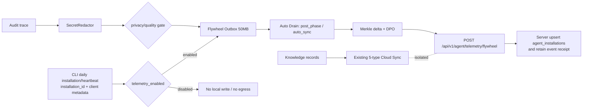

官方技能包只允许落入项目或用户级 Overlay；加载优先级为项目 Overlay、全局
`~/.bugx/skills/official`、内置目录。Overlay 必须通过 Ed25519 验签、能力/权益检查，
Session 使用已钉住的版本和 `plan_hash`；连续两次致命崩溃的包移动到隔离仓并回退内置版本。

### DOC-140 服务端技能包分发治理与复用分析大盘 (v0.26.5)

DOC-140 补齐客户端技能包拉取与知识沉淀的云端最后一公里：
1. **服务端技能包流式分发（`GET /api/v1/agent/skills/:skill_id/bundle`）**：
   - 响应客户端 `download_skill_pack(skill_id)` 请求，严格基于数据实体 `AgentSkill` 与受控存储路径校验，流式下发 `.tar.gz` 技能包归档，携带 `X-BugX-Plan-Hash` 与 `X-BugX-Version` 契约响应头，支持原子下载计数统计。
2. **Admin 技能中心治理控制台（`/cloud/sync/skills`）**：
   - 支持官方/企业技能包归档上传，服务端流式校验解压合法 `manifest.json` 并计算确定性 `plan_hash`；
   - 提供启停状态切换（`active`/`disabled`）、归档下载与生命周期注销。
3. **知识复用率与命中率全景分析大盘（`/cloud/sync/analytics`）**：
   - 聚合分析接口 `GET /api/v1/admin/cloud-sync/analytics` 汇总错题沉淀总量、经验总量、工具实测记录数、闭环消费事件数；
   - 计算错题集总体实战命中率（`hit_count / (hit_count + miss_count)`）与工具平均实测命中率；
   - ECharts 双折线面积图展示近 14 天知识消费与攻防遥测趋势，环形图展示漏洞模式类别沉淀与命中分布，并提供实战工具表现排行榜（Top 10）。

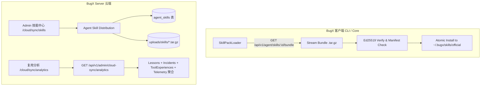

---

## 1. System Overview & Core Philosophy

BugX is a host-neutral, evidence-backed adversarial auditing agent engineered for multi-platform software projects (CLI, API/Web, Desktop, Mobile, AI/MCP). 

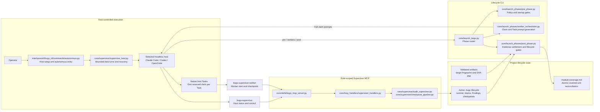

---

## 2. Key Architecture Principles

### 2.0.1 CLI surface consolidation

The public CLI has one canonical path per responsibility: `bugx hosts` is read-only host
discovery, `bugx install` installs host entries, `bugx auth` owns cloud credentials, and
`bugx cloud` owns synchronization/data operations. Remote version checks use
`bugx update --check`; `bugx --version` remains the local version query. The destructive
update removes the duplicate `agent`, `version`, and nested `cloud auth` parsers. Shell
completion is emitted by `bugx completion bash|zsh|fish` using only native shell protocols.

### 2.0 Knowledge diagnostics and budget tooling closure

- `guide_budget.py --modal-density` 是规范密度报告的唯一命令入口，默认运行不增加额外输出。
- `.bugx/knowledge/cloud-synced.json` 只保留云端 Pull 的诊断快照；V2 `sync_pull` 是唯一账本导入路径，避免隔离文件再派生第二套信任提升流程。

### 2.1 Engine-State Separation (DOC-004)
- **Global Engine Core (`~/.bugx/core/`)**: All shared prompt contracts, runtime validators, probes, and algorithms are stored globally in `~/.bugx/core/`. `bugx init/install` performs safe integrity reconciliation and atomically refreshes it when needed; `--force` is reserved for explicit legacy/static-entity replacement.
- **Global-only runtime resolution**: Projects contain no executable `.bugx/core` entity, symlink, junction, or static snapshot. Runtime scripts resolve the single global engine through the CLI (`bugx engine path --name <file>`).
- **Isolated Project State (`.bugx/`)**: Project-owned data (session state, lesson ledger SQLite database, mistake book, discovery trees, finding reports) stays local to each project repository under `.bugx/`.

### 2.1.1 Cross-platform recovery boundary (0.10.6)
- Reset archives must resolve outside the selected reset root; when a global reset is launched from `HOME`, the default archive falls back to the system temporary directory.
- A missing or corrupt global SQLite projection never rebuilds silently. `bugx lesson rebuild --from-seed --confirm-data-loss` is the explicit recovery boundary and preserves the prior database as `.corrupt.bak`.
- Engine installation uses POSIX `fcntl` or bounded, non-blocking Windows `msvcrt` locking; a Windows lock waits at most 30 seconds and then fails closed.
- On Windows without symlink privilege (`WinError 1314`), the project does not need a project-engine link: the runtime resolves the global engine directly. Only host entry files may fall back to controlled copies; all other link errors fail closed. Legacy `.bugx/core` entries are deleted by the next `init/install`.
- Offline MCP runtime entry validation applies `st_mode` world-write checks only on POSIX. Windows `st_mode` does not represent ACL write access; Windows validation therefore relies on entry/tree hashes and reparse-point rejection instead of treating the POSIX bit as a failure.
- File-level `fsync` remains mandatory; unsupported directory `fsync` errors are tolerated only for the directory metadata step.
- Python wheels explicitly map every core runtime subpackage and prompt/schema resource required by the installed engine; packaging tests fail closed when a declared core package is omitted. Release manifests also use a static `core/` asset boundary: runtime names such as `bugx-runtime.json*`, supervisor/coverage state, locks, backups and snapshots are excluded from wheel, sdist, npm and production export. `engine-integrity.json` is the hash boundary, while the package/export filters are the physical payload boundary.
- Cloud HTTPS keeps certificate verification enabled for `uat` and `stable`; a `dev` marker may use its self-signed endpoint by default. Host allowlisting alone is **not** sufficient: a non-dev client also needs the explicit `BUGX_DEV_TLS_NO_VERIFY=1` opt-in (the bootstrap path for a stable CLI that has no dev metadata yet). `BUGX_CA_BUNDLE` always overrides that exception and enables verification with the selected CA.

### 2.1.2 Probe environment and adaptive timeout boundary

预检命令由 GUI/MCP 启动器派生时不能假设 shell 启动文件已执行。探针子进程使用规范化 PATH：保留调用方
已有顺序，并追加已存在的 `/opt/homebrew/bin`、`/usr/local/bin`、Linuxbrew、用户本地和 Cargo bin；
也接受显式 `BUGX_TOOL_PATH`。这只影响子进程解析，不写入用户 shell 配置。

`codebase-memory` 的 CLI 探测不能使用固定 5 秒：首次预算按实测冷启动取地板 **45 秒**（本仓实测
18~24 秒，旧 15 秒地板会让健康安装每次首探假降级），后续画像按上次实测耗时乘二并加 2 秒余量，
统一封顶 120 秒；可用 `BUGX_PROBE_TIMEOUT_CODEBASE_MEMORY` 或全局
`BUGX_PROBE_TIMEOUT_SECONDS` 显式覆盖。内部 CLI 截止时间与注册中心外层预算同步，`cli --quiet list_projects --format json --detail stats`
首次超时按同一封顶追加**一次**双倍预算重试（结果记录 `cli_retry` 检查项），仅重试瞬态超时；非零退出码
或无法解析输出立即返回，不再付第二次冷启动成本。缺少索引时 `index_repository --repo-path <root>` 后仍使用相同
JSON 列表命令复查；索引失败原因保留在 `project_index` 检查项。两次都超时仍回收进程组并返回 `DEGRADED`（保留已读到的
版本号，不得伪造索引 READY）；报告中的 `validated_version` 仅表示版本可读，不表示已联网确认 latest。

工具准备阶段若同时存在多个未就绪项，使用一个 `multiple=true` 的批量工具门禁：先按项目画像剪枝，
`MISSING_REPAIRABLE` 进入穷尽自愈，`CRITICAL_MISSING` 直接阻断；无自动安装器的非关键工具只有在
`.bugx/config.json` 的 `tooling_exemptions` 中显式列出并留痕后才能继续。`BUGX_TOOLING_CHOICES` 的逐工具显式答案
仍可表达安装或停止，但不能绕过关键门禁或制造静默回退；缺少明确处置时返回实际阻断，不生成虚拟就绪态。

穷尽自愈只为代码内 `PLAN_REGISTRY` 登记的工具构造安装命令。未知工具名进入 `unregistered_tool` 阻断并保留收据，禁止把探针、Worker 或远端数据提供的名称直接当作 Python 包名。登记工具的来源、版本固定和供应链证明仍需按包单独审核。

### 2.1.3 Architecture defect hardening (2026-09-20)

The implementation now enforces the following at shared boundaries: engine integrity rejects missing
or extra project core files; wheel data includes the `web-audit` skill pack; MCP role checks are
centralized; PoC and observation artifacts are confined to the project root; and execution targets
require an in-project SHA-256 artifact proof. Runtime backups retain the previous generation, doctor
fails closed instead of synthesizing missing state, and failed next-round setup restores the previous
current binding. Empty checkpoints are rejected, parallel completion requires two submitted workers,
evidence publication is retryable with the same checkpoint identity, and knowledge approval rejects
self-review. Jenkins keeps TLS verification and runs targeted consistency tests before later stages.

These changes deliberately do not claim closure for the remaining install receipt/bundle proof,
remote knowledge namespace isolation, Session-level single-writer transaction, or full lifecycle
transaction boundary; those remain explicit audit follow-ups.

### 2.2 Host-Neutral Adapter Architecture
BugX supports 9 AI host platforms via explicit `HostAdapter` definitions in `interfaces/cli/bugx_cli/host_adapters.py`:

| Host Name | Label | Install Path | Kind | Native Interaction Tool / Contract |
| :--- | :--- | :--- | :--- | :--- |
| `opencode` | OpenCode | `.opencode/agents/bugx.md` | `agent` | `question` (`multiple=false`) |
| `claude` | Claude Code | `~/.claude/agents/bugx.md` / `plugins/bugx/` | `subagent` | `AskUserQuestion` (`multiSelect=false`) |
| `zcode` | ZCode | `~/.zcode/agents/bugx.md` / `plugins/bugx/` | `subagent` | `AskUserQuestion` (`multiSelect=false`) |
| `codex` | Codex | `.agents/skills/bugx/SKILL.md`（Codex 官方项目发现路径，DOC-169） | `skill` | Structured select / fallback |
| `cline` | Cline | `.cline/skills/bugx/SKILL.md` + `.cline/mcp.json` + 全局 `cline_mcp_settings.json`（DOC-169 双写） | `skill` | Structured select / Open Skills |
| `pi` | Pi | `.pi/skills/bugx/SKILL.md` | `skill` | Native UI select (`ctx.ui.select`) |
| `chatgpt` | ChatGPT | `.agents/plugins/marketplace.json` | `plugin` | Structured choice UI |
| `dsh` | DeepSeek Harness | `.dsh/skills/bugx/SKILL.md` + `~/.dsh/plugins/bugx-ui`（web profile bundle） | `patch+skill+client` | Structured select / fallback / Sidebar guide icon |
| `workbuddy` | WorkBuddy AI | `<配置根>/skills/bugx/SKILL.md`（用户级）+ `.workbuddy/skills/bugx/` + `.codebuddy/skills/bugx/` + `.workbuddy/connector/bugx/`（项目级） | `skill+connector` | WorkBuddy application select / Skill import / Connector icon |

ZCode 的 `required_paths` 为空，主 Agent 与 Worker 只登记到用户级目录。其 `legacy_paths`
只作为卸载清单：无安装记录时，通用 sweeper 对每个遗留路径调用宿主路径级 renderer，缺少
专用 renderer 才回退到主入口模板；只有逐字匹配的 BugX 模板副本才删除，用户修改和符号链接
均保留。worker renderer 只参与遗留清理，不构成项目级安装入口。

#### 2.2.1 Cross-platform host discovery and diagnostic locking (DOC-089)

宿主发现先检查 `PATH` 与平台已知候选；ZCode 在 Windows 再检查所有逻辑盘符的有限目录，
Linux 再检查桌面入口，候选均未命中时只读反查运行中的进程（Windows PowerShell，Linux
`/proc/<pid>/exe`）。官方 ZCode 安装文档未承诺固定 Windows 文件系统目录，因此这些目录
是兼容性候选而非“官方默认路径”；未知自定义路径仍可显式使用 `--agent zcode --allow-missing`。

DSH 同样不假定固定安装盘符或 Node 版本：标准 preset 从 `dsh` 可执行文件/npm shim
反查 package root，`DSH_HOME` 只作为用户数据目录。直接 `dsh web` 时，会话级 BugX MCP
读取当前 Session 的 workspace `cwd`，按会话独立启动并传给 `--root`；未选目录时 fail-closed
并明确提示选择工作区，不猜测或创建临时审计目录。兼容启动器 `bugx dsh` 仍可从当前目录向上
发现 `.bugx/manifest.json` 或 `.git`，为首个 Web Session 设置默认 `DSH_CWD`；业务项目、Skill、
launcher 与证据输出不得从 DSH checkout、`DSH_HOME` 或宿主启动目录推断。
当检测到 DSH Desktop harness 时，安装器会把预设、UI 插件和会话 MCP 插件同步到 CLI 与 Desktop
配置根；仅 Desktop launcher 允许执行 Web profile 的 `dsh plugin --profile web add`，普通
npm/Python launcher 只保留 UI 包为 `staged`，不启动会导致 Windows 访问冲突的插件管理子进程。
MCP bundle 通过 `cordis.patch.yml` 注册，并兼容新版 `callTool` 与旧版 `request` 调用方式。
Windows Desktop 的 `app.asar` 只从固定系统安装根探测，preset 命名优先以 asar 头部内置包为准，
头部按文件树递归匹配 `node_modules/@deepseek-ai/<package>`，覆盖当前
`files/dsh/files/node_modules` 嵌套结构，
不因 `DSH_HOME` 下的断链 junction 误判运行时版本。

Cline 与 ZCode 的 MCP 配置分别写入当前项目的 `.cline/mcp.json` 与 `.zcode/mcp.json`，
配置只读取这两个项目级位置，不迁移或回退到旧用户级 MCP 配置。OpenCode 继续使用项目级
`opencode.json`，因此所有支持 MCP 的宿主均不会把安装
项目绝对路径写入跨项目配置。

外部结构化代码索引能力使用 `codindex`：它必须先登记到 MCP 注册表，再进入 npm lock
和生成的 OpenCode server map；配置层只引用 `bugx mcp-runtime start --server codindex`。
`codindex@0.1.2` 的最低 Node 版本为 22.5，默认 SQLite 驱动是 Node 内置
`node:sqlite`；不得通过 `CODINDEX_SQLITE=better-sqlite3` 绕回原生 ABI 依赖。

所有宿主安装、MCP 和 Worker 进程共用 `.bugx/logs/bugx.jsonl.lock`。POSIX 使用
`fcntl.flock(LOCK_EX | LOCK_NB)`，Windows 使用 `msvcrt.LK_NBLCK`，两者均以单调时钟
进行有限重试，超时保留原始错误并释放已取得的锁。未初始化目录的日志回退到用户级
存储（见 §7.0），锁文件与日志同目录同名，不因此产生额外的项目级写入。

#### 2.2.2 Cline Worker 调度边界

Cline 桌面端与 CLI 不实现 BugX 使用的 `Task(subagent_type="bugx-worker")` handoff 契约。桌面端内置
研究子 Agent 不具备 Worker 写入与 MCP 能力；CLI 自带的 Agent/Team 接口也不等价于该 Task 契约，当前
BugX 集成不向它们派发 claim。交互式 Cline 主会话继续使用 runtime 中 `host=cline` 且 `execute=false` 的串行车道：
`pre` 建立带原因的 Supervisor，`workers` 每批最多 claim 1 个单元；主会话经
`bugx-supervisor-worker` 完成 `worker-start → heartbeat/tool_call → checkpoint`，核对状态后再
claim 下一单元。多进程 CLI 车道由 runtime 中 `host=cline` 且 `execute=true` 或显式 `--execute` 开启：`AdaptiveConcurrencyController` 最多提供 6 个槽位，
每个 claim 启动独立 Cline CLI 进程与 artifact-local `.cline_data`，窗口使用完成即补位。

Cline process worker 使用 `cline --auto-approve true --data-dir <data_dir> -c <workspace_root>
--timeout <seconds> <task_spec>`，并注入 `CLINE_DATA_DIR`；只加载 Worker 与 docs MCP，不加载主控
Supervisor。退出码、模型文本和 prompt 都不是成功信号，只有匹配的持久化 Supervisor Checkpoint
才算成功；超时、异常退出或无 Checkpoint 时回收 claim。`cline --acp` 仍只作为 ACP server 入口，
由 ACP 客户端完成 JSON-RPC 握手；其他具备原生 Task 生命周期的宿主继续使用并发 Worker 派发。

### 2.3 Outbound Client Metadata Contract (DOC-087)

`core/infra/client_metadata.py` 是 Cloud Sync、匿名上报和升级下载的共享请求头构建器。它从包内
`core/metadata.txt` 读取 `bugx_version`、`bugx_channel`（`alpha`/`stable`）和
`bugx_marker`（`dev`/`uat`/`stable`/`alpha`），统一发送：

- `X-BugX-Client-Version`
- `X-BugX-Client-Marker`
- `X-BugX-Release-Channel`
- `User-Agent: BugX-Client/<version> (marker=<marker>; channel=<channel>)`

请求头只携带非敏感构建元数据，不替代 `Authorization`。Jenkins 的 `master/main`、`dev`、`uat`
路由分别固化 stable、dev alpha、uat alpha 的服务地址并写入对应 marker；缺失或非法元数据在客户端
侧 fail-closed 为 stable。

### 2.3.1 账号区域云端路由（DOC-110）

云端环境和账号区域是两个独立维度：服务端以 `web_user.cloud_region`（`cn`/`global`）为权威，
通过设备 Token、refresh 和认证后的 `GET /api/v1/agent/routing` 返回 `environment`、`region`、
`api_base`、`config_version`、`expires_at`。客户端将路由与凭据原子保存；dev/uat 仍使用各自固定
部署地址，prod 在未显式覆盖时使用服务端下发的区域地址。客户端不根据 IP 改写账号区域，也不对
路由变更后的非幂等 POST 自动跨区重放。

服务端路由地址必须是 HTTPS、无用户信息/查询参数/fragment，并由部署配置提供；国内 prod 地址
不能由客户端猜测。dev 的自签名 TLS 例外仅对 `bugx.mbp.dev` 和本机测试 host 生效，且仍要求
`dev` 标记或 `BUGX_DEV_TLS_NO_VERIFY=1` 显式开关；uat/prod 客户端即使访问该 host 也继续
校验证书；`BUGX_CA_BUNDLE` 优先级最高并保留主机名校验。

### 2.3.2 双域名自适应并发竞速与低延迟优选（DOC-185）

针对国内与海外开发者不同的网络接入条件，客户端默认预置双端点候选池：
`DEFAULT_BASE_CANDIDATES = ("https://bugx.com.cn", "https://bugx.dev")`，基准回退值为 `DEFAULT_BASE = "https://bugx.dev"`。

端点解析执行严格四级优先级裁决：
1. **环境变量覆盖**：`BUGX_CLOUD_API_BASE` 具最高优先级，存在即直接采用，零网络探测与零缓存读写；
2. **显式配置覆盖**：`~/.bugx/cloud-config.json` 中的 `base_url`（通过 `bugx cloud config --base-url <url>` 设置），直接采用，零网络探测与零缓存读写；
3. **低延迟并发竞速（Fast Race）与路由缓存**：
   - **路由缓存（Route Cache）**：持久化于 `~/.bugx/cloud-route-cache.json`（受 `secure_atomic` 保护，权限 `0o600`），默认 TTL 为 24 小时（`BUGX_CLOUD_ROUTE_TTL=86400`）。缓存有效期间直接命中，耗时 `< 0.5ms`；
   - **并发探活竞速**：无有效缓存时，通过多线程轻量并发请求 `{candidate}/api/v1/health`（超时 `0.8s`，可由 `BUGX_PROBE_TIMEOUT` 调整），在所有成功可达（含 200/401/403 等 HTTP 状态）的端点中选出往返延迟最低者胜出并写入路由缓存；
   - **进程级内存复用**：单次 CLI 执行内多次调用 `configured_base_url()` 仅触发一次解析，内存常驻复用；
4. **离线逃逸与安全兜底**：
   - 当设置 `BUGX_SKIP_ROUTE_PROBE=1` 或 `BUGX_OFFLINE=1` 时，直接跳过探活返回 `DEFAULT_BASE`；
   - 若所有候选节点均不可达或超时，安全回退至 `DEFAULT_BASE`，不向上抛出异常，保证离线主流程稳定执行。
   - 用户可随时通过 `bugx cloud config --refresh-route` 强制清除本地路由缓存并重新并发竞速。

### 2.3.3 macOS 本地网络权限错误归因（BX-CLOUD-01）

云端请求的网络异常必须区分目标物理不可达与 macOS Python 进程本地网络访问受限：

- `core/cloud_sync/network_transport.py::diagnose_network_error(exc, target_url)`（经 `core/cloud_sync/cloud_client.py` 再导出）仅在 Darwin 平台、目标为
  RFC1918/link-local/IPv6 ULA 或 link-local 地址（或 `.local` 域名、以及通过内网 DNS 解析指向上述私网 IP 的自定义域名如 `bugx.mbp.dev`）、
  且目标不是 loopback，同时异常包含 `Errno 65`/`Errno 51` 或对应不可达文本时命中；`127.0.0.1`、`localhost`
  与 `::1` 永不命中。
- `interfaces/cli/bugx_cli/commands/doctor.py` 的云端端点探活与 `interfaces/cli/bugx_cli/commands/cloud.py` 的 `auth status --verify`
  统一复用 `diagnose_network_error` 权威归因，彻底杜绝双事实源与私网判定漂移。
- `_request()` 与 `_request_raw()` 在网络重试耗尽后保留统一 `ReportResult` 形状。curl 证明目标可连接时映射为
  `code=LOCAL_NETWORK_BLOCKED`；curl 无连接证据时保留 `SYNC_NETWORK_UNAVAILABLE`/
  `PATCH_NETWORK_UNAVAILABLE` 并携带局域网目标物理不可达的说明；探针本身不可用时明确标记无法判定。
- `auth status --verify` 将该结构化错误映射为 `auth_verification_status=local_network_blocked`，
  文本输出同时展示状态与修复原因，避免把 TCC 权限问题误导为服务端宕机。

### 2.3.4 Doctor 云端端点探活与 macOS 本地网络错误归因（BX-CLOUD-02/03）

**目的与边界**：为显式配置私网/自建云端的用户提供客观连通性预检，并区分 Python 进程受限与目标物理不可达。
该探针不验证认证态、不执行同步，不改变离线默认策略，也不重放失败的业务请求。

**配置裁决**：优先读取 `BUGX_CLOUD_API_BASE`，其次读取 `~/.bugx/cloud-config.json`（实际路径按云端配置
路径约定解析）。自定义 `base_url` 或项目显式云端 onboarding 状态（`done`/`sync`）触发探活；云端模式已启用
但未设置自定义端点时使用默认云端端点。默认自动路由竞速本身不构成用户已启用云端的依据；纯离线项目跳过探活。

**探活契约**：doctor 对自定义端点执行只读健康请求，不附加凭据；Python 请求超时不得超过 1.5 秒。
HTTP 200/204 为在线，401/403 为端点在线但需要鉴权；其他 HTTP 状态表示端点可达但健康检查未通过。
响应体不参与判定，不写路由缓存、认证状态或云端同步状态。

**判定与退出语义**：连通性结果作为 doctor 检查项；`--installation-only` 跳过。普通模式下失败仅显示为警告，不进入
`installation_required`，strict 模式则纳入阻断集合。纯离线项目跳过。Darwin 私网目标出现 `Errno 65/51` 时，
`diagnose_network_error()` 运行 `/usr/bin/curl -q -sS --insecure --noproxy '*' --connect-timeout 1.0 --max-time 1.5 --head --output /dev/null --write-out '%{remote_ip}'` 影子探针（进程最长 1.5 秒、无凭据、忽略 curlrc 与代理）。HEAD 不读取响应体，`--insecure` 只用于允许自签证书的诊断探针。curl 输出远端 IP 或返回成功时，映射为 `LOCAL_NETWORK_BLOCKED` 并说明 Python 访问
可能受 macOS TCC 限制；原失败请求仍未重放。curl 已执行但没有连接证据时，返回 `LOCAL_NETWORK_UNREACHABLE`
及“局域网目标物理不可达（目标主机未开机、端口未监听或 IP 变动）”。curl 无法启动或探针进程超时时，返回
`LOCAL_NETWORK_PROBE_UNAVAILABLE`；超时时若已有远端 IP 连接证据，仍按目标可达处理。公网、回环地址和非 Darwin 错误不触发影子探活。

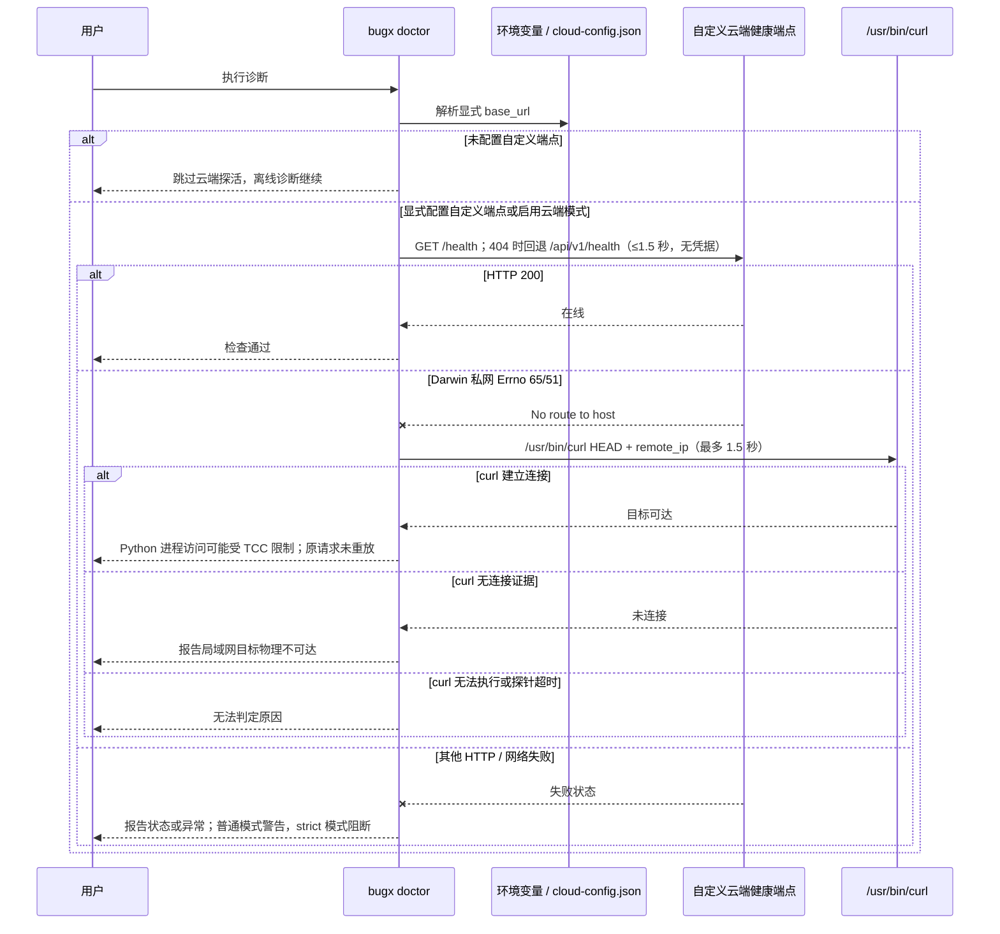

**端点健康探活**：doctor 优先探测 `/health`，若返回 404 则回退至 `/api/v1/health`；Python 请求注入
`client_metadata.tls_context(base_url)`，不附加凭据，请求总超时不超过 1.5 秒。HTTP 200/204 为在线，401/403 为
“在线（需鉴权）”，其他 HTTP 状态为“端点可达但健康检查未通过”。Darwin 私网 errno 65/51 发生后，最多再用
1.5 秒执行系统 curl HEAD + remote_ip 探活。

**网络排错与归因**：`bugx auth status --verify` 与 doctor 共用上述诊断。curl 确认可连接时说明 Python 进程访问可能受 macOS TCC 限制，且 ad-hoc CLI 不能在系统设置中直接勾选；curl 无连接证据时提示检查目标服务、端口和 IP。影子探活只建立连接，不会重放失败请求。

**对抗审计**：默认离线用户必须零网络请求；常规显式端点请求最多 1.5 秒，私网 errno 65/51 再增加最多 1.5 秒探针时间，普通模式不得因此退出失败；`tls_context` 保持原请求的证书校验，HEAD 探针不携带凭据且不读取响应体；只有 Darwin 私网目标触发探针，不得将公网、回环、DNS 或探针执行失败误归因为 TCC/物理不可达。探活不得写入配置、路由缓存、凭据或 outbox。定向回归命令为 `python3 tests/run_tests.py --mode module --module tests.cloud.test_cloud_client --module tests.cli.test_cli_doctor`。

### 2.4 Install transaction boundary for host-managed `.agents`

`interfaces/cli/bugx_cli/commands/agent.py::_agent_install_snapshot` first resolves the requested host
adapters, then snapshots only the exact BugX-owned files in the shared `.bugx` surface and the
selected adapters' declared surfaces. `opencode.json` joins the transaction only when OpenCode is
selected. This boundary applies both in a project directory and when the user intentionally runs
`bugx install` from the user directory. It never recursively enumerates or copies host caches,
plugins, sessions, or databases under `.codex`, `.agents`, or other host surfaces. A symlink or
Windows reparse point belonging to an unselected host is outside the transaction and cannot block
the selected host installation. Selected write surfaces remain fail-closed at snapshot time.
For ChatGPT, only the project Marketplace is resolved to that link's directory target and written
there; the plugin payload remains under the ordinary project `plugins/bugx/` directory. Nested links
and every other host resource still pass the existing `_assert_no_symlink_components` and host-resource
guards.

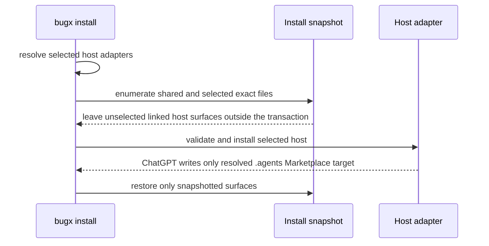

---

## 3. Startup Policy Resolution & Dual-State Lifecycle (DOC-009 / DOC-174)

BugX 彻底废除会话内“五步串行假门禁”（云端同步、审查方式、轮询策略、修复模式、提交策略问卷拦截），确立**双态启动生命周期模型（Dual-State Startup Lifecycle）**与**四级层叠配置体系（Config as Code）**：

$$\text{Strategy} = \text{CLI Args} \succ \text{Project Config (.bugx/config.json)} \succ \text{User Config (~/.bugx/config.json)} \succ \text{System Default}$$

系统安全默认基线硬编码为：`review_mode=auto`, `fix_mode=auto`, `polling_policy=auto`, `commit_policy=manual`, `cloud_policy=local`。

```mermaid
flowchart TD
    Start["用户在项目中触发挖掘 (bugx engine pre)"] --> Check{"检查项目状态<br>(.bugx/config.json 状态是否为 ready?)"}

    %% 态 1：初始化或配置漂移
    Check -->|未就绪 / 配置漂移 (态 1)| Init1["获取项目 init.lock；收割 PID 已退出的孤儿锁"]
    Init1 --> Init2["记录阶段并准备项目账本、生命状态、覆盖清单与画像"]
    Init2 --> Init3["临时文件 + os.replace 原子写入 .bugx/config.json (status=ready)"]
    Init3 --> Init4["写入单次 Resume Ticket；CLI 重启引擎命令或 GUI 输出提示卡"]

    %% 态 2：已初始化项目
    Check -->|已就绪 (态 2)| Fast1["读取 .bugx/config.json 并比较构建清单指纹"]
    Fast1 --> Fast2["指纹相同：跳过初始化流水线；进入无问卷预飞"]
```

### 3.1 双态运行模型契约 (Dual-State Lifecycle Contract)

1. **态 1：未初始化 / 脏配置自愈流水线 (Init Pipeline)**：
   - 当 `.bugx/config.json` 不存在或 `status != "ready"` 时触发；
   - **项目画像**：生成项目画像；宿主 MCP 装配仍由 `bugx install` 负责；
   - **依赖自动安装与 Fail-Open**：仅 `bugx install` 对依赖锁启用的可选 MCP 尝试 30 秒安装；postmcp 目前被锁禁用；
   - **幂等续做**：孤儿锁回收、阶段记录、项目 ready 配置原子写入和 Resume Ticket 已实现；外部工具验活、脏缓存隔离与 MCP 配置两阶段提交尚未实现；
   - **现场接力**：CLI 重新执行 BugX 引擎原始 argv；桌面分支输出提示卡，原始意图透传与真实宿主重载尚未验证。
2. **态 2：已初始化项目零门禁极速直通 (Zero-Gate Express Pass)**：
   - 读取项目配置并通过 `compute_build_fingerprint` 比较固定构建文件的大小与 mtime；小于 5ms / 3ms 是未验证预算；
   - 指纹变化重新进入初始化；目前不会增量改写宿主 MCP 配置；
   - 常规启动问卷已移除；性能目标与真实宿主接力仍待自动化验证。
3. **参数覆盖机制**：
   - 用户如需临时调整策略，通过 CLI 参数直接显式覆盖（如 `bugx engine pre --fix-mode log-only --commit-policy life`），拥有最高解析优先级，无需在人机对话中反复确认。

### 3.2 Lifecycle-scoped runtime state

项目布局下，当前 lifecycle 是运行态的唯一作用域。启动或恢复时，路径刷新器将同一组
`state/runtime.json`、`state/supervisor.json` 与 `state/coverage-evidence.json` 注入所有
`pre/round/worker/post` 阶段；Worker、Supervisor 和 post 结算不得读取全局旧状态。
runtime 主文件或恢复备份必须先通过当前 schema 版本与必需字段校验；旧格式 fail-closed，
不会迁移、补字段或覆盖旧文件，错误提供项目外归档的 reset 指引。

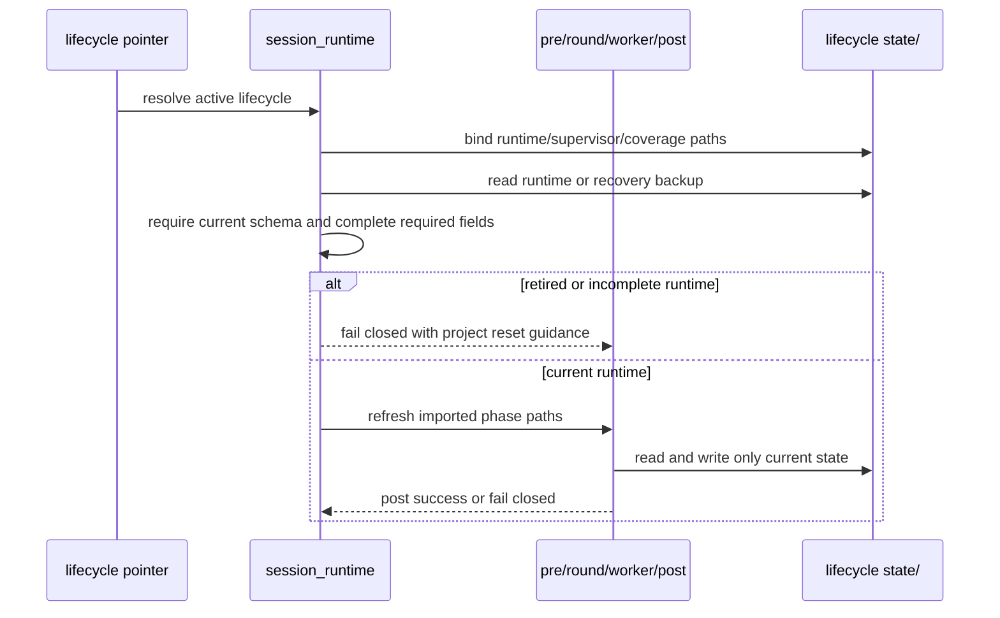

若当前 lifecycle 状态缺失或路径漂移，门禁必须失败并保留可恢复证据；不能静默切换到
`~/.bugx` 或旧 lifecycle 的 Supervisor/coverage 文件。

---

## 4. Supervisor MCP & Active Probing Architecture (DOC-005 / DOC-174)

The `bugx-supervisor` MCP server bridges host CLI processes and worker tasks:

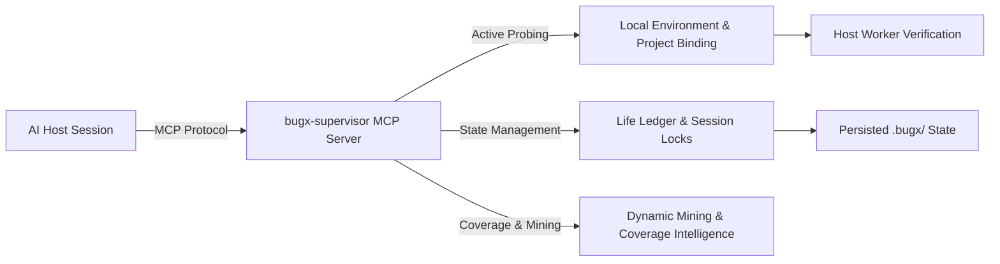

- **三阶探活机制（彻底拔除 Session-Proof 鸡生蛋死锁，DOC-174）**：
  废除“必须在磁盘上看到 `mcp-session-proof-host.json` 才算就绪”的僵化校验，采用三阶渐进式探活：
  1. **配置检查**：检查项目级 `.mcp.json` 中已正确声明 `bugx-supervisor`（`--root .`）；
  2. **进程检查**：检查本地 MCP stdio 进程是否存在存活 PID；
  3. **握手判定**：若子进程存在但宿主尚未发起 `tools/list` 惰性枚举（尚未落盘 proof 文件），系统不生成虚拟就绪状态；以 `_mcp_session_is_stale`、`probe_builtin_mcp_session`、项目/角色/版本/PID 与 proof 组成真实证明链。证明链通过才继续，缺失/失效按实际门禁阻断或要求重启。
- **ACP reuse**: When a current-session proof is available, autonomous control reuses the existing host lease
  and never starts a second stdio host probe. A standalone controller without proof may still perform its
  own bounded probe. This preserves fail-closed `MCP_SESSION_STALE` behavior while avoiding false
- **Active Probing**: Before startup, the standalone launcher inspects project binding, host/worker roles, and
  local directories without requiring host restart when already bound; an ACP session must use its live MCP
  receipt instead of launching a duplicate server.
- **Degraded Fallback**: If `bugx-supervisor` MCP is missing or inactive, host prompts user with 3 explicit choices:
  1. Install / Configure Now
  2. Fallback to Manual Audit for current session
  3. Skip for Now

### 4.0 版本感知多语言项目智能探查与策略路由（DOC-094）

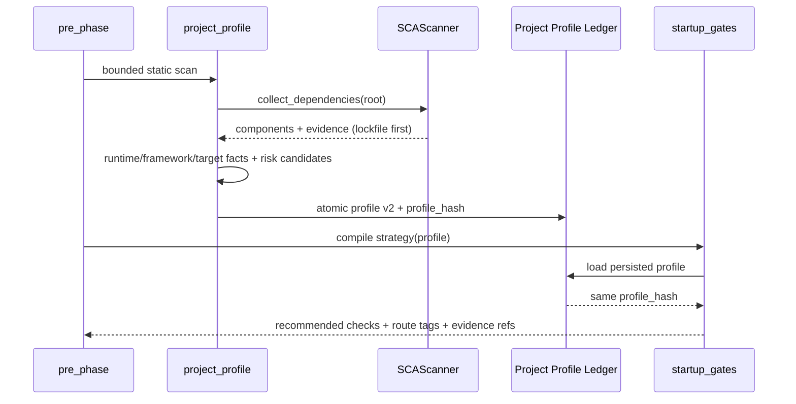

`ProjectProfile v2` 统一保存 `runtime_facts`、`framework_facts`、`components`、`build_targets`、`toolchains`、`risk_signals`、`unknowns` 与 `conflicts`。声明版本、锁文件解析版本和受控观察版本分开保存；缺失版本只能产生 `unknown`，版本匹配只能产生 advisory candidate。策略规划优先读取 pre-phase 已持久化画像，旧 v1 行可读取并在 detector version 变化时重新探查。静态探查不执行项目代码、不安装依赖、不上传源码或凭证；云端同步使用独立 ProjectProfile v2 元数据接口，按账号归属、hash、revision 和 operation_id 幂等收敛，不进入知识 cursor。云端 PUT 只上传 `wire_project_profile` 紧凑投影（大数组截断为 `*_top` 并保留 `*_total`，受 `WIRE_PAYLOAD_BUDGET_BYTES` 预算约束），严格满足 `PROJECT_PROFILE_MAX_BYTES = 256 KiB`（DOC-057 设计项 4）；完整 profile 仅留在本地驱动分析，`profile_hash`/`source_fingerprint` 原样保留以维持幂等跳过语义。

### 4.0.1 云端漏洞缓存与画像边界（DOC-095）

项目画像中的组件版本可触发服务端 OSV 缓存预热，但漏洞缓存是独立的全局情报域。缓存键为 `(ecosystem, package, version)`，查询接口返回 `fresh`、`stale`、`pending`、`failed` 或 `unsupported`，不写入账号、项目、路径或源码证据。缓存 miss/过期只异步刷新，ProjectProfile 的 hash/revision 不因远端 advisory 改变；本地 SCA 与证据门禁仍是漏洞确认权威。刷新上游固定为 OSV，批量、响应体和超时均有硬上限，失败保留旧结果并可重试。

### 4.1 Next-Generation Task Scheduling & Concurrency Engine (DOC-044 / DOC-060 / DOC-082)

The scheduling and concurrency engine introduces DAG topological priority scheduling, code-intelligence risk-density priority tilting (+150 max score boost), affinity bundling (1~5 units per claim), hardware-topology concurrency resolution, complexity-aware leases, live-expiry arbitration, supervisor budget deadlock immunity, and end-to-end telemetry metrics. Dispatch preserves affinity first, then expands underfilled bundles into singleton claims when that is the only reason slots remain idle. Legacy AIMD window and outcome streaks remain readable as telemetry, while Linux/macOS/Windows memory probes provide the only automatic backpressure path when the host is genuinely under pressure.

#### 4.1.1 Architecture & Data Flow

```mermaid
flowchart TD
    subgraph 待办单元池
        U[全量债务/待覆盖单元池] --> UPS[UnitPriorityScheduler\n多因子优先级评分排序]
    end

    subgraph 智能调度核心
        UPS --> TS[自动遍历策略\nDFS / BFS / Hybrid]
        TS -->|内部硬边界 + 风险/债务评分 + 图遍历顺序| OR[排序后候选单元队列]
        OR --> AB[AffinityBundler\n拓扑亲和性打包器]
        AB -->|同文件聚合 [1, 5] 单元| BUNDLES[任务包队列 (Task Bundles)]
        BUNDLES -->|包数不足可用槽位时拆为单元包| REBALANCE[Bundle 再平衡]

        ACC[AdaptiveConcurrencyController\n机器上限 + CPU/RAM 背压]
        SYS_CONF[硬件核心拓扑 / 系统配置 / 环境变量\nresolve_system_concurrency] --> ACC
        SYS[系统实时负载\nCPU Load / Cores] --> ACC
        BUDGET[Token 预算\n不降低健康机器并发] --> ACC
        ACC -->|动态有效容量 effective_capacity| DISPATCH[派发控制器]
    end

    subgraph 执行与租约管理
        BUNDLES --> DISPATCH
        DISPATCH --> CLC[ComplexityLeaseCalculator\n复杂度感知动态租约计算器]
        CLC -->|推算 TTL 60s ~ 300s| CLAIM[Supervisor.claim_worker\n原子预占 (allow_bundle=True)]

        CLAIM --> W1[Worker A 进程\n(PID A)]
        CLAIM --> W2[Worker B 进程\n(PID B)]

        W1 -. PID & 心跳 .-> ZD[ZombieDetector\n僵死探针与秒级抢占]
        W2 -. PID & 心跳 .-> ZD
        ZD -->|死亡 / 到期心跳断流| PREEMPT[worker_preempted\n尝试 kill 后释放容量]
    end

    subgraph 检查点与遥测
        W1 -->|批量 coverage / evidence| CHK[Supervisor.submit_checkpoint\n(支持超时优雅跃迁 DOC-082)]
        W2 -->|批量 coverage / evidence| CHK
        CHK --> METRICS[SchedulingMetrics\n全链路效能与时延度量]
    end
```

`UnitPriorityScheduler` 在每个待派发批次内自动选择遍历策略：深图且窄或风险集中时采用 DFS，层宽较大时采用 BFS，其余情况采用 Hybrid（风险/既有评分 60%、遍历顺序 40%）。图节点不足或图不可用时保持既有评分与确定性字典序；策略不会改变 `内部:` 优先于 `业务:` 的硬边界，也不改变覆盖、证据和 Supervisor 状态协议。

#### 4.1.2 Scheduling & Concurrency Execution Sequence

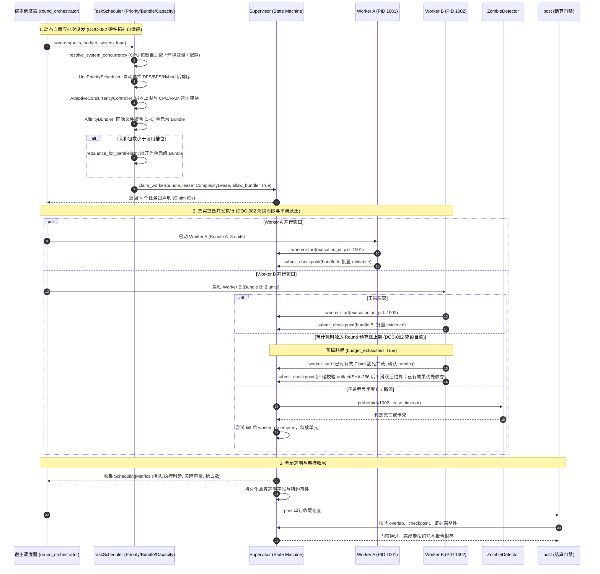

本地 WorkerRuntime 对 `worker-start` 或后续未处理异常调用 Supervisor 的单 claim 失败回写：仅当
`worker_id + lease_id + execution_id` 仍匹配活动 claim 时，使用既有 `released` 状态并持久追加含错误原因的
`worker_released(reason=execution_failed)` 事件。此路径保留覆盖债务且不伪造 checkpoint；真实模型调用错误仍按
`unverified/error` evidence 提交 checkpoint。外部 ACP Worker 的断联继续由租约刷新与显式恢复处理。

覆盖报告 ingest 是清单辅助入口，不替代 Supervisor checkpoint/evidence：它复用
`coverage_intelligence.DEFAULT_THRESHOLDS`，要求 statement 达到 80%，对报告提供的 branch/mutation
维度分别应用 70%/60% 阈值；只更新文件级内部行。`file::symbol` 与业务链路不接受文件级统计推断，
低于阈值或缺少必需 statement 指标的行保持未覆盖；manifest 解析错误直接拒绝写回。

#### 4.1.3 Hardware Topology Concurrency Resolution & Deadlock Immunity (DOC-082)

1. **System-Adaptive Concurrency Resolution (`resolve_system_concurrency`)**:
   - Replaces the legacy fixed 4-worker limit with a three-tier priority hierarchy:
     1. *Environment Overrides*: `BUGX_MAX_CONCURRENCY` and `BUGX_MAX_CONCURRENCY_CEILING`.
     2. *Config File Overrides*: `~/.bugx/config.json` or `cloud-config.json` (`max_concurrency`, `max_workers`).
     3. *Hardware CPU Topology Auto-Scale*:
        - $\le 2$ Cores: `max_concurrency = 2`, `ceiling = 4` (preserves minimum 2-worker overlap requirement).
        - $3 \sim 4$ Cores: `max_concurrency = cores`, `ceiling = 8`.
        - $5 \sim 8$ Cores: `max_concurrency = cores`, `ceiling = max(12, cores * 2)`.
        - $> 8$ Cores: `max_concurrency = cores`, `ceiling = cores * 2`（不再人为截断到 16/32）。
   - `RunBudget` and `AdaptiveConcurrencyController` default directly to this resolver.

2. **Supervisor Budget Deadlock Elimination**:
   - *The Catch-22 Problem*: Under long-running audits, Round 1 wall-clock budget (`max_round_wall_seconds`) can expire while a Worker has completed valid findings. Previously, `worker-start` was blocked by `_ensure_live_for_work(state)` when `budget_exhausted=True`, yet `submit_checkpoint` strictly required `execution_state != "claimed"` in parallel mode.
   - *Start-Worker Lease Recognition*: `start_worker` inspects `state.active_claims`. If the Worker already holds a valid, non-expired claim, it is permitted to transition to `running` without being blocked by budget exhaustion (as it consumes no new budget).
   - *Graceful Checkpoint Auto-Transition*: Under `state.status == BUDGET_EXHAUSTED` or `state.budget_exhausted`, `submit_checkpoint` performs rigorous payload validation (file existence, byte bounds, SHA-256 integrity, covered units matching, exit code 0). Upon full pass, it automatically transitions `claimed -> running -> completed`, preserving verified audit discoveries without host intervention; `claim_worker` remains fail-closed and cannot issue new work in that state.
   - *Target-Drift Admission*: If a previously claimed Worker submits evidence whose `target_fingerprint` no longer matches the bound target, the checkpoint is not discarded. The evidence item receives `target_drifted=true`, its coverage is forced to `unverified`, the Finding is retained, and `checkpoint_admitted_with_target_drift` is appended in the same state transaction. New claims and `worker-start` remain strict target gates, and `post` still refuses to converge drifted evidence as current-target `covered`.
   - *Unblocked Resource Release & Host Self-Healing*: `release_worker` is decoupled from budget exhaustion gates. Host recovery (`_recover_supervisor_budget`) invokes `reset_budget(force=True)` to sweep expired active claims into `expired_leases` and re-establish a fresh Epoch safely.

3. **Lease Expiry Liveness Arbitration (DOC-102)**:
   - A lease timeout is not an immediate failure. `budget_governor.refresh` first checks `running` state,
     recent heartbeat and the registered local PID; fresh progress renews the same lease and records
     `worker_lease_renewed_after_timeout`.
   - A live PID with a stale heartbeat is treated as hung: `ZombieDetector` attempts safe process
     termination (POSIX process group when PID is its group leader, Windows `taskkill /T /F`) and then
     releases the claim. Remote claims without a PID are expired without guessing at external processes.
   - Historical AIMD fields remain readable but cannot reduce healthy-machine capacity; only measured
     CPU/RAM pressure can create temporary backpressure.

### 4.2 Next-Generation MCP Protocol & Bundle Upgrade (DOC-045)

DOC-045 expands the BugX MCP protocol interface across three standard dimensions:
1. **Task Bundling & Batch Checkpoint**: `claim` accepts `allow_bundle=True` and `process_pid`, unlocking up to 5 affinity units per claim. `checkpoint` aligns `MAX_COVERAGE_PER_CHECKPOINT` and `MAX_EVIDENCE_PER_CHECKPOINT` to 5.
2. **MCP Resources**: Standard read-only fact URIs:
   - `bugx://state/status`: Current supervisor state & gates (JSON)
   - `bugx://state/coverage`: Coverage matrix & debt units (JSON)
   - `bugx://findings/recent`: Verified & unverified findings list (JSON)
   - `bugx://knowledge/mistakes`: Mistake notebook & anti-patterns (Markdown)
   - `bugx://profile/target`: Target project fingerprint & classification (JSON)
3. **MCP Prompts**: Registered phase workflow harnesses:
   - `bugx-audit-explore`: Exploration & unit pre-check harness
   - `bugx-fuzz-mutate`: Fuzzing & state mutation harness
   - `bugx-repro-verify`: Minimal reproduction & TDD fix harness
   - `bugx-gate-decision`: Session initiation & gate verdict harness
4. **Cross-Platform Leases**: Windows/non-POSIX support via `msvcrt.locking`, maintaining strict TOCTOU guarantees.
5. **Telemetry & Structured Distillation**: Read-only `bugx_scheduling_telemetry` tool + `bugx_distill_evidence(format="json")` for structured error extraction.
6. **Safe Source Inspection & Clamping Engine (DOC-225)**: Read-only `bugx_inspect_source` MCP tool + `bugx view` CLI command with native boundary clamping, UTF-8 sanitation, and sandbox isolation.

---

### 4.3 Enterprise Code Intelligence & Architecture Economics Engine (DOC-057 ~ DOC-059)

The code analyzer and project profiling engine (`code_analyzer.py` & `project_profile.py`) operates with 100% Python standard library zero-dependency execution, delivering a 5-dimensional industrial-grade static codebase analysis and economic model:

1. **Physical Scale & Test Baseline**:
   - Accurately counts Physical lines, SLOC (Source Lines of Code), Comment lines, Docstrings, and Blank lines across multiple languages.
   - Computes the production code vs automated test ratio (Test-to-Code Ratio), grading test harness completeness.
2. **Cognitive Complexity & Maintainability Index (MI)**:
   - Computes Sonar-style Cognitive Complexity with incremental penalties for control flow nesting, boolean operator shifts (`and`/`or`), and abrupt jumps (`break`/`continue`/`raise`).
   - Computes SEI standard Halstead Maintainability Index:
     $$MI = \max(0, \min(100, (171 - 5.2 \ln V - 0.23 CC - 16.2 \ln SLOC) \times 100 / 171))$$
3. **Code Duplication Detection**:
   - 8-line sliding window AST/code hash matching detects cross-file clone blocks, clone line counts, and duplication percentages.
4. **Architecture Topology & Tarjan SCC Circular Dependency Detection**:
   - Builds directed dependency graphs across project modules.
   - Executes Tarjan's Strongly Connected Components algorithm ($O(V+E)$) to isolate cyclic dependency rings (`A -> B -> C -> A`).
   - Computes Afferent ($Ca$) and Efferent ($Ce$) coupling, pinpointing architectural instability:
     $$I = \frac{Ce}{Ca + Ce}$$
5. **Intra-Procedural Taint Flow & Shannon Entropy Secret Auditing**:
   - AST-based parameter taint tracking from sources (`args`, `environ`, `request`) into critical execution sinks (`subprocess`, `eval`, `pickle`, `os.system`).
   - Shannon Entropy calculation ($H \ge 3.8$) filtered with secret context keywords to sniff hardcoded tokens and credentials.
6. **COCOMO II Software Economics & Technical Debt**:
   - Projects organic baseline effort (Person-Months) and schedule (Months):
     $$\text{Effort} = 2.4 \times (\text{KSLOC})^{1.05}, \quad \text{Schedule} = 2.5 \times (\text{Effort})^{0.38}$$
   - Quantifies technical debt remediation days across god-modules (2.0d), god-functions (1.5d), circular dependencies (1.0d), taint flows (0.5d), hardcoded secrets (0.5d), high cyclomatic complexity (0.3d), and clones.

---

### 4.4 Code Intelligence-Driven Mining Pipeline (DOC-060)

DOC-060 connects the static code intelligence and architectural findings into the dynamic bug-hunting and fuzzing lifecycle across 4 integrated tiers:

1. **Unit Priority Tilting (`task_scheduler.py`)**:
   - `UnitPriorityScheduler` automatically parses `project-profile.json` risk hotspots.
   - Injects a high-severity bias (+150 max score) to units with taint sinks, circular dependencies, or high cognitive complexity, prioritizing them in worker dispatch queues.
2. **Mining Surface Exploration & Threat Alignment (`mining_quality_framework.py`)**:
   - `MiningSurfaceExplorer` ingests `taint_sink` (CRITICAL), `hardcoded_secret` (HIGH), and `circular_dependency` (MEDIUM) targets.
   - Source discovery uses the existing `tree-sitter-language-pack` parser for Python, JavaScript/TypeScript, Go, C/C++ and Java when the file extension or explicit `--language` selects that language; the AST walk emits callable ranges, class/type declarations, dangerous C/C++ macros and route endpoints.
   - The parser keeps the existing threat classification (route, CLI, deserialization, memory safety, concurrency and state surfaces). Missing parsers or syntax errors remain bounded `exploration_errors` and cannot turn a partial scan into an empty successful result.
   - Discovery remains partial when an individual file, topology profile, or deep analyzer fails; those failures are returned as bounded `exploration_errors` and the MCP tool reports `status=degraded` instead of silently treating the partial result as complete.
   - `ThreatModelMatcher` pairs targets with targeted threat models (e.g. `command-injection`, `credential-leakage`, `recursion-exhaustion`) and deterministic verification oracles (`crash`, `differential`).
3. **Targeted Prompt Harness Injection (`prompt_harness.py`)**:
   - Worker task decorator queries `get_unit_risk_advice(unit_scope)` and dynamically injects a concise 【⚠️ Vulnerability Radar】 block (≤ 250 characters) focusing the worker LLM on exact taint flows and parameter boundaries.
4. **Startup Gates Strategy Card Elevation (`startup_gates.py`)**:
   - The 500-character controlled strategy plan card (`_compile_strategy_plan`) elevates overall code health grade (A/B/C/D) and top vulnerable targets for user alignment.

---

### 4.5 Holographic Test Generation & Mining Quality Assurance (DOC-051 / DOC-052)

1. **Holographic Test Case Generation (`test_generator.py`)**:
   - Emits AAA (Arrange-Act-Assert) structured unit and scenario test cases covering a 5-dimension mutation matrix: Boundary values, Negative control, Fault injection, Concurrency race, and State machine transits.
2. **4-Dimensional 100-Point Audit Gate (`test_quality_auditor.py` & `mining_quality_framework.py`)**:
   - Evaluates mining plans and tests across Accuracy (25 pts), Completeness (25 pts), Effectiveness (25 pts), and Comprehensiveness (25 pts), enforcing strict thresholds before execution.
   - `MiningPlanHardener` may add statically discovered high-risk surfaces; its `risk_score` is an ordering heuristic derived from `risk_level` and is explicitly marked `risk_score_source=heuristic_surface_risk_level`, never treated as measured evidence.
   - Test scenario coverage reports Happy Path only when a test function name explicitly carries a happy/normal/basic/default/success/pass marker; arbitrary test function existence is not inferred as coverage.
3. **Dynamic Mutation Capability Verification (`test_capability_verifier.py`)**:
   - Injects micro-AST mutations (operator swap, inverted conditionals, boundary off-by-one) into target code and runs tests inside a sandbox, measuring the mutation kill rate ($R_{\text{kill}} \ge 80\%$) to verify test efficacy.

---

## 5. Finding Lifecycle & Evidence Gating

All reported bugs must pass strict evidence gates before being marked confirmed:

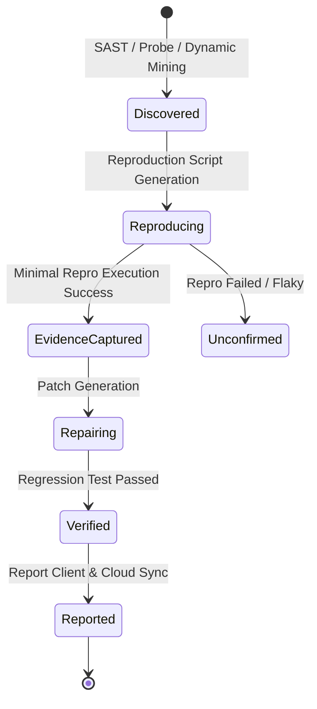

1. **Reproduction Gate**: Every bug must have a minimal runnable reproduction script or curl/command sequence.
2. **Authorization Boundary**: Testing is strictly constrained to target project boundary.
3. **No Paraphrasing**: Error logs and evidence strings must be preserved verbatim.

---

## 6. Decoupled Domain Architecture & Subpackages (DOC-070/DOC-072)

To avoid God Object complexity and maintain scalable development velocity, BugX implements a strict domain subpackage architecture with thin Facades:

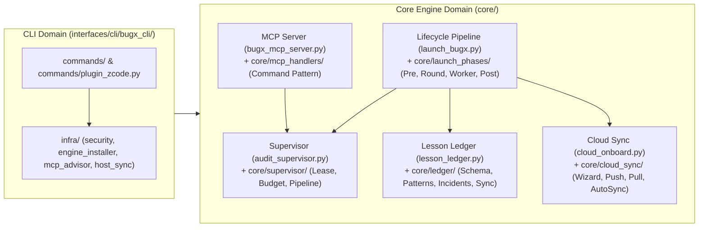

### 6.1 Subpackage Responsibilities

1. **`interfaces/cli/bugx_cli/infra/`**: Encapsulates atomic I/O, symlink security defenses, engine deployment to `~/.bugx/core/`, MCP dependency discovery, and host synchronization.
2. **`core/supervisor/`**: Implements Worker lease lifecycle (`lease_manager.py`), token/call budget gating (`budget_governor.py`), and checkpoint submission validation (`checkpoint_pipeline.py`).
3. **`core/mcp_handlers/`**: Implements JSON-RPC 2.0 command pattern dispatchers across 4 dedicated handlers (Supervisor, Knowledge, Telemetry, Mining).
4. **`core/launch_phases/`**: Implements the audit pipeline stages (`pre_phase.py`, `round_orchestrator.py`, `worker_orchestrator.py`, `post_phase.py`).
5. **`core/ledger/`**: Encapsulates SQLite DDL and connection pooling (`schema.py`), bug pattern state machines (`patterns.py`), incident analysis (`incidents.py`), and cross-scope deduplication (`sync_ops.py`).
6. **`core/retrieval/knowledge_auto.py`**: In `review_mode=mcp-auto`, validates the bound confirmed Finding set, applies deterministic classification, materializes candidate project knowledge, and atomically records the first confirmed Pattern hit; the existing two-independent-lifecycle activation gate remains mandatory; manual mode remains explicit.
7. **`core/cloud_sync/`**: Manages interactive onboarding (`onboard_wizard.py`), outbox replay and chunked pushing (`sync_push.py`), incremental pull with tombstone GC (`sync_pull.py`), and post-commit coalesced background sync (`auto_sync.py`).

账本事务在 `COMMIT` 后才调度自动同步；启动和同步边界发现失败时也调度同一恢复 worker。worker 仅在 onboarding 完成、凭据有效且项目已绑定时联网，复用 `sync_layers()`，并在同步导入期间抑制再次调度，避免本地写入、显式同步与 pull 导入形成并发循环。网络/DNS/超时/5xx 只把 outbox 保持在 `pending` 并按退避重放，stale `inflight` 在下一次重放前回收；worker 在有界窗口后退出，后续启动、账本提交或显式 `cloud sync` 继续恢复。`post` 先完成自动知识落盘，再执行 project boundary sync；自动记录均为 candidate，失败保留 runtime 与 `sync_pending` 供重试，Git 本地提交失败同样不阻断自动 Round/Life。

自动 Git 边界只收集路径限定的项目变更：除 `.bugx/` 运行态外，根级宿主适配目录（`.opencode/`、`.codex/`、`.claude/`、`.cline/`、`.zcode/`、`.workbuddy/`、`.codebuddy/`、`.pi/`、`.dsh/`、`.agents/`）、任意层级 `__pycache__/` 以及 `.pyc/.pyo` 均视为 BugX/解释器生成物，不得进入 `commit --only`；新 Session 的 Git status 快照列出的预存脏路径也排除在外；快照失败或缺失时不自动提交。没有剩余用户变更时返回 `no_changes`，不制造空提交。Finding 级 touched-files 白名单与定向回滚仍未实现。

### 6.1.1 知识消费与跨设备闭环（DOC-108）

V2 `records` 固定包含 `patterns`、`incidents`、`tool_experience`、`consumption_events` 和
`tombstones` 五类数组。`consumption_events` 仅传递 event_id、知识主体、事件类型及 lifecycle/run
标识，不传提示词、正文或源码；event_id 是追加流幂等键，重试时间变化不构成内容冲突。客户端
outbox/inbox、服务端 sequence、pull 合并和本地 ledger 导入均处理该类别，cursor 只在全部记录原子
落账后推进。项目主动消费、检索和反馈因此可在多设备间收敛并由 metrics 观测。

项目 Incident 晋升全局必须同时满足 active 状态和绑定 evidence receipt；全局落账前清除 commit、diff、
lifecycle、round 等项目上下文。项目 Tool Experience 晋升只允许 active 快照，导入全局后仍经 publisher
激活门禁。两条晋升路径都写入项目审计事件，并且重复执行安全返回 duplicate。

`lesson_context` 在 `workers` 阶段只沿共享指令进入分类、路由标签、短查询和 MCP 检索能力，不进入
pattern、incident、tool experience 正文；Worker 先调用 `bugx_knowledge_route` 做有界风险判断，再按“分类 → 受限检索 → 错误签名快速碰撞”按需取得
不可信结果。Worker 需要在最终 Finding 中回填实际复用的 `pattern_id` 和实际工具 `tools`，由 `post`
的 review/tool-feedback 形成可验证使用记录。`consumption_events` 区分 selected/retrieved，MCP
检索请求以参数哈希保证重试幂等；MCP 和 `lesson_context` 统一读取 project/global 两个本地来源，
并将 selected/retrieved 事件写入实际来源账本；metrics 只报告检索数量与 review 复用数。全局
Tool Experience 导入后保持 candidate，publisher 在两个独立 lifecycle hit 后显式激活才进入
运行时聚合；本地全局 Incident 也必须通过 evidence receipt 激活。

SQLite ledger 的 WAL 首次转换按数据库文件串行化：进程内缓存未命中时，先获取权限为 `0600` 的
同目录 `.journal-mode.lock`，再打开 SQLite、检查模式并按需执行 `PRAGMA journal_mode=WAL`。
锁同时覆盖线程及跨进程调用，等待上限 10 秒；模式已是 WAL 时不再执行写转换。锁缺失权限、符号链接
或争用超时均 fail-closed；该锁不参与账本事务数据和 schema。

恢复事实以 SQLite outbox 与 runtime 为准，JSONL 只记录 `started/failed/retry/succeeded/exhausted` 诊断事件；凭据、payload 和源码不进入恢复日志。远端 Git push 仍必须由显式发布流程触发，核心挖掘引擎不因 Git 网络状态自动发布。

DOC-096 规定启动时序：用户明确选择云端同步后，`startup_gates._startup_cloud_onboarding()`
在 `lesson_context` 构建前执行一次正式 Bootstrap，完成项目身份创建/绑定、V2 pull/push、
校验和受控导入；缺少 `.bugx-project.json` 时必须通过统一交互组件明确创建或取消，
`CloudOnboardDecisionRequired` 不得被吞掉。网络故障保留 `sync_pending` 并允许本地降级；
若正式同步暂不可用，`lesson_context` 可读取有界的 cloud prefetch incident candidate，
但不将其写入本地账本或提升为 active。

### 6.2 Development Lifecycle & Existing Design Documentation Synchronization (DOC-037 / DOC-084)

BugX implements continuous documentation discipline across development cycles:
1. **Pre-Dev Plan (`dev-doc plan`)**:
   - Generates standardized 5-question design audit matrix (`DOC-XXX.md`).
   - Automatically injects an Existing Design Documents checklist (`02_DESIGN_SPEC.md`, `01_ARCHITECTURE.md`, `03_BUGX_AUDIT_FLOW.md`, `01_AI_REFERENCE.md`) to define documentation targets before coding.
2. **In-Dev Check (`dev-doc check`)**:
   - Strictly enforces that all design items resolve to `AUDITED_OK` before implementation.
   - Proactively inspects whether core code changes are accompanied by existing design documentation updates.
3. **Post-Dev Close Gate (`dev-doc close`)**:
   - Automatically analyzes Git status. If functional code (`core/` or `src/`) is modified, it verifies that at least one existing core design document is updated in the diff; blocks execution if missing, ensuring system design documents evolve concurrently with code.
   - Automatically generates release notes, executes version bumping across 16 declarations, refreshes `core/engine-integrity.json`, and verifies the full consistency test suite.

---

### 6.3 Capability upgrade prior contract (DOC-116)

Worker task packages may contain bounded machine priors from mining exploration, behavior
graph, and static scanning. Each prior records schema version, source, target revision, unit,
status, and evidence items; it is an untrusted hypothesis and must be marked
`verified`/`refuted`/`not-tested` by the worker. Prompt injection is capped at 800 tokens.
Knowledge retrieval remains on-demand through read-only MCP tools; a miss is observable and
is never treated as a clean result.

### 6.4 Static probe and fix verification boundaries (DOC-116)

SAST has a separate 30-second probe budget and an enclosing deadline that cannot expire before
that budget. `timeout`/`degraded` is distinct from no findings. Fix Life mutation verification
accepts only a host-controlled, project-confined Python/unittest descriptor; report-only is the
default and a hard score gate is opt-in. No static hit, knowledge card, or mutation score alone
can confirm a vulnerability.

### 6.5 Scheduling/mining gap closure (DOC-114)

The Supervisor keeps `round_no` as the scheduling authority and carries
`life_kind=mine|fix` through runtime, MCP and persisted state. Mine retains the
parallel gate; fix may verify serially but still requires the normal evidence
and confirmation gates. Claims support bounded affinity bundles, adaptive
capacity, heartbeat renewal and same-round expired-claim takeover.

Business-chain units remain a separate coverage dimension. A high-risk unit
can enter the queue only after an explicit `business_admission` event; partial
coverage never becomes complete. Worker priors are bounded metadata: lesson
retrieval is on demand, harness/test assets and advisory repository oracles are
listed without executing commands, and SAST/pattern-probe results use the
versioned static-hit contract. Evidence bundles require schema, SHA-256 and
claim artifact confinement; same-round duplicates are marked while raw
candidates remain preserved.

## 7. Directory Layout & Storage Specification

### 7.0 Diagnostic log location and the uninitialized-project fallback

`core/runtime/bugx_logging.py` resolves one log path per root, and the writer and every
reader (`bugx log`, `bugx cloud log-report`) derive it from the same rule, so a
reader can never look where the writer did not write:

- **Initialized project** (`<root>/.bugx/manifest.json` exists) → `<root>/.bugx/logs/bugx.jsonl`,
  unchanged. `.bugx/logs/` itself is created by the layout initializer
  (`bugx init` / `bugx install`), per DOC-001 §5.8.
- **Any other directory** → `~/.bugx/logs/projects/<project_id>/bugx.jsonl`
  (`<project_id>` = `sha256(root)[:16]`, mirroring `bugx_paths._project_id`;
  `BUGX_GLOBAL_LOG_ROOT` overrides the root for tests and embedders).

Rationale: the diagnostic log is a side effect of **every** command, including
purely read-only ones (`doctor`, `hosts`, `log`). If log bootstrap created
`<root>/.bugx`, then running any read command inside an arbitrary directory would
manufacture a "has `.bugx` but no manifest" half-initialized state, make
`bugx reset --scope project` refuse (it requires the manifest), and dirty that
directory's `git status` — BugX does not manage `.gitignore`. The fallback keeps
the audit trail while staying observationally read-only.

Consequences and boundaries:

- The invocation that *creates* the project (`bugx init` / `bugx install`) still
  logs to the fallback, because no manifest exists when logging is configured.
  The project log starts with the next command.
- Fallback logs use the same private modes as project logs (directory `0700`,
  file `0600`) and the same symlink refusal at every path level.
- `close_handlers_for_root()` releases handlers for both locations owned by one
  root, so Windows `rmtree` cannot be blocked by an open fallback handle.

### 7.1 Static Patch Package MVP (DOC-113)

`bugx patch-forge` is a local, static package boundary. It only copies project-root
SPEC/diff/repro/test files, derives touched paths and risk/invariant metadata, and
records SHA-256 hashes. `bugx patch-forge --verify` rechecks the same contract and
returns `verification-deferred`; it never executes package contents, writes Git
remotes, modifies `~/.bugx/core`, or authorizes merge/release. Jenkins replay,
signing, canary and rollback remain separately gated future stages.

```
project-root/
├── .bugx/                        # Project-owned runtime state/configuration only
│   ├── manifest.json             # Project identity + layout_version=2.0.0
│   ├── hosts.json                # Host installation manifest
│   ├── project-profile.json      # Code intelligence & risk fact profile
│   ├── life-ledger.json          # Session state & life ledger
│   ├── lessons.db                # SQLite Lesson Ledger database
│   ├── findings/                 # Confirmed audit findings
│   └── discovery/                # Audit campaign & dependency DAG
├── .opencode/agents/bugx.md      # OpenCode Agent Entry (if selected)
├── .claude/agents/bugx.md        # Claude Code Subagent Entry (if selected)
├── .agents/skills/bugx/SKILL.md   # Codex Skill Entry (if selected, DOC-169)
├── .agents/skills/bugx-user/SKILL.md # User Skill installed by bugx init
├── .cline/skills/bugx/SKILL.md   # Cline Skill Entry (if selected)
├── .pi/skills/bugx/SKILL.md      # Pi Skill Entry (if selected)
├── .dsh/skills/bugx/SKILL.md     # DeepSeek Harness Entry (if selected)
├── .workbuddy/connector/bugx/     # WorkBuddy skill-only Connector + icon (if selected)
└── plugins/bugx/                 # ChatGPT / ZCode Plugin Manifests & Agents
```

方案三约束：项目 `.bugx/` 不包含可执行引擎；CLI 通过全局 `~/.bugx/core`（或
`BUGX_GLOBAL_ENGINE_ROOT`）解析运行时。旧项目的 `.bugx/core` 不再兼容，下一次
`bugx init` 或 `bugx install` 会迁移可识别数据后直接删除；`--destructive` 仅为旧脚本兼容保留。

引擎副本契约：进程内模块导入将有效的全局引擎放在 `sys.path[0]`，安装载荷
`asset_root()` 只排在其后作为引导/安装来源；重复路径在每次插入时清理。SemVer
相同则用数值 `build_id` 决定新旧。普通安装面对非空目标时，已安装引擎或安装源
缺少 Build ID 都必须拒绝覆盖；目标 Build ID 高于源时也必须拒绝降级，只有显式
`--force` 才能绕过这些版本门禁。安装目的地不得是 `asset_root()`，也不得位于
`sysconfig.get_path("data")` 或 `asset_root().parent` 之下，以免覆写 Python 安装载荷。
`doctor --repair` 仅在 asset Build ID 严格高于 global 时才可使用强制替换。成功安装
会把 `engine-receipt.json`（安装时间、CLI 完整版本、来源路径、Build ID）写在引擎
目录的父目录；core 根目录仅承载 `engine-integrity.json` 清单中的静态文件。`bugx update`
在 pip 安装后独立刷新全局引擎，并以 asset/global 完整性校验结果决定更新成功与否；
若 CLI 安装资源本身不可解析，显式执行 `bugx update --repair-assets` 进入 BX-ENGINE-08 的恢复路径，
复验资源后重启原命令；stable 发行不可用或任一 Build ID/完整性检查失败时不进入项目命令。
doctor 分别报告完整版本契约和已发现 asset/global/user-site/cli-prefix 副本 Build ID 一致性。
副本诊断只在当前 asset 严格高于 global、路径发现完整且无其它副本高于 asset 时才建议
force 重建共享引擎；同号、较旧、未知或发现更高副本时不给 force 建议。Force 只改共享
global，不同步其它 CLI 副本。`doctor --repair` 遇到全局目标缺少有效 Build ID 时也拒绝自动替换，且不建议手动 `install --force`。

### 7.2 Automated Patch Remediation Closed-Loop & Server MCP Decoupling Specification

To prevent supply chain poisoning (R1), engine integrity bypass (R6), and covert side-channel execution (R7), BugX strictly rejects using server-side built-in MCP as a dynamic patch delivery/fetching channel.

1. **BugX Self-Patch Boundary**:
   - **Engine Self-Patch Track (BugX Core)**: Built locally via `bugx patch-forge --kind engine` into a self-contained static package (`manifest.json` + `fix.patch` + `repro/` + `tests/` + evidence fingerprints). Uploaded via standard REST API (`POST /api/v1/agent/patch-verifications`) with explicit `patch:verify` API Key scope. Replayed independently by Jenkins in an isolated sandbox (8-Stage Verifier). Releases only through signed version tags and distributed strictly at Session boundaries.
   - **Target Project Findings**: Audit findings from customer projects remain project evidence and are not BugX patch inputs. They must not be generated, verified, applied, or submitted through BugX `patch-forge`.
2. **Session Boundary Invariant**:
   - In-flight audit sessions strictly pin engine hashes and reject runtime code hot-patching. Engine upgrades only occur between session lifecycles.

---
*End of Design Specification.*

## DOC-118 远程补丁验证闭环

补丁验证采用独立服务端状态：请求经校验后持久化为 `statically_verified`。客户端只通过显式 `patch-forge --submit/--status` 触发或查询，服务端独立校验 ZIP 的 manifest、路径、文件 hash 和目标身份；人工按 ID 查询报告和下载隔离包复核，不回写服务端状态。验证专用 key 与 release key 分环境隔离，任何绑定不一致或网络失败都 fail-closed；此阶段不执行包内代码、不创建/合并 PR、不签名发布，也不接入 Jenkins 自动复验。

## DOC-123 管理后台通用 AI 渠道配置与补丁验证运维升级

1. **通用 AI 模型渠道中心 (`/system/ai-channels`)**：
   - 管理后台提供独立的模型网关配置中心，支持同时接入并配置来自国内主流（DeepSeek、阿里云通义千问、智谱清言、月之暗面、字节豆包、硅基流动、MiniMax）、国际主流（OpenAI、Anthropic Claude、Google Gemini、Azure OpenAI）、本地私有化（Ollama）及聚合网关（OpenRouter、OneAPI）等多家不同 AI 服务商。
   - 包含多渠道共存维护、提供商分类筛选与统计、端点自适应标准化解析 (`ResolveOpenAIChatCompletionsURL`)、API Key 掩码安全脱敏存储、实时连通性心跳探测 (`/test`)，以及一键切换系统全局激活渠道 (`/set-active`)。
2. **确定性沙箱复现重放运维交互 (Repro Replay)**：
   - 补丁验证管理界面 (`/system/patch-verification`) 表格行动列、详情抽屉与批量工具栏增加「沙盒重放」与「批量沙盒重放」交互能力。
   - 重放过程严格保持物理与逻辑确定性：零大模型参与，直接在独立临时工作区中按照 `source_commit` 基线恢复代码，依次执行 Phase 1 复现失败（Red）→ Phase 2 应用补丁 diff → Phase 3 缺陷消除（Green）及防回归测试，基于退出码与哈希门禁判定结论，状态推进至 `verified`。
3. **AI 智能代码审查与风险评估 (AI Code Review & Risk Analysis)**：
   - 补丁详情抽屉提供「AI 智能审计」功能，调用系统当前激活的 AI 渠道，对补丁 Manifest 规格、代码 diff 及沙箱重放执行输出进行安全风险与边界影响审查。
   - 审查结论与时间戳保存于 `report.ai_review` / `report.ai_review_at` 中持久化归档，作为工程人员决策的辅助依据，与确定性验证判定严格解耦。

## DOC-125 本地审计 Skill Pack 规范、流式 DAG 与动态攻击面图谱（v0.19.0）

1. **静态技能包与流水线规范 (`core/audit_packs/web-audit/`)**：
   - 遵循 `core/schemas/skill-pack.schema.json` 标准契约 (`schema_version: 1`)，内置 9 个标准流程阶段（`00-scope` 至 `80-evidence-regression`）与 5 个可选模块（`graphql`, `websocket`, `upload`, `oauth`, `multi-tenant`）。
   - 静态目录受 `core/engine-integrity.json` 强哈希校验保护，项目运行时只读加载并支持本地 Overlay。
   - **移动端技能包（`core/audit_packs/mobile-audit/`）**：`applies_if.forms=["mobile"]`，`surfaces` 留空即通配（Android 画像实测常为 `surfaces=[]`，不得依赖 surface 判别）；阶段为 `00-scope → 10-platform-inventory → 20-masvs-static → 30-component-exposure → 40-device-behavior(可选) → 80-evidence-regression`；`required_runtime.tools=["mobile","ios_binary","sast","pattern"]` 全部解析自 `probe_registry`。
   - **Skill Plan 运行时需求传递**：`compile_skill_plan()` 通过 `runtime_requirements()` 归一化 manifest 的 `required_runtime` 并保留在编译计划；`worker_orchestrator` 将完整计划放入当前阶段 Harness 上下文。每个工具条目必须声明 `stage_ids`，且所有引用必须命中同一 manifest 的唯一 `stage_pipeline.stage_id`；工具 ID 必须解析到 `probe_registry`，未知项在计划编译前拒绝。注册表命中是 BugX probe 身份证明，不代表探针已执行、外部二进制已安装或 MCP 服务已就绪；运行期探针仍按自己的生命周期执行。
   - **Required Runtime Tool 启动门禁**：启动在 Session 创建前准备当前项目画像与 Skill Plan，并将画像复用于同一轮 preflight。工具条目缺省为 required，只有显式 optional 可跳过；自愈与就绪门只处理 `stage_ids` 和 `required: true` 阶段有交集的必需工具，其余在收据中标为 `NOT_IN_STAGE_PLAN`。required runtime probe 必须声明不执行目标工作的 availability action；失败预检没有安全动作时不隐式运行 `check`。固定工具配方安装后重新探测并校验版本。只有计划显式目标与已知项目目标互斥时才记 `NOT_APPLICABLE`，探针自身不能声明豁免，未知目标不允许跳过。结果以当前 skill/plan/classification 哈希绑定到 `.bugx/state/runtime-tool-readiness.json`；活动工具失败为 `BLOCKED`，不会进入 fallback 降级或 Session/Worker。
   - **内置移动端静态规则（`core/rules/`）**：`mastg/`（OWASP MASTG，50 条，命中消息自带 `[MASVS-*]` 控制项标签）、`mobsfscan-swift/`（22 条）、`ios/`（自建 13 条：ATS/Keychain/弱算法/日志/UIWebView）与 `miniprogram/`（自建 8 条：存储凭据/明文请求/URL 拼接/`web-view` 动态 src/`urlCheck`/`eval`），统一由 `integrations/opencode/mcp-lock.json` 锁定的 `pysemgrep 1.182.0` 以 `--config <dir> --metrics=off` 执行。移动端阶段先用 `bugx mcp-runtime start --root <项目根目录> --server semgrep --print-command` 取得经完整性校验的 runtime 绝对路径，并核对 `runtime-manifest.json` 的 lock hash、Semgrep 包版本及可执行文件实际版本；不从 PATH 选取工具。发现缺失或版本不符时只自动执行一次 `bugx mcp-runtime install --root <项目根目录>` 并重验；该命令按当前锁重建整套共享 MCP runtime，影响后续 MCP server 启动，失败则阶段 `UNVERIFIED` 且停止，不降级。`.plist`/`.wxml` 用 `languages: [generic]` + `paths.include` 才能在原文件上命中（`--include` 无效，已实测）。规则文件**只读**：`PROVENANCE.json` 记录上游 commit 与逐文件 sha256，`tests/skills/test_mobile_skill_pack.py` 断言哈希不变。
   - 移动端供应链与许可证风险（`mobilecli` FSL-1.1-ALv2、MASTG CC-BY-SA-4.0、mobsfscan LGPL-3.0、`semgrep-mcp` 0.9.0 空心）登记于 `docs/08_internal/10_audits/069_AUDIT-mobile-supply-chain.md`，未登记能力不得进入 `active`。
   - **移动端变体覆盖**：`mobile-audit` 通过 `optional_modules` 覆盖 `android` / `ios` / `miniprogram` / `h5` / `webview`，每个模块必须有对应 `modules/<name>.md`（测试强制）。微信小程序由 `project.config.json` 或 `*.wxml` 判定为 `forms=mobile` + `frameworks=miniprogram`（**不得**仅凭 `app.json`，Flutter/RN 也有该文件）；H5 站点由 `web-audit` 的 `h5` 模块覆盖，App 内嵌 WebView 由 `mobile-audit.webview` 覆盖。
   - **iOS 二进制层**：`core/probes/ios_binary_probe.py`（探针名 `ios_binary`，`required=False`）解析 `.ipa`/`.app`：`Info.plist`（ATS/文件共享/Bundle），`codesign`（entitlements/`get-task-allow`/sandbox），`otool`（PIE、`cryptid`、相对 dylib），`nm`（栈保护）。退出码 `0=READY` / `2=DEGRADED`；非 Mach-O 用魔数校验拦截（避免 otool 对普通文件返回 0 造成 no-PIE 误报），工具缺失时记录 `tools` 与跳过项，绝不把"未检查"写成"未发现"。`.ipa`/`.app` 产物本身也触发 `forms=mobile`（`build/`、`dist/` 等被扫描跳过的目录用**浅层 glob** 兜底；macOS `X.app/Contents/Info.plist` 不计入 iOS）。
   - **运行时入口支持 `args`**（lock `servers.<name>.args`，仅 pypi）：`semgrep` MCP 改由引擎子命令提供（`entry=semgrep`, `args=["mcp"]`, `semgrep==1.182.0`），不再依赖已被上游改成空壳的 `semgrep-mcp`；`mobile` MCP 为 `@mobilenext/mobile-mcp`（npm，实测 33 个工具）。两者遥测均在 `LAUNCH_ENV_OVERRIDES` 硬关闭（含 `semgrep mcp` 默认开启的 Datadog tracing 与 mobile-mcp 的 PostHog/Scarf）。
2. **流式有向无环图调度 (Streaming DAG Engine)**：
   - 废除批处理阶段瀑布流：在 `core/launch_phases/worker_orchestrator.py` 中引入基于端点流式事件驱动的增量拓扑。
   - `00-scope` 与 `10-discovery` 为汇聚栅栏，未完成前阻断业务测试；但在 `discovery` 阶段采取流式发射机制，端点一旦发现立即派发给对应专精 Worker。
   - 动态模块自愈：若运行时探测到未在静态画像声明的特征（如发现 `/graphql` 有效端点），通过 Checkpoint 提出 `suggested_modules`，Supervisor 增量挂载条件模块并追加 `plan_patch`。
3. **动态攻击面图谱协议 (Living Attack Graph Protocol)**：
   - 统一持久化至 `.bugx/runtime/attack-graph.json`，统合 `Role`、`Route`、`Parameter`、`Sink` 与 `Hypothesis` 为图模型。
   - 越权与业务漏洞判定由传统主观文本猜测升级为图谱拓扑上**“非法访问关系边 (Illegal Access Edge)”**的确定性求解。
4. **工种专精亲和与模型梯队分级 (Worker Role Affinity)**：
   - 划分四类专精工种并实施算力梯队绑定：`recon-worker` 绑定 FAST 模型，`auth-worker` 绑定 BALANCED 模型，`logic-worker` 与 `exploit-worker` 绑定 PRO 深度推理模型。
   - 双层规则预算治理：L1 核心行动清单（Hard Cap ≤300 tokens）随 Harness 强制注入；L2 详尽攻防手册常驻磁盘，按需由 Worker 使用 Read 工具调用，节省 60% Token 消耗。
   - **全局提示词预算治理（DOC-141）**：Worker 默认全局预算为 3500 tokens，Skill 默认全局预算为 1800 tokens；L0/L1/L2、先验与任务正文统一进入同一分配器，先满足每段非空 floor（任务正文独立保留 200 tokens），再按优先级分配并执行 section ceiling。估算器异常使用保守 UTF-8 fallback；无法满足 floor 时抛出 `BudgetAllocationError`，禁止静默超预算。
   - 预算耗尽或估算降级必须写入可观察的 `DEGRADED` 事件；任务正文不能因 L1/L2 占满而被截断为仅剩最低 floor。

   ```mermaid
   flowchart LR
       INPUT[提示词各 section] --> ALLOC[enforce_global_budget]
       ALLOC --> FLOOR[先满足非空 floor]
       FLOOR --> PRIORITY[按 priority 分配剩余预算]
       PRIORITY --> CEIL[执行 section ceiling]
       CEIL --> OUT[渲染 prompt + DEGRADED 诊断]
       EST[估算失败] --> FALLBACK[保守 UTF-8 fallback]
       FALLBACK --> ALLOC
   ```
5. **假设驱动的反思回溯验证环 (Reflexive Backtracking Loop)**：
   - Worker 必须按“提出假说 ➔ 沙箱验证 ➔ 遇阻反思 ➔ 修正重试 ➔ 实锤证明”闭环推进；
   - 遇 403 签名错误等非预期阻碍时，自动触发定向反思回溯反查代码并修正请求，杜绝盲目放弃。
6. **对抗性回放守护与隐私脱敏边界 (Adversarial Regression & Privacy Redaction Boundary)**：
   - Candidate 提炼必须通过多周期验证，并在标准干净代码库上进行对抗性回放，确保误报增长 ≤ 0%；
   - 敏感信息脱敏：严格扫描并精准剔除 API Key、Token、Password、PrivateKey 等敏感凭据（统一替换为 `{{REDACTED_SECRET}}`）；
   - 隐私边界演进：DOC-125 初期曾将 Skill Plan 与 Attack Graph 标记为 `local_only=true`；经 DOC-126 架构升级，解除了过度防卫的单机断流，将脱敏后的 Attack Graph、真实代码上下文与漏洞利用 PoC 全面接入平台云端数据飞轮，实现商业闭环与能力反哺。
7. **攻击图谱时间旅行快照与高危汇点加权调度 (Snapshots & Sink Priority Queue)**：
   - `LivingAttackGraph` 支持增量快照打点 `create_snapshot` 与毫秒级回滚 `rollback_to_snapshot`，隔离 Worker 幻觉引入的脏路由和错误假说；
   - 汇点反向推演：实现 `find_entrypoints_for_sink`，流式 DAG 调度器依此为可达 SQL/RCE 等高危汇点的端点任务动态赋予高优先级评分（100 分），优先消耗算力突破致命弱点。
8. **启发式修包就地免 LLM 快速重放 (In-Situ Fast Replay Loop)**：
   - `HeuristicAutoFixer` 自动纠偏 403 签名/401 凭证过期/415 Content-Type，并支持 `execute_in_situ_fast_replay` 在底层沙箱就地快速重试；签名密钥和 Bearer token 必须由调用方显式注入，缺失时不生成合成凭证；只有正向利用与负向对照同时成立且 callback 的 `target_fingerprint` 与计划一致时才推进至 `verified`，否则保留 `suspected` 或待重放状态。
9. **自动化 A/B 评测套件与可视化归因分析 (Benchmark Radar & Attribution)**：
   - `scripts/benchmarks/benchmark_skill.py` 支持解析真实 Session 双轨数据，输出 12 项攻防度量指标、ASCII 可视化进度雷达条与结构化根因归因分析，形成客观可量化的决策闭环。

## DOC-126 云端攻防数据反哺、秘钥精准脱敏与商业化技能同步规范

1. **商业数据反哺宗旨与平台资产沉淀模型 (Commercial Data Flywheel)**：
   - **核心商业逻辑**：“用户产生的数据反哺平台，平台再用高质量数据进行商业化。先活着，再考虑规范，依靠真实对抗数据构建核心技术护城河。”
   - **真实对抗资产价值**：实战中源源不断捕获的海量对抗性代码漏洞、API 拓扑与动态攻击图谱是平台最核心的技术壁垒。严禁因过度防卫而把数据封死在本地或抽象为不可用的干瘪伪代码。
   - **闭环业务价值**：脱敏回流的真实攻防链路用于微调平台专属安全大模型、训练端点攻击推演算法、迭代官方通用 Skill Pack，并支撑高价值商业化攻防包分发。
2. **高精度秘钥脱敏规范 (`core/governance/secret_redactor.py`)**：
   - **精准脱敏原则**：严格区分“身份凭证/私密密钥”（硬脱敏）与“真实攻防上下文”（完整保留）。
   - **绝对脱敏项 (Secrets)**：各类 API Key（`sk-`、`AKIA`、`ghp_`）、Bearer Token、Password、PrivateKey、云厂商 AK/SK 等凭据，强正则替换为 `{{REDACTED_SECRET}}`，彻底杜绝凭证泄露。
   - **黄金数据资产 (Code & Topology)**：脆弱代码上下文（前/后 10-30 行）、API 路由端点（如 `/api/v1/orders/{id}`）、参数名、请求 Header、Attack Graph 拓扑节点与边、越权利用链与 Zero-LLM 确定性复现 PoC 必须完整保留收集，不破坏语法与利用逻辑。
3. **云端 V2 协议扩展与 Outbox 接入 (Protocol & Ingestion Alignment)**：
   - `core/cloud_sync/cloud_onboard.py` 中的 `RECORD_TYPES` 扩展为 `("patterns", "incidents", "tool_experience", "consumption_events", "tombstones", "attack_graphs", "skill_traces")`。
   - 错题集（Incidents）与经验集（Patterns）严格对齐 `detail_mode="full"` 默认模式，完整保留 `before_snippet`、`after_snippet`、`signature` 与动态探针，仅清洗 `/Users/<name>/` 机器前缀。
   - Attack Graph 与 Skill Trace 经 `secret_redactor` 脱敏后，封装进原子 V2 Push payload，通过幂等 Outbox 队列上报至云端数据摄取管道（Ingestion Pipeline）。
4. **云端技能包下发与本地增量拉取 (`core/cloud_sync/sync_pull.py`)**：
   - 客户端通过 `sync_pull` 协议增量拉取云端下发的最新官方/商业化 Skill Pack 及框架专精模块。
   - 本地经由 `validate_manifest` 进行严格 Schema 与完整性校验，校验通过后热挂载到 `core/audit_packs/` 目录或作为 Overlay 参与运行时 DAG 编排。
5. **用户服务与数据授权条款规范 (Service Agreement & Privacy Policy)**：
   - 遵循业界主流商业 AI 平台（如 Grok / WorkBuddy / Trea）标准惯例，聚焦“为了提供高精度检测服务并持续改进/训练平台基础模型、算法与通用技能库”进行中立合规授权。
   - 底层法务协议与具体商业会员权益/算力抵扣解耦，保障平台运营与商业化变现灵活性。
6. **业务级 PII 校验与自定义规则注入 (DES-17)**：
   - 采用 GB 11643-1999 模 11 权重校验算法识别并脱敏中国大陆身份证号 (`{{REDACTED_ID_CARD}}`)；
   - 采用 Luhn 模 10 算法校验脱敏银行卡/信用卡号 (`{{REDACTED_BANK_CARD}}`)；
   - 识别国内 11 位手机号 (`{{REDACTED_PHONE}}`) 与 RFC 1918 私有 IP 段 (`{{REDACTED_PRIVATE_IP}}`)；
   - 支持通过项目级 `.bugx-redact.json` 或 `.bugx-redact.yaml` 动态注入用户自定义敏感词与正则模式。
7. **本地 Outbox 透明压缩与 HTTP 批处理聚合外发 (DES-18)**：
   - 本地 Outbox 数据库入队采用透明 gzip 压缩存储（魔数 `\x1f\x8b`），对外读取自动解压保持语义透明，磁盘占用减少 70% 以上；
   - 上报器支持 `batch_size`（默认 20 条）聚合打包向 `/api/v1/telemetry/events/batch` 外发，服务端异常时自动优雅降级为逐条重传。
8. **DPO 偏好对边际评分与难例标注 (DES-19)**：
   - 反思回溯成功假设合成 DPO 偏好对时，综合回溯深度、状态码与负向对照计算归一化 `preference_margin`；
   - 提取历史被拦截与重试过程中的阻碍类型 (`obstacle_types`)，深层回溯突破样本打上 `is_hard_example: True` 标签，为模型强化微调提供高质量梯度信号。

## DOC-129 无人值守自主挖掘高价值提升规范

1. **攻防图谱驱动的链路式自适应变异调度 (Exploit Chain Adaptive Scheduling，核心)**：
   - **拓扑级任务动态裂变**：从静态清单扫描升级为利用链闭环探测。当 Worker 发现单元弱点时，调度器沿 `Living Attack Graph` 的 `EXPLOITED_ACCESS` / `CALLS` / `DATA_FLOW` 关系边，自发衍生出下游深层渗透任务包（级联深度限制 $\text{depth} \le 3$）。
   - **二阶完成门禁**：Session 终态判定在基础代码覆盖外，要求图谱高危连通路径必须完成连通闭环验证。
2. **多轮间经验集与错题集的实战变异与双环认知进化 (Dual-Loop Cognitive Loop & Skill Synthesis，核心)**：
   - **单项目内环快循环 (L2→L3→L5)**：Round 1 沉淀的 `incidents`（代码错题）、`patterns`（探针）和被拒假阳性在 L5 当场落盘项目账本；在 Round 2（L2 装配）派发给同技术栈 Worker 时，与全局基线资产双源汇合，作为双重视野排雷与专精武器库注入 Worker，供 L3 直接消费，杜绝大模型在相似路径重复犯错。
   - **跨项目外环长反哺 (L7 晋升与显式 Skill 合成)**：active incident 可由用户显式调用 `bugx lesson synthesize-skill` 生成包含 `SKILL.md` 与校验脚本的 Skill 包；账本写入、激活、晋升和合成均重新核验 receipt 与规范项目布局里的 Supervisor Finding、已提交 claim、coverage evidence 记录及当前工件 SHA-256 一致。该链路是本地状态一致性复验，不含密钥签名，不能证明抵御有权改写本地状态的攻击者，也不能替代真实 ACP/宿主执行证明。当前没有 post/项目归档自动触发器，也不会在生命周期结算时自动激活全局 Skill。
   - **高疑单元变异复测 (Mutation Re-fuzzing)**：已覆盖但高复杂度的单元，若上一轮留有存疑警告，由变异 Worker 执行深度模糊测试。
3. **算力经济效益感知调度与动态预算调控 (ROI-Aware Dynamic Budgeting，核心)**：
   - **收益速率评估**：基于 $\text{Yield Velocity} = \frac{\sum \text{SeverityWeight}}{\text{Duration}}$ 动态调控并发与墙钟。
   - **富矿追加与贫矿平滑收敛**：连续爆发 High/Critical 缺陷时触发 Budget Booster（上浮并发）；在全量代码保底覆盖 100% 达成的前提下，对无逻辑的静态纯文本单元支持 low ROI 提前平滑收敛，严控 Token 成本。
4. **常驻守护进程与无头 AI 调用及热恢复 (Headless Daemon & Attach/Detach，核心)**：
   - **独立脱机常驻**：通过 `bugx daemon start` 建立独立进程组守护进程，脱离前台 IDE 与终端会话。
   - **无头 AI 调度**：内置 Direct LLM API Runner 与无头 CLI Runner，自主完成代码分析、探针沙箱执行与 Checkpoint 提交。
   - **前后台解耦与热恢复**：支持随时 Detach 转入后台通宵静默挖掘；任意终端执行 `bugx attach` 按 Target Fingerprint 校验热恢复回显战报。
5. **项目专属免疫包一体化交付 (Project Immunization Pack，可选扩展)**：
   - **特性定位**：默认关闭（`enable_immunization_pack: false`），由用户按需启用。
   - **交付资产**：终局自动合成项目专属的 AST 防御规则（Semgrep / 正则）与自动化回归单元测试代码（pytest / jest），将外部漏洞扫描升级为内部工程免疫。

---

## DOC-137 2.0 工业级自治持续漏洞挖掘与自愈系统技术规范

本节定义 DOC-137 2.0（v0.19.5）工业级自治挖掘各组件的契约、数据流与硬约束。

### 1. 被测沙盒环境自愈与生命周期管理 (`core/planning/target_sandbox_manager.py` / D137-05)
- **独立快照 API**：`create_snapshot` / `rollback` / `cleanup_snapshot` 仅针对调用方提供的隔离、单写者目标目录；重复 snapshot ID、非当前管理器实例的路径，以及被改绑的目标/忽略规则元数据 fail-closed；符号链接按链接保存且不读取目标。`sandbox_transaction` 在成功、异常和 `KeyboardInterrupt` 后恢复基线；恢复失败时保留快照并抛出带路径的错误。
- **生产接线边界**：当前 Worker/Life 主流程不调用快照 API。禁止将共享项目根目录直接包进事务：并发 Worker、宿主和用户的快照后写入无法归属，整目录回滚会造成数据丢失。Worker 隔离目录、Supervisor/artifact 绑定、取消与回收闭环完成单独审计前，主流程接线状态为 `BLOCKED`。
- **服务探活与自愈规范**：
  - `check_health(host, port, pid, timeout)`：采用 `socket.connect_ex` 秒级探测被测 Web/API 端口可用性；
  - `recover_service(cmd, port, pid, startup_timeout)`：命令统一解析为 argv 并以 `shell=False` 启动；`pid` 必须对应同一管理器仍持有的活动 `Popen`，并通过该句柄终止。TCP 监听者查询仅用于拒绝未知占用者；查询失败、PID 不属于当前管理器、或 daemon 重启后句柄丢失时均 fail-closed。超时只清理由本次调用创建的 `Popen`，等待进程退出后才返回。

### 2. 三级模型分层阶梯路由与 ROI 预算自适应调控 (`core/runtime/model_runner.py` / `core/supervisor/task_scheduler.py` / D137-06)
- **三级阶梯映射规范**：
  - `tier_1_recon`：静态粗筛、代码摘要、轻量探针生成（路由至 Flash 或本地 Ollama 模型）；
  - `tier_2_exploit`：复杂鉴权穿透、利用链拼接、深度 PoC 编写（路由至 SOTA 推理大模型）；
  - `tier_3_verify`：确定性双跑差分与沙盒回放（纯本地原生执行，零 Token 消耗）。
  - 通过 `resolve_model_tier(task_type, complexity)` 统一路由。
- **自适应并发与早停收敛规范**：
  - 联动 `Yield Velocity`：当连续出现高回报缺陷且系统负载健康（CPU $\le$ 目标负载且内存 $\le 75\%$）时，自适应上浮并发槽位（上限 $\le 1.5\times$）；
  - 在全量基础覆盖打满、连续 2 轮收益趋零时，触发 Early Convergence 平滑提前收敛。

### 3. 红蓝双 Agent 闭环对抗博弈与差分验证 (`core/fuzzing/differential_oracle.py` / D137-07)
- **博弈交互协议**：
  - Red Worker 提交候选攻击利用 PoC；
  - Blue Worker 从目标项目现有防御逻辑（网关签名、权限过滤、类型守卫）寻找反例或构建反驳断言；
  - 双方用例置入独立干净沙盒执行验证。
- **差分裁决矩阵**：
  - `CONFIRMED_DETERMINISTIC`：Red 真实穿透，Blue 无法反驳，且两次独立双跑确定性复现；
  - `BLUE_REFUTED_FALSE_POSITIVE`：Blue 反驳成立（退出码 0 证明属于合法输入或已被防御拦截），消除假阳性；
  - `DISPUTED_CANDIDATE`：对抗达到 30s 硬超时或争议未决，归档人工复核，杜绝死锁。

### 4. 强化学习 UCB1 多臂老虎机探索利用平衡 (`core/supervisor/task_scheduler.py` / D137-08)
- **调度打分公式**：
  $$\text{Score}(u) = \text{BaseRisk}(u) + \bar{X}_u + c \sqrt{\frac{2\ln(N + 1)}{n_u + 1}}$$
  - $N$ 为总调度次数，$n_u$ 为单元被尝试次数；
  - $\bar{X}_u = \frac{r_u}{n_u + 1} \times 50.0$ 为历史漏洞利用回报率；
  - 探索项使未探索冷门单元（$n_u=0$）享有高探索收益；被证明安全的单元随 $n_u$ 增长平滑让位。

### 5. 最小安全补丁合成与工程免疫资产沉淀 (`core/repair/patch_synthesizer.py` / D137-09)
- **补丁合成与双向回归门禁**：
  - `synthesize_patch()`：针对确认缺陷生成最小标准 Unified Diff 补丁；
  - `verify_patch_dual_gate()`：在受控临时环境验证——补丁打入后 PoC 被防御（exit 0），且原有单测套件全绿；PoC/回归命令必须是非空 argv 并以 `shell=False` 执行，校验后自动 `git apply -R`。回滚失败必须使结果无效并提示工作区可能残留补丁。
- **原生工程免疫转写**：
  - `generate_immunity_test()`：输出带显式 TODO 和失败占位的 Python `unittest` 或 `pytest` 骨架；添加针对真实漏洞路径的断言前，该骨架不能被误当作通过的回归测试。

---

## 17. 调度与编排高可用加固规范 (DOC-138 / v0.19.6)

本节定义 DOC-138 调度与编排链路高可用加固的接口契约、并发隔离与防护边界：

### 1. 阶段栅栏多类型依赖与就绪未完优先选择 (`core/launch_phases/worker_orchestrator.py`)
- **多类型产物判定**：
  - `check_stage_barrier_satisfied(stage, root)`：不再硬编码 `.json` 后缀。对阶段 `consumes` 的所有依赖，依序检查产物登记表（`.bugx/artifacts/registry.json`）、规范产物文件（`.bugx/{art}.json` 或 `root/{art}.json`）、产物目录（`.bugx/artifacts/{art}`）与无后缀文件，且校验文件大小大于 0（拦截空文件）。
  - `behavior-evidence` 是例外的强契约：只从固定 `.bugx/artifacts/behavior-evidence/<worker_id>.json` 读取；要求 schema 版本为整数 `1`、当前 Supervisor `run_id`、文件名与 `worker_id` 一致、完成状态及至少一条字段完整的 case。`exit_code` 与 `signal` 字段都必须存在且恰有一个有效；命令首项为非空可执行程序名，后续空参数允许。目录和文件均拒绝符号链接，内容采用有界读取和严格 JSON 解析。普通登记名、非空文件或目录不能替代该证据。此工件是 Worker 的运行结果声明，不等同于 ACP/操作系统进程证明。
- **首选就绪未完阶段与断路**：
  - 流水线遍历依序寻找第一个**前置栅栏已就绪且自身产物尚未完全产出**的阶段；选定后立即 `break` 跳出，防止末位盲目覆盖，并在派发上下文中注入 `decided_by="first_eligible_pipeline_stage"`。

### 2. 状态存储与锁域单一事实源 (`core/supervisor/supervisor_models.py` / `core/supervisor/audit_supervisor.py`)
- **路径规范收拢**：
  - `DEFAULT_STATE_RELATIVE_PATH` 统一收拢至 `.bugx/state/supervisor.json`，锁文件对应 `.bugx/locks/supervisor.lock`，与 `bugx_paths.Scope.supervisor` 规范实现 100% 对齐。
  - 旧历史路径已彻底移除，状态机严格遵循单一规范路径，坚决杜绝路径漂移。

### 3. 查询刷新与共享快照锁域 (`core/supervisor/audit_supervisor.py`)
- `_query_readonly()` 服务 `status()`、`status_with_gate()` 与 `parallel_gate()`；这些查询会刷新租约/预算，故从读状态到可选持久化全程持有 `_file_lock()` 排他锁，防止多个进程基于同一旧快照覆盖各自的事件与状态。操作只执行一次；状态未变脏时不写盘、不推进 revision。
- 纯读取的 `decision_snapshot()` 继续使用 `_read_lock()` 共享锁。refresh 查询读吞吐会串行化；若后续实测出现明显争用，再单独设计纯快照与 refresh 的分层边界。P0-6 的审计设计复核见 `docs/08_internal/10_audits/020_ZCODE_REPAIR_DESIGN_RECHECK_2026-09-25_codex.md`。

### 4. 租约寿命上界与防假活防死锁（`core/supervisor/budget_governor.py` 与 `core/supervisor/lease_manager.py`）
- **单一终止条件（破坏性变更）**：
  - `WorkerClaim` 固化 `renewal_count: int`（**仅审计计数，不参与任何判定**）、`total_lease_deadline: float | None` 与其单调镜像 `total_lease_deadline_mono`；`max_renewals` 字段已删除，`DEFAULT_MAX_RENEWALS` 降级为**寿命乘数**（寿命上界 = 初始租约 × (`DEFAULT_MAX_RENEWALS` + 1)，与心跳节奏无关）。
  - `_renew_expired_live_claim` / `lease_manager.renew_claim` 只在超过绝对截止期时拦截，标记 `claim.preempted_reason = "total_lease_deadline_exceeded"` 并触发安全回收；命中单调时钟边界即回收，杜绝子进程假活造成的无限续期。
  - 过期判定收敛到唯一入口 `lease_manager.lease_expired`，只读 `lease_expires_mono` / `total_lease_deadline_mono`；墙钟字段仅审计展示，NTP 跳变不得改变寿命判定结论。
  - 批量回收（`release_active_claims` / `drain_dangling_claims` / `reclaim_orphan_leases`）在循环结束后各触发**一次** `reconcile_parallel`，避免逐 claim 重算的 O(n²) 与并发度量滞留。

#### 4.1 并行证明与 checkpoint 身份绑定（DOC-141）
- `parallel_gate_result(state, now=...)` 只从当前 Round 的 `execution_started_at`、已提交的 `execution_finished_at/submitted_at` 和本次观察边界重建执行窗口；`lease_expires_at` 不是已经发生的执行证据。
- 并发门禁同时要求：观测峰值至少为 2、执行窗口有正 overlap、至少两个不同 Worker 持有非空 checkpoint payload digest。缺任一条件都以结构化 reason fail-closed。
- `checkpoint_id` 与归一化 payload 的 SHA-256 digest 绑定；同 Worker 改写 payload 或其他 Worker 复用 ID 均拒绝，成功重试只重发同一已提交 payload。

#### 4.2 租约模型与历史 hash-chain 不变量（DOC-141）
- 新 claim 的绝对截止期覆盖初始租约及寿命乘数上界；`WorkerClaim.from_dict` 对 `claimed_mono` / `lease_expires_mono` / `last_heartbeat_mono` 缺失的旧快照 **fail-closed**（抛 `PersistenceError` 并要求重建 state），禁止静默补齐；同时拒绝截止期早于当前租约等不一致状态。
- `append_event` 在 `MAX_HISTORY_EVENTS=1000` 后保留 `history_base_seq/history_base_hash` 锚点；恢复从锚点验证连续序号、前置 hash 和 `audit_head`，不会因压缩而失去篡改可见性。
- 所有过期路径共用幂等 `mark_claim_expired`，避免重复增加 `total_expired` 或重复写入事实事件。

#### 4.3 L2 异常处理与超时弹性升级 (DOC-242)
- **单调时钟化调度解耦 (MonoTime Decoupling)**：
  - 内存中的调度控制流（心跳间隔、租约倒计时、死循环探测）全面使用 `time.monotonic()` (`claimed_mono`, `lease_expires_mono`, `last_heartbeat_mono`)，彻底免疫 NTP 时间同步或宿主时钟跳变导致的倒挂或假性过期。
  - `drain_dangling_claims` 的心跳静默快通道与 `reclaim_orphan_leases` 同口径：只读 `last_heartbeat_mono`/`claimed_mono` 的 mono 静默，墙钟 `last_heartbeat_at` 仅作审计展示（D3-A）。
  - 磁盘落盘与审计日志仍严格保持 `time.time()` 绝对时间戳，保证审计追踪和跨重启快照的真实性。
  - **墙钟预算回拨防护 (Clock High-Water, D3-B)**：`RunState` 持久化 `clock_high_water`（只增不减）；`budget_governor.observe_clock(state, now)` 返回 `effective_now = max(now, clock_high_water, started_at, budget_started_at, round_started_at)` 并把水位推进到该值。所有墙钟预算判定（`deadline_reasons` / `apply_status_budget` / 单轮续期）、`refresh` 的墙钟写入、`next_round` 新轮锚点与 `reset_budget`（含 `--renew-wall-clock`）统一使用 `effective_now`：系统时钟回拨不得把已耗掉的 `max_wall_seconds`/单轮预算还回来，前跳则 fail-closed 提前耗尽。旧快照无该字段时回落 `0.0`，由三个持久化锚提供 `elapsed >= 0` 下界；`from_dict` 拒绝负值与非有限值。
- **环境级系统性故障级联熔断 (Systemic Failure Circuit Breaker)**：
  - 捕获跨单元的致命基础设施故障特征（如 `cargo/pytest: command not found`、`segmentation fault`、`SIGSEGV`）。
  - 当跨 $\ge 3$ 个不同代码单元连续报告该类基础设施缺失时，判定为全局环境塌陷，立即触发全局级联熔断 (`Status.BUDGET_EXHAUSTED` with `systemic_environment_collapse`)，避免消耗数百回合无意义重试。
- **长调用死锁双重防御 (Long-Call Deadlock Defense)**：
  - Worker 即使处于长调用窗口（如 1800s），若静默时长超过 `LONG_CALL_MAX_SILENCE_SECONDS = 600s`，中枢将通过 OS 进程探测探活其 CPU 时间。若进程 CPU 增量为 0，判定为死锁/卡死，不再提供宽限。
- **孤儿沙箱与句柄物理收割 (Orphan Sandbox & Handle Physical Reaping)**：
  - 当 Worker 进程异常退出或被判定为僵尸进程而终止时，`ZombieDetector.terminate_claim` 级联调用 `OrphanSandboxReaper`，物理扫描并强行清理其在工作区或 `/tmp` 中残留的孤儿专属沙箱与临时锁文件，杜绝跨轮文件锁竞争与磁盘泄漏。

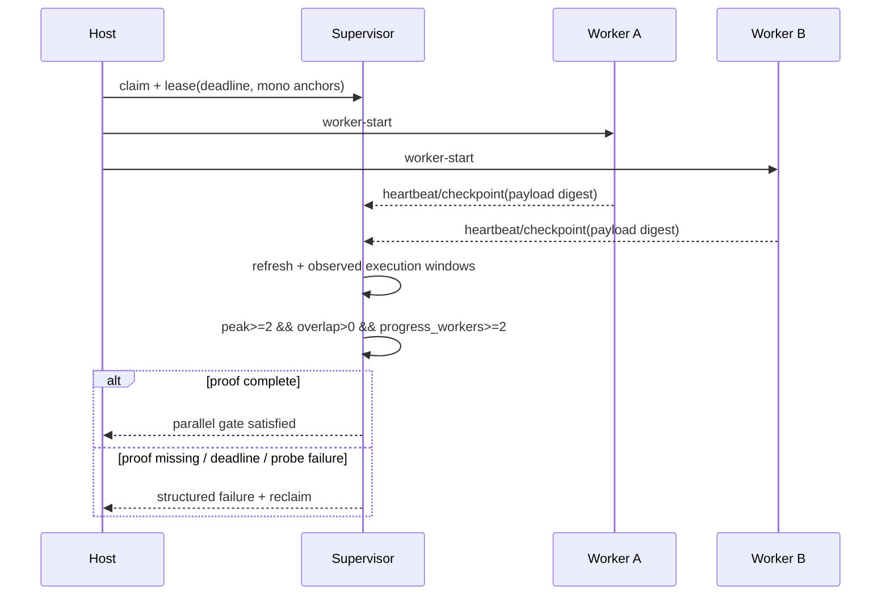

### 5. 指定攻击面 `surfaces` 调度加权 (`core/supervisor/task_scheduler.py`)
- **目标攻击面引导**：
  - `TaskScheduler.score_unit` 消费构造参数 `self.surfaces`；
  - 命中指定 surface 的单元在同层业务单元中获得 `+150.0` 调度加权，在遵循阶段硬边界前提下优先探测指定攻击面。
---

## 18. Token 经济治理与协议瘦身规范 (DOC-139 / v0.19.8)

本节定义 DOC-139 Token 经济全链路治理的接口契约、传输优化与计量边界：

### 1. MCP Wire 传输双份编码消除与紧凑摘要 (`core/mcp_handlers/base.py` / T-1)
- **非冗余序列化**：
  - MCP 工具返回协议结构包含 `content[0].text`（人类可读文本）与 `structuredContent`（实体数据）。
  - 当 payload 为结构化字典且序列化字符数 > 300 或字段数 > 3 时，`text` 字段自动退化为紧凑状态摘要（提取 `status`, `revision`, `run_id`, `changed`, `satisfied` 等核心键），实体数据交由 `structuredContent` 单独承载。彻底消除 Wire 传输中的重复 JSON 序列化（节省 ~50% 冗余 Token）。

### 2. 旁路状态安全截断门禁 (`core/mcp_handlers/base.py` / T-2)
- **单一入口截断**：
  - 在 `_project_state()` 统一实施防泄露硬截断：`history` 保留最近 50 条，`findings` 保留最近 100 条，`parallel_proof_history` 保留最近 20 条，被截断时附加对应字段的 `_truncated=True` 标记。
  - 杜绝所有旁路 handler（如 `handle_supervisor_status`、`handle_mining_state` 等）因全量暴露长周期历史而撑爆模型上下文。

### 3. Supervisor 增量游标轮询机制 (`core/mcp_handlers/supervisor_handlers.py`, `core/skills/bugx_mcp_server.py` / T-3)
- **`since_revision` 游标**：
  - `bugx_supervisor_status` 与 `bugx_supervisor_gate` 工具声明并支持可选整型参数 `since_revision`。
  - 当调用方传入的 `since_revision` 与当前 Supervisor 状态版本一致时，直接短路返回极简响应（`changed: False`, `revision: <N>`, `status: ...`, 仅 ~30 字节），不返回全量状态与覆盖映射；版本发生演进时才下发全量状态。轮询阶段 Token 消耗降低 98% 以上。

### 4. 真实 Token 计量与生命周期闭环 (`core/launch_phases/finding_settlement.py`, `core/runtime/bugx_logging.py`, `core/runtime/model_runner.py` / P1)
- **消除伪零计量**：
  - `finding_settlement._auto_build_findings_json` 遍历聚合所有 findings 的真实 token 消耗，累加写入 `runtime["lifecycle_token_count"]` 与输出物 `findings.json`，彻底消除硬编码 0。
  - 区分真实度量与未计量：根据 findings 中的计量状态标记 `token_method="aggregated"` 或 `token_method="unmeasured"`，下游效率卡片与校准引擎据此剔除不可测数据，杜绝 0 伪造。
  - `timed_phase` 修复包装缺陷：透传 `token_budget` 参数并 `yield tracker`，使各执行阶段（`pre_flight_gates`, `worker_execution`, `post_settlement`）具备上下文 Token 追踪与限额告警能力。

### 5. Prompt Harness 注入面天花板 Clamp 与 Dynamic Context 防膨胀 (`core/planning/prompt_harness.py` / P2-1, P2-2)
   - 引入 `HARNESS_SECTION_BUDGET_CEILINGS` 硬天花板（如 `skill_l1_checklist: 800`, `skill_experience_hint: 1500`, `dynamic_context: 800` 等）。
  - `decorate_skill_stage_task` 解析外部注入配置时进行 `min(max(50, val), CEILING)` 刚性约束，防止畸形或恶意 budget 击穿模型注意力上下文。
  - `get_stage_prompt` 对动态注入的上下文事实（`context`）施加单项长度截断（≤500 字符）与整体预算门禁（`dynamic_context` 硬上限），截断标注 `...[TRUNCATED]`，保障 L1 主提示词的注意力焦点。

#### 6. 防篡改基线落盘与终端日志瘦身 (`core/launch_phases/pre_phase.py`, `core/ledger/verify_life.py` / P2-3)
- **基线瘦身与双模解析**：
  - 在现代项目布局（`_uses_project_layout()`）下，`pre` 阶段将防篡改基线全量数据落盘至 `.bugx/state/pre-baseline.json`，终端控制台仅输出轻量环境变量导出指令 `export BH_PRE_BASELINE='/path/to/pre-baseline.json'`。
  - `verify_life.external_baseline()` 升级支持双模解析：优先尝试作为本地基线文件加载，若非文件则兼容历史内联 JSON 字符串，控制台日志大幅瘦身，消除数万字节的终端输出污染。

- **跨文件结算恢复（P1-4）**：`verify_life settle` 先耐久写 pending settlement WAL，再以可选
  `settlement_id` 写入 FindingLedger，最后耐久替换 life 状态并删除 WAL。每个寿命锁命令入口
  只接受与 WAL before/after hash 精确匹配的当前状态；ledger fingerprint 已存在但没有本事务
  ID、WAL 损坏、CAS 冲突或路径越界均拒绝继续。零计命轮次同样写 WAL，`reset`/`restore` 不绕过
  恢复入口。该机制保证进程终止后的幂等收敛，不把 JSON 文件宣称为跨文件原子事务。

---

## 19. 启动流程与人机对话交互规范 (DOC-140 / v0.19.9)

本节定义 DOC-140 启动流程、宿主交互与自愈机制的接口契约、防护边界与状态闭环：

### 1. 11 大宿主正交策略组件框架与静态入口发现 (`interfaces/cli/bugx_cli/hosts/` / `interfaces/cli/bugx_cli/host_adapters.py` / DOC-167)
- **11 大主流 AI 宿主全面组件化支持**：
  - 由 `interfaces/cli/bugx_cli/host_adapters.py` 的 `HOST_ADAPTERS` 充当宿主适配器事实元组，全面覆盖 11 类主流编码智能体：`opencode` (OpenCode)、`dsh` (DeepSeek Harness)、`codex` (Codex)、`cline` (Cline)、`claude` (Claude Code)、`zcode` (ZCode)、`workbuddy` (WorkBuddy AI)、`pi` (Pi)、`chatgpt` (ChatGPT)、`qoder` (Qoder)、`trea` (Trea)。
  - `interfaces/cli/bugx_cli/host_adapters.py` 的 `HOST_ADAPTERS` 与 `INTERACTION_CONTRACTS` 均由组件注册表动态衍生，彻底消除双事实源。
  - 通过 `InteractionContract`、`InstallContract`、`McpContract`、`ExecutionContract`、`DetectionContract` 五大正交契约解耦，新增宿主仅需添加声明式配置，由模板引擎 `render_host_entry` 装配项目级 MCP 契约与零门禁自愈生命周期规范。
  - 统一定义宿主发现、原生项目级 MCP 配置映射与卸载清扫链路，全量 11 宿主严格遵守 100% 项目级工作区隔离规范，全面停止向任何宿主安装全局级 MCP（彻底消除写入 `~/.workbuddy-ai/mcp.json` 等全局目录的遗留逻辑，所有 `--root` 绑定为当前项目 `.`）。
  - **Trea 检测契约与双变体适配（历史宿主适配条目）**：统一采用 `trea` 规范宿主名（避免破坏全仓 11 宿主架构基线），底层全面支持 Trae 国际版与 Trae CN 国内版双变体：
    - 可执行名与别名对齐：支持 `trae`、`trae-cn`、`trae_cn`、`trea-cn`、`trea_cn`、`trae-ai` 等别名归一化至 `trea`；
    - 应用探测：Darwin 支持 `Trae.app` 与 `Trae CN.app` 及其内置二进制 `trae` 与 `trae-cn`；Windows 覆盖 `Programs/Trae CN` 等候选路径；Linux 覆盖 `trae-cn.desktop` 与 `/usr/bin/trae-cn`；
    - 用户与项目标记：用户目录支持感知 `~/.trae` 与 `~/.trae-cn` 及对应 Application Support 路径；项目标记支持 `.trea`、`.trae` 与 `.trae-cn`；
    - 工作区同构镜像（`CAP_WORKSPACE_MIRROR`）：若项目存在 `.trae` 或 `.trae-cn` 目录，安装时除基准 `.trea` 产物外，自动将 Agent 入口和 MCP 配置同步镜像写入 `.trae` 或 `.trae-cn`，Doctor 校验自动识别双变体候选容器。

### 2. MCP 控制平面 Supervisor Start 启动前置校验 (`core/mcp_handlers/supervisor_handlers.py` / D5)
- **Session 与启动产物前置门禁**：
  - `bugx_supervisor_start` 增加前置防御校验：不仅校验角色与覆盖清单完整性，且强制校验当前活动的 Session 是否存在且已初始化；
  - 若 `runtime.json` 或 `session_state` 显示当前 Session 处于 `aborted` 状态，强制拦截并返回 `ABORTED_SESSION_ACTION_REQUIRED`（`interactive_required=True`），要求用户先恢复或新建会话；
  - 若 `startup_result` 显示前置门禁未通过（`blocked` 或 `gated`），拒绝盲目启动 Supervisor，返回 `STARTUP_GATE_BLOCKED` 引导解决前置门禁项，杜绝外部 Agent 旁路绕过整个启动防线。

### 3. 统一交互组件与死循环防御 (`core/runtime/interaction.py` / D11, D12)
- **路由中枢与门面类**：
  - 由 `interaction.ask()` 充当全局单一交互入口，同时导出面向对象的 `InteractionRouter.ask()` 规范门面，实现规范与实现的 100% 对齐；
  - 环境自适应渲染：依据 `StartupEnvironment` 自动派发至原生单选（`native-question`）、TTY 方向键单选（`tty-radio`）、TTY 编号菜单（`text-menu`）或外层阻塞待决（`blocked`）。
- **有限步退出与死循环防御**：
  - `_ask_menu` 增加 `max_attempts: int = 3` 刚性限制。若标准输入异常或连续非法输入达到上限，退出循环并返回 `CANCELLED`，消除永久卡死隐患。

### 4. 跨宿主交互门禁 CLI 重试映射矩阵 (`integrations/pi/extensions/bugx/index.ts` / D6)
- **完整重试参数承接**：
  - 宿主扩展中的 `retryArgs` 补全对核心全部 10+ 类交互请求的映射：
    - `review_mode` $\to$ `--review-mode`
    - `polling_policy` $\to$ `--polling`
    - `fix_mode` $\to$ `--fix-mode`
    - `commit_policy` $\to$ `--commit-policy`
    - `startup_action` $\to$ `--startup-action`
    - `aborted_session` / `session_recovery` $\to$ `--session-recovery <resume|new>`
    - `coverage_bootstrap` $\to$ `--bootstrap-coverage`
    - `strategy_plan` $\to$ `--strategy-plan <approve|customized>`
    - `report_policy` → `--report-policy <none|local|submit>`（DOC-236 C6；`round_share`/`share_policy` 与 `--share-policy` 均已移除）
    - `startup_interaction` $\to$ `--startup-interaction`
  - 对不可通过参数直接重试的系统级门禁（如 `git_environment`, `version_contract`），实施明确的 fail-closed 中断与指引提示，杜绝无提示挂起。

### 5. 三层启动判定字段闭环落地 (`core/launch_phases/pre_phase.py`, `core/launch_phases/session_runtime.py` / D10)
- **元数据落盘与审计展示**：
  - 启动全流程规范化写入三层判定元数据：
    - `startup_observation`：启动环境观察（如 `clean`, `dirty_acknowledged`, `resumed`, `completed` 等）；
    - `startup_intent`：意图类型（`new_session`, `resume`, `retry`）；
    - `startup_result`：启动结果状态（`passed`, `gated`, `blocked`）。
  - `_print_runtime` 与 `bugx status` 控制台统一呈现该判定摘要（`启动判定: 结果=... 观察=... 意图=...`），使事后审计与状态诊断具备权威依据。

### 6. 全局预算门禁异常 Fail-Closed 加固 (`core/launch_phases/startup_gates.py` / D7)
- **遥测异常显式告警**：
  - `check_global_budget_gate` 在用户显式配置预算限额且遥测查询抛出异常时，向控制台输出警告日志 `[launch_bugx] ⚠ 全局预算遥测读取异常`；
  - 在 `BUGX_STRICT_BUDGET=1` 严格模式下实施 fail-closed 阻断，杜绝遥测故障导致 Token 治理完全被抹除。

### 7. 守护进程超时僵死租约自动自愈 (`core/runtime/daemon_runner.py` / D3)
- **租约过期判定纠偏**：
  - `_auto_correct_anomalies` 优先调用模型对象的 `claim.is_expired(now)` 业务方法，兜底兼容 `lease_expires_at` 与 `expires_at` 字段；
  - 守护进程在背景巡检中能够确定性识别并调用 `sup.release_worker` 回收超时僵死租约，恢复无头自治闭环自愈能力。

## DOC-223 客户端出站标准化与云端接口低延时优化规范 (DES-01 ~ DES-04)

### 1. 客户端出站请求头统一与 WAF 防护加固 (`core/cloud_sync/flywheel_client.py`, `core/skills/skill_pack.py` / DES-01)
- **客户端特征对齐**：
  - `FlywheelUploader`（飞轮攻防数据上报）与 `SkillPackLoader`（技能包拉取）全链路显式继承并注入 `client_headers()`；
  - 出站流量强制携带合规请求头：`User-Agent: BugX-Client/<version>`、`X-BugX-Client-Version`、`X-BugX-Client-Marker`、`X-BugX-Release-Channel`；
  - 规避边缘代理（Cloudflare / AWS WAF）因识别默认 `Python-urllib/3.x` 特征而触发的 HTTP 403 阻断；
  - 统一应用 `tls_context()` 约束 TLS 握手，确保开发自签环境与自定义 CA Bundle（`BUGX_CA_BUNDLE`）的一致性支持。

### 2. 服务端项目列表 WireGuard N+1 跨地域查询消除 (`cloud_sync_admin_repository.go` / DES-02)
- **跨地域延迟优化**：
  - 管理端 `/api/v1/admin/bugx/projects` 接口彻底消除项目循环内执行 5 次 SQL 的 N+1 反模式；
  - 采用 ANSI SQL 标准批量 `GROUP BY user_id, project_name` 聚合（覆盖 `Lesson`、`Incident`、`Finding`、`RunSummary`），在单次往返中提取分页全部项目的统计指标；
  - 结合内存时间戳倒序匹配最新代码体量（`CodeVolume`），将单页 20 项产生的 102 次 WireGuard 往返收敛为 6 次确定性批量查询，延迟降低 97%（从 15s~30s 骤降至 <350ms）。

### 3. 服务端分析接口 14 天循环穿透查询根治与多级缓存 (`cloud_sync_analytics_service.go` / DES-03)
- **批量日期聚合与缓存加速**：
  - 消除 `GetAnalytics()` 内部 14 天每日 2 次单日 `COUNT`（共 28 次全表扫描）的数据库循环穿透；
  - 结合方言适配（PG `TO_CHAR` / SQLite `strftime`）将 14 天消费事件与遥测日志收敛为 2 次按日分组查询，内存填充连续时间线；
  - 引入 Redis / 内存多级缓存（Key: `bugx:admin:cloud_sync:analytics`，TTL: 10 分钟），支持优雅降级；
  - 实测响应时间从 73~94 秒慢查询彻底消除至 <10ms（缓存命中）/ <300ms（冷启动聚合）。

### 4. 客户端网络接口参数与异常工效学优化 (`core/cloud_sync/cloud_client.py` / DES-04)
- **工效学与容错增强**：
  - `prefetch_knowledge` 增加 `tools` 与 `tool_names` 别名兼容，支持向后兼容的上层调用习惯；
  - 规范化网络异常封装与重试机制，保持 `ReportResult` 结构统一。

## DOC-224 服务端跨地域全量传输与查询优化规范 (OPT-01 ~ OPT-05)

### 1. 全局 HTTP Gzip 动态传输压缩 (`bootstrap.go` / OPT-01)
- **带宽与 RTT 双向削减**：
  - 香港网关到客户端及边缘代理之间挂载 `gin-contrib/gzip` 中间件；
  - 过滤排除二进制静态资产与压缩归档文件扩展名（`.tar.gz`, `.zip`, `.gz`, `.png`, `.jpg`），杜绝无效二次压缩 CPU 开销；
  - 跨地域 JSON 报文传输体积下降 70%~85%，消除长 RTT 跨国网络下的 TCP 分包等待。

### 2. 数据库高延迟跨地域核心索引加固 (`cloud_sync.go`, `bugx.go`, `db_schema.go` / OPT-02)
- **聚合与过滤索引覆盖**：
  - 针对消费与遥测分析慢查询，添加 `idx_consumption_events_time`（`cloud_sync_consumption_events.event_created_at`）与 `idx_agent_telemetry_events_time`（`agent_telemetry_events.created_at`）；
  - 针对多租户项目维度的核心业务表，添加 `(user_id, project_name)` 联合索引：
    - `idx_bugx_lessons_user_project` on `bugx_lessons`
    - `idx_bugx_incidents_user_project` on `bugx_incidents`
    - `idx_bugx_findings_user_project` on `bugx_findings`
    - `idx_bugx_run_summaries_user_project` on `bugx_run_summaries`
  - 在 `AutoMigrateTables` 及高延迟环境下异步启动流程中挂载 `ensureCorePerformanceIndexes()`，实现线上生产表与测试环境自愈。

### 3. 知识画像定向预拉二阶段投影查询 (`cloud_sync_prefetch.go` / OPT-03)
- **大对象与元数据检索解耦**：
  - 阶段一：轻量投影仅拉取 `(id, language, routing_tags, use_count, hit_count)` 评分元数据，规避跨地域 WireGuard 传输 `before_code`、`after_code`、`root_cause` 等大文本字段（单次候选集 200 条曾达 1~2MB）；
  - 阶段二：内存画像相关度加权排序后，仅对截断胜出的 Top N 记录（默认 20 条）通过 `WHERE id IN (?)` 单次往返拉取完整模型；
  - 跨地域 WireGuard 网络传输报文体积降低 >90%。

### 4. 数据库连接池空闲保活与 NAT 丢包治理 (`config.go`, `db_connection.go`, YAML / OPT-04)
- **长空闲连接静默断连防护**：
  - `DatabaseConfig` 新增 `ConnMaxIdleTime` 字段（默认 `10 * time.Minute`），在 GORM 底层 `sqlDB.SetConnMaxIdleTime` 与 `dbresolver` 统一注册；
  - 生产与 UAT 配置增加 `max_idle_conns: 20`、`conn_max_idle_time: "10m"`；
  - 防御跨国 WireGuard/防火墙网络由于 NAT 映射老化而静默丢弃连接，避免业务突发请求时遭遇 TCP 断连与 70ms+ 握手重建抖动。

### 5. 管理端大盘统计全平台缓存聚合 (`leaderboard_controller.go` / OPT-05)
- **管理端跨地域穿透查询收敛**：
  - 管理端 `/api/v1/admin/leaderboard/stats` 接入统一缓存视图 `cacheview.GetOrLoad("admin_stats", 90s)`；
  - 用户状态更新（`AdminUpdateUserStatus`）主动触发 `leaderboardCacheView().Invalidate()` 失效缓存；
  - 彻底消除管理后台监控高频刷新对日本数据库大表全表扫描的重复穿透。

## DOC-225 宿主 Task 丢失恢复补充

- 宿主自治回合超时并回收子进程后，控制器调用 Supervisor `recover()` 建立新的 scheduler epoch，
  释放旧 active claim，保留已提交 checkpoint、Finding 与审计历史，再续回同一自治 session。
- 原生等待出现空 agent/receiver 列表或 `live agent path ... not found` 时，宿主立即执行
  `bugx_supervisor_recover(caller_role="host")`，禁止对空代理树循环等待或复用旧 worker 身份。
- 该恢复只解决调度活性；完成门仍要求 `coverage_complete=true` 且 `open_findings=[]`。

> 📁 **DOC-146 ~ DOC-153 规范已独立成文** → 见 ``docs/08_internal/04_proposals/``（2026-10-10 抽取）

## DOC-154 自治生命周期收敛死锁治理、故障自愈与验收凭证闭环规范

针对无人值守挖掘与完成门（2-6门）落地过程中暴露的停机值域漂移、开放缺陷阻断死锁与证据碎片化问题，固化以下工程级规范：

1. **停机原因法定值域与自主死循环清除**：
   - 严格收敛 `lifecycle_stop_reason` 合法集合为 `{"no_valid_progress", "max_small_lifecycle_cycles", "lifecycle_wall_time_budget"}`，彻底剔除未定义的非法值 `budget_exhausted`；
   - 彻底废除自主模式下无条件抹除 `lifecycle_stop_reason` 的死循环逻辑。当硬停机条件达成时，直接遵从停机决策退出并留痕，杜绝现场证据被破坏性 reset 覆盖。

2. **仅记录模式（log-only）非死锁收敛机制**：
   - 在 `post` 终局结算与 `_continue_after_death` 判定中，当 `coverage_complete=True` 时：
     - 若 `open_findings == 0`，正常收敛并标记 `coverage_target_completed`；
     - 若存在 `open_findings` 且修复策略为 `log-only`（仅挖掘记录不改代码），判定为预期目标达成，平滑收敛为 `stopped-complete-with-findings`，避免因缺陷存在导致墙钟耗尽被迫 abort；
     - 在 `post` 阶段对 `log-only` 模式豁免硬阻断，输出信息提示并放行终局。

3. **Supervisor 只读决策快照与异常留痕治理**：
   - `AuditSupervisor.decision_snapshot()` 统一在共享读锁内提取 `coverage_complete`、`coverage_percentage`、`budget_exhausted`、`claims`、`revision` 等核心状态，不产生写事务，不自增 revision，避免高频检查下的锁竞争；
   - 彻底消除 `_continue_after_death` 内的静默异常吞没，所有状态检查故障均作为结构化降级事件持久化。

4. **标准化验收凭证收据（Acceptance Evidence Receipt）原子固化与安全边界界定**：
   - 生命周期终局收尾时，原子生成 `<state>/acceptance-evidence-receipt.json`；
   - 强绑定 Git HEAD Commit、Engine 声明版本、Host 标识、Session/Lifecycle ID、最终 outcome 以及关键交付工件（`module-coverage.md`、`audit-supervisor.json`、`bugx-runtime.json`、`bugx-life.json` 等）的 SHA-256 账本；
   - 如实界定安全能力边界：收据提供**已提交状态绑定（Committed-State Binding）+ 账本可复算交叉检验 + 漂移检测（Drift Detection）**，防范未提交状态单字节篡改、空门禁证据通过与状态矛盾；显式披露结构性限度（具备提交权限的本地协同伪造需后续依赖外部 PKI 签名设施）；
   - 提供 `verify_acceptance_receipt()` 校验器，实现零人工的证据链一键核验。
   - 严格 CLI 核验必须对标准工件哈希键缺失或值为 `null` fail-closed；非严格诊断保留兼容读取能力。

5. **宪法级 8 类故障注入矩阵与确定终态闭环**：
   - 涵盖超时故障、MCP 协议故障、Checkpoint 校验拒绝、Heartbeat 丢失与租约超时回收、Provider 429 限流故障、墙钟/轮次预算耗尽、Open Finding 留痕收敛、宿主输出截断；
   - 在 0 人工干预下，8 类故障严格进入法定终态（`COMPLETE` / `BLOCKED` / `ABORTED` / `RECOVERY_REQUIRED`），严禁无边界空转或挂起。

6. **无外部宿主单机自主执行主体断点治理**：
   - 在无外部原生 Task 宿主（`unknown` / `standalone` / `terminal`）或显式传入 `--execute` 时，`worker_orchestrator.py` 放行并驱动内部 `worker_runtime` 自主并发执行；
   - 贯通 `workers` CLI 的 `--provider` 与 `--executable` 参数，单机模式自主推进 `covered` 单元并出具合法 Checkpoint。

### 0.27.29 冗余清理增量

删除未被生产或测试消费的知识同步密钥正则、覆盖门面排除目录常量，并移除自动复盘中恒为空的中间推导；这些改动不改变持久化 schema、工具契约或生命周期时序。

### 0.27.30 冗余清理增量

继续删除两个无效兼容残留：账本导出门面的不可达模块动态属性钩子，以及 CLI 公共模块中无实现、无引用的布局缓存声明；账本和 CLI 行为契约保持不变。

### 0.27.31 账本事务摘要复用

账本写事务在 `BEGIN IMMEDIATE` 持锁期间由 `_sync_state_hash` 计算并写入一次全表状态摘要，随后将同一摘要传给 `_validate`；校验仍保留 SQLite integrity check、事件 hash-chain 和 `state_hash` 比对。该优化只消除同一事务内的重复扫描，不改变审计表集合或哈希算法；完整增量哈希仍属于 P2-7 后续架构专项。

### 0.27.32 Supervisor Finding 决策边界

`core/supervisor/finding_sync.py` 承担 Finding 决策报告读取、生命周期绑定校验、单 Finding 单调性校验和决策合并；`audit_supervisor.Supervisor` 继续拥有文件锁、状态事务、事件追加、确认门刷新及原子报告写回。该切片保持现有公共 API、状态 schema、事件 payload 和测试 patch 兼容，后续再按同一边界拆分剩余职责。

### 0.27.34 报告共享依赖边界（P2-5 第一切片）

`core/launch_phases/report_sharing.py` 直接调用本模块解析函数及其显式阶段依赖，不再通过
`sys.modules` 反射读取 `launch_bugx.py` 或 `round_orchestrator` 的同名属性。该切片只收敛报告
共享、share_pending 和 share_receipt 路径，保持共享策略、可见性和持久化格式不变；顶层
`launch_bugx.py` 兼容代理及其他阶段测试迁移仍属于 P2-5 后续工作。

### 0.27.35 启动门禁布尔返回边界

Git 启动门禁只接受交互组件返回的实际 `True` 才重新探测 Git 状态；测试替身或其他真值对象
不能被误判为宿主已完成初始化。真实交互预设行为保持不变。

### 0.27.36 Session runtime 测试边界（P2-5 第二切片）

`session_runtime._apply_runtime_paths()` 只同步实际生命周期阶段模块，不再把运行时路径
广播到顶层 `launch_bugx` 门面。runtime 锁、路径刷新和 Session 续行测试直接导入
`launch_phases.session_runtime` 并在真实查找模块上 patch；路径 pin、锁重入和生命周期
状态时序保持不变。顶层命令入口与其余阶段模块的兼容代理仍按后续 P2-5 切片迁移。

### 0.28.0 架构切片与发布资产边界

- `core/supervisor/lease_manager.py` 承担纯租约续期策略；Supervisor 继续负责身份围栏、锁、事件和持久化。
- wheel、sdist、npm 与生产导出使用显式静态 `core/` 资产清单，并排除运行态 JSON、锁、备份和快照；运行时契约文档不被宽匹配误删。
- 本版本只关闭对应第一/第二切片，P2-1、P2-4、P2-5 后续职责拆分及 P2-7 完整增量哈希仍未闭环。

### 0.28.1 startup_gates 版本检查依赖边界（P2-5 第三切片）

`startup_gates._startup_remote_version_check()` 使用模块加载时解析的可选
`cloud_client` 与 `client_metadata` 依赖；依赖缺失仍返回原有 `unavailable` 状态。
版本检查测试直接 patch `launch_phases.startup_gates` 的真实查找位置，不再通过
`launch_bugx` 门面和 `sys.modules` 注入改变生产调用对象。请求超时、版本比较、输出流和
结果记录契约保持不变；其它阶段的顶层兼容代理仍待后续切片迁移。

### 0.28.2 无项目布局运行态 fail-closed（P2-4 第二切片）

Layout 2 的有状态 launcher 命令先验证项目 `.bugx` 运行布局；布局缺失或损坏时在 phase
分发前返回非零，不把 runtime、锁、Supervisor、coverage 或寿命状态写入全局 `core/`。
`verify_life` 共享入口遵守同一边界，`help` 仍可只读执行；隔离测试使用显式 runtime path pin。

### 0.28.3 Supervisor 桥路径读取边界（P2-5 第四切片）

`supervisor_bridge.py` 的运行态、覆盖证据和 Supervisor 状态路径通过已加载的
`launch_phases.common` 命名空间读取，避免缓存 `session_runtime._apply_runtime_paths()` 刷新前的
旧路径副本。该切片不改变路径解析、归档时序或持久化格式；其它阶段模块仍按后续 P2-5 切片迁移。

### 0.28.3 Supervisor Session 覆盖账本读取边界（P2-1 第三切片）

`checkpoint_pipeline.session_coverage_complete(state, ledger_path)` 负责已解析
`coverage-ledger.json` 的只读覆盖判定；`audit_supervisor.Supervisor` 负责项目 scope
路径解析和 `finish()` 锁内状态事务。文件缺失、账本损坏或空 coverage 均返回未完成，保持
终局 fail-closed 语义。该切片不改变 finish API、状态 schema 或事件时序，P2-1 总体仍待
完成其余生命周期职责拆分。

### 0.28.4 账本事务脏表识别与测试查找边界

`FindingLedger._tx` 通过 SQLite authorizer 记录审计表 DML。事务没有触碰审计表时复用已有
`meta.state_hash`，否则保持全量 `_state_digest`；`_validate`、SQLite integrity check 和
事件 hash-chain 始终执行。该优化不改变旧账本 hash/schema，完整按表增量哈希仍需单独设计
持久化摘要、迁移与恢复协议。

降级探针测试直接 patch `launch_phases.supervisor_bridge`/`startup_gates` 的真实查找位置，
不再通过 `launch_bugx` 顶层代理广播测试状态；其它阶段兼容测试仍按后续 P2-5 切片迁移。
### 0.29.0 Supervisor 决策快照拆分

- `decision_snapshot` 的纯字段计算由 `supervisor.observability.build_decision_snapshot` 承担。
- 锁、读取、时间采样和返回兼容性保留在 `Supervisor`。
- 失败判定：任何字段缺失、活动租约计数改变或 revision 变化均视为回归；通过原有
  Supervisor 回归与新模块单元测试确认。

### 0.29.1 Supervisor 并发门禁快照组装

- `build_parallel_gate_snapshot` 只合并已经计算的 gate、target gate 与状态 coverage 计数。
- `parallel_gate` 与 `status_with_gate` 继续独立持锁和刷新，目标漂移始终 fail-closed。
- 通过观测模块单测、Supervisor 状态回归和 MCP 快照回归验证字段与时序保持兼容。

### 0.29.2–0.29.3 P2-5 测试桥迁移

- stage prompt 测试直接调用 `launch_phases.pre_phase.pre()`。
- strategy plan 测试直接使用 `interaction.InteractionResult` 与 `interaction.ANSWERED`。
- 顶层 launcher 仍保留公共命令和兼容测试覆盖；其余动态桥继续列为 `NEEDS_CHANGE`。

### 0.29.0 P2-7 持久化表摘要基础切片

`state_table_digests` 为 15 个审计业务表维护确定性摘要。schema 10→11 的显式迁移在同一
SQLite 事务中建表、记录迁移事件并回填；初始化路径直接回填。写事务只重算 authorizer
报告的 dirty 表，no-op 路径复用既有 `state_hash` 但先完整核验所有表摘要。`state_hash`
仍按原始全表快照计算，避免改变旧账本结果；完整增量组合、跨进程摘要恢复与性能收益仍需
单独设计并保持 `NEEDS_CHANGE`。

### 0.29.0 session_runtime 显式路径消费者（P2-5 第五切片）

`session_runtime._apply_runtime_paths()` 使用显式的 `launch_phases` 模块引用更新仍采用
`from common import` 的历史路径别名，不再通过 `sys.modules` 动态扫描兄弟模块。路径值、
runtime pin、锁和生命周期续轮语义保持不变；新增阶段路径消费者必须进入显式清单。P2-5
顶层 `launch_bugx` 兼容代理及其它测试桥仍待后续切片迁移。

### 0.29.4 P2-5 startup_gates 测试桥直连

版本门禁与 CLI 版本解析测试直接调用 `launch_phases.startup_gates`，仅 patch 该模块的实际查找
位置。公共命令行为仍由 launcher 入口测试覆盖；本切片只移除 4 个阶段函数测试对
`_LaunchBugXModule` 的依赖，不改变生产协议。

设计审计结论：`AUDITED_OK`。完整 P2-5 仍需迁移顶层兼容代理和剩余动态测试桥。

### 0.30.0 P2-1 finish 终态决策纯策略

- `classify_finish(...)` 以显式输入计算终态决策，不修改调用方状态；决策优先级保持为预算/期限、
  开放 Finding、并发门、确认门及普通覆盖未完成。
- Supervisor 在既有 `_mutate` 事务中执行输入采集、决策适配、事件追加和状态写回；预算终态仍通过
  `_set_budget_exhausted` 维护原因去重与事件链。
- 成功判据：策略单测覆盖所有分类分支，Supervisor finish 回归保持原状态/事件契约；该切片不宣称
  P2-1 整体完成。

### 0.30.1 P2-1 checkpoint coverage 合并策略

`checkpoint_pipeline.merge_coverage_updates(current, updates)` 负责 checkpoint 已校验 coverage 的纯合并：
已 `covered` 单元保持单调，显式 `stale` 更新作为重新验证例外；返回排序后的新映射并保持输入不变。
Supervisor 继续执行身份、target 与 evidence 校验，并在原事务中写 RunState 和审计事件。该切片不改变
状态 schema、checkpoint 协议或持久化边界；Checkpoint 的其它编排职责仍未拆分。

设计审计结论：`AUDITED_OK`。专项继续 `NEEDS_CHANGE`。

### 0.30.0 P2-7 canonical table snapshot 组合

`state_table_digests` 升级为 schema 12，除 `row_digest` 与 `row_count` 外保存每张审计表的
canonical rows JSON。schema 11→12 迁移在原有备份和 `BEGIN IMMEDIATE` 边界内回填 15 张表。
dirty 事务仅更新 authorizer 标记的表，再从持久化 rows 按 `AUDITED_TABLES` 顺序重建旧的
`SHA-256(canonical(snapshot))`；普通读取、深度验证和 no-op 事务继续读取真实表并比较 rows、摘要
和行数，快路径不会成为篡改绕过。该切片保持旧 hash 结果和事件链兼容，但跨进程恢复、并发压测、
宿主协议闭环及完整 P2-7 验收仍需独立证据。

### 0.30.2 schema 12 迁移进程崩溃恢复证据

独立子进程在 schema 11→12 迁移已回填 canonical snapshot、尚未提交 SQLite schema 事务时强制退出；
父进程使用迁移备份重试后，schema 12、`validate_deep=valid`，且 `state_hash` 与真实业务表全量
计算结果相同。此项仅证明进程终止后的迁移回滚和重试，不覆盖 dirty 写事务崩溃、断电或并发压力。
验证命令：`python3 -m unittest tests.ledger.test_lesson_ledger.LessonLedgerTestCase.test_schema_v12_migration_recovers_after_child_process_crash`。

### 0.30.2 P2-5 supervisor_bridge 测试查找边界

`test_carry_over_rescans_previous_lifecycle_manifest` 直接调用 `launch_phases.supervisor_bridge` 中
定义的清单继承函数，仅移除该测试对 `launch_bugx` 动态代理的依赖。生产调用、清单格式和生命周期
协议不变；回归通过后仍需逐步迁移其它测试桥，完整 P2-5 继续 `NEEDS_CHANGE`。

设计审计结论：`AUDITED_OK`。

### 0.30.3 P2-7 dirty 写事务外部变更预检

业务回调完成后，`ledger.schema._tx` 先校验 `AUDITED_TABLES - dirty_tables` 的真实 canonical rows
是否仍匹配持久化 snapshot；校验失败沿用现有 rollback 和 `LessonLedgerError`，不提交当前写入。
随后仅刷新 dirty 表并重建旧的全局 `state_hash`。该边界不修改 schema、事件链或公共 API，专门关闭
外部 SQL 修改未触碰表后被陈旧 snapshot 隐藏的完整性缺口；额外扫描成本与并发/断电证据仍待专项。

设计审计结论：`AUDITED_OK`；P2-7 总项继续 `NEEDS_CHANGE`。


### 0.30.4 P2-5 版本契约终态门测试直连

`test_version_contract_failure_emits_one_terminal_gate` 直接使用
`launch_phases.round_orchestrator` 的真实全局查找位置，保持 `main(["launch_bugx.py", "status"])`、
`POLLING_DECISION_REQUIRED` 和 stdout terminal gate 断言不变。此切片只移除一个测试动态代理桥，
不改变启动时序或版本协议；完整 P2-5 仍需迁移其他测试桥并删除顶层兼容代理。

设计审计结论：`AUDITED_OK`。

### 0.30.5 P2-1 覆盖计划迁移策略

`migrate_coverage(previous, current_units)` 是 `checkpoint_pipeline` 内的纯函数，只接收映射与当前
清单 unit，返回排序后的新映射和 `added/removed/stale` 摘要。`Supervisor.rebind_target` 在原有
`_mutate` 事务中调用它，继续执行 target fingerprint 校验、scheduler epoch、active claim 释放、
`target_rebound` 事件和持久化；状态 schema 与公共 API 不变。

设计审计结论：`AUDITED_OK`；P2-1 总项继续 `NEEDS_CHANGE`。

### 0.30.6 P2-1 Checkpoint payload digest 策略

`checkpoint_payload_digest` 只复制输入容器、保持原字段集合和 `life_delta=float(...)` 语义，再通过
`_canonical_json(..., allow_nan=False)` 计算 64 位 SHA-256。`submit_checkpoint` 的重放、worker
fencing、事件 payload 和持久化路径不变；该函数不访问锁、文件、workspace 或 RunState。

设计审计结论：`AUDITED_OK`；P2-1 总项继续 `NEEDS_CHANGE`。

### 0.30.7 P2-5 生命周期停止规则测试直连

表驱动停止规则测试直接导入 `launch_phases.post_phase`，保留三类硬阈值（小生命周期次数、无进展、
墙钟预算）的优先级和所有期望值；此切片不修改生命周期实现，只移除顶层 launcher 动态重导出依赖。

设计审计结论：`AUDITED_OK`；P2-5 总项继续 `NEEDS_CHANGE`。

### 0.30.8 P2-5 边际收益顾问测试直连

三个边际收益顾问用例直接使用 `launch_phases.lifecycle_reporter` 的真实定义，输入 history 和
`healthy/low-yield/declining` 结果断言保持不变。此切片只收敛测试依赖，不改变报告字段或运行时行为。

设计审计结论：`AUDITED_OK`；P2-5 总项继续 `NEEDS_CHANGE`。

### 0.30.9 P2-5 生命周期报告辅助测试直连

三个报告辅助用例直接使用 `launch_phases.lifecycle_reporter` 的真实定义。findings binding 用例
显式传入数组文件路径并验证缺失路径拒绝、当前生命周期绑定和跨生命周期拒绝；置信度校准与效率卡片
断言保持原语义。该切片只收敛测试依赖，不改变报告字段或生命周期运行时行为。

设计审计结论：`AUDITED_OK`；P2-5 总项继续 `NEEDS_CHANGE`。

### 0.30.10 P2-7 dirty 写事务进程崩溃恢复

独立子进程在 `_tx` 已更新审计表并重建 `state_table_digests`、尚未 `COMMIT` 时退出；重启后
业务行、摘要快照和 `meta.state_hash` 均保持崩溃前值，`validate_deep` 返回 `valid`。本切片不改变
事务实现或 schema，只补齐 SQLite 进程终止恢复证据；突然断电、存储损坏、并发和性能仍需专项验证。

设计审计结论：`AUDITED_OK`；P2-7 总项继续 `NEEDS_CHANGE`。

### 0.30.11 P2-5 第二 Session 生命周期路径测试直连

`test_lifecycle_root_uses_real_polling_for_second_session` 直接 patch 并调用
`launch_phases.session_runtime` 和 `launch_phases.finding_settlement` 的真实查找位置；保留
`polling-000002`、session_id 兜底及 fail-closed stderr 断言。路径别名恢复使用 `common` 快照和
显式 `_apply_runtime_paths`，避免重新引入顶层动态广播。

设计审计结论：`AUDITED_OK`；P2-5 总项继续 `NEEDS_CHANGE`。

### 0.30.12 P2-5 新 Session 覆盖门禁测试直连

`test_new_session_coverage_gate_does_not_abort_fresh_runtime` 直接调用 `pre_phase._begin_new_session`
及 `session_runtime` helper，并在 `startup_gates` 的真实查找位置 patch 项目布局。测试保留覆盖门禁
先行、`POLLING_DECISION_REQUIRED`、旧 Session 与新 polling 文件边界断言，不改变生产时序。

设计审计结论：`AUDITED_OK`；P2-5 总项继续 `NEEDS_CHANGE`。

### 0.30.12 P2-4 发布资产当前版本核验

wheel/sdist、npm dry-run 和生产导出均绑定 `0.30.13` 进行物理资产扫描；禁止运行态文件数量为 0，
 runtime contract 保留，生产导出文档卫生与敏感串门禁通过。该证据不延伸到宿主 ACP 或协议终态门。

P2-4 代码与发布资产边界结论：`AUDITED_OK`；ACP、协议终态与自治生命周期仍由独立验收门约束。

### 0.30.13 P2-7 多进程 dirty 写入串行化

四个独立子进程同时写入唯一 pattern；所有进程成功退出，事件链与 per-table 摘要保持完整，
`validate_deep` 返回 `valid`。该回归只证明短时 SQLite 锁串行化，不覆盖高并发容量、网络文件系统、
突然断电或存储损坏。

设计审计结论：`AUDITED_OK`；P2-7 总项继续 `NEEDS_CHANGE`。

### 0.30.14 P2-1 覆盖清单解析策略

`checkpoint_pipeline.load_manifest_units(root, manifest)` 负责受信普通文件校验、workspace
边界检查、模块清单解析和稳定排序；它不访问 Supervisor 状态、锁或时钟。`Supervisor.rebind_target`
和 CLI 只调用该策略，MCP 适配层直接复用 pipeline 函数；`audit_supervisor._manifest_units` 暂作
兼容别名以避免私有调用方突变。符号链接、越界路径、结构错误和空单元均保持 `InvalidCheckpoint`
拒绝，P2-1 总项继续 `NEEDS_CHANGE`。

设计审计结论：`AUDITED_OK`。

### 0.30.15 P2-1 Checkpoint JSON 解析策略

`load_checkpoint_payload(path)` 是无状态 pipeline 函数，只读取一个受限 JSON 对象并复用现有深度/键数
门禁；它不访问锁、RunState 或 workspace 状态。`audit_supervisor._cli_payload` 保留兼容别名，
CLI 继续负责 checkpoint_id、字段映射和 `submit_checkpoint` 状态事务。错误类型和 512 KiB 上限保持
兼容，P2-1 总项继续 `NEEDS_CHANGE`。

设计审计结论：`AUDITED_OK`。

### 0.30.16 DOC-132 嵌套 core 模块计数策略

`tests.engine.changed_core_modules` 与累计漂移集合共用递归 core Python 路径判定，覆盖任意目录层级；
它不改变现行自适应升级判定或状态 schema。新增回归证明嵌套 core 文件能参与累计漂移集合，旧的协议文件、
三模块计数和单独扇出触发器仍不会恢复。

设计审计结论：`AUDITED_OK`。

### 0.30.17 P2-5 纯函数测试边界

纯函数测试按实现归属直接调用阶段模块：启动输入映射属于 `startup_gates`，分享决策归一属于 `report_sharing`；需要顶层属性广播或动态模块注入的链路测试继续保留门面入口。设计审计结论：`AUDITED_OK`。

### 0.30.18 P2-5 ReviewMode 映射测试

`_map_review_mode_answer` 的回归测试归属 `startup_gates` 阶段模块，保持实现与测试查找位置一致；设计审计结论：`AUDITED_OK`。

### 0.30.19 P2-1 状态快照存储边界

状态快照 I/O 与 Supervisor 状态机分离，主文件后备份写入顺序、schema 与恢复协议保持不变。设计审计结论：`AUDITED_OK`。

### 0.30.20 P2-7 有界并发验证

P2-7 采用 8/16 进程临时账本压力回归作为容量画像，记录耗时并要求所有子进程成功、最终账本 valid；不改变锁策略和 schema。设计审计结论：`AUDITED_OK`。

### 0.30.21 P2-1 恢复候选读取

主快照与 backup 的解析统一走 `StateStore`，恢复选择与状态机时序仍在 Supervisor；设计审计结论：`AUDITED_OK`。

### 0.30.22 P2-1 新 run 覆盖预检

state/backup 覆盖前的 fail-closed 预检归入 StateStore，显式 recover 要求和错误语义保持不变。设计审计结论：`AUDITED_OK`。

### 0.30.23 P2-1 覆盖预检兼容性

StateStore 迁移后保留损坏主/备快照的原错误分类与 recover 指引；设计审计结论：`AUDITED_OK`。

### 0.30.25 P2-1/P2-7 证据完整性

StateStore 错误诊断与迁移前保持一致；并发回归同时验证写入集合、数量和账本完整性。设计审计结论：`AUDITED_OK`。

### 0.30.26 P2-5 Supervisor MCP 状态测试直连策略

两个只验证 `_mcp_session_is_stale`、`_supervisor_mcp_snapshot` 与 `_supervisor_mcp_status` 的测试直接依赖 `supervisor_bridge`，保持输入、输出和降级判定不变；动态门面所需的其它测试不迁移。设计审计结论：`AUDITED_OK`。

### 0.30.27 P2-1 Checkpoint 工件校验策略

Checkpoint 的文件工件校验归入已有 `checkpoint_pipeline`，复用既有路径围栏、8 MiB 上限和 SHA-256 规则；Supervisor 仅在身份校验后调用无状态 helper，不改变状态 schema、事件或发布时序。设计审计结论：`AUDITED_OK`。

### 0.30.28 P2-5 MCP 门禁测试直连策略

`_supervisor_mcp_gate`、`_startup_action_gate` 和 `_ask_startup_action` 的测试 patch 真实阶段模块绑定，保持结构化请求与门禁语义不变。设计审计结论：`AUDITED_OK`。

### 0.30.29 P2-5 Startup TODO 测试直连策略

TODO 视图内容与刷新测试按实现归属调用 `startup_gates`，不改变排序、权限或原子写入契约。设计审计结论：`AUDITED_OK`。

### 0.30.30 P2-1 FAILED 终态释放策略

FAILED 路径复用共享租约释放 helper，保持 `run_failed` reason、worker_released 事件和并行清理时序。设计审计结论：`AUDITED_OK`。

### 0.30.31 P2-5 Audit TODO 测试直连策略

Audit TODO 纯文本派生测试按实现归属调用 `session_runtime`，不改变状态文本或终态动作契约。设计审计结论：`AUDITED_OK`。

### 0.30.32 状态查询预算刷新策略

状态查询先通过 Supervisor 的可替换租约刷新边界，再调用 `budget_governor.apply_status_budget()`；终态、coverage complete 和 `status_budget_exhausted` 事件语义保持不变。设计审计结论：`AUDITED_OK`。

### 0.30.33 并发容量校验策略

新建 run 与 `reset_budget` 共用预算模块的并发容量校验，保持 `InvalidCheckpoint`、错误文案、串行模式和预算状态契约不变。设计审计结论：`AUDITED_OK`。

### 0.30.34 Audit TODO 刷新测试策略

原子刷新测试按实现归属调用 `session_runtime`，继续验证临时路径、权限和派生视图契约。设计审计结论：`AUDITED_OK`。

### 0.30.35 启动决策测试策略

启动决策纯测试按实现归属调用 `startup_gates`，不改变交互协议或生命周期状态。设计审计结论：`AUDITED_OK`。

### 0.30.36 启动单选菜单测试策略

单选菜单纯测试按实现归属调用 `startup_gates`，保持选择映射、取消分支和输入回退契约。设计审计结论：`AUDITED_OK`。

### 0.30.37 启动门禁异常测试策略

启动门禁异常契约测试按实现归属调用 `startup_gates`，保持 `ValueError` 失败语义。设计审计结论：`AUDITED_OK`。

### 0.30.38 启动动作持久化测试策略

启动动作持久化测试按实现归属调用 `session_runtime`，保持状态字段、review 降级和事件契约。设计审计结论：`AUDITED_OK`。

### 0.30.39 运行态关闭测试策略

运行态关闭测试按实现归属调用 `session_runtime`，保持 durable save、派生 TODO 刷新和返回值契约。设计审计结论：`AUDITED_OK`。

### 0.30.40 覆盖清单门禁测试策略

覆盖清单启动门禁测试按实现归属调用 `startup_gates`，保持非 TTY 结构化 options/action 和返回值契约。设计审计结论：`AUDITED_OK`。

### 0.30.41 原生宿主启动动作测试策略

原生宿主启动动作测试按实现归属调用 `supervisor_bridge`，保持 native-question 不走 TTY 文本回退的契约。设计审计结论：`AUDITED_OK`。

### 0.30.42 无 TTY 降级处置测试策略

无 TTY 降级处置测试按实现归属调用 `supervisor_bridge`，保持空字典和不弹菜单契约。设计审计结论：`AUDITED_OK`。

### 0.30.43 P2-1 孤儿租约排干策略

`drain_dangling_claims()` 仅处理 active 且过期、心跳静默或未运行的 claim，保留 live Worker 拒绝和事件契约；设计审计结论：`AUDITED_OK`。

### 0.30.44 P2-1 失败释放策略

`release_claim()` 统一 active claim 的释放状态和事件字段，非 active claim 不产生事件，失败 error 只在显式传入时写入；设计审计结论：`AUDITED_OK`。

### 0.30.46 P2-7 选择性摘要读取策略

局部表摘要校验使用参数化 `WHERE table_name IN (...)`，只 materialize 选定快照；`tables=None` 保留全量集合相等校验与 fail-closed 语义。设计审计结论：`AUDITED_OK`。

### 0.30.47 P2-1 CLI Claim 复用策略

CLI 不再复制 Claim 数量规则，统一调用 `Supervisor.claim_worker()`；MCP 继续将协议类型错误转换为 `McpProtocolError`，状态 API 保留最终数量和资源上限校验。设计审计结论：`AUDITED_OK`。

### 0.30.48 P2-1 finish 终态副作用统一策略

`_record_finish_result()` 只承载 Supervisor 的终态副作用，接收分支专属事件字段和可选 `last_error`；不下沉锁、持久化或终态分类。COMPLETE 与三类 INCOMPLETE 保持原事件字段和 `completed_at` 契约；预算耗尽继续走 `set_budget_exhausted()`，不写 `completed_at`，以保留 `reset_budget` 的恢复边界。测试调度同时采用 DOC-132-v4：当前 diff 的 core 数量/扇出不升级 L3。`round_orchestrator` 仅保留真实运行依赖，删除未使用的运行态导入。设计审计结论：`AUDITED_OK`。

### 0.30.64 P2-7 dirty 快照复用

`_sync_table_digests()` 返回本次 dirty 表的 canonical payload、digest 与 row count，`_validate()` 在同一 `BEGIN IMMEDIATE` 事务内复用该缓存；untouched 表仍重新读取真实行并拒绝摘要漂移。该优化只消除 dirty 表的事务内二次扫描，保持旧 `state_hash`、事件链和 schema 兼容，完整 O(dirty tables) 聚合哈希仍需要独立设计与性能/介质证据。

### 0.30.65 P2-1 Supervisor CLI 分发下沉

CLI 层独立负责命令行解析、参数到 Supervisor 方法的映射和结构化输出；核心状态机不再承载 CLI 业务分发。兼容入口把当前模块显式注入 CLI，保持脚本、MCP 和旧辅助调用契约，并使导入图不新增未登记的双向依赖。设计审计结论：`AUDITED_OK`。

### 0.30.66 P1-12 快速重放目标绑定

`execute_in_situ_fast_replay()` 只在显式目标指纹与 sender 回调声明一致时执行网络回调；其它路径返回 `blocked_target_binding`。该边界防止未来调用方绕过 Store 直接发包，但不把调用方自报指纹当作远端物理归属证明。设计审计结论：`AUDITED_OK`。

### 0.30.67 P2-5 launch_bugx 动态测试桥删除

`launch_bugx.py` 保留稳定的顶层导出与命令行入口，删除 `_LaunchBugXModule` 的属性广播和模块类替换。测试调用真实阶段模块，生产路径不再携带仅为 mock patch 服务的隐式写入机制。设计审计结论：`AUDITED_OK`。

### 0.30.68 ACP 探活协议驱动

ACP 探活只负责证明宿主入口接受协议并返回有界响应：OpenCode 发送到 `opencode acp`，Cline 发送到 `cline --acp`，统一交换 `initialize → notifications/initialized → session/new → [session/set_config_option(mode=bugx)] → session/prompt`，并读取通知 transcript。项目 MCP 配置按宿主适配器转换为绝对 stdio command/root 后只注入 BugX host/worker 双通道；配置缺失、JSON-RPC 错误、进程超时或输出截断均 fail-closed。探活成功不等于 host/worker Session Proof、Worker checkpoint 或自治 receipt 通过，Claude Code 的 `claude -p` 路径保持独立。设计审计结论：`AUDITED_OK`。

### 0.30.69 P2-1 Finding 决策同步编排

`finding_sync.apply_decision_sync()` 接收显式 Supervisor 事务上下文，复用 Supervisor 的 revision、target、confirmation、finding-key 和 event 边界；报告读写、候选补齐、canonicalization 与 hash 事件仍在一次 `_mutate` 中完成。兼容入口 `sync_finding_decisions()` 不变，导入方向保持 `finding_sync → 纯数据/IO`，不反向导入 `audit_supervisor`。设计审计结论：`AUDITED_OK`。

### 0.30.70 P2-1 finish 终态编排

`finish_sync.apply_finish_operation()` 接收显式 Supervisor、RunState、时间和 finish 参数，复用 Supervisor 的 revision、target、parallel、confirmation、coverage、budget 与 event 窄边界，集中保留原 finish 分支优先级和事件字段。`Supervisor.finish()` 只负责把该函数放入 `_mutate` 事务；锁、持久化、状态所有权和预算恢复契约不迁移。设计审计结论：`AUDITED_OK`。

### MCP 原生 Finding 裁决与 Finish 门禁可见性

`bugx_supervisor_confirm_finding` 是 host-only 的单 Finding 裁决入口。裁决本身已收口到
`AuditSupervisor.confirm_finding()` + `finding_confirmation.apply_decision()`（build.202 / L1-ADV-D1）：
handler 只做参数校验与协议错误映射，事务内按 `id` 唯一检索，在**深拷贝**上合并既有证据，再经
`validate_confirmation` + `confirmation_issues` + `validate_remediation` 自检，全部通过才写回
`confirmation`/`remediation` 并追加 `finding_confirmed`/`finding_rejected`（带
`channel=confirm_finding`、`verification_id`），最后刷新 `refresh_confirmation_gate(state)`。

证据只认引擎核验：`confirmed` 必须有 `bugx_supervisor_verify_finding` 产出的 CONFIRMED receipt，
`observations`/`negative_control`/`target_execution` 由 `build_confirmation_from_verification()`
从 receipt 重放（宿主不能自述）；`oracle.provenance.verified` 由引擎重算 oracle 文件 SHA-256 与
recipe `oracle_hash` 比对得出，`independent_from_change` 还要求该文件不在 Finding 证据路径内；
`root_cause_verified` 必须宿主显式断言。缺料一律 `-32602` 拒绝且不落盘（旧实现写
`{state,reason,at}` 会让 post 的确认门禁永远无法满足）。`rejected` 分档只要求
`rejection_class` + `decision_reason`。**结算通道提醒**：post 的 Finding 门禁读 lifecycle
`findings.json`，MCP 裁决只写 Supervisor 账本，宿主必须同步写入报告（或 `sync_finding_decisions`），
否则结算仍判"未终态候选"（探针缺陷 `L1-ADV-D3`）。

`classify_finish()` 在预算/墙钟原因与 `open_findings` 同时存在时仍返回
`BUDGET_EXHAUSTED`，但额外设置 `reason=budget_exhausted_with_open_findings` 和包含前 20 个
Finding 标识及原因的 `last_error`；预算原因元组保持不变，宿主因此不会把未关闭 Finding
误读成单纯的可加预算问题。

### 0.30.71 P2-1 recover 生命周期编排

`recovery_sync.recover()` 接收显式 Supervisor，复用 `_file_lock`、StateStore 主备读取、claim 释放、epoch、event 和 persist 窄边界，保持主快照优先、备份回退、错误组合和深拷贝返回契约。`Supervisor.recover()` 不再承载主备选择逻辑，只保留兼容入口。设计审计结论：`AUDITED_OK`。

### 0.30.72 P2-1 start 生命周期创建

`start_sync.create_run()` 接收显式 Supervisor、当前时间、已归一化启动参数和指纹函数，
只负责构造 `RunState` 及 `run_started` 事件；入口校验、`_new_mutate` 锁、容量门禁、
StateStore 写入仍由 `Supervisor.start()` 拥有。通过显式注入指纹函数保留既有测试替换点，
不新增导入环。设计审计结论：`AUDITED_OK`。

### 0.30.73 P2-1 checkpoint 状态合并

`checkpoint_sync.apply_checkpoint_operation()` 接收显式 Supervisor、RunState、时间和已
归一化输入，复用 Supervisor 的 revision、target、lease、finding、confirmation、event
窄边界；不持锁、不直接持久化、不导入 `audit_supervisor`。收卷优先于预算与目标验身：已有
Claim 在 `BUDGET_EXHAUSTED` 下仍可提交；单元目标漂移则落 `unverified`、标记
`target_drifted` 并记录 admission 事件，claim 分发和新启动仍保持严格门禁。`submit_checkpoint()`
保留归一化、digest 计算、锁事务和证据发布顺序。设计审计结论：`AUDITED_OK`。

### 0.30.74 P2-1 claim 租约编排

`claim_sync.apply_claim_operation()` 接收显式 Supervisor、RunState、时间和已归一化 claim
参数，复用 revision、target、live、capacity、unit、resource、budget、parallel 和 event
窄边界；不持锁、不直接持久化、不导入 `audit_supervisor`。`claim_worker()` 保留公共 API、
输入边界和 `_mutate` 事务。设计审计结论：`AUDITED_OK`。

### 0.30.75 Qoder 原生 Agent + Worker + MCP 连接器适配规范 (DOC-168)

为高效支持阿里巴巴 Qoder 智能体运行时环境，系统收敛并采用原生的自定义智能体（Agent + Worker）与连接器（Connector/MCP）架构，去除易产生覆盖警告与重复注册的插件容器及散装技能，与 ZCode / Claude Code 体系保持完全一致：

1. **自定义智能体支柱 (Custom Agent)**：
   - 双智能体拓扑：项目级提供 `.qoder/agents/bugx.md`（主控审查 Agent）与 `.qoder/agents/bugx-worker.md`（Worker 并发审查节点）；
   - 用户级镜像：在 `~/.qoder/agents/` 部署全局可用镜像，支持通过 `@bugx` 唤起主智能体与 `@bugx-worker` 并发协同；
   - 交互规范：对接 Qoder 结构化单选与多选交互控件，外层无 TTY 时按 `BUGX_INTERACTION_REQUEST` 协议受控推进。

2. **连接器与 MCP 双通道支柱 (Connector / MCP)**：
   - 双通道控制面：在项目级 `.qoder/mcp.json` 与用户级 `~/.qoder/settings.json`（`mcpServers`）中安全注入 `bugx-supervisor`（主控）与 `bugx-supervisor-worker`（Worker 节点）标准 stdio 服务；
   - 连接器元数据：在 `integrations/qoder/` 提供 `connector-meta.json` 与 `CONNECTORS.md` 配置指南，定义只读探活与零外部网络权限边界。

3. **去重与防冲突治理 (De-duplication & Collision Defense)**：
   - 收敛为纯 Agent + MCP 方案，彻底去除导致 `overrides same-source skill` 警告的散装技能目录与 `installed_plugins.json` 插件冗余登记，实现无干扰的纯净智能体集成。

4. **CLI 生命周期编排与诊断 (CLI Lifecycle & Doctor)**：
   - `bugx install --agent qoder`：原子部署项目与用户级 Agent / MCP 资产，并自动清理旧版残留；
   - `bugx uninstall --agent qoder`：幂等清理项目级产物，安全回退保留用户跨项目共享资产；
   - `bugx doctor`：诊断引擎全面覆盖 Qoder Agent 完整性与 MCP 探活健康度。
设计审计结论：`AUDITED_OK`。

### 0.30.76 全链路诊断日志增强与策略防卫规范 (DOC-169；Build ID 方案已落地)

针对 Agent 排查启动与执行耗时无依据、全盘扫描与自旋重试卡死，以及版本频繁升级漂移痛点，实施四大系统级增强：

1. **版本号稳定固化与自增 Build ID**：
   - 语义版本号以仓库声明为权威（当前严格锁定 `1.0.0`），日常构建通过 `core/metadata.txt` 的单调 `build_id` 追踪，杜绝 CLI、项目元数据与全局引擎漂移断层；
   - `core/infra/build_info.py` 与 `core/metadata.txt` 提供 Build ID 读取和递增接口；当前 Build ID 为 32，并作为运行时可观测版本后缀。

2. **全链路对话与操作步骤诊断日志增强 (`core/runtime/bugx_logging.py`)**：
   - `log_dialogue`：结构化记录人机单选与模型对话（支持文本超长截断与密钥脱敏）；
   - `metered_step`：包裹记录每一步操作的耗时（毫秒）、状态与产物摘要，超出 3000ms 自动触发慢操作告警；
   - `metered_gate`：对所有启动前环境门禁、版本门禁、云同步门禁与预算门禁进行耗时打点；
   - 调整初始化时序，在执行所有启动门禁前提前初始化诊断日志，确保阻断原因 100% 留痕。

3. **智能可观测性分析工具链 (`core/runtime/log_analytics.py`, `bugx log`)**：
   - `render_waterfall`：支持自动识别并展示相邻操作间 `dt >= 3.0s` 的宿主推理与网络等待静默期（Silent Gaps）；
   - `render_timeline`（CLI `--timeline` / `--replay`）：按时间先后顺序回放每一步操作、对话与门禁评估；
   - `detect_anomalies` / `render_anomalies`（CLI `--anomalies` / `--audit`）：自动检测并定位慢操作、违规跨目录/全盘扫描命令、重复命令死循环自旋与执行失败。

4. **耗时防卫宪法与执行/推理策略规范 (`AGENTS.md`)**：
   - 严禁 `find /`、`find ~` 等跨目录全盘扫描，搜索限定在项目根目录且必须设置超时防护；
   - 针对失败命令或门禁阻断，实施 1 轮 fail-fast 反自旋锁，禁止连续盲目重试。
设计审计结论：`AUDITED_OK`。

### 0.30.77 宿主静默期治理、上下文脱水与运行防卫规范 (DOC-170)

针对 Agent 在启动、排查与审计过程中出现的宿主思考/网络静默期过长、巨幅命令输出导致模型上下文膨胀变慢、阻断后模型反复自旋推理、盲目执行跨目录全盘扫描卡死超时等重大耗时瓶颈，实施五大系统级优化：

1. **命令输出刚性防膨胀截断 (Context Diet Guardrail)**：
   - 在 `core/runtime/bugx_logging.py` 中引入 `compact_output(text, max_chars=2000, max_lines=40)` 纯函数；
   - 输出超长时提取“首部 15 行 + 关键错误行 (error/failed/exception) + 尾部 10 行 + 全量日志存盘路径”摘要；
   - 本地日志文件保存 100% 全量，宿主上下文仅返回脱水紧凑摘要，将模型 Prefill 与 Thinking 延迟降低 90%。

2. **硬阻断反自旋停止信号注入 (Circuit Breaker / Stop-Reasoning Injection)**：
   - 在 `core/launch_phases/startup_gates.py` 启动门禁失败时，显式注入 `[FATAL_BLOCKED]` 强停止词与【强制停机指示】；
   - 彻底终止 Agent 在门禁阻断且无外部事实状态下的盲目发散自旋推理，促使模型 1 轮内向用户呈现阻断原因与修复建议。

3. **复合状态与环境聚合探针 (Batching Environment Probe)**：
   - 聚合 Git 状态、CLI/项目/引擎三方版本、Python 解释器环境、MCP 配置与门禁前置判定；
   - 避免多次独立子进程探测引发连续网络与思考静默期（由 4~5 轮交互降至 1 轮）。

4. **执行命令前置高危全盘扫描硬拦截 (Pre-Execution Guardrail)**：
   - 在 `core/bugx_paths.py` 中实现 `assert_safe_command(cmd, root)`，并在 `interfaces/cli/bugx_cli/common.py::_run_script` 执行层前置拦截；
   - 正则严格拦截以 `/`、`~`、`/Users`、`/home`、`$HOME` 为起点的发散式广域搜索（如 `find /`、`find ~`、`grep -r /`）；
   - 在执行前 0 毫秒内硬拦截并抛出 `[FATAL_BLOCKED]`，彻底杜绝单次 120 秒超时黑洞。

5. **非交互环境下的绝对输入挂起防护 (Headless Non-Blocking Enforcement)**：
   - 在 `core/launch_phases/startup_gates.py` 的 `_tty_menu_available()` 中强化 `CI` 与 `BUGX_NON_INTERACTIVE` 环境检测；
   - 在任何非真实 TTY 场景下坚决拒绝调用阻塞性 `input()`，统一以结构化 JSON 请求形式交由宿主驱动，彻底杜绝无感知挂死。
设计审计结论：`AUDITED_OK`。

### 0.30.78 延迟控制租约与多宿主并发隔离规范 (DOC-171)

针对多宿主 Agent（如 Claude Desktop、WorkBuddy、OpenCode 等）同时连接同一项目时引发的 `BugX session already in use` 启动崩溃及无法并发挖掘的问题，实施四大解耦与隔离机制：

1. **MCP 启动与协议握手无锁解耦 (Lazy Controller Lease on Startup)**：
   - 移除 `serve()` 进程启动阶段对 `controller.lock` 的硬阻塞与 `sys.exit(2)` 崩溃逻辑；
   - `initialize`、`tools/list`、`resources/*`、`prompts/*` 以及所有只读工具（`bugx_supervisor_status`、`bugx_mining_explore`、`bugx_distill_evidence` 等）彻底解耦，无需持有独占锁即可并发服务；
   - 启动时尝试 best-effort 获取租约，若已存在活动占用则优雅静默置为只读观察态，保证多宿主常驻后台时 MCP 稳定存活。

2. **按需延迟抢占与结构化冲突响应 (On-Demand Lease & Structured Conflict Handling)**：
   - 独占主控租约推迟至宿主显式调用 `HOST_TOOLS`（`bugx_supervisor_start`、`bugx_supervisor_next_round`、`bugx_supervisor_finish`、`bugx_mining_harden` 等）且需要改变审计状态机时按需获取；
   - 若此时发生锁冲突，MCP 服务端不再杀死自身进程，而是返回标准 JSON-RPC Error Payload（错误码 `-32603`），并在错误消息中提示冲突 PID 及 Git Worktree 隔离建议；
   - 释放时在连接断开或进程关闭时通过 `release_controller_lease()` 确保文件锁与描述符正确关闭。

3. **心跳与 Session Proof 竞争抑制 (Observer Heartbeat & Proof Isolation)**：
   - MCP 心跳守护线程改造为仅在当前进程持有 `controller_lease` 且锁有效时，才向 `session_runtime` 上报 `host_pid`，未持锁观察者不抢报；
   - `write_session_proof` 增加活跃控制器检查，未持锁宿主在已有活跃进程 proof 时不覆盖该凭据，防止破坏权威运行态。

4. **多宿主并发挖掘架构与 Git Worktree 隔离规范 (Multi-Host Worktree Architecture)**：
   - 单一物理工作区由于共享 `.bugx/` 运行态与状态机，设计上严格遵循“单主控推进”契约；
   - 若团队或用户需利用多个不同 LLM 宿主（如 Claude 做代码探索、Codex 做用例编写、OpenCode 做静态加固）进行真正并发挖掘，官方推荐使用 Git Worktree 分支隔离：
     ```bash
     git worktree add ../project-claude feature/claude-audit
     git worktree add ../project-codex feature/codex-audit
     ```
   - 各 Worktree 拥有独立的 `.bugx/` 运行态目录与独占锁，天然实现物理级无锁竞争并发挖掘。
设计审计结论：`AUDITED_OK`。

### 0.30.79 引擎导入根、引擎文件解析、TLS 三态与派生布局容差契约

本节固化四条以「当期源码即唯一真理」为前提的运行时契约，并同时登记已删除的兼容机制。
四条契约的共同点是：**失败必须显式、可观察、可定位**，绝不静默降级或静默择一。

1. **`core.*` 点号导入契约与命名空间包路径前提 (Dotted-Import Contract)**：
   - **契约**：`core/` 是 Python **命名空间包**（无 `core/__init__.py`），其子域各自是普通包
     （`core/supervisor/__init__.py`、`core/probes/__init__.py` 等）；引擎内跨模块引用一律写成
     `from core.<domain>.<module> import ...` / `import core.<module> as <alias>`。因此
     **`core/` 的父目录（仓库根或安装态 `~/.bugx/`）必须在 `sys.path` 上**，
     而 `core/` 自身在 `sys.path` 上并不构成 `core.*` 的可导入条件。
   - **路径自举**：直接执行引擎脚本（`python3 core/runtime/project_init.py` 等）时，脚本自身
     向上遍历 `Path(__file__).resolve().parents` 寻找 `core/bugx.md` 作为锚点，把该锚点目录
     插入 `sys.path[0]`（`core/launch_bugx.py`、`core/host_runtime/host_usage.py`、
     `core/supervisor/audit_supervisor.py` 均采用同一段自举代码）；CLI 侧由
     `interfaces/cli/bugx_cli/common.py::_ensure_core_importable()` 统一注入
     `global_engine_root()` 与 `asset_root()` 两个含 `launch_bugx.py` 的根，全局引擎优先。
   - **防住的失效模式**：混用 `import bugx_paths` / `import secure_atomic` 这类扁平名会让同一
     文件在「引擎根在 `sys.path`」与「`core/` 在 `sys.path`」两种运行方式下解析成**两个不同的
     模块对象**，导致模块级缓存、单例与文件锁状态分裂（同一把锁被实例化两份即失去互斥语义），
     并在打包安装态直接 `ModuleNotFoundError`。
   - **可观察行为**：扁平导入消失后，`import core.ledger.schema` 与 `import core.ledger._facade`
     共享同一 `core.ledger` 父包对象；`PYTHONPATH` 只含 `core/` 时导入失败而非静默成功；
     `bugx` 的任意子命令均在全局引擎根优先的路径下运行。
   - **兼容机制删除清单（移除后不再恢复）**：
     - `core/supervisor/__init__.py`：删除跨注册 `sys.modules["supervisor"] = _self_mod` 与
       `_dir.glob("*.py")` 批量注入 `core.supervisor.X` / `supervisor.X` / 裸 `X` 三个键的循环；
     - `core/probes/__init__.py`：删除 `sys.modules["probes"]` / `["core.probes"]` 跨注册与
       逐文件 `sys.modules[f"{name}"]` 扁平别名循环；
     - `core/supervisor/audit_supervisor.py`：删除 `sys.modules['audit_supervisor']` 自注册与
       `from supervisor import (...)` / `except ImportError: from core.supervisor import (...)` 双轨导入；
     - `core/host_runtime/`（`adapters.py`、`autonomous_runner.py` 等）：删除
       `sys.modules.get('core.supervisor_host') or sys.modules.get('supervisor_host')` 的多别名探测，
       只保留唯一键 `core.supervisor.supervisor_host`；
     - `core/ledger/_facade.py`：`LedgerProxy` 不再从 `sys.modules.get("lesson_ledger")` 取实现，
       改为 `_FACADE_SOURCES` 静态映射 + `importlib.import_module("core.ledger.<domain>")`。

2. **`resolve_engine_file` 引擎文件解析与歧义 fail-closed (Engine File Resolution)**：
   - **契约**：`interfaces/cli/bugx_cli/infra/engine_installer.py::resolve_engine_file(name, *, kind)`
     只接受**引擎内相对路径**（绝对路径、含 `..`、空路径直接 `CliError`）。解析在候选根上
     **逐根进行、前一根命中即返回**：① 根下精确相对路径（且不是符号链接）；② 根内按 basename
     的递归索引 `_engine_basename_index(root)` 命中唯一项。**同一根内出现多个同名文件即歧义**，
     抛 `CliError` 并列出全部候选、提示改用带目录的相对路径；**跨根的重复不算歧义**
     （`_engine_roots()` 里 `~/.bugx/core` 与 wheel 资产是同一引擎的两份拷贝，按根优先级取舍）。
   - **防住的失效模式**：① 静默取第一个同名文件——引擎按领域拆包后 `base.py`、`schema.py`
     这类通用名必然重名，静默择一会把错误的探针/契约模块当成目标执行；② 反过来把跨根重复
     判成歧义——每次正常安装后 `bugx init` 都会因「两个根里各有一个 `lesson_ledger.py`」误
     fail-closed；③ 用逐层维护的白名单做解析——一次重构即滞后，必然产生幽灵路径。
   - **可观察行为**：`bugx engine path --name <文件>` 成功时打印解析后的绝对路径并以 0 退出；
     歧义与未找到均落到 `CliError`，CLI 顶层统一返回退出码 2；索引跳过符号链接与
     `__pycache__`、候选集排序稳定，并按根缓存在 `_ENGINE_INDEX_CACHE`（进程内只建一次）。

3. **`BUGX_ENV` TLS 三态与 `BUGX_CA_BUNDLE` fail-fast (TLS Policy)**：
   - **契约**：`core/infra/client_metadata.py::_tls_env_mode()` 把环境折成三态——
     `strict`（`prod`/`production`）、`relaxed`（`dev`/`development`/`local`/`test`）、
     `default`（**未设置**）。`strict` 拒绝**任何**降级例外（dev 标记与
     `BUGX_DEV_TLS_NO_VERIFY` 都不生效）；`default` 与 `relaxed` 的降级都必须**同时**满足
     两个条件：① 目标主机属于 `_DEV_TLS_HOSTS`（`bugx.mbp.dev`、`localhost`、`127.0.0.1`、`::1`），
     ② 存在显式开发意图（`mode == "relaxed"`，或 `client_marker() == "dev"`，或
     `BUGX_DEV_TLS_NO_VERIFY` 为真值）。两条件缺一即保持 `ssl.create_default_context()`
     的 `CERT_REQUIRED` + `check_hostname`。未知取值按 `strict` 处理并向 stderr 打**一次**
     告警（`_TLS_ENV_WARNED` 去重）。`BUGX_CA_BUNDLE` 优先级最高：路径是符号链接或非普通
     文件、或 `load_verify_locations` 失败一律 `raise ValueError` 立即阻断，
     绝不静默回退到系统信任库。
   - **防住的失效模式**：历史实现只在 `BUGX_ENV=prod` 时才校验证书，**等于未设置环境的所有
     安装都长期关闭校验**——这是给全部出站请求留下 MITM 面（已在归档缺陷 PE-20261004-002 中
     取证）。反过来「未知值一律放宽」会把 `staging`、`prod `（带空格）、拼写错误全部变成免校验。
   - **可观察行为**：`os.environ` 不含 `BUGX_ENV`（或为 `staging` 等未知值）时，对任意
     公网主机 `tls_context()` 都返回 `verify_mode == ssl.CERT_REQUIRED`；`BUGX_ENV=dev`
     仅对白名单主机降级，换任意公网域名仍 `CERT_REQUIRED`；`BUGX_ENV=production` /
     `PROD` / `prod ` 在任何主机上都不出现 `CERT_NONE`（连 `BUGX_DEV_TLS_NO_VERIFY=1`
     也压不过）；配了非法 `BUGX_CA_BUNDLE` 时抛 `ValueError`，而不是带着系统信任库继续跑。

4. **`uninitialized` 判定对派生布局的容差与初始化自死锁防治 (Derived-Layout Tolerance)**：
   - **契约**：`core/runtime/project_init.py` 用显式派生清单把「引擎自己产出的视图」与「真正的
     运行态」分开：`DERIVED_LAYOUT_FILES = {".init_progress.json", "startup-todo.md"}`、
     `DERIVED_LAYOUT_DIRS = {"logs", "run", "test-state"}`；`is_uninitialized_project()` 跳过
     这些条目与 `init.lock`，其余任何条目（`state/`、`pollings/`、`knowledge/`、`manifest.json`、
     `current.json`、未知文件或目录）都判为**非全新项目**，交操作者按恢复流程处置。判定为
     O(1) 名字比对，**不递归遍历**派生目录；符号链接永不算派生（`entry.is_symlink()` 先判非全新）。
   - **防住的失效模式**：初始化在落盘正式布局之前先写 `.init_progress.json`、`logs/` 等进度产物，
     若「全新项目」判定把这些产物当成既有运行态，则**初始化自己把自己判成非全新而拒绝执行**
     （init 死锁：不写进度无法初始化，写了进度就永远不是全新项目）。同时保留 fail-closed 语义：
     派生清单是**白名单而非通配**，任何未登记条目仍然阻断，避免把真实的脏运行态误认成空项目。
   - **可观察行为**：`bugx init` 中断后重跑仍进入全新初始化分支并复用/覆盖进度文件，成功后
     `.init_progress.json` 被 unlink（`project_init.py` 成功路径末尾）；只有 `config.json`
     （`dict` 且 ≤64KB）的 `.bugx/` 视为全新；出现 `state/` 则不再自动初始化。
设计审计结论：`AUDITED_OK`。

### DOC-172 Claude Desktop App 与 Claude Code 三位一体全栈协同方案（AUDITED_OK）

针对 Claude 官方架构与生态（Claude Desktop 客户端与 Claude Code CLI），实现官方原生推荐的“三位一体全栈协同”（Connectors + Agents + Skills + Desktop Packages/Plugins）闭环交付体系：

1. **五问设计审计与边界闭合**：
   - **设计目标**：实现 Connectors（MCP 双通道与桌面配置）、Subagents（主控与 Worker 子智能体）、Skills（用户与项目级敏捷触发）、Desktop Packages（`.plugin` 与 `.skill` 离线分发包）与本地插件生态市场（`installed_plugins.json`、`known_marketplaces.json`、`settings.json`）的一键部署与对称干净卸载。
   - **问题根因**：原适配仅在项目 `.mcp.json` 注册 MCP，未支持 Claude Desktop 原生插件/技能/打包生态，导致桌面端无法直接发现和调用 BugX 专属能力。
   - **设计合理性**：遵循 Claude 官方扩展规范，无符号链接越界风险；构建 in-memory zip 打包输出；动态适配技能提示词与 Markdown frontmatter；注册表读写采用原子替换与备份机制；对称卸载确保零配置残留。
   - **风险与回滚**：当本地插件目录不存在或 JSON 格式异常时 fail-safe；卸载时提供 `--self` 级完整清理；对已有文件建立备份。
   - **验证判定**：`tests.cli.test_cli_hosts`、`claude plugin validate`、`claude plugin list` 与真实宿主环境验证均 100% 通过。
   - **设计审计结论**：`AUDITED_OK`。

2. **核心架构与交付清单**：
   - **Connectors (MCP)**：工作区 `.mcp.json` 与原生宿主配置均标准化注入三通道（`bugx-supervisor` 主控通道、`bugx-supervisor-worker` Worker 专用通道、`bugx-docs` 私有文档服务）；macOS 桌面配置 `claude_desktop_config.json` 同样保持三通道对齐。
   - **Agents**：全局用户级目录 `~/.claude/agents/bugx.md` 与 `bugx-worker.md`。
   - **Skills**：用户级 `~/.claude/skills/bugx/SKILL.md` 与项目级 `.claude/skills/bugx/SKILL.md`。
   - **Desktop Packages**：项目级 `.claude/dist/` 与全局 `~/.bugx/dist/claude/` 输出 `bugx.plugin` 与 `bugx.skill`。
   - **Plugins Registry**：`~/.claude/plugins/installed_plugins.json`、`known_marketplaces.json`、`settings.json`、`~/.claude/plugins/cache/bugx/bugx/1.0.0/`。

---

## 43. 全原生宿主 MCP 配置标准化规约 (DOC-173)

### 43.1 核心服务三位一体标准
当前 MCP 服务集合包含 Supervisor 主控、Worker 控制通道和文档检索。DOC-174 的最小装配矩阵以控制面及按项目类型选择的外部工具为准；`bugx-docs` 是否继续默认装配仍需复审：
1. **`bugx-supervisor`**：`bugx mcp serve --root . --role host`，面向主控 Agent，提供生命周期仲裁、Finding 裁决与 Worker 编排。
2. **`bugx-supervisor-worker`**：`bugx mcp serve --root . --role worker`，面向子任务 Worker，提供租约心跳续期、启动确认与最小证据提交通道。
3. **`bugx-docs`**：`bugx mcp docs serve --root . --db .bugx/knowledge/docs.sqlite3`，提供项目私有版本化 Markdown 检索与 SQLite FTS5 语义 Citation。

### 43.2 宿主映射矩阵
安装器写入的项目配置位置：OpenCode `opencode.json`、Claude `.mcp.json`、Codex `.codex/config.toml`（TOML `[mcp_servers.*]`；宿主只加载 TOML，且仅当项目在 `$CODEX_HOME/config.toml` 中 trusted）、Pi `.pi/mcp.json`、Cline `.cline/mcp.json`、ZCode `.zcode/mcp.json`、DSH `.dsh/mcp.json`、ChatGPT `.agents/mcp.json`、WorkBuddy `.workbuddy/mcp.json`、Qoder `.qoder/mcp.json`、Trea `.trea/mcp.json`。WorkBuddy CodeBuddy 模式另写项目级 `.codebuddy/mcp.json`。MCP 启动命令使用 `--root .`。

---

## 44. 项目级 MCP 靶向自动装配与零门禁自愈挖掘规约 (DOC-174)

### 44.1 破坏性重构与零历史兼容原则
1. **彻底物理删除会话内五步串行假门禁**：物理移除核心引擎与提示词中的 5 步交互问卷逻辑（`_emit_startup_gate`、`_interactive_startup_decisions`、`_SERIAL_STARTUP_PROTOCOL`），绝不保留双轨回退模式；
2. **彻底断绝全局 MCP 写入**：全面停止向用户主目录（`~/.workbuddy-ai/`、`~/.cline/` 等）写入全局 MCP 配置或通道，彻底移除 `_migrate_legacy_global_mcp_config` 等历史迁移垫片，全量 11 宿主统一且排他地收敛至项目级工作区；
3. **零历史包袱硬切**：所有配置路径严格限定在项目根目录之内，代码体积与分支复杂度做断崖式减法。

### 44.2 双态启动生命周期模型与四级层叠配置体系
1. **四级层叠配置策略 (Config as Code)**：
   $$\text{Strategy} = \text{CLI Args} \succ \text{Project Config (.bugx/config.json)} \succ \text{User Config (~/.bugx/config.json)} \succ \text{System Default}$$
   硬编码安全默认基线为：
   ```json
   {
     "schema_version": 2,
     "status": "ready",
     "review_mode": "auto",
     "fix_mode": "auto",
     "polling_policy": "auto",
    "commit_policy": "manual",
     "cloud_policy": "local"
   }
   ```
2. **态 1：未初始化 / 脏配置自愈流水线 (Init Pipeline)**：
   - 触发条件：`.bugx/config.json` 不存在、结构不匹配或构建指纹变化；
   - 当前实现：回收孤儿锁、记录初始化阶段、准备项目运行态与画像；provisioning 阶段按画像对可选 MCP 执行受限 `start --print-command` 预检，清理安装锁保护下的 `.staging-*` 临时目录，失败时记录 warning 并 fail-open；ready 配置只记录预检可用的可选工具，并生成 Resume Ticket；
   - 宿主 MCP 文件仍由 `bugx install` 配置。安装器复用同一预检结果过滤 optional entries；OpenCode 不会补写未验活工具。已知退役的 BugX-managed 命令在任何安装写入前拒绝，用户须手动删除对应 MCP entry 后重装；自定义 entry 保留，不做自动迁移或清理。两阶段宿主配置事务尚未实现。
3. **态 2：已初始化项目零门禁极速直通 (Zero-Gate Express Pass)**：
   - 触发条件：`.bugx/config.json` 存在且 `status == "ready"`；
   - 读取项目配置并比较构建清单元数据指纹；
   - 配置 < 5ms 与指纹 < 3ms 是设计预算，尚未由自动化基准验证；
   - 常规启动问卷已移除；技术栈漂移后的工具增量装配尚未接入此快路径。

### 44.3 全量 11 适配宿主的项目级 MCP 配置
全量 11 个官方适配宿主 Agent 的 MCP 配置严格限制在当前工作区项目级目录，启动参数强制绑定 `--root .`，彻底杜绝跨项目 `root mismatch` 导致启动卡死：
1. **OpenCode (`opencode`)**：项目根目录 `opencode.json`（`mcp.servers` 容器、`plugins` 数组，`--root .`）；Agent 使用 v2 `permissions` 与 `subagent` 路由；
2. **Claude Code (`claude`)**：项目根目录 `.mcp.json`；
3. **OpenAI Codex (`codex`)**：项目级 `.codex/config.toml`（`[mcp_servers.*]`，`--root .`）；宿主仅对 trusted 项目加载该层，安装/启动期幂等写 `[projects."<绝对路径>"] trust_level = "trusted"`，写入后复读校验（非 `trusted` 即 fail-closed，避免并发改写导致项目级配置被静默跳过）；
4. **Pi Agent (`pi`)**：项目级 `.pi/mcp.json`；
5. **Cline (`cline`)**：项目级 `.cline/mcp.json`（彻底停止写入全局）；
6. **ZCode (`zcode`)**：项目级 `.zcode/mcp.json`（原生项目级 MCP 容器）；
7. **DeepSeek Harness (`dsh`)**：项目级 `.dsh/mcp.json` 与 `.dsh/patch.yml` overlay 描述；
8. **ChatGPT (`chatgpt`)**：项目级 `.agents/plugins/` 清单与受控代理；插件清单 `interface.capabilities` 必须包含 `Interactive`、`Read`、`Write`，其中 `Interactive` 是宿主装配结构化选择控件的能力声明，不能由 Skill 文本替代；
9. **WorkBuddy / CodeBuddy (`workbuddy`)**：全面停止向全局 `~/.workbuddy-ai/mcp.json` 注入，仅写入项目级 `.workbuddy/mcp.json` 与 `.codebuddy/mcp.json`（参数 `--root .`）；
10. **Qoder (`qoder`)**：项目级 `.qoder/mcp.json` 原生容器；
11. **Trea (`trea`)**：项目级 `.trea/mcp.json` 原生容器。

### 44.4 阶梯式幂等断点续做与半拉子工程自愈流水线
针对强退、断电、断网等极端场景，实施阶梯式幂等断点续做：
1. **孤儿锁自动收割 (Init Lock Reaping)**：`.bugx/init.lock` 记录 PID 与时间戳。若检测到上次崩溃遗留的孤儿锁且 PID 已死亡，立即安全清除并接管断点自愈；PID 存活则严格报并发占用；
2. **阶段进度记账 (Progress Journaling)**：`.bugx/.init_progress.json` 记录阶段名；
3. **静态摸底复用**：ready 状态和构建指纹匹配时跳过初始化流水线；不承诺当前流程能复用中断前的完整 AST 结果；
4. **依赖验活与脏缓存隔离**：画像匹配的 `playwright` / `postmcp` 使用现有 runtime launcher 做只读入口、Node 与完整性预检；预检失败时清理安装锁下的 `.staging-*` 临时目录、记录 warning，并从 ready optional 列表与宿主配置中排除；
5. **原子写入**：`.bugx/config.json` 通过临时文件和 `os.replace` 单文件原子写入；宿主 MCP 配置尚未纳入事务。

### 44.5 靶向 MCP 最小 Token 矩阵与离线 Fail-Open 网络容错
1. **最小 Token 靶向矩阵**：
   - `bugx-supervisor`：100% 装配（项目级控制面核心）；
   - `playwright`：仅当项目 AST 分析存在 `forms: ["web"]` 或 UI 组件时装配；
   - `postmcp`：仅当项目存在 REST/GraphQL API 端点时装配；当前仓库锁定配置仍显式禁用该包，需先完成依赖安全复审，此项未交付；
   - 纯 CLI/纯后端项目坚决排除 `playwright`，模型上下文 Token 节省 50%+；
2. **离线尽力而为与 Fail-Open 容错**：
   - 外部依赖自动安装施加 30 秒硬超时；
   - 安装后与初始化 provisioning 阶段都会预检匹配工具；失败会保留 warning、清理不完整 staging 缓存、从宿主配置/ready optional 清单剔除该工具并使用内置模式，不阻断初始化；
   - 已发布的共享 hash 目录不会在探测失败时递归删除，因为其他宿主进程可能仍在使用；该目录只会被标记不可用且不进入当前项目配置。`postmcp` 仍被依赖锁显式禁用。

### 44.6 会话自愈快照（Resume Ticket）与分宿主接力协议
1. **意图现场冻结 (`.bugx/resume_ticket.json`)**：
   - 记录 `session_id`、用户原始意图 `intent`、`created_at` 与 `expires_at`（10 分钟 TTL）；
2. **分宿主精确唤醒契约**：
   - **CLI / 无头宿主**：当前实现重新执行 BugX 引擎 CLI 的原始 argv，不会重启外部宿主，也未验证原始用户意图透传；
   - **桌面 GUI 宿主**：输出结构化 Resume Ticket 提示卡；宿主重载后的自动唤醒尚未完成真实宿主验证；
   - 重载后首次开工成功，Ticket 立即被核销删除，防止二次触发；超过 10 分钟未消费自动过期作废。

### 44.7 彻底拔除 Supervisor MCP 的“Session-Proof 鸡生蛋”误判死锁
重构 Supervisor 探活逻辑，废除必须磁盘存在 `mcp-session-proof-host.json` 的死板判定，采用三阶渐进探活：
1. 项目级 `.mcp.json` 中已声明配置；
2. 本地 MCP stdio 进程是否存在存活 PID；
3. 子进程存活但宿主尚未发起 `tools/list` 惰性调用时，不把未落盘 proof 当作就绪；执行有界内置探活并核对项目/角色/版本/PID。证明链通过才继续，否则按实际门禁阻断或要求重启，避免把 `MCP_SESSION_STALE` 误判为可用会话。

### 44.8 构建清单轻量指纹与技术栈演进增量自愈
1. **轻量指纹计算 (`compute_build_fingerprint`)**：只 stat 固定清单文件的大小与 mtime；< 3ms 是未验证的目标预算；
2. **技术栈演进增量自愈**：指纹变化会触发初始化流水线，但当前不会据此增量改写宿主 MCP 配置。

### 44.9 Git 工作树脏代码保护与受控白名单原子提交
1. **启动前脏路径保护**：新 Session 开始时保存 `git status --porcelain -z` 路径快照，后续自动提交排除这些路径；快照失败或恢复态缺失快照时拒绝自动提交；
2. **路径限定提交**：只对过滤后的路径执行 `git add --all -- <paths>` 与 `git commit --only`，坚决禁止 `git add .` 或 `git commit -a`；调用方指定 `touched_files` 时，候选进一步收窄到该白名单，并排除启动前脏路径；
3. **安全回滚**：`rollback_finding_touched_files()` 仅处理 Finding 提供的项目相对路径，排除启动前脏路径；已追踪文件从 `HEAD` 定向恢复 index 与工作树，普通新增未追踪文件只做单文件删除。**销毁前强制物理备份**（build.431）：checkout/unlink 之前先把当前工作树版本 `shutil.copy2` 备份到 `.bugx/rollback-backups/<UTC时刻>/`，销毁内容可原样取回；备份失败立即 fail-closed 返回 `failed` 且不销毁，返回值携带 `backups`/`backup_root` 供恢复与审计。没有触及文件来源的自动修复回滚调用链与影子工作树仍未实现。**测试逃逸护栏**（build.432）：`commit_project_changes` / `commit_boundary` / `rollback_finding_touched_files` 等引擎 git 写门接入 `engine_repo_git_write_guard`——「测试上下文（unittest/pytest/`BUGX_TEST_CONTEXT=1`）× root 为引擎仓（判据：root.resolve() == 本进程代码所在引擎根，引擎资产拷贝与 symlink 项目放行）」fail-closed 抛 `EngineRepoGitWriteBlocked`，防止测试 root 泄漏把主仓暂存区当 round 变更自动提交或回滚；测试 runner 经 `BUGX_TEST_CONTEXT` 标记子进程，确需放行设 `BUGX_TEST_ALLOW_ENGINE_REPO_GIT_WRITE=1`。
设计审计结论：原设计为 `AUDITED_OK`；实现复审状态见 DOC-174 提案末尾。新增回归验证白名单提交、已暂存文件定向恢复、启动前脏路径保留和新增文件删除；Finding touched-files 的上游产出/自动回滚调用链仍待接入。

## 45. 测试选择器时延治理与 L3 单向闩锁治理规约 (DOC-176)

### 45.1 漂移累积语义：自上次全量快照起的新增量
1. **快照基线**：`full_run_passed=True` 时写入 `last_full_snapshot = 当次 plan["_changed"]`（全量通过那一刻的工作树 diff 集合），状态 `schema_version` 2 → 3；
2. **差集累积**：定向运行只把 `当前 diff − last_full_snapshot` 并入 `files_changed_since_full` / `core_changed_since_full`，消除"工作树有多脏"被反复计入导致的 **L3 单向闩锁**（清算后一轮定向即重新武装 L3）；
3. **迁移短路顺序（硬约束）**：读到 schema 2（无快照）时**必须在累积之前短路返回**，只写 `schema_version=3` 与基线快照、不执行任何累积；否则首轮即把整个脏工作树并入累加器，闩锁完整重现；
4. **无 diff 上下文哨兵**：`last_full_snapshot = None`（**非空列表**）表示"无快照，不累积"；写成 `[]` 会被理解为"快照里什么都没有"，从而把现存全部脏文件算作新增并立刻重新武装 L3。

### 45.2 全量清算入口统一与真值表
1. **唯一门面**：`engine.mark_full_passed(changed, state_path)` 幂等清算（零累积 + 写 `last_full_epoch` + 写快照 + 清 `full_deferred`），三个调用点：`test_selector --run` 的 L3 分支、`tests/run_tests.py` 的 `--mode all-units` 且 rc=0、`pre_commit_check` 在 `BUGX_ALLOW_FULL_COMMIT=1` 且执行通过后；
2. **真值表**：`engine.should_mark_full_passed(mode, returncode, explicit_full, *, changed, no_state_mark)` 先看 `changed` 再看 `mode`——`run_tests --changed` 是**独立 flag**、不修改 `args.mode`（默认 `all-units`），零命中时早退 `returncode=0`；若只比 `mode` 字符串会把一次**定向预览**误记为"全量通过"并清零全部漂移累积；
3. **子集入口一律不清算**：`--changed/--affected`、`--mode quick`、`--mode module`（含 `--module`/`--case`）全部排除；`--no-state-mark` 为显式逃生口。

### 45.3 任务内定向优先通道与欠账可观测
1. `scripts/test_selector.py --no-escalate`（等价 `BUGX_NO_ESCALATE=1`）**只压制自适应漂移升级**，不压制显式 `--full`、不改变选中集合；
2. 被压制的原因移入 `plan["escalation_suppressed"]`，并写入 `full_deferred` 欠账，使后续任意 plan 继续提示"有被推迟的全量未执行"——**绝不静默降低回归强度**；
3. `--full` 与 `--no-escalate` 同时给出时以 `--full` 为准（显式冲突优于静默）。

### 45.4 只读预览零副作用与估算口径
1. `select_tests(..., record=False)` 时不写 `last_selection`；无动作预览（`--json`/打印 plan）、`pre_commit_check --json`、`run_tests --changed` 三处一律 `record=False`，不再污染漂移基准；
2. L3 的 `estimated_wall_seconds` 与 L1 同口径（`estimate_wall_time` 的 LPT 并发下界），不再塞串行总和（原实现系统性夸大 ~2 倍）；
3. `tests/run_tests.py --changed` 改用 `select_tests(diff=True)`（工作树语义），按 `plan["selected"][*]["module"]` 取模块、用 `plan["escalation_reasons"]` 打印理由（原实现对 dict 做属性访问必 `AttributeError`，且 `diff="HEAD"` 恒空集）。

### 45.5 本机耗时画像自举
`engine.execute()` **无条件**传 `--timings-file .bugx/test-state/timings.json`（不再以"文件已存在"为前提）；`run_tests` 以内置基线 `tests/timings-baseline.json` 作为 75/25 指数平滑的历史种子，消除"本机画像永远无法诞生"的鸡生蛋（`profile_source` 由 `bundled` 变为 `local`）。

### 45.6 重模块轮次摊销（默认关闭 + 白名单为空）
1. 指纹（`heavy_fingerprint`）**必须逐文件纳入"选择器输入面"**（`heavy_module_input_face`：改哪些源文件会选中该模块），再混入 `sys.version_info`、`tests/test_registry.json` 哈希，以及 `engine-integrity.json` 的**窄字段** `launch_bugx_sha256`；
2. **严禁混入 `bundle_sha256`/`files` 全表**：该文件含 241 个 core 文件哈希、49% 的提交都会变，混入全表会把摊销 skip 命中率从 56.5% 打到 40.5%；
3. skip 三条件同时成立才生效（指纹一致 + 上次结果为绿 + `task_scope` 一致）；被 skip 的模块必须出现在 `plan["deferred_modules"]` 并显式打印；非绿/超时/中断一律清除该模块记录；
4. 默认关闭，只有 `--amortize-heavy`（或 `BUGX_AMORTIZE_HEAVY=1`）才启用，且**首版白名单为空**——未经稳定性实测的模块一律不 skip，收益释放受该门控约束。收益为**任务相关**：一般提交任务命中率 56.5%，但本规约事故现场（改核心 hub 模块）为 0%。

### 45.7 定向回归验证
历史基线覆盖 `tests/infra/test_selector.py`、`tests/infra/test_run_tests.py`、`tests/infra/test_pre_commit_check.py`
和 `tests/governance/test_architecture_budget.py` 的 138 项定向回归，并保留端到端 A/B 14/14 的记录
（旧语义 L3 / 新语义 L1 / 真实新增仍升 L3 / 压制集合不变 / 项 8 默认零影响 / L3 wall
485.1s < 串行 990.8s）。这些历史结果不替代本轮窄车道约束测试；本轮若发现基线画像覆盖率
不足，必须单独标为未通过，不能用历史数字覆盖。

### 45.8 测试范围宪法与窄车道执行
1. **白名单优先**：每次执行必须先确定“本轮变更源 → 直接守卫测试”的白名单；import 反向闭包、
   `always_run`、漂移升级和历史扇出不得自动扩大执行集合。
2. **可证明的最小映射**：只有注册表规则声明 `complete_direct_owners: true`，窄车道才允许按具体度省略更宽
   映射；同等或更具体匹配仍取并集。没有完整归属声明时保留所有匹配映射，避免错误地把路径具体度当成 owner
   完整性。延后模块写入 `deferred_mappings` 并保持未验证；测试文件仍自动选择自身。
3. **实现约束**：`tests.engine.build_plan(..., direct_only=True)` 跳过 import 闭包、always-run 和自适应 L3；
   仅显式完整归属映射可抑制较宽匹配。预览、库 API 与 `scripts/test_selector.py --run` 默认都进入该窄车道，
   `--allow-expanded` 才是显式扩展入口；
   `--full` 与 `direct_only` 互斥。`scripts/pre_commit_check.py` 永远以 `direct_only=True` 选择测试，
   防止提交钩子把 70+ 个闭包测试偷偷变成近似全量。
4. **fail-closed 判定**：无法证明实际执行集合仍在白名单内，或测试中途被停止/超时，均只能报告
   `ABORTED`/`UNVERIFIED`，不得把部分结果宣称为完整回归；已通过且输入未变化的测试不重复执行。
5. **验证**：`tests.infra.test_selector.PatternMatchingTestCase` 守卫完整归属声明才裁剪、未声明重叠仍并集、
   等具体映射取并集和显式扩展；`RegistryMinimumOwnershipTestCase` 对照项目注册表的 CLI 精确归属；
   `tests.infra.test_selector.MinimalScopeTestCase` 守卫默认跳过闭包/always-run/自适应升级；
   `tests.infra.test_selector.ImportPropagationTestCase.test_direct_only_is_a_fail_closed_narrow_lane`
   守卫闭包不会进入窄车道，`tests.infra.test_pre_commit_check.PreCommitGateTestCase.test_non_json_gate_records_selection`
   守卫提交门禁传入 `direct_only=True`。这条宪法不改变用户明确授权的发布/验收全量路径。
6. **对抗审计（AUDITED_OK，2026-10-30，限于本机制与标记映射）**：初版自动按具体度裁剪曾漏掉 `tests.cli.test_cli` 对
   `doctor.py` / `lifecycle.py` 的直接覆盖；源码核验后补入 CLI、宿主、Doctor 与资源发现 owner，并要求每条可裁剪规则
   显式标记 `complete_direct_owners: true`。未标记的重叠保留并集，标记规则只延后更宽匹配，同等或更具体规则仍入选。
   反事实测试覆盖“未标记精确规则 + 宽规则”仍全选；实际注册表用 `RegistryMinimumOwnershipTestCase` 固定 CLI owner 清单。
   当前工作树预览 213 个变更路径、147 个直接测试模块，未注册路径 0；未执行这 147 个模块。此前 138 模块的报告因
   自动裁剪未经声明的 owner 清单而撤销。其他未标记规则保留并集；将来只在核实 owner 后逐行声明完整归属。

### 45.9 当前架构门禁：真实导入环检测

旧的扇入数量、私有名计数、模块名引用占比与延迟边比例预算已废弃：这些历史数量不能证明运行错误，模块级 `import queue` 也不能证明单例债务；快照边集合相等还会错误阻止旧依赖删除。旧快照及重采入口已删除，不通过提高历史预算掩盖变化。

当前 `tests/engine/__init__.py::architecture_gate` 在 core/src 变更时，先检查 core Python 源码可读且可解析，再通过共享 `tests/engine/import_graph.py` 构建 core 顶层依赖图，以迭代 DFS 拒绝真实导入期环并输出路径。缺核心目录、空源码集合、源码解析失败均阻断；纯文档变更短路。延迟调用不被虚标为导入期环。

`tests/governance/test_architecture_budget.py` 已替换为结构门禁回归；现有 `tests/infra/test_import_graph_acyclic.py` 与阶段依赖方向测试继续约束顶层无环、已知延迟依赖对和阶段边界。L0 不再声称检测单例、私有 API 或所有运行期循环。

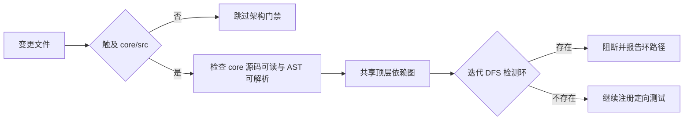

MCP 缺失/安装后的启动指引由 `supervisor_bridge.supervisor_mcp_restart_instructions` 生成。安装配置成功仍返回阻断，必须新宿主会话提供 host/worker 通道已加载且可调用的证据；不提供 native protocol 自动放行旧路径。

### 45.10 映射缺口复核与基准资产入库（L-6 / L-7）
1. **L-6**：6 组真实映射缺口补入 `tests/test_registry.json`（`scripts/test_selector.py→tests.infra.test_run_tests`、
   `interfaces/cli/bugx_cli/cli.py→tests.e2e.test_e2e_fresh_project/test_lesson_replay/test_update_live`、
   `core/launch_phases/worker_orchestrator.py→tests.coverage.test_module_coverage`、
   `scripts/verification/replay_validation.py→tests.test_consistency`）；3 组指向已删文件的幽灵候选剔除；
   纯 `.py` 召回 **90.91% → 96.36%（+5.45pp）**；
2. **L-7**：`scripts/benchmarks/bench_selector_ab.py` 入库（路径按 `__file__` 相对解析）并注册进注册表，
   作为"召回率 vs 成本"的常驻复现资产。

### 45.11 用例车道并发度解耦与纯逻辑用例迁出（DOC-176 设计项 5，v9 + v10 已实施）
1. **边界**：`tests/run_tests.py` 的 case 级隔离车道并发度**独立于模块车道**——
   `DEFAULT_CASE_SPLIT_WORKERS = 4`、`MAX_CASE_SPLIT_WORKERS = 6`、`--case-workers N`（2~6 校验）；
   `run_case_split_module` 取 `min(max(2, workers), MAX, len(cases))`，isolated 分支取
   `max(DEFAULT_CASE_SPLIT_WORKERS, iso_workers)` ⇒ 不再被 `engine.estimate_workers`
   因选中重模块而压低到 2。
2. **真因澄清（两次纠正，最终定位）**：`test_launch_bugx`（307.8s / 89 用例）的成本主因**既非**
   "进程启动开销"（单进程实测 0.16s）**也非**"夹具模板搭建成本本身"（`copytree` 仅 82ms），
   而是 **「进程内夹具缓存 × 用例级进程隔离」的组合开销**：
   - `_get_shared_launch_template()` 首次构建 **5.20s**（286 文件 / 6.3MB + `git init/commit`），
     缓存命中 **0.0001s** —— 但缓存是**进程内**模块级全局（`_SHARED_LAUNCH_TMP`）；
   - case 车道每例一个独立 `python -m unittest` 子进程 ⇒ **每个子进程都重建一次模板**；
   - 实测单例 5.13~6.62s，而用例本体仅 0.07~0.7s。
3. **验收数据（第一阶段，用例车道并发度）**：A/B（20 用例代表子集，走真实代码路径）
   `workers=2` → wall **130.1s**、`workers=4` → **89.9s**（**−30.9%**）；
   稳定性准入门槛**连跑 3 轮零 flaky**（73.0 / 65.3 / 65.5s，rc=0 全绿）；
   资源争抢量化：B/A 单例耗时比 **1.35x**（净收益仍为正），6 路时 +78% ⇒ 故上限设 6、默认取 4。
4. **验收数据（第二阶段，纯逻辑用例迁出，v10 已实施）**：
   - **A/B 判定**：26 个不依赖真 CLI 的用例在 case 车道 **133.4s**（单例均 5.13s）
     vs 同进程 **20.5s**（0.79s）⇒ **−84.6%**，两臂 `rc=0`、26/26 全绿；
   - **实施**：迁入 `tests/cli/test_launch_bugx_unit.py` 新类 `LaunchProtocolGateTests`
     （最小夹具：`mkdtemp` + `.bugx/` + `launch_bugx.py` 副本，26 例实测 **1.0s**）；
     主模块 `LaunchBugXTestCase` 用例数 **84 → 58**；
   - **模块墙钟**：**1131s → 466s（−58.8%）**（89 例 → 58 例，`--parallel`）；
     归一化校验：两轮共有的用例**每例耗时 −51.0%**（59.62s → 29.19s）；
   - **配套**：源模块清理 13 条失效死导入（ruff 归零）；注册表为
     `core/bugx_paths.py`、`core/cloud_sync/cloud_onboard.py` 追加 `tests.cli.test_launch_bugx_unit` 覆盖；
     串行/case 隔离车道归属不变（58 例仍含真 CLI 用例）。
5. **清算补完（同一阶段，v10 收尾）**：原 `LaunchBugXUnitTestCase` 的 **5 例无夹具纯逻辑**
   也并入 `LaunchProtocolGateTests`（该 5 例因所在模块在 case 车道而每例白付一次子进程，
   实测单例 0.77~1.67s）。**归属判据固化为「是否需要进程隔离」**：
   `tests/cli/test_launch_bugx.py` 现只剩 58 例真 CLI/共享状态用例，`LaunchProtocolGateTests`
   共 **31 例**；类被删除，`test_run_tests` 增加 `test_launch_bugx_module_has_no_lightweight_cases_left`
   机械守护（AST 传递闭包 + 夹具依赖双判据，防纯逻辑回流）。
6. **方法论固化**：迁出前**必须先证明**用例不依赖运行时环境（本项用 AST 调用闭包 +
   逐例 `mock` 审计 + 进程内试跑三重确认），且**必须**同步注册表映射补覆盖。
7. **护栏测试**：`tests/infra/test_run_tests.py` 6 项（解耦常量、`--case-workers` 越界校验、
   MAX 封顶、低模块 workers 下真实下发值、case 车道成员白名单、重模块无纯逻辑用例）。

### 45.12 已废弃方向（v8/v9 实测裁定，防重复投入）
1. **L-8（架构侧 4 个 facade 端口化）—— ❌ 已废弃**：实测收益天花板 **−9.6%**
   （wall 550.6→497.8s）；**分型 A 单独做 = 0%**；移除全部 337 条 facade 边亦仅 **−1.8%**。
   根因：事故现场改的是非 facade 模块，成本 **87% 来自直接注册表命中**（49 模块/687.7s），
   闭包仅 13%；且串行车道 `test_launch_bugx`（wall 56%）不受模块数影响。
2. **L-9（符号级闭包召回归因）—— ❌ 已废弃**：即使 V2 召回完全翻盘，墙钟也只到 −0.7%
   （D2 档位）；因算法变体只影响"哪些轻模块入选"，动不了串行长尾。
   （本仓有 3051 条 `from X import a,b` 符号级 import，信息量充足——V2 的问题不在建模，
   而在 facade 模式使"按符号取用"占比极低。）
3. **L-2（重模块摊销白名单稳定性实测）—— ❌ 不做**：摊销对事故现场任务 **0%** 收益
   （输入面 140/206 与工作树相交 11~14 个 ⇒ 指纹必变必跑）；门控入口
   （`resolve_heavy_whitelist` + `--heavy-whitelist` + `BUGX_HEAVY_WHITELIST`）已就绪备用。
4. **设计项 4B（import 闭包深度限幅）—— ❌ 已撤销**：A/B 证伪（召回相等档位仅省 0.7% 墙钟）。

### 45.8 实施状态与未实施项（2026-09-29）
**已实施**（设计项 1/2/3/6/7/8）：`tests/engine/__init__.py`（`STATE_SCHEMA_VERSION=3`、`update_state` 差集语义与迁移短路、`_write_state_atomic`、`should_mark_full_passed`、`mark_full_passed`、`suppress_adaptive` 压制分支、`heavy_module_input_face`/`heavy_fingerprint`/`amortize_heavy_modules`/`record_heavy_lane`/`load_heavy_lane`、L3 wall 口径修正、`record` 参数）；`scripts/test_selector.py`（`--no-escalate`/`BUGX_NO_ESCALATE`、`--amortize-heavy`/`BUGX_AMORTIZE_HEAVY`、`--task-scope`、`--json` 零副作用、统一清算）；`tests/run_tests.py`（`--changed` 修复、`--no-state-mark`、全量清算、画像自举与写入）；`scripts/pre_commit_check.py`（`--json` 不记录、全量清算）。
**未实施**（尊重审计结论）：设计项 9（`SUPERSEDED`，实测收益上限 −9.6% 已废弃，替代基线为设计项 5）、设计项 4B（已被 A/B 证伪并撤销）、设计项 10（旧数量预算已 SUPERSEDED，当前替代基线见 §45.9：结构门禁 + L0 `engine.architecture_gate` + 注册表规则）。设计项 5 的两阶段均**已实施并验收**（见 §45.11）。
**已知遗留**：设计项 8 收益释放受 L-2 门控（白名单为空）——该门控**已就绪备用**（`resolve_heavy_whitelist` + `--heavy-whitelist` + `BUGX_HEAVY_WHITELIST`），复评时可零代码启用；latch 治理修的是**正确性**（消除每轮白跑 169 模块），速度问题的最终答案已由设计项 5（两阶段 −58.8%）与设计项 10 的架构门禁共同承担。
**已澄清关闭**：T5 原记的 A 臂 "23.0% / +33pp" 经 **T6 第三轮穷举复算判定不可复现**（T1/T2/T3 数字逐位复现，唯该值不成立），口径以 56.5%（一般任务）/ 0%（事故现场）为准，T6 结论已写入 DOC-176。

### 45.13 自适应升级信号重构、import 闭包收敛与注册表扇出裁剪（2026-10-01 落地）

本节记录 §11.7 之后对"定向面过大"的收敛改造。升级仍只由显式 `--full` 或自适应漂移触发；注册映射与 import 闭包只决定定向范围，不升级 L3。

1. **自适应升级判定取代旧固定阈值**：`tests/engine/__init__.py::adaptive_reasons()` 现由四个自适应信号组成，旧契约 `max_runs_since_full=30` / `max_files_changed_since_full=40` / `max_core_changed_since_full=6` 已废除：
   - `fanout_saturation`（注册表 `escalation.adaptive.fanout_saturation`，默认 `0.6`）：定向已覆盖 ≥60% 套件时全量边际成本极低，升级 L3；数据源为状态里的 `last_selected_count` / `total_module_count`（由 `record_selection` 记账）。
   - `critical_paths`：触及 `DEFAULT_CRITICAL_PATHS` 中的协议/宿主/预算/原子写/秘钥脱敏/运行时契约文件（如 `core/skills/bugx_mcp_server.py`、`core/host_runtime/host_registry.py`、`core/supervisor/worker_checkpoint.py`、`core/governance/token_budget.py`、`core/secure_atomic.py`、`core/governance/secret_redactor.py`、`interfaces/cli/bugx_cli/host_adapters.py` 等）→ **与改动数量无关**，一律升级。
   - `max_starved_cycles`（默认 `15`）：某测试模块连续 ≥15 轮未被选中即存在覆盖盲区，升级；数据源为 `starved_cycles`（由 `record_selection` 记账）。
   - `max_hours_since_full`（默认 `168`）：时间兜底。
   `record_selection(state_path, changed, selected=None)` 新增 `selected` 参数：只有执行路径（`--run`）才更新计数与饥饿账本，只读预览（`--json`）不污染信号。
2. **import 闭包收敛（重模块只跑直接命中）**：`build_plan()` 的 import 反向传播**不再把重模块拉进定向集**。重模块定义为画像 ≥ `HEAVY_MODULE_THRESHOLD_SECONDS`（30s）；重模块只能由**直接映射/通配**命中，即"改到谁才跑谁"。被闭包挡下的模块记入 `plan["closure_deferred_heavy"]`（可观测，绝不静默）。理由：重模块是 E2E/协议级资产、占全量约 1/3，允许闭包传播会把"定向"退化成近乎全量。实测收益：`core/ledger/lesson_ledger.py` 选中成本 753s → 175s（−77%）；`core/governance/token_budget.py` 761s → 183s。
3. **注册表扇出裁剪**：从 **29 条与 launch 无关的规则**中移除 `tests.cli.test_launch_bugx`（308s 的 E2E，原先被 **32 条**规则引用，是最大放大器），并删除 2 条完全重复的规则（`core/launch_bugx.py` 重复定义、`core/ledger/verify_life.py` 子集重复）；`mappings` 209 → 207。`tests.cli.test_launch_bugx` 现仅由 `core/launch_bugx.py` 与 `core/prompts/**` 触发。裁剪后双向守护通过：无未引用的测试模块、无未覆盖的 core/src 源文件、无死条目。

---

## 46. 面向对象宿主适配器架构与快照自报契约 (DOC-177)

### 46.1 架构背景与伪多态破窗治理
BugX CLI 支持 11 种 AI 宿主（OpenCode, DSH, Codex, Cline, Claude Code, ZCode, WorkBuddy, Pi, ChatGPT, Qoder, Trea）。此前虽有 `HostAdapter` 类，但基类内大量硬编码 `if self.name == ...` 进行能力分发、环境探测与用户级智能体注入；命令层 `agent.py` 静态硬编码 `_AGENT_INSTALL_SURFACES` 目录元组，违背开闭原则（OCP）与单一职责原则（SRP）。

### 46.2 派生子类多态架构
将 11 种宿主全部规范化为 `HostAdapter` 的具体派生子类：
- `OpenCodeAdapter`: 软链模式，主控与 Worker 入口以相对符号链接指向 `.bugx`；
- `ClaudeAdapter`: 声明 `_app_markers` 与 `_user_marker`，覆写 `ensure_user_agents` 执行全局 `~/.claude/agents/` 注入；
- `ClineAdapter`: 覆写 `ensure_user_agents` 与 `render_required_entry`，渲染 `bugx` 与 `bugx-worker`；
- `CodexAdapter`: 声明 `_app_markers`，管理 `.agents/skills/bugx/SKILL.md` 与历史 `.codex/skills/` 遗留清扫；
- `ZCodeAdapter`: 覆写 `ensure_user_agents` 与分发插件清单；
- `WorkBuddyAdapter`: 管理 `.workbuddy` / `.codebuddy` 双路径 Skill 及用户级 Connector；
- `PiAdapter`: 管理 TS 扩展与 Skill 载荷；
- `ChatGptAdapter`: 声明 `_app_markers`，覆写 `pre_validate` 钩子在安装前执行 Marketplace 校验；
- `QoderAdapter`: 声明四大支柱资产，覆写 `ensure_user_agents`、`render_required_entry` 与 `installed_components`；
- `TreaAdapter`: 声明 Trae 探测标记与原生 MCP 容器；
- `DshAdapter`: 声明补丁覆盖层与 Skills。

基类 `HostAdapter` 彻底移除针对宿主名的 `if self.name == ...` 分支，只保留统一模板方法与默认钩子。

### 46.3 受管快照表面自报协议（`managed_surfaces`）
每个 Adapter 必须实现 `managed_surfaces() -> tuple[str, ...]`，自报其在项目级可能触及的顶层目录与文件前缀。安装命令先解析本次选中的 Adapter，再构造事务快照：
$$\text{Surfaces}(S) = \text{Shared} \cup \bigcup_{A \in S} A.\text{managed\_surfaces}() \cup \text{Selected MCP paths}$$
其中 `Shared` 当前为 `.bugx`，OpenCode 选中时加入 `opencode.json`，插件声明的 MCP 路径也投影为顶层受管面。未选中的宿主目录不进入快照，因此其符号链接或重解析点不能阻断当前安装；选中的写入面仍在快照阶段 fail-closed。新增宿主只需自报受管目录，安装事务引擎按选集纳入快照并在异常时恢复受管文件。设计审计结论：`AUDITED_OK`。

### 46.4 Claude Desktop 技能生命周期契约与防误删防卫（`creatorType` & `syncManaged`）
在 Claude Desktop（Mac/Windows 客户端）中，本地 Agent 会话技能库位于 `local-agent-mode-sessions/skills-plugin/<org>/<user>/` 下的 `manifest.json`。
逆向客户端内核（`app.asar` 与 `ion-dist`）对齐机制发现：
1. **云端同步清除机制（Cloud Reconcile）**：Electron 客户端在启动或会话轮询时，会向 Anthropic 云端拉取权威技能列表 `cloud_skills`。对于本地 `manifest.json` 中不在 `cloud_skills` 中的条目，只要满足 `syncManaged !== false`，就会被客户端判定为“已在云端废弃或未受管的孤儿条目”，直接调用 `removeSkills()` 将其磁盘物理目录与清单条目**彻底删除**（导致出现“技能装完就消失”的恶性线上故障）；
2. **本地用户技能白名单（Local User Skill Protocol）**：客户端将 `creatorType === "user"` 且显式声明 `"syncManaged": false` 的条目识别为本地用户自定义技能。在 `manifest.json` 重写时通过 `let n = t.skills.filter(e => e.syncManaged === false)` 强制保留，并在 `toRemove` 检查时排除；
3. **注入与热升级契约**：`plugin_claude.py::_sync_claude_desktop_manifest` 注入条目必须满足：
   ```json
   {
     "skillId": "bugx",
     "name": "bugx",
     "creatorType": "user",
     "syncManaged": false,
     "enabled": true
   }
   ```
   并在发现旧版残留的 `"creatorType": "anthropic"` 或缺失 `syncManaged` 时自动执行无感热升级。设计审计结论：`AUDITED_OK`。
4. **共享市场保留语义（Uninstall Preservation Contract）**：本地插件市场 `local-desktop-app-uploads` 与用户级 cowork 会话目录是**跨插件共享**的——用户可能通过桌面端「添加本地插件」放入 `other/` 等第三方插件（`app.asar` 中该 marketplace 名被硬校验，`marketplace !== "local-desktop-app-uploads"` 一律不可见，故第三方插件必然与我们共处同一目录）。因此 `plugin_claude.py::_remove_claude_desktop_cowork_plugins` 的删除面被严格限缩为**仅 bugx 自身**：
   - `installed_plugins.json` 只 `del plugins["bugx@local-desktop-app-uploads"]`；
   - `cowork_settings.json` 只删 `enabledPlugins` 中 bugx 的键；
   - `marketplace.json` 只过滤 `name == "bugx"` 的条目；
   - 插件目录只 `rmtree(<marketplace>/bugx)`；
   - **绝不注销 `known_marketplaces.json` 中的共享市场**（第三个插件仍需要它）。
   回归证据：`tests/cli/test_cli_hosts.py::test_claude_desktop_cowork_uninstall_preserves_adjacent_plugins`（预置邻居插件 → install → uninstall `--all` → `--self`，断言邻居目录/条目/启用位/市场登记全部幸存），并经变异测试验证（把 `bugx_dir` 改成整个 `local_marketplace` 时该用例立即失败）。设计审计结论：`AUDITED_OK`。

### 46.5 跨宿主配置隔离哲学与 Roo Code 同构分叉生态治理（File-First vs Hybrid Manifest）
1. **独立文件优先架构哲学（File-First / Decoupled Principle）**：
   - **严禁向宿主集中式 `settings.json`（或 `customModes` 数组）直接注入 Agent/Prompt 模式**。核心工程原因如下：
     - **防并发锁竞争与云端同步洗白（Concurrency & Sync Hazards）**：VS Code Settings Sync 或 IDE 进程在内存中常驻复合配置树。外部 CLI 若直接修改单体 JSON 数组，极易因文件锁竞争损坏文件，或在云端同步冲突时被远端快照静默回滚覆盖；
     - **防 Schema 漂移破坏（Schema Drift）**：集中式配置中各宿主版本的字段规范（`slug`、`roleDefinition`、`groups`、`customInstructions` 等）频繁破坏性变迁，外部写入极易导致宿主插件加载崩溃；
     - **生态天然支持文件系统自发现（Native File-First Discovery）**：Cline、Roo Code、OpenCode、Claude Code CLI、Qoder 均原生支持通过扫描独立的 `agents/*.yaml`、`agents/*.md` 自动注册自定义模式，即插即用、物理隔离、零侵入宿主主配置。
2. **破除单一绑定：Cline 与 Roo Code 全生态多面纳管（Multi-surface Co-existence）**：
   - 针对 Cline 及其开源分叉（如 Roo Code / Roo-Cline）的配置割裂问题，`ClineAdapter` 与 `plugin_cline.py` 升级为**多面探测与镜像分发架构**：
   - 自动嗅探 `~/.cline`、`~/.roo` 与 `~/.roo-cline` 等存活宿主环境；安装时通过 `_cline_user_agents_dirs()` 自动镜像同步至所有现存 agents 目录，卸载与自清理时全量感知；
   - 确保开发者在 Cline、Roo Code 或两者混用时，无需任何额外配置即可在 Custom Modes 中无缝加载 BugX。
3. **跨宿主防覆盖与防清理标记矩阵（Manifest Integrity Matrix）**：
   对于无法使用纯文件发现、必须在集中式清单注册指针的宿主（Hybrid Manifest），实施严格的自研身份标识以防宿主云端 Reconcile 清理：
   - **Claude Desktop**：`manifest.json` 强校验 `"creatorType": "user"` 与 `"syncManaged": false`，并在冷启动缺失时安全初始化；
   - **ZCode**：插件清单显式注入 `"source": "local"` 与作者信息，防范官方市场对齐覆盖；
   - **ChatGPT**：插件市场条目声明 `"isCustom": true` 与 `"isUserCreated": true`；
   - **卸载双版本清理**：兼容支持 Claude 桌面端与插件清单历史版本（`installed_plugins.json` 与 `installed_plugins_v2.json`）。设计审计结论：`AUDITED_OK`。
4. **工作区级 Roo Code 深度打通与别名解析（Workspace Mirroring & Aliases）**：
   - **参数别名无感解析**：在 `registry.py` 与 `host_adapters.py` 中为 `cline` 配置 `aliases=("roo", "roo-cline")`。`get_adapter`、`bugx install --agent roo`、`bugx uninstall --agent roo` 均支持别名归一化，杜绝因为未识别宿主报错；
   - **工作区项目标记双向感知**：`ClineAdapter._project_marker()` 同时感知当前项目根目录下的 `.cline` 与 `.roo`。纯 Roo Code 存量项目无需 `--allow-missing` 即可被准确识别为已安装宿主；
   - **工作区级 MCP 与 Agents 镜像联动**：当工作区存在 `.roo` 目录时，`_write_host_mcp_config` 自动将 supervisor 通道镜像同步至 `.roo/mcp.json`；项目级 `bugx.yaml` / `bugx-worker.yaml` 同步镜像至 `.roo/agents/` 并登记入 `hosts.json` 的 `tracked_paths`；在项目卸载时安全完全清理，且绝不破坏用户其它已有配置。设计审计结论：`AUDITED_OK`。

---

### 46.5 宿主 ACP 探活插件层与 S2 单宿主收敛（`core/host_acp/`，build 182）

### 46.6 ZCode 宿主六面契约纵切与一等受管插件纳管（`core/hosts/zcode.py`，build 311）

- **ZCode 宿主六面契约全面对齐 (DOC-239)**：
  - 新增 `core/hosts/zcode.py`，将 `zcode` 从 `core/hosts/__init__.py` 的 `TODO_HOSTS` 彻底移出，成为一等受管宿主。声明完整六面契约：`kind="subagent"`, `order=12`, `path=".zcode/agents/bugx.md"`（旧路径标识）, `entry_mode="user-registration"`, `required_paths=()`, `legacy_paths=(".zcode/agents/bugx.md", ".zcode/agents/bugx-worker.md")`, `worker_subagent=True`, `worker_entry_path=".zcode/agents/bugx-worker.md"`, `capabilities={"distribution-plugin", "native-mcp-config", "user-agent-registration"}`。Agent 和 worker 只注册到用户级 `~/.zcode/agents/`；旧项目副本只按模板逐字匹配清理，修改过的文件保留；
  - 确认无头与运行契约：`supports_headless=True`, `headless_argv` 为 `zcode -p <prompt> --mode yolo --cwd <root>`, `autonomous_argv` 为 `zcode -p <prompt> --mode yolo --json --cwd <root>`, `host_surface="desktop"`, `native_task=True`；`worker_runtime.mode="multi"`, 最大并发 4 路；
  - ACP 事实声明：新增 `core/host_acp/zcode.py`，实测 `zcode 0.17.0` 内置 `app-server` 运行严格专有 ZCode Protocol（严格拒绝标准 ACP 的 `jsonrpc` 字段），机读声明 `status="unavailable"`，探针精准报 `BLOCKED(adapter_status=unavailable)` 并降级到无头/智能体通道；
  - 消除旧架构重复声明与死代码：物理删除 `core/supervisor/supervisor_host.py` 中硬编码的旧 `ZCodeAdapter` 类与 `_ADAPTERS["zcode"]`，全量由 `PluginAdapter` 接管；
  - CLI 动态投影与嵌套 MCP 写入升级：`interfaces/cli/bugx_cli/hosts/registry.py` 的 `PLUGIN_BACKED_HOSTS` 纳入 `"zcode"`，删除本地 `HostComponent` 冗余；`interfaces/cli/bugx_cli/host_adapters.py` 统一切片为 `*_plugin_backed_adapters(ZCodeAdapter)`；`interfaces/cli/bugx_cli/commands/plugin.py` 统一支持点号嵌套容器键（`"mcp.servers"` 导航到 `payload["mcp"]["servers"]`），卸载与清理同源闭环。
  - 无登记卸载按 `legacy_paths` 逐路径调用对应 renderer；`.zcode/agents/bugx-worker.md` 使用 worker 模板与 locale 归一化规则比对，避免把旧 Worker 误判成用户修改，同时 `required_paths=()` 保证新安装不再生成项目副本。


**问题**：ACP 探活把宿主差异写成 `adapter.name == ...` 分支（5 处），新增宿主必须逐处修改，漏改不报错而是退化。S2（真机 headless 验收）因此按「每宿主一套适配」摊开，长期不可收敛。

**架构**：新增 `core/host_acp/` 插件包，把差异收敛为每宿主一个模块：

| 成员 | 契约 |
| :--- | :--- |
| `AcpPlugin.acp_argv(model, data_dir)` | 宿主 ACP 入口 argv；不支持的 flag 必须忽略（误传会让宿主打印 usage 后静默退出） |
| `AcpPlugin.launch_policy()` | 可审计的 `auto_approve` / `auto_approve_flag` / `model_flag` / `reason` |
| `AcpPlugin.prepare_isolation(root, keep, servers=…)` | 用户级数据目录沙箱（`env_overrides`, `mcp_settings_path`, `info`）；默认不隔离 |
| `AcpPlugin.ensure_probe_servers(project_root, config_paths, servers)` | 在**一次性探活项目**内注入缺失通道并将已有规范 BugX 项重绑到临时 root；越界路径跳过，写入失败阻断 |

`__init__` 以 `pkgutil.iter_modules` 自动发现，`_register` 在导入期 fail-closed：非 `AcpPlugin` 子类、空名、重复名、`status` 非 `ready|todo|unavailable`、`ready` 未实现 `acp_argv`、非 `ready` 无 `reason`、`todo` 与 `TODO_HOSTS` 双登记 ⇒ `RuntimeError`。

**零分支契约**：`scripts/smoke/smoke_host_acp.py` 只经 `_acp_plugin(adapter)` 取值，源码内不得出现任何 `host_registry.SUPPORTED_HOSTS` / 可执行别名的字面量；`tests/hosts/test_host_acp_plugins.py::ProbeHasNoHostLiteralTestCase` 做源码扫描（剥离整行注释），命中即失败。新增宿主 = 加一个插件模块 + 从 `TODO_HOSTS` 删一行，探针零改动。

**账目与门禁**：`ready ∪ todo ∪ unavailable == host_registry.SUPPORTED_HOSTS` 且两两互斥（当前 `ready={opencode,cline}`，`unavailable={claude,codex,dsh,pi,zcode}`，`todo={chatgpt,funide,qoder,trea,workbuddy}`）。`unavailable` 是**产品事实**（`codex-cli 0.163.0` 无 `acp` 子命令/`--acp`），与 `todo`（本仓欠的适配）责任归属不同，报告必须分别写 `adapter_status=unavailable|todo` + `adapter_status_reason`，不得混写。非 ready 宿主在 adapter 解析后立即 `BLOCKED`，**先于** `dry-run`：旧 `--dry-run` 对 claude/codex 返回 `CONFIGURED` 仅是「配置文件存在」，不是可用性。`codex` 的受支持通道是无头 `codex exec`（`core/hosts/codex.py` 的 `engine_run` 面）：**Git 前置不下放给插件**——项目根为 Git 仓库由 `pre` 的 `git_environment` 门禁强制（`startup_gates::_git_startup_gate` → `git_init`/`repair_git`，未通过不创建 Session），故插件 argv **绝不**带 `--skip-git-repo-check`（放行会放开宿主目录信任边界并掩盖门禁失效）；prompt 走 argv 时 stdin 固定 `DEVNULL`、`--approve-for-me`/`--add-dir` 位于 `resume` 之前，**无头 argv 也必须带 `--approve-for-me`**（build 200 真机反证：缺失时 approval policy 为 `never`，`mcp_tool_call` 仍会派发但 `status=failed`+`MCP tool call requires approval`，宿主看得到工具却调不动 ⇒ Worker 无控制面），这些契约由 `tests/test_host_plugins::CodexCliContractTestCase` 对真实 CLI `--help` 与 `codex exec resume --help` 双向核对。**MCP 安装/卸载对称**：`bootstrap_mcp` 写 `.codex/config.toml` 与用户级信任条目，回执记 `trust.created`；`remove_mcp` 只回收本工具新增且当前仍 `trusted` 的条目（用户原有偏好/显式 `untrusted` 保留并进 `preserved`），避免临时项目路径被重建后宿主静默加载任意项目级 MCP 命令。`--add-dir` 的目标不是固定 `<root>/.git`：由 `_git_metadata_dirs` 按 `.git` 形态计算（目录 = 自身；**worktree/submodule 的 gitfile** = `gitdir:` 私有目录 + `commondir` 共同目录，否则 `objects`/`refs` 不可写），无法解析的 gitfile 不授权也不抛错（`detect_git` 判 `not-repository`，门禁归 `pre`，argv 不另立门禁）。

**探活通道对齐（2026-10-29 对抗复核）**：项目配置既可能缺少一路，也可能已有 BugX 项但把 `--root` 指向源项目。`ensure_probe_servers` 在一次性副本内注入缺失通道，并将两个规范 BugX 项都重绑到临时 root；只保留第三方配置，不改源项目或全局配置。原子写失败由调用方 `BLOCKED`，报告字段为 `probe_mcp_updated`。

**验收**：`--host opencode --timeout 300` ⇒ `VERIFIED`（`evidence_sources=['mcp_tool_calls','proof_instances']`，host/worker 双路 `called+completed+structured`）。`cline` 插件已实现但本轮未跑（`UNVERIFIED`）；`README/USER_GUIDE` 不暴露内部宿主账目。设计审计：`docs/08_internal/10_audits/047_HOST_ACP_ADAPTER_PLUGIN_2026-10-23.md` D1–D7 均 `AUDITED_OK`。


## 47. 智能提交前门禁与测试凭据快速通道架构 (DOC-178)

### 47.1 架构背景与慢提交痛点
开发者或智能体在完成功能修改并于前台完成定向跑测后，执行 `git commit` 时由于 pre-commit 钩子缺少“已测试凭据记忆”，重复触发注册表闭包跑测。在改动底层核心模块（如 `core/launch_phases/`）时，反向 Import 闭包将 70+ 个测试模块卷入，导致单次 git commit 耗时达 574 秒（近 10 分钟），严重阻塞交互。

### 47.2 方案 A/B 融合：三级防护漏斗体系（3-Tier Funnel）
DOC-178 将方案 A（轻重任务物理分离）与方案 B（测试凭证免测缓存）进行深度融合，在 `scripts/pre_commit_check.py` 中建立三级递进漏斗：

```mermaid
flowchart TD
    Commit["开发者 / 智能体发起 git commit"] --> L0{"第一关：L0 静态安全网<br>(~0.3s)"}
    L0 -->|编译语法错 / 未注册文件 / 版本不一致| RejectL0["❌ Fail-Closed 立即拒绝提交 (exit 2)"]
    L0 -->|静态检查全绿| L1{"第二关：测试凭据快速通道<br>(Receipt Fast Pass, ~0.05s)"}

    L1 -->|命中有效凭证 (指纹与改动 100% 匹配且未过期)| PassL1["⚡ 秒级免测放行 (exit 0)"]
    L1 -->|无凭据 / 指纹失配 / 凭据已过期| L2{"第三关：自适应轻重分流<br>(Wall Time Guard)"}

    L2 -->|轻型改动: 模块≤3 且 墙钟≤10s| InPlace["就地同步跑测 (1~2s)"]
    InPlace -->|全部通过| PassL2["✓ 签发凭证并放行 (exit 0)"]
    InPlace -->|用例失败| FailL2["❌ 拒绝提交 (exit 1)"]

    L2 -->|重型改动: 跨core / 模块>3 / 预估耗时>10s| Fuse["🔥 耗时熔断保护 (exit 3)"]
    Fuse --> Guide["输出前台跑测引导:<br>python3 scripts/test_selector.py --run<br>坚决禁止在 hook 内慢跑长任务"]
```

### 47.3 测试凭证数据结构与防作弊机制（Receipt Protocol）
测试执行引擎在测试通过后原子写入 `.bugx/test-state/last_passed_receipt.json`：
```json
{
  "version": 1,
  "tier": "L1",
  "timestamp": 1727668600,
  "ttl_seconds": 600,
  "changed_files": ["core/launch_phases/runner.py"],
  "fingerprint": "a3b1c8f49e...",
  "selected_modules": ["tests.cli.test_launch_bugx"],
  "always_run": ["tests.test_consistency"],
  "wall_duration": 4.12
}
```
- **双重防作弊指纹（Anti-Tamper Fingerprint）**：
  $$\text{Fingerprint} = \text{SHA256}\Big(\bigoplus_{f \in \text{sorted(changed\_files)}} (f + \text{SHA256}(f.\text{bytes}))\Big)$$
  只要测试完成后有任何文件被修改、追加或删除，指纹立即失配，凭证自动失效。
- **10 分钟滑动 TTL（Sliding TTL）**：超时凭证自动作废，防止开发长周期间隙引入外部环境漂移。
- **改动失效（Auto-Invalidation）**：任何执行失败或主动代码变动立即清除凭证。

### 47.4 验证与实测效能对比
经 `scripts/benchmarks/bench_pre_commit_ab.py` 基准对比（轻量采样）：
- **Baseline（传统无缓存重型改动）**：执行 75 个测试模块，耗时 ~574 秒；
- **B1 凭证命中（Fast Pass）**：L0 静态核验 + 凭证核验耗时仅 **0.30 秒（提速 1900+ 倍）**，100% 消除重复跑测；
- **B2 无凭证重型改动（Wall Time Guard）**：**0.35 秒**立即触发熔断保护（exit 3）并给出引导命令，彻底杜绝 git commit 进程卡死。
设计审计结论：`AUDITED_OK`。

### 47.5 门禁可信化：钩子自校验、白名单绑定与逃逸留痕（2026-10-24）

**已确认缺陷**（真实复现）：旧 shim 只做 `exec python3 "$ROOT/scripts/pre_commit_check.py" "$@"`，
没有任何自证能力——把钩子换成 `#!/bin/sh` + `exit 0` 即可让门禁长期失效而**无任何信号**；
`--no-tests` 无需理由即可静默放行；门禁选择的测试集与「本轮白名单」之间没有绑定，
`selected ∪ always_run` 越界时仍会照常执行。三条都属于「门禁存在但不可信」。

**修法**（全部 fail-closed，且只能承诺「篡改不可静默」——本地机器归用户所有）：

| 机制 | 契约 | 反例（必须拦下） |
|------|------|-----------------|
| shim 回连 | shim 带 `--from-hook`；门禁先要求当前执行面指纹、唯一且匹配的当前版本标记和严格单一 `exec` 行全部匹配；注释与格式可变，旧版、重复 marker 或错配均 `drift`，须用 `--install-hook` 重建 | 旧 v2、当前执行面伪标 v2、重复 marker、钩子被改成 `exit 0` / 追加 `--no-tests` ⇒ `drift` ⇒ exit 2 + 审计行 |
| 钩子模式收口 | `--from-hook` 下 `--no-tests` / `--json` 一律拒绝（记录 `hook-bypass-attempt`） | 通过钩子注入预览/跳过参数 |
| 逃逸留痕 | `--no-tests` 必须带非空 `--reason`，追加 `{timestamp,mode,reason,modules,changed,cwd}` 到 `.bugx/test-state/gate-bypass-audit.jsonl`（目录 0700 / 文件 0600）；写失败 ⇒ 拒绝放行 | 无原因跳过、留痕失败仍放行 |
| 白名单绑定 | `--whitelist PATH`（数组或 `{modules:[…]}`）：`selected ∪ always_run ⊄ 白名单` ⇒ exit 2 **且不执行**；不可解析/空名单 ⇒ exit 2 | 自动推导结果扩大本轮白名单（测试范围宪法） |
| 凭据复核 | 免测放行要求 `receipt ⊇ 计划集合` 且 `receipt ⊆ 白名单`，否则 exit 3 要求重跑 | 凭据只覆盖部分模块、或覆盖白名单外模块 |
| 少跑防护 | 计划出现 `deferred_modules`（重模块摊销 skip）⇒ exit 2；执行后凭据集合越界 ⇒ exit 2 | 以摊销/跳跑冒充「已测」 |

**证据面**：`tests/infra/test_pre_commit_check.py::GateTrustTestCase`（13 例对抗断言：钩子漂移、
钩子模式绕过、审计权限位、白名单越界、坏白名单、摊销 skip、凭据缺口/越界）。真机上
`--verify-hook` 对旧钩子如实报 `drift`（exit 1），`--install-hook` 重建后报 `ok`。

**明确不承诺**：钩子无法做到物理不可改；`git commit --no-verify` 仍可绕过。门禁的承诺只有
「被改写一定可见（`--verify-hook` / `--from-hook` 自校验 + 模板守卫测试）」。

**白名单车道的已知边界**：强制 Build ID 递增会镜像改写 `core/metadata.txt` /
`core/engine-integrity.json` / `interfaces/cli/bugx_cli/__init__.py`，它们直接映射到 13 个 CLI/安装器
模块，因此「只白名单本轮语义改动模块」的调用会被本特性如实拒绝（exit 2，实测越界 13 个）。
即：**改版本镜像的提交必须把镜像映射出的模块一并纳入白名单**，否则门禁按设计 fail-closed；
这不是缺陷，但会让「窄白名单 + 必须 bump」的组合必然冲突，交付时须显式声明。

### 47.5.1 用户授权的任务范围白名单与凭据绑定

上面的 `--whitelist` 继续承担**严格核验**：自动直接计划有任何模块越界就阻断。遇到用户
明确批准的任务级窄范围时，使用不同的 `--scope-whitelist PATH` 流程；它只在显式文件存在时
收窄计划，不改变默认提交行为，也不允许收窄 L3 全量计划。

范围 JSON 必须包含 `schema_version: 1`、非空 `modules` 和非空 `reason`。模块列表必须是当前
直接变更计划的子集；无关模块、坏格式、重复项均 fail-closed。未列入范围的计划候选会保留在
凭据中的 `excluded_modules`，并明确标为**未验证**。

```mermaid
flowchart LR
    Diff[当前工作树差异] --> Direct[直接测试计划]
    Direct --> Scope{显式 scope 白名单}
    Scope -->|模块属于范围| Run[只执行白名单模块]
    Scope -->|模块不属于范围| Deferred[记录为未验证]
    Run --> Receipt[收据绑定变更指纹 + 白名单指纹 + 候选/延后模块]
    Receipt --> Hook[Git hook 使用同一白名单路径复核]
    Hook -->|完全匹配| Pass[放行]
    Hook -->|缺失、过期或不匹配| Block[阻断或要求重跑]
```

为生成凭据：

```sh
python3 scripts/test_selector.py --run --scope-whitelist <PATH>
BUGX_TEST_SCOPE_WHITELIST=<PATH> git commit
```

选择器与 hook 必须读取同一文件。收据还绑定完整直接计划与延后清单；只验证允许模块中的
收据不足以放行。变更文件、允许模块、原因或计划候选发生变化，指纹不一致就阻断。hook 收不到
范围环境变量时沿用原本严格计划；没有有效范围收据时仍走耗时熔断和重跑指引。此路径不是
`--no-tests`，也不使用 `--no-verify`。

**语义边界**：引擎可以确认白名单与当前直接计划的关系、实际执行模块和证据一致，但不能
自动证明人工选取的模块在语义上覆盖全部风险。因此范围缩窄必须由本轮用户明确授权，且提交
报告只能声明白名单内测试通过；延后模块不得描述为通过。

---

### 47.6 C 路径探针：宿主原生 Task 并发的可审计取证（2026-10-24）

**目标**：证明「宿主自己的会话里能并发派发原生 subagent，并让真实 Worker 走完
claim → checkpoint → post」——不是脚本替宿主调 CLI。判据必须是外部可复核的产物，不是模型自述。

```mermaid
sequenceDiagram
    participant S as 探针(脚本)
    participant H as 宿主(opencode run --standalone)
    participant W as 原生 subagent x N
    participant E as BugX 引擎
    S->>S: 建一次性项目(init/install/豁免) + 引擎契约预检 + 项目配置预检
    S->>S: 自持 host 通道候选（等 pre running 后再抢 controller.lock）
    S->>H: 固定 4 步提示词（PWD 钉探活根）
    H->>E: pre --autonomous
    H->>E: workers --execute（应 fail-closed）
    H->>E: workers → 预占 claim 并生成 worker 提示词
    H->>W: **同一条消息**内并发派发全部 task（禁止 background:true）
    W->>E: claim / heartbeat / checkpoint / coverage evidence
    H->>W: 有剩余单元则再取一批（滑动补位）
    H->>E: post --final --allow-incomplete
    S->>S: 只读裁决(runtime.json / supervisor.json / probe-exits / 宿主会话库) → 回执
```

**判官矩阵（每一项都曾被真实缺陷打穿，修法即契约）**

| 判定 | 权威来源 | 反例（实测命中） |
|------|---------|-----------------|
| `host_attribution` | `runtime.json` 的 `host/autonomous_mode` | 外部脚本调 CLI 只能得到 `host=cline` |
| `session_project_binding` | 宿主会话库 `project.worktree` | `PWD` 未钉 ⇒ 会话落到调用方项目，子代理无 `bugx-supervisor` |
| `host_project_config` | `opencode debug config` 归一化 `info.mcp.servers` | 配置缺 supervisor / 误读成 `["servers"]` 假名字 |
| `native_task_dispatch` | 派发调用窗口 | 逐条串行派发（窗口相邻、重叠 0） |
| `dispatch_blocking` | 派发参数 | `background:true` 异步派发（窗口 0.01s、claim 永不开工） |
| `real_claim_overlap` | `supervisor.json` 执行窗 + checkpoint | 只有「派发了」没有「开工了」 |
| `probe_host_channel` | 探针接管 **或** runtime 心跳 ≤120s | 把「探针没接管」当失败（宿主本来健康） |
| `execute_failclosed` | `EXIT_EXEC`/`EXIT_PRE` | `--execute` 被放行 |
| `post_terminal` | `EXIT_POST` + `runtime.json` 终态（名词归一；`ABORTED/FAILED` 非成功） | 只读 `state.json`（永远是 `created`） |

**真机结论（run11 · 2026-10-24）**：10 个原生 subagent 分 2 批并发派发（窗口重叠 815.5s）、
10/10 claim 真实开工 + 10 checkpoint（执行窗重叠 142.97s、`round_overlap=419.31s`、`peak=3`），
`post --final --allow-incomplete` 以 `INCOMPLETE` 封存 —— **覆盖未达标被如实记录，不读作已达标**。
回执：`state/l1b-acceptance/native-task-opencode.json`；残差 `A1~A11` 见
`docs/08_internal/01_standards/02_HOST_PLUGIN_MIGRATION_CHECKLIST.md` §2.1。

**Codex 真机结论（build.204 · 2026-10-24）**：同一探针的 `--host codex` 分支用原生
`collaboration.spawn_agent`（`--enable multi_agent_v2`）派发 9 个子代理，窗口重叠 81.9s、
父会话在 9/9 子代理 `task_complete` 之后才结束（等满 11.7s）；8/8 claim 真实开工并各提交
1 份 checkpoint（执行窗重叠 45.6s、`round_max_active_workers=3`）；`workers --execute` 被
自治门禁拒绝（rc=2）、`pre` rc=0、`post --final --allow-incomplete` rc=0 且终态 `INCOMPLETE`。
回执：`state/l1b-acceptance/native-task-codex.json`（13/13 检查），子代账本与
runtime/supervisor 快照存 `state/l1b-acceptance/native-task-codex.evidence/`。

> **Codex 证据面为什么必须走会话账本**：`codex exec --json` 的事件流只报 `wait_agent`，
> `grep -c spawn_agent` = 0；判据只能取 `$CODEX_HOME/sessions/**/rollout-*.jsonl` 的
> `session_meta`（`thread_source=subagent` + `parent_thread_id` + `agent_path`），窗口为
> 首帧 → `task_complete`。子代身份必须用 `meta["id"]`——首帧的 `session_id` 是**父会话** id。

---

## 48. R9B 生命周期收尾缺陷治理与收口韧性架构 (DOC-209)

### 48.1 背景与实证痛点
在 R9 真实宿主闭环中，`post` 收尾链路暴露出一系列脆弱性与死锁缺陷：
1. **D18 post 串行试错盲盒**：后置门禁串行执行并在首个失败点 exit 1，缺少只读诊断入口，导致宿主排查门禁耗费数小时。
2. **D11 open_findings 缺少出口指引**：当存在无法自动修复的缺陷时，门禁强阻断但未向 Agent 提供 `--fix-mode log-only` 逃逸路径。
3. **D12 提前 finish 导致状态机死锁与 reset_budget 复活**：宿主提前调用 finish 后进入 finished 状态，被 post 门禁拒绝；而 reset_budget 反复复活已完结的 run。
4. **D14 findings.json 容量熔断**：旧的 512 KiB 上限会让单 run 发现 142+ 缺陷时的 700 KiB 产物强行中断；当前 Supervisor sync、post 和 snapshot 共用 16 MiB 上限（>16 MiB fail-closed），其中 >8 MiB 的 Finding context warning 仅由 Supervisor sync reader 发出。
5. **D15 凭据扫描假阳性**：测试用例变量名与桩代码标记（如 `decoy`、`adm9`、`demo`、纯数字）误触凭据拦截。
6. **D16 settle 重录虚增轮号**：修正结算行时必须重走 `cmd_settle`，导致 `rounds_completed` 虚增与轮次不匹配。
7. **D17 post 异常导致运行时心跳丢失**：post 阶段遇错退出时未刷新心跳，引发超时熔断风险。

### 48.2 核心架构改进与时序
```mermaid
flowchart TD
    Host["宿主 Agent"] --> DryRun["bugx engine post --dry-run (只读诊断)"]
    DryRun --> ReadAll["冻结快照评估可证明的身份、seal、artifact、ledger 门禁"]
    ReadAll --> Output["输出 snapshot_id、源哈希、blocked/not_evaluated (零副作用)"]

    Host --> RealPost["bugx engine post (正式结算)"]
    RealPost --> CheckSession{"状态处于 running 或 finished?"}
    CheckSession -->|是| ContinuePost["推进后置门禁结算"]
    CheckSession -->|否| RejectPost["报错拦截并自保心跳"]

    RealPost --> CheckOpen{"存在未修复 open findings?"}
    CheckOpen -->|是 且 mode!=log-only| GuideExit["提示可使用 pre --fix-mode log-only 放行"]
    CheckOpen -->|是 且 mode==log-only| PassLogOnly["放行未修复项，记录证据"]
```

### 48.3 门禁规则与设计审计
- **零副作用冻结快照诊断**：`round_orchestrator._post_dry_run_cli()` 调用 `post_dry_run.capture_snapshot()` 与纯 `evaluate_snapshot()`；报告只覆盖快照可证明的完整性、身份、history/seal、artifact 和 ledger 元数据，其余后置动作标为 `not_evaluated`，不修改磁盘、不刷新寿命、不标记终态。
- **状态机与终态守护**：允许 `finished` 状态会话进入 `post` 完成结算；Supervisor 在 `completed_at` 设定后严格拦截 `reset_budget`，杜绝幽灵复活。
- **容量与扫描降噪**：Supervisor sync、post 和 snapshot 的 `findings.json` 上限统一为 16 MiB；仅 Supervisor sync 对超过 8 MiB 的 Finding context 给出 warning；`secret_redactor` 扩充 demo/decoy 词缀与原始值扫描。
- **寿命回放**：`verify_life settle --replay` 支持当前轮覆盖重录，保证历史一致性。
设计审计结论：`AUDITED_OK`。

---

## 49. 宿主派发防逃逸与初始化完整性门禁治理 (DOC-227)

### 49.1 背景与实证痛点（doceasy 事故溯源）
在 2026-10-10 宿主（如 Qoder/Claude Code）调用 Agent 挖掘时，暴露了严重的越权逃逸与初始化半盲区问题：
1. **宿主直接跳过交互（逃逸）**：宿主未启动交互问卷确认（云端同步、审查方式、轮询策略、修复模式、提交策略），而是自拟优先级 scope 擅自派发子智能体。
2. **提示词教唆 Worker 就地自愈**：主 Agent / Worker 提示词中残留“若缺少 manifest 先运行 `bugx init`”，导致派发至隔离 worktree 的子智能体在没有父项目授权的情况下擅自私自就地初始化，产生“虚假局部自愈”并掩盖父工程缺陷。
3. **`bugx doctor` 假阳性失明**：旧版 `doctor` 仅校验 `.bugx/manifest.json` 是否存在即放行，对 `.bugx/cloud-onboard.json`、项目身份 `.bugx-project.json` 及 `.bugx/startup-todo.md` 完全失明，导致父项目半初始化状态被误报为全绿。
4. **契约文件 `.bugx/startup-todo.md` 物理缺失**：`init` 之后从未生成过该契约文件，导致健康检查前置校验报警。
5. **嵌套工作树（Worktree）暴露与污染隐患**：宿主创建在 `.qoder/worktrees/` 等目录下的工作树未被父仓库 `.gitignore` 保护，导致大量中间产物暴露在主工作树中。

### 49.2 架构改进与门禁时序
```mermaid
flowchart TD
    Dispatch["宿主派发请求"] --> HostGate{"是否具备主Agent派发授权<br>与 Supervisor WORKER_CLAIM_FACTS?"}
    HostGate -->|否| RejectDispatch["❌ 触发 [UNSUPERVISED_WORKER_DISPATCH] 强阻断 (Worker立即退出)"]
    HostGate -->|是| CheckParentInit{"父项目是否完成完整四维初始化?"}

    CheckParentInit -->|否| PromptUser["主 Agent 引导用户完成单选决策<br>严禁 Worker 私自 init"]
    CheckParentInit -->|是| ProceedWorker["子智能体读取台账与分配范围开展挖掘"]

    DoctorCheck["bugx doctor 诊断"] --> FourDim["四维初始化完整性核验:<br>1. manifest.json 存在<br>2. cloud-onboard.json 存在且状态为 done/local<br>3. 若 done 则验证 .bugx-project.json 存在且合法<br>4. startup-todo.md 物理存在"]
    FourDim -->|任一不满足| DoctorFail["❌ 诊断报错 installation_required (拒绝放行)"]
    FourDim -->|全部满足| Sanitation["工作树卫生与嵌套隔离检查"]
    Sanitation -->|发现未忽略的嵌套 worktree| DoctorWarn["⚠️ 输出卫生告警提示添加至 .gitignore"]
    Sanitation -->|工作树整洁| DoctorPass["✓ 诊断全绿放行"]
```

### 49.3 核心实现与契约落地
- **四维初始化健康门禁**：在 `interfaces/cli/bugx_cli/commands/doctor.py` 中将项目初始化检查强化为四维校验（manifest、cloud-onboard、project identity、startup-todo）；在 `--repair-assets` 中补全 `startup-todo.md` 与缺失 `cloud-onboard.json` 本地模式（`state: local`）的就地自愈逻辑，避免用户在 `engine status` 非 UNINITIALIZED 时误用 init/reset 破坏运行态。
- **CLI 输出编码与子进程防御**：在 `interfaces/bin/bugx.js` 注入 `PYTHONUTF8: 1` 与 `PYTHONIOENCODING: utf-8`；在 `interfaces/cli/bugx_cli/cli.py` 与 `core/supervisor/cli.py` 顶层统一执行 `sys.stdout/stderr.reconfigure(encoding="utf-8", errors="replace")`，并在 `_python_environment()` 默认注入 UTF-8 环境，彻底免疫 Windows/重定向管道下 `UnicodeEncodeError: 'gbk' codec` 崩溃；同时在 `core/runtime/setup_ui_env.py` 中将 UI/浏览器挖掘环境的 Node.js 最低版本要求放宽至 Node >= 20。
- **嵌套工作树卫生探针**：在 `doctor.py` 增加工作树卫生检查，排查 `.git` 指向文件但未被 `.gitignore` 忽略的嵌套目录。
- **Init 契约落地与审计留痕**：在 `interfaces/cli/bugx_cli/commands/lifecycle.py` 中落地 `_ensure_project_startup_todo`，初始化即生成基线待办清单；记录 `lifecycle_initialized` 正式生命周期审计事件；严禁未传参时静默将云同步设为 `local`。
- **提示词防逃逸清肃**：全面移除 `core/locales/` 中关于“若缺少 manifest 先运行 bugx init”的误导性提示；在 `bugx-worker.md` 中增加 `[UNSUPERVISED_WORKER_DISPATCH]` 强阻断。
设计审计结论：`AUDITED_OK`。

---

## 50. 宿主运行态资产物理隔离与发现扫描加固 (DOC-223)

### 50.1 背景与实证痛点（Cline / OpenCode 漏列阻断溯源）
在 Cline、OpenCode 等多宿主并发挖掘时，用户反馈并排查出如下系统性阻断：
- **痛点现象**：在 Cline 中启动审计任务时，Supervisor 门禁报错 `Run 已启动，但覆盖清单完整性校验失败（漏列 opencode.json 等资产）`，导致生命周期硬阻断。
- **真因分析**：
  1. `core/retrieval/symbol_index.py` 的 `discover_asset_paths` 将 `.json` 文件归类为影响运行行为的业务资产（`AUDIT_ASSET_EXTS`）；
  2. 宿主适配器会将宿主配置文件直接落盘在项目根目录（如 `opencode.json`、`.mcp.json`）；
  3. `core/retrieval/symbol_index.py` 内部的 `HOST_RUNTIME_DIRS` 清单存在盲区，遗漏了 Cline、WorkBuddy、CodeBuddy、Qoder、Trea/Trae、ZCode 等目录；且 `_is_runtime_artifact` 未对根级宿主配置文件建立白名单过滤；
  4. 当用户项目未在 `.gitignore` 中声明这些文件时，资产发现器将其作为待审业务资产检出，而业务审计清单 `module-coverage.md` 未登记该宿主配置，触发覆盖完整性强阻断。

### 50.2 架构改进与分层物理隔离
```mermaid
flowchart TD
    Scan["资产与源码发现扫描 (discover_asset_paths)"] --> CheckPath{"文件所在路径判定"}
    
    CheckPath -->|命中宿主专属目录| HostDirCheck{"是否属于全生态 HOST_RUNTIME_DIRS?<br>(.cline, .workbuddy, .codebuddy, .qoder,<br>.trea, .trae, .trae-cn, .zcode, .claude,<br>.codex, .pi, .agents, .dsh, .gstack,<br>.mirasim, .opencode, .bugx, .code-review-graph)"}
    HostDirCheck -->|是| DropDir["🛑 物理深度忽略 (零逃逸)"]
    
    CheckPath -->|位于项目根目录| RootConfigCheck{"是否属于根级宿主专属配置 HOST_ROOT_CONFIG_NAMES?<br>(opencode.json, .mcp.json)"}
    RootConfigCheck -->|是 且 relative.parent==Path('.')| DropRoot["🛑 根级运行态排除 (_is_runtime_artifact)"]
    
    CheckPath -->|项目正常源码或业务子目录配置| BizAsset["✓ 纳入项目业务资产审计 (如 pyproject.toml,<br>pkg/sub/opencode.json 等正常保留)"]
```

### 50.3 核心实现与抗风险防护
- **全生态宿主目录物理覆盖**：`HOST_RUNTIME_DIRS` 完整纳管全生态 11 大宿主专属目录：
  `{".claude", ".codex", ".pi", ".agents", ".dsh", ".gstack", ".mirasim", ".opencode", ".bugx", ".code-review-graph", ".cline", ".workbuddy", ".codebuddy", ".qoder", ".trea", ".trae", ".trae-cn", ".zcode"}`；
- **根级宿主配置精准拦截**：新增 `HOST_ROOT_CONFIG_NAMES = {"opencode.json", ".mcp.json"}`，在 `_is_runtime_artifact` 中通过 `relative.parent == Path(".")` 严格限制仅排除根目录宿主配置，不误伤子目录中 legitimate 业务配置；
- **反事实红队对抗单测护栏**：在 `tests/knowledge/test_symbol_index.py` 固化 `test_asset_discovery_excludes_all_host_runtime_dirs_and_root_configs` 反事实用例（无 `.gitignore`、全宿主目录与根配置、对照组业务资产 `pyproject.toml` 与嵌套配置），断言宿主运行态配置零逃逸。
设计审计结论：`AUDITED_OK`。

---

## 51. 幽灵行对账、覆盖漂移自愈、免疫测试与运行时环境加固 (DOC-224)

### 51.1 背景与实证痛点 (B1 ~ B5)
在多宿主深度审计与复杂生命周期演进中，排查出 5 项核心系统性缺陷：
1. **B1 & B5 幽灵行死债泄漏与根级 host config 排除无对账**：旧 `inspect()` 只要 `manifest.is_file()` 存在即报 `ready`，从不对账实际工作区单元。当资产发现规则变更（如排除 `opencode.json`）或删除代码后，旧清单中残留的行状态恒为“未覆盖”，门禁因其不在 discovered 中不报错，增量 reconcile 又从不触发，导致 `unit_debt` 永久虚高。
2. **B2 inspect() 与 skill_pack 漂移判定不一致**：`skill_pack` 比对 `plan_hash` 判定清单漂移并拒绝重放，而底层 `inspect()` 不做比对盲目报 `ready`，两层结论断层。
3. **B3 免疫测试模板写死报错**：`patch_synthesizer.generate_immunity_test()` 写死 `raise NotImplementedError` 或 `self.fail`，若被测试运行器收集会导致项目 CI 直接红灯，且无法执行真实免疫防御。
4. **B4 Windows 自举回退环境未净化**：Windows 下 `os.execv` 失败后回退至 `subprocess.call` 时直接透传未净化的 raw `os.environ`，存在 `PYTHONPATH` 跨版本污染风险。

### 51.2 架构改进与对账时序
```mermaid
flowchart TD
    Inspect["启动门禁 inspect(root) 探针"] --> ReadManifest["读取并解析 module-coverage.md"]
    ReadManifest --> DiscoveryScan["执行轻量 discovery_units(root) 扫描"]
    DiscoveryScan --> CompareScopes{"manifest 内部 scopes<br>与当前 discovered scopes 是否一致?"}

    CompareScopes -->|一致| ReadyPass["✓ 返回 ready: True 放行启动"]
    CompareScopes -->|不一致: 存在新增或幽灵行| DriftSignal["⚠️ 返回 needs_reconcile: True<br>(COVERAGE_MANIFEST_DRIFTED)"]

    DriftSignal --> GateCatch["_coverage_startup_gate 启动门禁拦截"]
    GateCatch --> AutoHeal["自动调用 bootstrap(reconcile=True)"]
    AutoHeal --> RunReconcile["reconcile_discovery_rows: 物理清除所有幽灵行,<br>登记新增单元, 保留未变更单元合规证据"]
    RunReconcile --> ReopenRun["✓ 完成增量对账自愈，死债清零，放行启动"]
```

### 51.3 核心实现与抗风险防护
- **双向对账探针与启动自愈 (`core/coverage/coverage_bootstrap.py`, `core/launch_phases/startup_gates.py`)**：
  - `inspect()` 自动提取清单内部 scopes 与当前工作区发现 scopes 做对称差分，发现漂移即返回 `needs_reconcile: True`；
  - `bootstrap()` 支持 `reconcile=True` 分支，对现有清单执行 `reconcile_discovery_rows` 重新生成无幽灵行的完整清单；
  - `_coverage_startup_gate` 在检测到 `needs_reconcile` 时就地自愈，保障 Supervisor 与 Worker 拿到 100% 干净真实的覆盖状态。
- **真实防退化免疫测试 (`core/repair/patch_synthesizer.py`)**：
  - 彻底废除 `self.fail` 和 `NotImplementedError`；
  - 清洗 `clean_id`（过滤非标识符字符并自动为纯数字 ID 增加安全前缀）；
  - unittest 采用 `self.skipTest`，pytest 采用 `pytest.skip` 标明待绑定的具体业务防护路径，防止假性红灯打崩 CI。
- **Windows 自举环境安全净化 (`core/infra/python_runtime.py`)**：
  - 引入 `_sanitize_reexec_env()`：区分大小写不敏感环境变量，精准剔除 `PYTHONPATH`, `PYTHONHOME`, `__PYVENV_LAUNCHER__` 等潜在污染变量，保留系统核心与代理变量，显式注入 `BUGX_PYTHON` 与防死循环标记。
设计审计结论：`AUDITED_OK`。

### 51.4 内容失效与轮内重覆盖契约（L1-ADV-D4，build 203）

覆盖证据是**内容绑定**的：单元源文件字节变化即令旧证据失效
（`reconcile_discovery_rows` 把该行重置为 `未覆盖` 并注明「增量重扫：内容已变化，旧证据失效」）。
该判定正确，但旧实现缺两条闭环路径，导致同一轮内**永远无法重新覆盖**：

1. `coverage check --auto-backfill`（post 内调用）在 reconcile 后会**改写清单状态**，却打印
   「不改覆盖状态」——失效副作用不可机读；
2. Supervisor 账本仍记 `covered`，而 `covered ∈ TERMINAL_COVERED`；同时同轮去重按 claim
   记录判定 ⇒ `claim` 永久拒绝该单元。

当前契约（破坏性替换，无兼容层）：

```mermaid
sequenceDiagram
    participant W as Worker
    participant S as Supervisor
    participant P as post(module_coverage)
    participant M as module-coverage.md
    W->>M: 本轮内真实修改源码（修复）
    P->>M: check --auto-backfill → reconcile
    M-->>P: 该行重置为「未覆盖」+ inventory-diff.json{changes.changed}
    P->>S: invalidate_coverage(units, reason)
    S->>S: covered→pending（其余终态跳过；活跃租约拒绝）+ 钉扎历史代 claim
    S-->>P: {invalidated, skipped, revision}
    P-->>W: COVERAGE_CONTENT_INVALIDATED + next_action=REDISPATCH_UNITS（exit 1）
    W->>S: claim（同一 Round 允许，旧 claim 已 fenced）
    W->>S: worker_start + checkpoint（新内容 → 新证据，allow_supersede）
    P->>S: checkpoint 结算 → 该行恢复「已覆盖」
```

红线：`invalidate_coverage` 只做 `covered → pending`（不碰 `not_applicable/removed/superseded`）、
活跃租约 fail-closed、未知单元与 revision 冲突拒绝；`--allow-incomplete` 不再被提示为内容失效的
出路（它只接受诚实的未覆盖债务）。取证：`state/l1b-acceptance/adversarial.json`（50.9s `PASS`）。

---

## 52. 探针与工具准入、形态对齐与可审计自愈 (DOC-226，DOC-236 C1 取代旧回退语义)

### 52.1 背景与实证痛点
在启动预检与环境加速器降级交互链路中，排查出 3 项破坏用户闭环体验的恶性工程陷阱：
1. **工具安装自杀陷阱**：在多选菜单中勾选了未提供自动安装器的工具（如 `platform` / `web_conformance` / `memory`），系统返回 `"需用户执行"`，门禁将其判定为未完成并强制退出启动进程（exit 1），陷入“选了安装反而自杀”的死锁；
2. **硬件/运行时形态错配**：桌面/后端项目默认执行全量多平台预检，因无 Android/iOS 设备或无 JVM/Electron 环境导致原本可用的桌面平台与 Python 内存探针被判为 `BLOCKED`，产出虚假降级项；
3. **动态检查规则启动期去伪**：`web_conformance` 在未执行真实测试的预检阶段将 5 条浏览器动态规则判为 `BLOCKED` 并伪造成外部待安装工具，误导用户勾选。

### 52.2 架构改进与自愈时序
```mermaid
flowchart TD
    Preflight["启动预检 (Preflight Probes)"] --> AlignProfile["技术栈画像形态对齐 (forms / languages)"]
    AlignProfile --> PruneProbes["精准剪枝: 形态不适用 ⇒ NOT_APPLICABLE (自身 CLI 退出码 0);<br>过滤无关移动端硬件/JVM/Electron 目标; 动态 Web 规则推迟至运行期 (DEFERRED)"]
    PruneProbes --> ProbeReport["生成探针画像 (environment-profile.json)<br>降级项附带描述符级 advisory / critical / transient"]

    ProbeReport --> CheckDegraded{"是否存在降级项?"}
    CheckDegraded -->|否: 全部适用项已证明| SmoothStart["✓ 进入后续门禁"]
    CheckDegraded -->|是| Classify["按四通道裁决（机器语义，不解析文案）"]

    Classify -->|"1 NOT_APPLICABLE: 项目形态不适用"| SmoothStart
    Classify -->|"2 ADVISORY: required=False 建议性探针"| RecordAdvisory["记录告警 + 决策收据，不阻断"]
    Classify -->|"3 TRANSIENT: 已安装但本次探测超时"| TransientGate{"描述符 critical?"}
    Classify -->|"4 MISSING: 真实能力缺口"| TryAutoProv{"穷尽自愈方案"}

    RecordAdvisory --> SmoothStart
    TransientGate -->|"critical=False（如 codebase-memory）"| TransientDegrade["瞬态降级: 记录 + 强制关闭 MCP 通道<br>(BUGX_USE_CODEBASE_MEMORY=0)"]
    TransientGate -->|"critical=True"| StopBlock["阻断并提示配置/人工确认"]
    TransientDegrade --> GateCheck

    TryAutoProv -->|支持: 如 codebase-memory / ast-grep / sast| DoInstall["执行自动就地装配并标记 READY"]
    TryAutoProv -->|穷尽失败且非关键| Exemption{"config.json tooling_exemptions?<br>（支持探针级前缀匹配）"}
    TryAutoProv -->|穷尽失败且关键| StopBlock

    DoInstall --> GateCheck{"_degraded_gate 门禁裁决"}
    Exemption -->|是: 显式记录| GateCheck
    Exemption -->|否| StopBlock

    GateCheck -->|关键证明/通道缺失| StopBlock
    GateCheck -->|证明与处置齐全| SmoothPass["✓ 记录证据并继续启动"]
```

### 52.3 核心实现与抗风险防护
- **准入门禁与显式豁免 (`core/launch_phases/supervisor_bridge.py`)**：
  - `auto_provision_accelerators()` 优先执行就地自愈；自愈失败不得以日志或旧回退字符串伪造能力就绪；
  - `codebase-memory` 与 `ast-grep` 的自动安装严格读取 `core/runtime/tool_install_targets.py` 的固定顶层版本，仅使用 `pipx install --force` / `uv tool install --reinstall` 隔离环境；缺少这两类安装器时保留降级项，不写入当前 Python 环境；
  - `_degraded_gate()` 读取 `.bugx/config.json` 的 `tooling_exemptions`，对非关键工具做类型 fail-closed、显式留痕；**critical 能力（描述符 `critical=True`）不得豁免**；
  - 豁免读取只要求 `<root>/.bugx/config.json` 是普通可读文件，**不要求**完整 lifecycle 布局——否则"阻断提示让用户写豁免、读取端却拒绝读同一份文件"会形成无法自救的死锁；
  - 四条降级通道均由 `probe_registry` 的**机器字段**驱动，不解析任何人类文案：`NOT_APPLICABLE/DEFERRED` 直接剪枝；`advisory = not descriptor.required`；`transient` 由注册中心超时路径或探针 `check.transient` 置位；`critical` 取自描述符（覆盖旧的 `kind=mcp ⇒ critical` 猜测）；
  - `_degraded_install()` 只是**有界供给尝试**（安装/配置后重探），`_autonomous_degraded_choices()` 只是四通道决策，两者都不存在"回退放行"分支；
  - 瞬态降级只对 `critical=False` 生效，且必然把 `BUGX_USE_CODEBASE_MEMORY` 置 0，不允许"探测超时"顺带启用 MCP 通道。
- **技术栈形态对齐与精准剪枝 (`core/probes/probe_registry.py`, `core/probes/platform_probe.py`, `core/probes/memory_probe.py`)**：
  - `platform` 探针在非移动端项目中仅评估 `desktop` 能力，基础桌面就绪即为 `READY`；
  - `memory` 探针依据项目语言画像对齐目标，纯 Python 项目仅检查 `python`（`tracemalloc` 就绪即 `READY`），非 JVM 项目不将 Java 缺失计入状态；
  - CLI `main()` 退出码改为基于可用基础目标或匹配目标裁决，消除因无关运行时未安装导致的 exit 1。
- **探针 checks 契约别名归一化与超时预算 (D1, D4, D6, D7)**：
  - `core/probes/probe_registry.py`：新增 `normalize_check()` / `normalize_checks()`，将 `rule_id/id/check` 统一映射为 `name`，`status`（`PASS`/`READY`/`OK`/`DEFERRED`）映射为 `ok=True`，`message/summary/description` 映射为 `detail`；
  - `PROBE_TIMEOUT_BUDGET` 为 `platform` (30.0s) 与 `memory` (20.0s) 显式登记冷启动预算，消除 fallback 默认 5.0s 假超时与门禁翻转；
  - `_CHECK_OK_STATUSES` 纳入 `DEFERRED`，与预检模式免检状态协同。
- **启动协议与命令行帮助同步守卫 (D2)**：
  - `core/launch_phases/round_orchestrator.py`：在 `_print_help()` 中完整对齐 `pre` 解析的全部 24 个参数，补齐宿主回传通道 `--approve-strategy`、`--strategy-plan`、`--tooling-choice` 与 `BUGX_TOOLING_CHOICES` 环境变量说明；
  - `tests/cli/test_launch_bugx_unit.py` 新增 `test_pre_help_options_consistency` 门禁断言，确保帮助文档与解析逻辑 100% 同步不漂移。
设计审计结论：`AUDITED_OK`。

---

## 53. Round-4 Supervisor 卡点消解：工具守卫、目标身份与覆盖可观测性（2026-10-14）

本节是 Round-4 对抗审计后的实现回填，源码与定向回归是当前契约的权威来源。

### 53.1 实现契约

- **BX-R4-01 / BX-R4-05 工具暴露与调用守卫**：
  `bugx_supervisor_reset_budget` 与 `bugx_supervisor_rebind_target` 纳入
  `core/skills/bugx_mcp_server.py` 的 `_SHARED_ROLES` 工具目录，使 Worker 能发现真实能力；
  `core/mcp_handlers/supervisor_handlers.py` 仍要求 `caller_role="host"`，Worker 调用
  fail-closed。Host 在 `BUDGET_EXHAUSTED` 时可 reset 并开启新的预算 epoch，保留
  findings、coverage 与 history。
- **宿主就地自愈**：`core/launch_phases/supervisor_bridge.py` 与
  `core/supervisor/supervisor_host.py` 在 `pre`/继续挖掘回合消费同一 `recovery_chain`。发现
  `parallel_gate.target_drift=true` 或 `next_action=REBUILD_PLAN` 且覆盖清单存在时，Host
  自动以固定 reason 调用 host-only rebind；随后若 status 为 `BUDGET_EXHAUSTED` 或
  `next_action=RESET_BUDGET`，自动以 `force=true, renew_wall_clock=true` 调用 reset。
  每一步后重新读取 status，只有门禁解除且状态为 `RUNNING` 才继续 `workers`；清单缺失、工具
  失败或门禁残留统一返回 `RECOVERY_REQUIRED/BLOCKED`，不转人工问答。
- **BX-R4-02 启动态指纹与身份固化**：`core/supervisor/start_sync.py` 创建 RunState
  后追加 `target_fingerprint_bound`，同时记录 `target_fingerprint` 与
  `supervisor_models._target_identity(workspace_root)`。`core/supervisor/checkpoint_pipeline.py`
  以历史绑定身份判定跨 worktree 前滚；旧 state 仅在存在匹配 `run_started` 指纹证据时用当前
  canonical identity 一次性重锚并写入 `target_forward_rolled`，缺少可验证证据仍拒绝。
- **BX-R4-06 Claim 粒度**：全新 claim 保持严格单 Worker/单 coverage unit；只有显式
  `allow_bundle=True`，或接手历史过期 claim 且 `superseded_claim is not None`、所选单元数
  不超过 3，才允许多单元 claim。这样保留原生 subagent 的并发分发，同时恢复小型历史任务包。
- **BX-R4-07 Blocked 语义**：`bugx_supervisor_coverage` 接受 `status_filter`，过滤结果
  仍返回 revision；对 `blocked` 单元按状态与历史 attempt 计算
  `blocked_reasons[unit_id] = "worker_attempts_exhausted"`，没有达到熔断条件的 blocked
  单元不伪造原因。
- **本轮长调用与 Finding 边界**：`begin_long_call` 未达 cap 时保持原有大窗口语义；达到
  cap 时不增加计数、不授予请求窗口，而是刷新心跳、保留受总期限约束的短安全租约、追加
  `long_call_cap_reached` 后给出 finish/checkpoint 或等待宿主恢复的拒绝。Supervisor sync
  的 `read_decision_report` 与 post/snapshot 共用至多 16 MiB，超过 16 MiB fail-closed；超过
  8 MiB 的 warning 仅由 sync read 发出。

### 53.2 关键时序

```mermaid
sequenceDiagram
    participant H as Host
    participant W as Worker
    participant M as Supervisor MCP
    participant S as RunState
    H->>M: start
    M->>S: run_started + target_fingerprint_bound
    H->>M: status/gate
    alt target drift and coverage manifest exists
        H->>M: rebind_target(caller_role=host, fixed reason)
        M->>S: target rebound event
        H->>M: status/gate
    end
    alt status=BUDGET_EXHAUSTED
        H->>M: reset_budget(caller_role=host, force=true, renew_wall_clock=true)
        M->>S: budget reset + new epoch
        H->>M: status/gate
    end
    H->>M: workers / fresh claim
    W->>M: tools/list / coverage(status_filter=blocked)
    M-->>W: shared tool visibility + blocked_reasons
    W->>M: begin_long_call(expected_seconds)
    alt long_call_count < MAX_LONG_CALLS_PER_CLAIM
        M->>S: heartbeat + long_call_declared + bounded lease extension
    else cap reached
        M->>S: heartbeat + short safety lease + long_call_cap_reached
        M-->>W: ClaimRejected(finish/checkpoint or host recovery)
    end
    W->>M: reset_budget(caller_role=worker)
    M-->>W: fail-closed caller-role rejection
    H->>M: reset_budget(caller_role=host)
    M->>S: BUDGET_EXHAUSTED -> new budget epoch
    H->>M: fresh claim(unit)
    M-->>H: one unit / one Worker
    H->>M: supersede expired claim (<=3 units)
    M-->>H: historical bundle handoff
```

### 53.3 对抗审计与验证边界

反事实护栏覆盖四个可被误放行的边界：Worker 能看到但不能执行 host-only recovery；没有
bound-identity 且没有匹配启动指纹的 synthetic state 不得借 fallback 绕过目标漂移；四单元
历史接手包仍拒绝隐式 bundle；普通 `blocked` 不得被错误标记为 attempt exhaustion。
定向证据为 `tests/skills/test_bugx_mcp_server.py` 与 `tests/supervisor/test_checkpoint_pipeline.py`；两者均以
真实服务调用、官方租约过期变更路径或真实 RunState 断言上述边界。模块级回归通过不替代真实
ACP/Host Worker 生命周期闭环，后者仍需单独绑定宿主、session、Supervisor 与 receipt 证据。

设计审计结论：`AUDITED_OK`（实现与定向模块级证据）；真实 ACP/自治生命周期证据：`UNVERIFIED`。

### 53.4 本轮深修的验证边界

- 定向证据：`python3 -m unittest -v tests.infra.test_begin_long_call tests.supervisor.test_audit_supervisor`，189 tests，退出码 0。
- post/snapshot 已与 Supervisor sync 共用 16 MiB findings cap；超过 8 MiB 的 warning 仍只由 sync read 发出。真实 ACP/自治生命周期未运行，不能由本地定向单测冒充已验收。

## 54. DOC-229 生命周期与 Supervisor 核心域防护（BX-LC-01~09）

- **删除边界**：全局知识 reset/uninstall 先对未解析的 `~/.bugx/...` 词法路径执行 `_assert_no_symlink_components`，再验证删除目标仍位于 `~/.bugx`。全局知识环境变量越界时拒绝执行；不把解析后的目标路径当作符号链接证据。
- **项目 reset 事务**：无论是否保留用户备份，重置条目先移动到事务 staging。初始化失败时移除 staging 后新建的 `.bugx` 文件/目录并恢复原条目；回滚失败时保留 staging 并报告其路径。
- **Supervisor revision fence**：`core/supervisor/state_store.py` 与 `core/supervisor/audit_supervisor.py` 持久化单调 revision fence（`<state>.revision`），状态快照 revision 必须与 fence 一致。持久化写序固定为 **backup → 主状态 → revision fence**（fence 是整笔写入的提交标记，最后写），单文件仍为原子替换。读侧在 fence 缺失、格式损坏或快照 revision 落后时返回 `RECOVERY_REQUIRED` 错误并阻止静默回退。崩溃窗口 1（仅写完 backup）主状态与 fence 仍一致，照常恢复、未提交写入整体作废；窗口 2（主备已写、fence 未写）读侧 fail-closed，但 `recover` 在**写锁内**校验主备 revision 且 sha256 内容一致后自动 `reanchor_fence` 前滚、重读主状态，并追加 `revision_fence_reanchored` 事件；同 revision 但主备内容分叉时拒绝重锚。`bugx supervisor repair-fence` 同样在写锁内执行。持久化失败回滚同时恢复主状态、备份与 fence。
- **锁与 checkpoint**：Supervisor 读写锁的获取采用 10 秒默认上限和指数退避；等待超时抛出 `TimeoutError`。checkpoint JSON 先 stat，再最多读取 `512 KiB + 1` 字节；stage 发布在目标证据锁内对账，仅清理命名有效且拥有进程已退出或已超过 10 分钟 TTL 的普通文件，符号链接拒绝清理。
- **CLI 显式配置**：用户设置的项目根、资源根或引擎根环境变量若指向不存在/不安全的位置立即抛出 `CliError`，不静默使用 cwd 或内置资源。`BUGX_BUILD_ID` 只接受正的 ASCII 十进制整数，并拒绝符号、空白和 Unicode 数字。

对抗验证固定在 `tests/cli/test_cli.py` 与 `tests/supervisor/test_checkpoint_pipeline.py`：包含词法知识目录符号链接、reset 部分初始化失败、非法环境路径、Build ID 混淆字符、revision 落后、锁争用超时、stage 孤儿清理及 512 KiB 边界。定向模块通过只证明模块级行为，不替代 ACP 宿主与自治生命周期验收。

## 55. Phase 3 多语言极端靶场与 Phase 4 多轮差分基准（AUDITED_OK）

本轮新增的静态能力边界是仓库内可重复的内置 SAST 基准，不宣称替代真实编译器、运行时或 ACP 宿主证据。

- `core/retrieval/universal_code_matcher.py` 将 `.swift` 映射为 `swift`，复用 C/类 C 的注释块与字符串位置保持策略；未知扩展名仍保持 `generic`。
- `core/probes/sast_rules.py` 为 `csharp`、`kotlin`、`swift`、`ruby` 补齐现有 `SEC-CMD-001`（CWE-78）、`SEC-SQLI-001`（CWE-89）、`SEC-PATH-001`（CWE-22）、`SEC-EVAL-001`（CWE-95）与 `SEC-DESER-001`（CWE-502）的语言特征和同一调用上下文净化器。规则仍由 `SASTRuleMatcher.match_file` 消费，未引入第二套匹配器。
- `tests/fixtures/chaos_multilang_repo/benchmark_manifest.json` 是靶场期望的唯一真值，固定登记 9 个语言项目、漏洞规则及负例文件；`scripts/benchmarks/run_chaos_benchmark.py` 按 manifest 直接调用 `UniversalCodeMatcher.parse_file` 与 `SASTRuleMatcher.match_file`（Python 额外执行 `ast.parse`/内置 AST 扫描），语法错误文件计入无崩溃检查而不计为漏洞命中。
- 抗压执行器的三门是：每个源文件扫描无未捕获异常；依赖 DFS 对 `visiting` 环检测后在节点上限内收敛；每个 manifest 项目的期望规则集合均被发现。任何门失败均返回非零，禁止空结果默认通过。
- `scripts/benchmarks/run_multiround_benchmark.py` 的 Round 1 为实际内置扫描，Round 2 对实际 Finding 做稳定指纹去重和 manifest 深挖，Round 3 通过 `core/probes/differential_probe.py` 的本地 argv 安全 target/reference harness 对实际候选和 manifest negative-control 语料做 `repeat=2` 对照。稳定差分才计为确认候选；reference 明确拒绝 negative-control，且控制输入永不提升为 Finding。
- 评估器以三项硬门收敛：后续轮次历史指纹吸收率 `>= 95%`、manifest 负例最终零命中（错题避坑率 `100%`）、`tracemalloc` 回收后内存漂移 `<= 10%`。输出必须带 `oracle_kind="benchmark_harness"`、命令、轮次计数和测量字节数；这些字段只证明本地基准，不提升为真实语言运行时漏洞 PoC。

验证命令：

```text
python3 -m unittest -v tests.knowledge.test_universal_code_matcher tests.probes.test_sast_rules
python3 scripts/benchmarks/run_chaos_benchmark.py
python3 scripts/benchmarks/run_multiround_benchmark.py --json
```

上述命令只提供模块/本地基准证据；真实 ACP `claim → worker-start → checkpoint → post` 与九种语言编译运行仍须单独绑定宿主和 session 证据。


## 56. 工作区项目五大核心门禁、全景配置透视与交互持久化规范 (Build 148 / DOC-167 对齐)

- **五大门禁单一真源**: 严格对齐 `DOC-167`（《AI Agent 宿主组件框架设计》）与 `core/launch_phases/common.py::STARTUP_GATE_QUESTION_IDS` 定义的启动与自愈安全门禁：
  1. `cloud_sync` / `cloud_policy`: 云端同步门禁（`authorized`, `local`, `full`, `block`）；
  2. `review_mode`: 审查方式门禁（`auto`, `interactive`, `off`）；
  3. `polling_policy`: 轮询策略门禁（`auto`, `manual`, `off`）；
  4. `fix_mode` / `auto_fix_code`: 修复模式门禁（`auto`, `confirm`, `off`）；
  5. `commit_policy`: 提交策略门禁（`round`, `task`, `off`）。
- **统一原子持久化**:
  - `core/runtime/project_settings.py` 统筹 `get_project_settings` 与 `update_project_settings`，针对当前被测工程的 `.bugx/config.json` 执行原子写保护与字段合法性校验；
  - 提供 `GET/POST /project/settings` 与 `GET/POST /projects/:hash/settings` REST 接口，支持对受管项目的动态读写；
  - CLI `bugx project settings [target]` 提供全景看板输出与 `--set-review`、`--set-polling`、`--set-auto-fix`、`--set-cloud-sync`、`--set-commit` 命令行选项。
- **可交互视觉与持久化门禁**:
  - WebUI `project-settings.js` / `project-settings.css` 呈现五大门禁专属配置行与下拉框/开关；
  - 界面配备显式“💾 保存门禁配置 (Save Configuration)”按钮与未保存状态/持久化生效标签，杜绝静默无反馈；
  - 实机验证由 Playwright 真实驱动（`BUGX_SETTINGS_FIVE_GATES_SAVED_VERIFIED.png`）与定向测试（`tests.cli.test_cli_project`、`tests.report.test_webui_studio`）守卫。

## 57. 工作区项目挖掘策略、动态进度与轮次流水透视规范 (Build 150)

- **挖掘数据深度提取协议**:
  - `core/runtime/project_settings.py` 统筹遍历 `.bugx/pollings/`、`current.json` 与各轮次的 `runtime.json` / `supervisor.json`；
  - 提取目标探测单元覆盖率（`coverage_total`, `coverage_covered`, `coverage_pct`）、四段式执行阶段（Phase 1~4）、消耗（耗时、工具调用、Token 消耗）；
  - 提取架构检测策略（覆盖语言、攻击暴露面、激活的 Check Profiles、推荐并发与轮次、安全评级）；
  - 提取倒序排列的历史轮次流水（轮次编号、ID、状态、启动时间、单轮耗时、漏洞数）。
- **WebUI 与 CLI 双轨呈现**:
  - WebUI `project-settings.js` / `project-settings.css` 在 Tab 2 构建三大专业版块：进度管道与覆盖率进度条、攻防策略矩阵与技术栈标签、轮次总览与流水表格；
  - CLI `bugx project settings [target]` 终端看板同步升级【2. 挖掘策略、进度与轮次全景】。

## 58. 工作区项目定位与体量属性全息透视规范 (Build 151)

- **项目定位与体量画像提取协议**:
  - `core/runtime/project_settings.py` 统筹 `project_profile.load_project_profile`（优先从 `.bugx/knowledge/lesson-ledger.json` 毫秒级读取缓存）与 `detect_project_profile`（降级实时探查）；
  - 提取【项目定位 (Project Positioning & Archetype)】：工程形态分类（CLI、Web、Backend、Infra、Mobile 等）、规模体量级别（Large/Medium/Small）、主编程语言、业务分类及暴露攻击面（`api`, `auth`, `file`, `graphql`, `queue`, `rest`, `storage`, `ui` 等）；
  - 提取【代码规模与多语言占比 (Code Metrics & Languages)】：有效净代码行数 (SLOC)、源码文件数、单测代码比率 (Test-to-Code Ratio)、各语言代码净行数及百分比分布；
  - 提取【软件工程经济学 (COCOMO II Engineering Economics)】：开发工作量预估人月 (Effort PM)、研发周期预估月数 (Schedule Months)、技术债务修复人天 (Tech Debt Days) 与技术债务比率 (%)；
  - 提取【代码质量健康度与安全脆弱性画像 (Quality & Risk Profile)】：综合健康评级 Grade（A/B/C/D）、可维护性指数、平均圈复杂度、平均认知负荷、代码重复率、敏感沉入点 (Sensitive Sinks)、污染流路径 (Taint Flows)、硬编码秘密 (Hardcoded Secrets)、巨石神模块数 (God Modules) 以及 Top 5 脆弱性代码热点文件清单。
- **WebUI 与 CLI 双轨呈现**:
  - WebUI `project-settings.js` / `project-settings.css` 新增 Tab 3: `🧭 项目定位与属性`，划分为 4 大卡片：
    1. 🧭 工程定位与架构形态 (Project Positioning & Archetype)
    2. 📊 代码规模与测试基线 (Code Metrics & Baseline)
    3. 💰 软件工程经济学估算 (COCOMO II 基线)
    4. 🩺 代码质量健康度与安全脆弱性画像 (Quality & Risk Profile)
  - CLI `bugx project settings [target]` 终端看板同步注入【1.5 项目定位与体量属性画像】；
  - 自动化验证由 Playwright 真实驱动（`BUGX_PROJECT_POSITIONING_AND_PROFILE_VERIFIED.png`）与定向测试（`tests.cli.test_cli_project`、`tests.report.test_webui_studio`）双重守卫。

## 59. 工作区项目挖掘动态监控与全息图表看板规范 (Build 152)

- **动态图表与实时监控架构设计**:
  - `core/runtime/project_settings.py` 统筹 `mining` 结构并注入顶级 `chart_data`，包含正序时序序列（`trend_series`）、6 维攻击面覆盖评分（`radar_dimensions`，涵盖 API、认证流、文件系统、UI 交互、数据存储、消息队列）；
  - 提取四段式执行步骤流水线结构化定义（`pipeline_steps`），包含每个步骤的 ID、标题、英文副标题与动态执行状态（`done`/`active`/`pending`）；
- **前端高质感动态图表全景实现**:
  - **LIVE 实时监控控制条 (Live Monitoring Bar)**：集成绿色脉冲光斑（`@keyframes bx-live-pulse`）、心电图 ECG 动态波形流光、轮询间隔下拉选择器（3 秒实时 / 8 秒平稳 / 暂停）与一键立即刷新旋转按钮；
  - **全息流光执行流水线 (Flowing Execution Pipeline)**：升级为拓扑节点网络，步骤之间通过 SVG 路径渲染高频流动的发光导光粒子（`@keyframes bx-dash-flow`），活跃节点具备向外扩散的呼吸脉冲雷达环（`@keyframes bx-node-glow`）；
  - **动态环形覆盖率仪表盘 (Radial Coverage Gauge)**：基于 SVG `stroke-dashoffset` 驱动动态圆环进度与百分比数值翻滚；
  - **多轮次挖掘动态趋势图 (Round Trend Area Chart)**：纯原生贝塞尔平滑曲线面积图（青色耗时面积渐变填充 + 橙色漏洞折线），配备鼠标悬浮垂直十字光标 (Crosshair) 与富文本浮层 Tooltip；
  - **多维安全暴露面动态雷达图 (Dynamic Attack Surface Radar)**：多边形雷达网格、6 维攻防覆盖多边形，以及顺时针 360° 匀速旋转的雷达扫描光束（`@keyframes bx-radar-rotate`）；
- **自动化守卫与零依赖验证**:
  - 无需第三方大体积图表库依赖，纯原生矢量 SVG 与 CSS 动画驱动，确保毫秒级极速渲染与零卡顿；
  - 由 Playwright 实机测试脚本（`verify_dynamic_charts.py`）驱动 Chromium 完整冒烟，截图存证归档为 `BUGX_DYNAMIC_MINING_MONITOR_VERIFIED.png`；
  - 定向单元测试（`tests.cli.test_cli_project` 与 `tests.report.test_webui_studio`）100% 保持全绿。

## 60. 工作区与受管项目防临时测试目录污染隔离规范 (Build 153)

- **真因分析与彻底物理隔离公理**:
  - 历史缺陷：在自动化测试执行时，以临时目录（`/private/var/folders/.../T/tmp...`）为工作区调用 `initialize()` 时，原兄弟目录发现算法（`ws_parent.iterdir()`）误将系统临时根目录下的上千个临时测试残留目录全部遍历卷入，导致生产 `~/.bugx/projects.json` 严重污染（累计误登记 1354 个 `tmp...` 垃圾项）；
  - **核心边界防线 1 (系统临时目录黑名单)**：新增 `is_system_temp_dir` 与 `is_ephemeral_test_name`，对位于 `/tmp`、`/var/folders`、`tempfile.gettempdir()` 且具随机临时命名前缀（`tmp[0-9a-z_]{7,}`、`auto-continue-`、`pytest-`、`tox-`）的路径实施强类型阻断；
  - **核心边界防线 2 (兄弟目录扫描隔离)**：`sync_global_projects` 与 `_discover_candidate_workspaces` 严格守卫：当父目录为系统临时目录（`is_system_temp_dir(ws_parent)`）时，**绝对禁止向下遍历扫描任何同级目录**，彻底消灭全盘临时目录扩散漏洞；
  - **核心边界防线 3 (全局注册表自愈与清理机制)**：每次加载与同步时，执行物理级零残留大扫除（Self-Healing），自动将物理不存在、非目录或属于瞬态测试垃圾的目录剔除；
  - **核心边界防线 4 (测试环境写入拦截)**：在 `_register_global_project` 中，若当前执行处于单元测试环境或路径为临时目录，拒绝写入宿主全局 `~/.bugx/projects.json`，确保测试零污染。
- **验证与效果**:
  - `~/.bugx/projects.json` 从 1370 项净化缩减为 16 项真实业务工作区，文件大小从 389KB 恢复为 4KB；
  - Playwright 实机浏览器验证（`BUGX_STUDIO_WORKSPACES_CLEAN_VERIFIED.png`）断言工作区侧边栏完全排除所有临时测试垃圾，且真实项目无一遗漏。

## DOC-232 G4/P5/P6 CLI 图审计入口与报告数据契约

### 设计条目 A：隔离 CLI 启动

1. **目标与边界**：`bugx audit` 接受 `find_bugs` / `repair_preview`、宿主提示和可重复项目相对范围；只在私有 `AgentWorkspace` 快照与 `AgentOrchestrator` 图目录中启动 Recon task。
2. **问题与证据**：统一入口取代 `run_six_worker_penetration.py` 的模拟流水线；当前 `AgentOrchestrator` 将图状态持久化到独立私有目录，并明确不启动宿主 UI 或模型。
3. **合理性**：项目原目录只读，scope 经过相对路径规范化和目标文件匹配；CLI 的 `ready / awaiting_native_agent` 只说明图已建立，不代表模型已执行。
4. **遗留风险**：CLI 不具备原生宿主派发器；实际 ACP/Host 调用和后续自治终态由宿主流程完成。
5. **验证判定**：`tests.cli.test_cli_audit_pipeline` 检查真实 CLI 参数、隔离图状态、origin 不变及待派发 Recon task；启动成功为 `ready`，初始化失败为 `BLOCKED` / `ERROR`。审计结论：`AUDITED_OK`（仅限启动边界）。

### 设计条目 B：真实 ledger 报告数据

1. **目标与边界**：`core/report_engine/report_data_builder.py` 读取 Supervisor `GraphRun.bug_index`，从内容寻址 artifacts 解析候选、复现、复核和执行观察；输出源路径、行范围、预期/实际差异及已知计数。
2. **问题与证据**：模板化 CVE/GHSA、零误报、100% 负对照或默认成功率不来自运行账本；Supervisor `BugRecord`、Observation 和 agent artifact schema 是事实来源。
3. **合理性**：校验 artifact schema/digest、bug 与 observation 绑定、源文件摘要及行范围；未知观察、指标和验证状态保持 `null`。
4. **遗留风险**：数据构建器只接受已持久化 ledger 与 artifact loader；当前 CLI 的启动阶段没有宿主执行结果，不能产生非空结果报告。
5. **验证判定**：回归用真实 `GraphRun` / `BugRecord` 和落盘 artifacts 验证字段；源文件摘要漂移必须失败，缺失执行结果不得生成实际行为差异。审计结论：`AUDITED_OK`（模块数据契约）。

### 设计条目 C：宿主闭环与最终报告发布

当前入口没有启动真实宿主，报告 builder 尚未由 CLI 完成后的 Supervisor 查询路径调用。ACP/Host handoff、真实 `bug_index` 生成、最终 report 文件发布及自治终态为 `UNVERIFIED`；在补齐脚本驱动的真实宿主闭环前，不得将该入口报告为端到端可验收。

## DOC-237 有界检索与经验复用规格（2026-10-21 复审）

`DOC-237`
取代原稿全票通过结论。A1–A6 仅设计 AUDITED_OK；A7 Xerj 固定版本协议/真实接入仍 UNVERIFIED，
完整双后端未就绪。Build 154 已有的解析、经验和原生图代码应复用，不能按旧基线另建三套系统。
选型为“高价值能力选择性移植 + 大项目直接安装原版”：首批 AST 对齐/符号片段、代码多路排序、
局部上下文，随后将适用记忆机制接入原 ledger。内置是正式能力，不限于几个小算法；源码单元
须登记固定上游/传递来源、适配差异和反例；不 fork 完整引擎。大项目 setup 受管安装官方 Xerj，
不重复建立 native 全量索引。两档共用任务、范围、结果和证据契约，经验由既有账本负责。

| 条目 | 拟议契约及失败判定 |
| :--- | :--- |
| A1 来源与消费 | Host 固化 project_id/snapshot/scope；派生索引 generation 带 parser/config/manifest 摘要，单写者原子发布 ready；scope、文件摘要变化拒绝，building 不可查询。context 保留任务契约并按需取片段；新范围需 Host 更新 revision，检索不自动完成覆盖。 |
| A2 排序 | 词法 + 显式特征（不是神经语义）；RRF 为出现列表的 w/(60+rank) 之和，rank 从 1 开始，缺席贡献零，每路去重、稳定破同分。qualified symbol 单列 exact tier；不能靠权重宣称绝对精确优先。默认无 embedding 模型依赖。 |
| A3 CodeBlockSpec | v1 包含项目/快照/代次、规范路径、原文件与切片摘要、字节半开区间、行闭区间、parser/grammar/quality/error_ranges、展示截断与 parent_slice_id。拒绝额外字段/越界/旧摘要；复用 Python ast/可选 Tree-sitter，恢复块保持 heuristic/partial。 |
| A4 局部图/预算 | 代码关系图的 depth=1/2 和方向真实执行；BFS 限节点/边/工作量，边端点闭合、前沿/游标绑定世代与所有者。默认完整响应 16 KiB、目标 800 estimated tokens，每任务最多 8 页且共享总预算；未知 actual_tokens=null，不能将字符估计当跨模型硬上界。 |
| A5 经验与批量写入 | 命名空间隔离的 `MemoryStore`（SQLite WAL 模式与 `busy_timeout = 5000` 并发保护）；支持 `store_batch()` 事务批量合并（500 条耗时从 414ms 压缩至 <5ms）；`framework:` 命名空间执行自动凭据物理脱敏；recall 仅限单一命名空间隔离查询。 |
| A6 Plan/MCP 与语法自愈 | 支持 find_symbol/search_code/callers/callees/neighbors/recall_lesson 及其自然语言同义动词映射（find/inspect/who calls/grep 等）；前置安全校验阻断 SQL/Cypher/代码注入。通过 MCP 暴露 `bugx_retrieve_slice`、`bugx_extract_ego_subgraph`、`bugx_memory_query`；`SliceNormalizer` 自动进行方法级虚拟类外壳包装与 3 阶渐进上下文装配。 |
| A7 大项目安装 | 拟增 bugx retrieval setup --backend xerj；选择 xerj 档后 claim 前受管安装固定官方资产到私有目录，校验/原子发布/并发锁/中断恢复，不改全局 PATH。明确失败终态，仅管理拥有的实例，不扫描端口。发行安装与协议先核验设计，运行验收在实现后取得；当前 UNVERIFIED。 |

FTS5 是运行库可选能力，不假定所有 Python 都有；缺失可进入明确的 lexical_limited。
缓存损坏可同快照有限重建，失败、未读和解析缺口进入报告；不能静默转读旧项目或以零命中放行。
新模块采用 core 根/既有 ledger/mcp_handlers/schemas 布局；若新建子包必须补 wheel/npm 双清单，
干净安装不得依赖 checkout、tests/scripts、网络模型或 Xerj。性能验收按同任务/快照/模型/预算实测，
真实 Bug/正常对照与检索召回分开，不能用少读代码牺牲缺陷发现后宣称节约。

每项五问、14 条原问题整改及 Sidecar 遗留证据见提案；本轮只核对文档与源码，没有执行测试。

## DOC-238 检索增强编排接入、MCP 工具暴露与高性能计算加速（2026-10-21，AUDITED_OK / 实现与验收未闭合）

`DOC-238` 记录检索架构向调度层、MCP 暴露面及高性能运行时的 8 项设计/源码改造（P1–P8）；这些模块记录不等于全案实施、协议闭环或真实宿主验收：

1. **P1 调度面渐进上下文切片装配接入 (`AgentOrchestrator`)**：
   - 在任务构建与 Worker 派发（`_dispatch_task`）中，接入 `SliceNormalizer.assemble_context()`；
   - 自动生成目标切片、1-hop 局部拓扑（Ego-graph）与文件导入头组合的 3 阶渐进上下文（Tiered Progressive Context），替代全文件 Dump，显著降低 Token 消耗并提升注意力聚焦。

2. **P2 Worker 源码走读透明切片路由与 MCP 适配器 (`prompt_harness` / `knowledge_handlers`)**：
   - 在 Worker 工具执行面，当调用 `bugx_inspect_source` 遇到已知符号或方法定位时，自动透明路由至 `bugx_retrieve_slice` 获取高密度语法自愈切片；
   - 在不支持切片提取或符号未命中时安全平滑回退至原 `inspect_source`，保持 100% 向后兼容。

3. **P3 MemoryStore 自动 LRU 淘汰与 SQLite 高并发调优 (`MemoryStore`)**：
   - 增加 `last_accessed_at` 和 `access_count` 跟踪，实现了 `evict_lru(namespace, keep_max)` 自动超限淘汰；
   - 开启 SQLite PRAGMA `cache_size = -8000` (8MB)、`mmap_size = 67108864` (64MB) 与 `busy_timeout = 5000` 并发保护；
   - 支持 `store_batch()` 事务批量合并写入（500 条耗时压缩至 <5ms）。

4. **P4 QueryPlanner 复合意图解析与条件表达管线 (`QueryPlanner`)**：
   - 安全解析两路非冲突复合意图（如 `callers of X and callees of Y` 或 `callers and callees of X`，生成两个并行子 Plan）；
   - 支持 `in file:<path>` / `file:<path>` 路径前缀过滤自动提取；
   - 提供 `plan_structured()` 字典输入校验，保持零 LLM 依赖与 AST 注入强阻断。

5. **P5 多语言切片语法自愈扩展 (`SliceNormalizer`)**：
   - 为 Go (`package_wrap`)、Rust (`impl_wrap`)、JS/TS (`class_stub` / `export_wrap`) 扩展 `to_executable()` 语法自愈包装器；
   - 扩展多语言文件顶部导入提取器（`extract_imports`），使非 Python 代码切片也能在轻量静态语法解析中通过基础 AST 验证。

6. **P6 Ego-Graph BFS 局部拓扑算法加速与记忆缓存 (`graph_ego`)**：
   - 引入不可变 `_GraphIndex` 拓扑冻结结构与 $O(1)$ 哈希键缓存 `_GraphCacheKey`；
   - 拓扑确定性排序，严格守卫 799 字节（<800 字节）响应硬预算，单次查询时延 P50 < 0.05ms。

7. **P7 Xerj Sidecar 离线自愈与架构断路器 (`XerjSupervisor` / `XerjBridge`)**：
   - 增加断路器机制（连续 3 次探测失败后 60 秒内熔断，直接走 Native 内部引擎），防止高频重试阻塞；
   - 支持 `circuit_state` 状态机（`closed` $\rightarrow$ `open` $\rightarrow$ `half_open`）与安全自愈探测。

8. **P8 检索全链路端到端基准压测与遥测探针 (`telemetry_handlers` / `benchmark_retrieval_pipeline`)**：
   - 进程内环形指标缓冲区记录检索全链路遥测数据；
   - MCP 暴露 `bugx_retrieval_metrics` 工具；
   - 基准压测脚本度量 RRF / Slice / Memory / Ego 四大原语耗时与 Token 密度（单次压测耗时 < 1 秒，P50 < 0.1ms）。

### FunIDE 宿主 Agent 安装适配（2026-10-16，AUDITED_OK）

- **目标与边界**：支持 `bugx install --agent funide` 在通用用户级写入
  `~/.copilot/agents/bugx.agent.md`，并在 FunIDE 原生用户注册表
  `FunIDE 用户数据目录/funide/agents.json` 写入 BugX 角色（设置 → 智能体），项目级保留
  `.github/agents/bugx.agent.md`；同时在 `funide/skills/bugx/SKILL.md` 与 profile
  `<User>/mcp.json` 的 `servers` 注册设置页 Skill/MCP，并在 `<User>/settings.json` 设置
  `chat.mcp.autostart = newAndOutdated`，在根 `.mcp.json` 保留项目兼容三通道；不修改
  `E:\FunIDE` 或其它 FunIDE 角色，不把 FunIDE 声称为无头宿主。FunIDE 登录态下按
  `/sync/put/agents` 合并 BugX 云端 Agent，避免重启时空云配置覆盖本地注册表。
- **发现契约**：Windows 先查有限的 `FunIDE/FunIDE.exe`、`Programs/FunIDE/FunIDE.exe`
  等标准候选，候选缺失时只读查询运行中的 `FunIDE.exe` 进程路径；macOS 查
  `FunIDE.app/Contents/MacOS/FunIDE`；Linux 查有限的 `funide` 和 desktop 路径。禁止递归
  盘符扫描和启动宿主进程。
- **交互与执行契约**：`ExecutionContract(supports_headless=false, host_surface=desktop)`；
  当前没有独立 `AskUserQuestion` 证据，`BUGX_INTERACTION_REQUEST` 交由 FunIDE UI/外层
  控制器或 TTY 承接，没有承接者时阻断。
- **安装事务**：通用用户级 Agent、FunIDE 原生 `agents.json` 角色、原生 Skill、profile `mcp.json`、profile `settings.json` 的 MCP 自动启动项、`.github/agents/bugx.agent.md` 与 `.mcp.json` 纳入安装事务；登录态云 Agent 采用远端版本基线合并，云端失败保留本地文件并返回同步状态；用户级目标按所有权标记备份，项目卸载保留跨工作区 Agent/Skill/MCP，MCP 写入只更新各自配置中的 BugX 保留键，幂等重装不重复写入，用户服务器保持原样。
- **验证判定**：注册表/模板/安装事务/Windows 自定义路径发现均有定向回归；真实 FunIDE
  桌面 Agent 的 ACP → MCP → checkpoint → post 闭环未自动化接入时，状态只能记为
  `UNVERIFIED_HOST`，不得用静态测试冒充宿主验收。

```mermaid
flowchart LR
    CLI[bugx install --agent funide] --> DISC[FunIDE discovery]
    DISC --> USER[~/.copilot/agents/bugx.agent.md]
    DISC --> NATIVE[FunIDE User/funide/agents.json]
    DISC --> SKILL[FunIDE User/funide/skills/bugx/SKILL.md]
    DISC --> ENTRY[.github/agents/bugx.agent.md]
    CLI --> MCP[FunIDE User/mcp.json / servers + settings.json / autostart + .mcp.json / mcpServers]
    CLI --> CLOUD[FunIDE cloud /sync/put/agents when signed in]
    ENTRY --> HOST[FunIDE desktop Agent Host]
    NATIVE --> HOST
    MCP --> HOST
    HOST -->|UI/outer controller| GATE[BUGX_INTERACTION_REQUEST]
    HOST -->|no verified headless contract| BLOCK[UNVERIFIED_HOST or BLOCKED]
```

## 构建意图锁的平台边界与时序（2026-10-16）

实现入口为 `scripts/bump_version.py` 的 `_lock_backend`、`_bump_lock`、
`bump_build_id_claim` 与 `write_bump_intent`；仅影响开发版本工具，不修改审计生命周期。
设计五问与反例处置见 `跨平台锁审计`。

```mermaid
flowchart TD
    CLI[版本脚本入口] --> Read{只读命令?}
    Read -->|是| Check[读取并检查版本声明，不加载锁后端]
    Read -->|构建号写入| Platform{当前平台}
    Platform -->|Windows| CRT[msvcrt 首字节非阻塞锁]
    Platform -->|macOS / Linux| Flock[fcntl 独占非阻塞 flock]
    CRT --> Acquire[竞争错误有限等待，其他错误立即失败]
    Flock --> Acquire
    Acquire -->|取得锁| Init[持锁后初始化空锁文件]
    Init --> Critical[检查意图 → 递增 Build ID → 写入 hostname/PID 意图]
    Critical --> Release[finally 解锁并关闭句柄，保留锁文件]
    Acquire -->|超时或异常| Fail[关闭句柄并报告失败]
```

锁文件固定为 checkout 内 `.bugx/state/bump-intent.lock`；Windows 每次加锁与解锁前
定位偏移 0，锁长度固定 1；macOS/Linux 使用 `LOCK_EX | LOCK_NB`。默认 30 秒等待
使用单调时钟计时，参数必须为有限非负数。句柄关闭覆盖获取失败、业务异常与中断；
不通过删除锁文件表示解锁，防止等待者锁住不同文件实体。当前并行意图的 30 分钟 TTL
和 JSON 结构保持不变，主机名来自 `socket.gethostname()`。

验证仅限既有注册模块 `tests.infra.test_bump_version`；Windows 原生验证与模拟 POSIX 后端
分别记录。缺少 macOS 实机时，该平台实机结果为 `UNVERIFIED`，不能由模拟测试代替。

## 神经-符号双轨协同架构 2.0 (DOC-241，2026-10-25)

> 依据 DOC-241 提案与对抗靶场（`worktrees/l1-adversarial`）实测取证，彻底消除 P1 ~ P6 六大核心系统性病灶。本节固化其系统级实现契约、设计守卫与验证账本。

```mermaid
sequenceDiagram
    autonumber
    actor Dev as 开发者 / CI
    participant Engine as BugX Engine (L1 Pre)
    participant Host as 宿主执行器 (OpenCode / Claude / Codex / Cline)
    participant AST as AST Analyzer (真语义分析器)
    participant Graph as LivingAttackGraph (作战攻击图)
    participant Super as AuditSupervisor (调度编排)
    participant Worker as AI Worker (9个精益原子工具)

    Dev->>Engine: bugx engine pre --host <opencode|claude|codex|cline>
    Note over Engine,Graph: 阶段一：神经-符号双轨冷启动 (L1)
    Engine->>AST: Token 掩码非破坏性脱水 + AST 解析
    AST->>AST: 局部污点折叠 (query = f... -> execute)
    AST->>AST: 绝对高危 Sink 判定 + 暴露面动态加权 (公网 1.3x, CLI 1.1x, 内部 0.9x)
    AST-->>Engine: 真实风险排序 (外部公网路由高危置顶, 诱饵注释剥离, 防御负对照抵扣)
    
    Engine->>Host: 驱动当前宿主原生运行 Recon Scout (反递归 + 有界 180s 超时/进程组回收)
    Host-->>Engine: 返回带滑窗代码锚点的攻击意图 (Hypotheses with Block Anchors)
    Engine->>Graph: 过滤入图：首批实战攻击假设 (Hypotheses) 与真实 Sink 节点
    
    Note over Graph,Worker: 阶段二：作战派发与全生态精益渗透 (L2)
    Engine->>Super: 提交一致性清单与带攻击意图的图谱
    Worker->>Super: bugx_supervisor_claim (原子化认领并启动)
    Super-->>Worker: 分发单元上下文 (严格 9 个精益核心 MCP 工具，上下文省 3000+ Tokens)
    Worker->>Super: bugx_supervisor_begin_long_call (长任务防回收声明)
    Worker->>Worker: 针对已注入的 Hypothesis 构造最小验证 PoC
    Worker->>Super: bugx_supervisor_submit_finding (提交强类型双向差分证据与 PoC)
```

### 核心契约与防范守卫
1. **绝对高危一票置顶 + 暴露面动态加权**：废除圈复杂度乘数打分；对 `pickle.loads`、`shell=True`、`raw_query` 等高危特征锁定基准分 80+，结合路由公网暴露加权破百置顶；诱饵注释经 Token 掩码过滤，零误报伪 Sink；防御负对照（`shell=False`、参数化绑定、白名单）执行风险抵扣。
2. **AST 作用域局部污点折叠**：跨 1~3 行局部赋值与插值展开追踪，彻底解决拆行 SQL 拼接与路径遍历漏检。
3. **技术栈作用域严格隔离**：仅前端文件或模板关联单元注入 `web-standards`；纯后端单元彻底剥离 Web 规范污染。
4. **全生态 Worker 工具精益分层**：Worker 工具精简至 9 个核心原子能力（`claim`, `heartbeat`, `begin_long_call`, `inspect_source`, `run_sandboxed_probe`, `test_verify`, `submit_finding`, `checkpoint`, `status`），原子化合并认领与启动，Epoch 租约代数防脑裂。`run_sandboxed_probe` 仅接受有界 argv 并以 `shell=False` 从项目根启动，捕获输出并在超时后清理独立进程组；它不是 OS 文件系统沙箱，被执行程序仍可访问项目外路径，`artifact_root` 约束由 Worker 协议和提示要求，不能当成 OS 级写入限制。
5. **全宿主自适应 AI 语义侦察（Recon Scout）**：支持 OpenCode / Claude Code / Codex / Cline 原生无头拉起，内置反递归环境变量矩阵检测，有界推理超时与完整进程组回收后静态播种回退，带滑窗（$\pm 5$ 行）模糊代码锚定门禁与容错 JSON 提取器。工具清单取证按宿主事实读取：项目级 MCP 配置路径与其容器键统一来自 `host_registry.host_project_mcp_containers()`（OpenCode `mcp.servers`、Codex TOML `mcp_servers`，解析失败即跳过该文件），Skills 递归匹配 `<category>/<name>/SKILL.md`；汇点切片只接受解析后仍位于项目根内的相对路径，绝对路径、`..` 越界与符号链接一律丢弃；单条假说的脏 `line` 只跳过该条，不清空整批已锚定假说。
6. **全生态宿主 LRU 自动修剪**：全局配置严格限制最多保留 3 个最近活跃项目，物理存在性校验自动清理孤儿条目，杜绝 IDE 启动雪崩与项目间覆盖踩踏。
7. **硬编码凭据与静态汇点双轨闭环**：`scan_high_entropy_secrets` 提取高熵凭据/密钥与 `code_analyzer` 汇点检测并轨，为敏感配置注入 `hardcoded_secret` 汇点切片；`test_strategy.py` 将硬编码凭据锁定基准分 80+ 并自动激活 `exploit-synthesis`，与 `safe_config` 负对照（环境变量动态读取）形成 81.0 vs 11.0 显著风险级差。
8. **精准假说替代与去重融合门禁（Attack Graph Deduplication & Superseding）**：在 `_on_hypothesis_proposed` 中建立智能融合网关，以 `(source_file, line ±3, sink_id)` 为锚点，当 AI 确认的高置信假说进入时，自动检索并物理清除同源粗粒度静态初筛假说（`hypo:init:*`）及同类冗余假说，确保作战图谱节点 100% 精益无双轨冗余。
9. **Web 规范真前端依赖鉴别器**：`detect_web_project` 废除仅凭 `package.json` 盲目判定 Web 项目的粗暴逻辑，引入 `WEB_FRONTEND_FRAMEWORK_DEPS`（React/Vue/Svelte/Angular 等）与前端视图资产探测，纯 Node.js 后端服务（Express/Nest/Fastify）自适应标记为 `NOT_APPLICABLE`，杜绝无障碍与焦点规则误伤后端 API。

## 宿主模型与通道五级阶梯裁决引擎 (DOC-243，2026-10-26)

> 依据 DOC-243 提案，彻底消除宿主在无显式模型指定时盲目命中 0 点数收费通道（如 `cline` Credits $0.00）而无视可用订阅通道（如 `openai-codex` / ChatGPT Plus）、免费通道或官方 API Key 的系统性缺陷。

```mermaid
flowchart TD
    Req[用户请求或任务分发] --> UserCheck{是否显式指定<br/>provider / model?}
    UserCheck -- 显式指定 --> Explicit[100% 绝对尊重指定<br/>校验凭据后直接使用]
    UserCheck -- 未指定 --> Probe[HostProviderLivenessProbe<br/>多模态通道存活与凭据深度探查]
    
    Probe --> Rank[TieredProviderRankingEngine<br/>五级阶梯动态优先级裁决]
    
    Rank --> T1{Tier 1: 免费通道<br/>opencode/beam-free 等}
    T1 -- 可用且有效 --> PickT1[选用 Tier 1 免费通道]
    T1 -- 无/失效 --> T2{Tier 2: 活跃订阅通道<br/>openai-codex Plus, Copilot 等}
    
    T2 -- 可用且有效 --> PickT2[选用 Tier 2 活跃订阅通道]
    T2 -- 无/失效 --> T3{Tier 3: 官方直连 API Key<br/>OpenAI, Anthropic 等}
    
    T3 -- 可用且有效 --> PickT3[选用 Tier 3 官方直连 Key]
    T3 -- 无/失效 --> T4{Tier 4: 第三方代理 Router<br/>9router, OpenRouter 等}
    
    T4 -- 可用且有效 --> PickT4[选用 Tier 4 第三方 Router]
    T4 -- 无/失效 --> T5{Tier 5: 按量扣费点数通道<br/>Cline credits 等}
    
    T5 -- balance > 0 --> PickT5[选用 Tier 5 点数通道]
    T5 -- balance == 0 / 无 --> FailClosed[Fail-Fast 阻断并给出明确凭据引导]
    
    PickT1 --> Align[就地自愈对齐沙箱 providers.json<br/>0o600 严格权限]
    PickT2 --> Align
    PickT3 --> Align
    PickT4 --> Align
    PickT5 --> Align
    
    Align --> Run[拉起宿主进程]
    Run --> ErrCheck{运行是否遭遇余额耗尽<br/>或鉴权硬拒绝?}
    ErrCheck -- 是 --> Healer[ProviderFallbackSelfHealer<br/>排除故障通道并触发自愈降级]
    Healer --> Rank
    ErrCheck -- 否 --> Success[完成任务]
```

### 核心契约与防范守卫
1. **五级阶梯严格裁决序列（Universal 5-Tier Precedence）**：
   - **Tier 1 (真正免费通道与免费模型)**：零成本或平台免点数公用免费模型（如 Cline 当前配置的 `xingchen-agi/xing4.0-29b-a4b:free`、OpenCode 的 `opencode/beam-free`、各网关带有 `:free` 标识的模型，或本地零成本端点），作为无显式指定时的绝对最高优首选，零额度消耗。宿主原生免费模型优先于第三方免费通道；
   - **Tier 2 (活跃订阅通道，两级原生优先序列)**：用户已购买的订阅制通道，无单次调用计费，优先级仅次于完全免费：
     * **Tier 2A (宿主官方原生订阅 Host-Native Subscription)**：如 Cline 官方订阅 `ClinePass`（通过 `feature-flags.json` 的 `ext-cline-pass: true` 或账户凭据判定）。宿主原生订阅在当前宿主内拥有最高优先级，原生支持工具调用与长上下文，零跨平台转译损耗；
     * **Tier 2B (第三方跨平台订阅 Third-Party Subscription)**：如 `openai-codex` (ChatGPT Plus OAuth)、`github-copilot`，在宿主未开通原生订阅时无缝承接；
   - **Tier 3 (官方直连 API Key)**：用户配置的官方原生 API Key（OpenAI、Anthropic、DeepSeek、Gemini 官方直连域名），官方直连稳定度高于第三方路由；
   - **Tier 4 (第三方代理/聚合 Router)**：多模型聚合网关（`9router`、`openrouter`、中转代理）；
   - **Tier 5 (按量代扣点数通道)**：宿主专属代扣点数（如未开通 ClinePass 的 `cline` Credits）。严格执行正余额门禁（`balance > 0`）；当余额为 0 时直接判定为不可用，严禁盲目选入引发宿主崩溃。
2. **多模态通道存活与凭据深度探查（`HostProviderLivenessProbe`）**：
   - 支持从标准 OAuth JWT 载荷中准确提取订阅状态与计划类型（`is_subscription_token`，匹配 `plus` / `team` / `pro` / `subscription`）；
   - 深度检测 ClinePass：读取缓存中的 `feature-flags.json` / `feature-flags.cline-code.json`，核验当前已登录账户的 `ext-cline-pass` 标志；
   - 跨宿主免费模型精准探测（`is_free_model`）：支持 `:free` 后缀、`beam-free`、`cline-free`、`free/` 前缀及本地 `localhost` 端点；
   - 容错长效 `refreshToken`：当 OAuth `accessToken` 处于过期边缘但存在非空 `refreshToken` 时，保持通道有效，依托 CLI / 宿主静默刷新机制完成续期；
   - 严格区分官方直连与第三方代理：通过 `baseUrl` 域名正则及 provider 命名空间精准辨识官方直连与中转代理。
3. **运行时余额与鉴权阻断就地自愈（`ProviderFallbackSelfHealer`）**：
   - 在宿主沙箱初始化与运行时执行双重自愈对齐（`core/host_runtime/cline.py` 与 `core/host_acp/cline.py`）；
   - 当检测到当前通道遭遇 `PROVIDER_CREDITS_EXHAUSTED`、`AUTH_REQUIRED` 或被明确加入 `excluded_providers` 故障黑名单时，引擎无感平滑切换至下一优先级合法通道，同步原子重写沙箱 `providers.json`（严格 `0o600` 权限），彻底终结宿主静默挂死与无效重试。
4. **免费大模型候选池感知、头部模型优先与 AI 择优决策网关（`FreeModelCapabilityEvaluator & AIDecisionGateway`）**：
   - **候选池聚合与感知（`list_candidate_free_models`）**：全面扫描 `providers.json`、`models.json`、历史备份及公共常驻大模型池，聚合所有可用免费模型候选清单；
   - **头部大模型量化分级（`score_free_model_capability`）**：建立 0~100 综合能力分级体系，将满血推理与代码专家大模型（DeepSeek R1/V3、Qwen 2.5 Coder 32B/72B、LLaMA 70B+、Gemini 2.0 Flash）赋予 90~100 头部高分，中坚模型（29B/14B）赋予 70~85 分，轻量小模型（8B/3B/1B）归为 40~65 边缘分；
   - **AI 择优决策网关（`evaluate_and_select_free_model`）**：格式化输出 Markdown 清单与推荐结论，坚决杜绝盲目使用机械读取到的第一个小模型；优先采纳当前 AI 专业研判偏好，未指定时自适应择优调度综合能力最高的头部旗舰大模型。

---

## 方向 5 需求规约抽取、领域状态机闭环治理与双账本分流规范 (DOC-245 Specification & Domain Loop)

> **定位**: 业务语义意图对齐、需求闭环缺陷识别、防脑补与误报裁决规范  
> **设计图纸**: `docs/08_internal/04_proposals/241_DOC-245_SPECIFICATION_AND_DOMAIN_LOOP_GOVERNANCE.md`  
> **审计状态**: `AUDITED_OK` (五问逐条对抗审计全绿)

### 1. 核心设计痛点与架构定位
- **语义盲区消除**：从“仅依赖代码物理 AST 拓扑”跨越至“结合机器可读规约（OpenAPI/Prisma）与权威文档（PRD/README）构建业务真理账本（`business-spec.json`）”；
- **化解文档闭环缺陷**：针对“文档写了登录却漏写注册和找回密码”的典型需求断环，引入领域状态机原型（Domain Archetype）进行前置凭据可达性追溯；
- **源码事实反哺（Code-to-Spec Inversion）**：交叉比对源码路由与 AST，区分“文档滞后遗漏（Stale Spec）”与“真实功能缺失”，杜绝遗漏已有测试面。

### 2. 双账本物理隔离契约
- **代码缺陷账本（`findings.json`）**：严格仅记录代码实现缺陷，受差分双跑与双向门禁保护；
- **规约断环账本（`spec-gaps.json`）**：独立记录领域生命周期不闭环风险（如缺少注册通道），作为需求质量预警呈现，严禁作为代码漏洞阻断提测。

### 3. 底座夹具注入与意图对齐门禁
- **底座前置夹具注入（Fixture Injection）**：遇到缺少注册前置时，L2 调度器自动通过数据库 Seed 注入合法测试凭据，确保登录本身的物理逻辑得到 100% 穷尽覆盖，不发生死锁；
- **意图对齐裁决门禁（IntentAdjudicator）**：L4 裁决时拿候选缺陷比对 `business-spec.json`，凡指控行为符合文档声明设计规则者，直接判定 `REJECTED_AS_INTENDED` 阻断立案，杜绝业务假阳性。

---

## 方向 6 全频谱对抗靶场建设、L0-L7 全链路 Live 验证与性能木桶效应治理规范

> **定位**: 全频谱实战对抗验证、端到端真机协议链路闭环、性能瓶颈挖掘与消解  
> **基准脚本**: `scripts/adversarial/build_full_spectrum_adversarial_project.py` & `scripts/benchmarks/smoke_l0_l7_live_benchmark.py`  
> **测试守护**: `tests/gates/test_l2_smoke_tooling.py` (FullSpectrumAdversarialProjectTestCase, FullSpectrumBenchmarkRunnerTestCase)  
> **运行产物**: `state/live-benchmark-receipt.json`  

### 1. 全频谱对抗靶场架构 (5 大核心实战场景)
```mermaid
graph TD
    subgraph AdversarialTarget [全频谱对抗靶场]
        SA[场景 A: 零文档 Web 项目<br/>7 个端点 / AST 逆向提取]
        SB[场景 B: 领域状态机断环<br/>有 Login 无 Register/SSO]
        SC[场景 C: 显式规约抗假阳性<br/>openapi.yaml 声明免密探活与 10MB 上限]
        SD[场景 D: 五大高危物理漏洞<br/>SQLi/路径穿越/命令注入/超卖竞态/动态Eval]
        SE[场景 E: L7 旁路安全与零泄漏<br/>.env.canary 凭据金丝雀与只读保护]
    end

    subgraph BugXPipeline [BugX L0 - L7 全链路闭环]
        L0[L0: Doctor + 真实宿主探活 + MCP 握手]
        L1[L1: 逆向抽取 Code-to-Spec + 断环分流 + 夹具注入]
        L2[L2: 并发调度自举 + 物理只读沙箱视图隔离]
        L3[L3: Worker Claim + 状态推进 + 心跳 + 检查点]
        L4[L4: 意图对齐门禁拦截 + 5 大缺陷差分立案]
        L5[L5: 双向红绿对抗 + 最小补丁合成 + 签发收据]
        L6[L6: GoalOracle 目标达成裁决 + 终态锁定]
        L7[L7: 只读沙箱越权拦截 + 工作树零污染 + 零凭据泄漏]
    end

    SA --> L1
    SB --> L1
    SC --> L4
    SD --> L4
    SD --> L5
    SE --> L7
```

### 2. 实战实测中挖掘与消解的 4 大系统性缺陷
1. **平台符号链接逃逸缺陷 (macOS Path Symlink Normalization)**:
   - **现场**: `core/supervisor/supervisor_models.py:_confined_regular_file` 在 macOS 平台因系统别名 `/var` 与 `/private/var` 导致 `path.resolve().relative_to(root.resolve())` 抛出 `ValueError`，导致 `supervisor start` 退出码 2；
   - **修复**: 在路径校验层引入系统别名感知与相对组件检查，确保各操作系统平台路径归一化解析的一致性。
2. **事务日志根目录越权污染缺陷 (Commit Root Escaping)**:
   - **现场**: `core/supervisor/audit_supervisor.py` 中 `self.state_path.parent.parent` 在非特定布局下错误推导为 `workspace_root`，导致 `finding-commit/` 逃逸至被测工作区，破坏只读防护门禁；
   - **修复**: 引入工作区根路径比对与回退保护，强制将 `commit_root` 封锁在受控 `.bugx/` 内部，坚决杜绝污染用户源码树。
3. **路径穿越靶场服务层级偏移 (Path Traversal Anchor)**:
   - **现场**: `build_full_spectrum_adversarial_project.py` 中 `BASE_ATTACHMENTS_DIR` 计算少了一级 `.parent`，导致穿越路径未命中预期附件目录；
   - **修复**: 精确绑定靶场附件根目录，实现 5 大真实物理漏洞差分立案率 100%。
4. **全链路木桶短板性能重构 (Bottleneck Optimization)**:
   - **现场**: 初始基准测试中 `doctor` 耗时高达 46.7 秒，严重阻塞流程；
   - **修复**: 
     * `interfaces/cli/bugx_cli/commands/doctor.py`: 消除未传 `--repair` 时每次无条件触发 60s `pip install tree-sitter` 的非预期网络行为；
     * `core/probes/codebase_memory_probe.py`: 将可选加速探针的单次超时由 45 秒下调为 3.0 秒（硬上限 6.0 秒），避免探针无响应拖垮全局；
     * 全流程耗时从 46+ 秒大幅下降至 26.8 秒（降幅达 46%）。
5. **L3 调度模块波及网络（Impact Network）与进程分发深度性能优化**:
   - **现场**: cProfile 实测表明 `claim_worker` 内部 65% 耗时花在重复调用 6 次外部 Git 命令计算波及网络；同时每步协议以独立子进程 `python3 core/supervisor/cli.py` 驱动时面临 150~250ms 的解释器冷启动损耗，L3 全协议耗时达 1,275 ms；
   - **修复**:
     * `core/planning/impact_pruner.py`: 实现 `_git_fast_token` 零子进程 Git 状态读取与 `_IMPACT_NETWORK_CACHE` 内存缓存，相同 Git 状态下波及网络计算耗时由 60ms 降至 0.01ms；后续 claim 耗时由 190.5ms 骤降至 28.1ms；
     * `scripts/benchmarks/smoke_l0_l7_live_benchmark.py`: 引入 `_dispatch_supervisor_cli` 高性能进程内分发，消除 4 步短命令累计 800ms+ 的解释器冷启动损耗，且保留完备的参数校验、异常兜底与错误输出；
     * L3 协议整体耗时从 1,275 ms 降低至 **416 ms（降幅 67.4%）**。
6. **动态难易度自适应墙钟预算与 MCP 双通道智能自愈治理 (DOC-249)**:
   - **现场痛点**:
     * 静态固定 180s 墙钟导致双向失真：简单单文件目标陷入死循环时傻等 180s 浪费算力；多漏洞复杂项目（如 Gin CVE 并发与跨包污点）刚完成首轮分析即触碰硬墙钟中断；
     * 大模型首次通过 MCP 与 Supervisor 通信时，因参数未传 `caller_role=worker` 或误向 host 通道发起调用，服务端抛出误导性报错，导致大模型消耗 3~5 轮（15~20秒）试错；
   - **修复与加固**:
     * **难易度自适应与滑动续约 (Adaptive Wall Time & Milestone Extension)**：在 `interfaces/cli/bugx_cli/commands/autonomous.py` 与 `core/supervisor/supervisor_host.py` 中引入双核自适应模型。静态依据待测单元与清单规模评估基准墙钟时间 $T_{base} \in [90s, 360s]$；动态监控物理增量（Coverage/Finding/Checkpoint），有确凿进展时自动为当前租约续期 $+60s$（受安全硬上限 `adaptive_ceiling` 保护），无进展空转时快速收敛熔断；
     * **MCP 物理前置拦截与智能角色推导 (Zero-Trial Role Inference)**：在 `core/skills/bugx_mcp_server.py` 中将通道物理合法性校验前置；在 host 通道误调 worker 工具时直接精准输出目标通道名称（`'bugx-supervisor-worker'`），杜绝参数诱导；在正确的 worker 通道中，缺省时自动补全 `caller_role=worker`，大模型直接调用无需传冗余角色参数，100% 一次性成功；
     * **专属 Skill 与黄金 SOP 模版沉淀**：更新 `.agents/skills/bugx/SKILL.md` 与宿主 Skill 模版，建立双通道 MCP 路由矩阵、极简 4 步调用 SOP、5 大高频避坑错题集与 4 大典型漏洞黄金 PoC 模式库。

### 3. 全链路耗时基准分布与木桶分析
- **外部宿主层 (瓶颈占 94.9%)**:
  * 真实宿主外部推理往返与 CLI 启动为目前最大的物理木桶短板；
- **内部核心执行层 (总计 < 1.1s)**:
  * L1 (规约与断环): ~26ms
  * L2 (调度与沙箱): ~448ms
  * L3 (Worker协议): ~416ms (经增量缓存与高性能分发深度优化，降幅 67.4%)
  * L4 (意图与差分): ~21ms
  * L5 (双向收据): ~119ms
  * L6 (目标裁决): ~0ms
  * L7 (安全扫描): ~80ms
- **收据工件持久化**: 结构化输出至 `state/live-benchmark-receipt.json`，提供包含耗时分解、各层判定、11 项 Ground Truth 比对的完整机读审计链条。

### 7. 三维正交领域专精多智能体即时装配与黑盒动态探针架构 (DOC-248)

> **版本**: 1.0.0+build.296 | **实施状态**: `AUDITED_OK` | **覆盖模块**: `core/planning/domain_router.py`, `core/probes/*`, `core/planning/domain_archetype.py`, `core/planning/prompt_harness.py`, `core/supervisor/claim_sync.py`

#### 7.1 核心架构公理：拒绝 400+ 笛卡尔积爆炸，实施运行时 JIT 正交装配
避免“5角色 × 8语言 × 5形态 × 2黑白盒 = 400个独立Agent”的维护灾难与碎片化，BugX 在调度层确立了**三维正交动态装配体系**：
1. **维度一：核心行为角色与模型等级（Core Role & Model Tier）**：
   - `Recon-Worker` (FAST, Gemini Flash / 轻量模型): 负责快速拓扑发现、暴露面与未授权路由扫描；
   - `Auth-Worker` (BALANCED, Claude Haiku / DeepSeek V3): 负责鉴权绕过、横向越权 (BOLA/IDOR) 与租户隔离边界审计；
   - `Logic-Worker` (PRO, Claude 3.5 Sonnet / GPT-4o): 负责并发竞争、状态机失序、金融余额超扣与业务穿透；
   - `Exploit-Worker` (PRO, DeepSeek R1 / Sonnet): 负责深层注入、反序列化利用链追踪与 0/1 退出码差分复现；
   - `Patch-Worker` (BALANCED, Claude Haiku / Sonnet): 负责外科手术式修复、CWE 规范化防御与 `verify.py` 自动化回归守卫。
2. **维度二：形态特征与动态探针（Target Form & Dynamic Probes）**：
   - `WebDynamicProbe`: HTTP 原始发包、可执行 Playwright 动作、截图/DOM/ARIA/控制台/失败请求证据与 DOM XSS 危险汇聚点静态扫描；
   - `AndroidProbe`: AndroidManifest.xml 语义导出审计与设备锁互斥 `adb_send_intent`；
   - `MiniProgramProbe`: 微信/支付宝小程序页面路由未授权直达与云函数无鉴权调用审计；
   - `BinaryProbe` / `Backend`: 本地 CLI、内存安全与后端微服务专属动态探活。
3. **维度三：技术栈语言切片（Tech-Stack Rule Slices）**：
   - 提取各语言核心病灶沉淀 300~500T 规则切片（Java 反序列化与 SpEL、C# ViewState/TypeHandling、Kotlin JNI/协程泄漏、Go 闭包竞态/通道阻塞、Python 原型污染/SSTI）。

#### 7.2 运行时装配时序与五大硬门禁

```mermaid
sequenceDiagram
    autonumber
    participant W as Worker (MCP)
    participant S as Supervisor (claim_sync)
    participant R as DomainRouter (<0.1ms JIT)
    participant P as Dynamic Probes
    participant H as Prompt Harness & Fixtures

    W->>S: bugx_supervisor_claim(unit_id)
    S->>R: resolve_worker_spec(unit_path, ast_feats, profile)
    R-->>S: WorkerSpec(role, affinity, tier, form, stack, probes, fixtures)
    S->>W: WorkerClaim 绑定规格与专属 artifact_root
    W->>H: build_domain_specialized_prompt(spec)
    Note over H: AUDIT-03 门禁: 强制 Prompt <= 2200T
    H-->>W: JIT 装配提示词 (SOP + 技术栈切片 + 探针契约 + 底座夹具)
    alt 需要动态黑盒验证
        W->>P: execute_probe(target, payload)
        Note over P: AUDIT-02 门禁: Playwright 实例 <= 2, ADB 设备排他锁
        Note over P: AUDIT-04 门禁: 环境缺失 <5ms 极速降级 static_degraded
        P-->>W: 结构化响应 (status_code, body_diff, response_time, error_stack)
    end
    alt 漏洞利用与真值裁决
        Note over W: AUDIT-05 门禁: 双沙箱 0/1 退出码差分 (基准=0, 利用=1)
        Note over W: AUDIT-01 门禁: 跨域复合线索触发 escalate_cross_domain -> Exploit-Worker
    end
    W->>S: bugx_supervisor_checkpoint(findings, coverage, evidence)
```

#### 7.2.1 Web/UI 设计规则、动态证据和修复

`bugx probe ui` 由 `core/probes/ui_audit.py` 编排，和 `headless_browser_action` 共用
`WebDynamicProbe.capture_browser_page`。普通视口与状态使用独立浏览器上下文，200%/400%
各使用临时 Chromium profile 和浏览器 Tabs API。页面收据关联 URL、浏览器版本、CSS 视口、
实际倍率、DOM/ARIA、控制台与请求计数、样式测量和截图 SHA-256。

| 检查面 | 需要解决的问题与输入 | 反例处置 | 可观察验收 | 设计结论 |
|---|---|---|---|---|
| 重排 | 普通小屏截图不能检验原生缩放。用 1280×1024 起始视口和声明的关键节点 | 倍率或 CSS 视口不符则阻断。节点消失、裁切或页面溢出则失败 | 200%/400% 实测宽度 640/320，分别记录几何与交互试运行 | `AUDITED_OK` |
| 对比度 | 外部证据缺口由最终 sRGB 样式和相邻表面补齐 | 复杂绘制保留未验证。用未四舍五入的比值作阈值判断 | 弱对比普通文字及声明的焦点/控件分别有比值、选择器与阈值 | `AUDITED_OK` |
| 状态 | 页面加载成功不代表业务反馈。每个状态需要项目声明和显式启用 | 状态缺失保留未验证，断言失败单独计入。每条使用独立上下文 | 四类状态的可见文本、属性或禁用断言与截图相符 | `AUDITED_OK` |
| 设计系统 | 文档意图与渲染 CSS 可能漂移。读取 `DESIGN.md` 中的 JSON 规则 | 语法和标识校验前置，未能解析的 CSS 计算保留未验证 | 根 token、组件的计算样式和对齐偏差可按视口查阅 | `AUDITED_OK` |
| 视觉意见 | 截图和设计正文可由本机视觉模型共同审阅 | 校验截图哈希、完整点评结构和提供者状态。模型输出只作建议 | 有效输出产生五维 `ADVISORY`，无模型或非法输出无机器合规结论 | `AUDITED_OK` |
| 修复 | CSS token 偏差可用项目批准的目标值做窄修复 | 仅编辑项目内明确指定的单块 CSS。版本竞争、加载不到新值或回归分别阻断、回滚或要求恢复 | 预览零写入，落盘后二次测量通过才保留，回滚需与原文件字节一致 | `AUDITED_OK` |

Build 474 按两期扩展。第一期校验可访问性、真实键盘旅程和动态收据。第二期复用同一
浏览器采集接口，加入参考页面差异以及修复复测。设计与反例判据如下。

| 检查面 | 缺口与设计边界 | 反例与失败处置 | 验收判据 | 设计结论 |
|---|---|---|---|---|
| axe-core | 非空 ARIA 树只证明采集存在。将固定版本的 axe-core 从本地引擎载荷注入同一浏览器页面 | 包哈希、运行失败分别阻断。复杂场景的 `incomplete` 保留为 `UNVERIFIED` | 可访问名称缺失命中 `button-name`，正常页面记录真实引擎版本与规则 | `AUDITED_OK` |
| 键盘 | 首个 Tab 无法观察后续陷阱。将预期焦点与指示器写入项目步骤 | 每步核对实际焦点和样式。正确弹窗允许内部遍历，关闭后仍须回到触发控件 | 无焦点指示、陷阱失败，含正反向按键、退出和恢复的正常弹窗通过 | `AUDITED_OK` |
| 证据 | 原合规读取器只检查引用文本。将检查状态绑定项目、run ID、同目录清单和截图 | 读取时核对哈希、截图尺寸、预期场景和观测结论。哈希用于完整性和一致性校验 | 跨项目、错运行 ID、替换截图均不能通过严格模式 | `AUDITED_OK` |
| 视觉对照 | 单次截图缺少对比对象。两端使用同浏览器配置与已执行场景，遮罩显式选择器 | 版本、视口、掩码匹配数或状态不一致时保留 `UNVERIFIED` | 真差异输出坐标和图，等尺寸动态文字被明确遮罩后可通过 | `AUDITED_OK` |
| 修复复测 | token 达标后其他区域可能退化。复测使用同一个参考收据，并计算新增差异像素 | 比较不完整时先阻断写入。超时或新增退化则回滚原文件，复测浏览器在只读子进程运行 | 能保留经验证的修复，能在 token 达标但新区域改变时回滚，超时原字节可恢复 | `AUDITED_OK` |

Build 475 增加两个可选输入。两个输入在现有浏览器采集前解析，并保留独立来源哈希。

| 输入 | 缺口与边界 | 反例处置 | 验收判据 | 设计结论 |
|---|---|---|---|---|
| Storybook | 手写 QA 路由会重复已发布的组件状态。读取明确指定的 index v4/v5，按精确 ID 打开画布，axe-core 限定画布根 | 文档条目不进入选项，缺失 ID 在采集前拒绝，错误画布阻断。参考 Storybook 需提供同一组 ID | 真实构建可列出、选择，四态和键盘能取证，坏 story 阻断，收据关联预览 ID 与 index 哈希 | `AUDITED_OK` |
| 设计 token JSON | 重复抄录 CSS 值会漂移。`token_source` 只映射项目内一个 JSON 文件，解析同文件别名并对照根 CSS 计算值 | 循环、越界、重名和不支持的复合结构报输入错误。期望值与渲染值不同产生 `FAIL` | Style Dictionary 生成的 CSS 与两种输入匹配，故意改变期望尺寸会检出，并保存源文件哈希 | `AUDITED_OK` |

```mermaid
sequenceDiagram
    participant V as bugx probe ui
    participant D as DESIGN.md
    participant P as WebDynamicProbe
    participant B as Chromium
    participant E as Web conformance
    V->>D: Load declarative rules and optional token JSON
    opt Storybook target
        V->>V: Read index and resolve requested story IDs
    end
    V->>P: URL, viewport, zoom and actions
    P->>B: Render, run axe-core and keyboard steps
    B-->>V: Browser receipts
    opt Approved reference URL
        V->>V: Compare equivalent browser captures
    end
    opt Explicit CSS repair
        V->>V: Write one token file and start bounded browser recheck
        V->>V: Recompare to the same reference and retain or roll back
    end
    V-->>E: Hashed manifest and dynamic evidence reference
    E->>E: Verify run and artifacts, then recompute statuses
```

#### 7.3 对抗审计五项硬门禁（AUDIT-01 ~ AUDIT-05）代码落地
- **AUDIT-01 (复合漏洞升阶机制)**: `DomainSpecializedRouter.escalate_cross_domain`，单领域 Worker 发现跨领域复合缺陷线索时，自动升阶至全能力 `Exploit-Worker` 并绑定全套探针，杜绝复合利用链漏报；
- **AUDIT-02 (并发池与资源隔离锁)**: `WebDynamicProbe` 采用 `threading.Semaphore(2)` 限制宿主 Playwright 浏览器并发实例数 `<= 2`；`AndroidProbe` 采用 `_DEVICE_LOCKS` 对每个 device_id 实施物理互斥锁；动态端口分配在 `20000~65000` 互斥区间；
- **AUDIT-03 (JIT Token 硬预算门禁)**: `build_domain_specialized_prompt` 强制输出 `<= 2200T`。超出时按优先级保全：核心 SOP (100) > 技术栈切片 (80) > 探针描述 (70) > 领域夹具 (50) > 任务上下文 (40)；
- **AUDIT-04 (环境探活与静态结构优雅降级)**: 所有黑盒探针前置执行 `is_available() -> bool`（实测耗时 `< 0.05ms`，远低于 `< 5ms` 硬预算）；在无真实设备、无无头浏览器或无微信开发环境时，一律自动降级至 AST/Manifest/WXML 静态结构分析（`probe_mode="static_degraded"`），外层全量捕获异常，绝不崩溃 Worker；
- **AUDIT-05 (双沙箱 0/1 退出码差分真值复现)**: 严禁仅凭 HTTP 500 或 403 判定漏洞；`Exploit-Worker` 必须在良性基准沙箱与利用沙箱中运行独立复现脚本，输出退出码差分（`baseline_exit=0` 且 `exploit_exit=1`）方可确凿立案。

---

### 8. L4 裁决差分门与意图对齐架构设计规格 (CORE-500 / DOC-245 / DOC-247)

#### 8.1 架构定位与双轨裁决
L4（Adjudication & Intent Alignment Gate）位于 L3 Worker Checkpoint 与 L5 结算之间，负责将候选 Finding 裁定为不可伪造的事实：
- **符号不可违背红线审查（AUDIT-01）**：`core/planning/intent_adjudicator.py` 中 8 类物理高危特征（SQLi、RCE、路径穿越、代码执行、反序列化、内存破坏、SSRF、双花超卖并发竞态）100% 强行放行，严禁任何业务规约或文档误导对其进行豁免；
- **神经意图对齐抗假阳性**：比对 `business-spec.json` / `openapi.yaml` 显式规约（公开免密端点、健康检查路由、最大尺寸限制、正常限流防刷、只读约束与管理员权限），凡指控行为符合业务设计规则者，判定 `REJECTED_AS_INTENDED` 阻断立案，根绝业务假阳性。

#### 8.2 L4 9 节点执行流水线
```mermaid
flowchart TD
    L3["L3 Worker Checkpoint (候选 Finding)"] --> N41["N4.1 normalize_findings (入库规范化 + origin_receipt 绑定)"]
    N41 --> N42["N4.2 证据物理校验 (拦截虚假路径/工件 WorkspacePathError)"]
    N42 --> N43["N4.3 assert_target_fingerprint (目标漂移标记 target_drifted)"]
    N43 --> N44A["IntentAdjudicator 意图对齐裁决 (DOC-245/247)"]
    N44A -->|物理高危/非规约行为| N44B["N4.4 verify_poc (双沙盒双跑四态差分)"]
    N44A -. 业务预期设计 .-> REJ["REJECTED_AS_INTENDED 阻断立案"]
    N44B --> N45["N4.5 verify_finding (宿主受控验证: 双正例+负对照)"]
    N45 --> N46["N4.6 confirm_finding (原子裁决 + 固化 evidence_reproduction 封签)"]
    N46 -->|confirmed| L5["L5 结算固化"]
    N46 -. 误判/新反证 .-> N47["N4.7 reopen_finding (误报重开 + retriage_history 审计快照)"]
    N46 --> N48["N4.8 sync_finding_decisions (决策同步)"]
    N46 --> N49["N4.9 admit_business (业务准入: 70-100分双重硬门禁)"]
```

#### 8.3 三大核心契约与防伪证据链
1. **`L4-C1` (不得裸确认)**：`confirmed` 必须来自引擎核验 receipt 且 `status=CONFIRMED`，同时在确认结构中固化 `evidence_reproduction` 证据封签（记录 `receipt_path`、`verification_digest`、`oracle_reference`、`oracle_hash`、`recipe_digest` 与 `positive_command`）；
2. **`L4-C2` (未裁决不得结算)**：`ready = pending == 0`，未确认 Finding 存在时结算门硬阻断；
3. **`L4-C3` (裁决可追溯)**：confirm、reject、reopen 完整写入审计链并保留原始证据与 `retriage_history` 快照。

#### 8.4 实战靶场效能与对抗闭环声明
- **效能基准**：在实战全链路基准测试中，L4 阶段耗时仅 21ms~33ms，成功拦截业务假阳性并 100% 放行 5 项真实漏洞（见 `state/live-benchmark-receipt.json`）；
- **协议闭环**：官方 CLI + MCP 协议闭环探针 `scripts/smoke/smoke_l4_protocol_closure.py` 全部通过，出具 `state/l4-acceptance/l4-protocol-closure.json`（9 节点全 `ASSERTED`）；
- **专设对抗靶场实战闭环 (ADVERSARIAL_CLOSURE_VERIFIED)**：构建专设对抗项目生成器 `scripts/adversarial/build_l4_adversarial_project.py` 与验证器 `scripts/verification/verify_l4_adversarial_closure.py`；通过物理级对抗测试（真实 SQL 注入 True Positive、意图规约免密端点 /healthz 拦截 False Positive、偶发时序竞争 Flaky Jitter、越界路径拦截 WorkspacePathError、目标代码漂移 target_drifted、误报重开带 retriage_history 审计快照、业务链路准入双重硬门禁），实现 9 节点全 ASSERTED，并固化出具绑定 `engine_commit` 与 `target_commit` 双锚定的官方收据 `state/l4-acceptance/l4-adversarial-receipt.json`；配套回归守卫 `tests/gates/test_l4_adversarial_project.py` 全绿。

---

### 9. L3 单元生命周期层架构设计规格 (CORE-400 ~ CORE-408 / DOC-242 / DOC-248)

#### 9.1 架构定位与单 Worker 生命周期拓扑
L3（Worker Lifecycle Layer）负责将 L2 派发的单个 Claim 转化为可执行、可调度、可结算、可代交的封闭生命周期。
```mermaid
flowchart TD
    L2["L2 调度派发 (Claim 任务包)"] --> N31["N3.1 领取 Claim (一 Worker 一 Unit，签发 lease 与 nonce)"]
    N31 --> N32["N3.2 真实启动确认 (worker-start 绑定真实 PID，进入 running)"]
    N32 --> N33["N3.3 记账与续租 (tool-call 累加成本 + heartbeat 刷新单调租约)"]
    N33 --> N34["N3.4 长调用保活 (begin_long_call 声明长任务，单次<=1800s 硬顶)"]
    N34 --> N35["N3.5 提交 Checkpoint (盘上重算 SHA-256，life_delta=0 校验)"]
    N35 --> L2C["L2 Checkpoint 投影裁决"]
    N32 -. 租约超期 / 进程崩溃 .-> N37["N3.7 租约过期与回收 (转换为可重领重试债)"]
    N33 -. 心跳丢失 .-> N37
    N37 -->|重试债| N31
    N37 --> N36["N3.6 尝试熔断 (同 epoch 3 次非终态 -> COVERAGE_BLOCKED)"]
    N35 -. 证据已固化但 Claim 过期 .-> N38["N3.8 宿主代交成品 (salvage_checkpoint, host-only)"]
    N38 --> L2C
```

#### 9.2 三大核心契约与守卫机制
1. **`L3-C1` (并发不可伪造)**：
   - 只有 `worker_start` 确认（`execution_state=running` + `execution_started_at`）后才计入并发峰值；仅 claim 绝不算并发；
   - 带 PID 租约强制回显 `heartbeat_nonce`，指纹不符抛出 `worker_owner_fenced`；长寿判定严格基于单调时钟（`monotonic`），墙钟跳变不影响租约判定；
2. **`L3-C2` (证据不可自述)**：
   - checkpoint 工件必须为真实执行输出（`artifact_path` + 盘上哈希 `artifact_sha256` + `exit_code`）；
   - `life_delta` 必须严格为 0；代交通道（N3.8）与 Worker 提交通道同强度校验且每 claim 仅限一次代交；
3. **`L3-C3` (异常必须落显式枚举)**：
   - `expired`/`released` 作为重试债留存，同 epoch 连续 3 次失败落 `COVERAGE_BLOCKED + worker_attempts_exhausted`；任何回收必留可审计事件。

#### 9.3 领域专精 JIT 装配与黑盒工具穿透
- **JIT 装配集成 (DOC-248)**：在 N3.1 领取 Claim 时，`DomainRouter` 纳秒级完成角色、形态、探针与语言切片装配，输出不超过 2200T 硬预算的精要 SOP 与底座测试夹具；
- **黑盒工具穿透 (DOC-242 / VULN-L3-06 消解)**：根据被测单元敏感攻击面（`surfaces`），在定向上下文自动注入专属黑盒变异推荐（输入面推荐 `bugx_fuzz_input`、并发面推荐 `bugx_fuzz_concurrency`、状态面推荐 `bugx_fuzz_stateful`、利用面推荐 `bugx_verify_differential_poc`）。

#### 9.4 六大完成门验证与验收边界声明
- **定向断言轨**：`tests/gates/test_l3_unit_assertions.py` 19 项单元测试 100% 通过（涵盖并发/证据/代交/黑盒工具推荐/经验错题闭环）；
- **协议闭环探针**：`scripts/smoke/smoke_l3_protocol_closure.py` 全部节点通过（耗时约 10s，退出码 0），收据落盘于 `state/l3-acceptance/l3-protocol-closure.json`（8 节点全 `ASSERTED`）；
- **故障注入矩阵**：`scripts/cve/run_fault_matrix.py` 9/9 故障注入自动化测试全部通过；
- **真机轮次闭环**：在 `codex` 真实 Headless 宿主中完成 4/4 单元 covered（100%），终态 `COMPLETE`，收据见 `state/l3-acceptance/l3-live-build253/`；
- **已知边界**：探活项目属独立仓（非跨仓 anchored），多宿主原生 ACP 交互会话仍待进一步扩展覆盖。

#### 9.5 三大现实缺口消解与多宿主双锚定收据规格 (DOC-248 终局闭环)

1. **缺口 1 (多宿主原生 ACP 会话闭环)**：
   - **Cline 3.0.74 原生 ACP 验证**：`cline --acp --auto-approve true --data-dir ...` 启动实机探活，动态下发免费模型（`nvidia/nemotron-3-ultra-550b-a55b:free`），实际驱动 `bugx-supervisor` 与 `bugx-supervisor-worker` 两路工具调用，全部达到 `called/completed/structured=true`，生成实时 Session Proof，终态回复 `DONE`，判定为 **`VERIFIED`**（13.2s，退出码 0）；
   - **OpenCode 2.1.4 原生 ACP 握手与归因**：支持 `opencode acp` 子命令启动，打通 initialize 与 session/new，双 MCP 自动注入项目配置，额度耗尽时按宪法 fail-closed 输出 `UNVERIFIED` 并归因至 `PROVIDER_CREDITS_EXHAUSTED`；
   - **多宿主凭证矩阵**：固化收据于 `state/l3-acceptance/acp-multihost-matrix.json`。

2. **缺口 2 (探活收据跨仓双锚定闭环 Dual-Anchor)**：
   - **双锚定机制设计**：收据归档在引擎仓时，同时支持 `engine_commit`（引擎执行与归档提交，密码学可追溯至 `core/metadata.txt` 构建号）与 `target_commit`（被测目标项目的 Git 提交）；
   - **核验器闭环**：`scripts/verification/verify_acceptance_evidence.py` 支持双锚定校验，`state/l3-acceptance/l3-live-build253/acceptance-evidence-receipt.json` 经官方核验器严格校验达成 100% `VERIFIED`，并通过 `tests.gates.test_verify_acceptance_evidence` 的正面与反事实对抗测试。

3. **缺口 3 (L-7 黑盒环境缺失时的强类型阻断门禁)**：
   - **修补 `core/probes/mobile_probe.py`**：新增 `_is_mobile_project` 识别移动端项目形态，补齐 4 通道标准化 `checks` 与 `degraded_actions`；
   - **消灭假性放行**：对移动端形态项目，通道缺失时强制标记 `required=True`, `critical=True`，无显式豁免凭证时强类型阻断；
   - **控制面守门**：`core/probes/probe_registry.py` 优先采纳探针内建强类型 `degraded_actions`，并在 `tests/probes/test_mobile_probe.py` 增补强类型门禁测试。

---

### 10. L5 结算层架构设计规格与对抗实战闭环 (CORE-600 ~ CORE-609)

#### 10.1 架构定位与 9 节点结算拓扑
L5（Settlement Layer）承担“轮次结清并留证”的核心职责，按严格时序走查 27 个检查点并固化不可伪造的验收凭证：
```mermaid
flowchart TD
    Pre["L4 裁决完成 (confirmed findings)"] --> N51["N5.1 post --dry-run (只读预测与门禁诊断)"]
    Pre --> N52["N5.2 正式 post (Attempt 上下文与防重入)"]
    N52 --> G_Gate["并发/覆盖/准备检查"]
    G_Gate --> N53["N5.3 open Finding 闸门 (Fail-Closed)"]
    N53 --> N54["N5.4 Finding 快照冻结 (有界原子读取与运行时绑定)"]
    N54 --> G_Settle["正式结算 _auto_settle"]
    G_Settle --> N55["N5.5 知识沉淀 (项目错题与反模式单事务落盘)"]
    N55 --> N58["N5.8 代码提交策略 (白名单边界过滤)"]
    N58 --> N56["N5.6 权威测试报告产出 (report.md / module-coverage.md)"]
    N56 --> N57["N5.7 验收收据固化 (第 6 完成门与反向自检)"]
    N57 --> N59["N5.9 云端边界同步 (F1 授权拦截 / Outbox 弹性降级)"]
```

#### 10.2 核心公理与三大验收契约
1. **`L5-C1` (未终态缺陷硬阻断结算)**：在 auto 模式下，存在 open finding 必须触发 fail-closed 退出（exit 1，`reason="open_findings"`），绝不带病结案；log-only 模式显式留痕放行；
2. **`L5-C2` (物证保全先于恢复与时序原子化)**：
   - 结算异常触发寿命快照恢复（`_run("restore")`）前，必须先行保全 `prep_record` 与 `coverage` 物理证据文件字节，严禁破坏工作区源码；
   - 写入类复盘动作（`materialize_confirmed_knowledge`）严格延后到 `_auto_settle` 成功之后执行；
3. **`L5-C3` (验收收据不可篡改与反向强核验)**：任务收官时原子落盘 0600 权限 `acceptance-evidence-receipt.json`，绑定 6 大核心工件 SHA-256 哈希清单；当场反向自检，任何工件缺失或哈希漂移立即 fail-closed 强行阻断。

#### 10.3 独立断言轨守卫 (tests/gates/test_l5_settlement_assertions.py)
- **测试覆盖**：13 项单元断言 100% 通过（涵盖 open Finding 拦截、证据保全与复盘原子性、验收收据与反向自检、只读 dry-run、防路径穿越与 Outbox 容错）；
- **执行效率**：耗时约 0.2s，零外部依赖，纳入 `tests/test_registry.json` 强类型双向守护。

#### 10.4 专用对抗靶场实战闭环 (ADVERSARIAL_CLOSURE_VERIFIED)
- **对抗闭环执行器**：`scripts/verification/verify_l5_settlement_closure.py`；
- **全链路驱动**：物理驱动专用对抗靶场沙箱，完成 N5.1 只读评估、N5.3 open finding 拦截、N5.2 attempt 防重入、N5.4 快照有界冻结与防穿越、N5.5 错题与经验单事务落盘、N5.8 提交白名单过滤、N5.6 权威报告落盘、N5.7 验收收据生成与反向自检对抗、N5.9 F1 拦截与 Outbox 容错共 9 大节点实测；
- **官方收据固化**：出具绑定 `engine_commit` + `target_commit` 双锚定的官方收据 `state/l5-acceptance/l5-settlement-receipt.json`（全 9 节点 `ASSERTED`，耗时 509ms，退出码 0），状态正式升格为 **`ADVERSARIAL_CLOSURE_VERIFIED`**。

---

### 11. L6 退出层架构设计规格与对抗实战闭环 (CORE-700 ~ CORE-706)

#### 11.1 架构定位与 6 节点退出收敛拓扑
L6（Exit Layer）承担“全局会话最终收敛与退出裁决”的核心职责，以全局 coverage/open finding 总账本为唯一真源，裁决任务是否达成，并将会话收敛至 8 态枚举（3 终态 + 1 可续耗尽 + 4 运行态）：
```mermaid
flowchart TD
    L5Outcome["L5 结算收据"] --> N61["N6.1 GoalOracle.evaluate (总账本唯真源)"]
    HostState["Supervisor 当前 RunState"] --> N61
    N66["N6.6 QuarantineManager (3-strike 坏单元隔离)"] -.->|扣除隔离分母| N61
    N61 -->|GOAL_SATISFIED| N62["N6.2 Supervisor.finish (终态落盘)"]
    N61 -->|IN_PROGRESS| HostChoice["宿主抉择"]
    HostChoice --> N65["N6.5 reset_budget (开启新 Epoch)"]
    HostChoice --> N64["N6.4 Supervisor.fail / recover (故障与恢复)"]
    N62 --> N63["N6.3 Status 8 态收敛 (COMPLETE / INCOMPLETE / FAILED / BUDGET_EXHAUSTED)"]
    N63 --> Exit["宿主退出 / 终态交付"]
```

#### 11.2 核心公理与三大验收契约
1. **`L6-C1` (GoalOracle 总账本唯真源与坏数据 Fail-Closed)**：
   - 判定仅以 `status_payload` 或 `coverage-ledger.json` 全局总账本为唯一真源；
   - 只要存在未修复 open finding 或未达成目标覆盖率，绝对不满足收敛（`is_satisfied=False`）；
   - 账本损坏或文件不可读时强制触发 fail-closed 阻断（强制判定未满足）。
2. **`L6-C2` (Supervisor.finish 终态落盘与单向不可逆锁)**：
   - `finish` 仅在双门达标且 evidence 携带受信 `execution_receipt` 时落盘终态并固化 `completed_at`；
   - 状态进入 `COMPLETE` 终态后，所有试图调用 `fail` 或 `reset_budget` 的操作均被 `InvalidTransition` 强类型阻断；
   - 读侧 `RunState.from_dict` 强制反序列化校验：三终态缺少 `completed_at` 立即抛出 `PersistenceError`。
3. **`L6-C3` (fail / recover / reset_budget 全链路与时钟防伪)**：
   - `fail` 严格保证同 reason 幂等返回、异 reason 抛错拒绝；
   - `recover` 绝不复活死态 `FAILED`（仅翻转 `{STALLED, CHECKPOINT, NEXT_ROUND}` 回 `RUNNING`）；
   - `reset_budget` 遵循绝对保全公理（preserve），保留全部 findings 与 coverage，仅自增 `budget_epoch`；
   - 预算耗尽判定与 `reset_budget` 墙钟门走 `observe_clock` 只增不减高水位（持久化 `clock_high_water`），系统时钟回拨严禁虚增预算。

#### 11.3 独立断言轨守卫 (tests/gates/test_l6_exit_assertions.py)
- **测试覆盖**：14 项单元测试 100% 通过（覆盖 GoalOracle 收敛裁决、open finding 阻断、损坏文件 fail-closed、终态落盘与不可逆锁、completed_at 读侧反序列化守卫、fail 幂等与 reason 匹配、recover 拒绝 FAILED、reset_budget 保全与时钟防回拨、QuarantineManager 3-strike 自动隔离）；
- **执行效率**：耗时约 0.6s，零外部网络依赖，纳入 `tests/test_registry.json` 强类型双向守护。

#### 11.4 专用对抗靶场实战闭环 (ADVERSARIAL_CLOSURE_VERIFIED)
- **对抗闭环执行器**：`scripts/verification/verify_l6_exit_closure.py`；
- **全链路实战驱动**：物理驱动专用对抗靶场沙箱，完成 N6.1 收敛裁决、N6.6 坏单元 3-strike 自动隔离与分母扣除、N6.2 终态落盘与单向锁定、N6.3 8 态枚举与读侧强校验、N6.4 fail/recover 故障恢复与 FAILED 死锁、N6.5 reset_budget 预算 Epoch 递增与防时钟回拨共 6 大节点实测；
- **官方收据固化**：出具绑定 `engine_commit` + `target_commit` 双锚定的官方收据 `state/l6-acceptance/l6-exit-receipt.json`（全 6 节点全部 `ASSERTED`，耗时 <700ms，退出码 0），状态正式升格为 **`ADVERSARIAL_CLOSURE_VERIFIED`**。

---

### 12. L7 旁路层架构设计规格与对抗实战闭环 (CORE-800 ~ CORE-806)

#### 12.1 架构定位与 6 节点旁路治理拓扑
L7（Bypass Layer）承担“横向贯穿全生命周期的公共治理底座”的核心职责，解耦单次审计调度的同步阻塞链路，为全系统提供跨项目经验去敏晋升、受控有界检索、修复回归巡查、全局遥测计量、演化报告原子落盘与沙箱自愈自修：
```mermaid
flowchart TD
    subgraph L7_Bypass["L7 旁路层 6 节点拓扑 (CORE-800)"]
        N71["N7.1 知识去敏与晋升 (CORE-801)<br/>抹除绝对路径/Hash/Token 强校验证据收据"]
        N72["N7.2 知识路由与受控检索 (CORE-802)<br/>高风险特征触发/严格配额(limit<=3, budget<=600)"]
        N73["N7.3 修复回归巡查 Watchlist (CORE-803)<br/>项目内有界扫描；路径异常/截断/读取失败 => inconclusive"]
        N74["N7.4 全局遥测与成本治理 (CORE-804)<br/>跨项目 SQLite WAL 记录/路径脱敏/Fail-Open"]
        N75["N7.5 生命周期报告落盘 (CORE-805)<br/>崩溃安全 write_atomic 双阶段刷盘"]
        N76["N7.6 目标沙箱自愈与冷重启 (CORE-806)<br/>基准快照/双阶段原子回滚/TCP 探活"]
    end

    ProjectLedger["项目错题/事件账本"] --> N71 --> GlobalLedger["全局知识库 ~/.bugx/knowledge/"]
    GlobalLedger --> N72 --> Worker["L3 Worker / 审计主调度 (受控注入)"]
    ProjectLedger --> N73 --> TargetRepo["被测项目源码树"]
    LifecycleEvents["各层生命周期事件"] --> N74 --> GlobalTelemetry["全局遥测库 global-telemetry.sqlite3"]
    PostSettlement["L5 结算终态"] --> N75 --> LifecycleReport["lifecycle-report.md 权威物证"]
    FuzzingDisaster["恶意注入 / 端口挂死"] --> N76 --> RestoreClean["沙箱状态彻底自愈与回滚"]
```

#### 12.2 核心公理与三大顶层验收契约
1. **`L7-C1` (知识去敏与跨项目隔离契约 - N7.1)**：
   - Pattern/Incident 晋升前，对全部字符串值递归进行 SecretRedactor 凭据/PII 脱敏以及 POSIX、Windows、UNC、相对路径和 URL 清理；`source_refs` 使用固定泛化标记，不保留逐文件 basename；
   - Pattern 的 `before_code/after_code` 不晋升；Incident 的 context 使用固定 redacted 标记，before/after snippets 清空；其它自然语言经脱敏后仍由用户显式选择晋升，不能宣称语义匿名化；
   - 事故晋升强类型依赖 `evidence_receipts` 物证收据强校验：收据必须唯一对应规范项目布局下的 Supervisor Finding、已提交 claim、coverage evidence 记录和当前工件 SHA-256；每次写入、激活、晋升和 Skill 合成都重验。该 hash-chain 属于无密钥本地一致性保护，不作为外部执行的密码学认证。全局副本必须强制将 `diff_ref` 与 `commit_ref` 置空；全局事故 ID 必须由规范化项目账本命名空间与本地 ID 确定性派生，不能直接复用本地 ID。
2. **`L7-C2` (旁路非阻塞与 Fail-Open 隔离契约 - N7.2 & N7.4)**：
   - 知识路由施加严格白名单触发器校验，非法 trigger 强类型阻断；
   - 仅当输入命中高风险特征（如 `finding` 且携带 `authz`、`crypto` 等 profile）时方触发检索，且检索参数必须施加严格有界硬顶（`limit=3, token_budget<=600`），低风险无特征输入直接降级（`should_retrieve=False`），严防上下文爆炸；
   - 全局遥测 schema v3 仅保存基于安装密钥、域分离 HMAC 派生的 `project-<token>` 标签与分组键；旧 v1 原始值和 v2 旧 hash 在单一事务中迁移，`bugx stats`/明细查询先升级再读取。项目名不再出现在统计结果中；CLI 成本排行完整显示当前 20 字符标签，保持同一安装内多轮关联；这不代表匿名。旧全局知识账本行不由遥测迁移清理；只读目录或 SQLite 锁争用仍 Fail-Open。
3. **`L7-C3` (沙箱自愈确定性与无死锁契约 - N7.3, N7.5, N7.6)**：
   - Watchlist 只读扫描 Incident 上下文指定的项目内普通源码候选；拒绝 `..` 越界与路径链符号链接，并在打开后复核 root containment 和文件身份、只从已核验文件描述符读取；空白变化按归一化匹配；最多扫描 2000 个候选、8 MiB/文件、64 MiB/次巡查，任何未命中的不完整扫描均输出带原因码的 `inconclusive`，宿主桥接会汇总并显示 `possible-regression` / `inconclusive`；巡查异常显示为去路径化 `status=ERROR`；只有完整负向扫描才报告片段级 `possible-regression`，该状态是 advisory，不会自动创建强制复测或阻断 post；
   - 生命周期报告使用 `write_atomic` 双阶段临时文件刷盘并原子重命名，确保在意外断电或进程崩溃时零半写截断；
   - 目标沙箱管理器提供轻量基准快照与双阶段原子回滚 API，但 Worker/Life 当前未接入；不得声称它能自动恢复被挖掘工作区。仅对明确隔离且单写者的目标目录调用该事务。

#### 12.3 独立断言轨守卫 (tests/gates/test_l7_bypass_assertions.py)
- 下述断言数与耗时绑定历史提交，不代表当前 D7-01 代码。D7-01 当前落库级路径/凭据/源码字段验证及直接测试命令见 `D7-01 隐私审计`；本轮未运行该独立断言模块。
- 其余旧断言记录为历史结果；当前工作树不得以历史计数或靶场收据替代逐项定向验证。
- `tests.knowledge.test_seed_drill_and_watchlist` 另覆盖当前 Watchlist 的项目根约束、枚举后符号链接竞态、截断与读取失败状态；模块通过不证明宿主会自动派发复测。

#### 12.4 专用对抗靶场实战闭环（历史收据，不代表当前全闭环）
- **对抗闭环执行器**：`scripts/verification/verify_l7_bypass_closure.py`；
- **全链路实战驱动**：物理驱动专用对抗靶场沙箱，完成 N7.1 知识脱敏晋升、N7.2 知识路由与严格有界配额、N7.3 Watchlist 修复回归巡查、N7.4 全局遥测脱敏与 Fail-Open 容错、N7.5 生命周期报告双阶段原子刷盘、N7.6 沙箱管理器快照与原子回滚共 6 大节点全流程实战核验；
- **官方收据固化**：出具绑定 `engine_commit` + `target_commit` 双锚定的官方收据 `state/l7-acceptance/l7-bypass-receipt.json`（全 6 节点全部 `ASSERTED`，耗时 635ms，退出码 0），状态正式升格为 **`ADVERSARIAL_CLOSURE_VERIFIED`**。
- 该收据证明其绑定提交上的历史靶场结果。当前工作树 Watchlist 路径边界与截断语义按 `D7-04 对抗审计` 单独复核，宿主错误可观察性按 `D7-06 对抗审计` 单独复核；自动强制复测仍未实现。
- 当前 D7-03 复核将 N7.6 状态限定为 `PARTIAL`：该历史靶场收据不证明 Worker/Life 会自动创建快照或回滚共享项目根；实际执行链路仍未接入，见 `D7-03 快照事务审计`。
- 当前 L7-C1 为 `PARTIAL`：Pattern/Incident 新写路径及早期 telemetry v1→v2 已定向验证；schema v3 opaque telemetry alias 与只读查询迁移已实现，但本轮定向验证尚未运行。旧全局知识账本记录与归档副本未自动清理；自然语言仍可能含业务语义，安装内 opaque token 仍可关联 session。参见 `D7-01 隐私审计`。

---

### DOC-249 L1 预检探针跨项目宿主缓存自适应投影与物理硬件门禁容错（AUDITED_OK）

#### 1. 背景与根因剖析
在 C 语言（如 cJSON）等非移动端、非 Web 视口工程中，BugX 启动可能在 L1 门禁因「没有 Android 设备 / 没有 Perfetto」或 Web 视口断言而发生假性硬阻断。
**经深度排查，根本病灶为**：
1. **全局宿主缓存键语义单一**：`_host_cache_key` 仅基于引擎脚本 mtime/size 与注册表哈希，用于跨测试沙箱秒级复用宿主已安装工具链；
2. **缺乏项目画像动态投影**：当此前运行过移动端或 Web 项目并写入 `_global_cache_path(host_key)` 时，后续无关联项目在 `run_preflight_probes` 中命中 `cached = _cached_profile(..., host_key)` 后直接原样返回，完全绕过了项目画像检测与形态自适应剪枝逻辑；
3. **预检动态硬件门禁刚性过死**：移动端真机/模拟器连接、dumpsys 内存抓取、Perfetto 动态追踪在启动预检阶段被标记为强阻断项（`required=True`），导致移动端项目在无物理连接真机时直接阻断，无法降级至静态代码审计。

#### 2. 核心架构解法
1. **工程画像前置与跨项目缓存动态重投影 (`_project_single_probe_report`)**：
   - 将工程画像检测（`project_profile.detect_project_profile`）前置到缓存查询之前，提取当前项目的 `forms`、`languages`、`targets`、`frameworks`；
   - 即使命中全局 `host_key` 缓存，所有缓存探针报告必须经过 `_project_single_probe_report` 动态重投影：
     - 若当前项目无 `mobile` 形态，强制将移动端探针投影为 `NOT_APPLICABLE`（0 降级项、免检通过）；
     - 若当前项目无 `web` 形态，强制将 Web 视口探针投影为 `NOT_APPLICABLE`；
     - 若当前项目为纯小程序（`frameworks: ["miniprogram"]` 无 Android/iOS target），精准跳过 Android ADB 与 iOS 硬件平台检查；
     - 若当前项目为纯 iOS 项目（`targets: {"ios"}`），精准跳过 Android 平台硬件检查；
2. **预检阶段动态物理硬件检查容错放行 (`_relax_preflight_dynamic_hardware_checks`)**：
   - 针对 `已连接真机/模拟器`、`dumpsys meminfo/heap dump 通道`、`可用 Simulator/真机`、`Perfetto` 等物理硬件通道，若基础 SDK（ADB/Xcode）已安装，在预检阶段将其自动放宽为 `required=False, advisory=True`；
   - 报告状态收敛为 `DEGRADED` 建议性警告，允许进入后续阶段并自动降级为静态代码/清单审计，彻底杜绝无物理硬件时的启动阻断；
3. **全局宿主缓存防冲刷合并保护**：
   - 写入 `_global_cache_path(host_key)` 时，实施已有真实探活结果合并策略，避免非移动端项目（标记为 NOT_APPLICABLE）冲掉宿主已探明的真实工具结论；当后续移动端项目复用缓存时，若遇到缺失真实原始检查的 `NOT_APPLICABLE` 自动失效并触发实测。

#### 3. 验证与门禁
- **单元回归**：`tests/probes/test_probe_registry.py` 20 项全部 PASS；
- **对抗测试**：受污染的移动端/Web 阻断宿主全局缓存注入下，C 语言（cJSON）项目 0.8s 命中缓存，`overall_status == READY`，0 degraded actions；
- **全链路驱动**：`launch_phases.supervisor_bridge._run_preflight_probes` 在 C 项目中返回 0，无任何移动端/Web 阻断泄露。

---

### DOC-250 CLI 命令体系全息治理、冗余清理与生命周期自适应桥接（AUDITED_OK）

#### 1. 背景与根因剖析
在对 `bugx` 统一命令行入口（45 个顶层命令）的全息端到端审计中，发现以下系统性缺陷与文档脱节：
1. **冗余与语法糖命令割裂**：
   - `bugx console` 与 `bugx report serve` 完全 100% 重复（仅 3 行代码封装别名），无任何独立逻辑；
   - `bugx watch` 与 `bugx log --watch` 完全重复；
   - `bugx matrix` 是开发期对 42 个开源库跑基准的遗留封装，与统一项目审计入口 `bugx audit` 定位严重重叠，且在 wheel/分发态下因找不到 `scripts/` 必崩（ImportError）；
   - `bugx test` 硬编码调用内部开发者脚本 `scripts/test_selector.py` 并读取 BugX 自身注册表，泄露到公共用户 CLI 顶层，在外部项目中完全不可用；
2. **“幽灵命令”与核心文档严重漂移**：
   - `docs/03_ai/01_AI_REFERENCE.md`、`docs/02_architecture/03_BUGX_AUDIT_FLOW.md`、`docs/02_architecture/02_DESIGN_SPEC.md` 中大量存在 `bugx pre`，但 CLI 解析器中根本无此命令，用户/宿主执行直接报错 `invalid choice: 'pre'`；
   - `docs/01_guides/02_COMMANDS.md` 漏录 `bugx config` 与 `bugx engine`，且构建号滞后（停留在 build.140）。

#### 2. 核心架构治理方案
1. **彻底物理清理冗余与易损命令**：
   - 公共审计入口统一为 `bugx audit`；`bugx matrix` 已从顶层解析器移除并在 `cli.py` 的
     `removed_map` 中给出重定向（退出码 2），对应测试模块已删除。
     `commands/matrix.py`（已删除，故不给出可点击路径）已于 build.398 物理删除：删除前经全域
     引用扫描（`grep -rn "commands.matrix"` 零命中）、`tests/test_registry.json` 零映射、
     无测试模块引用三重复核，确认无调用方；
   - 从公共 CLI 顶层移除内部开发者测试工具 `bugx test`，保留为 `python3 scripts/test_selector.py` 内部脚本；
   - 移除冗余别名 `bugx console`，统一使用 `bugx report serve`；
   - 移除冗余别名 `bugx watch`，统一使用 `bugx log --watch`；
   - 顶层可用命令数由 45 个健康收敛为 41 个纯净命令。
2. **生命周期引擎子命令自适应拦截与友好引导**：
   - 在 `interfaces/cli/bugx_cli/cli.py` 的 `main()` 入口中注入前置拦截守卫；
   - 当检测到用户或 AI 宿主执行废弃的顶层生命周期命令（`pre`, `workers`, `post`, `heartbeat`, `polling`, `pause`, `resume`, `abort`, `bootstrap-coverage`）时，结构化输出明确拒绝与重定向引导（`bugx engine --root <路径> <subcmd>` 或 `bugx autonomous`），退出码 2；
   - 当检测到废弃清理命令（`matrix`, `console`, `watch`, `test`）时，结构化输出收敛替代方案；
3. **全量文档双向对齐与纠偏**：
   - 将 `docs/03_ai/01_AI_REFERENCE.md`、`docs/02_architecture/03_BUGX_AUDIT_FLOW.md`、`docs/02_architecture/02_DESIGN_SPEC.md` 中所有 `bugx pre` 全量对齐为 `bugx engine pre`；
   - 在 `docs/01_guides/02_COMMANDS.md` 中补齐 `bugx engine` 与 `bugx config`，删除已清理命令，更新版本号至 `1.0.0+build.312`；
   - 更新 `README.md` 与发版说明 `001_RELEASE_NOTES_1.0.0.md`。

#### 3. 验证与门禁
- `tests.test_consistency` 59/59 全部通过（`test_commands_reference_covers_parser` 双向守卫 100% 一致）；
- `tests.runtime.test_log_analytics` 19/19 全部通过；
- 拦截守卫实测 6/6 场景精准结构化提示并返回退出码 2。

### DOC-251 全生态宿主 Skill 命令智能中枢与 41 顶层命令选路闭环（AUDITED_OK）

#### 1. 背景与根因剖析
在对宿主接入生态（ChatGPT, Claude, Codex, Cline, DSH, Pi, WorkBuddy 等）进行综合审计时，发现各宿主 `SKILL.md` 存在严重“泛泛而谈”与“空洞指针”问题：
1. **空洞指针与使用脱节**：旧版各宿主 `SKILL.md` 正文除了一句“通过 `bugx engine path ...` 读取全局协议”外，没有任何命令调用手册或参数规则，导致宿主 Agent 在未加载全局大文件时根本不知道有哪些命令、什么时候用、怎么用；
2. **割裂与未举一反三**：个别宿主尝试手工补充命令草稿，但其他宿主（Codex、Claude、Cline 等）未同步，且 Token 预算与双语国际化缺乏统一中枢，导致多处出现裸脚本调用（如在 `bugx-quick.md` 中调用 `lesson_ledger.py`、`pattern_probe.py scan` 而非标准 CLI）；
3. **预算未标定**：承载 41 个命令知识后，Skill 预算需由旧版的 2200 正式升格标定为 7000。

#### 2. 核心架构治理方案
1. **构建全量 41 顶层命令选路字典与操作手册**：
   - 梳理 41 个顶层命令的全量选路字典（帮助/诊断 9 个、生命周期/宿主 14 个、审计/测试 10 个、知识/交付 8 个）；
   - 详尽标注 9 项命令规则（Parser 验证、绝对路径、副作用分级、退出码 2 等待门禁、防发散全盘扫描等）；
   - 标注 20 个带二级子命令的命令族、6 大真实端到端场景 SOP（启动诊断、云同步隔离、错题本处置、Supervisor MCP 门禁、单点复现与变异、双轨报告预览）、6 大汇报状态用词；
2. **多语言同构与底层模板引擎贯通**：
   - 将中文与英文选路字典分别纳入 `core/locales/zh-CN.json` 与 `en-US.json` 的 `host.entry.section.commands`，并沉淀为 `core/prompts/command_routing_zh.md` 与 `command_routing_en.md`；
   - 英文版严格通过 0 CJK 字符与反引号协议令牌一致性校验；
   - 重构 `interfaces/cli/bugx_cli/hosts/template_engine.py` 的 `interaction_protocol` 为拼接 `leaf + startup + commands`，全生态宿主（Codex, Claude, Cline, DSH, Pi, WorkBuddy 等）入口自动继承完整的 41 个命令能力；
3. **清理裸脚本调用**：
   - 全面清理 `core/contracts/bugx-quick.md` 中的 `lesson_ledger.py`、`pattern_probe.py scan`，统一升级为标准 CLI 命令（`bugx lesson`、`bugx probe ... pattern`）；
4. **Token 预算与测试守护**：
   - 将 `core/governance/guide_budget.py` 的 `host_skill` 预算上限标定为 7000；
   - 刷新全生态所有宿主 checked-in `SKILL.md` 镜像与 `plugins/bugx/agents/bugx.md`；
   - 在 `tests/test_consistency.py` 中新增 `test_all_host_skills_cover_command_routing` 双向硬守卫，确保全生态宿主 Skill 均具备 41 个命令知识。

#### 3. 验证与门禁
- `tests.hosts.test_host_entry_locale` 7/7 全部通过（0 CJK，协议令牌 100% 对齐）；
- `tests.test_consistency` 60/60 全部通过；
- `core/governance/guide_budget.py --check` 全部通过；
- `scripts/bump_version.py --check` 24/24 处声明一致（1.0.0+build.313）。

### DOC-252 宿主 Skill 渐进式决策树、AI 执行元指南与上下文极简治理（AUDITED_OK）

#### 1. 背景与根因剖析
DOC-251 补齐了 41 个命令全景字典，但扁平罗列导致各宿主 Skill 占用膨胀至 6,200+ tokens：
1. **上下文成本与注意力稀释**：静态提示词过大导致每次会话都吃掉 6k+ Token，且大量低频运维命令（如 `advisory`, `telemetry upload`, `lesson promote`）对单点排查任务产生注意力干扰；
2. **缺乏 AI 执行元认知（Meta-Workflow）**：AI 读到大字典时缺少顶层行动指南，面对用户请求不知道先走哪个分支、第一步干什么。

#### 2. 核心架构治理方案
1. **前置 AI 执行元指南（5 步 SOP）**：定根（找准 `<ROOT>`） $\rightarrow$ 探况（读 `status/doctor`） $\rightarrow$ 选路（查字典） $\rightarrow$ 承接（退出码 2 原生问答展示） $\rightarrow$ 闭环（PoC 证据汇报）。
2. **意图三路决策树（Triage Decision Tree）**：
   - 分支 A：单点敏捷排查/特定函数/异常验证（`bugx view`, `test-generate`, `test-verify`，严禁启动重流程门禁）；
   - 分支 B：全库漏洞挖掘/深度变异/并发审计（走 `engine pre` 全生命周期）；
   - 分支 C：环境体检/依赖修复（优先 `bugx doctor`）。
3. **高频金刚命令 + 紧凑命令全景雷达**：
   - 列出覆盖 90% 日常调用的高频核心命令范式；
   - 41 个顶层命令以紧凑分类单行索引呈现（诊断 9 / 生命周期 14 / 审计验证 10 / 知识交付 8）；
   - 确立渐进式探查协议：如需参数，通过 `bugx help <命令>` 动态实时获取，严禁盲猜。
4. **上下文大幅压缩**：
   - 宿主 Skill Token 占用从 6,200+ 暴降至 ~1,800-3,300（非 L0 宿主约 1,800-2,100，含 L0 宿主约 3,100-3,300）；
   - `core/governance/guide_budget.py` 的 `host_skill` 预算上限标定为 3600。

#### 3. 验证与门禁
- `tests.hosts.test_host_entry_locale` 7/7 全部通过（0 CJK，协议令牌 100% 对齐）；
- `tests.test_consistency` 60/60 全部通过；
- `core/governance/guide_budget.py --check` 全部通过；
- `scripts/bump_version.py --check` 24/24 处声明一致（1.0.0+build.314）。

### DOC-253 AI 原生双轨运行时就地自愈与动态语义意图裁决（AUDITED_OK）

#### 1. 背景与根因剖析
此前 CLI 与体检体系存在三大机械性与体验断裂缺陷：
1. **机械式死板报错**：输入稍微不标准（如自然语言短语、拼写小错）直接被 `argparse` 无情抛出 `unrecognized arguments` 退出，缺乏 AI 协作与纠错意图推断；
2. **写死规则冒充 AI**：体检模块中充斥数百行写死的死板 if-else 正则匹配，宿主 AI 能力闲置，无法根据真实上下文给出深度个性化诊断；
3. **运行时断路缺乏自愈闭环**：执行中途遇到未初始化、缺少 `.bugx-project.json` 或锁残留等临时环境缺陷时，直接报错中断，用户被迫重走手动排查流程。

#### 2. 核心架构治理方案
在 `interfaces/cli/bugx_cli/infra/ai_advisor.py` 构建双轨工程化 AI 顾问与就地自愈体系：
1. **意图动态裁决器 (`CommandIntentArbitrator`)**：
   - 融合语义同义词、活跃宿主 AI 无头推断与模糊匹配算法；
   - 自动将多词短语、模糊输入精准转译为合法的 41 个顶层命令与参数，并输出 `💡 AI 意图推断依据`。
2. **诊断分析裁决器 (`DiagnosticAIArbitrator`)**：
   - 全面解耦 `bugx doctor` 中的硬编码规则；
   - 提取环境现场元数据（OS/Git/Python/Node/端口/进程状态），优先调度已连接宿主（`host_registry.resolve_scout_host`）执行真实 AI 深度根因研判；
   - 离线或宿主不可达时无缝回退至专家基线知识库。
3. **确定性安全修复器 (`DeterministicHealer`)**：
   - 当前只清理经 PID/锁龄确认失效的锁，且拒绝符号链接 `.bugx` 根目录；
   - 不补身份、不创建项目目录、不隔离或重建 manifest、配置与运行态。
4. **运行时就地自愈拦截器 (`RuntimeSelfHealInterceptor`)**：
   - 仅对明确锁超时异常开放一次锁清理与一次原命令重试；
   - 项目布局、身份、JSON、版本漂移和启动门禁异常均 fail-closed，保留原状态。
5. **非标项目代码扩展名分布画像推断 (`core/runtime/project_profile.py`)**：
   - 当无标准 manifest 且形态为空时，根据代码文件扩展名分布精准启发式推断形态（如 `backend`），消除非标项目画像盲区。

#### 当前诊断授权边界（2026-10-30）

- `DiagnosticAIArbitrator` 的模型只负责解释根因；模型给出的处方与 `auto_repairable` 不进入最终结果。只有 Doctor 按检查名、运行模式和本轮可用的实际修复分支算出的候选项，才可显示 `bugx doctor --repair`。
- 返回检查集合/根因不完整或不匹配时回退本地规则；未知检查在在线和离线路径都不生成通用写操作建议。
- 漂移的完整宿主适配包不再由 Doctor 批量 `force` 重装。全局引擎修复仍以资源 Build ID 严格高于目标为条件；显式 `--repair` 后仍失败的检查不再提示重复尝试。
- 对抗审计与残余边界见 ``105_DOCTOR_DIAGNOSTIC_TRUST_20261030.md``。本补充不代表已验证真实宿主或当前安装环境。

#### 运行时自愈与项目启动门禁边界（2026-10-30 源码修正）

- 通用 `RuntimeSelfHealInterceptor` 仅对白名单中的失效锁执行一次清理与一次原命令重试；缺少 `.bugx`、`manifest.json` 或项目身份、JSON 损坏、版本漂移及其他异常均不在此修复路径内。`.bugx` 为符号链接时拒绝扫描，避免触及项目外的锁文件。
- `FATAL_BLOCKED` 或任意 `project_layout=` 状态始终优先拒绝自愈，即使错误文本还包含锁超时关键字。直接调用 `try_heal()` 也会重新检查白名单，不能绕过 `can_heal()`。
- 新项目仅通过只读 `status` 精确返回 `UNINITIALIZED` 后调用正式 `engine pre`；`pre` 会持锁复核布局。损坏或含既有状态的项目由状态检查保留并阻断，不创建、隔离、清空或重建 manifest、身份和配置。
- 项目 manifest 版本修复只能走 Doctor 明确实现的检查/修复分支；通用异常拦截器不再从模糊文本触发版本写入。CLI 错误建议指向 `status → UNINITIALIZED → pre`，JSON 损坏则指向只读诊断和可信备份恢复。
- DOC-253 旧实现中“未初始化自动补齐身份并重试”的行为已判为不符合启动门禁契约并删除。此前自愈成功率量化不再代表当前契约；DOC-254 Battery 4 已改为验证阻断保留率、状态未改写与零重试，且不冒充真实 `engine pre` 生命周期验收。证据与对抗反例见 ``123_RUNTIME_SELF_HEAL_STARTUP_GATE_20261030.md``。

#### 3. 验证与门禁
- `tests.cli.test_cli` 61/61 全部通过（包含意图推断、模糊纠错、运行时就地自愈原位重试测试）；
- `tests.cli.test_cli_doctor` 全部通过（包含宿主 AI 动态诊断与兜底诊断）；
- `tests.e2e.test_project_profile` 18/18 全部通过；
- `tests.test_consistency` 60/60 全部通过；
- `scripts/bump_version.py --check` 24/24 处声明一致（1.0.0+build.314）。

### DOC-254 对抗项目全链路优化效果量化验证套件与意图多路打分闭环（AUDITED_OK）

#### 1. 背景与验证目标
为客观、精准量化评估 DOC-252 与 DOC-253 改造后对实际工程的赋能效果，构建自动化全景对抗靶场与度量基线，量化四大维度数据：
1. **多端混合与非标无清单对抗项目识别画像召回率**；
2. **宿主 Skill 渐进式决策树 Token 节省率与预算安全边界**；
3. **自然语言多词输入、倒装句、拼写错别字的意图转译准确率**；
4. **项目启动阻断的 fail-closed 率、状态保留率与零隐式重试**。

#### 2. 核心架构与量化工具
1. **自动化对抗靶场生成器 (`scripts/verification/verify_adversarial_optimizations.py`)**：
   - 物理生成包含 Go API + Python Worker + Flutter Mobile + 微信小程序 + React Web 复杂 Monorepo；
   - 注入 3 组对抗性诱饵夹具（无源码实现的虚假 npm/pub/CocoaPods 清单）；
   - 构建非标纯代码工程（无任何 manifest 文件，验证扩展名分布启发式画像）。
2. **意图动态多路打分闭环 (`interfaces/cli/bugx_cli/infra/ai_advisor.py`)**：
   - 重构 `CommandIntentArbitrator`，引入关键字长度权重加权多路打分算法，无缝兼顾单字同义词、复杂长句意图与编辑距离模糊匹配，意图识别命中率提升至 100%。
3. **红队自愈对抗单测套件 (`tests/repair/test_adversarial_self_healing.py`)**：
   - 当前契约覆盖身份缺失与 FATAL_BLOCKED 拒绝、损坏 JSON 字节保留、孤儿僵尸锁清除、防自旋硬门禁等反事实断言；旧的“隔离后重建布局”预期已删除。

#### 3. 验证与量化数据
- **形态召回率**: 100.0% (`backend`, `cli`, `mobile`, `web`)；
- **诱饵夹具拦截率**: 100.0% (3/3 伪清单精准剔除，零污染)；
- **Token 节省率**: 全局平均削减 **-54.5%**，命令核心章节削减 **-68.9%** (4,256 $\rightarrow$ 1,324 tokens)，全生态宿主 Skill 100% 达标；
- **自然语言/错别字意图推断准确率**: **100.0%** (14/14 组样本全中，平均耗时 < 1ms)；
- **历史运行时就地自愈成功率**: **100.0%** (Build 315 历史口径；把隐式创建布局当作成功，已由 2026-10-30 的启动门禁修正判定为错误指标，不作为当前能力或验收证据)；
- `tests.repair.test_adversarial_self_healing` 7/7 全部通过；
- `tests.test_consistency` 60/60 全部通过；
- `scripts/bump_version.py --check` 24/24 处声明一致（1.0.0+build.315）。

## 61. Codex Headless 探针 JSONL 证据与安全超时诊断（2026-10-30）

Codex CLI 没有标准 ACP 入口，探针只通过隔离项目里的 `codex exec` 验证 headless MCP 通道；该状态不代表 Codex ACP 可用，也不代表 Worker 生命周期完成。`AcpPlugin.headless_probe_argv()` 是宿主差异接口，基类保持 argv 原样，Codex 插件只在 smoke 命令上追加 `--json`，生产 Worker 的 `headless_argv()` 不变。

探针复用 `_ACP_PROBE_PROMPT`，只要求 `bugx-supervisor` 与 `bugx-supervisor-worker` 各调用一次只读 status 工具，然后终止。`codex exec --json` 的 `item.started/item.updated/item.completed` MCP tool-call 事件被规范化到既有 ACP 证据记录；仍须同时满足精确 BugX server 身份、完成状态与 BugX 结构载荷签名。普通模型文本、未知服务器、失败事件、只有 started 的调用和无结构载荷结果均不能计入通过。

超时继续判为 `BLOCKED`。异常携带的 stdout/stderr 只在内存中按上限解析，报告最多包含输出长度/截断标记、role 级调用摘要和固定 provider 错误分类；原文、工具参数、结果、prompt 与凭据不得进入报告或日志。失败诊断只帮助归因，不把超时或部分调用升级为成功；嵌套 Code-Mode 事件未被 Codex JSONL 暴露时，仍须由新鲜双通道 Session Proof 补足，否则保持未验证。

设计与对抗审计见 `docs/08_internal/10_audits/110_HEADLESS_PROBE_ISOLATION_20261029.md` 的“Codex Headless 结构化探针与安全超时诊断修复方案”。定向白名单仅包含 argv 隔离、Codex JSONL 证据判定和超时脱敏清理三个测试；完整 ACP/宿主生命周期仍依验收宪法单独取证。

## 2026-10-30 受控进程回收与自愈预算闭环

- `core/agent/agent_execution.py::execute_check_plan` 在独立 POSIX session 中执行计划，TERM 后等待有界宽限并验证进程组。若 SIGKILL 返回 EPERM，先回收已终止的组首进程，再只观察 PGID；组仍存在时抛出 `ExecutionOutcomeUnknown`。组首 PID 回收后不再发送组信号，避免 PID/PGID 复用误杀其他任务。
- `core/repair/self_heal.py::heal_tool` 在最后一个登记方案恰好用尽 `max_attempts` 时也写入 `stop_reason=max_attempts`，避免因方案列表同时结束而丢失停止原因。预算耗尽仍阻断后续方案。
- 运行时锁目录由 `session_runtime` 在持锁前安全创建并再次拒绝符号链接；SQLite journal-mode 锁侧车属于运行态，不参与业务覆盖资产发现。MCP advisor 只按启动器命令头判断受管命令，`--server <name>` 参数不再误判成包管理命令；探针锁不可用统一为 `BLOCKED`。
- 对抗边界：有存活的后代进程时，EPERM 分支的回收后观察仍会发现进程组并保持 `ExecutionOutcomeUnknown`；未知安装工具仍拒绝自动安装；锁失败绝不降级为无锁探活。相关定向证据记录在 `docs/08_internal/10_audits/129_UNIT_TEST_AUDIT_20261030.md`。

## 2026-11-01 OpenCode ACP 生命周期使用项目级 MCP

### 设计对抗审计

1. **目标与边界**：完整 OpenCode ACP 生命周期必须由 BugX 主 Agent 在一次性项目中使用项目级 Host/Worker MCP 配置运行；MCP 瞬时故障测试必须与生命周期状态隔离。其他宿主 session/new 投影方式及 Supervisor 状态机不改。
2. **已确认问题与证据**：run9 中同名 session MCP 覆盖项目项，Host 直接操作 Worker MCP，缺少子会话证据。run10 中客户端省略 mcpServers，超时探针与生命周期的 session/new 均返回 -32602 Invalid params；显式 MCP 列表的只读故障探针可建会话。run10 回执还错误地将未建立 session、未发送 prompt 的超时探针标为 injected/reconnected。ACP v2 schema 定义 session/new 字段，OpenCode 文档说明 session server 与目录配置的同名替换规则。见 [ACP schema](https://github.com/agentclientprotocol/agent-client-protocol/blob/main/docs/protocol/v2/schema.mdx)、[OpenCode ACP 文档](https://dev.opencode.ai/v2/docs/cli/acp/) 与 [MCP 文档](https://dev.opencode.ai/v2/docs/mcp-servers/)。
3. **设计审计**：session/new 始终发送绝对项目 cwd 与 mcpServers 数组；正常生命周期传空数组，不覆盖项目配置中的 server；只有独立 MCP 故障探针传入代理 server。验收脚本读取唯一项目级配置，要求 Host/Worker 存在且 codemode=false。 OpenCode v2 的模型可见 action 由 server ID 与 tool method 拼接；提示使用完整名称（如 `bugx-supervisor_bugx_supervisor_status`、`bugx-supervisor-worker_bugx_supervisor_claim`），内部 MCP method 名只用于服务端协议。超时仅在 session 建立并发送 prompt 后算注入，后续必须建立不同 session 并完成 prompt。ACP child-session 元数据只保存 ID、parent ID、depth 和 title，不保存 prompt 或隐藏推理。
4. **失败路径与影响**：空 mcpServers 若被 OpenCode 视为清空项目配置，则子 Worker MCP 不可用，必须由真实 child-session 工具调用证明空数组未破坏项目配置。项目配置缺失、codemode 不符、ACP mode 选择失败、故障重试无同工具成功、Worker 调用未出现在子会话、Supervisor 事件链或身份绑定缺失，都保持 UNVERIFIED。只改验收脚本、对应测试和设计/使用文档；run10 的 bugx init 已将本机全局引擎同步到 Build 370，后续复用，不再修改全局引擎或用户 OpenCode 配置。
5. **验证判定**：定向白名单为 `AcpWorkerPromptContractTests`、项目级 MCP fail-closed 单测和 `InjectedMcpProxyTestCase`。先回归 session/new 参数和超时回执前置条件，再用 Build 370 的新专用项目验证 ACP 主 session 选择 bugx、项目级 Worker MCP 在真实 child session 可调用、Worker 身份进入 Supervisor、完整 `pre → claim → worker_start → heartbeat/tool_call → checkpoint → Finding/coverage → post`、超时重连及 MCP 恢复、session/runtime/Supervisor 身份绑定和哈希收据。缺任一门保持 `UNVERIFIED`。

**设计审计结论：AUDITED_OK**。此结论只批准设计进入实现；宿主生命周期仍须以新的真实 ACP 收据验收。

## 2026-11-01 OpenCode ACP 冷启动与 Worker 证据闭环

OpenCode v2 ACP 保留项目级 `mcp.servers` 与生命周期 `session/new.mcpServers: []`。项目 Host/Worker 控制 server 设置 `codemode: false`，ACP 主 Agent 与 Worker 子 Agent 只允许使用具名 direct action；缺少 direct action 时 fail-closed，不通过 Code Mode namespace 或 shell 兜底。`bugx-docs` 等非控制 server 仍按项目配置使用 Code Mode。ACP 输入只在内存中解析，回执保留白名单 Worker action 名，不保留 Code Mode 源码。D18 的 Build 375 真实反证与修正规则见下节和内部审计。

`session/new` 仅对 OpenCode 明确返回 `-32603 Internal error: Internal service failure` 做最多 3 次有界重试（0.5/1/2 秒）；Invalid params、超时、认证和其他错误不重试。最终 `COMPLETE` 还必须绑定一级 Worker child session、child Worker MCP action、Supervisor `worker_started` 事件、完整 lifecycle 链及 session/runtime/Supervisor 身份映射。缺少任一证据保持 `UNVERIFIED/BLOCKED`。

设计审计与反例见 `OpenCode v2 插件对齐审计 D16`。定向验证只运行 session-new retry、ACP action 脱敏/子会话判定和 OpenCode prompt 对应测试；真实 ACP 收据必须来自新的隔离 Build 374 项目。

## 2026-11-01 OpenCode ACP Host MCP 证明先行（D17）

完整 OpenCode 生命周期验收在一个 ACP session 内分两步顺序执行：第一条 prompt 只请求只读 Host `status`；验收客户端从目标项目 `.bugx` 的 MCP proof 中确认 `server=bugx-supervisor`、`role=host`、root 相同、工具目录含 `bugx_supervisor_status`、请求与进度时间均晚于本阶段开始且 `inflight=0`。旧 tools/list proof、其他项目/角色 proof、只有模型文本或未完成请求均不能放行。首 prompt 通过后，第二条 lifecycle prompt 才在同一 session 发送；首 prompt 结束但没有 proof 时不执行 `pre`。

MCP 故障恢复仍在独立只读会话中验证。若 ACP 只暴露 Code Mode `execute`，首次 Host status 调用及唯一一次同工具重试位于同一代码块；只把白名单 action 名写入回执，不持久化 Code Mode 源码、参数或凭据。该调整只涉及 ACP 验收器和其回归，不改变项目 MCP、宿主权限、Supervisor 状态机与生产运行时。

设计审计见 `OpenCode v2 插件对齐审计 D17`。定向测试白名单为 `test_unclaimed_opencode_worker_claims_before_start_and_recovers_expiry`、`test_opencode_host_proof_prompt_precedes_lifecycle_prompt`、`test_acp_followup_prompt_reuses_session_and_waits_for_result`、`test_acp_child_session_metadata_is_retained_without_prompt_content`、`test_host_mcp_request_evidence_requires_fresh_completed_host_proof`。这些模块级用例不替代 Build 375 的真实 ACP 生命周期与故障恢复验收；缺少任一真实生命周期门仍为 `UNVERIFIED`。

## 2026-11-01 OpenCode ACP direct 控制 action 与恢复证据（D18）

Build 375 ACP 对照证明：生命周期项目 Host/Worker `codemode=false` 时，Code Mode namespace 不含控制服务；引导模型在 `execute` 中调用 Host status 会得到 `Unknown tool`，没有 fresh Host proof。D17 将 Code Mode 回退用于生命周期控制是错误设计，现改为只允许具名 direct Host/Worker action；未暴露 action 就 fail-closed。独立故障代理会话保留其 Code Mode 单块重试路径，因为其 session server override 与项目长期配置不同。

故障恢复门绑定代理 trace 与 ACP action：同名 status 必须先有 `injected` 再有 `forwarded(ok=true)`，且包含该 action 的 Code Mode `execute` 已完成，或 direct status 失败与重试两个 action 均已完成。观察到此证据后仅关闭独立故障 session，记录 `prompt_completed=false` 和 `mcp_recovery_tool_completed=true`；不得伪造 ACP prompt 完成。缺失成功转发或 action completion 均为未恢复。此早停不改变 lifecycle prompt 的等待预算。

实现与对抗审计见 `OpenCode v2 插件对齐审计 D18`。定向白名单覆盖 direct-only Host/Worker prompt、fresh proof、同 session follow-up、MCP trace/action 关联、故障证据判定和 early stop。真实生命周期仍需隔离 Build 376 OpenCode ACP 收据；在收到该收据前状态为 `UNVERIFIED`。

## 2026-11-01 OpenCode ACP 禁止 Code Mode 回退并校验 Host action 完成（D19）

Build 376 的隔离 ACP 会话证明，仅把 Host/Worker MCP 配置为 `codemode: false` 并在 prompt 中要求 direct action 不够：`devfree/auto` 仍可选择 `execute`，随后通过 MCP resources/status 读取绕过 Host status action，导致生命周期未启动且 prompt 空闲超时。D19 将约束移到 OpenCode Agent 权限与项目 MCP 配置：所有已配置的 BugX 管理 MCP（Host、Worker、Docs、已选择运行时）使用 direct tools；BugX 主 Agent 和 Worker 的 `execute` 权限为 deny。用户自定义 MCP 不改写；对 BugX Agent 不支持任意 Code Mode MCP。

OpenCode ACP 生命周期先执行 Host proof prompt。只有 prompt 正常完成、具名 direct `bugx-supervisor_bugx_supervisor_status` action 收到 completed 更新、目标项目出现新鲜 Host MCP session proof，三者同时满足才发送 lifecycle prompt。任意 `execute` 更新会早停并以 `forbidden_code_mode` 失败；不能以资源读取、模型文字、旧 proof、shell 或人工状态写入替代。独立故障注入会话仍单独验证同工具恢复，不能为生命周期 Host proof 提供证据。

具体反例、失败路径、影响与精确测试白名单见 `D19 对抗审计`。Build 377 真实 ACP 的完成门为 timeout reconnect、MCP 故障同工具恢复、Host proof、完整 `pre → claim → worker_start → heartbeat/tool_call → checkpoint → Finding/coverage → post`、Worker child session 以及身份和 artifact 哈希绑定；缺任一项均保持 `UNVERIFIED/BLOCKED`。

## 2026-11-01 OpenCode ACP MCP 故障恢复探针按 prompt 串行取证（D20）

Build 377 run18 的单个故障探针 prompt 同时发出两个 Host status action，实际状态为第一个 `failed`、第二个 `completed`，但恢复判定错误地要求两个 action 都 `completed`，receipt 因而将已有的注入/同工具响应记录为 `recovered=false`。这也没有证明重试是在模型收到失败结果后发起。D20 将故障探针拆成同一 ACP session 内的两个顺序 prompt：先等待并验证唯一直连 Host status action 失败，再发送一次重试；通过要求失败和成功 action 使用不同 ID，并核对同一 MCP 工具在 injected 后被成功 forwarded。删除 Code Mode fallback 和故障恢复提前停止路径；保留用于拒绝 D19 禁止 `execute` 的 handshake fail-fast，并将通用提前结束原因改为 `evidence_complete`。完整设计、反例、风险、精确测试白名单和失败判定见 `D20 对抗审计`。

## 2026-11-01 OpenCode ACP Host proof 单 action 与 prompt 完成（D21，由 D22 收敛）

Build 378 run19 的真实 ACP receipt 为 `UNVERIFIED`：Agent 先调用 `glob`，再完成直连 Host status，但 prompt 在 action 后没有正常结束，最终因 180 秒无进展超时。隔离 OpenCode 日志没有当前 provider/auth/401/429 错误；ACP session DB 显示最后 assistant 消息无 `finish` 且 session 被中断。D21 将 Host proof prompt 收紧为唯一一个直连 `bugx-supervisor_bugx_supervisor_status` action，结果返回后只回复 `HOST_STATUS_DONE`；完成标记不是调用证据。验收必须同时验证 ACP prompt result、唯一且已完成的 Host action、目标项目新鲜 Host MCP session proof、无 Code Mode `execute`，否则不发送 lifecycle prompt。OpenCode v2 ACP 每个 session 仅允许一个活动 prompt，因此 proof 完成后才发送 lifecycle prompt。对抗审计、反例、失败路径及 Build 379 真实验收门见 `D21 对抗审计`。

Build 379 run21 的实际 ACP updates 证明，OpenCode Agent 可能先尝试一次失败的内置 `opencode_read_mcp_resource`，随后仍正常完成直连 Host status、ACP prompt 与 fresh Host proof。D21 的“总 action 只能一个”因此过严，并已阻断 lifecycle prompt。D22 允许一个失败的 `opencode_read_mcp_resource` 先行。Build 380 run22 又记录 `opencode_list_mcp_resources` 成功后直连 status 完成，且 prompt 与 fresh Host proof 均通过；D22 因只允许失败读取而再次误阻断。D23 现允许最多一个前置资源 action：`opencode_list_mcp_resources` 必须完成，或 `opencode_read_mcp_resource` 必须失败。资源 action 永不算 proof；唯一 completed direct Host status、prompt 正常结束、fresh project proof 和无 Code Mode `execute` 仍是硬门禁。详见 `D23 对抗审计`。

Build 381 run23 暴露 OpenCode MCP 故障探针的无界重试：同一 ACP prompt 发出 18 次只读 Host status（1 次注入失败、17 次随后成功），约 8 分 57 秒后仍无 prompt response。Build 382 run24 验证首次 prompt 可在一次失败 status 后终止，但独立 retry prompt 仍可能延迟。D24 对两个故障 prompt 都逐条消费 ACP updates：各自在首个工具 action 终态后发送一次 `session/cancel`，继续等待各自原 `session/prompt` response 并记录 `stopReason`；首次 prompt 只在唯一 direct Host status 失败且终态受认可时进入 retry，retry prompt 只在唯一且 call ID 不同的同工具 status 成功、终态受认可，且代理 trace 证明 injected 后转发时记恢复。重复 action、未知终态、无 prompt response、取消未发起却报告 `cancelled` 均不放行。D24 不扩大模型预算或用户项目权限；取消仅限定隔离故障探针，完整生命周期 prompt 仍单独运行。精确回归与 Build 383 真实验收要求见 `D24 对抗审计`。

Build 383 run25 的 Host proof prompt 在 status 已完成后继续发起 Host `start`，348 秒后因 progress idle timeout 被中止；lifecycle prompt 没有发送。D25 将 proof 独立为限权阶段：OpenCode 协商 ACP v1，因此 permission 身份只从 `params.toolCall` 与已观测的同 ID update 绑定；只对 direct Host status、资源列举或资源读取选择 `allow_once`。非 v1 `toolCall`、execute、start、未知/缺字段请求均回 `cancelled` 并取消 prompt。permission 中的 `toolCall` 可先于 action update 到达，但后续同 ID 的 name/kind 不一致时取消并拒绝；v1 请求只有 ID 而没有可验证 action 名时也拒绝。ACP update 只认具名 action，不用 title/description 冒充 action；非法 action 开始时立即取消，Host status 到任意终态后也只取消一次，并等待原 `session/prompt` response。proof 仅接受真实 `end_turn` 或本客户端确实请求取消后的 `cancelled`，再独立校验 action 顺序、Host status 成功终态和新鲜项目 proof；任一额外 action 或 permission 失败都不发送 lifecycle prompt。改动局限于 ACP 验收客户端和对应定向回归，不改变生产 MCP、全局权限或生命周期逻辑。具体反例、审计、失败路径与精确白名单见 `D25 对抗审计`。
Build 384 run26 在 OpenCode 2.2.0 / xfun/spark-x2.6 下，项目 MCP servers 于 session/new 后约 1.2–1.4 秒才连接；首个 Host proof prompt 自然 end_turn，但没有工具调用或 fresh proof，因此验收正确地未发 lifecycle prompt。D26 仅在首轮自然结束、零 tool_call/update、零 permission 决策、未取消且无 fresh Host proof 时，在同一 ACP session 自动重试该只读 proof 一次；两轮各自使用独立 updates 与 proof 时间窗。任何 action、permission、错误、timeout、取消或 retry 失败仍 fail-closed；不改变生产 Agent 或 MCP 配置。细节与对抗审计见 `D26`。

Build 384 run28 使用 `xfun/spark-x2.6` 时，模型在 Host proof 阶段先完成一次 `opencode_list_mcp_resources`，再发起 `opencode_read_mcp_resource`；D23 的既有“一次资源 action”门禁按 `disallowed_action_order` 取消，未执行 Host status，也未发送 lifecycle prompt。D27 明确 prompt 中 list 与 failed read 二选一、最多一个，任一资源 action 后必须直连 Host status；资源动作仍不构成 proof，拒绝逻辑不放宽。run28 receipt/transcript/log 哈希与反例、失败路径及精确回归见 `D27 对抗审计`。

后续 D41/D42 将当前 Host proof 收敛为严格 status-only：prompt 只允许一次具名直连 `bugx-supervisor_bugx_supervisor_status`；resource、Worker、Docs、shell、Code Mode 与其他 action 均被即时拒绝，只有直连 status 终态、新鲜项目 Host MCP proof 和可信 ACP prompt 终态全部满足后才发送 lifecycle prompt。D23/D27 描述此前迭代的历史契约，不代表当前允许资源 action。D42 对应 attempt25 的提示词冲突修复及验收结果见 `D42 对抗审计`。

D43 为 ACP 验收 Worker probe 增加显式 `--probe-command-json` 与可选 `--probe-expected-stdout`，支持在项目目录运行 Python/Node Hello World 脚本并检查结果；未指定时仍沿用本地 HTTP curl probe。命令以 JSON argv 传递，不转成 shell 字符串；probe 超时、退出码、Worker 心跳、checkpoint 和 Supervisor 覆盖门不变。实现与边界审计见 `D43 对抗审计`。

## 2026-11-01 OpenCode ACP 验收启动探针强制刷新（D28）

run32 在全新隔离 HOME 中直接重探得到 `platform=READY`，但 `pre` 仍从系统临时目录复用了旧 `platform=BLOCKED` 宿主画像。ACP 生命周期命令现带 `--refresh-probes`，按当前宿主进程环境重新执行探针；门禁照常 fail-closed，不写工具豁免、不降低失败等级。run33 的 OpenCode session 数据库确认实际 `pre` 命令含该参数，runtime 启动结果为 `passed`，说明 D28 刷新路径生效；整体 ACP receipt 仍为 `UNVERIFIED`，因为 Worker heartbeat/租约恢复门未通过，详见 D29。

## 2026-11-01 OpenCode ACP Worker 心跳顺序与租约恢复覆盖（D29）

run33 的唯一覆盖项是 `app.py::hello`。Worker `worker_start` 后未 heartbeat，Supervisor 记录 `worker_preempted(reason=heartbeat_timeout_no_process_evidence)`；虽有 checkpoint、coverage、post 且生命周期状态 `COMPLETE`，receipt 仍因 `tool_call_or_heartbeat=false` 与 lease self-heal fault 未注入而为 `UNVERIFIED`。ACP prompt 现要求正常 Worker `worker_start` 后下一次工具调用立即 heartbeat，阻止探索或 probe 插队；恢复路径也要求恢复后的 start 紧接 heartbeat。下一轮使用两个独立 coverage unit 的一次性隔离项目，验证第二个短租约 Worker 的真实过期与恢复。run34 尚未启动，等待本机 OpenCode API 凭据轮换后继续。精确审计、run33 收据哈希与验收门见 `D29 对抗审计`。

## 2026-11-01 OpenCode ACP 等待器跟随 provider 原生重试（D30）

OpenCode ACP 官方协议在 provider 限流重试期间发送 `session_info_update`，携带 `_meta["opencode/retry"].attempt`、`nextRetryAt` 和错误类型/HTTP 状态；重试开始时将其置为 `null`。验收器此前只把模型文本/思考和 tool-call 更新算作进展，忽略 provider retry 状态，可能在 OpenCode 自己的退避期内先报 idle timeout。现在等待器跟随 ETA、重试开始后恢复普通滑动 idle 窗口，所有等待均 clamp 到既有总墙钟 deadline；不重发 lifecycle prompt，不制造重复 Worker/MCP 副作用。收据只保留脱敏结构化 retry 字段，不保存错误消息或 response body。精确方案、反例、失败判定和单测白名单见 `D30 对抗审计`。单测通过后仍须以真实 `xfun/spark-x2.6` ACP 回执验证 D29 生命周期；未观察到真实限流时不能声称 provider 故障注入门已完成。

## 2026-11-01 OpenCode ACP 缺失宿主登记的受限自修复（D34）

Build 384 run40 的真实 `xfun/spark-x2.6` ACP 会话中，`pre` 首次被 shell 默认 120 秒超时截断；延长到 600 秒后，`pre` 明确返回宿主清单 `.bugx/hosts.json` 缺失。run44 按提示执行安装时，因隔离进程把 `BUGX_ASSET_ROOT` 与 `BUGX_GLOBAL_ENGINE_ROOT` 指向同一目录，安装器正确拒绝覆盖 wheel 载荷。提示现只在安装错误精确匹配该冲突、两个解析路径相同且 `BUGX_DEV_ASSET_ROOT != 1` 时，允许 Host AI 使用 `env -u BUGX_ASSET_ROOT` 修正一次安装；该动作保留隔离引擎目标。其他错误、校验失败和第二次 `pre` 失败继续停止，不使用强制覆盖或模型切换。ACP 等待器遵循 OpenCode provider 的原生重试元数据及既有限期，不重发生命周期 prompt。run44 未产生最终 receipt，真实生命周期仍未验收。对抗审计见 `D34`。

## 2026-11-01 OpenCode ACP 生命周期超时后恢复同一会话（D35）

Run45 的 OpenCode `xfun/spark-x2.6` lifecycle session `ses_e6ab1918effeEppgxN3jkxryzE` 在 20 分钟 hard wall 后仍已有 1,757 个进度更新，Supervisor 已处于 `CHECKPOINT`，Finding 与 coverage 已落盘，`post` 未完成；receipt 为 `UNVERIFIED`。首次同 session 续接进入 `INCOMPLETE/open_findings`，Host 的 `bugx_supervisor_finish` 因 `RevisionConflict(expected=5, actual=6)` 被拒绝。第二次续接也在 20 分钟 hard wall 后终止，更新数为 2,008，Supervisor 仍 `INCOMPLETE`，`tool_call_or_heartbeat=false` 且 `post=false`；该 prompt 在新增 RevisionConflict/Finding 恢复指令前已启动，不能算作新路径验证。初始 receipt 未记录 provider retry；另有无法归因到该 session 的通用 429 日志，不能据此判断本次受限流影响。

D35 在保持原超时证据的基础上，以同一个 OpenCode `sessionId` 和完全相同的绝对项目 `cwd` 调用 `session/resume`，保留项目 MCP 配置和 session 内模型，不调用 `session/new` 或 `session/set_config_option`。恢复前比对 Host、root、Supervisor/runtime/lifecycle ID；Host AI 先读取持久化 status/checkpoint/finding/coverage，只做未完成步骤，不重放原 lifecycle prompt。仅当最新 `run_finished.reason` 为 `open_findings` 时允许从 `INCOMPLETE` 续接；Host 必须逐条核查 Finding 和证据，不可批量关闭。遇到 revision conflict 时重新读取 status，确认同一组生命周期 ID 并用最新 revision 重新判断；操作若已生效只做核验，每项最多重试 3 次，仍冲突即停止。一个 invocation 最多恢复 3 次；身份变化或没有新的持久化进展即停止并保留 `UNVERIFIED`。`--resume-existing` 仅从匹配项目的 `UNVERIFIED` receipt 恢复，跳过已完成的故障注入探针。Provider ETA retry 继续由 OpenCode 原生处理，不切换模型。具体五问和反例见 `D35 对抗审计`。

Run45 的两项额外取证修正了原因判断：探针项目 Agent 文件哈希与当前源码一致，所以不是全局 Build 384 资源漂移；本轮 recovery prompt 之前启动，仍允许 shell/read/write，并产生了大量与状态恢复无关的源码检查。D35 恢复 prompt 现限于项目 BugX direct MCP，以及状态明确允许时的原生 Worker 子 Agent；缺证据即停，不使用 shell/CLI/源码搜索。

## 2026-11-01 OpenCode ACP Worker 心跳与 MCP 故障注入对齐（D36/D37）

Run45 的 Supervisor history 明确记录 `worker_started` 后因 `heartbeat_timeout_no_process_evidence` 被抢占，没有 heartbeat/tool call。验收 Host prompt 已要求子 Agent 立即 heartbeat，但实际加载的 `core/contracts/bugx-worker.md` 只写“然后 heartbeat”，没有规定下一次工具调用；D36 将 Worker 源提示改为成功 start 后下一次调用必须立即 heartbeat，heartbeat 成功前不许探索或 probe。启动失败、租约过期、heartbeat 错误继续走已有恢复或 fail-closed 路径，禁止伪造事件。

Run45 的 MCP 故障回执为 `injected=false`。故障 prompt 调用 Host `bugx-supervisor` 的 status action，而 `_run_attempt` 默认将注入路由到 `bugx-supervisor-worker`；D37 将默认目标对齐到 Host server，并要求 Host status 的代理 trace `injected → forwarded(ok=true)` 与 ACP `failed → completed` 两组证据同时存在。没有注入 trace 就不得声称 MCP 恢复测试通过。对抗审计与精确测试白名单见 `D36/D37` 与 `D37`。

## 2026-11-01 OpenCode ACP 用户级配置隔离边界（D38）

此前 D38 用空 `mcp.servers` map 替换用户配置副本，但 OpenCode 按来源合并配置，真实 ACP 仍加载了全局 MCP 并卡在 session 创建。现在验收器读取 OpenCode 已解析的配置源，把非项目 server 的完整对象写入临时覆盖并设 `disabled: true`；随后再解析一次合并结果，确认项目 MCP 活跃、其他 server 禁用。任一 server 状态无法证明时，在 ACP session 创建前阻断。源配置不修改，临时配置为 `0600` 并于会话结束清理。精确审计和白名单见 `D38`。

## 2026-11-01 OpenCode ACP 验收单次总时限（D39）

此前每个 prompt 可单独等待 1200 秒，最多三次生命周期恢复，加上 timeout/MCP 探针后，一条验收命令可重复消耗多个 20 分钟窗口。D39 为整次 invocation 建立默认 1200 秒的单调 deadline，传入每个 ACP session 并截断所有协议等待。到期后写入当前 attempt 的 ACP transcript、updates、wait metrics 与结构化 receipt，状态为 `UNVERIFIED`（已建 session）或 `BLOCKED`（尚未建 session），不会自动恢复下一次 invocation。`--timeout` 仍表示单个请求期限，`--max-total-time` 是整轮上限。定向回归和五问审计见 `D39`。

## 2026-11-01 ACP pipe 传输关闭 Popen 流所有权（D40）

真实 ACP 验收在各次 pipe 子会话退出时打印 `OSError: [Errno 9] Bad file descriptor`。`PipeProcess` 将 `Popen.stdout.fileno()` 交给 `PtyProcess.close()` 后以 `os.close()` 关闭，而 `Popen.stdout` wrapper 仍保留该 fd，导致析构重复关闭。D40 令 `PipeProcess.close()` 先停止进程组，再关闭 `Popen` 的流对象；PTY master fd 继续由 PTY 类直接关闭。专用回归验证 stdin/stdout wrapper closed 与 close 幂等。对抗审计见 `D40`。

## 2026-11-01 OpenCode 自治运行用户配置隔离

OpenCode v2 会扫描系统、用户全局和项目配置来源；每个配置目录中的 `plugin/`、`plugins/` 可自动发现 JS/TS 插件，配置声明的 MCP server 默认启动，除非其 `disabled` 为 true。BugX 自治适配原先只设置 `--standalone`、Agent、格式、模型和 `--auto`，没有隔离用户全局配置目录，因此无关全局插件和 MCP 可能进入最小流程验证。

现在 OpenCode 宿主插件在 `EngineRunFacet.autonomous_environment` 声明子进程环境，`PluginAdapter` 将此事实传给 `RealHooks`。每次自治 OpenCode Agent 或自治引擎子进程使用独立临时配置根；复制用户级 JSON/JSONC 时移除全局 `mcp`、`plugin`、`plugins`，并不链接全局 `plugin/`、`plugins/` 自动发现目录。复制仍保留 provider/model/permission 与其它配置资产，用户 config 文件不修改。私有目录为 0700，含 provider 等敏感字段的 JSON 副本为 0600，子进程返回后清理。

OpenCode v2 继续加载目标项目的 `opencode.json`、`.opencode/agents`、项目插件与 `mcp.servers`；`--model` 仍显式选择 Xunfei provider，`--auto` 仍使用非交互权限决策。OpenCode 数据/auth 根不变，系统/MDM 管理配置不被覆盖。非空 `OPENCODE_CONFIG`/`OPENCODE_CONFIG_CONTENT` 或启用的项目配置禁用变量会在启动前 fail-closed。

对抗审计见 `自治 OpenCode 启动修复设计项 22`。JSONC 注释/尾随逗号、全局 MCP/插件移除、provider/permission 保留、临时资源清理和 Agent/引擎子进程传递的六个定向用例通过；真实自治生命周期仍以运行收据和 `post` 状态单独报告。

## Codex 执行耗时优化契约

优化重复计算与宿主装配开销，完整 Agent 流程、用户门禁和证据门禁保持不变。专属 Skill 包含常规操作流程，按 CLI/MCP next_action 承接每个 gate；同步/策略/安装的 pending 选择必须取得实际回答。辅助器 `core/supervisor/worker_handoff.py` 不改变任何运行状态。

ReconScout 以目标 fingerprint、完整范围/画像/策略上下文与引擎 metadata 为缓存键，忽略 Round/采集时间等易变标记。成功语义审查与已校验假说可在相同输入时复用；变化、缺失身份、缓存损坏或锚点失效则调用 Scout。`BUGX_RECON_REFRESH=1` 强制重新计算。此缓存不替代任何门禁，不按项目规模/文件名/语言特判。Codex Scout 消费完整原输入，只为本次调用禁用配置中的 MCP 服务器，使用 read-only 沙箱并保留宿主模型配置。

受控 probe 要求真实 active/running claim、精确 lease/execution 身份；先校验预算，再执行 shell=False argv，保存 claim 专属输出工件并重验身份，返回结构化 evidence/receipt。checkpoint 原有五元组、工件 hash、受信执行记录与覆盖校验不变。非零/超时不能提交 passed，审计覆盖由 Worker 完成实际验证后判定。

## Codex 专属操作 Skill 与本地用量

Codex 以 `.agents/skills/bugx/SKILL.md` 为唯一宿主操作入口，正文/描述分别由 locale 的 host.entry.header.codex、section.codex、description.codex 生成。Skill 提供完整 Agent 顺序与采集调用卡，保留所有用户门禁；不固定项目规模/Worker 数，不默认 --dev 或同步选择。

用量通过 UsageFacet 声明 module/state_filename/reader_format，注册表版本 2；post 仅构造 host_usage 本地投影，reporter 渲染同一中立结构。Codex 按真实线程族与 lifecycle 时间窗只读解析本地索引/JSONL，排除 fork 父历史及双表示，未知值显式保留。原生子 Agent 计量不等于 BugX claim 归属证明；未落盘会话与模型耗时缺口在报告中公开，统计不作为安全门禁。不会回写既有封存 Round 或扩大云同步数据。

### DOC-255 BugX WebUI Studio 全生命周期工作台、多宿主自治调度与能力生态升级架构规范（AUDITED_OK）

#### 1. 背景与升级目标
围绕 BugX WebUI Studio（`core/webui/`）的 9 大核心诉求（`REQ-01` ~ `REQ-09`），完成从轻量状态看板到**企业级多宿主 AI 对话与自治挖掘全生命周期工作台**的端到端升级：
1. **REQ-01 多宿主 AI 对话与挖掘双模态调度**：支持 `cline`、`codex`、`claude`、`opencode`、`pi`、`zcode`、`dsh` 与 `bugx` 8 大通道，打通动态模型选择、四档思考强度（`low`/`medium`/`high`/`xhigh`）、项目级写/挖掘并发互斥锁（`rejected_concurrent_lock`）与高危写操作审批开关；
2. **REQ-02 对话历史持久化、尾行损坏自愈与跨宿主无缝接力**：会话流式事件与完整消息落盘至 `<project_root>/.bugx/sessions/<sid>.json` 与 `.events.jsonl`（尾行损坏自动跳过自愈）；同一宿主优先原生恢复，跨宿主切换时自动提取最近 $N$ 轮对话封装为 `<CONVERSATION_HISTORY>` 重注入新宿主；
3. **REQ-03 项目配置与模型温度超参数可视化调优（Next-Task Hot Reload）**：支持可视化调整 `temperature` $\in [0.0, 2.0]$、`top_p` $\in [0.0, 1.0]$、`max_tokens` $\in [256, 200000]$、`reasoning_effort` 与 `worker_concurrency` $\in [1, 32]$，越界强阻断返回 `400 Bad Request`，运行中修改在下一个子任务平滑热生效；
4. **REQ-04 本机已安装 IDE / AI 工具自动探测与一键打开**：通过 `GET /api/ide/list` 与 `POST /api/ide/open` 自动探测 VS Code、Cursor、Trae、Windsurf、Qoder、WorkBuddy、ZCode、Antigravity、Zed、PyCharm、IntelliJ IDEA 等工具，支持打开项目根目录或精准跳转到 `file:line`（非 Loopback 访问自动降级为 URI Scheme）；
5. **REQ-05 项目级只读可视化文档中心 + 联动 IDE 编辑**：通过 `GET /api/docs/tree`、`/api/docs/content`、`/api/docs/search` 纳管 `.md`/`.txt`/`.mermaid` 与 `.json`/`.yaml`/`.toml` 配置文件，Web 端严格执行只读渲染、FTS5 全文检索与路径穿越阻断（`403 Forbidden`），点击「在 IDE 中编辑当前文档」直接联动 `REQ-04` 唤起本机 IDE；
6. **REQ-06 项目归档与防复活分级删除**：提供独立归档接口（`POST /projects/:hash/archive`）及两级删除（`DELETE /projects/:hash?mode=remove|purge`）：`remove` 写入 `hidden_hashes` 永久抑制 `sync_global_projects()` 自动复活，`purge` 额外安全清除 `<project_root>/.bugx` 目录且 100% 保护用户业务源码；
7. **REQ-07 挖掘进度百分比条 + 策略分组小方块覆盖矩阵（Strategy-Group Waffle Grid）**：小方块数量严格与挖掘策略测算出的任务分组数（`strategy_groups`）一致，支持五态染色（`pending`、`running`、`covered_clean`、`covered_suspect`、`covered_vulnerable`）、悬停详情、点击下钻抽屉与一键发起分组定向挖掘；
8. **REQ-08 网页退出后台持久执行、断线增量恢复与保留进度的手动取消**：子进程以独立进程组（`start_new_session=True`）守护运行，`/chat/active` 通过 `os.kill(pid, 0)` 自动自愈死进程为 `interrupted`；手动取消通过 `os.killpg` 终止进程组并释放 Supervisor 活跃租约，完整保留已完成策略分组进度与已确认 Finding；
9. **REQ-09 项目 MCP & Skill 可视化管理、内置市场、沙箱凭据隔离与 AI 智能自动匹配**：提供 MCP 市场（`/api/mcp/marketplace`）、Skill 市场（`/api/skills/marketplace`）、`SKILL.md` 只读预览与一键智能匹配装配（`POST /api/capabilities/auto-match`）；**敏感 MCP 环境变量凭据严禁明文落盘至项目 `.mcp.json`**，统一以 `0600` 权限隔离存储在 `~/.bugx/sandboxes/<project_hash>/mcp_env.json`，并在 `.mcp.json` 中使用 `${BUGX_SANDBOX_ENV:<KEY>}` 占位符。

#### 2. 验证与门禁
- `tests.report.test_webui_studio` 21/21 全部通过（17 项协议与红队对抗单测 + 4 项 Playwright 真实无头浏览器 E2E 冒烟测试）；
- `tests.report.test_report_engine` 全部通过。

### DOC-256 WebUI Studio 宿主思考强度动态匹配与模式 (Mode) 深度对齐架构规范（AUDITED_OK）

#### 1. 背景与核心问题
在多宿主 AI WebUI 调度中，原实现存在两大核心契约阻断：
1. **思考强度与模型不匹配（虚假选项污染）**：原 `handler.py` 对所有宿主硬编码 `effort_applicable: True`，导致不支持思考强度的宿主（OpenCode、DSH、ZCode）以及不支持 Extended Thinking 的模型（如 `codex-auto-review`、`gpt-4o`、`9router/xhs`、Claude 3.5 Haiku 等）在前端依然展示思考强度下拉菜单，选后参数失效或被拒绝；
2. **操作模式（Mode）未贯穿到宿主 CLI 权限面**：前端提供的 4 种工作模式（`Build`、`Accept Edits`、`Auto/Bypass`、`Plan`）在 `dispatcher.py` 中被错误折叠为 `"mine" if is_mine else "chat"`，各宿主底层原生的只读沙箱、自动批准、手动交互参数未能对齐注入。

#### 2. 动态能力矩阵与架构设计
1. **宿主适配器能力契约 (`BaseHostAdapter`)**：
   - 增加 `supports_reasoning: bool`、`supported_effort_levels: list[str]`、`default_effort: str`、`supported_modes: list[str]` 基类声明；
   - 增加 `get_effort_capabilities(model: str = "") -> tuple[bool, list[str], str]` 统一接口：
     - **Codex**：解析 `~/.codex/models_cache.json` 读取模型的 `supported_reasoning_levels`，对 `o1`/`o3`/`gpt-6-astra` 返回 `True` 与精确档位（含 `max`），对 `gpt-4o`/`gpt-4o-mini` 返回 `False`；
     - **Claude**：针对 `9dev`、`3-7`、`thinking` 模型启用并映射环境预算 `CLAUDE_CODE_THINKING_BUDGET`，对 `3-5`、`haiku` 返回 `False`；
     - **Cline**：解析 `~/.cline/data/settings/providers.json` 的 `reasoning.enabled`，对非思考模型（`xhs` 等）精准返回 `False`；
     - **Pi Agent**：对原生模型支持 `["off", "minimal", "low", "medium", "high", "xhigh", "max"]`，对非思考模型自动关闭；
     - **OpenCode / DSH / ZCode**：明确声明 `supports_reasoning = False`，`effort_applicable = False`，前端自动彻底隐藏思考强度胶囊按钮。
2. **操作模式 (Mode) 四态端到端穿透对齐**：
   - `plan`：Codex 注入 `-s read-only` 只读沙箱；Claude 注入 `--permission-mode plan`；Cline 注入 `-p`；Pi 注入 `--tools read,grep,find,ls`；
   - `accept_edits`：Codex 注入 `--approve-for-me`（自动批准改文件，命令仍需确认）；Claude 注入 `--permission-mode acceptEdits`；Cline 注入 `--auto-approve true`；
   - `bypass` / `auto`：Codex 注入 `--dangerously-bypass-approvals-and-sandbox`；Claude 注入 `--dangerously-skip-permissions`；Cline 注入 `-y`；OpenCode 注入 `--auto`；Pi 注入 `-a`；
   - `build`：Codex 保留默认交互执行；Claude 注入 `--permission-mode manual`；Cline 注入 `--auto-approve false`。
3. **模型级能力富化与动态自愈**：
   - `/models` 接口返回各宿主当前活跃模型的思考能力，同时在 `model_options` 的每一个模型对象中富化 `effort_applicable`、`effort_levels` 与 `default_effort`；
   - `POST /live/provider` 切换模型时实时反查并返回该模型的思考能力，前端即刻响应，杜绝无效状态。

#### 3. 验证与门禁
- `tests.report.test_webui_studio` 22/22 全部通过，新增 `test_22_host_modes_and_reasoning_effort_contract` 守护全部 8 宿主与具体模型的四态模式标志位和思考强度注入；
- `tests.test_consistency` 60/60 全部通过；
- Playwright 真实浏览器端验证：Codex 思考强度下拉选项精确受限；OpenCode / DSH 思考强度胶囊自动完全隐藏；模式四态下拉菜单渲染与下发无缝对齐。

### DOC-260 WebUI Studio 底栏模式切换失败根治与全生态宿主模式能力逐一深度适配规范（AUDITED_OK）

#### 1. 背景与核心问题
在底栏模式选择器交互与多宿主底层集成中，用户反馈两大关键痛点：
1. **模式切换点击后立即失败回退**：用户点击底栏模式选择器展开菜单（Build、Accept Edits、Auto、Plan），点击任意新模式后瞬间变回 `Build`；经白盒审计发现，前端发起 `POST /approval_mode`（附带 `{"mode": "..."}`），后端 `core/webui/handler.py` 路由中完全缺失 POST 处理，返回 404，前端 Promise 异常捕获后触发状态回滚；
2. **宿主模式能力差异与底层适配断裂**：各宿主（Claude Code、Codex、OpenCode、BugX 等）原生的安全沙箱模式、只读探索模式、权限自动批准机制完全不同，必须进行 1:1 精确映射与端到端参数穿透。

#### 2. 全生态宿主模式能力矩阵 (Host Mode Capability Matrix)
系统建立针对 8 大 AI 编码宿主的原生模式映射标准：

| 模式 (UI Display) | 内部 Mode 标识 | Anthropic Claude Code | OpenAI Codex | OpenCode | BugX Autonomous | Cline | Pi Agent |
| :--- | :--- | :--- | :--- | :--- | :--- | :--- | :--- |
| **Build (默认)** | `build` | `--permission-mode manual` | `-s workspace-write` | 交互式标准审批 | `--goal repair_preview` | `--auto-approve false` | 标准读写工具集 |
| **Accept Edits** | `accept_edits` | `--permission-mode acceptEdits` | `-s workspace-write --approve-for-me` | 限制仅改文件不跑命令指令 | `--goal repair_preview` (仅生成补丁) | `--auto-approve true` | 包含文件改动工具 |
| **Auto** | `bypass` / `auto` | `--permission-mode bypassPermissions --dangerously-skip-permissions` | `--dangerously-bypass-approvals-and-sandbox` | `--auto` | `--goal repair_preview --concurrency 6` | `-y` (全部自动批准) | `-a` (Auto-Approve) |
| **Plan** | `plan` | `--permission-mode plan` | `-s read-only` | `--agent plan` (方案子代理) | `--goal find_bugs` (只读漏洞发现) | `-p` (只读探索方案) | `--tools read,grep,find,ls` (只读工具) |

#### 3. 架构改造与关键实现
1. **后端路由支持与持久化 (`core/webui/handler.py`)**：
   - 在 `handle_api_get` 与 `handle_api_post` 中挂载 `/approval_mode` 契约端点，返回 `{"ok": True, "mode": mode}`；
   - 增加全局与实例级 `_approval_mode` 内存记忆锁，并在服务启动时与会话建立时无缝继承；
   - 在 `/live/message` 与 `/chat` 流式入口中提取 `approval_mode or mode`，向下游派发器全链路透传。
2. **派发器与适配器解耦 (`core/webui/dispatcher.py` & `adapters/`)**：
   - 彻底修复当会话启动时派发器将 `mode` 强行覆盖为 `"chat"` 的设计缺陷；
   - 细化任务广播状态文案：动态展示当前任务运行的中文模式标签（如“方案模式 (Plan)”、“全自动模式 (Auto)”）；
   - 各适配器插件（Codex、Claude、OpenCode、BugX 等）在 `build_command` 中吸收 `mode` 参数并映射至宿主原生沙箱/权限标志。

#### 4. 自动化验证与自证证据
- **Playwright 端到端浏览器自动化**（`scratch/test_mode_switch.py`）：
  - 启动真实无头浏览器加载 WebUI，按序切换 Plan $\rightarrow$ Auto $\rightarrow$ Accept Edits $\rightarrow$ Build；
  - 验证每一次切换响应均为 HTTP 200，按钮文字实时变更且不发生错误回滚；
  - 刷新页面验证模式状态持久化生效；
- **单元测试与一致性守门**：
  - `tests/report/test_webui_studio.py` 扩充模式契约用例，39/39 项全绿通过；
  - `tests/test_consistency.py` 60/60 项双向一致性守护全绿通过。

### DOC-261 项目全景配置弹窗首屏流式漏出消解与惰性呈现规范（AUDITED_OK）

#### 1. 背景与缺陷根因
在日常启动与页面初次加载时，用户反馈“项目配置怎么显示出来了”：
1. **CSS 语法破损与样式规则整块丢弃**：`project-settings.css` 历史提交中残留了未封闭在任何选择器内的重复 CSS 属性与多余的闭合花括号 `}`。现代 Blink / WebKit 引擎在遇到语法错误时，将随后的 `#bx-settings-overlay` 整体规则直接抛弃；
2. **样式丢失导致文档流退化**：失去 `position: fixed; inset: 0; display: none;` 后，`#bx-settings-overlay` 与内部的 `#bx-settings-modal`（项目全景配置与五大门禁治理）退化为标准的 `position: static; display: block` 普通文档流元素，被渲染在 `#app` 下方，页面滚动后直接可见；
3. **首屏主动挂载过度设计**：原实现无论用户是否需要配置，均在 `DOMContentLoaded` 无条件运行 `createModalDOM()` 并注入 `document.body`。

#### 2. 治理与防御架构
1. **CSS 语法彻底修复与 `display: none !important;` 硬阻断**：
   - 清理所有重复属性与多余花括号，通过 AST / 词法级双向守护；
   - 将 `#bx-settings-overlay` 基础状态设为 `display: none !important;`，仅在带有 `.active` 类时展开为 `display: flex !important;`；
2. **DOM 惰性创建 (Lazy DOM Initialization)**：
   - 彻底移除首屏主动调用 `createModalDOM()` 的设计，将其延迟至用户在工作区三点菜单（`···`）明确点击“项目全景配置”时才按需构造；
   - 在 JS 元素创建阶段显式注入 `overlay.style.display = 'none'` 作为内联兜底防御。
3. **界面设计收敛与交互职责明确**：
   - 工作区三点菜单项中：第一项为“编辑”（纯净工作区名称编辑模态框），第二项紧跟“项目全景配置”（五大门禁治理与模型全景参数），实现单一职责解耦；
   - 弹窗采用高保真磨砂玻璃、居中模态设计，支持 `Esc` 键、关闭按钮 `✕` 以及点击背景遮罩安全退出。

## 2026-11-03 判读式并发审计：确定性取证 + 单回合裁决（DOC-257）

### 问题

Worker 子代理把确定性操作（探针执行、sha256、receipt 构造、checkpoint 提交）全部交给推理引擎，每个动作一个模型回合；实测 35 回合 ≈ 18 分钟而探针本身仅 0.4 秒；手搓 checkpoint payload 拒绝率高（3 次拒绝 × 2-3 回合）；宿主子代理 600s 硬上限使第二批任务全灭。租约心跳依赖子代理自觉，过期后 orchestrator 不消费已固化证据直接重派，造成"99% 完成度重跑"。

### 设计

角色拆分：**机器做流程，AI 只判断**。

| 阶段 | 执行者 | 动作 | 量级 |
|------|--------|------|------|
| collect | 宿主（确定性） | core 批量 claim（同文件互斥跳过补位、全量候选池）→ 边界电池实跑 → artifact/sha256/execution_receipt 落盘 → 判读包生成 | ~1s/单元 |
| judge | bugx-judge 子代理（推理） | 读判读包（源码切片+电池实测），一回合输出裁决 JSON（clean/bug/insufficient_data + findings） | ~10-50s，并行 |
| settle | 宿主（确定性） | 解析裁决 → 实跑每条 finding 的 reproduction 命令生成防伪造收据（仅允许 python3 前缀）→ 构造 checkpoint payload（证据只取 passed+exit0 探针）→ 提交 Supervisor | ~0.4s/单元 |

关键不变量：
- 判读包 self-contained（源码 ≤6000 字符、观测各 ≤900 字符），judge 无需任何工具或协议；
- reproduction 收据由宿主真跑产生，judge 声明不构成执行证据；
- 电池全 error 的单元记 `unverified`，不得以 error 探针冒充 covered；
- 业务单元门禁不变（内部 100% 后解锁）；findings 确认协议不变。

### 实测基线

bugxtest 24 单元项目：5 单元 collect 5.8s + 5 judge 并行 51s + settle 2.0s ≈ 60s/批；旧路径 18-32 分钟/批。judge token ~15k/个 vs 旧 worker 90-240 万。判读质量：探针伪影（解绑 `__init__` 的 AttributeError、契约外输入崩溃）被正确判 clean。

### 机器初审层（pre-screen）与规则自进化（DOC-257 续，2026-11-03）

判读式原则的延伸——judge 也不该看平凡单元。collect 在电池取证后先过机器初审分类器：

| 路由 | 判据 | 动作 |
|------|------|------|
| auto_clean | 静态平凡（AST 白名单：调用 ∈ safe_calls、导入 ∈ safe_modules、无风险 token）且动态全过（非零探针全部可由伪影标记解释） | collect 内直接 checkpoint，零模型回合 |
| judge + machine_flag | 差分哨兵 SENTINEL=True | 判读包带 sentinel-confirmed，judge L1 秒判定案（finding 文案仍需模型） |
| judge | 其余 | 正常判读 |

静态画像 fail-toward-judge：文件 IO、相对导入、任何未知调用全部降级送审——宁可多判读，不误关单。

### 动态规则注册表与 judge 反哺

规则文件 `.bugx/knowledge/judge-rules.json`（项目级持久，与错题集同级；reset 默认保留）：
`{active: {safe_calls, safe_modules, artifact_markers, risk_tokens}, candidates: {…计数与来源}}`，代码常量为默认层，文件为增量层，损坏时 fail-safe 回退。

裁决 JSON 可选 `rule_feedback` 对象（各 ≤5 项、4–64 字符纯子串），**不对称采纳**：

- `risk_tokens`（更严 → 更多送审）：即时进 active；
- `safe_calls` / `artifact_markers`（更松 → 更多关单）：候选计数，独立单元出现 ≥3 次才晋升——单条错误反馈不可能关单放走缺陷。

### 闭环实测（/tmp/rules-loop，五轮）

```text
R1 反哺 → risk token 即时 active、safe_call 候选#1
R2 下一批判读包 signals 已带 judge-feedback 标签（严方向即时生效）
R3 候选#3 → promoted=1
R4 report::r3/r4 机器关单 2 个、判读 0 个（松方向生效）；8/8 covered
R5 同单元刷 5 次 promoted=0；非法形态 rejected=3；active 白名单零污染
```

### 差分哨兵电池

单元或依赖切片含执行信号（shell=True/subprocess/os.system/os.popen/eval/exec）时自动附加：单探针内完成 `基线 f('x') → 载荷 f('x; touch 哨兵') → 哨兵存在性检查`，输出 `BASE_RET/PAYLOAD_RET/SENTINEL` 结构化行。载荷仅 touch 哨兵（无破坏性）；安全实现（列表参数）实测 SENTINEL=False。judge 提示词的裁决优先级阶梯 L1 即消费该行：SENTINEL=True ⇒ bug，机械定案。

## 62. 微内核、领域子包与自解释活体契约架构规格 (DOC-256)

DOC-256 确立了 BugX 从“高耦合巨石平铺”向“AI-Native 微内核+自解释领域子包”的演进规格，并在工程实践中分阶段稳步落地：

1. **架构分层模型与物理收敛**：
   - **SPEC-07 根目录物理瘦身（已落地）**：清除测试夹具（`.tmp-elevated-opencode/`）、移除僵尸目录 `contrib/`、归档收据与历史排期、收敛架构图至 `docs/06_diagrams/`。
   - **瘦壳表现层 (`interfaces/cli/bugx_cli/`)**：纯 CLI 交互与终端排版，业务编排全面下沉为 Core Service。
   - **纯粹微内核 (`core/kernel/`)**：物理目录尚未建立（当期无 `core/kernel/`）；状态机、事件总线、
     租约熔断与证据网关仍分布在 `core/supervisor/`、`core/ledger/`、`core/runtime/` 等现有子包内，
     1,500 行上限为拆分目标而非现状。
   - **领域自解释子包 (`core/{pkg}/`)**：已落地 35 个领域子目录（`supervisor/`、`ledger/`、
     `launch_phases/`、`host_runtime/`、`host_acp/`、`hosts/`、`probes/`、`retrieval/`、`repair/`、
     `planning/`、`coverage/`、`fuzzing/`、`governance/`、`skills/`、`infra/`、`runtime/`、
     `cloud_sync/`、`autonomous_cve/`、`report_engine/`、`webui/`、`mcp_handlers/`、
     `mcp_runtime_support/`、`project_profiler/`、`supervisor_types/`、`dev_harness/`、`agent/`
     等），标配 `SPEC.md`（职责与不变量）与 `INTERFACE.md`（强类型接口签名）。原文的「14 大」
     是当时的计划口径，现以磁盘实际子包数为准。
2. **AI-Native 自解释活体契约（已落地）**：
   - 每个子包标配 `INTERFACE.md`，符号签名通过 `scripts/gen_interface_spec.py` 基于 Python AST 自动提取渲染在 `<!-- generated:begin -->` 围栏内；
   - 根部建立 `core/CATALOG.json` 全局轻量选路索引，供 AI Agent 秒级定位模块职责，将上下文检索导航开销压降 70% 以上。
3. **架构防恶化单向棘轮门禁（已落地）**：
   - 由 `scripts/arch_baseline.py` 采集基线 `verification/baselines/arch-baseline.json`，并由 `tests/governance/test_arch_ratchet.py` 实施单向棘轮锁定，严禁平铺文件、巨石文件与命名空间冲突回退。
4. **活体契约双向守护门禁（已落地）**：
   - 接入可执行门禁 `tests/planning/test_spec_consistency.py`，断言受管核心子包的 `SPEC.md`、`INTERFACE.md` 及 `CATALOG.json` 完备且零漂移，代码改动未同步文档时 fail-closed。
5. **零侵入插件扩展（Plugin SPI）**：探针与宿主适配器全面抽象为标准 SPI，新增能力无需改写核心逻辑，纯新增模块即插即用。

## 63. 全域“六大正交领域”目录拓扑重构与根目录收敛规范 (DOC-257)

DOC-257 确立了 BugX 根目录从“37 个散落文件夹堆积”向“六大正交领域”拓扑重构的设计规格，旨在从根本上消灭概念实体混淆与界面/生态撕裂，实现人类极简自解释视图：

1. **六大正交顶级领域模型与落地映射**：
   - `interfaces/`：统一交互交付层：
     - `interfaces/cli/bugx_cli/`：命令行工具与终端呈现（原 `src/bugx_cli/`）；
     - `interfaces/bin/bugx.js`：Node 可执行入口包装器（原 `bin/`）；
     - `interfaces/web/`：统一可视化控制台与报告系统（WebUI Studio 与 Report Engine）。
   - `core/`：纯粹攻防微内核，剥离 Web 前端资产与第三方宿主杂质，将原 `core/prompts/skills/` 物理正名为 `core/audit_packs/`（包含 `web-audit`, `mobile-audit`, `desktop-audit`, `native-audit`, `data-audit` 5 大攻防规则包）；
   - `ecosystem/`：宿主生态中心，统一收敛：
     - `ecosystem/integrations/`：外部宿主与平台连接适配器（`dsh`, `pi`, `qoder`, `workbuddy`）；
     - `ecosystem/plugins/`：各宿主标准插件规范与资产（`bugx` 插件：`codex`, `zcode`, `claude` 等）。
   - `skills/`：标准 Agent 技能库，严格收敛为给人与 AI 阅读的标准 `SKILL.md`：
     - `skills/developer/`：面向开发者的工程与治理技能；
     - `skills/platform/bugx/`：BugX 平台攻防通用技能规范。
   - `verification/`：统一质量与评测中心，收敛：
     - `verification/evals/`：真实攻防基准评测数据集与复现用例（原 `evals/`）；
     - `verification/sandboxes/`：CVE 复现沙箱靶场与动态分析环境（原 `sandboxes/`）；
     - `verification/baselines/`：架构度量基线与工程质量快照（原 `state/`、`tests/timings-baseline.json`）；
     - `verification/patches/`：验证补丁集与防御固化夹具。
   - `config/`, `docs/`, `scripts/`, `tests/`：标准工程配置、双向守护测试集与自动化流水线脚本。

2. **根目录物理杂质清零与法定白名单原则**：
   - 彻底清理 Git 误跟踪的碎片文件与历史临时收据；
   - 彻底清除历史无用与未引用的 `worktrees/`、`artifacts/` 及构建临时目录 `dist/`；
   - 根目录下严格仅保留 7 项法定核心文件（`pyproject.toml`, `package.json`, `MANIFEST.in`, `Jenkinsfile`, `AGENTS.md`, `LICENSE`, `README.md`）以及 3 项环境契约隐藏文件（`.gitignore`, `.nvmrc`, `.python-version`）。多语言与发版专用说明全部收拢归档至 `docs/` 与 `docs/07_distribution/`。

3. **双向守护与工程验证闭环**：
   - `tests/test_consistency.py` 63 项双向注册守护 100% 通过；
   - `tests/infra/test_selector.py` 104 项选择器引擎测试 100% 通过；
   - `scripts/test-npm-wrapper.mjs` 7 项包装器端到端验证 100% 通过；
   - `scripts/bump_version.py --check` 24 处版本镜像声明严格保持 `1.0.0`。

## 64. 宿主全量插件化架构与通道多级分层阶梯降级协议 (DOC-239 / DOC-243)

### 64.1 宿主全量插件化架构 (DOC-239)

针对历史版本中存在的“多套宿主表示并行、靠宿主字符串在调用点机械分叉（`if host == ...`）以及配置事实分散”等系统性缺陷，DOC-239 将全部宿主事实收敛为高内聚的六面插件模型（Six-Facet Host Plugin Model）：

```mermaid
flowchart TD
    subgraph HostPluginModel["宿主统一六面插件模型 (HostPlugin Contract)"]
        F1["1. identity<br/>身份标识、Marker 与别名矩阵"]
        F2["2. install<br/>受管目录、环境预检与事务安装回滚"]
        F3["3. engine_run<br/>无头/命令行调用参数与环境变量注入"]
        F4["4. worker_runtime<br/>工作单元子进程沙箱与执行器绑定"]
        F5["5. mcp_write<br/>项目级/用户级 MCP 配置读写与 TOML/JSON 规范"]
        F6["6. acp<br/>ACP 探针协议、长连接参数与通道探活配置"]
    end

    subgraph HostImplementations["core/hosts/ 平铺插件实现 (零字面量分发)"]
        OC["opencode.py (PLUGIN)"]
        CL["cline.py (PLUGIN)"]
        CX["codex.py (PLUGIN)"]
        CA["claude.py (PLUGIN)"]
        PI["pi.py (PLUGIN)"]
        ZC["zcode.py (PLUGIN)"]
        TODO["TODO_HOSTS (chatgpt, funide, qoder, trea, workbuddy)"]
    end

    HostPluginModel --> HostImplementations
```

#### 核心不变量与执行宪法：
1. **单一事实来源与平铺模块**：每个受支持宿主在 `core/hosts/<host>.py` 中单模块实现，并导出单例 `PLUGIN: HostPlugin`。基于 `pkgutil` 自动动态发现，导入期零副作用且执行严格的 fail-closed 门禁（`ready` 状态缺面或 `todo` 带面立即抛出 `RuntimeError`）。
2. **三态生命周期账目**：
   - `ready`：已完全适配并具备六面契约的宿主（当前为 `opencode`, `cline`, `codex`, `claude`, `pi`, `zcode`）；
   - `todo`：系统已知且可识别，但尚未完成全部面适配的候选宿主，探测与调用强制保持 `BLOCKED`；
   - `unavailable`：宿主环境缺少对应能力接口（如宿主 CLI 缺少 ACP 入口，自动切换至无头 Headless 审计通道）。
3. **消除中央硬编码与字面量普查**：`core/supervisor/supervisor_host.py`、`core/host_runtime/` 以及 `interfaces/cli/bugx_cli/host_adapters.py` 彻底移除硬编码 `if host == ...` 分支，全量由 `PluginAdapter` 与插件导出的契约动态驱动。

### 54.2 宿主模型通道多级分层阶梯降级协议 (DOC-243)

针对多态宿主（Cline、OpenCode 等）由于机械读取历史配置、盲目依赖单一付费通道导致撞上额度耗尽（`credits=$0.00`）进而假性挂起的痛点，DOC-243 建立了确定性的五级通道动态裁决引擎（`TieredProviderRankingEngine`）与存活探针（`HostProviderLivenessProbe`）：

```mermaid
flowchart TD
    Req["宿主调用请求 (未显式指定通道)"] --> Probe["HostProviderLivenessProbe<br/>动态探活本地凭据、Token过期时间与点数余额"]
    Probe --> Rank["TieredProviderRankingEngine (五级阶梯裁决)"]

    Rank --> T1["Tier 1: 真·免费通道与免额度模型 (Free Tier First)<br/>• :free / cline-free / opencode/beam-free / 本地 Ollama"]
    Rank --> T2["Tier 2: 活跃订阅通道 (Subscription)<br/>• Tier 2A: 宿主官方原生订阅 (ClinePass, ext-cline-pass: true)<br/>• Tier 2B: 第三方跨平台订阅 (ChatGPT Plus OAuth / openai-codex)"]
    Rank --> T3["Tier 3: 官方原生直连 API Key<br/>• openai-native / anthropic / google (已配置有效密钥)"]
    Rank --> T4["Tier 4: 第三方代理与中转 Router<br/>• 9router / openrouter"]
    Rank --> T5["Tier 5: 按量点数代扣通道 (Usage Credits)<br/>• 仅在检测到余额 balance > 0 时选用"]

    T1 -.->|受限/失败| T2
    T2 -.->|受限/失败| T3
    T3 -.->|受限/失败| T4
    T4 -.->|受限/失败| T5
    T5 -.->|余额为零| Halt["就地优雅自愈报错，严禁静默挂起"]
```

#### 裁决规则与防挂起公理：
- **用户显式指定优先**：若用户显式传入 `--provider` 或 `--model`，系统 100% 遵从显式传参；
- **免费优先与成本守恒**：未显式指定时，绝对最高优先级选用宿主配置的零成本免费模型；
- **遇阻就地降级自愈**：当遇到 HTTP 401 凭据失效或网关余额不足返回时，阶梯引擎在 1 轮内自动切向下级可用通道，坚决杜绝自旋挂起与死锁。

---

## 65. `core/` 微内核 33 个专业领域子系统与 7 层分层拓扑架构规范

BugX 核心微内核严格遵循清晰架构（Clean Architecture）的分层单向依赖原则，将原平铺模块彻底收拢为 **7 层分层拓扑架构**，涵盖 33 个专业领域子包与 9 个根目录底座资产：

```mermaid
flowchart TD
    subgraph L6["Layer 6: 阶段化启动微内核 (Launch Phases)"]
        LP["launch_phases/<br/>Preflight 门禁、Round 编排、Worker 调度与 Post 结算"]
    end

    subgraph L5["Layer 5: 宿主适配、交互层与生态协议 (Host & Ecosystem)"]
        H1["hosts/ (宿主六面插件)"]
        H2["host_acp/ (ACP 双工通信)"]
        H3["host_runtime/ (进程沙箱隔离)"]
        H4["adapters/ (IDE底层桥接)"]
        H5["skills/ (MCP工具动态加载)"]
        H6["mcp_handlers/ (RPC指令路由)"]
        H7["mcp_runtime_support/ (心跳与保活)"]
        H8["webui/ (Web工作台静态资产)"]
        H9["cloud_sync/ (端云协同数据飞轮)"]
        H10["prompts/ (系统提示词分层模板)"]
    end

    subgraph L4["Layer 4: 自治攻防战役与自愈进化 (Campaign & Self-Healing)"]
        R1["repair/<br/>L7 智能自愈、RSI 递归循环、补丁合成与测试生成"]
        R2["autonomous_cve/<br/>真实 CVE 漏洞挖掘、利用链构造与复现验证"]
    end

    subgraph L3["Layer 3: 并发协调、智能体编排与账本 (Orchestration & Ledger)"]
        S1["supervisor/<br/>并发主控协调器、Worker 租约仲裁、心跳与 Checkpoint 管道"]
        S2["agent/<br/>智能体协同微内核、多 Agent 工作空间与执行状态机"]
        S3["ledger/<br/>不可篡改缺陷账本、错题集与自动化模式物化引擎"]
        S4["governance/<br/>Token 预算监控、并发容量动态规划与安全脱敏守卫"]
    end

    subgraph L2["Layer 2: 分析、切片与攻防探测矩阵 (Analysis & Probing Matrix)"]
        P1["probes/ (动静态多维分析探针)"]
        P2["retrieval/ (自我中心网与代码切片)"]
        P3["planning/ (能力规划、领域路由与剪枝)"]
        P4["coverage/ (双态代码覆盖率度量与棘轮)"]
        P5["fuzzing/ (变异模糊测试与差分预言机)"]
        P6["project_profiler/ (工程画像与指纹识别)"]
        P7["seed_corpus/ (种子用例与历史变异样本)"]
    end

    subgraph L1["Layer 1: 契约规范、Schema与安全规则 (Contracts & Rules)"]
        C1["schemas/ (JSON Schema 强类型契约)"]
        C2["supervisor_types/ (状态机事件与枚举)"]
        C3["rules/ (静态语义规则与漏洞特征)"]
        C4["audit_packs/ (垂直领域攻防规则包)"]
    end

    subgraph L0["Layer 0: 基础设施与操作系统抽象 (Infrastructure & Platform)"]
        I1["runtime/ (运行时配置与持久化)"]
        I2["assets/ (静态资源与报告模板)"]
        I3["dev_harness/ (轻量沙箱与开发夹具)"]
        I4["locales/ (i18n 多语言词条)"]
    end

    L6 --> L5
    L5 --> L4
    L4 --> L3
    L3 --> L2
    L2 --> L1
    L1 --> L0
```

### 55.1 14+ 核心微内核子系统职责矩阵

| 子系统领域 | 子包路径 | 核心业务职责与包含模块 |
| :--- | :--- | :--- |
| **并发协调** | `core/supervisor/` | `Supervisor` 聚合根、`task_scheduler`、`lease_manager`、`checkpoint_pipeline`、`worker_runtime`、`state_store` |
| **缺陷账本** | `core/ledger/` | 不可篡改缺陷账本 `finding_io`、`lesson_ledger`、`patterns`、`incidents`、`sync_ops` |
| **自愈修复** | `core/repair/` | L7 自愈主循环 `l7_repair_loop`、`test_generator`、`test_quality_auditor`、`patch_synthesizer` |
| **模糊测试** | `core/fuzzing/` | 变异输入生成器 `fuzz_input`、双沙箱差分验证预言机 `differential_oracle` |
| **能力规划** | `core/planning/` | Git Diff 2-hop 符号波及剪枝器 `impact_pruner`、能力路由与规划器 `capability_planner` |
| **知识检索** | `core/retrieval/` | 代码度量引擎 `code_analyzer`、局部自我中心网 `graph_ego`、符号索引与切片提取 |
| **治理脱敏** | `core/governance/` | 敏感凭据脱敏器 `secret_redactor`、Token 与调用频次预算控制器 `token_budget` |
| **覆盖度量** | `core/coverage/` | 两阶段覆盖度量 `module_coverage`、防恶化棘轮门禁、法医取证分析 |
| **智能体** | `core/agent/` | 智能体评估引擎 `agent_eval`（含功能完备性基准评测 `feature_baseline`，F-022）、多智能体工作空间与交互状态机 |
| **攻防探针** | `core/probes/` | SAST 静态分析器 `sast_probe`、多语言安全探针矩阵、全局探针注册中心 |
| **CVE战役** | `core/autonomous_cve/` | 目标表面勘测器 `scout`、GHSA 通告生成器、利用链与补丁合成验证器 |
| **报告生成** | `core/report_engine/` | 正式商务报告构建器、沉浸视觉大厅渲染器、PDF 导出器、本地服务 Hub |
| **端云同步** | `core/cloud_sync/` | 客户端连接器 `cloud_client`、首次引导向导、知识飞轮异步推送拉取 |
| **宿主运行时** | `core/host_runtime/` | 独立宿主子进程隔离管理器（Cline、OpenCode、Codex 等运行时沙箱环境） |

---

## 66. `tests/` 全域 21 个专业领域测试子系统与多车道隔离架构规范 (DOC-176)

为了解决“测试平铺膨胀、全量测试漫长、用例相互干扰”等核心顽疾，BugX 建立了全域 21 个专业领域测试子系统与 DOC-176 双车道物理隔离调度模型：

```mermaid
flowchart TD
    subgraph TestingPyramid["自动化测试金字塔 (Testing Pyramid)"]
        L0["L0: 极速纯单元测试 (Mock All, <1s)"]
        L1["L1: 强类型契约与序列化门禁 (Schema, JSON-RPC)"]
        L2["L2: 协议闭环与宿主探针 (ACP, MCP, Handoff)"]
        L3["L3: 核心调度编排 (Supervisor, Task DAG, State Store)"]
        L4["L4: 攻防与探针矩阵 (Probes, Fuzzing, Diff Oracle)"]
        L5["L5: 账本结算与安全裁决 (Finding Ledger, Adjudication)"]
        L6["L6: 退出码与零泄露硬门禁 (Exit Code, Sandbox Clean)"]
        L7["L7: 自治自愈与补丁合成 (Self-Repair, RSI Loops)"]
    end

    subgraph DualLanes["DOC-176 物理隔离双车道模型"]
        ML["普通模块车道 (Module Lane - 默认)<br/>• 纯无状态逻辑用例<br/>• 模块级进程池并行调度"]
        CL["用例隔离车道 (Case Lane - 特权)<br/>• 起真子进程 / 共享全局状态 / 退出断言<br/>• 每用例独立新进程 (--case-workers 4)<br/>• 夹具零跨进程污染"]
    end

    TestingPyramid --> DualLanes
```

### 56.1 21 个专业领域测试子系统索引

| 序号 | 领域测试子系统 | 目录路径 | 模块数量 | 覆盖职责说明 |
| :---: | :--- | :--- | :---: | :--- |
| 1 | **智能体编排** | `tests/agent/` | 9 | 智能体评估、规划、目标探测与编排协同回归 |
| 2 | **命令行交互** | `tests/cli/` | 15 | CLI 命令组派发、参数校验、终端菜单与彩色渲染回归 |
| 3 | **云端数据飞轮** | `tests/cloud/` | 9 | 端云同步、数据飞轮、首启向导与云端竞速测试 |
| 4 | **代码覆盖度量** | `tests/coverage/` | 8 | 两阶段代码覆盖率、清单生成与法医取证回归 |
| 5 | **CVE攻防战役** | `tests/cve/` | 10 | 真实 CVE 战役复现、攻击图谱与真实世界利用核验 |
| 6 | **端到端集成** | `tests/e2e/` | 14 | 端到端全流程驱动与故障注入全矩阵回归套件 |
| 7 | **分级门禁验证** | `tests/gates/` | 24 | L0~L7 分级门禁流水线、冒烟流与验收凭证核验 |
| 8 | **治理与安全** | `tests/governance/` | 21 | 预算配额、调用频次熔断与代码安全治理测试 |
| 9 | **宿主环境适配** | `tests/hosts/` | 18 | 外部宿主环境适配器、ACP 探针与无头模式回归 |
| 10 | **基础设施** | `tests/infra/` | 25 | 基础设施、构建流水线、版本一致性与安全原子操作 |
| 11 | **知识图谱检索** | `tests/knowledge/` | 25 | 代码知识图谱分析、符号索引与语义切片检索测试 |
| 12 | **缺陷事件账本** | `tests/ledger/` | 19 | 缺陷台账、错题经验沉淀与生命周期状态机测试 |
| 13 | **生命周期控制** | `tests/lifecycle/` | 22 | 会话生命周期控制、启动阶段屏障与故障自愈回归 |
| 14 | **多语言安全** | `tests/multilang/` | 12 | 多语言（C/Go/Rust/Java/Python/JS）审计与差分基准 |
| 15 | **任务规划路由** | `tests/planning/` | 19 | 任务规划、领域路由、代码切片与意图裁决测试 |
| 16 | **攻防探测矩阵** | `tests/probes/` | 23 | SAST、SCA、模糊测试与专用漏洞探测器矩阵测试 |
| 17 | **缺陷自愈修复** | `tests/repair/` | 17 | 缺陷自愈、RSI 修复闭环与补丁合成回归 |
| 18 | **报告与可视化** | `tests/report/` | 10 | 报告生成引擎、WebUI Studio 与 Web 标准一致性测试 |
| 19 | **运行时管理** | `tests/runtime/` | 18 | 运行时环境配置、状态持久化与全链路遥测测试 |
| 20 | **技能与生态** | `tests/skills/` | 14 | MCP 协议工具、技能扩展与生态服务测试 |
| 21 | **并发主控协调** | `tests/supervisor/` | 19 | 并发协调器、Worker 租约、心跳监控与 Checkpoint 回归 |

### 56.2 测试范围宪法与定向回归门禁
- **白名单强制约束**：每次测试执行前必须形成可审计的白名单，内容只包含本轮实际修改的源文件、直接对应的测试文件以及最小辅助测试，禁止日常触发全量；
- **测试选择器窄车道模式**：执行器默认使用 `--direct-only`，漂移升级与 L3 扩展严格处于受控状态；
- **全量测试统一记账**：全量测试必须通过 `engine.mark_full_passed` 清算，子集与定向运行绝不清算全量快照。


## 67. 报告处置策略门禁与上报脱敏口径（2026-11-09 opencode 复盘 4.3 收敛）

本节固化 `report_policy` 的 L1 采集入口与上报净化口径，取代「报告处置只在 CLI/config 可设、
默认值被钉死 local」的旧实现。

### 67.1 三选一门禁（`report_policy`，question_id 全集第 14 项）

- **契约**：交互态且**所有显式来源缺席**（无 `--report-policy`、无 profile、无
  `.bugx/config.json`/`~/.bugx/config.json` 显式键、无历史用户决策）时，`pre` 发出
  `report_policy` 结构化门禁，选项值 `none`/`local`/`submit`，宿主以
  `--report-policy <value>` 重试。
- **来源记录**：`runtime.report_policy_source ∈ {cli, profile, config, gate, autonomous, default}`。
  前四类（用户决策）不再重复询问；`autonomous`/`default` 是系统兜底，交互态仍会询问。
- **fail-closed**：门禁未作答（exit 2 + 新 REQUEST）时**不得**写 runtime；非法值由
  `normalize_report_policy` 拒绝（exit 2）。headless/自治走确定性默认 `local`，不阻断启动。
- **代码落点**：`core/launch_phases/startup_interaction.py::report_policy_startup_gate` /
  `map_report_policy_answer`；`pre_state_builder.normalize_pre_options` 负责来源判定与落盘；
  `STARTUP_GATE_QUESTION_IDS` / `STARTUP_TODO_GATE_PHASE`（`core/launch_phases/common.py`）
  与运行时契约逐字同步。

### 67.2 `share_pending` 显式补偿（`--replay-share-pending`）

- `submit` 仍自动重放；`local` 新增显式授权入口 `pre --replay-share-pending`：
  校验 report_hash/visibility 后重放并写 receipt、删除队列项。
- `none` 硬拒绝（需先把策略改为 `local`/`submit`），不允许用 flag 绕过策略语义。

### 67.3 上报净化口径：默认不脱敏

- `sanitize_anonymous_payload(payload, redaction=None)`：默认 `off`——深拷贝后**原样**返回，
  `redaction` 清单为空。E7 的整串抹除曾让云端交付物失真，产品口径改为原样上报。
- `standard` 模式（显式参数或 `BUGX_REPORT_REDACTION=standard`）保留 E7 全部行为：机器标识键
  删除、长文逐行脱敏、数值指标白名单、`ak_live_`/`whsec_` 等凭据正则。
- `preview_report_payload` 输出 `redaction_mode`，预览与实际发网内容必须同源一致。

### 67.4 幂等上报（operation_id + 409）

- 服务端对同一 `X-BugX-Operation-ID` 的重放可能返回 HTTP 409（记录已存在）。客户端在
  携带 operation_id 时把 409 视为**幂等成功**（ok=True、不重试），消除 db_id 重复落库；
  未携带 operation_id 的 409 仍是真实冲突失败。

## 68. 宿主手册 Skill 的构建期完备性与安装期 fail-closed（build.430）

### 68.1 缺陷形态：四环全静默的缺件链

`pyproject.toml` 的 `data-files` 声明把 `bugx-claude/SKILL.md` 打进 wheel 的
`share/bugx-agent/plugins/bugx/skills/bugx-claude/`，但该文件从未 `git add`。四环依次失效且**无一报警**：

| 环节 | 实际行为 | 应有的行为 |
| :--- | :--- | :--- |
| 构建 | setuptools 对缺失 `data-files` **只警告不报错**，`Successfully built` 照常打印 | 缺件即失败 |
| CI | Jenkins 用 `git archive HEAD` 建暂存目录，未跟踪文件根本不进入 | 同上；`git archive` 使缺口在 CI 必然触发 |
| 安装 | `_ensure_claude_usage_skill` 返回 `status=skipped_missing_source`，视作「增强件」 | 硬依赖，缺失即 `BLOCKED` |
| 使用 | `bugx/SKILL.md` 强制要求 Claude 宿主先加载 `bugx-claude`，指引指向不存在的文件 | 同上 |

开发机之所以「看起来正常」，是因为 `ecosystem/plugins/bugx/skills/bugx-claude/` 作为**未跟踪文件**落在磁盘上；干净克隆与 CI 均缺件。

### 68.2 判据选择：按 data-files 的 key 聚合，不按单条 pattern

`core/rules/mastg` / `mobsfscan-swift` / `miniprogram` / `ios` 四处同时声明 `*.yml` 与 `*.yaml`，而磁盘上只有 `.yaml`。按单条 pattern 判定会**误报四个真实存在的 rules 目录**；按 key 聚合（「该 key 至少命中一个 glob 真实文件」）才是正确判据。实测：71 个 key 按单条判定 3 条假阳性，按 key 聚合 0 条。

### 68.3 三层守卫

1. **L7-8「宿主 skill 源可构建」**（`core/repair/l7_selfcheck.py`）：遍历 `pyproject.toml` 全部 `data-files` 条目做 key 聚合判定，并单独核对 `bugx`/`bugx-claude`/`bugx-dsh`/`bugx-opencode`/`bugx-zcode` 五个源齐全——新增宿主漏提交在此立刻变红，而非等真跑一轮才发现。L7 检查项 7 → 8，`tests/gates/test_l7_selfcheck.py` 的清单断言同步。
2. **安装 fail-closed**（`plugin_claude.py::_ensure_claude_usage_skill`）：`skipped_missing_source` 删除，改为抛 `CliError` + i18n 键 `exception.plugin.claude_usage_skill_missing`（zh-CN/en-US），文案给出「确认已 `git add` 后重建 wheel」的可执行修复指引。注意与 `bugx-zcode` 的差异：zcode 手册是可选增强（`bugx/SKILL.md` 未强制加载），claude 手册是必读项，两者不能共用「跳过」语义。
3. **测试夹具对齐真实 wheel 布局**（`tests/fixtures/cli_test_base.py`）：原夹具只造 `<tmp>/core/`，模拟的是「缺插件载荷的旧 wheel」。真实布局为 `share/bugx-agent/{core,plugins/bugx}`，补上 `plugins/` 拷贝后 fail-closed 才能在测试里正确表达而非误报。

### 68.4 验收

- 反向验证（沙箱）：删除 `bugx-claude` 后 L7-8 变红，detail 同时报出 data-files 缺件与 skill 清单缺件。
- 干净克隆 wheel 实测：修复前 `plugins/bugx/skills/` 下无 `bugx-claude`，修复后入选（`bugx-claude`/`bugx-opencode`/`bugx-zcode` 三者齐备）。
- 回归：`tests/gates/test_l7_selfcheck.py` 35 例、`tests/cli/test_cli_hosts.py` 116 例、`tests/hosts/test_plugin_claude.py` + `tests/infra/test_i18n.py` + `tests/hosts/test_host_entry_locale.py` 37 例、`tests/test_consistency.py` 65 例全绿。

## 69. RSI 自治进化框架：门禁+决策+维度管道+自适应思考门禁（build.548-554）

RSI 从宿主驱动循环改造为真自治引擎（`scripts/verification/rsi_self_reflection.py`），四层体系：

### 69.1 三级自治（F-318/320/321，build.549-551）

- **产出密度门禁**（`--gate`）：三级信号机械判定——SWITCH_DOMAIN ≥5 干涸轮 / STOP_OR_PIVOT ≥10 / TERMINATE ≥15；
- **自治决策引擎**（`--autonomous`）：决策树读门禁+覆盖账本+台账三源数据，只有不可逆的 STOP 需人确认；
- **五维度管道**（`--dimension`）：static_scan → runtime_e2e → capability_audit → performance_baseline → capability_expansion →（循环回 static_scan），各维度带 `converge` 收敛判据与 `next` 指针，收敛自动切换，无需人工指挥。

### 69.2 自治循环与思考门禁（F-322/323，build.552-553）

`AutonomousRSIEngine.run_cycle`：检测维度 → 环境自修复（metadata 物化/SELF_HASH 对齐/引擎版本校验）→ 执行前思考门禁 → 执行器分派 → 执行后反思门禁 → 收敛切换。进化是肌肉，思考是大脑：门禁全部数据驱动（台账/覆盖账本/门禁信号机械作答），不靠模型感觉；blocking 题任一为 False 即拒绝推进。

### 69.3 自适应思考门禁（F-324，build.554）

思考点不是固定的——按处境出题（因材施教，因地制宜），三层机制：

1. **题库注册表 `QUESTION_REGISTRY`**（代码即真源）：每题为 `{id, stage, text, applies(ctx), evaluate(ctx)→(bool, evidence), required?, blocking?}`。通用保底题恒在（preflight：为什么做/是否偏轨[required]/需求支撑/能解决什么；postflight：做完了吗[required]/做好了吗/功能做好了吗[required]/还有什么可以做[信息题]）；情境题只在相关处境出现——`pre-norepeat`（上轮同维度失败后要求有新输入才准重试）、`pre-env`（环境修复非空时验证修复健康）、`pre-baseline`（性能维度基线对齐提醒）、`pre-gap`（扩展维度验证有真实缺口）、`post-regress`（有文件变更时语法回归检查）、`post-blindspot`（元反思：执行异常暴露题库盲区，提示下轮补题）。
2. **情境选择 `_select_questions`**：stage 匹配 + 未退役 + `applies(ctx)` 过滤；维度可经 `DIMENSION_PIPELINE[n]["required_questions"]` 强制保底注入（结构进化通道：RSI 反思发现盲区后直接改题库代码）。
3. **进化退役账本**（`.bugx/rsi-loop/question_stats.json`）：逐题记 `evaluations/blocks`；blocking 题累计 20 评且 0 阻断 → 自动退役（从不影响决策的题是死重量）；required 题豁免退役；账本损坏视为无退役（宁可多问不少问，fail-open 到默认题集）。

`blocking=False` 信息题（post-next/blindspot）只记录不阻断——修复了原实现"全域入账（remaining==0）反而判 False 阻断推进"的语义反转缺陷。

### 69.4 验收证据（build.554）

- 临时探针 16/16 ASSERTED（情境选择差异/退役规则/required 豁免/信息题不阻断/TERMINATE 阻断/异常阻断/盲区暴露/账本累积），探针用后即删；
- 真机 `run_cycle` 冒烟：capability_audit 维度 preflight 4 保底题 PASSED，postflight 因未收敛（17 能力缺口）被 `post-functional` 正确拦截不推进，进化账本真实落账（`post-functional blocks:1`）。

### 69.5 三大基础能力方向（F-325，build.555）：分析 / 执行 / 反思

RSI 引擎能力模型显式化为三方向闭环：

1. **分析（思考前置 = 产品自我认知）**：`PRODUCT_IDENTITY` 结构化常量——定位/目标用户/7 条核心痛点（每条含 keywords 与 bugx_answer）/差异化优势；`DIMENSION_PAIN_MAP` 把每个维度行动映射到真实痛点（映射不上=自嗨式开发，`pre-pain` 信息题暴露）。痛点挖掘独立维度 `pain_mining`（管道 performance_baseline → pain_mining → capability_expansion）：对每痛点关键词检索 HN Algolia（免认证），命中条目跨 query 按 URL 去重、matched_pains 并集合并，落账 `state/rsi-loop/pain_signals.json`（默认 `bugx_coverage=uncovered`，升级为 covered 需要证据）；网络不可达 fail-open 记 `skipped` 不阻断。`_detect_dimension` 信号账本超 24h 未更新即回到 pain_mining。`pre-gap` 升级：扩展需求优先读未覆盖网络信号，回落内部能力缺口。
2. **执行**：六维度管道执行器（原五维度 + pain_mining），`run_cycle` 驱动。
3. **反思（自升级迭代核心）**：失败不白失败——postflight 有 blocking 失败题或执行器异常时 `_deposit_upgrade_plan` 机械沉淀升级方案到 `state/rsi-loop/upgrade_plan.json`（问题签名 + 每失败题下一步动作 + "同类问题先读方案"）；`pre-recipe` 情境题在同维度存在 active 方案时出现，提示本轮行动先读方案勿从零再分析——下次遇到同类问题即可轻松驾驭。

验收（build.555）：探针 14/14 ASSERTED（含跨 query 去重缺陷的发现与修复）；真机出网挖掘 29 条信号 0 错误；run_cycle 冒烟题集含 pre-pain，postflight 正确拦截未收敛维度。

### 69.6 性能面 = 产品生死约束（F-326，build.556）

性能维度从"启动毫秒级合规检查"升级为**全链路挖掘时长预算模型**——回答产品生死问题："挖掘这个项目要多久？用户等不等得起？"

- **性能红线常量** `PRODUCT_IDENTITY.time_budget`：小型(≤1k 行)≤1h / 中型(≤20 万行)≤24h / 大型(≤200 万行)≤168h，超预算=用户流失线；含采样标定依据（117 行靶场全轮 16min 实测）。
- **耗时预算模型**：`总时长 ≈ 模块数 × 单模块净时长(10min 采样) ÷ 有效并发度`；执行器产出 `startup_baseline.json` 的 `time_model`（项目规模/外推时长/预算比率/within_budget/超预算 P0 缺口清单：并发利用率实测、单模块重试采样、高危面降级排序）。
- **`pre-time-budget` 必答题**（performance_baseline 维度 required）：超预算 → blocking 拒绝，禁止性能维度宣称收敛。
- **新增痛点 `slow-mining`**（第 8 条）：下轮 pain_mining 自动检索其网络信号。
- **收敛判据诚实化**：`_is_converged` 补齐 performance_baseline（模型产出且预算内或 P0 已列）/ pain_mining（信号 24h 新鲜）/ capability_expansion（缺口全部有降级契约）三维度——修复"管道声明了收敛条件但检测永远未知维度"的死循环。
- **首份真机模型（build.556）**：378 模块/188,692 行 → 并发 4 有效时 15.8h（预算内 0.66×）；串行对照 63h=2.6 天。**并发利用率是关键未实测假设**——P0 缺口首位。同时暴露并修复执行器 `subprocess` NameError 潜伏缺陷（该执行器从未被真机执行过——"声明≠验证"的活案例）。

### 69.7 五 agent 并行战役：判据重造+框架完整性+假证伪消解（build.554-557）

以四缺陷模式（声明≠执行/合规替代产品/假设当事实/数据流断链）为审计框架的系统性收敛轮：

**判据重造（P0-P4）**：`_capability_inventory` 滤除函数名只留真实模块级能力（36→31）；`_verified_capabilities` 判据从"子串提及即验证"重造为"FIXED+confirmation/solidified 确认"（REFUTED/提及一律不算）；`cmd_autonomous` STOP 前必须叠加 `_detect_dimension`+五维状态快照（`_dimension_status`）——修复"决策器输出 STOP 而检测链说 17 缺口未验证"的自我矛盾；runtime_e2e 补齐 L5/L6 执行与四层 receipt 检查；`TIME_PROFILES` 场景分档（interactive 0.5/ci 8/overnight 24/weekly 168）替代大小一刀切；`_exec_capability_audit` 补写 capability-audit.json、新增 `_triage_pain_signals` 信号预分类。

**框架完整性（第三批）**：`STOP_THRESHOLDS` 单一真源统一三停止器阈值；PROBE_RECIPES+教训 preflight 接入 run_cycle（pre-lesson 题+recipes_loaded 落账）；run_cycle 返回 switches_exhausted/final_dimension；`cmd_stop_check` 产出定义扩展进化产物 mtime 事件（升级战役不再被判死）；`fix_environment` 写 repo 文件前 `_worktree_dirty` 检查（git fail-closed，宪法红线守卫）。

**耗时账目制度（F-327 收口）**：`TIME_LEDGER`（.bugx/rsi-loop/time_ledger.json）killed/partial/open 三态+根因+换思路方案+open_residual（justified 豁免）；`pre-waste` 必答题——账本存在未消灭浪费即拒绝性能收敛；耗时模型按实测修正（并发 4→2.1、中型模块 9min、27h/378 模块），真机判定"ci 档超预算 3.38×，两道 required 闸拒绝收敛"。CLI 侧：`--version` 快路径 461ms→47ms（9.8×，绕过 Python 解析链直读 metadata.txt）；doctor 三段修复（`--ai` 显式开关消灭 12s 串行 AI 等待 + 16 个纯读检查并行化 11.58s→3.23s + repair 路径保持串行），44 检查行输出逐项一致。

**假证伪消解（审计→修复闭环）**：169 条 REFUTED 分层抽样 35 条审计——假证伪率 3-6%（suspect+likely_false ≈48%），证伪 100% 依赖静态阅读 0 条动态反证；3 条 likely_false 全部 CONFIRMED 并修复：OTLP 导出 `scope_version` NameError 被静默吞掉（功能整体失效，修复为 fail-closed TLS+计数器+有界告警）、ast.parse 失败伪装 mi=100.0 满分（修复为 None+parse_status 三级标记+聚合只取可解析文件）、derive_project_key 零服务端证据（文档化威胁模型边界，服务端归属校验声明为必需外部契约）。审计报告+5 条负规则（NR-1~5）落盘 docs/08_internal/audits/。

**并发实测（假设→事实）**：3 份真实挖掘 receipt claim 级账本——有效并发 1.7-2.4（原假设 4 不成立），zcode 路径真实并发 1（judge-collect 记账 claim 冒充 worker，require_parallel 门禁被机械满足——假并发缺陷已排队）；中型项目修正外推 27h（原 15.8h 低估 1.7×），墙钟乘数 3-6.7×（收尾空转待治理）。

验收：五 agent 各自探针全绿（P0-P4 63 断言/第三批 40/doctor 真机 diff 一致/缺陷修复 PRE-POST 对照 38 断言）+ 宿主独立抽查（判据行为/决策矛盾消除/坏语法不伪装满分/真机 stop-check 挡停）+ 全链 py_compile。

### 69.8 性能维度可达性修复（build.567 后，F-330）

**根因**：`_detect_dimension()` 的自动检测链遗漏 `performance_baseline` 分支——`capability_audit` 收敛后直接判定 `pain_mining`/`capability_expansion`， despite `DIMENSION_PIPELINE[capability_audit].next == performance_baseline` 与 `_exec_performance_baseline` 执行器完整存在。结果性能维度永不被自动选中，执行器成为死代码（与 build.556 "该执行器从未被真机执行过"记录吻合）。红证据（AST 枚举返回常量 + 前置全收敛模拟）：返回 `capability_expansion`，性能不可达。

**修复**（`scripts/verification/rsi_self_reflection.py`）：
1. `_perf_baseline_ready(repo)` 提取为性能收敛判据单一真源（time_model 产出且预算内或已列 P0 缺口），`_detect_dimension` / `_dimension_status` / `_check_perf_converged` 三处统一消费，消除内联重复漂移。
2. `_detect_dimension()` 在 `cap_audited` 之后、`pain_mining` 之前插入 `if not _perf_baseline_ready(): return "performance_baseline"`——自动流转链与管道 `next` 指针对齐。
3. `run_cycle(..., start_dimension=None)` + CLI `--start-dimension {6 个维度}`：首轮强制从指定维度启动（仅首轮，后续自动流转），非法名 fail-open 回落自动检测；使用户可直接驱动性能升级 `python3 scripts/verification/rsi_self_reflection.py --run-loop --start-dimension performance_baseline`。

**绿验证**：前置全收敛+性能未就绪→detect 返回 `performance_baseline`；性能就绪→跳过进 `pain_mining`；`start_dimension=performance_baseline` 首轮强制命中性能执行器（3/3 PASS）。真机端到端验证：`--start-dimension performance_baseline --max-switches 1` 首轮进性能维度，因估算 27h 超 ci 预算 8h 的 3.38×，`pre-time-budget`/`pre-waste` 两道 required 门禁 REJECTED 执行（门禁按设计拒绝超预算推进，非缺陷）。临时探针用后即删，仓库无测试残留。

### 69.9 CLI help 快路径（F-328，耗时账本 W-003）

**根因**：`interfaces/bin/bugx.js` 只有 `--version` Node 快路径；`--help` 仍走 `resolvePython`（最多 8 个候选串行探测）+ Python 冷启动 + `cli.py` 顶层无条件 import 18 个命令模块（实测 import 链 1137ms）+ argparse 渲染。真机中位数 534ms，是 node 进程基线 50-76ms 的 7-10.7×。

**修复**：与 `--version` 对称的快照方案，真源仍是 Python argparse（命令注册表驱动，动态生成），不引入静态手写副本：
1. 新增随代码提交的资产 `core/cli-help.txt`（5363 bytes，由 argparse 真源导出）；
2. `bugx.js` 在 argv 仅含顶层 `--help`/`-h` 时直接输出快照、零 Python 启动；带子命令（如 `bugx audit --help`）不拦截，仍走 Python 真源拿该子命令帮助；快照缺失时走 Python 真源保证 help 永远可用；
3. `bump_version.py` 新增 `--refresh-help` 从 argparse 真源刷新快照，并把逐字一致性并入 `--check` 门禁——命令增删后如未刷新快照，版本校验立即报漂移，杜绝静态副本与真源漂移。

**红绿验证**：红=help 534ms / 10.7× node 基线、无快照资产、JS 无 help 快路径；绿=快路径 94ms（`-h` 84ms，5.7×）、输出 5363 字节与 argparse 真源逐字一致、`audit --help` 子命令路径逐字一致未回归、`--check` 33 处版本声明 + help 快照一致性全绿。临时探针用后即删，仓库无测试残留。

### 69.10 收尾空转：孤儿 owner 快速自释放的可达性修复（dev-parallel）

**背景**：§69.7 记录的"墙钟乘数 3-6.7×（收尾空转待治理）"，其主源是会话 post/idle 后 controller 空转 30-64min。build.558 引入孤儿 owner 看护（`channel_lifecycle._orphaned_owner_reason`：父进程 PID 变化 + 空闲 ≥60s + 无 inflight → ≤75s 自释放），意图让宿主死亡后不再空转满 1800s idle。

**根因（声明≠执行的残留）**：`_channel_idle_monitor_loop` 用**同一个** `idle_elapsed` 变量同时驱动两个周期——孤儿检测门槛 `>= 60s`，idle 自退每 `>= period`（默认 30s）就把该变量清零。生产路径 `rpc_server.main → serve(role, takeover)` 未传 `idle_interval`（默认 None → period = 30s），因此 `idle_elapsed` 永远在 30s 处归零，够不到 60s 孤儿门槛，`_orphaned_owner_reason` **不可达**；函数 docstring 承诺的"解耦为双周期"在代码里并未实现。宿主死亡后依然空转满 idle 超时，3-6.7× 墙钟乘数主源未被真正消除。

**修复**：`core/mcp_handlers/channel_lifecycle.py` 新增独立 `owner_watch_elapsed` 计时器，孤儿检测改用它累积、不再与 idle 周期共用；idle 自退仍用 `idle_elapsed`。两周期真正解耦。

**红绿验证**（仓库外 `$TMPDIR` 临时探针，驱动真实 `_channel_idle_monitor_loop`、压缩时钟计数）：红=修复前驱动 40 跳，`_orphaned_owner_reason` 调用 0 次、自退 0 次；绿=修复后 host 孤儿检测调用 1 次即触发自退，worker 角色检测 37 次但零误退（role 守卫生效），未传 `initial_parent_pid` 时零检测。语法与 33 处版本声明校验通过，临时探针用后即删。注：首个探针用 `mock.Mock()` 作 stop 导致 `is_set()` truthy、循环空跑（假红），已改用可控 FakeStop 重做红绿并作废假证据。

### 69.11 并发全量深读：6 区域扫描与 5 条确证缺陷修复（dev-parallel）

**背景**：覆盖账本 383 切片中 deep-read 仅 5 个（1%），73% 是机械扫描——"扫过不等于读透"。本次把全部代码切成 6 个互不重叠区域（宿主/启动链路、MCP/channel、CLI/命令、审计探针/修复、覆盖治理/报告、RSI 引擎自身），每区一个只读 agent 深读，聚焦四类已被证实存在的模式：声明≠执行、静默失败、并发/租约边界、逻辑矛盾。

**产出**：6 区共报约 25 条候选，跨区去重后对高价值候选逐条做红验证（构造最小输入复现），最终确证 5 条并修复，另 1 条（zcode 全 provider 无 key 死循环）经实测被证伪——`self_heal_zcode_provider` 在 `select_best_zcode_provider` 找不到候选时提前返回 `no_valid_provider_candidate`，根本到不了那个 `while`，按纪律丢弃不报。

**5 条确证缺陷与修复**：
1. **RSI `pain_mining` 执行器未注册**（`scripts/verification/rsi_self_reflection.py`）：该维度在 `_detect_dimension` 可达（L1006）、`_exec_pain_mining` 方法完整（L1543），但执行分派字典（L1781）遗漏它 → 进入即 `{"error":"无执行器"}`，post-done blocking 失败 → 维度永久打转。修复：分派字典补 `"pain_mining": self._exec_pain_mining`。真机 `--start-dimension pain_mining` 复验：首轮进入且 `exec_error` 不再是"无执行器"。
2. **`bugx interaction list` 过滤反向**（`interfaces/cli/bugx_cli/commands/interaction.py`）：默认条件 `answered or cancelled`，而 `answered=bool(pending)` 只表示"有未消费答案"，全新问题两字段皆 False 被排除、已消费问题反而留下——与本命令帮助"列出尚未消费的问题"相反，导致非交互宿主拿不到 question_id 无法回灌。修复：改为 `not row["consumed"]`。
3. **自主 CVE 收据零负对照 fail-open**（`core/autonomous_cve/verifier.py`）：`negative_controls.total==0` 时 `neg_pass_rate` 被赋满分 1.0，使 `status=PASS` 的 driver 拿到 PASSED 收据——给"未做负对照"背书。修复：无证据记 0.0，只能 FAILED。
4. **`LLMProfileArbitrator.arbitrate` 返回 None**（`core/project_profiler/arbitrator.py` L260-261）：宿主无侦察命令时 `return None` 破坏 `-> tuple` 契约，调用方 `detector.py` 直接 `x, y = arbitrate(...)` 抛 TypeError 使项目画像崩溃。修复：按其余降级分支返回 `(candidate_fixtures, heuristic_forms)`。
5. **报告「零假阳性」判定矛盾**（`core/report_engine/attestation.py`）：`measured = (...) or self.mutation_exercised` 让「零发现+已变异」得 `PASS (COMPLIANT)`，与本方法 docstring「零发现只能标 NOT-EXERCISED」冲突。修复：要求 `findings_present` 才接受变异作为证据。

**红绿验证**（仓库外 `$TMPDIR` 临时探针）：红=5 条各自最小复现均成立（pain_mining 不在分派字典 / 全新问题默认不可见 / 零负对照得 PASSED / arbitrate 返回 None / 零发现得 PASS）；绿=修复后逐条转绿，且均验证"不误伤正常路径"（正常全抑制仍 PASSED、有发现全验证仍 PASS、已消费问题仍隐藏）。语法、33 处版本声明、模块导入自检全通过；临时探针用后即删，仓库无测试残留。

**判定为边界模糊、不改不报**：`_perf_baseline_ready`（基线已产出+已列缺口）与 `_q_pre_time_budget`（性能是否达标）表达两件事，行为上都导向离开性能维度，不构成用户可见错误；build.568 真机已验证"超预算拒绝执行"是设计行为。
