# BugX 审计流程

> **版本**: 0.1.0 | **定位**: Diátaxis - Explanation (核心生命周期与状态机时序)
> 本文是 BugX 全生命周期审计时序、状态流转与门禁判定依据。面向人类工程师与系统架构师。
> **当前基线**：0.1.0　|　**读者**：使用 BugX 的项目维护者

本文按首次接入、启动预飞、审查执行和结果处理，说明一轮 BugX 审计如何走完。安装细节见 [01_USER_GUIDE.md](../../docs/01_guides/01_USER_GUIDE.md)，系统分层见 [01_ARCHITECTURE.md](01_ARCHITECTURE.md)，宿主命令契约见 [01_AI_REFERENCE.md](../../docs/03_ai/01_AI_REFERENCE.md)。

## CLI 安装资源缺失恢复时序

真实控制台入口发现默认 wheel 载荷缺失或损坏时，只修当前 Python distribution，不借用源码树；显式
资源覆盖、开发模式和项目生命周期门禁不进入此流程。恢复顺序如下：

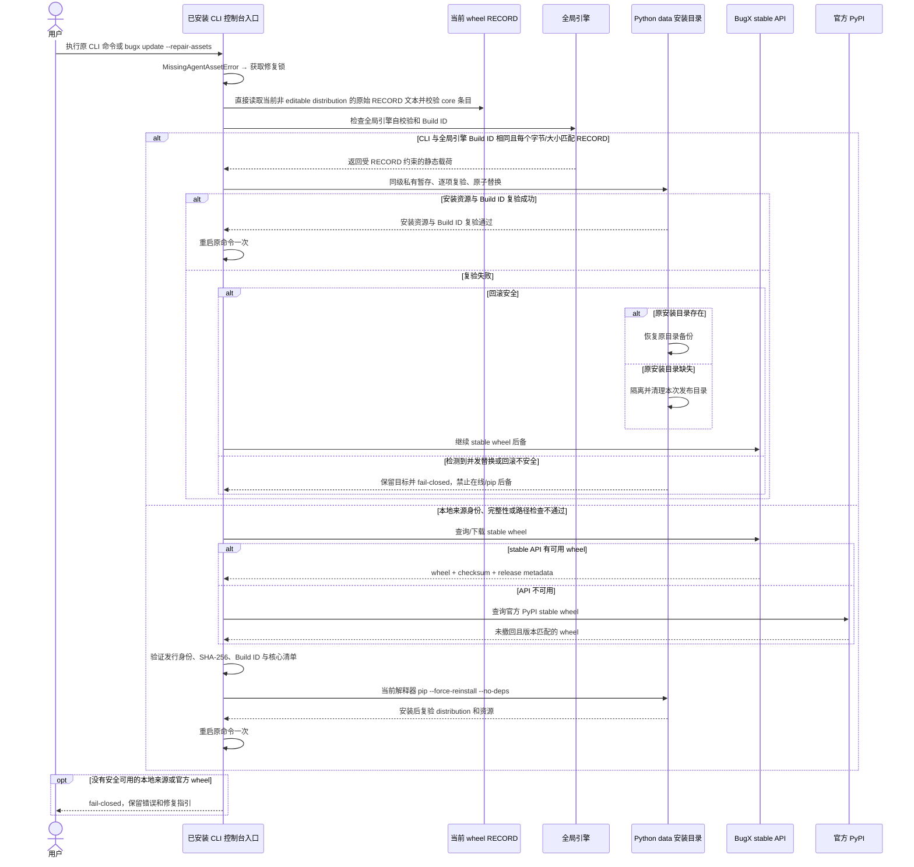

本地恢复只在同 Build ID 下使用当前非 editable wheel distribution 的 `RECORD` 逐项约束全局载荷，
不会将全局引擎当成 CLI 升级包。暂存、哈希、Build ID、安装后状态任一条件不满足时先执行失败回滚；
原目标缺失则清理本次发布目录，原目标存在则恢复备份。回滚目标若被并发替换，则保留替换目标或隔离备份并以错误终止，禁止继续在线/pip 后备。该路径不提供独立发行签名，
因为当前 RECORD 与全局副本仍处在同一个用户可写信任域。

## 多语种攻击面预勘测

## Skill Plan 运行时需求传递

技能包的 `required_runtime` 经 `runtime_requirements()` 归一化后保留在编译后的
`skill_plan.required_runtime`。每个工具条目必须带 `stage_ids`，且只能引用本 manifest 中
唯一声明的阶段；`validate_manifest()` 还会逐个解析工具名，未登记 probe ID 会拒绝该技能包。
Worker 调度器把完整 Skill Plan 放入当前阶段 Harness 上下文。该身份解析不等于工具已就绪：
外部二进制、MCP 服务及安装自愈仍须由相应预检和受信安装配方提供可观察证据。

启动顺序先准备当前项目画像和 Skill Plan，再按 `required: true` 阶段与工具 `stage_ids` 的交集
确定活动工具，然后执行预检与已登记的自愈。无阶段交集的工具写入 `NOT_IN_STAGE_PLAN`，不执行
安装或探针。预检中已通过的工具复用本轮报告；失败项只有在存在受信自愈配方时才尝试修复，之后
清理探针缓存并复核实际版本。运行期工具只能使用 descriptor 显式声明的安全就绪动作。就绪动作
不得扫描目标源码或执行差分两侧命令。工具条目默认必需，只有显式标记 `optional` 才允许跳过；目标
条件只有在项目画像明确给出互斥目标时才能判为 `NOT_APPLICABLE`。最终状态与 `skill_id`、
`plan_hash`、项目分类哈希写入 `.bugx/state/runtime-tool-readiness.json`。活动必需工具仍不可用时，
启动在创建 Session 前以 `BLOCKED` 终止，不进入 fallback 降级。
探针自身报告 `NOT_APPLICABLE` 不构成豁免；就绪报告必须包含至少一项通过的必需检查，否则为 `BLOCKED`。

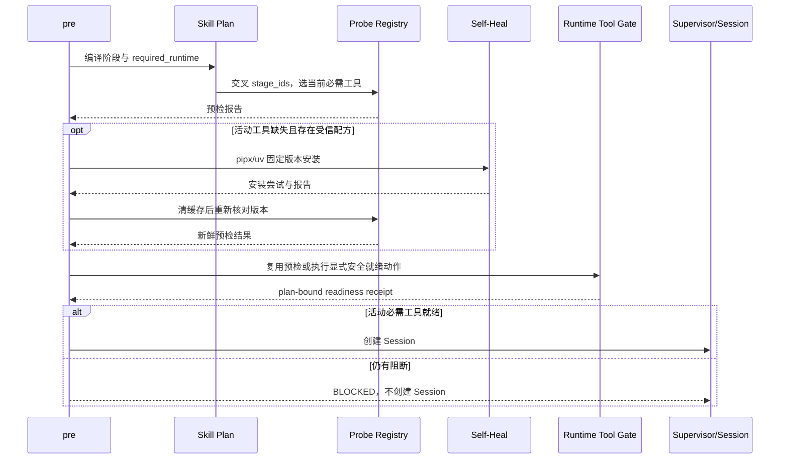

动态审计前可运行 `bugx mining-audit explore --root <dir> --json` 建立静态攻击面基线。扫描器按
扩展名自动选择 Tree-sitter 语言，或接受 `--language python|javascript|typescript|go|c|cpp|java|php|rust`
显式指定；结果包含函数/方法、类或类型、C/C++ 危险宏和路由端点，并把反序列化、命令/参数注入、
内存安全、并发与状态迁移等威胁绑定到主体。解析后端缺失或源语法错误时，结果保留可识别主体并
报告 `exploration_errors`，后续覆盖门禁必须把该次扫描视为 `degraded`，不能把空结果视作零风险。

## 一键审计 CLI → Workbench 当前演练与报告时序

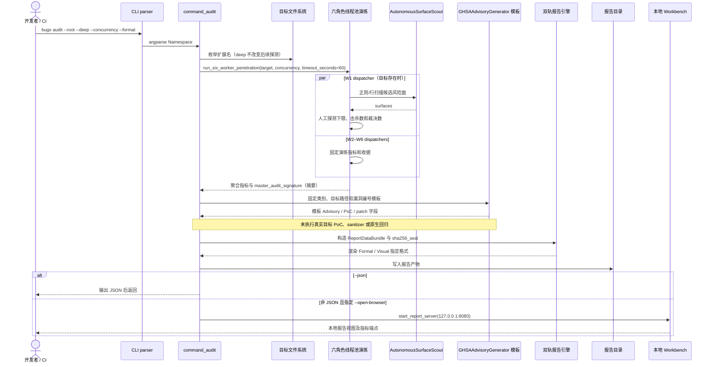

当前 `bugx audit` 识别目标后调用六角色线程池演练，聚合 receipt 和演练指标，再按固定
Finding 模板生成商务正式轨（Formal）与技术交付轨（Visual）。W1 虽调用真实行扫描器，
仍有人工计数；W2–W6 的演练指标、模板 PoC/补丁和 SHA-256 摘要不能证明目标漏洞或修复。
默认报告目录是 `<root>/.bugx/reports`，`--out` 可改为指定目录；报告生成不等于真实攻防闭环。

> [!NOTE]
> **拟议编排，尚未实施**：设计记录
> 已按自用项目找 Bug 的场景闭合四项设计门，状态为 `AUDITED_OK（设计）`；代码、协议、宿主、
> 平台和安装包验收仍为 `UNVERIFIED`。工作副本保护项目 WIP，不宣称 OS 安全沙箱。

拟议顺序为项目外工作副本 → Recon Agent 语义勘测 → Repro Agent 最小复现 →
受控本地执行与失败反馈 → 独立 Review Agent + Host 裁决 → **已确认 Bug 先入账并报告**。
请求 repair_preview 时再派 Patch Agent，基于精确 diff 在独立副本做复现转绿与定向回归。
默认 find_bugs 不要求先修好；确认、证据等级和修复状态独立，失败/未读/待验证项不丢失。

原生创建/等待能力在领取 claim 前核实，Host 保留真实 Agent/claim 身份映射。图任务使用新增
的 graph-stage claim 与图 checkpoint，不把同一 source coverage unit 重复领取给多个角色，
也不伪造覆盖单元。图状态在现有 Supervisor 事务内提交；同键同内容幂等、异内容拒绝，
执行结果不明不盲目重跑。原项目 MCP 不改 root，graph_id 只定位引擎登记的私有运行上下文。

首批适配 Python unittest/pytest 与 Node/TypeScript 的既有测试配置；没有原生测试仍可生成
调用真实目标的最小用例，但不能声称完整回归。复用 run_bounded 做命令超时/输出与进程回收，
不引入容器/VM 必需依赖。每阶段有限尝试和绝对 deadline，取消/回收失败有明确终态。

新 find_bugs 完成策略校验实际图、全部必需任务、Bug 裁决及报告，不把开放 Bug 假记为已修复；
repair_preview 和旧 mine/fix 保留各自回归/关闭条件。找到 Bug 是应用产出，声明范围内没有候选
也不能升级成“项目零缺陷”。未来六道完成门仍需独立自动化证据。

`--open-browser` 只绑定本机回环地址 `127.0.0.1:8080`，不向外部服务上传源代码；Workbench
首页提供两条报告视图切换和 `/api/metrics` 指标端点。使用 `--json` 时 CLI 在输出结构化摘要后
直接返回，因此不会同时进入长驻 Workbench 服务；需要本地挂载时应省略 `--json`。报告格式选择
和产物对应关系见 [02_COMMANDS.md](../../docs/01_guides/02_COMMANDS.md#一键全息审计-bugx-audit)。

## 并发 Worker 编排、ACP 宿主交互与断点持久化时序 (Concurrent Orchestration & Breakpoint Recovery)

BugX 核心调度微内核基于事件驱动与长连接协议，实现**面向外部宿主 Agent（Host）**的 ACP 协议交互、**并发工作单元（Worker）**的滑动窗口租约生命周期以及基于 **Revision Fence** 的不可篡改断点持久化自愈：

### 1. ACP 宿主长连接握手与模式协商时序 (ACP Host Interaction)

宿主（如 OpenCode、Cline 等）接入 BugX 时，必须遵循 ACP（Agent Client Protocol）协议的严格握手流程，杜绝弱权限与 Code Mode 逃逸：

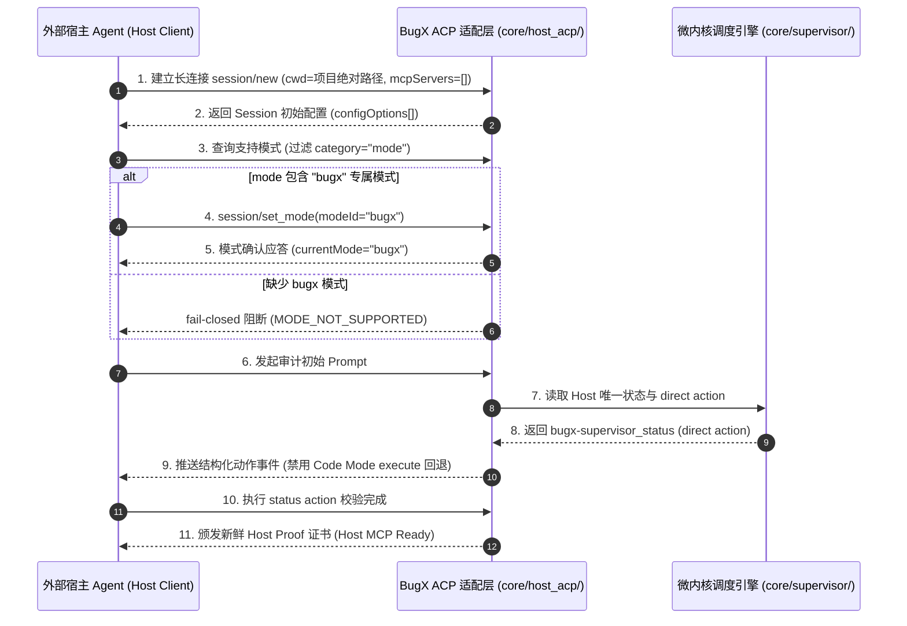

#### ACP 交互硬约束：
- **禁止 Code Mode 注入**：主 Agent 与 Worker 统一配置 `codemode: false`，仅通过权限约束下的具名 direct action（如 `bugx-supervisor_*`）调用工具，未暴露 direct action 时立即 fail-closed；
- **项目 MCP 绝对路径隔离**：`mcpServers` 严格使用项目级绝对路径配置，严禁传同名 session server 覆盖；
- **Host Proof 先行**：在进入复杂 lifecycle 调度前，必须在单回合内完成独立的 Host proof action 取证。

---

### 2. 并发 Worker 调度与生命周期状态机 (Concurrent Worker Lifecycle)

Worker 是无状态、受隔离的并发工作单元，由 Supervisor 通过单调时钟租约仲裁与心跳管道实施全生命周期管护：

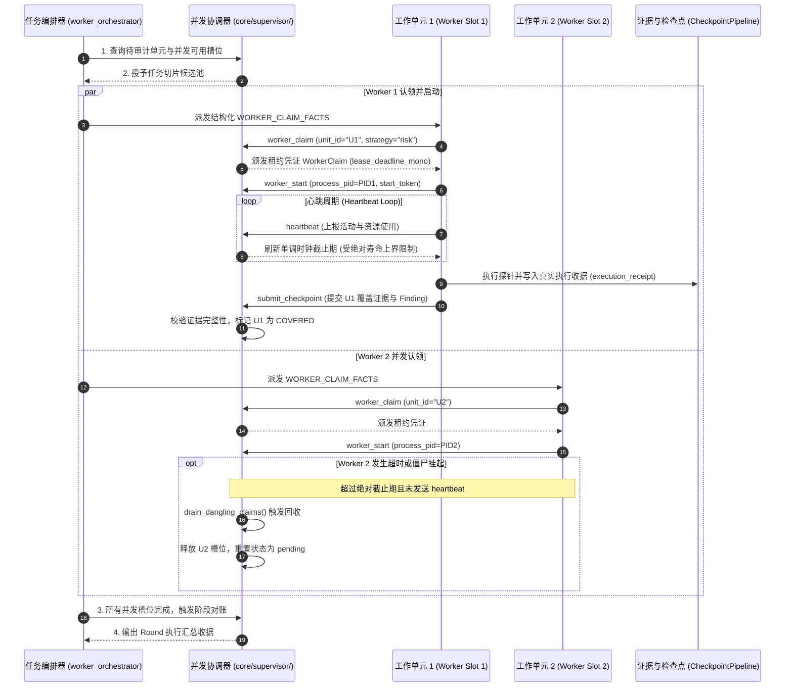

#### 租约与状态机不变量：
- **生命周期四部曲**：`claim → worker_start → heartbeat → checkpoint`。缺少前置步骤直接提交 checkpoint 视为非法证据；
- **绝对寿命硬拦截**：`WorkerClaim` 固化 `total_lease_deadline_mono`，心跳续期不得突破总寿命上限，杜绝子进程假活导致的永久挂起；
- **滑动窗口动态补位**：每当一个任务提交 checkpoint，编排器立即拉起新 Worker 填满并发槽位，维持最高执行效率。

---

### 3. 状态快照与 Revision Fence 断点持久化自愈时序 (Breakpoint Persistence & Recovery)

为了防御机器断电、进程强杀与并发写入冲突，Supervisor 的状态持久化严格执行**三级提交事务（Backup $\to$ State $\to$ Revision Fence）**：

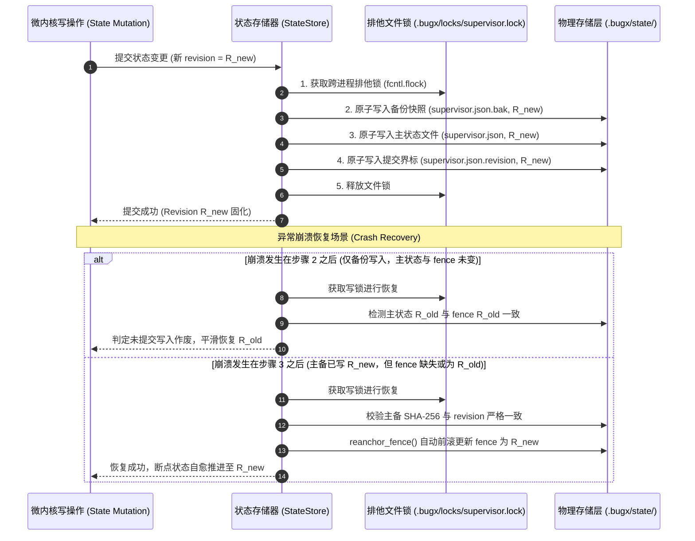

#### 持久化安全公理：
- **Fence 唯一提交标记**：`revision fence` 是整笔事务的原子提交印章，状态快照版本必须与 fence 逐字对齐；
- **前滚自愈与崩溃安全**：崩溃恢复全在排他写锁内进行，主备内容分叉时拒绝自愈并提示人工介入，主备一致时自动前滚修复界标；
- **单次 Resume Ticket 接力**：会话生成具名 `resume_ticket.json`（严格限制 10 分钟单次有效 TTL），支持外部宿主无感接力唤醒。

---

## 首次接入与 100% 项目级 MCP

安装 BugX CLI 和宿主入口后，在宿主中选择目标项目并请求启动挖掘。新项目的首次启动会自动准备项目状态，然后继续检查 Git、宿主、云端等实际前置条件；已有状态不完整时会保留数据并报告原因。初始化项目本身不意味着宿主 MCP 已加载。

启动前环境画像只在当前项目根、引擎脚本、ProjectProfile 检测器版本、完整源指纹匹配且时间戳有效时复用；项目内容/检测规则变更、扫描不完整、读取失败或缺少版本/指纹都会重跑项目级探针。跨项目缓存只复用明确标记为宿主级的探针。项目级索引结论（例如 Codebase Memory 当前仓库是否已建图）会针对当前 root 复查，不能用其他项目的 `READY` 结果代替。Codebase Memory 的同项目缓存仅允许复用仍匹配当前固定 pin 和原 CLI 路径的 `READY` 报告：复用前对当前候选执行 2 秒/候选的有界版本复核；旧格式、版本漂移、校验失败和 `DEGRADED/BLOCKED` 报告都会重新运行完整探针，避免外部环境已修复却继续显示缓存降级。

也可以在项目根目录检查并准备项目状态，再连接 AI 宿主：

```sh
cd <项目根目录>
bugx engine --root . status --json
# 只有 status 精确返回 UNINITIALIZED 时才运行：
bugx engine --root . pre
bugx install
```

`status` 返回 `FATAL_BLOCKED`、其他状态或检查失败时保留现场并停止；不要用 `bugx init`、`reset` 或 `--force` 绕过门禁。

`bugx install` 会自动接入本机可用的宿主（亦可通过 `--agent` 指定宿主，如 `opencode`, `claude`, `codex`, `cline`, `zcode`, `dsh`, `chatgpt`, `workbuddy`, `qoder`, `trea`, `funide` 等）。
**关键隔离准则**：项目级 MCP 默认写入当前项目目录（`--root .`）。FunIDE 设置页另有已确认的用户 profile `mcp.json` 数据源，安装器会在该文件的 `servers` 中登记同样的工作区相对命令，并在 profile `settings.json` 写入 `chat.mcp.autostart = newAndOutdated`，保证设置 → MCP 可见且 Agent 消息按需自动拉起新/过期服务；其它宿主仍不写入无契约的用户全局配置。

### FunIDE 桌面入口安装时序

FunIDE 是 VS Code 兼容的桌面 Copilot Agent Host。安装准备用户级 Agent 与项目资源，真实 UI 会话
必须在宿主重载后重新加载入口与 MCP；登录态还必须同步 Agent 云配置，当前没有已确认的 FunIDE 无头命令或原生问答工具。

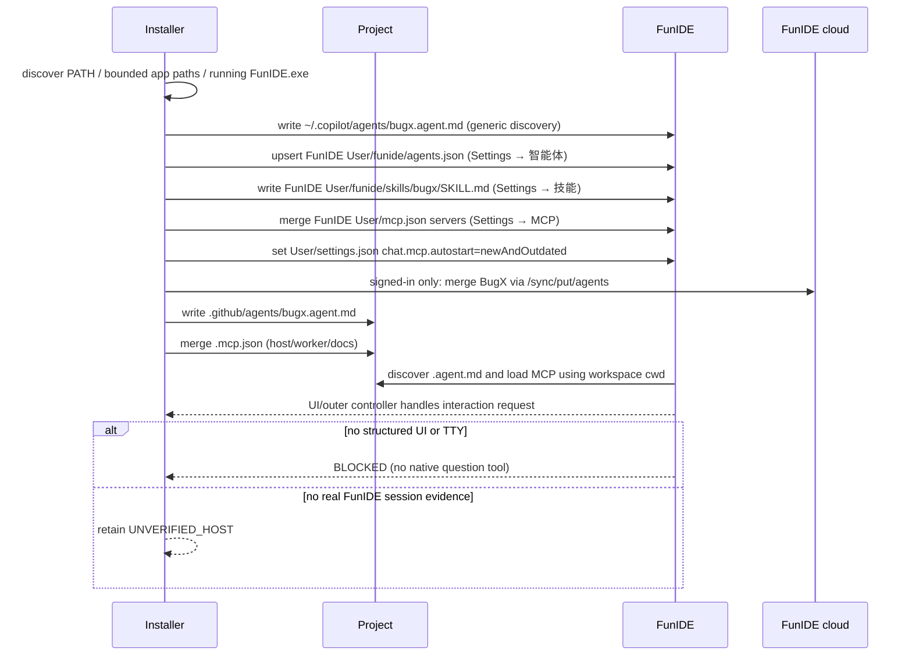

## Finding 证据与差分裁决时序（当前基线）

```mermaid
sequenceDiagram
    participant W as Worker
    participant S as Supervisor checkpoint
    participant O as Differential Oracle
    participant G as Finding confirmation gate
    W->>S: Finding + fingerprint + evidence
    S->>S: 真实 workspace evidence 路径校验
    alt 缺失/不存在 evidence
        S-->>W: checkpoint rejected
    else target fingerprint drifted after claim
        S->>S: mark evidence.target_drifted=true; force coverage=unverified
        S->>S: enrich every new Finding.origin_receipt with drift marker/reason
        S->>S: append target-drift admission note to state.unit_notes
        S->>S: append checkpoint_admitted_with_target_drift
        S-->>W: checkpoint admitted; Finding retained
    else covered unit reports a PoC crash
        S->>S: require PoC declaration and Finding unit_id/target_units association
        alt association missing
            S-->>W: checkpoint rejected
        else association valid
            S->>S: mark evidence.reproduced_crash=true; keep coverage=covered
            S-->>W: checkpoint admitted; Finding retained
    else evidence 有效
        W->>O: poc_input(string/path/JSON object/array)
        O->>O: 两个独立沙盒双跑 + 输出归一化
        alt 命令/文件/权限等基础设施故障
            O-->>G: INFRA_ERROR
            G-->>S: rejected(tool_failure), lifecycle=unverified
        else 两次正常退出
            O-->>G: FALSE_POSITIVE
            G-->>S: rejected(not_reproducible), lifecycle=false_positive
        else 抖动或双跑失败
            O-->>G: FLAKY_JITTER / deterministic
            G-->>S: unverified 或进入负对照/根因门禁
        end
    end
```

裁决语义是 fail-closed：`INFRA_ERROR`、`FLAKY_JITTER`、工具失败和证据不足都不能被改写成
`false_positive`；只有 Oracle 明确返回 `FALSE_POSITIVE` 才允许该 lifecycle 状态。缺少显式
Finding fingerprint 时，直接库调用会写回 canonical `sha256:` 指纹；MCP wire 仍要求非空
fingerprint。`poc_input` 的 JSON object/array 按 JSON 物化为临时文件，项目外路径拒绝。

## 预算与重试恢复时序（当前基线）

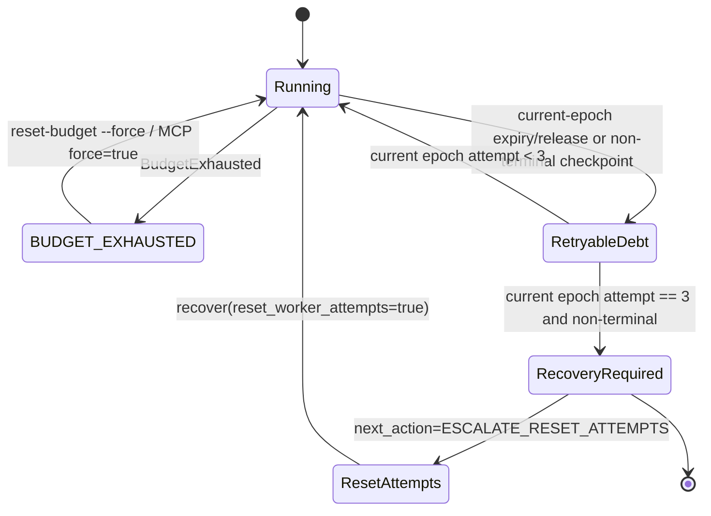

预算恢复只创建新的 budget epoch，保留 findings、coverage 和 history；同一
`scheduler_epoch` 内达到三次单元级 `expired`/`released`，或三次提交后仍未进入终态覆盖，
就熔断并将单元置为 `COVERAGE_BLOCKED`，防止自治循环无限重派。仍 active 的第三次允许
完成，真实 `covered` 的 submitted claim 不计入失败熔断；target rebind/state recovery
隔离旧 epoch。若所有未完成单元均触及全 Run 尝试硬顶且没有 active worker，
`next_action=ESCALATE_RESET_ATTEMPTS`；Host 必须调用
`bugx_supervisor_recover(caller_role="host", reset_worker_attempts=true)`，由恢复流程为终结
历史 claim 写入 fence 标记并追加 `worker_attempts_reset` 事件，再重读状态。模型 Worker 默认
超时 300 秒，宿主 Agent 回合默认超时 600 秒。

Round-4 控制面边界：`bugx_supervisor_reset_budget` 与
`bugx_supervisor_rebind_target` 在 shared tool 目录中对 Worker 可发现，但处理器要求
`caller_role="host"`；Host 在 `BUDGET_EXHAUSTED` 时可 reset，Worker 的新 claim/启动调用仍 fail-closed，
但已持有合法 Claim 的 checkpoint 收卷不被预算或单元目标指纹漂移阻断；漂移单元进入 `unverified`
并记录 `checkpoint_admitted_with_target_drift`，供 post 继续 fail-closed 处理。
宿主 `pre` 与继续挖掘回合不再把这两个恢复动作变成人工待办：发现
`parallel_gate.target_drift=true` 或 `next_action=REBUILD_PLAN` 且覆盖清单存在时，自动先调用
`bugx_supervisor_rebind_target(caller_role="host", reason="auto-rebind current workspace target on drift")`；
随后若 status 为 `BUDGET_EXHAUSTED`（或 `next_action=RESET_BUDGET`），自动调用
`bugx_supervisor_reset_budget(caller_role="host", force=true, renew_wall_clock=true)`。
每次调用后重新读取 status；恢复失败、清单缺失或状态未回到 `RUNNING` 时记录
`RECOVERY_REQUIRED/BLOCKED` 并结束当前回合。
恢复链的每一步都带有 `required_role` 与 `available_in_channel`。目标重绑和预算重置必须走
Host MCP 通道，过期 Worker 接手必须走 Worker MCP 通道；通道不匹配时返回
`channel_guidance`，宿主应切换到对应通道而不是重试同一调用。无目标漂移的 rebind 是结构化
幂等结果 `rebound=false, rebind_skipped_reason="target_not_drifted"`，成功重绑则返回
`rebound=true`。恢复主备快照时，`STALLED`、`CHECKPOINT` 和 `NEXT_ROUND` 都清洁归位为
`RUNNING`，防止中间态在崩溃恢复后继续阻塞调度。
RunState 创建时把 `target_fingerprint_bound` 与 canonical `target_identity` 写入 history；旧
state 只有在存在匹配 `run_started` 指纹证据时才能一次性前滚到当前目标身份。全新 claim 保持
单 Worker/单 unit，显式 bundle 或不超过 3 unit 的过期历史接手包才允许聚合；coverage 查询可用
`status_filter` 过滤并从 `blocked_reasons` 读取 `worker_attempts_exhausted` 熔断原因。

进入 `workers` 前，自治 `pre` 会把官方初始 `prep-record.md` 占位模板替换为基于当前启动
事实的最小准备记录（项目路径、Git/版本、工具状态、覆盖链路和证据标准）。只替换可识别的
官方模板；用户已填写的记录不覆盖，其他无效记录仍在 `post` 的 `prep_validate` 门禁中失败。
这一步解决无人值守宿主未人工补写准备表导致 `post` 失败的问题，不降低准备记录校验标准。

## Cline 双轨 Worker 调度

Cline 交互式会话没有 `Task(subagent_type="bugx-worker")`，所以默认只保留一个活动 Claim；主会话完成
`worker-start → heartbeat/tool_call → checkpoint` 后，才领取下一条。自治 CLI 通过
runtime 中 `host=cline` 且 `execute=true`，或 `workers --execute` 显式传参，切换到独立 Cline 进程池：每个 Claim
使用自己的 `.cline_data` 与 Worker/docs-only MCP 配置，进程组独立运行，`FIRST_COMPLETED` 窗口在任务完成后动态补位，
并可通过 runtime context 的 `stagger_seconds` 错峰启动。进程超时、异常退出或缺少匹配的持久化 Checkpoint 时，Supervisor
记录失败并释放 Claim；退出码或模型文本本身不构成成功证据。在该方案中，Supervisor 进一步强化了超时与异常自愈：调度控制流单调时钟化免疫 NTP 回拨，跨 $\ge 3$ 单元环境级崩溃触发全局级联熔断，长调用静默超 600s 探测 CPU 活跃度以阻断假活死锁，Worker 异常终止时自动物理收割孤儿沙箱。OpenCode 自治轮次的滑动期限只承认新鲜且带时区的 `heartbeat_at`，不再把 runtime 文件 mtime 当作进展；成功退出但没有 lifecycle 身份时立即以 `host_no_lifecycle_progress` 阻断。
OpenCode 使用 v2 配置：插件在 `plugins`、MCP server 在 `mcp.servers`、Agent 权限在 `permissions`。主 Agent 通过原生 `subagent` 工具调用 `bugx-worker`；每次必须显式传入 `background=false`，等子会话结果返回后读取权威 status/checkpoint，活动子会话或 claim 未结算时不得结束主回合。项目配置仅对 Host/Worker 控制 MCP 关闭 Code Mode、直暴露具名控制工具；Docs MCP 保持 Code Mode，缩小原生工具目录。
OpenCode v2 自治子进程会从 `EngineRunFacet` 取得临时用户配置环境：隔离用户级 MCP 和 JS 插件，同时保留 provider/权限与项目级配置；`opencode.json` 中的项目插件、BugX MCP 与 Xunfei 模型继续加载。显式 config 覆盖或禁用项目配置的环境变量会在启动前阻断。此范围不覆盖系统/MDM 管理策略。
Worker probe 使用 argv 数组和 `shell=False`，stdout/stderr 由 MCP 捕获，超时会清理独立进程组；执行器不是 OS 文件系统沙箱。被执行程序仍可尝试访问项目外路径，因此验收必须使用一次性目标，并把 `artifact_root` 约束视为 Worker 协议要求，不能当成物理隔离证明。
OpenCode ACP 生命周期验收直接使用官方 `opencode acp` 的 stdin/stdout JSON-RPC pipe，并在收据中标记 `stdio-pipe`；需要 TTY 的其他宿主保留 PTY 探测。两种传输的证据分开记录，不把 OpenCode pipe 结果写成 PTY 验收。生命周期 `session/new` 传绝对 `cwd` 和必需的 `mcpServers: []`，让 OpenCode 使用项目 `opencode.json` 中的 Host/Worker MCP 与 `codemode: false`；省略该字段会返回 `Invalid params`，传入同名 ACP server 会替换项目 server。若缺少项目级 MCP 或 `codemode` 不为 false，验收直接阻断。MCP 故障注入只在另一条只读 status ACP 会话中执行：首次注入 prompt 与独立 retry prompt 都在首个工具终态更新时发送一次 `session/cancel`，并继续等待各自原 `session/prompt` 的终态响应、记录 `stopReason`。每个 prompt 必须有受认可的终态；首次阶段唯一 Host status 必须失败，retry 阶段唯一同工具 action 必须完成且 call ID 不同。两阶段均通过后，代理 trace 中注入后同工具成功转发才共同证明恢复。
OpenCode 生命周期会话先在同一 ACP session 发送独立的 Host proof prompt。当前契约只允许一次具名直连 Host `status`，并只对绑定当前 session 与精确工具身份的 `allow_once` 请求自动响应；资源、Worker、Docs、shell、`execute` 与其他 action 均即时取消，拒绝不触发人工权限弹窗。direct status 到任意终态后验收端请求一次 `session/cancel`，等待原 prompt response。只有收到 `end_turn`，或本客户端确实请求取消后收到 `cancelled`，才接受 prompt 终态；再验证唯一且已完成的 direct status action、目标项目 Host proof 的 `last_request_at`/`last_progress_at` 晚于本阶段开始且 `inflight=0`。固定标记或模型文本不是调用证据。旧 proof、错误 root/role、未结束请求、permission 错配或取消竞争中已出现额外 action 均在 `pre` 前阻断。D23/D27 的只读资源例外是历史策略，D41/D42 已收敛为 status-only；attempt25 收据与修复审计记录在 `D42`。全部 Host proof 条件通过后，才在同一 ACP session 顺序发送 lifecycle prompt。Host/Worker 控制 server 设置 `codemode: false`，若 ACP 未暴露具名 direct action，立即阻断，不用 Code Mode 或 shell 兜底。独立故障代理会话仍分别验证两个 prompt 的取消回执与失败/成功 action，不为生命周期 Host proof 提供证据。
Worker probe 可执行目标项目提供的脚本 argv；验收参数 `--probe-command-json` 以 JSON 数组输入，`--probe-expected-stdout` 可指定输出核对值。默认 probe 行为不变，脚本调用继续通过 `run_sandboxed_probe` 的受限 argv 接口执行。

OpenCode 首个 ACP prompt 可能在项目 MCP 工具注册前结束。只有首轮自然 `end_turn`、没有工具或 permission
动作、没有取消且没有新鲜 Host proof 时，验收客户端才在同一 session 重发一次相同的只读 proof prompt；
两轮证据分开计算，任一 action、permission、timeout、取消或第二轮失败仍阻断 lifecycle。此为有界的验收端
恢复路径，不代表 OpenCode 上游冷启动竞态已修复。
OpenCode ACP 报告 provider 原生重试时，等待器识别 `session_info_update._meta["opencode/retry"]`，按 `nextRetryAt` 等待并在 retry-start 清除 ETA；普通进展继续使用滑动 idle 窗口，单个 prompt 仍受 hard wall 限制。若 lifecycle prompt 因 hard wall 结束且已有进展，验收客户端核对原 Host/root/Supervisor/runtime/lifecycle 身份后，以原 `sessionId`、绝对 `cwd` 和项目 MCP 配置调用 `session/resume`，再发送只要求检查持久化状态并续做缺项的 follow-up prompt。原 lifecycle prompt 不重放，避免重复 claim/checkpoint；恢复也不创建新 lifecycle、不修改 session 模型。每次续接最多 3 次；身份变化或无新的持久化进展即停止并保留 `UNVERIFIED`。`--resume-existing` 只读取匹配项目的 `UNVERIFIED` receipt，并跳过已完成故障注入探针。receipt 保留每次 ACP attempt、retry ETA、脱敏错误分类与 artifact hash。
当 lifecycle `pre` 精确报告 `.bugx/hosts.json` 缺失时，Host AI 可按受限流程执行一次项目级 `bugx install` 并核验登记与 engine status。若唯一安装失败明确指出目标等于 `asset_root`，仅在 `BUGX_ASSET_ROOT` 与 `BUGX_GLOBAL_ENGINE_ROOT` 解析到同一目录、且 `BUGX_DEV_ASSET_ROOT != 1` 时允许 `env -u BUGX_ASSET_ROOT` 重试一次；安装器继续校验 wheel 资源、目标保护根和 Build ID。路径条件不成立、wheel 资源缺失、任意其他错误或重试失败都停止在 Supervisor 启动前。此恢复不切换模型；provider 429 先由 OpenCode 原生 ETA 重试处理，持续运行达到单 prompt hard wall 后再按同 session 恢复流程检查持久化状态。

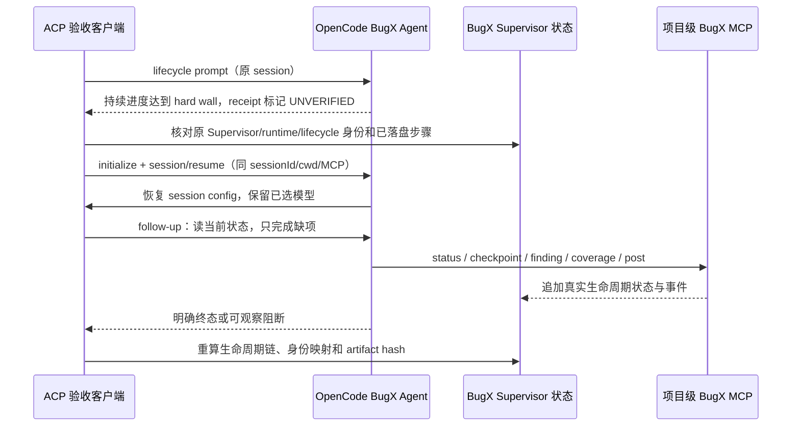
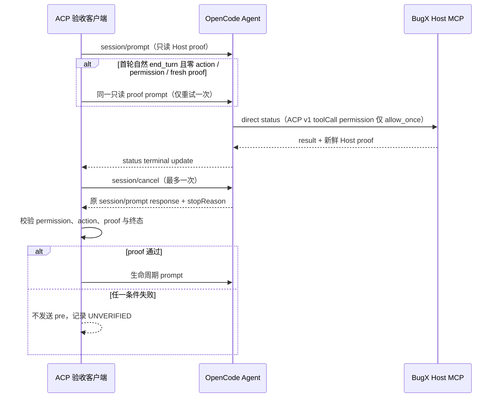
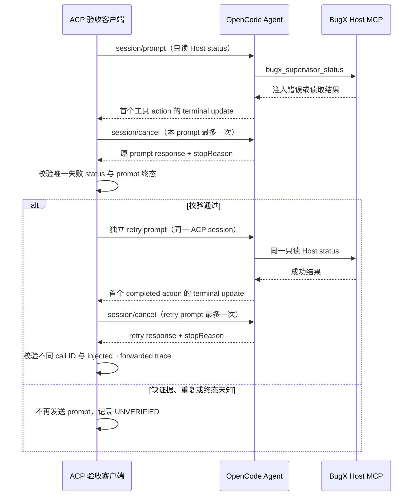

OpenCode ACP `session/new` 默认使用项目主 Agent。生命周期验收客户端必须从返回的 mode 选项确认 `bugx` 存在，成功执行 `session/set_mode(modeId="bugx")` 后再发送 prompt；缺失或选择失败时停止，不能把默认 Agent 的活动算作 BugX 证据。Host 应自行执行 `bugx engine --root <root> workers --count 1`，把完整生成的 Worker 任务块交给 `bugx-worker`；不能把命令文本当成子 Agent 任务。
OpenCode 原生 `subagent` 的任务文字不会创建 Supervisor claim。Worker 仅在收到完整结构化
`WORKER_CLAIM_FACTS` 时沿用预占身份并先 `worker_start`；普通单元派发须先经 Worker MCP
`claim` 成功，再 `worker_start`，之后才允许探索、执行探测和 checkpoint。Claim 失败必须停止，
不能用 `worker_start` 代替 claim，也不能在 claim/start 成功前调用探索工具。
ACP 生命周期 prompt 中的启动命令必须带 `pre --autonomous --refresh-probes`，以当前宿主子进程环境重跑启动探针；
探针仍按正常门禁裁决，`BLOCKED` 时不进入 Supervisor 生命周期，也不写豁免。
正常 Worker 的 `worker_start` 成功后，下一次工具调用必须是 heartbeat；短租约恢复必须使用另一个待处理 unit，
恢复后的 `worker_start` 也必须紧接 heartbeat。读写、shell、搜索或 probe 不得插在 heartbeat 前。

### 会话上下文的隔离边界

自治入口在启动宿主前将 `host`、`autonomous_mode`、`execute`、`workers`、`worker_capacity`、`subagent_type`、`stagger_seconds` 与 `provider` 写入当前项目的 `.bugx/bugx-runtime.json`。`workers()` 与 Worker runtime 的取值顺序是显式参数、当前 runtime、物理宿主探查；旧的全局宿主/自治/容量环境变量不再参与调度。runtime 校验失败直接阻断，避免错误绑定到另一个宿主。针对通道与模型选择，宿主执行器接入 `HostProviderArbitrator` 五级阶梯裁决引擎（真正免费模型 > 宿主官方原生订阅如 ClinePass > 第三方跨平台订阅如 ChatGPT Plus > 官方直连 API Key > 第三方代理 Router > 按量代扣点数通道），无显式指定时自动选出最优低成本通道，沙箱内配置就地自愈对齐，遇余额耗尽或鉴权异常自动剔除并平滑降级。对于免费模型，全面聚合候选池并对模型能力量化打分，优先推荐与选用头部满血推理/代码大模型（DeepSeek R1/V3、Qwen 2.5 Coder 32B 等），坚决杜绝机械索引轻量小模型，且支持当前 AI 显式指定择优决策。
`bugx autonomous --model <provider/model>` 作为显式选择直接覆盖 OpenCode 项目/进程默认模型，仅在当前自治控制器调用期间生效；控制器退出后恢复原环境。没有 CLI 模型时继续读取 `BUGX_OPENCODE_MODEL`，再回退到项目 `opencode.json`，不修改宿主配置。

OpenCode 自治回合使用 `opencode run --standalone`，避免接入已绑定其他项目的用户级常驻服务；普通 headless 调用维持原 argv。执行监控需同时核对 OpenCode 与 shell 后代的 `cwd`/`PWD`，任一路径离开目标项目即中止并保留目标运行状态作为证据。主控必须以前台同步命令运行 `pre` 并等待真实退出码，不得后台启动后轮询 PID 或日志。OpenCode v2 原生 `shell` 调用显式设置项目根 `workdir` 和 `timeout=300000` 毫秒；工具级超时记为 `BLOCKED`，不得用 shell timeout 包装、重跑或将输出重定向到项目根外绕过。
自治 `pre` 触发的 Recon Scout 同样使用私有 OpenCode 服务；它优先采用 `BUGX_SCOUT_MODEL`，否则继承自治 CLI 的 `BUGX_OPENCODE_MODEL`，并固定 `PWD` 为目标项目根，避免嵌套调用回到用户共享服务或其他模型。Scout 使用 `worker_execution.run_bounded` 回收完整进程组，默认 180 秒超时可配置；超时或失败后清理并回退静态播种。
OpenCode 主 Agent 与 Worker Agent 显式拒绝通过 shell 对 `/`、用户目录、home、父目录进行常见递归枚举，并允许以 `.` 为根的项目查找；`--auto` 保留这些 deny，进程监控继续检测实际 shell 子进程。
Host Agent 与 lifecycle launcher 子进程都把环境 `PWD` 绑定到传入的绝对项目根，确保 OpenCode 的进程目录、项目配置/MCP 与 BugX lifecycle 状态使用同一靶场。

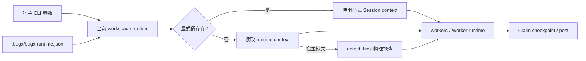

## 启动预飞（Pre-flight）与双态生命周期

BugX 彻底废除会话内“五步串行假门禁”（不再在会话中轮流弹出云端同步、审查方式、轮询策略、修复模式、提交策略问卷拦截），确立**双态启动生命周期模型（Dual-State Lifecycle）**与四级层叠配置体系（`CLI 参数` $\succ$ `项目配置 .bugx/config.json` $\succ$ `用户配置 ~/.bugx/config.json` $\succ$ `系统默认基线`）：

| 运行状态 | 触发条件 | 执行动作与耗时 | 交互体验 |
| :--- | :--- | :--- | :--- |
| **态 2：已就绪快路径** | `.bugx/config.json` 为 ready，且构建清单指纹未变化 | 读取配置并比较轻量指纹，随后进入预飞流程；性能目标尚未基准验证 | 无启动策略问卷；Supervisor MCP 未加载时使用内置协议 |
| **态 1：初始化或配置漂移** | 配置缺失、无效或构建指纹变化 | 回收孤儿锁、记录阶段、装配开工记录与覆盖清单；缺失清单在 runtime 独占锁内分类：fresh idle 可继承或发现，quiescent idle 只能哈希重扫继承，活动/损坏/含历史计数状态 fail-closed；单次发现/重扫按源码路径与内容哈希复用 AST 风险分；随后准备账本/画像并原子写入 ready 配置、生成 Resume Ticket | CLI 重启 BugX 引擎命令；部分桌面宿主输出重载提示卡 |

覆盖清单恢复把同名 AST scope 按源码位置唯一化；历史重复 scope 若含覆盖状态或字段冲突则阻断。重扫结果是 Markdown 行，写入前必须解析为 `ModuleRow` 并校验编号、阶段和状态；非字符串、格式损坏或编号重复均在 manifest 与 inventory diff writer 之前拒绝。

如需临时改变审计策略，直接通过 CLI 参数显式指定（如 `bugx engine pre --fix-mode log-only --commit-policy life`），优先级最高，无需在对话中反复确认。真实 TTY 才显示策略问卷；非交互、headless/ACP 和自治入口自动落盘 `strategy_plan=approve`、`fix_mode=log-only`、`commit_policy=manual`，不会以策略问卷 exit 2 阻断。

**报告处置策略（`report_policy`）**：交互态在 L1 发出一次 `report_policy` 结构化门禁（不上报 / 仅本地 / 上报云端），答案以 `--report-policy <none|local|submit>` 重试并写入 `runtime.report_policy_source`；已决策来源（cli/profile/config/gate）不再重复询问，headless/自治走确定性默认 `local`。`local` 留下的 `sync/share_pending.json` 由 `pre --replay-share-pending` 显式授权补偿（`none` 仍硬拒绝）。上报负载默认**不脱敏**（原样发出），`BUGX_REPORT_REDACTION=standard` 或库参数 `redaction="standard"` 才启用凭据/绝对路径/机器标识净化。

Doctor 是独立的本地环境检查入口：普通 `bugx doctor` 只报告状态，不清理 Qoder 遗留文件或改写项目 manifest；`bugx doctor --repair` 才执行确定性修复。项目初始化检查要求 manifest 存在且布局校验成功；缺少 manifest 时只指引只读 `engine status --json`，仅对精确 `UNINITIALIZED` 状态建议 `engine pre`，半初始化或损坏状态保留现场。repair 写入拒绝软链接并原子替换文件，任何修复错误都会阻断修复检查；已初始化项目缺少宿主清单时仍按已探测宿主执行只读 MCP 检查。AI 只补充根因分析，修复提示取决于 Doctor 当前实际实现的路径和检查结果；未知项不生成通用 repair 命令。对漂移的完整宿主包，Doctor 报告差异但不强制重写，避免覆盖项目内本地修改。引擎副本诊断只有当前 asset 严格高于 global、发现结果完整且没有已发现副本高于 asset 时才建议 force；同号、较旧、未知或存在更高副本时不给 force 建议，且明确 force 只替换共享引擎，不会同步其它 CLI 安装。

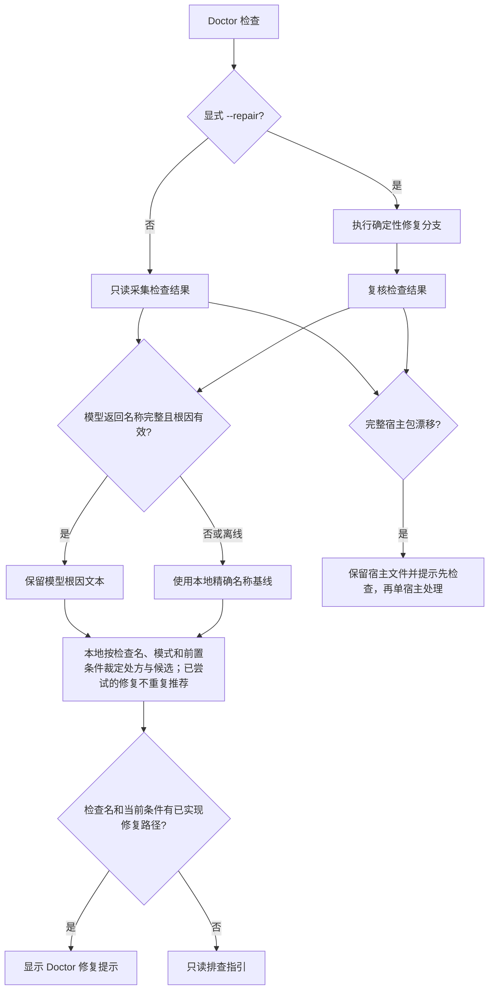

## 自治生命周期（`bugx engine pre` → `workers` → `post`）

自治启动的云同步与 Host 输出终态规则：项目云状态为 `pending`、且 profile/CLI 未显式选择云策略时，`pre --autonomous` 将其持久化为 `local` 后继续启动；这不影响用户已选择的 `sync` 或已完成同步状态。OpenCode `--format json` 的阻断标记从 `text.part.text` 和已完成/失败 `tool_use.part.state.output` 解码，工具参数与运行中事件不作为输出。宿主每回合最多调用一次 `pre`；非零退出（含 2）必须输出 `BLOCKED:` 并停止派发，外层控制器识别结构化事件后将回合记为 blocked。

```mermaid
flowchart TD
    Start["Agent 在项目宿主中触发 BugX"] --> Status["只读 engine status --json"]
    Status -->|UNINITIALIZED| Pre["engine pre：持锁复核并准备新项目"]
    Status -->|有效项目布局| Check{"检查项目配置<br>(.bugx/config.json ready?)"}
    Pre --> Check
    Status -->|FATAL_BLOCKED / 其他阻断 / 检查失败| Stop["保留现场并停止；不得 init/reset/--force 绕过"]

    %% 态 1：项目状态准备
    Check -->|未就绪 / 配置漂移 (态 1)| Init1["取得项目 init.lock 并回收已退出进程遗留的锁"]
    Init1 --> Init1a["runtime 独占锁：校验 runtime 与 Supervisor 状态"]
    Init1a -->|fresh idle| Init1b["继承旧清单或执行符号发现"]
    Init1a -->|quiescent idle| Init1c["只做旧清单哈希重扫继承"]
    Init1a -->|活动/损坏/含身份或历史计数| Stop
    Init1a -->|quiescent 且无有效旧清单| Stop
    Init1b --> Init2["记录阶段并装配开工记录 (prep-record) 与覆盖清单 (module-coverage)；准备账本/画像并预检 optional MCP"]
    Init1c --> Init2
    Init2 --> Init3["原子写入 .bugx/config.json (status=ready，只列验活工具)"]
    Init3 --> Init4["落盘 10 分钟单次 Resume Ticket"]

    %% 态 2：已就绪路径
    Check -->|已就绪 (态 2)| Fast1["读取 .bugx/config.json 并比较构建清单指纹"]
    Fast1 --> PreFlight["启动预飞：未认证云端就地自愈为本地模式与 Supervisor 三阶探活"]

    Init4 -.->|重载/重拉接力| Fast1
    PreFlight --> StrategyGate{"是否自治模式 (--autonomous)?"}
    StrategyGate -->|是| Plan["生成审计方案与工作单元任务切分"]
    StrategyGate -->|否| AskPlan["宿主弹出原生单选控件确认作战方案 (一键批准/微调/稍后)"]
    AskPlan --> Plan
    Plan --> Parallel["滑动窗口流水线动态补位派发 Worker 并行检查 (持续保持满并发度)"]
    Parallel --> Evidence["收集检查点证据与候选 Finding"]
    Evidence --> Dedupe["复核证据、去重与确定性验证"]
    Dedupe --> Fix{"是否有已确认 Finding?"}

    Fix -->|有| FixAction{"依配置策略处理"}
    FixAction -->|auto (自动修复)| DoFix["实施修复并定向复验 (TDD 回归)"]
    FixAction -->|log-only (只读记录)| Keep["记录问题与上下文，不改动代码"]
    Fix -->|无| Settle["汇总覆盖率、证据并执行结算 (post)"]
    DoFix --> Settle
    Keep --> Settle

    Settle --> CommitGuard{"按提交策略处理变更"}
    CommitGuard -->|按当前提交策略| ReportCheck{"覆盖率达标且无遗留 Finding?"}

    ReportCheck -->|是| Done["生成审计完成报告 (Complete)"]
    ReportCheck -->|否 且可续轮| Parallel
    ReportCheck -->|受阻/预算耗尽| Blocked["报告未完成原因与恢复指引"]
```

运行时通用异常拦截器只处理经 PID/锁龄检查确认失效的 BugX 锁，最多清理一次并重试一次。它不创建布局，不隔离或重建 manifest、项目身份或配置，也不修复版本漂移；`FATAL_BLOCKED`、`project_layout=` 和 JSON 损坏均保留数据并 fail-closed。版本问题通过 Doctor 的显式诊断/修复路径处置。

## 判读式并发审计时序

```
pre ──► bugx engine judge N ──► N 个 bugx-judge 并行（各一回合）──► judge --settle verdicts.json ──► post
        宿主确定性：              只判断数据：                      宿主确定性：
        claim+边界电池+判读包      裁决 JSON（clean/bug/            实跑 reproduction 取证 +
        （~1s/单元）              insufficient_data）               机械 checkpoint（~0.4s/单元）
```

- 判读包 = 源码切片 + 电池实测输出，self-contained；judge 不执行命令、不读文件、不碰 Supervisor 协议。
- 复现命令由宿主真跑生成收据（防伪造锚点），judge 的声明不构成执行证据。
- 实测：5 单元 60s/批（旧 Worker 路径 18-32 分钟/批）；墙钟 = 最慢一个 judge 的推理时间。

## 每一阶段会发生什么

1. **启动预飞（Pre-flight）与双态流转**：
   - 穷尽自愈只执行代码内登记的工具配方；未知工具名称以 `unregistered_tool` 阻断，不能由探针或 Worker 输出直接变成 pip 包名。
   - codebase-memory 探针逐个检查 PATH 候选并优先查找配置/默认用户工具目录，只接受与 `core/runtime/tool_install_targets.py` 固定 pin 完全一致的 CLI；旧版本首个命中会被跳过，不会遮蔽后面的正确版本。项目列表使用 `cli --quiet list_projects --format json --detail stats`，显式请求节点/边统计；统计字段缺失代表无法判定，不能当作空图。没有匹配版本时，在列表/建图前保留原因并触发固定规格的隔离安装自愈，安装后精确复核版本；匹配后缺少当前仓库索引才使用 `cli --quiet index_repository --repo-path <root>` 并复查。输出格式不符、建图失败或项目仍未出现时保留原因，不猜测上游版本边界。
   - Codebase Memory 自愈桥接复用 `codebase_memory_probe.inspect`；图增强桥接也调用同一固定版本解析器，并复用直接 JSON 的 `list_projects`/`index_status` 命令及当前 flag 形式的 `query_graph`。PATH 前置旧副本会被跳过，外层 MCP envelope 不会被误当作状态对象；只有当前项目复核 `status=READY` 才移除降级项与设置环境标记，索引子命令单独 exit 0 或同名可执行文件存在都不代表已就绪。只发生索引错误时不重复安装包，图增强只读路径不安装工具。
   - `codebase-memory` / `ast-grep` 通用自愈只从 `core/runtime/tool_install_targets.py` 读取固定顶层包规格，并通过 `pipx install --force` 或 `uv tool install --reinstall` 替换隔离环境；Homebrew 与当前 Python `pip` 不属于自动回退路径。传递依赖哈希和 Codebase Memory PyPI provenance 尚未验证。
   - SAST 自愈只认活动阶段选择的 `sast`、`bandit`、`semgrep` 规范探针名；探针按 PATH 顺序选取满足最低兼容版本的候选。无兼容候选时，Bandit/Semgrep 的包规格只从 `core/runtime/tool_install_targets.py` 读取，并仅用 `pipx` / `uv tool` 隔离安装。安装后清探针缓存并校验固定版本；无隔离安装器、安装失败或复核不通过时保留降级项，不写入当前 Python 环境；上游索引与传递依赖哈希仍待供应链验证。安装版 `core/` 是平铺资源目录，预检直接执行 `sast_probe.py`；探针必须同时支持包导入和脚本导入，脚本模式只能按同目录模块名解析依赖。
   - 移动端 `20-masvs-static` 另有精确版本契约：使用 lock 固定的 `pysemgrep 1.182.0`，从 `bugx mcp-runtime start --root <项目根目录> --server semgrep --print-command` 的经校验 `runtime_dir` 取得绝对路径，并核对 runtime manifest 与二进制版本。缺失或版本不符时只调用一次 `bugx mcp-runtime install --root <项目根目录>`（会重建整套共享 MCP runtime），复核失败即 `UNVERIFIED` 停止；禁止从 PATH 降级选择宿主 Semgrep。
   - 先读取只读 `engine status --json`：仅 `UNINITIALIZED` 可调用 `engine pre`，由 `pre` 持锁复核并准备新项目；`FATAL_BLOCKED`、其他阻断与检查失败都保留现场并停止。状态通过后，已就绪项目比较构建指纹，未就绪配置才进入准备流程；验活失败按 `NOT_APPLICABLE` 剪枝、`MISSING_REPAIRABLE` 穷尽自愈或 `CRITICAL_MISSING` 阻断裁决，缺少当前会话证明时按实际门禁阻断或要求 `RESTART_REQUIRED`，不以 warning 或内置模式伪造就绪；
   - 构建指纹变化会重新运行项目初始化，目前尚未按新增暴露面增量改写宿主 MCP 配置；
   - Supervisor 三阶探活读取项目级配置、stdio 身份/PID 与有界内置探活证明；不生成虚拟待加载状态，也不因缺 MCP 自动放行内置协议。自动 Git 提交按路径限定，并排除 Session 启动前已有的脏路径；缺快照时 fail-closed。提交器支持 `touched_files` 白名单，`rollback_finding_touched_files()` 可定向恢复并保留启动前脏路径（销毁前先物理备份到 `.bugx/rollback-backups/`，备份失败 fail-closed 不销毁），且所有 git 写门带测试逃逸护栏：测试上下文 × root=引擎仓时 fail-closed 拒绝；Finding 上游绑定、修复前快照与自动回滚调用链仍未接入；
   - Supervisor 三阶探活：检查项目级配置 $\to$ 检查 stdio 身份/PID $\to$ 执行有界内置探活并核对当前会话 proof；不把宿主尚未枚举工具写成虚拟就绪态。代码实现见 `supervisor_bridge._mcp_session_is_stale` + `supervisor_host.probe_builtin_mcp_session`；证明不足按实际门禁阻断/要求重启。服务端对重复 `tools/list` 使用连接内缓存和批量诊断聚合，`bugx log --mcp-polling` 输出命中与 interval 统计，单请求批次不构成缓存证明，外部客户端轮询行为仍需宿主证据。
2. **形成审计计划与任务划分**：BugX 依据客观画像与高危特征完成工作单元优先级排序；全新
   claim 按单 unit 派发，只有显式亲和 bundle 或小型历史接手包才进行 DAG 聚合，准备就绪。
3. **并行检查（宿主 Agent 滑动窗口流水线驱动）**：宿主 Agent（Host Agent）把目标拆成任务并安排 Worker 并行审查。严格采用**滑动窗口流水线模式**：每当任一已有 Task 返回或 Worker 提交 Checkpoint，宿主立即领取新任务补位填满并发槽位，杜绝整批等待木桶效应；严禁在运行时引入 Orca 或依赖外部非宿主进程；任务必须提交绑定 claim/lease/execution receipt、真实 SHA-256 与命令退出码的 Checkpoint 证据；artifact 必须是执行输出而非源码脚本，仅有文字结论不算完成覆盖。Worker ID 必须包含 lifecycle/round 命名空间。
   - **安全源码视窗探针纪律**：在代码走读、上下文勘测与 PoC 编写过程中，Agent/Worker 严禁在 Shell 终端使用 `python3 -c "with open..."` 或 `head | tail` 编写临时脚本切片读码（防范越界 `IndexError`、Unicode 乱码及 `/tmp` 残留）；必须统一使用 `bugx view <path> [--lines START:END]` 或 MCP 工具 `bugx_inspect_source`。该探针内置越界自动夹紧自愈（Boundary Clamping）、UTF-8 容错解码、10MB OOM 防护与路径沙箱安全隔离。
4. **复核问题（程序级自动裁决与智能升阶）**：系统在结算前自动运行程序级确定性裁决器（`_adjudicate_candidate_findings`），对具备客观复现证据的候选项直接升级为 confirmed 并补齐契约；若存在无法程序裁决的歧义项，则生成结构化升阶建议交由宿主 Agent 定点裁决。
5. **修复或记录（宿主 Agent 闭环）**：自动修复模式由宿主 Agent 原生实施红绿 TDD 补丁合成并定向复验，宿主 Agent 是修复交付的最终责任人；只读模式完整保留现场上下文。
6. **结算本轮（Post）**：BugX 核对实际覆盖，整理证据账本，按白名单提交修复改动并封存报告。正式结算前可执行 `post --dry-run`：它只对一次冻结、拒绝 symlink 的运行快照评估可观察门禁，返回 `snapshot_id`、源文件哈希、`passed/blocked/not_evaluated` 和阻断原因；不刷新租约/预算、不写 coverage/Finding/ledger/runtime、不提交 Git、不联网，也不代表最终 post 成功。正式 post 若结算前置条件未满足（缺少 passed evidence、缺少 Finding 绑定的合法 PoC evidence、证据哈希冲突、知识沉淀失败等），命令会 fail-closed 退出（exit code 1），并在同一 `post_attempt_id` 下触发唯一 `post_failed` 诊断事件、将阶段 `phase.post_settlement.finished` 标记为 `failed` 与记录决策原因，以及将 `core_command_finished` 提至 ERROR 级别，支持 `bugx log --errors` 精准回溯。`post_observability.GATE_REGISTRY` 只登记实际执行的检查点，不把历史日志中出现的七道/八道失败类别当作固定门数量；`gate_finished` 与 `post_attempt_finished` 为诊断证据，遥测写入失败只标记不可用，不改变业务返回值。checkpoint evidence 采用批量 staging；Supervisor-owned 的 `reproduced_crash/evidence_type` 标记必须随 evidence manifest 持久化并在 post 重载，state/backup 写失败会恢复并回滚 evidence，避免出现 `coverage=covered` 而证据未发布的分叉状态。

### Post 预检、Finding 快照与身份边界

正式 post 的 Finding 读取由一次 `FindingsSnapshot` 贯穿 direct gate、自动裁决和知识沉淀：
报告 bytes、SHA-256、evidence/observation artifact 的 device/inode/size/line_count/hash 和
runtime expected binding 在同一次有界读取中冻结；`formal` 项目布局要求顶层和嵌套
`run_id`、`lifecycle_id`、正整数 `round` 与当前 runtime/polling/Supervisor 身份一致，只有现有
`legacy` 布局保留无 binding 例外。Supervisor history/revision 与 `findings_report_sealed`
内容哈希不一致时拒绝结算，不能从另一份文件或另一轮猜测身份。

自动知识沉淀遵循「双环认知模型」：在单轮结算中，先在 raw Finding 上计算 fingerprint/confirmation digest，再构造固定字段的脱敏 projection 写入【项目错题集与项目经验集】，实现单项目轮次间（Round N → Round N+1）的即时快循环复用；原文不进入本地 ledger、runtime、日志、返回体或云端同步。跨项目 Pattern/Incident 晋升必须由用户显式运行 `lesson promote` / `promote-incident`；它会清理全部字符串值中的凭据、PII、URL 与路径，不保留逐文件来源或源码片段，但仍共享经清理的自然语言，不等于语义匿名化。Skill 合成仍是单独的显式入口，不由晋升或 post 自动触发。账本 schema 14 的
`incidents.finding_fingerprint` 仅是可空、非唯一的本地索引，v13→14 迁移必须显式执行，旧行
保持 NULL 与原 content hash。runtime 查询键固定为 `sig-v1:sha256:<64 位小写十六进制>`。

Incident evidence receipt 不能由调用方提交一个 64 位哈希就取得授权：`evidence-add` 必须从规范 `.bugx` 布局的 polling/lifecycle manifest 解析 Supervisor state，并验证其本地 history/revision 链、唯一 Finding fingerprint、匹配的 Worker claim 和 execution receipt、coverage evidence 记录以及项目内工件的实时 SHA-256。工件由根目录相对的 `O_NOFOLLOW` 有界读取器打开，并校验读取前后的文件身份，避免符号链接替换竞态。Incident 激活、跨项目晋升和 Skill 合成在消费收据时都会重新执行该复验；缺文件、歧义身份、被改写的状态或工件均 fail-closed。Supervisor 状态链没有密钥签名，本地有权写入者仍可重建整条链，因此该机制证明本地记录之间的一致性，不证明外部 ACP/宿主命令真实执行；真实宿主闭环仍需单独验收。

Incident 跨项目晋升时，以规范化项目账本路径和项目 `incident_id` 派生 `I-<12hex>` 全局 ID，
避免并发晋升的自然主键竞争；调用方必须使用返回的 `global_incident_id`。账本搬迁会产生新命名空间。

`--allow-serial` 只能消费 pre 阶段签发的 `serial_authorization_issued` hash-chain 事件；普通
`fix` Life 与 `host=cline` 单任务 `mine` Life 可签发，其他 mine 宿主仍 fail-closed。post 复核
life/session/round/lifecycle、`life_id=life-<life_no>`、预算摘要和当前 worker 状态。缺授权、
回执或身份被改写均拒绝；上述授权不等价于跳过 Finding、证据或 settlement 门禁。结案依据受监督
execution receipt 的真实性和 assurance 权重自动流转，receipt 不足时仍保持 candidate 并返回结构化升阶状态，
不等待终端按键确认。

`pre` 在首次 runtime 写入前完整校验策略、Life、串行授权和提交选项。任何无效参数均先返回参数错误，不得因旧 runtime 损坏而改报持久化错误；旧 runtime schema 不迁移。

**内容失效不是死路（`L1-ADV-D4`，build 203）**：若本轮内真的改过源码（修复），覆盖证据会因
内容绑定而失效——`coverage check --auto-backfill` 把相关行重置为 `未覆盖` 并把 scope 写入
`inventory-diff.json`。post 不再只是失败：它调用 `Supervisor.invalidate_coverage()` 把失效单元
从 `covered` 退回 `pending`（旧 claim 钉成历史代），打印
`COVERAGE_CONTENT_INVALIDATED` + `next_action=REDISPATCH_UNITS`。宿主随后重新 `claim` →
`worker-start` → `checkpoint`（新内容产出新证据），再重跑 post 即可在同轮收敛。
`--allow-incomplete` 不是这条路的出口；活跃租约存在时失效会被拒绝。

## 结果代表什么

| 结果 | 含义和下一步 |
| --- | --- |
| **完成** | 所选范围已检查，结果有证据支持，且没有待处理问题。查看完成报告；范围以外不在结论内。 |
| **继续** | 还有可执行的目标。自动轮询会按策略开启后续轮次；手动或单轮模式会先交付本轮结果，再由用户决定是否继续。 |
| **未完成** | 仍有目标未覆盖或问题尚未解决。报告列出剩余事项，处理后可继续审查。 |
| **受阻** | 必要配置、工具、证据或用户决定缺失。按报告中的原因补齐条件，再从当前项目继续。 |

只记录或补丁预览不会把未解决的问题变成已解决；所选范围尚未结清时，报告不会显示为完成。

## 陈旧误报的受控恢复时序

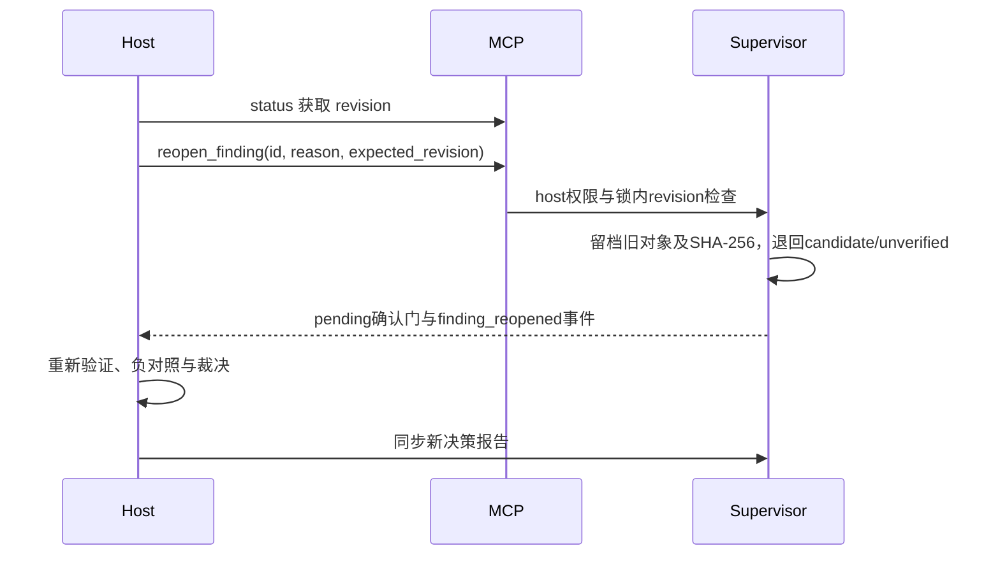

对仍处于候选态且已有明确宿主裁决的 Finding，宿主也可以在同一 revision 保护下直接调用
`bugx_supervisor_confirm_finding(finding_id, decision, reason, expected_revision, root_cause_verified, oracle, remediation, rejection_class)`。
该调用在 Supervisor 排他锁内**由引擎核验 receipt 派生证据**并自检（`confirmed` 缺 CONFIRMED
receipt、缺 `root_cause_verified`、oracle 文件哈希不符或与被测文件重合 ⇒ 直接拒绝，不写半成品），
通过后合并 `confirmation`/`remediation`、追加 `finding_confirmed` 或 `finding_rejected` 审计事件，
刷新确认门并返回新的 status 快照；Worker 通道、未知/重复 Finding 与陈旧 revision 均 fail-closed。
注意 MCP 裁决只写 Supervisor 账本，`post` 的 Finding 门禁读 lifecycle `findings.json`，
宿主需把同一套决策写入报告（或 `sync_finding_decisions`）才能完成结算闭环。

预算耗尽时允许重开记账，但仍须显式续期才能重新派发。已结束的 run 不允许
重开；新 run 应按受控流程带入待复验候选。业务链路通过真实 checkpoint 才能
完成覆盖；显式高风险准入可提前参与 workers 派发，授权不受心跳历史截断影响。

## Supervisor MCP 配置与会话加载

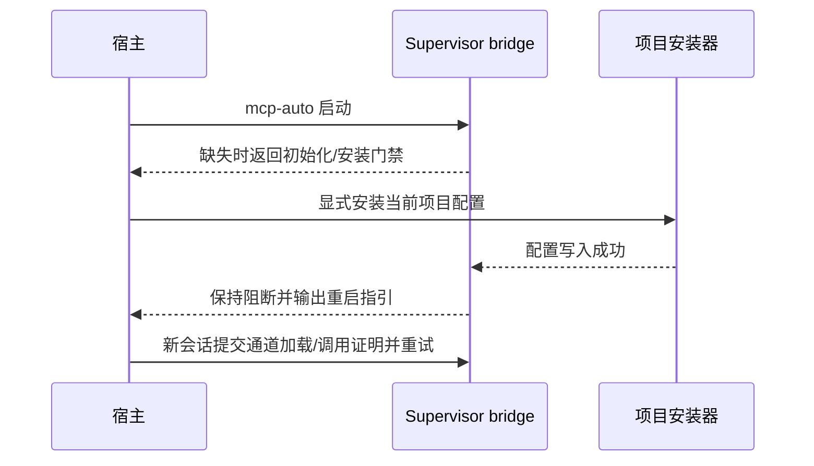

缺失分支和安装成功分支均不能通过旧 native protocol 描述自动放行。测试夹具必须在 Supervisor 首次绑定清单前补齐覆盖库存与计划字段，Checkpoint 后不改写绑定清单以迎合结算。

## 生命周期恢复与资源上限时序

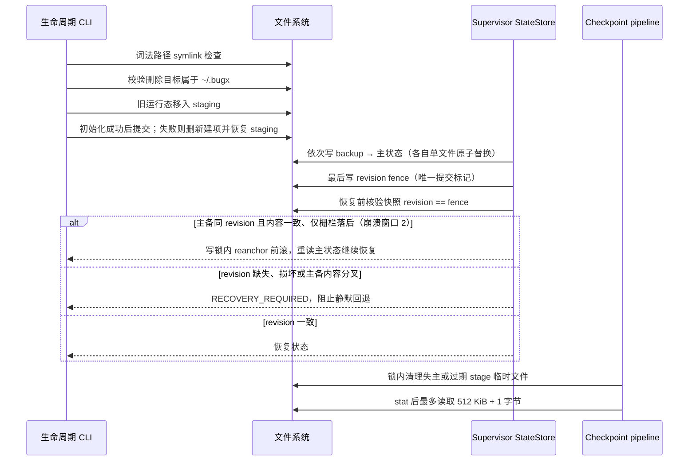

锁获取超时为 10 秒并采用指数退避。自动化边界由 `tests/cli/test_cli.py` 与 `tests/supervisor/test_checkpoint_pipeline.py` 覆盖；模块通过不构成 ACP 宿主和自治生命周期验收。

## OpenCode ACP 墙钟超时后的同 session 恢复（D35）

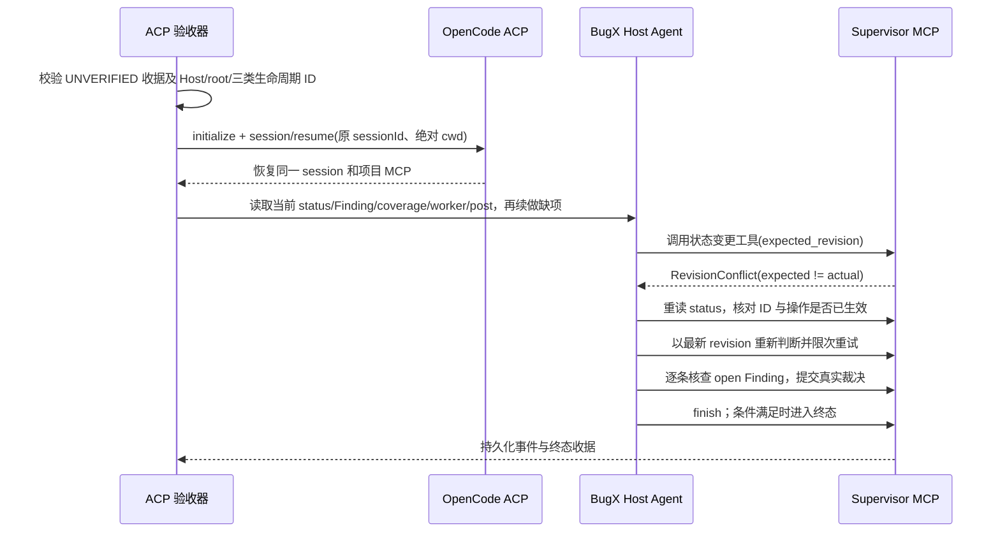

仅最新 `run_finished.reason=open_findings` 的 `INCOMPLETE` 状态允许恢复；其它 `INCOMPLETE` 原因 fail-closed。revision conflict 不通过省略 revision 绕过：Host 必须读取最新状态、确认操作是否已执行、用新 revision 重试，单项最多三次。恢复仍使用原 session 和模型，不重放生命周期 prompt；身份变化、重复冲突或无进展都保留 `UNVERIFIED`。测试范围与对抗反例见 `D35 对抗审计`。

Worker 生命周期再要求 `worker_start → heartbeat` 紧邻执行；heartbeat 成功前不允许探索或 probe。MCP 故障探针只代理 Host status action 的服务器，并用代理 trace 与 ACP failed/completed tool-call 双证据确认恢复；错误服务器或缺 trace 都计未注入。对应方案见 `D36` 与 `D37`。

## OpenCode ACP 用户级配置隔离（D38）

验收器先用当前 OpenCode 配置解析器读取各配置层，再在私有临时配置中为所有非项目 MCP 写入完整 server 对象并设 `disabled: true`。第二次解析会验证最终合并结果：项目 MCP 保持启用，其他已配置 MCP 全部禁用。预检最多 10 秒，解析或优先级不符合预期时，在 ACP session 创建前阻断。临时文件权限为 `0600`、会话结束清理，源配置不修改。方案与失败边界见 `D38 对抗审计`。

同一验收 invocation 以单调时钟设 1200 秒总截止时间，覆盖故障探针、生命周期和同 session 恢复；每个协议等待按剩余时间截断。到期时写入已开始 attempt 的 ACP transcript/updates 和 `UNVERIFIED` 状态；不会把局部进度记成通过，也不会自动开启新一轮。对抗审计见 `D39`。

Pipe ACP 子进程由其 `Popen` stream wrapper 关闭 stdin/stdout fd；PTY 继续关闭自行申请的 master fd，避免对 pipe stdout 做 raw `os.close` 后由 wrapper 再次关闭。详细证据与回归见 `D40`。

## Phase 3/4 靶场与多轮测评时序

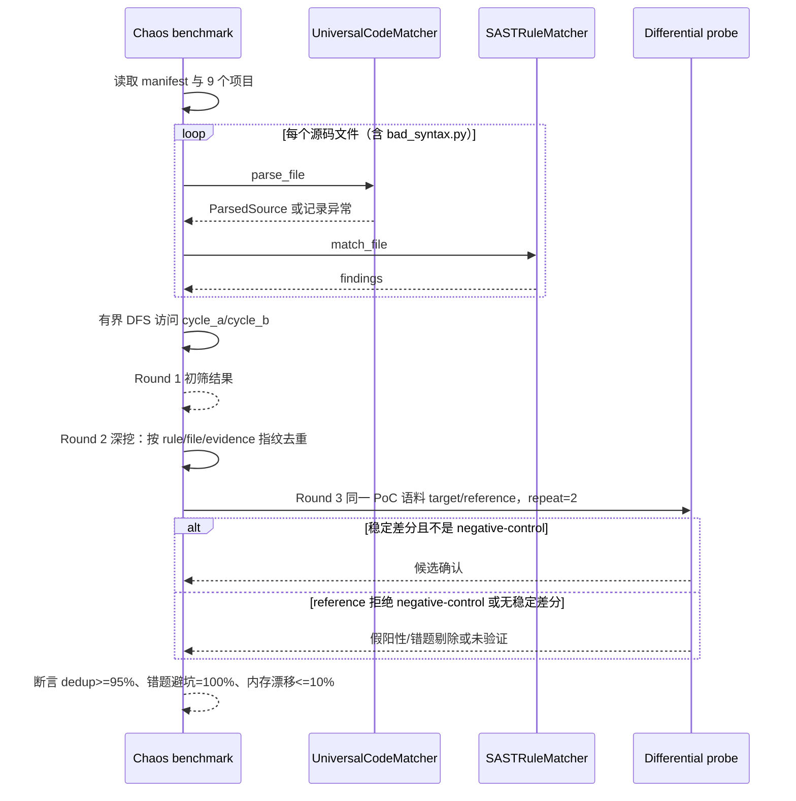

靶场脚本默认只使用仓内内置实现和临时目录，不写 `.bugx`、不联网、不编译九种语言。它的“抗崩溃率”和“规则检出率”是可复现的静态基准度量；缺少真实 ACP/宿主 session、runtime/Supervisor ID、receipt 或语言编译运行证据时，审计生命周期状态仍为 `UNVERIFIED`。

### 统一 CLI 图审计入口与报告数据流

```mermaid
sequenceDiagram
    participant CLI as bugx audit
    participant AW as AgentWorkspace
    participant AO as AgentOrchestrator
    participant Host as 原生宿主（后续派发）
    participant Ledger as Supervisor GraphRun
    participant Builder as report_data_builder

    CLI->>AW: 建立目标项目只读快照
    CLI->>AO: 按 --goal / --scope 建立私有图
    AO-->>CLI: graph_id + pending Recon
    CLI-->>Host: JSON ready / awaiting_native_agent
    Note over CLI,Host: CLI 不启动宿主模型；初始报告路径与计数为 null
    Host-->>Ledger: 宿主执行后经 Supervisor 持久化 bug_index / observations
    Ledger->>Builder: 提供真实 GraphRun 与 artifact loader
    Builder-->>Ledger: findings / source refs / evidence / counts
    Note over Builder: 未知验证、修复和指标保持 null
```

当前命令只实现快照和图启动；图的原生宿主派发以及 Supervisor ledger 到 CLI 报告文件的
最终查询/发布路径仍未接通。因此初始响应不能视为漏洞扫描结果，宿主闭环和最终报告发布
保持 `UNVERIFIED`。`run_six_worker_penetration.py` 仅转发到该 CLI，不再生成模拟指标。

### 有界检索消费、切片自愈与 MCP 工具接入（源码落点记录）

设计记录描述检索设计审计与当前源码落点；这不是协议闭环、真实宿主或全案验收结论。
普通项目源码包含倒数排名融合（`RRFEngine`）、代码切片（`SliceExtractor`）、语法自愈（`SliceNormalizer`）与命名空间隔离记忆（`MemoryStore`）路径；大项目 Xerj Sidecar 的受管安装、发行资产、协议和真实宿主验收仍 `UNVERIFIED`。
MCP 工具面包含 `bugx_retrieve_slice`、`bugx_extract_ego_subgraph` 与 `bugx_memory_query` 的实现/注册路径；局部 A/B 或模块证据不等于 Host 与 Worker 已完成真实 ACP 闭环，也不自动改变 coverage/finish。

```mermaid
sequenceDiagram
    participant H as Host / 图任务
    participant C as context 与范围校验
    participant I as 同快照派生索引
    participant W as 原生 Worker
    participant K as 命名空间隔离记忆库 (MemoryStore)
    H->>C: 固定任务/快照/scope/预算
    alt native 普通项目
        C->>I: 内置移植能力构建/复用 ready 代次
    else xerj 大项目
        C->>I: claim 前 setup 校验/启动/建索引
        Note over C,I: 固定资产校验；失败保持 UNVERIFIED/BLOCKED，不伪造降级，不重复 native 全量索引
    end
    C-->>W: 任务契约、种子位置、检索能力与父引用
    W->>I: MCP: bugx_retrieve_slice / bugx_extract_ego_subgraph
    I-->>W: 摘要、来源、前沿、截断与语法自愈切片 (SliceNormalizer)
    W->>K: MCP: bugx_memory_query (FTS5 BM25)
    K-->>W: 隔离命名空间已验证且脱敏的参考条目
    W-->>H: 实际读取引用、审查结果及未读范围
    H->>H: 真实复现、独立复核、裁决/checkpoint/报告
    H->>K: store_batch 事务批量幂等结算写回
```

检索命中不等于已审查或确认 Bug；不能直接改变 coverage/finish。任务契约和必要复核不得被裁掉，
新增范围由 Host 更新 scope revision 后才可读取。预算/解析/索引失败保留已有结果与未读范围；
同页重放不重复计量为覆盖。旧全文默认注入由 SliceNormalizer 3 阶渐进装配替代，切实降低 Token 膨胀与防范凭据泄露。
模块、定向验证与静态报告不能替代 `claim → worker-start → tool_call/heartbeat → checkpoint → Finding/coverage → post`、ACP 宿主会话、故障恢复和发布证据；缺失这些证据时整体状态保持 `UNVERIFIED`。

### 神经-符号双轨协同审计时序

```mermaid
sequenceDiagram
    autonumber
    actor Dev as 开发者 / CI
    participant Engine as BugX Engine (L1 Pre)
    participant Host as 宿主执行器 (OpenCode / Claude / Codex / Cline)
    participant AST as AST Analyzer (真语义分析器)
    participant Graph as LivingAttackGraph (作战攻击图)
    participant Super as AuditSupervisor (调度编排)
    participant Worker as AI Worker (9个精益原子工具)

    Dev->>Engine: bugx engine pre --host <opencode|claude|codex|cline>
    Note over Engine,Graph: 阶段一：神经-符号双轨冷启动 (L1)
    Engine->>AST: Token 掩码非破坏性脱水 + AST 解析
    AST->>AST: 局部污点折叠 (query = f... -> execute)
    AST->>AST: 绝对高危 Sink 判定 + 暴露面动态加权 (公网 1.3x, CLI 1.1x, 内部 0.9x)
    AST-->>Engine: 真实风险排序 (外部公网路由高危置顶, 诱饵注释剥离, 防御负对照抵扣)
    
    Engine->>Host: 驱动当前宿主原生运行 Recon Scout (反递归 + 有界 180s 超时/进程组回收)
    Host-->>Engine: 返回带滑窗代码锚点的攻击意图 (Hypotheses with Block Anchors)
    Engine->>Graph: 过滤入图：首批实战攻击假设 (Hypotheses) 与真实 Sink 节点
    
    Note over Graph,Worker: 阶段二：作战派发与全生态精益渗透 (L2)
    Engine->>Super: 提交一致性清单与带攻击意图的图谱
    Worker->>Super: bugx_supervisor_claim (原子化认领并启动)
    Super-->>Worker: 分发单元上下文 (严格 9 个精益核心 MCP 工具，上下文省 3000+ Tokens)
    Worker->>Super: bugx_supervisor_begin_long_call (长任务防回收声明)
    Worker->>Worker: 针对已注入的 Hypothesis 构造最小验证 PoC
    Worker->>Super: bugx_supervisor_submit_finding (提交强类型双向差分证据与 PoC)
```

### 神经-符号双轨全链路分工与准确性防御闭环

```mermaid
sequenceDiagram
    autonumber
    actor Dev as 开发者 / CI
    participant L0 as L0: 符号握手 & 降级适配
    participant L1 as L1: AST 逆向 & 规约提炼
    participant L2 as L2: 沙箱隔离 & 意图特征感知
    participant L3 as L3: 增量波及网络 & 上下文用例合成
    participant L4 as L4: 物理红线放行 & 争议对齐
    participant L5 as L5: 退出码真值差分 & 凭据金丝雀
    participant L6 as L6: 数学账本守恒 & 价值收敛
    participant L7 as L7: 脱敏归档 & 确定性回归合成

    Dev->>L0: 启动 BugX 流程
    L0->>L0: [符号] CLI/配置/Python 物理环境校验 (Fail-Fast)
    L0->>L1: 握手就绪
    L1->>L1: [符号] 零文档 AST 静态逆向提取全部端点与 Sink
    L1->>L1: [神经] LLM 提炼高维业务规约 (business-spec.json) 与单向状态机
    L1->>L2: 生成只读业务规约与前置底座夹具
    L2->>L2: [符号] 双沙箱进程隔离、动态端口分配与租约心跳
    L2->>L3: 调度 Worker 认领
    L3->>L3: [符号] 增量波及网络缓存 (Impact Network Cache, 0.01ms)
    L3->>L3: [神经] 上下文感知用例合成 (ContextualTestSynthesizer)
    L3->>L3: [符号] 本地进程内 AST 编译门禁 (verify_code_syntax, <1ms 拦截损坏代码)
    L3->>L4: 提交候选缺陷与验证 PoC
    L4->>L4: [符号] 物理不可违背红线审查 (SQLi/RCE/Path Traversal/超卖 100% 强行放行)
    L4->>L4: [神经] 语义争议对齐 (健康检查/匿名/限流豁免裁决)
    L4->>L5: 进入物理双向差分执行
    L5->>L5: [符号] 真实 0/1 退出码差分对比与反向工作树扫描 (无纸面通过)
    L5->>L6: 提交经过物理证伪的实锤缺陷
    L6->>L6: [符号] 账本数学守恒与单调递增 (无冲突收银台)
    L6->>L7: 触发 L7 经验归档与晋升
    L7->>L7: [符号] 绝对路径相对化、密钥凭据 [REDACTED] 物理抹除
    L7->>L7: [神经] 自动推断标准 CWE/OWASP 分类与生成 5 阶段排查 SOP
    L7->>L7: [符号] 确定性生成 scripts/verify.py 并双向断言检验通过
```

#### L0~L7 神经 (AI) 与 符号 (传统工程) 职责分界表

| 层级 | 传统符号工程负责项 (Deterministic / Physical Gate) | AI 神经语义负责项 (High-Dimensional Semantic / Adaptive) |
|---|---|---|
| **L0 环境握手** | CLI 参数解析、环境版本、Node/Python 依赖硬门禁（微秒级） | 多宿主（Claude/Codex/OpenCode/Cline）协议自适应握手与 Prompt 降级 |
| **L1 规约勘察** | AST 语法树遍历、端点与绝对高危 Sink 提取、只读规约锁定 | 高维业务意图提炼、状态机断环（缺注册/缺鉴权）推断与底座夹具合成 |
| **L2 调度沙箱** | 双沙箱物理隔离、独立端口池动态分配、Worker 租约超时强制回收 | 任务上下文边界感知、意图加权派发、长任务意图自适应评估 |
| **L3 调度生成** | 增量波及网络内存缓存（0.01ms）、进程内 AST 语法编译拦截门禁 | 上下文感知语义参数推断（email/JWT/端口/金额）、反事实边界合成 |
| **L4 意图差分** | 物理高危红线强行放行（SQLi/RCE/路径穿越/超卖绝不赦免，AUDIT-01） | 业务预期边界争议对齐（匿名接口、探活健康检查、只读权限白名单） |
| **L5 红绿对抗** | 真实子进程退出码差分（0/1 契约）、被测工作树物理扫描绝无凭据遗留 | 缺陷根因高维语义反思、误报模式归纳与修复原型指导建议 |
| **L6 收敛结算** | 发现项去重单调递增账本、数学守恒记账（无并发死锁与竞争状态） | 缺陷共性抽象、全局经验晋升价值语义评估与分级打标 |
 | **L7 旁路演进** | 全局写入前的凭据/PII/路径清理、去掉逐文件来源和源码片段；telemetry schema 升级清理旧路径 | 用户显式选择可共享的自然语言抽象、CWE/OWASP 知识图谱对齐与多阶段 SOP 编排 |

##### L3 单元生命周期层 8 节点规范 (CORE-400)
- **N3.1 (领取 Claim)**: 一 Worker 一 Unit 独立装配，签发 `lease_id`、`heartbeat_nonce` 与隔离 `artifact_root`；
- **N3.2 (启动确认)**: `worker-start` 登记真实操作系统 PID 并置 `execution_state=running`，作为唯一并发计入点；
- **N3.3 (记账与续租)**: `tool_call` 原子计费与 `heartbeat` 单调时钟续租，超额硬阻断；
- **N3.4 (长调用保活)**: `begin_long_call` 声明长时间探针运行，单次受限且总截止期硬顶；
- **N3.5 (提交 Checkpoint)**: 盘上重算证据工件 SHA-256，强制 `life_delta=0`，产出候选 Finding；
- **N3.6 (尝试熔断)**: 同轮次连续 3 次非终态自动触发 `COVERAGE_BLOCKED` + `worker_attempts_exhausted`；
- **N3.7 (租约过期与回收)**: 超期与崩溃 Worker 自动回收并转换为可重领的重试债；
- **N3.8 (宿主代交)**: host-only 专有代交通道，针对固化证据一次性代交，不放宽门禁。
- **三大现实缺口消解 **:
  1. 多宿主原生 ACP 原生闭环（Cline 3.0.74 真实会话 `VERIFIED`，OpenCode 2.1.4 额度耗尽精准归因，凭据矩阵落盘）；
  2. 探活收据跨仓双锚定闭环（`engine_commit` + `target_commit` 双重绑定，官方核验器 100% 通过）；
  3. 移动探针逐通道报告 `degraded_actions`，避免聚合状态下空动作放行；native-audit 的 Stage 30→80 另由当前 run 的结构化 `behavior-evidence` 产物栅栏连接。该 JSON 是 Worker 声明，尚不能替代 ACP/操作系统执行证明；通用动态工具启动门禁仍未闭环。

##### L4 裁决差分门 9 节点与意图门禁映射规范 (CORE-500)
- **N4.1 (入库规范化)**: `normalize_findings` 建立规范指纹与绑定 `origin_receipt`；
- **N4.2 (证据校验)**: 路径与工件真实性物理核验，拦截不存在或虚假工件 (`WorkspacePathError`)；
- **N4.3 (目标漂移裁决)**: `assert_target_fingerprint` 校验源码树一致性，漂移时置 `coverage=unverified`；
- **N4.4 (意图与差分裁决)**: 前置 `IntentAdjudicator` 意图核验，随后执行 `verify_poc` 双沙盒双跑产出四态裁决；
- **N4.5 (宿主受控验证)**: 宿主双正例 + 负对照受控复验，产出确定性 `CONFIRMED` 收据；
- **N4.6 (原子裁决)**: host-only 事务确认，固化 `evidence_reproduction` 证据封签（`L4-C1`~`L4-C2` 守卫）；
- **N4.7 (误报重开)**: 允许驳回重开并保留完整 `retriage_history` 审计快照（`L4-C3` 守卫）；
- **N4.8 (决策同步)**: 多端 key 精确匹配与状态对齐；
- **N4.9 (业务链路准入)**: `[70, 100]` 分数前置与事务双重硬门禁拦截，且不影响覆盖判定。

##### L7 Watchlist 负向判定时序与证据边界 (CORE-803)

```mermaid
flowchart TD
    Post["L5 post 后巡查"] --> Incident["读取近期 candidate / active Incident"]
    Incident --> Hint["解析 context 路径"]
    Hint --> Scope{"项目内普通源码且路径无符号链接?"}
    Scope -- 否 --> Inconclusive["inconclusive<br/>candidate_scope_rejected"]
    Scope -- 是 --> Scan["枚举安全候选<br/>最多 2000 项 / 8 MiB 单文件 / 64 MiB 总量"]
    Scan --> Reopen["打开后复核 root 与文件身份"]
    Reopen --> Read["仅从已核验文件描述符读取并匹配"]
    Read -- "片段命中" --> Intact["intact"]
    Read -- "完整扫描未命中" --> Advisory["possible-regression<br/>仅提示"]
    Reopen -- "竞态 / 读取失败" --> Inconclusive
    Scan -- "候选数/字节截断 / 无候选" --> Inconclusive
```

`..` 越界路径与符号链接不会被读取；文件在候选枚举后被换链时，打开后的 containment 和文件身份复核必须先于内容读取。片段匹配容忍格式化空白变化。扫描不完整时不得作负向结论。`possible-regression` 表示修后片段未在完整候选中找到，不等于行为回归已证实；当前它不会自动创建定向复测或阻断 post。宿主汇报 possible-regression / inconclusive 汇总；巡查失败返回 `status=ERROR`，并只暴露异常类型，不回显路径或异常正文。当前实现与限制见 `CORE-803`、`D7-04 对抗审计` 和 `D7-06 对抗审计`。

## Codex headless 探针证据时序

Codex 标准 ACP 不可用时，BugX 只按 headless 通道探测 MCP，不据此宣称 ACP 或 Worker 生命周期可用。真实探测在一次性隔离项目和临时 `CODEX_HOME` 中执行；Codex 专属 `headless_probe_argv` 给 smoke 命令增加 `--json`，不改变生产 Worker 命令。提示词限定 host 与 worker 两路各调用一次只读 status 工具，随后结束。

```mermaid
sequenceDiagram
    participant S as smoke_host_acp
    participant P as Codex 探针插件
    participant C as Codex exec --json
    participant E as 证据判定器
    S->>S: 建立一次性项目、私有 CODEX_HOME 与双路 MCP
    S->>P: 构造 headless argv
    P-->>S: 仅 smoke 命令增加 --json
    S->>C: 执行限定提示词
    C-->>S: JSONL item.* MCP 事件
    S->>E: 规范化为 ACP 共用事件记录
    E->>E: 核对 server 身份、completed 与 BugX 结构载荷
    alt 两路证据通过且宿主正常结束
        E-->>S: VERIFIED（仅 headless MCP 探测）
    else 超时、事件不全或载荷无效
        E-->>S: BLOCKED / UNVERIFIED
        S->>S: 仅保留限长脱敏诊断，清理探针项目并释放锁
    end
```

超时诊断只记录 stdout/stderr 长度与截断状态、已识别的 role 级调用摘要和固定 provider 错误类别；原始输出、工具参数、结果与凭据不进入报告。超时本身仍为 `BLOCKED`，部分输出只能用于排查，不能代替成功证据。当前实现、测试白名单与真实宿主结果以 `Codex Headless 探针审计` 为准；即使该 smoke 通过，也不构成自治 Worker 生命周期验收。

## CheckPlan 超时与自愈预算收尾

```mermaid
sequenceDiagram
    participant R as CheckPlan Runner
    participant P as 私有进程组
    participant H as Self-heal
    R->>P: 启动独立 session
    R->>P: 超时/取消/结束后发 SIGTERM
    R->>R: 有界等待并检查进程组
    alt SIGKILL 被拒绝
        R->>R: 回收已退出 leader 后只读检查 PGID
        alt PGID 仍有成员
            R-->>R: ExecutionOutcomeUnknown
        else 组已消失
            R-->>R: 清理完成
        end
    else 仍有可终止成员
        R->>P: SIGKILL
        R->>R: 回收 leader 并复核
    end
    H->>H: 仅执行登记方案，检查总预算与尝试上限
    H-->>H: 上限命中时持久记录 stop_reason
```

进程组复核失败不会伪报成功；回收 leader 后不再向数值 PGID 发送信号。`max_attempts` 与方案阶梯同时结束时仍明确报告上限原因。探活锁无法安全建立时保持 `BLOCKED`；运行时锁和资产发现的边界以当前 CLI 与引擎实现为准。

## Codex 快速调用规则（完整流程不减项）

Codex 从安装的项目 Skill 直接执行常规流程，无需每轮重读完整手册；阶段 Harness、准备记录、知识路由、审计验证、Finding 裁决、cycle-review、gate/finish/post 与封存核验照常执行。所有待确认门禁都必须原样呈现并按用户实际回答执行。默认策略或等待超时不得代替同步授权。

派发只携带完整 Task、真实身份、相关图证据/缺口和授权，不复制整段聊天。Worker 启动后用 lease_id/execution_id 调用受控 probe，真实执行返回 evidence/receipt 后提交 checkpoint，避免人工重建收据返工。零 Finding 不免除复盘；没有真实指纹的工具反馈为 not_applicable。每轮分开记录 pre、派发、Worker、目标命令与 post；未知 token 与未观测间隔明确标注。

## Codex Skill 与结算时的本地用量

原生门禁问答取得真实答案 → pre/Harness/准备/Host 知识路由 → Supervisor 真实 Task 与原生 Worker → 审查/反事实/真实 probe/checkpoint/Finding/coverage → gate/finish → post。Codex 专属 Skill 只给出直接调用顺序，不能跳过任一步骤或以默认值代替用户选择。

post 在已验证覆盖清单后按 UsageFacet 采集本轮本地用量，再写入新的终局报告。Codex 以当前 Round 窗口和真实线程族裁剪，只读计量并保留来源哈希；独立导出不回写旧报告。主聊天与原生子 Agent、逐模型分项、未知数据与未覆盖会话边界分别显示；用量采集不构成审计覆盖或 Worker handoff 证据，不增加云同步。
