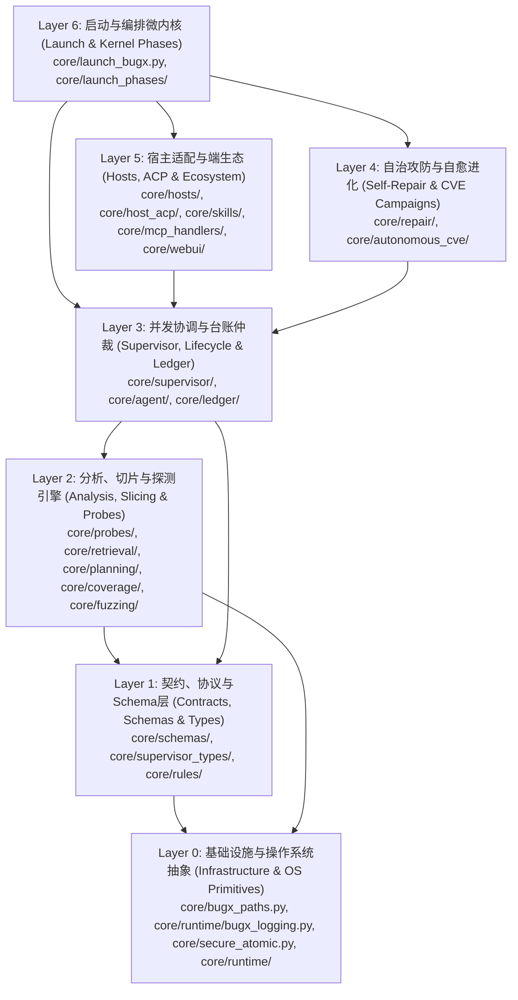
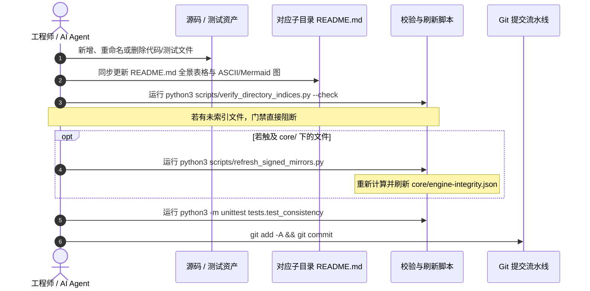

# BugX 代码与测试模块命名、分组与检索工程规范
# (Architecture Nomenclature, Grouping & Codebase Retrieval Engineering Guidelines)

> **版本契约**: `0.1.1`
> **守卫机制**: `scripts/verify_directory_indices.py`
> **权威适用范围**: `core/` 微内核、`interfaces/` 交互层及全仓代码资产；测试命名章节只描述临时过程文件。
> **不适用范围**: `docs/` 目录与文档文件命名 —— 该领域由 [`docs/02_architecture/07_DOC_GOVERNANCE_STANDARD.md`](07_DOC_GOVERNANCE_STANDARD.md) §4 定义，本文件不重复规定，避免双权威。

---

## 1. 概述与治理愿景 (Vision & Engineering Axioms)

当前 BugX 基线固定为 0.1.0，系统代码资产已涵盖微内核调度、多智能体协同、动静态探针矩阵、双态覆盖率、缺陷不可篡改账本与 L7 智能自愈等复杂子系统。为了解决**“视觉散乱、随意平铺、命名不一、跨层依赖恶化以及检索效率低下”**等长期痛点，特制定本工程级规范。

所有框架维护者与 AI 编码智能体必须严格遵循以下**三大工程治理铁律**：

1. **命名即契约 (Naming as Contract)**：
   模块与文件名必须准确传达业务领域与职责动宾，严格遵循领域语义分词前缀矩阵；临时验证文件统一 `test_<被测模块>.py`，并在验证后删除，杜绝模糊拼贴。
2. **分层单向无环 (Layered Unidirectional Graph)**：
   `core/` 各领域子包严格按照分层模型划分，依赖单向流动，坚决杜绝反向越级依赖与循环引用。
3. **100% 索引对齐与零知识漂移 (Zero-Drift Living Index)**：
   物理磁盘存在的每一个源文件、测试与脚本均必须在所属目录的 `README.md` 中建立全景索引与职责说明；代码变动时文档必须原子同步更新，由机器可执行门禁实时拦截脱节行为。

---

## 2. 模块命名工程规约 (Module Naming Conventions)

### 2.1 源文件与模块命名
1. **命名风格**：全部使用小写下划线（`snake_case`），严格禁止驼峰、中横线或空格。
2. **语义结构**：遵循“领域前缀 + 业务动宾/名词短语”模式，要求直观表达功能边界：
   - 示例：`session_profile.py`, `budget_governor.py`, `finding_verification.py`, `graph_ego.py`。
3. **禁止垃圾桶命名 (No Kitchen-Sink Names)**：
   严禁出现 `utils.py`, `helpers.py`, `common.py`, `tools.py`, `misc.py` 等无明确领域语义的泛化命名。必须添加领域限定词，例如：
   - `ast_utils.py` (AST 抽象语法树处理工具)
   - `path_helpers.py` (受控沙箱路径辅助)
   - `date_common.py` (时间与时区格式化)

### 2.2 领域语义前缀/后缀矩阵 (Prefix & Suffix Matrix)

在 `core/` 微内核中新增模块时，必须匹配以下前缀/后缀模式：

| 领域分类 | 命名模式 | 职责与内聚边界 | 典型范例 |
| :--- | :--- | :--- | :--- |
| **攻防探测器** | `*_probe.py` / `probe_*.py` | 静态代码分析、动态污点与外部扫描工具包装 | `sast_probe.py`, `probe_registry.py` |
| **代码覆盖率** | `coverage_*.py` | 源码插桩、分支覆盖度度量与法医取证分析 | `coverage_bootstrap.py`, `coverage_forensics.py` |
| **缺陷与台账** | `finding_*.py` | 漏洞状态机、复现配方、反事实判定与原子落盘 | `finding_lifecycle.py`, `finding_verification.py` |
| **工作单元** | `worker_*.py` | 子进程沙箱、状态隔离、任务移交与执行管线 | `worker_runtime.py`, `worker_handoff.py` |
| **宿主适配** | `host_*.py` | 外部宿主 Agent（OpenCode/Claude/Cursor）集成 | `host_registry.py`, `host_provider_arbitrator.py` |
| **自愈修复** | `repair_*.py`, `rsi_*.py`, `l7_*.py` | 补丁合成、自愈迭代循环与最小化复现验证 | `l7_repair_loop.py`, `rsi_rounds.py` |
| **契约与模型** | `*_schema.py`, `*_types.py` | 强类型数据契约、枚举定义与序列化协议 | `cloud_schema.py`, `supervisor_types/` |
| **启动微内核** | `launch_*.py`, `phase_*.py` | 启动生命周期、门禁预检与分阶段编排 | `launch_bugx.py`, `launch_phases/` |

### 2.3 临时验证文件命名规约 (Ephemeral Verification Artifacts)

仓库级测试套件和注册表已经删除。需要编写测试时，只能在仓库外临时目录或自动生成的
目标项目中创建过程文件：

1. 文件名可使用 `test_<被测模块>_<场景>.py`，类和函数命名必须表达条件与预期结果；
2. 临时文件不得写入本仓库、不得进入 `git add`、不得被发布包或索引收录；
3. 验证完成后立即物理删除临时目录；目标项目的既有测试由目标项目自行管理；
4. 长期保留的攻防基准和验收脚本必须归档到 `verification/`，不能伪装成单元测试。

---

## 3. 架构分层与单向依赖矩阵 (Subsystem Layering & Dependency Matrix)

### 3.1 核心分层拓扑模型 (7-Layer Architectural Stack)



### 3.2 跨层单向依赖矩阵 (Unidirectional Dependency Matrix)

为了防止系统陷入“蛛网循环依赖 (Spaghetti Cyclic Imports)”，各层级之间的依赖关系受到以下单向约束守卫：

| 依赖发起方 (Caller) \ 允许被依赖方 (Callee) | Layer 0 (Infra) | Layer 1 (Schema) | Layer 2 (Engine) | Layer 3 (Superv) | Layer 4 (Repair) | Layer 5 (Hosts) | Layer 6 (Launch) |
| :--- | :---: | :---: | :---: | :---: | :---: | :---: | :---: |
| **Layer 0 (基础设施与底层)** | 内部互通 | ❌ 严禁 | ❌ 严禁 | ❌ 严禁 | ❌ 严禁 | ❌ 严禁 | ❌ 严禁 |
| **Layer 1 (契约与Schema)** | ✅ 允许 | 内部互通 | ❌ 严禁 | ❌ 严禁 | ❌ 严禁 | ❌ 严禁 | ❌ 严禁 |
| **Layer 2 (分析与探测)** | ✅ 允许 | ✅ 允许 | 内部互通 | ❌ 严禁 | ❌ 严禁 | ❌ 严禁 | ❌ 严禁 |
| **Layer 3 (调度与台账)** | ✅ 允许 | ✅ 允许 | ✅ 允许 | 内部互通 | ❌ 严禁 | ❌ 严禁 | ❌ 严禁 |
| **Layer 4 (自愈与进化)** | ✅ 允许 | ✅ 允许 | ✅ 允许 | ✅ 允许 | 内部互通 | ❌ 严禁 | ❌ 严禁 |
| **Layer 5 (宿主与生态)** | ✅ 允许 | ✅ 允许 | ✅ 允许 | ✅ 允许 | ❌ 严禁 | 内部互通 | ❌ 严禁 |
| **Layer 6 (启动微内核)** | ✅ 允许 | ✅ 允许 | ✅ 允许 | ✅ 允许 | ✅ 允许 | ✅ 允许 | 内部互通 |

> [!CAUTION]
> **绝对依赖红线 (Zero Reverse Coupling)**：
> 1. `core/bugx_paths.py` 与 `core/runtime/bugx_logging.py` 是最底层的锚点，**绝对禁止导入任何上层模块**。
> 2. `core/probes/` 与 `core/retrieval/` 属于纯粹的计算/分析单元，**严禁反向依赖 `supervisor/` 或 `hosts/`**。
> 3. 跨子系统通信优先通过公共门面（如 `LedgerFacade`, `SupervisorHostManager`）或标准化事件契约，严禁私自耦合未导出的内部实现类。

---

## 4. 全域测试 21 个专业领域分类规约 (Tests 21-Domain Taxonomy)

`tests/` 目录彻底摒弃了全平铺模式，划分为 **21 个专业业务领域子系统** 与 **2 个测试基础设施目录**：

```text
tests/
├── 1. 业务领域测试子包 (21 Domain Subpackages)
│   ├── agent/         # 智能体评估、规划、目标探测与编排协同回归
│   ├── cli/           # CLI 子命令派发、交互终端与菜单选择自动化测试
│   ├── cloud/         # 端云同步、数据飞轮、首次接入与云端竞速测试
│   ├── coverage/      # 两阶段代码覆盖率、清单生成与法医取证回归
│   ├── cve/           # 真实 CVE 战役复现、攻击图谱与真实世界利用核验
│   ├── e2e/           # 端到端场景、全流程驱动与全矩阵故障注入套件
│   ├── gates/         # L0~L7 分级门禁流水线、冒烟流与验收凭证核验
│   ├── governance/    # 预算配额、调用频次熔断与代码安全治理测试
│   ├── hosts/         # 外部宿主环境适配器、ACP 探针与无头模式回归
│   ├── infra/         # 基础设施、构建流水线、版本一致性与安全原子操作
│   ├── knowledge/     # 代码知识图谱分析、符号索引与语义检索测试
│   ├── ledger/        # 缺陷台账、错题经验沉淀与生命周期状态机测试
│   ├── lifecycle/     # 会话生命周期控制、启动阶段屏障与故障自愈回归
│   ├── multilang/     # 多语言（C/Go/Rust/Java/Python/JS）审计与差分基准
│   ├── planning/      # 任务规划、领域路由、代码切片与意图裁决测试
│   ├── probes/        # SAST、SCA、模糊测试与专用漏洞探测器矩阵测试
│   ├── repair/        # 缺陷自愈、RSI 修复闭环与补丁合成回归
│   ├── report/        # 报告生成引擎、WebUI Studio 与 Web 标准一致性测试
│   ├── runtime/       # 运行时环境配置、状态持久化与全链路遥测测试
│   ├── skills/        # MCP 协议工具、技能扩展与生态服务测试
│   └── supervisor/    # 并发协调器、Worker 租约、心跳监控与 Checkpoint 回归
│
├── 2. 测试基础设施子包 (Test Infrastructure)
│   ├── engine/        # 自适应测试选择器引擎核心底层（select_tests, ownership）
│   └── fixtures/      # 全局通用测试夹具与被测项目样例靶场数据
│
└── 3. 根目录基础设施与核心入口 (Root Infrastructure)
    ├── run_tests.py   # 多车道测试并发调度器执行入口
    ├── test_consistency.py # 全仓一致性与防知识漂移权威守卫
    └── test_registry.json  # 源码到测试模块精准双向映射规则库
```

### 4.1 DOC-176 双车道隔离执行准则 (Lane Segregation Axioms)

在编写或归类测试模块时，必须依据以下准则选择执行车道：

1. **普通模块车道 (Module Lane - 缺省推荐)**：
   - **准入条件**：凡不启动系统级真子进程、无跨用例共享可变全局状态的纯逻辑单测，必须在 Module 车道执行。
   - **特点**：同进程/多进程快速并行，执行时间通常在毫秒级到秒级。
   - **红线**：严禁在 Module 车道使用昂贵的 `copytree` 模板复制夹具。
2. **用例隔离车道 (Case Lane - 特权隔离)**：
   - **准入条件**：必须启动真实操作系统子进程（如运行真正的 CLI 进程或系统守护进程）、依赖真实信号捕获、或断言进程退出码的重型回归。
   - **特点**：通过 `--case-workers 4` 为每一个测试用例拉起独立隔离的 Python 子进程。
   - **红线**：长跑用例必须经过轻量化拆分，非必须起真子进程的纯协议断言必须迁移至轻量单元测试（如 `test_launch_bugx_unit.py`）。

---

## 5. 高效代码检索与知识发现实战 (Fast Navigation & Codebase Retrieval)

当面对上百个模块与成千上万行代码时，严禁使用盲目的发散式遍历，推荐采用以下高信噪比检索工具链：

### 5.1 知识图谱检索 (Codebase Memory Graph)
本项目深度集成了 `codebase-memory-mcp` 知识图谱，代码查找的推荐优先级如下：

1. **查找符号或函数**：
   ```text
   MCP Tool: search_graph(name_pattern=".*BudgetGovernor.*")
   ```
2. **追踪调用链与影响面**：
   ```text
   # 反查谁调用了我 (Inbound Callers)
   MCP Tool: trace_path(function_name="claim_lease", direction="inbound")

   # 向下追查我调用了谁 (Outbound Callees)
   MCP Tool: trace_path(function_name="launch_kernel", direction="outbound")
   ```
3. **精准阅读源码实现**：
   ```text
   MCP Tool: get_code_snippet(qualified_name="core.supervisor.budget_governor.BudgetGovernor")
   ```
4. **校验索引覆盖度**：
   ```text
   MCP Tool: check_index_coverage(path="core/supervisor/lease_manager.py")
   ```

### 5.2 目录全景索引与快速排查工具 (Verify Directory Indices)
BugX 提供了内置的全仓目录索引校验器，支持直观查看各子系统的物理资产：

```bash
# 1. 校验全仓 66 个核心目录的 README 覆盖率（有缺失直接 fail-closed 退出）
python3 scripts/verify_directory_indices.py --check

# 2. 打印包含覆盖率指标与缺失清单的详细审计大盘
python3 scripts/verify_directory_indices.py --report

# 3. 仅审计指定关键子模块
python3 scripts/verify_directory_indices.py --dirs core/runtime core/supervisor tests/cli
```

### 5.3 临时验证与变更影响审查 (Ephemeral Verification)
仓库不再提供测试选择器或提交测试门禁。需要验证变更时，先列出本轮修改文件和对应的
最小协议/静态检查，在仓库外生成临时测试，验证结束后删除：

```bash
# 1. 先检查目录索引
python3 scripts/verify_directory_indices.py --check

# 2. 对当前变更做最小静态语法检查（临时目录中的测试验证完成后必须删除）
python3 -m compileall -q core interfaces/cli/bugx_cli
```

---

## 6. 文件变动同步与防漂移闭环工作流 (Change Synchronization Workflow)

为了确保“代码一变，文档同步变”的铁律落到实处，任何涉及文件新增、重命名或删除的改动，必须严格执行以下**四步同步闭环**：



1. **更新对应文档**：
   新增模块后，立即将文件名写入该子目录及顶级目录 `README.md` 的反引号列表中，并补充职责说明。
2. **运行索引审计**：
   运行 `python3 scripts/verify_directory_indices.py --check`，确保覆盖率 100%。
3. **刷新完整性签名**（若改动包含 `core/` 下文件）：
   运行 `python3 scripts/refresh_signed_mirrors.py`，更新 `core/engine-integrity.json`。
4. **通过一致性守卫**：
   运行 `python3 -m unittest tests.test_consistency`，通过 64 项架构与文档防漂移硬门禁。
