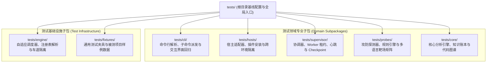
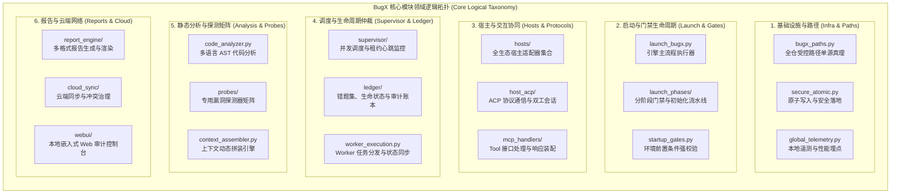

# BugX 仓库模块归类、命名规约与目录索引治理规范 (Module Taxonomy & Governance Spec)

> **版本契约**: 0.1.4 | **守卫机制**: `scripts/verify_directory_indices.py`
> **适用范围**: `core/` 核心引擎以及全仓各层级工程资产；历史测试分类章节仅保留为迁移记录。

> [!IMPORTANT]
> **当前规范（取代下文历史测试套件设计）**：本仓库不保留 `tests/` 目录、`test_registry`/测试注册表、
> `test_selector` 或 `pre-commit` 测试门禁。开发验证使用仓库外临时测试/协议检查，验证结束后物理删除；BugX
> 运行目标项目时，目标项目自带的 `tests/` 是被测输入，不属于本仓库资产。

---

## 1. 治理愿景与核心痛点

以下内容记录删除持久化测试套件前的历史背景，不再作为当前开发流程：
1. **测试目录膨胀**: `tests/` 根目录下曾平铺多达 337 个测试文件，缺乏领域内聚，开发时难以快速定位特定子系统的回归用例。
2. **核心代码平铺**: `core/` 根目录平铺 162 个 `.py` 模块，历史导入点遍布全仓（1,791 处裸引用），直接大面积移动会导致严重断链。
3. **文档与代码漂移**: 开发者在新增文件后容易遗漏索引维护与架构图对齐，导致新人与 Agent 无法直观获得代码全景图。

为了根治以上问题，当前只保留 **核心架构逻辑拓扑守门 (Core Living Taxonomy)** 与目录索引校验；历史测试体系模块化方案不再是本仓库开发契约。

---

## 2. 历史 `tests/` 目录分类方案（已废弃，仅作迁移记录）

以下内容仅保留迁移背景。仓库已物理删除 `tests/`、注册表和提交测试门禁；不得按本节恢复任何文件。
下方拓扑、命名和示例均是删除前的历史规划，不是当前目录或验证契约。当前验证在仓库外生成最小临时脚本，或使用被测目标项目自带测试，完成后删除过程文件。

### 2.1 历史目标子包拓扑结构



### 2.2 历史各子包详细收拢范围

| 历史测试子包 | 历史规划收拢范围 | 历史示例（不再存在） |
| :--- | :--- | :--- |
| `tests/cli/` | 所有 CLI 命令行工具、子命令派发与交互终端用例 | `test_cli_doctor.py`, `test_cli_hosts.py`, `test_cli_cloud.py`, `test_cli_lifecycle.py` |
| `tests/hosts/` | 宿主探测、安装适配、MCP/Skill 协议与宿主环境烟测 | `test_host_components.py`, `test_smoke_host_acp.py`, `test_smoke_host_headless.py` |
| `tests/supervisor/` | 多 Worker 编排、租约仲裁、状态恢复与 Checkpoint | `test_supervisor_host.py`, `test_worker_execution.py`, `test_worker_handoff.py` |
| `tests/probes/` | SAST 规则分析器、模糊测试器与语言探测器 | `test_domain_probes.py`, `test_sast_probe.py`, `test_differential_oracle.py` |
| `tests/core/` | 静态图谱、逻辑推理、错题本与全局路径工具 | `test_code_analyzer.py`, `test_logic_analysis.py`, `test_context_assembler.py` |
| 历史 `tests/engine/` | 历史测试执行器、选择器、依赖解析与并发隔离 | 历史 `test_selector.py`、`test_run_tests.py`（均不属于当前仓库） |

---

## 3. 历史测试设计公理（已废弃，仅作迁移记录）

> 本节所有“必须/禁止”均属于旧测试套件时期的约束；`test_selector`、`test_registry` 与
> `pre-commit` 测试门禁已删除。当前只遵循仓库外临时验证、协议探针及下文核心架构与目录索引约束。

### 3.1 历史命名规约 (Naming Conventions)
1. **测试文件名**: 必须统一以 `test_<component_name>.py` 命名，字母小写，下划线分隔，严禁驼峰或不带 `test_` 前缀的文件出现在测试目录中。
2. **测试类名**: 必须使用大驼峰命名，且以 `TestCase` 或 `Test` 结尾（如 `CliDoctorTestCase`, `TestCliAdvisory`）。
3. **测试方法名**: 必须以 `test_<scenario>_<expected_behavior>` 格式明确描述用例意图，禁止如 `test_1`, `test_func` 等无意义命名。
4. **导入路径深度自适应**: 在子包内的测试模块计算仓库根目录时，必须严格使用 `REPO_ROOT = Path(__file__).resolve().parents[2]`，禁止硬编码 `parents[1]`。

### 3.2 历史 DOC-176 车道隔离红线 (Execution Lane Axioms)
1. **轻量模块车道 (Module Lane - 默认)**:
   - 凡不启动真实宿主子进程、不产生跨用例共享可变状态的纯逻辑单测，必须在 Module 车道执行。
   - 严禁在 Module 车道用例中使用昂贵的 `copytree` 模板夹具。
2. **用例隔离车道 (Case Lane - 特权)**:
   - 仅当用例必须启动真实操作系统子进程、测试信号捕获或包含进程退出断言时，才允许进入 Case 隔离车道。
   - 历史上，串行长跑模块（耗时 >30s）曾登记在 `DEFAULT_SERIAL_MODULES`（`tests/run_tests.py`）与 `SERIAL_LANE_MODULES`（`tests/engine/__init__.py`）中；上述双向注册与车道调度机制已随持久化测试套件删除。

---

## 4. `core/` 核心架构分类与演进治理

### 4.1 核心架构逻辑六分法拓扑



### 4.2 渐进收拢演进契约 (Zero-Breakage Evolution)
1. **严禁暴力移动**: 鉴于全仓存在 1,791 处对 `core/*.py` 的顶层导入，严禁一次性大面积物理重命名或移动现存顶层模块。
2. **新增模块强约束**: 所有新开发功能与新增模块，**必须直接落入所属专业子包**（如新分析能力进入 `core/analysis/`，新协议处理进入 `core/mcp_handlers/`），严禁继续随意向 `core/` 根目录平铺散落文件。
3. **外观模式过渡**: 存量核心模块在重构收拢进子目录时，必须在原有路径保留外观转发（Facade），并在下一主版本发布前彻底清理所有旧引用。

---

## 5. 目录全景索引守卫与防漂移机制 (Zero-Drift Invariants)

本项目通过物理文件扫描与文档反向比对，实现 100% 防知识漂移：

### 5.1 守卫规则
1. **物理对齐**: `core/`、`scripts/`、`interfaces/`、`ecosystem/` 及其所有子目录下真实存在的每一个文件或子目录，必须在该目录的 `README.md` 中有一对一的反引号名称索引。仓库外临时验证目录和被测目标项目不纳入本索引。
2. **无死条目**: 文件移动或删除后，旧 `README.md` 中的条目必须同步剔除，新目录下的 `README.md` 必须同步补齐。
3. **可执行门禁**:
   ```bash
   # 全局目录索引覆盖率检查（缺失条目或死条目直接 exit 1）
   python3 scripts/verify_directory_indices.py --check
   ```
4. **可执行校验**：`python3 scripts/verify_directory_indices.py --check` 直接读取物理目录和 README 索引；不再通过持久化测试模块或提交门禁执行。
