# BugX AI 使用指南

> **版本**：0.1.0+build.470 ｜ **更新日期**：2026-11-10
> **定位**：给宿主 AI 的任务型操作指南
> **相关文档**：[AI Reference](01_AI_REFERENCE.md) ｜ [AI 命令手册](03_AI_COMMANDS.md) ｜ [用户故障排查](../01_guides/03_TROUBLESHOOTING.md)

> 面向使用 BugX 的开发者和宿主 AI。BugX 是审计协议与生命周期引擎；宿主 AI 负责理解目标、操作门禁、分析证据并汇报结果。命令选择与每类命令的适用场景见 [03_AI_COMMANDS.md](03_AI_COMMANDS.md)，完整参数见 [01_AI_REFERENCE.md](01_AI_REFERENCE.md)，生命周期背景见 [03_BUGX_AUDIT_FLOW.md](../02_architecture/03_BUGX_AUDIT_FLOW.md)。

## 0. AI 启动与排障路线



AI 只在每个阶段都拿到相应证据后进入下一阶段。遇到没有新状态变化的失败，不继续换参数重试，转到[故障排查与恢复手册](../01_guides/03_TROUBLESHOOTING.md)，并把最终状态标为 UNVERIFIED、BLOCKED 或 RECOVERY_REQUIRED。

## 什么时候使用 BugX

- 你明确要做代码安全审计、漏洞挖掘、发布前安全检查，或要复现一个可能的安全缺陷。
- 目标是你拥有或获准测试的代码库。自己写的本地项目可以审计；这不因“安全”二字而违规。先确认审计范围和是否允许联网、上传数据、修改文件。
- 单个函数、文件、Diff 或已知异常，采用定点分析和最小复现。
- 全项目未知缺陷、全域覆盖或并发挖掘，走 BugX 完整生命周期。

普通问答、日常开发、文档撰写或没有审计意图的单点调试，直接使用常规助手，不要启动 BugX 门禁。若用户要求检查 BugX 自身的日志或源码，目标是 BugX 安装/源码，不要误把被测业务项目当成 BugX 引擎。

## 标准启动顺序

1. 先确认本次实际执行的 CLI：`which bugx`、`bugx --version`、`bugx --help`。记录 CLI 版本；不要把旧日志里的 build、项目 manifest 版本或全局引擎版本混为一谈。
2. 明确被测项目的绝对路径 `<ROOT>` 和审计范围；路径不确定时先确认，不要拿插件仓库或当前工作目录猜测目标。
3. 先读取状态：

   ```sh
   bugx engine --root <ROOT> status --json
   ```

   查看当前分支、未提交改动和 `.bugx/` 状态。保留已有改动与运行数据。新项目状态为 `UNINITIALIZED` 时，直接运行 `pre`；不要先用 `init` 重建已有项目。

4. 根据请求先查 [03_AI_COMMANDS.md](03_AI_COMMANDS.md) 选择命令，再核对帮助。顶层可用 `bugx help <command>`；不要假设任意嵌套命令的 `--help` 都只读。单层 positional dispatcher 可能把 `--help` 当作实际操作参数，例如本机 `bugx supervisor install --help` 曾实际创建 Supervisor MCP。遇到 leaf help 不支持时，使用本手册和对应 CLI dispatcher 源码，不能把 `value/action` 或父级 flags 拼进去。
5. 运行启动门禁：

   ```sh
   bugx engine --root <ROOT> pre
   ```

   - 退出码 `0`：启动门禁就绪；再按当前审计任务进入后续阶段。
   - 退出码 `2`：需要宿主完成交互决策。读取 `BUGX_INTERACTION_REQUEST`，按原样呈现问题和选项，并记录所选项的 `question_id`、`value`、`action`、`detail`。
   - 退出码 `3`：需要重新安装/加载宿主入口并重启宿主会话，再运行一次 `pre`。
   - 其他非零退出：是失败；检查状态、错误输出和日志，说明阻塞原因。

`engine pre` 负责准备并检查本轮的状态和门禁；它自己不等于“全项目已经挖掘完成”。版本号也要区分：`.bugx/manifest.json` 的 `layout_version` 是运行数据格式，CLI/Engine 的 `bugx_version` 是程序版本；布局缺失时不要手改版本字段来绕过阻断。

## Dev 模式分流：先选 engine 来源，再选生命周期策略

AI 必须把下面两个开关分开处理：

| 开关 | 作用 | 决策规则 |
|---|---|---|
| `BUGX_DEV_MODE=1` | 在真实 BugX 源码 checkout 中把 engine 解析到仓库 `core/` | 只有用户明确要验证 BugX 源码改动时设置；当前进程必须满足 checkout 条件；`BUGX_GLOBAL_ENGINE_ROOT` 显式覆盖它 |
| `BUGX_DEV_ASSET_ROOT=1` | 上一开关的兼容别名 | 新调用优先 `BUGX_DEV_MODE=1`；值不是 `1` 时不生效 |
| `pre --dev` | 改变生命周期默认策略 | 只有用户明确接受自动修复、自动轮询、自动批准策略和按轮次提交时使用；它不是只读开关 |

AI 不得因为当前 cwd 是源码目录就声称 Dev engine 生效。先运行只读确认：

```sh
env -u BUGX_GLOBAL_ENGINE_ROOT \
    BUGX_DEV_MODE=1 \
    bugx engine --root <ROOT> path --name launch_bugx.py
```

唯一可接受的源码开发路径是 `<BUGX_SOURCE_CHECKOUT>/core/launch_bugx.py`。如果输出来自 `~/.bugx/core`、wheel、npm 包或其他目录，停止并检查 CLI 进程来源、`.git`、`scripts/bump_version.py`、`BUGX_GLOBAL_ENGINE_ROOT` 和 `BUGX_ASSET_ROOT`。不要先运行 `pre`，也不要用 `--force` 掩盖来源混用。

只验证源码而保留人工策略时，使用：

```sh
env -u BUGX_GLOBAL_ENGINE_ROOT \
    BUGX_DEV_MODE=1 \
    bugx engine --root <ROOT> pre \
    --fix-mode log-only \
    --commit-policy manual \
    --cloud-sync local
```

只有在隔离、可回滚、已获授权的项目中，才使用极速 Dev 生命周期：

```sh
env -u BUGX_GLOBAL_ENGINE_ROOT \
    -u BUGX_ASSET_ROOT \
    BUGX_DEV_MODE=1 \
    bugx engine --root <ROOT> pre --dev --cloud-sync local
```

`--dev` 当前默认 `autonomous=true`、`review-mode=mcp-auto`、`fix-mode=auto`、`polling=auto`、`commit-policy=round`、`session-recovery=resume`、`startup-action=start`、`strategy-plan=approve`，并跳过策略类提问。显式 `--cloud-sync` 或 profile 中已有 cloud policy 优先于 Dev 的 local 缺省。`--dev` 仍不能绕过 Git、版本、MCP、预算、凭据或 evidence gate。

Dev 路径的成功判定分三层：

1. `path` 指向当前 checkout 的 `core/launch_bugx.py`，只证明 engine 来源正确；
2. `pre` 返回 0，才证明启动门禁就绪；返回 2 必须等待交互，返回 3 必须重启 Host 后再运行一次；
3. 只有真实 Worker receipt、coverage、Finding verification、post 和 settlement receipt 齐全，才可以判断生命周期完成。

路径不匹配、出现未授权代码修改、状态为 `BLOCKED`/`RECOVERY_REQUIRED`、receipt 缺字段或同一失败没有新外部证据时，停止重试，报告阻塞原因和下一步。结束会话后清理本次设置的 `BUGX_DEV_MODE`/`BUGX_DEV_ASSET_ROOT`，但恢复而不是盲删用户原有的 engine/asset override。

## 处理交互选项：value 和 action 不是命令行参数

宿主返回的 `value` 是用户选择，`action` 是受控动作标识。两者都不能直接拼到 `engine pre` 后面，也不能推断成同名 CLI 参数。按这个顺序处理：

1. 一并读取问题 ID、选项的 `value` / `action`、用户可见描述和 `detail`。
2. 按用户可见问题限定操作范围；在执行前用当前 CLI 帮助或 AI Reference 核对命令和参数。
3. 只执行该选择明确授权的动作和范围；成功后再重跑一次 `pre`。
4. 如果同一个问题再次出现，停止重试，检查状态与日志，确认命令是否真的改变了对应状态。不要重复同一命令、换参数碰运气或改写 `.bugx/` 状态。

### 云同步门禁示例与范围确认

先把选项字段和范围说清：`value` 是选择值，`action` 是 BugX 内部动作 ID，两者都不是 CLI 参数。直接项目同步可明确指定范围：

```sh
bugx cloud status --root <ROOT> --scope project --json
bugx cloud sync --root <ROOT> --scope project
```

当前安装版 `cloud sync` 未设置范围时默认 `all`。更关键的是，`cloud onboard on`、`init --cloud-sync sync` 和已保存的同步决定进入 `engine pre` 时会调用 onboarding `sync_layers`；本机这条路径实际同步了 global + project。**所以项目级 `cloud sync --scope project` 后不能无条件再运行 `engine pre` 并宣称只同步项目。**如果用户只授权项目范围而启动路径会出全局数据，先停在门禁，确认授权或修复为真正的项目级启动路径。

若门禁请求创建项目身份（例如 `action=create_project_identity`），先核对当前 CLI 的 `cloud projects add` 语法。该命令会联网并写 `<ROOT>/.bugx/cloud-project.json`；这与选择“开启云同步”是两个动作。提交是独立 Git commit，只有用户明确选择创建并提交后，才只 stage/commit `.bugx/cloud-project.json`，保留其他 WIP。若选择取消则停止同步，不要换成身份创建命令。

### 云端数据路径的 AI 分流

在给出任何“同步/上传”下一步前，先向用户说明实际数据面，不要把“云端”当成一个统一动作：

| 用户意图 | 唯一对应入口 | 先确认什么 | 成功证据 |
|---|---|---|---|
| 同步 BugX 知识 | `bugx cloud sync --scope project|global|all` | consent、scope、`full|summary`、`block|redact|allow` | 每层 baseline/push/pull 摘要 + `cloud status` 收敛 |
| 上传项目规模/画像 | `bugx project sync --json` | 账号、项目绑定、是否允许指标出网 | `status=ok`、`project_id`、`synced=true` |
| 发送飞轮遥测 | `bugx telemetry flush|upload` | telemetry consent、队列范围、strict policy | inspect/audit + sent/remaining 结果 |
| 上报日志 | `bugx cloud log-report --tail-kb ...` | 日志尾部是否有秘密；kind、大小、限额 | bytes/lines + 网络返回和退出码 |
| 上报 lesson 反馈 | `bugx cloud feedback --dry-run` → 非 dry-run | 条目、outcome、lifecycle/run/project；先预览 | dry-run 条目或 updated/missing |
| 传输 bundle | `cloud export` → 人工检查 → `cloud upload` | bundle SHA-256、scope、mode、敏感策略 | snapshot_id/version + 上传后本地基线收敛 |

若用户只说“把数据上传一下”而没有指定数据面、scope 和授权，必须停在 `BLOCKED/NEEDS_USER_SCOPE`，先列出上述选项，不能自行选择 `all`、`full` 或 `allow`。`cloud sync` 省略 scope 时当前默认可能是 `all`；`onboard on` 和启动 onboarding 还可能同步 global + project。项目级同步成功后，不能推断后续 `pre` 仍 project-only。

云端故障恢复顺序固定为：`cloud status --json` → `auth status --verify`（需要网络时）→ `conflicts list` → `dead-letter list` → 仅在明确 cursor/baseline 失配时 `sync --calibrate`。`ack_pending=true`/`committed=true` 先标 `RECOVERY_REQUIRED`，不要 reset 或重复 upload；open conflict、data sharing revoked、payload/TLS/账号错误都不能用 calibrate 绕过。

`--cloud-sync` 在 `init` 中是初始化参数；在 `engine pre/audit` 中由全局 engine 读取为本次启动的 cloud policy。两条路径都必须明确范围，不要因为参数同名就把一个命令的持久化语义套到另一个命令上：

```sh
bugx init --root <ROOT> --cloud-sync local
bugx engine --root <ROOT> pre --cloud-sync local
```

`engine pre --cloud-sync local` 只表达本次启动使用本地策略，不会自动撤销用户级数据分享同意；`sync` 是联网和数据分享出口。若项目 profile 或其他启动状态仍要求 global+project onboarding，必须以实际状态和授权为准。若选择“下次再说 / 停止”，就结束本轮，不要继续启动。

### Supervisor MCP 启动门禁

如果当前宿主显示 action `install_supervisor_mcp`，它映射到 `bugx install --root <ROOT> --agent <HOST> --allow-missing --non-interactive`。先核对 `bugx hosts --root <ROOT> --json` 里的准确 host 名称。当前 `bugx install` 不只是写宿主配置，还会安装/更新全局 `~/.bugx/core`、初始化项目 layout/ledger/生命状态并写宿主入口，可能要求完全重启宿主。这个 action **不是** `bugx supervisor install`；后者是不同操作，且当前 CLI 的 positional parser 会把 `bugx supervisor install --help` 执行成真实安装。若 source-tree guard 拒绝从含脏改动的 BugX 源码树安装，不加 `--force` 绕过；先报告其会覆盖的全局引擎来源和扩大后的影响范围。

## 状态异常时

遇到 `FATAL_BLOCKED`、项目布局缺失、版本契约错误或状态文件冲突时，先保存状态报告、日志和现有文件清单。不要自动执行 `init`、`reset`、删除 `.bugx/` 或手改 manifest。确需恢复时，先查看对应 reset 的 dry-run 和备份范围，再按用户授权操作。

版本必须分清：`layout_version` 是项目运行态格式；CLI/Engine 版本是程序版本。二者不相等不自动证明要改 `manifest.json`。先核对当前 `bugx --version`、`engine status --json`、`doctor` 和安装来源；同一阻断重复出现时不原样重试、不换参数碰运气。

## 汇报规则

明确区分“状态检查通过”“门禁就绪”“挖掘已启动”“挖掘完成”。报告实际执行的命令、退出码、审计范围、证据位置及未完成项。仅完成 `status` / `pre` 或云端 onboarding 时，不能说已经挖掘或完成审计。
