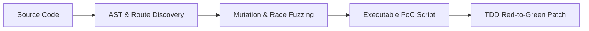
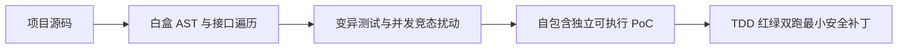

<p align="center">
  <strong>BugX · AI writes the code. BugX hunts the bugs.</strong>
</p>

> **Version 0.1.0** | **Updated: 2026-11-10**

> **Search summary** — BugX is a local-first Node.js/Python CLI for AI code auditing, application security review, vulnerability hunting, and verified bug reproduction. It connects supported MCP/ACP coding hosts to structured lifecycle evidence, coverage, Findings, execution receipts, and recovery artifacts.

<p align="center">
  <strong>The autonomous, evidence-driven code auditing and vulnerability-hunting agent for modern AI programming tools.</strong>
  <br>
  <em>AI writes the code. BugX hunts the bugs. · 面向主流 AI 编程助手的自主闭环、证据驱动型深度代码审计智能体。</em>
</p>

<p align="center">
  <a href="https://www.npmjs.com/package/bugx-cli"></a>
  <a href="https://nodejs.org/"></a>
  <a href="LICENSE"></a>
  <a href="https://www.npmjs.com/package/bugx-cli"></a>
  <a href="https://www.npmjs.com/package/bugx-cli"></a>
</p>

---

<p align="center">
  <a href="#-english-documentation">English Documentation</a> •
  <a href="#-简体中文说明">简体中文说明</a>
</p>

---

## 🌐 English Documentation

### ⚡ What is BugX?

**BugX** seamlessly embeds deep adversarial security inspection into your modern AI coding workflow (Claude Code, OpenAI Codex, OpenCode, Cursor, Windsurf, DeepSeek Harness, WorkBuddy, Pi).

Rather than dumping hundreds of noisy, unverified regex alerts, BugX implements an **evidence-based closed verification loop**:



- **Zero Speculation**: An issue is only confirmed when an executable, self-contained reproduction script (PoC) succeeds in isolating it.
- **Red-Green Patch Synthesis**: BugX automatically synthesizes minimal fixes and verifies them with dual test runs before closing findings.
- **Host-Neutral Architecture**: BugX never hijacks LLM execution. Your AI coding agent drives the actual code analysis and testing natively.

---

### 📦 Quick Start

#### Requirements
- **Node.js**: `>= 18.0.0`
- **Python**: `>= 3.11` (The BugX core engine is Python-powered; the npm package serves as a lightweight, zero-dependency global wrapper that automatically interfaces with your local Python environment).

The npm tarball includes the integrity-checked BugX core payload, its catalog, and the bundled Web UI static shell. It has no native `sqlite3` npm dependency; MCP registry storage uses the Node runtime's built-in `node:sqlite` path where applicable.

---

#### 1. Instant Execution with `npx` (Zero Installation)

Run BugX commands directly in any project without installing anything globally:

```bash
# Check system readiness and AI tool connectivity
npx bugx-cli doctor

# Initialize current repository (.bugx/)
npx bugx-cli init

# Auto-configure local AI assistants (Claude, Codex, OpenCode, etc.)
npx bugx-cli install
```

---

#### 2. Global Installation (Recommended for Daily Use)

Install globally via your preferred package manager:

```bash
# npm
npm install -g bugx-cli

# pnpm
pnpm add -g bugx-cli

# yarn
yarn global add bugx-cli

# bun
bun add -g bugx-cli
```

Once installed, use the unified `bugx` command directly:

```bash
# Initialize workspace
bugx init

# Discover and register local AI tools
bugx install

# Run health diagnostics
bugx doctor
```

---

### 🤖 Supported AI Coding Ecosystem

BugX automatically detects and configures Model Context Protocol (MCP) servers and skill configurations across your tools:

| AI Coding Assistant | Integration Mechanism | Setup Command |
| :--- | :--- | :--- |
| **Claude Code** | Native MCP / Autonomous Protocol | `bugx install --agent claude` |
| **OpenAI Codex** | Workspace Subagent / Native Plugin | `bugx install --agent codex` |
| **OpenCode** | Headless ACP / Native MCP | `bugx install --agent opencode` |
| **DeepSeek Harness (DSH)** | Official Web UI Extension & MCP | `bugx install --agent dsh` |
| **WorkBuddy** | Official IDE Connector Bundle | `bugx install --agent workbuddy` |
| **Cline / Roo Code** | MCP; interactive single-claim or CLI process-pool execution | `bugx install --agent cline` |
| **ChatGPT** | Project MCP / interactive host integration | `bugx install --agent chatgpt` |
| **ZCode** | Native MCP / host integration | `bugx install --agent zcode` |
| **Pi** | Native MCP / host integration | `bugx install --agent pi` |
| **Qoder AI** | Native MCP / host integration | `bugx install --agent qoder` |
| **Trea** | Native MCP / host integration | `bugx install --agent trea` |
| **FunIDE** | Native MCP / host integration | `bugx install --agent funide` |
| **Cursor / Windsurf** | Standard MCP Server | `bugx mcp serve --role host` |

Run `bugx hosts` to see all supported and detected environments on your system.

---

### 🛠️ Essential Commands

| Command | Description |
| :--- | :--- |
| `bugx init` | Initialize repository audit workspace and configuration (`.bugx/`) |
| `bugx install` | Automatically register BugX with local AI assistants and editors |
| `bugx doctor` | Diagnostic suite for MCP servers, environment binaries, and project configuration |
| `bugx autonomous` | Run unattended, multi-round autonomous audit sessions; Cline supports `--workers 2..6` (or `0` for adaptive capacity) |
| `bugx stats` | Global cross-project governance, token economy, and audit velocity metrics |
| `bugx test-generate` | Generate standardized AAA unit tests or minimal reproduction PoCs |
| `bugx test-audit` | Four-dimensional quality audit for existing test suites |
| `bugx test-verify` | Verify test suite defect-catching effectiveness via AST mutation |
| `bugx patch-forge` | Synthesize minimal self-healing patches and run red-green verification |
| `bugx uninstall` | Cleanly remove host integrations while safely retaining audit findings |
| `bugx update` | Check and upgrade BugX to the latest release |

Autonomous sessions keep their host, execution mode, worker capacity, and dispatch settings in the current project’s `.bugx/bugx-runtime.json`. Each workspace has its own runtime context, so concurrent hosts do not share global scheduling state. Use `bugx autonomous --host cline --workers 4` to select an explicit Cline process-pool capacity; `0` keeps adaptive capacity.

---

### 🛡️ Security & Privacy Guarantees

- **Local-First Execution**: AST parsing, mutation runs, reproduction scripts, and local audit artifacts remain on your disk in `.bugx/`.
- **No Unsolicited Source Upload**: BugX does not transmit proprietary source code without explicit cloud-sync or reporting authorization. Finding/report behavior follows the configured cloud and redaction settings; `BUGX_REPORT_REDACTION=standard` enables credential/path redaction.
- **Deterministic Bounds**: Concurrency budgets, timeout thresholds, and execution sandboxes ensure your host system remains stable.

---

## 🇨🇳 简体中文说明

### ⚡ 什么是 BugX？

**BugX** 是一款专为现代主流 AI 编程助手（Claude Code、OpenAI Codex、OpenCode、Cursor、Windsurf、DeepSeek Harness 等）打造的**自主闭环、证据驱动型深度代码审计与漏洞挖掘智能体**。

与传统的静态代码分析工具（仅产生大量未经证实的告警和噪音）不同，BugX 严格遵循**“事实证据闭环验证协议”**：



- **拒绝口头推测**：每一个被确认的缺陷，系统都必须自动合成可独立执行验证的最小复现代码（Proof-of-Concept）；
- **红绿测试自愈合成**：通过本地隔离沙箱执行 Red-to-Green 差异双跑，在确认补丁精准修复且不引入任何回归前，绝不虚假结案；
- **宿主无关，零侵入性**：不争夺模型执行权，代码阅读、测试执行与修复方案全部由开发者信任的 AI 宿主原生驱动。

---

### 📦 快速上手

#### 环境依赖要求
- **Node.js**：`>= 18.0.0`
- **Python**：`>= 3.11`（BugX 底层核心引擎由 Python 驱动，npm 包作为轻量 CLI 封装，启动时会自动无缝对接本机 Python 环境）

npm tarball 会完整携带经过完整性清单校验的 BugX 核心载荷、目录清单和 Web UI 静态资源；不依赖原生 `sqlite3` npm 包，MCP 注册表在适用运行时使用 Node 内置的 `node:sqlite` 路径。

---

#### 1. 使用 `npx` 免安装直接执行（零安装成本）

无需全局安装，在任意工程目录下即可直接执行：

```bash
# 检查系统与 AI 工具连通就绪状态
npx bugx-cli doctor

# 在当前项目初始化审计工作空间 (.bugx/)
npx bugx-cli init

# 自动发现并接入本机已安装的主流 AI 工具
npx bugx-cli install
```

---

#### 2. 全局安装（推荐日常开发）

使用你习惯的包管理器进行全局安装：

```bash
# npm
npm install -g bugx-cli

# pnpm
pnpm add -g bugx-cli

# yarn
yarn global add bugx-cli

# bun
bun add -g bugx-cli
```

全局安装后，在任意代码仓库根目录下直接使用 `bugx` 命令：

```bash
# 初始化
bugx init

# 一键接入全部 AI 工具
bugx install

# 诊断与健康检查
bugx doctor
```

安装完成后，直接在你的 AI 编程助手（如 Claude Code 或 OpenCode）中对话即可：
> *“使用 BugX 对本项目的 API 边界与数据持久化逻辑进行深度审计。”*

---

### 🤖 支持的 AI 编程宿主

| AI 编程助手 | 接入机制 | 快速安装命令 |
| :--- | :--- | :--- |
| **Claude Code** | 原生 MCP / 自治生命周期 | `bugx install --agent claude` |
| **OpenAI Codex** | 工作区子 Agent / 原生插件 | `bugx install --agent codex` |
| **OpenCode** | Headless ACP / 原生 MCP | `bugx install --agent opencode` |
| **DeepSeek Harness (DSH)** | 官方 Web UI 扩展与 MCP | `bugx install --agent dsh` |
| **WorkBuddy** | 官方 IDE 连接器拓展包 | `bugx install --agent workbuddy` |
| **Cline / Roo Code** | 插件 MCP 交互会话（单 Claim 串行）/ CLI 多进程池自治并发 | `bugx install --agent cline` |
| **ChatGPT** | 项目级 MCP / 交互式宿主接入 | `bugx install --agent chatgpt` |
| **ZCode** | 原生 MCP / 宿主接入 | `bugx install --agent zcode` |
| **Pi** | 原生 MCP / 宿主接入 | `bugx install --agent pi` |
| **Qoder AI** | 原生 MCP / 宿主接入 | `bugx install --agent qoder` |
| **Trea** | 原生 MCP / 宿主接入 | `bugx install --agent trea` |
| **FunIDE** | 原生 MCP / 宿主接入 | `bugx install --agent funide` |
| **Cursor / Windsurf** | 通用 MCP 服务协议 | `bugx mcp serve --role host` |

运行 `bugx hosts` 可实时查看当前设备上支持与检测到的 AI 工具清单。

---

### 🛡️ 安全与隐私保障

- **本地优先执行（Local-First）**：AST 解析、变异测试、PoC 脚本与本地审计产物保留在本地磁盘的 `.bugx/` 目录中。
- **不擅自上传源码**：未经明确的云同步或报告授权，BugX 不会传输业务专有源代码；Finding/报告行为遵循当前云端与脱敏配置，设置 `BUGX_REPORT_REDACTION=standard` 可启用凭据和路径脱敏。
- **沙盒自愈与资源有界防护**：严格限定最大并发度、单回合墙钟预算与文件资源锁，保障宿主系统的绝对稳定性。

---

### 📄 许可证与商业授权

基于 BSL 1.1 (Business Source License 1.1) 协议（见仓库根 [LICENSE](../../LICENSE) 或 npm 包内 LICENSE 文件），允许个人与企业免费用于内部研发与日常安全评估；发布 3 年后自动转为 Apache 2.0。BugX Cloud 云端服务采用商业授权，商务合作请联系 business@bugx.dev。
