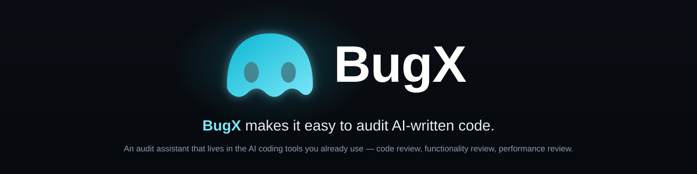
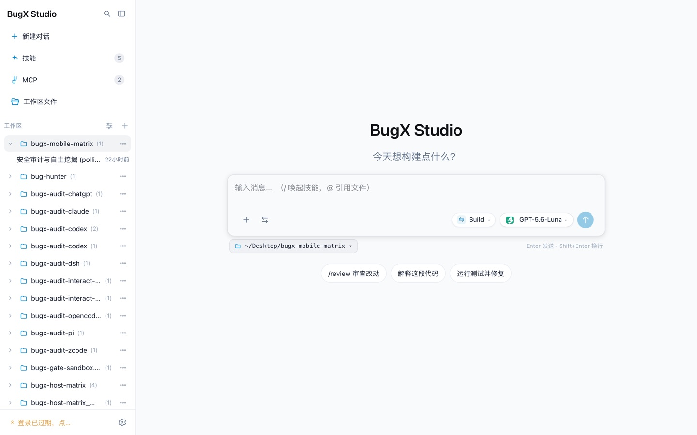
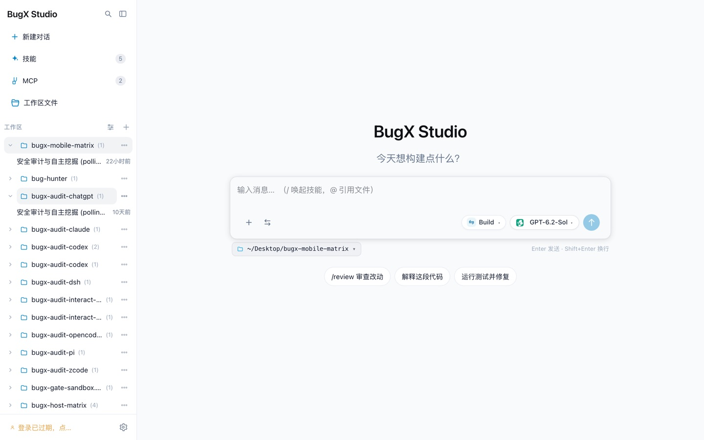
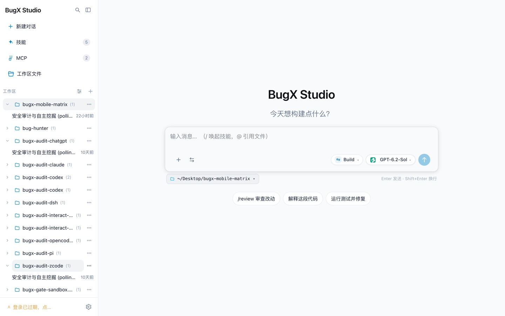
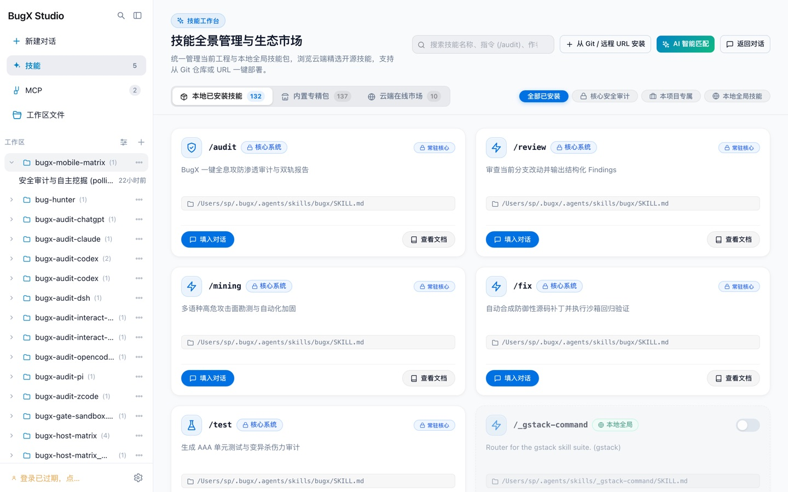

<p align="center">
  
</p>

# BugX — Autonomous Code Review & Automated Testing Agent

BugX is an autonomous code review and automated testing agent that lives inside your AI coding assistant or runs standalone on the command line.

**It safeguards software delivery at every step:**
- **For Developers**: Catches subtle, high-impact bugs immediately after code is written, eliminating painful debugging loops and rework.
- **For QA & Test Engineers**: Automates black-box, functional, and performance testing across complex edge cases that manual reviews often miss.
- **For Engineering Teams**: Guarantees code strictly meets functional contracts with rock-solid stability and resilience, ensuring dependable, crash-free releases.

By replacing subjective self-reporting with automated, evidence-backed audits, BugX accelerates release velocity, elevates software quality, and reduces long-term maintenance costs. Supported environments include **Claude Code, OpenAI Codex, Cursor, Trae, Windsurf, Kimi Code, MiniMax Code, OpenCode, ZCode, Cline, DeepSeek Harness (DSH), WorkBuddy, and Qoder**.

<p align="center">
  <a href="https://pypi.org/project/bugx-cli/"></a>
  <a href="https://pypi.org/project/bugx-cli/"></a>
  <a href="LICENSE"></a>
  
</p>

🌐 Website · 官网：**https://bugx.dev** · GitHub：**https://github.com/Bencibr/bugx**

<p align="center">
  <a href="#-english-documentation">English</a> •
  <a href="#简体中文说明">简体中文</a>
</p>

---

## English Documentation

### Why AI-written code needs an audit

AI writes code faster than any human can review it, and the model carries a training-level bias toward sounding done rather than being done:

1. **The grader rewards confidence.** Human raters score "I checked it carefully, nothing found" higher than "I haven't finished reading the files." The model learns to report good news.
2. **Checking is expensive; claiming is cheap.** Reading hundreds of files takes real work. Replying "no issues found" takes a few words.
3. **It doesn't know what it hasn't checked.** The model cannot see its own coverage gaps and will not say "half done."

BugX counters this with a ledger and four hard rules: a per-unit coverage list (checked / blocked / pending), mandatory reproduction (the same attack input must trigger the finding twice and a clean input must trigger nothing), crash-resumable audits, and hash-chained records that keep every verdict reviewable.

### What BugX does

- **AI code review** — bugs and defects classified by logic, state, boundary, exception, concurrency, performance, and resource handling.
- **Functionality review** — a behavior diff: the same inputs go to your implementation and a reference implementation, and the differences are reported.
- **Performance and memory checks** — performance and resource defects, plus dedicated memory inspection for native, Python, JVM, Electron, Android, and Apple targets.
- **UI audit** — layout, contrast, keyboard paths, and design tokens on a running web page (`bugx probe ui`).
- **Reproducible findings & blind verification** — every vulnerability is blind-reviewed by an independent verifier with a reproduction command or PoC; verified with AST negative control assertions; refuted cases are logged to the FP Ledger.
- **Prompt Policy Engine** — declarative prompt profiles adapt to model-specific safety filters (e.g. OpenAI Cyber Risk / Daybreak) without losing code fidelity.
- **Mutation-verified tests** — `bugx test-verify` mutates your code to check whether the tests actually catch the bugs.
- **Patch bundles** — `bugx patch-forge` builds a patch with static checks and hands it to you for review; it never commits on its own.
- **Lessons base and unattended runs** — `bugx lesson` / `bugx knowledge` accumulate project and global experience; `bugx autonomous` and `bugx goal` run end-to-end audits without supervision.

### BugX Studio

BugX ships with a built-in web console. Run `bugx report serve` and open http://127.0.0.1:8080:

<p align="center">
  
</p>

Every connected host keeps its own audit sessions (ChatGPT, ZCode, Claude, Codex, DSH, OpenCode, Pi, and more):

<p align="center">
  
  
</p>

The skill marketplace ships with `/audit` (one-shot full-surface audit with a dual-track report), `/review` (structured findings for branch changes), `/mining` (attack-surface survey and hardening), `/fix` (defensive patches with sandboxed regression), and `/test` (AAA tests with mutation-kill scoring):

<p align="center">
  
</p>

### Installation

Requires Python `>=3.11`.

```bash
# Standard install:
python -m pip install bugx-cli

# Or with uv (fast resolver):
uv pip install bugx-cli

# Or as an isolated application:
pipx install bugx-cli
```

Optional feature extras:

```bash
python -m pip install "bugx-cli[tui]"      # terminal interactive menu (pexpect)
python -m pip install "bugx-cli[ui]"       # web UI audit probes (playwright, Pillow)
python -m pip install "bugx-cli[graph]"    # tree-sitter multi-language AST indexing
python -m pip install "bugx-cli[crypto]"   # cryptographic telemetry and signing
```

Wire up your AI hosts once:

```bash
bugx install          # lists detected hosts (Claude Code, Codex, Cline, OpenCode, ZCode) and registers the BugX MCP servers
bugx doctor --strict  # health diagnostics
```

> ⚠️ **Important (Restart Required)**: After configuring or updating project MCP settings, **completely restart your host IDE or AI coding assistant** (e.g., Cursor, Trae, VS Code, Kimi Code, MiniMax Code, ZCode) so the host process reloads the project-level MCP server configuration.

To install everywhere at once: `bugx install --agent all`.

### Quick start

Sign in with `bugx auth login --root .`, then check the expected account and `auth_verified=true` with `bugx auth status --root . --verify --json`. Confirm which data may sync before enabling the project. If both the account-wide and project scopes are authorized, initialize a fresh project with `bugx init --root . --cloud-sync sync` and verify the transfer with `bugx cloud sync --root . --scope all`. Decline partial-sync requests. For existing projects and sync errors, see the [user guide](https://github.com/Bencibr/bugx/blob/main/docs/01_guides/01_USER_GUIDE.md#3-初始化项目).

Use `bugx engine --root . status --json` to check the current stage. After review and settlement, sync newly recorded lessons and experience in the same scope and check `bugx cloud status --root . --scope all --json`.

**Option 1 — inside your AI assistant (recommended).** Open Claude Code, Codex, Cline, OpenCode, or ZCode in any project and just tell it what to check:

> "Audit this project"
> "Check the login module for vulnerabilities"
> "Review the changes on this branch for security issues"

The AI inside your host calls BugX on its own: it builds the coverage list, dispatches concurrent workers, runs probes, verifies the findings, and writes the report. To watch an audit live, run `bugx report serve` and open http://127.0.0.1:8080.

**Option 2 — from the terminal.** The AI still comes from your installed hosts: BugX reuses the model and credentials you already configured there and never takes over your API keys.

```bash
bugx autonomous --host opencode    # full audit without supervision
bugx goal --host opencode "audit this project's login and payment flows"

bugx report serve              # live web console at http://127.0.0.1:8080
bugx report both --format html --out report.html   # offline archive
```

### Essential commands

| Command | What it does |
| :--- | :--- |
| `bugx install` | register the BugX MCP servers with detected AI hosts |
| `bugx hosts` | list every AI environment detected on this machine |
| `bugx doctor --strict` | health diagnostics for installation and connectivity |
| `bugx engine pre / status / post` | run and settle a structured audit lifecycle |
| `bugx autonomous --host <host>` | full unattended audit through your host |
| `bugx goal --host <host> "<target>"` | audit toward a stated target |
| `bugx report serve` | live web console (BugX Studio) |
| `bugx report both --format html` | export the formal + visual report |
| `bugx probe ui --url <url>` | audit a running web UI |
| `bugx test-generate` | generate AAA tests or a self-contained PoC |
| `bugx test-verify` | prove your tests catch real bugs via mutation |
| `bugx patch-forge` | build a reviewed patch bundle |
| `bugx lesson` / `bugx knowledge` | project and global experience base |
| `bugx daemon` | resident watchdog for unattended audits |

### Supported AI coding tools

| AI coding tool | Integration | Install |
| :--- | :--- | :--- |
| Claude Code | native MCP / autonomous lifecycle | `bugx install --agent claude` |
| OpenAI Codex | workspace subagents / native plugin | `bugx install --agent codex` |
| OpenCode | headless ACP / native MCP | `bugx install --agent opencode` |
| Cline / Roo Code | MCP sessions (serial) / CLI process-pool concurrency | `bugx install --agent cline` |
| ZCode | native MCP / user-level MCP registration | `bugx install --agent zcode` |

DeepSeek Harness (DSH), WorkBuddy, Cursor / Windsurf, and more are being adapted. Run `bugx hosts` to list everything detected on this machine.

### Security and privacy

- Project state lives in the project's `.bugx/` directory; the global engine, credentials, knowledge base, and caches live in a user-level BugX directory.
- Credentials are written to a controlled sandbox when needed (readable only by the current user by default). `bugx auth status` reports whether credentials exist — it never prints them.
- Knowledge sync uses the configured scope and sensitive-data policy. Bundle uploads, diagnostic log reports, and feedback have separate commands and data boundaries.
- `reset` / `uninstall` / `purge` / `--no-backup` delete data. Check each command's dry-run and backup behavior first.

### FAQ

**What is BugX?**
An autonomous code-audit agent that lives inside AI coding assistants: it runs via MCP in Claude Code, Codex, Cline, OpenCode, and ZCode, or as a standalone CLI, tracks audit coverage per unit, and verifies every finding with real executions.

**Which AI coding tools does BugX support?**
Claude Code, OpenAI Codex, Cline / Roo Code, OpenCode, and ZCode are supported today; DeepSeek Harness (DSH), WorkBuddy, Cursor / Windsurf, and more are being adapted.

**How does BugX verify a vulnerability?**
Rather than trusting the proposing model's self-report, findings are independently blind-reviewed: an attack input must reliably trigger the vulnerability twice, and a clean input must trigger zero times (two positive runs, one negative control) recorded with command, exit code, and artifact hashes, verified by AST syntax assertions. Refuted findings are recorded in the FP Ledger.

**Does BugX trigger AI model cyber-security risk blocks?**
BugX includes a declarative Prompt Policy Engine with adaptive prompt profiles (e.g., defensive QA phrasing for OpenAI Codex / GPT-4o) that prevents models from triggering platform Daybreak / Cyber Risk safety blocks, while preserving 100% of the underlying code and CWE details.

**Does BugX send my code to the cloud?**
The audit runs locally. When you enable lesson and experience sync, startup and eligible ledger writes can trigger cloud transfers. The authorized scope and sensitive-data policy govern the records sent.

**Does BugX replace human review?**
No. It gives you a reviewable ledger — what was checked, what wasn't, and reproducible evidence per finding — so human review starts from facts instead of the model's self-report.

**What languages does BugX audit?**
Multi-language static and behavioral analysis (Python, JavaScript/TypeScript, Java, Go, Rust, and more via tree-sitter), plus dedicated memory checks for native, Python, JVM, Electron, Android, and Apple targets.

### Keywords

vibe coding · vibe coding security · pr review · pull request review · zero false positive · poc generator · mcp security · automated code audit · ai code audit · automated code review · code review agent · ai agent · security audit · vulnerability scanner · vulnerability mining · sast · static analysis · mcp server · claude code · openai codex · opencode · cline · zcode · coding agent · llm security · autonomous audit · behavior diff · memory leak detection · devsecops

---

## 简体中文说明

### 什么是 BugX？

BugX 是装进 AI 编程助手的**自动代码审计与自动化 Code Review 智能体（Agent）**。它对 AI 写出的代码做端到端自动化审计与代码审查：把项目拆成覆盖清单、派发并发审计 Worker、对每条候选漏洞做真实执行验证，最终产出一份详实的审计报告——每条漏洞都附带一条你可以亲手运行的复现命令。

如果你的生产代码来自 Claude Code、Codex、Cline、OpenCode 或 ZCode，BugX 就是它们背后的 Python **自动代码审计**、**Code Review** 与安全加固引擎：它核查模型**实际交付了什么**，而不是模型**声称交付了什么**。

### 为什么 AI 代码需要审计

AI 写代码的速度远超人工审查，而且模型带着训练层面的偏差——听起来做完了，比真的做完了更容易：

1. **评分机制奖励自信。** 人类评分员给「我仔细查过了，没发现问题」的分数高于「文件我还没看完」。模型学会的是报喜。
2. **检查贵，声称便宜。** 读几百个文件是体力活，回一句「没发现问题」只要几个字。
3. **它不知道自己没查完。** 模型看不见自己的覆盖盲区，也不会说「做了一半」。

BugX 用一本账和四条硬规矩对抗这件事：逐单元覆盖清单（查完 / 卡住 / 未查）、强制复现（同一段攻击输入触发两次、正常输入触发零次）、审计可断点续跑、哈希链记录让每条结论都可复查。

### 安装

要求 Python `>=3.11`。

```bash
# 标准安装：
python -m pip install bugx-cli

# 或用 uv（更快的解析器）：
uv pip install bugx-cli

# 或作为隔离应用安装：
pipx install bugx-cli
```

可选功能扩展：

```bash
python -m pip install "bugx-cli[tui]"      # 终端交互菜单（pexpect）
python -m pip install "bugx-cli[ui]"       # Web UI 审计探针（playwright、Pillow）
python -m pip install "bugx-cli[graph]"    # tree-sitter 多语言 AST 索引
python -m pip install "bugx-cli[crypto]"   # 加密遥测与签名
```

装好后任意目录跑一次：

```bash
bugx install          # 列出检测到的 AI 宿主并注册 BugX MCP 服务
bugx doctor --strict  # 健康自检
```

一次装全所有宿主：`bugx install --agent all`。

### 快速上手

在目标仓库运行 `bugx auth login --root .`，再用 `bugx auth status --root . --verify --json` 核对账号和 `auth_verified=true`。确认同步范围和敏感数据策略后再开启同步。两层都已授权且为全新项目时，用 `bugx init --root . --cloud-sync sync` 初始化，然后用 `bugx cloud sync --root . --scope all` 验证首次推拉。只授权部分数据时停止同步。已有项目或同步失败时，参照[用户指南](https://github.com/Bencibr/bugx/blob/main/docs/01_guides/01_USER_GUIDE.md#3-初始化项目)。

用 `bugx engine --root . status --json` 查看当前阶段。审查收尾后，按同一授权范围同步本轮录入的错题和经验，再用 `bugx cloud status --root . --scope all --json` 核对绑定与同步状态。

**方式一：在 AI 助手里用（推荐）。** 在任意项目里打开 Claude Code、Codex、Cline、OpenCode 或 ZCode，直接说：

> 「审计一下这个项目」
> 「查一下登录模块有没有漏洞」

宿主里的 AI 会自动调用 BugX：建覆盖清单、派发并发 Worker、跑探针、验证漏洞、出报告。想实时看，终端跑 `bugx report serve`，浏览器打开 http://127.0.0.1:8080。

**方式二：命令行直接跑。** AI 同样来自你已装好的宿主——模型和凭据直接复用，不接管你的 Key。

```bash
bugx autonomous --host opencode    # 无人值守完整审计
bugx report serve                  # 实时 Web 报告 http://127.0.0.1:8080
```

### 支持的 AI 编程宿主

| AI 编程助手 | 接入方式 | 安装命令 |
| :--- | :--- | :--- |
| Claude Code | 原生 MCP / 自治生命周期 | `bugx install --agent claude` |
| OpenAI Codex | 工作区子 Agent / 原生插件 | `bugx install --agent codex` |
| OpenCode | Headless ACP / 原生 MCP | `bugx install --agent opencode` |
| Cline / Roo Code | MCP 会话（串行）/ CLI 多进程池并发 | `bugx install --agent cline` |
| ZCode | 原生 MCP / 用户级注册 | `bugx install --agent zcode` |

DeepSeek Harness（DSH）、WorkBuddy、Cursor / Windsurf 等持续适配中。运行 `bugx hosts` 查看本机检测到的宿主。

### 安全与隐私

- 项目状态存放在项目内 `.bugx/` 目录；全局引擎、凭据、知识库与缓存在用户级 BugX 目录。
- 凭据按需写入受控沙箱（默认仅当前用户可读）；`bugx auth status` 只报告是否存在，不输出内容。
- 云端上传、反馈、诊断上报与同步都是显式操作，执行前明确 `--scope`。
- `reset` / `uninstall` / `purge` / `--no-backup` 会删除数据，注意各自的 dry-run 与备份行为。

### 常见问题

**BugX 是什么？**
一款装进 AI 编程助手的自主代码审计 Agent：通过 MCP 在 Claude Code、Codex、Cline、OpenCode、ZCode 内运行，也可作为独立 CLI 使用；按单元跟踪审计覆盖，并对每条发现做真实执行验证。

**支持哪些 AI 编程工具？**
Claude Code、OpenAI Codex、Cline / Roo Code、OpenCode、ZCode 已适配；DeepSeek Harness（DSH）、WorkBuddy、Cursor / Windsurf 等持续适配中。

**如何验证一个漏洞？**
同一段攻击输入必须两次复现该漏洞，一段正常输入必须零触发；三次执行（两正例一负对照）连同命令、退出码与产物哈希全部记录在案。

**我的代码会被上传到云端吗？**
审计在本地执行。启用错题和经验同步后，启动引导以及符合条件的账本写入也可触发同步，发送内容受授权范围和敏感数据策略约束。

**BugX 能替代人工审查吗？**
不能。它提供一份可复查的账本——查了什么、没查什么、每条发现的复现证据——让人工审查从事实开始，而不是从模型的自述开始。

**审计支持哪些语言？**
基于 tree-sitter 的多语言静态与行为分析（Python、JavaScript/TypeScript、Java、Go、Rust 等），外加 native / Python / JVM / Electron / Android / Apple 六类目标的内存专项检查。

### 关键词

自动代码审计 · AI 代码审计 · 自动化 Code Review · Code Review · 代码审查 Agent · 代码审计智能体 · AI Agent · Vibe Coding 安全 · 氛围编程审计 · PR 自动审查 · 零误报 · 真实 PoC 复现 · 盲审验证 · 安全审计 · 漏洞扫描 · 漏洞挖掘 · 静态分析 · MCP 服务 · MCP 安全 · Claude Code 审计 · Codex 审计 · 编程助手安全 · 自主审计 · 行为差分 · 内存泄漏检测 · Python 安全 · JavaScript 安全 · DevSecOps

## License

[Business Source License 1.1](LICENSE)
