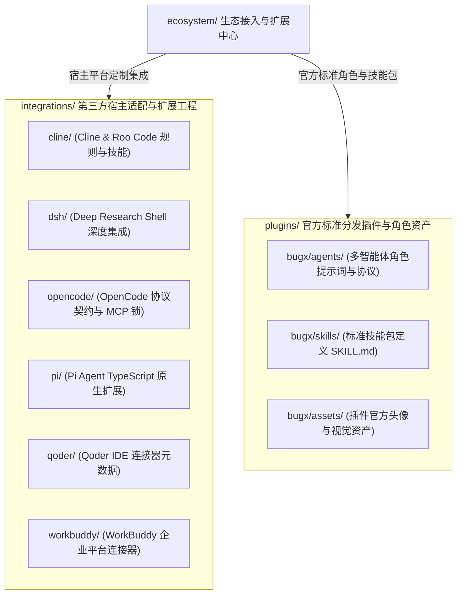

# BugX 生态连接与插件中心 (Ecosystem & Host Integrations)

> 本文档为 BugX `ecosystem/` 目录的唯一权威架构全景与生态扩展索引字典。收敛了 BugX 面向全部主流第三方宿主 AI 工具、终端平台、企业智能体平台与多智能体角色的扩展工程、插件和配置清单。

---

## 1. 架构拓扑 (Ecosystem Architecture & Integration Matrix)



---

## 2. 顶级子目录物理索引与职责清单 (Directory Inventory)

| 目录名 | 职责与功能定位 | 子模块 README | 核心纳管资产 |
| :--- | :--- | :--- | :--- |
| `integrations/` | 深度适配与定制化宿主扩展工程 | [integrations/README.md](integrations/README.md) | 收敛 Cline, DSH, OpenCode, Pi, Qoder, WorkBuddy 等 6 大宿主的定制配置与驱动代码 |
| `plugins/` | 官方标准分发插件定义与打包工件 | [plugins/README.md](plugins/README.md) | 收敛 Orchestrator, Worker, Judge 角色提示词、标准技能包与品牌资产 |

---

## 3. 六大第三方宿主集成模块说明 (Host Integrations Specification)

位于 `integrations/` 下的 6 大宿主集成工程分别负责打通特定的 AI 编程与终端环境：

1. **Cline / Roo Code (`cline/`)**：
   - **技术形态**：VS Code 扩展规则与标准 Skill 声明；
   - **核心资产**：包含 `skills/bugx/SKILL.md`，使开发者能够在 VS Code 内通过自然语言无缝触发 BugX 攻防审计、漏洞检索与补丁修复；
   - **接入模式**：支持一键注入到项目 `.cline/` 或用户全局规则目录。

2. **DSH - Deep Research Shell (`dsh/`)**：
   - **技术形态**：全功能端到端深度无缝嵌入；
   - **核心资产**：包含 `agents/bugx.md`（定制智能体定义）、`mcp/`（Node.js MCP 跨进程桥接器）、`ui/`（专有前端态势监控组件）、`skills/` 与 `dsh-patch.yml` 自动化修补清单；
   - **接入模式**：为 DSH 提供首选本地安全审计后端与图谱数据源。

3. **OpenCode (`opencode/`)**：
   - **技术形态**：声明式 MCP 工具清单与环境约束配置；
   - **核心资产**：包含 `opencode.json`, `bugx-mcp-manifest.json` 与 `mcp-lock.json`，完成工具输入 Schema 校验与依赖版本固化；
   - **接入模式**：遵循 OpenCode 官方扩展协议规范，支持零代码开箱即用。

4. **Pi Agent (`pi/`)**：
   - **技术形态**：TypeScript 编写的 Pi 原生扩展插件；
   - **核心资产**：包含 `extensions/bugx`（含 `manifest.json`, `index.ts` 及编译输出）与技能规范；
   - **接入模式**：通过 Pi 原生扩展机制挂载，实现多轮次交互式审计会话治理。

5. **Qoder IDE (`qoder/`)**：
   - **技术形态**：连接器元数据声明与协作协议契约；
   - **核心资产**：包含 `connector-meta.json` 与 `CONNECTORS.md`；
   - **接入模式**：定义 Qoder 平台与 BugX 微内核的双向通信通道与安全边界。

6. **WorkBuddy 企业智能体平台 (`workbuddy/`)**：
   - **技术形态**：企业级连接器与标准工作流挂载；
   - **核心资产**：包含 `connector-meta.json`, 平台专属 `icon.png` 以及 `skills/bugx/SKILL.md`；
   - **接入模式**：支持在企业内网流水线与智能体协同网络中作为受控安全节点运行。

---

## 4. 官方标准角色与技能插件包说明 (Plugins Specification)

位于 `plugins/` 目录下的官方标准分发包由 `bugx/` 组织，主要由三大正交要素构成：

### 4.1 多智能体协作角色定义 (`bugx/agents/`)
- `bugx.md`：**攻防总控智能体 (Orchestrator)**，负责全局统筹、任务分解、生命周期阶段推进与最终交付确认；
- `bugx-worker.md`：**攻防执行工作体 (Worker)**，专职负责代码逆向分析、脆弱性变异生成与反事实 PoC 攻击验证；
- `bugx-judge.md`：**独立裁决智能体 (Judge)**，严密审查 Worker 提交的漏洞证据链与补丁有效性，阻断虚假报告。

### 4.2 标准化技能包体系 (`bugx/skills/`)
- `bugx/`：面向通用 AI 编程助手的标准核心攻防技能包（含 `SKILL.md`）；
- `bugx-dsh/`：专为 DSH 终端轻量交互优化的定制技能包；
- `bugx-zcode/`：专为企业级环境协同优化的安全技能包。

### 4.3 品牌与视觉资产 (`bugx/assets/`)
- `bugx-avatar-512.png`：512×512 高清品牌图标，供各宿主 IDE 与插件市场统一展示。

---

## 5. 自动化安装与同步机制 (Installation & Sync Mechanism)

用户与宿主无需手动拷贝上述扩展文件，BugX CLI 提供了标准化的统一安装与热同步命令：
```bash
# 查看所有支持的生态宿主与安装状态
bugx plugin list

# 向指定宿主一键注入适配器与技能
bugx plugin install cline
bugx plugin install dsh
bugx plugin install opencode
bugx plugin install pi
bugx plugin install qoder
bugx plugin install workbuddy

# 导出通用技能包供 Cursor / Claude / Antigravity 使用
bugx skill export --out ~/.gemini/skills/bugx
```

---

## 6. 设计原则与质量守卫 (Architecture Guardrails)

1. **标准协议优先 (MCP Native)**：
   - 所有外部宿主集成尽可能复用标准 Model Context Protocol (MCP)；
   - 差异化部分通过声明式 JSON/YAML 配置驱动，严禁各宿主分支私有协议分叉。
2. **零侵入与就地自愈 (Zero Friction)**：
   - 扩展注入与配置同步具备完全的幂等性与可逆性；
   - 提供自动卸载 (`bugx plugin uninstall <host>`) 与自愈校验机制。
3. **文档与物理索引 100% 覆盖 (Zero-Drift)**：
   - 本目录下所有新增或变更的宿主工程必须在本文档及子模块 README 中建立权威索引；
   - 执行 `python3 scripts/verify_directory_indices.py --dirs ecosystem` 进行 100% 完备性门禁校验！
