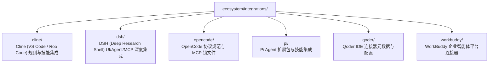

# BugX Ecosystem Integrations (外部生态宿主连接器与插件集成)

`ecosystem/integrations/` 存放了 BugX 与外部主流 IDE、智能体平台和终端工具的专用集成适配器、扩展包与配置胶水层。

---

## 1. 架构拓扑 (Integrations Matrix)

---

## 2. 集成目录物理索引与职责清单 (File Inventory)

| 目录名 | 目标生态平台 | 包含核心内容与职责说明 |
| :--- | :--- | :--- |
| `cline/` | Cline / Roo Code | 包含 `skills/bugx/SKILL.md`，向 Cline 用户提供自然语言调用 BugX 攻防与审查的标准技能规范 |
| `dsh/` | DSH (Deep Shell) | 包含 `agents/bugx.md`, `mcp/` (Node.js MCP 桥接), `ui/` (前端交互组件), `skills/` 与 `dsh-patch.yml`，提供端到端深度无缝嵌入 |
| `opencode/` | OpenCode | 包含 `opencode.json`, `bugx-mcp-manifest.json`, `mcp-lock.json`，提供开箱即用的 MCP 工具声明与依赖锁 |
| `pi/` | Pi Agent | 包含 `extensions/bugx` (TypeScript 编写的 Pi 原生扩展插件，含 `manifest.json` 与 `index.ts`) 以及技能定义 |
| `qoder/` | Qoder IDE | 包含 `connector-meta.json` 与 `CONNECTORS.md`，定义与 Qoder 协作的连接器契约 |
| `workbuddy/` | WorkBuddy | 包含 `connector-meta.json`, `icon.png`, `skills/bugx/SKILL.md`，提供企业级智能体工作流挂载 |

---

## 3. 设计原则

- **标准协议统一**：所有宿主扩展尽可能复用标准 MCP 协议，差异化部分通过轻量配置声明驱动。
- **免手动配置**：配合 `bugx plugin install <host>` 命令，实现上述宿主扩展的一键无缝注入。
