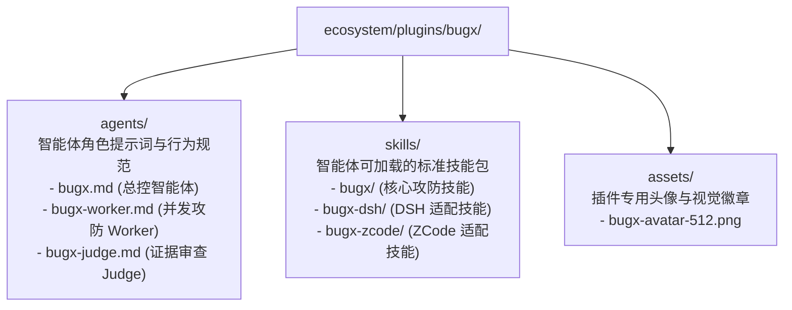

# BugX Agent Plugins (标准智能体角色包与分发插件)

`ecosystem/plugins/` 包含了 BugX 官方标准分发的多智能体角色定义包、原生技能定义与品牌资产。

---

## 1. 架构拓扑 (Agent Plugins Topology)

---

## 2. 目录与资产物理索引清单 (File Inventory)

| 相对路径 | 类型 | 职责与功能定位 |
| :--- | :--- | :--- |
| `bugx/` | 插件根目录 | BugX 官方插件标准打包根目录 |
| `bugx/agents/bugx.md` | Agent 角色 | 攻防总控智能体（Orchestrator），负责全局统筹、生命周期编排与用户交互 |
| `bugx/agents/bugx-worker.md` | Agent 角色 | 攻防执行 Worker，专门负责代码逆向、脆弱性变异与反事实 PoC 编写 |
| `bugx/agents/bugx-judge.md` | Agent 角色 | 独立仲裁 Judge，专职审查 Worker 提交的证据链真实性与有效性，防止虚假通过 |
| `bugx/skills/bugx/` | 技能包 | 包含 `SKILL.md`，面向通用 AI 编程助手暴露的代码审计与修复工作流 |
| `bugx/skills/bugx-dsh/` | 技能包 | 包含 `SKILL.md`，专用于 DSH 终端环境的轻量化审查技能 |
| `bugx/skills/bugx-zcode/` | 技能包 | 包含 `SKILL.md`，专用于 ZCode 平台的企业级协同技能 |
| `bugx/assets/` | 视觉资产 | 插件官方头像资产 `bugx-avatar-512.png` |

---

## 3. 设计原则

- **角色正交分离**：Orchestrator、Worker 与 Judge 职责边界分明，禁止角色越权。
- **开箱即用跨平台分发**：技能包与智能体定义遵循跨平台 Agent 规范，可直接被 Cursor, Claude Desktop, Antigravity 等平台直接挂载。
