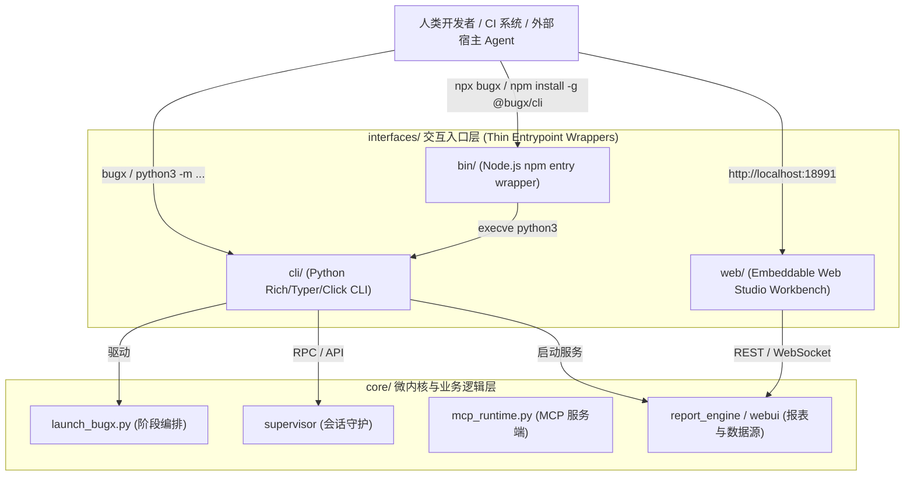

# BugX 用户交互与接口层 (User Interfaces & External Entrypoints)

> 本文档为 BugX `interfaces/` 目录的唯一权威架构全景与接口速查字典。记录了命令行 CLI、Web 控制台与 Node.js 包分发入口的架构拓扑、接口契约与职责边界。

---

## 1. 交互层架构拓扑 (Interfaces Architecture Topology)



---

## 2. 核心子目录架构与职责说明 (Subdirectories Map)

| 子目录 | 接口形态 | 核心职责说明 |
| :--- | :--- | :--- |
| `bin/` | Node.js 启动包装 | 包含 `bugx.js`，供 npm 全局安装或 `npx bugx` 唤起时自动寻找环境中的 Python 3.11+ 解释器并无缝转发命令行参数与信号 |
| `cli/` | Python CLI 核心 | 包含 `bugx_cli/` 包，提供现代化的命令行参数解析、交互式多选问答、色彩终端高亮及向微内核发起调用的轻量桥梁 |
| `web/` | Web 交互控制台 | 嵌入式 Web 控制台静态资源与本地开发服务器，提供图表化的审计态势感知、漏洞复盘、图谱探索与可视化工作台 |

---

## 3. CLI 命令行接口规范 (CLI Interface Specification)

### 3.1 统一调用入口与别名
BugX CLI 支持多平台无缝调用方式：
- **生产推荐**：`bugx <command> [options]`（全局安装或 pip 模式）
- **Node.js 免配环境**：`npx @bugx/cli <command> [options]`
- **源码开发模式**：`python3 -m interfaces.cli.bugx_cli.cli <command> [options]`

### 3.2 全局通用参数规范 (Global Options)
所有 CLI 子命令均继承以下标准化全局参数，严禁各子命令自行发明异构同义参数：
- `--root <path>`：指定待审计或操作的目标项目根目录（缺省为当前工作目录 `.`）；
- `--json`：开启机器可读的结构化 JSON 输出模式，静默色彩终端与交互式 prompt，便于 CI/CD 解析；
- `-v / --verbose`：输出调试级日志（包含微内核阶段推进细节与子进程命令）；
- `-q / --quiet`：静默非关键输出，仅打印最终状态码与致命错误；
- `--confirm-version-transition`：版本跃迁安全确认标志（仅在非 0.1.0 变更受控场景下生效）。

### 3.3 核心子命令与职责矩阵 (Command Matrix)
CLI 按功能正交划分为 5 大领域命令族：
1. **核心审计与攻防**：
   - `bugx audit [--profile <name>] [--rule <pack>]`：执行指定代码路径的交互式或定向深度安全审计；
   - `bugx autonomous [--headless] [--timeout <sec>]`：一键启动全自动无头自主攻防挖掘与闭环；
   - `bugx matrix [--matrix-file <path>]`：执行多环境、多语言、多宿主攻防交叉验证矩阵。
2. **环境诊断与补丁修复**：
   - `bugx doctor [--fix]`：全方位检查 Python 版本、宿主配置、MCP 服务可用性并支持就地自愈；
   - `bugx patch [apply|verify] <finding-id>`：提取漏洞复现 PoC 与自动合成补丁，执行双向验证；
   - `bugx advisory [query|show] <cve-or-ghsa>`：本地离线或云端检索已知安全通告与漏洞模式。
3. **生命周期与驻留守护**：
   - `bugx lifecycle [status|reset|advance]`：查询当前审计轮次状态机推进进度或强制安全重置；
   - `bugx daemon [start|stop|status]`：管理 BugX 后台驻留守护服务与长任务队列；
   - `bugx goal [set|list|status]`：长期目标驱动的迭代攻防探索与收敛状态管理。
4. **报表交付与洞察**：
   - `bugx report serve [--port 18991]`：启动本地嵌入式 Web 交互控制台与实时监控大屏；
   - `bugx report both [--out <dir>]`：同时渲染输出独立离线 HTML 漏洞报告与 SARIF/JSON 产物；
   - `bugx stats [--since <date>]`：聚合统计漏洞拦截率、修复准确率与代码覆盖度指标。
5. **宿主集成与扩展**：
   - `bugx plugin [list|install|uninstall] <host>`：一键向 Cline, OpenCode, Claude, Qoder 等宿主注入插件；
   - `bugx skill [list|install|export]`：智能体可调用的标准 Skill 技能包导出与配置；
   - `bugx agent [status|handoff|inspect]`：多智能体并发角色状态监控与协作排查。

---

## 4. Web 控制台与接口规范 (Web Console & API Specification)

### 4.1 架构与解耦原则
- **微内核后端解耦**：Web 控制台自身属于轻量展示层与人机协同交互交付中心，其底层数据契约、任务 DAG 拓扑流与 SQLite FTS5 引擎由 `core/webui/` 与 `core/report_engine/` 提供纯粹后端支撑。
- **开箱即用与零外部依赖**：控制台采用自包含单页静态资源（Vanilla/Pretext 原生渲染），无需额外配置复杂 Node.js 构建环境。

### 4.2 常用服务启动方式
```bash
# 启动本地可视化审计工作台（默认端口 18991）
bugx report serve --port 18991

# 生成并导出独立静态离线 HTML 审计报告与证据链
bugx report both --eval-dir verification/evals/oss --out verification/evals/oss
```

### 4.3 核心功能面板
1. **实时挖掘工作台 (Live Mining Workbench)**：展示任务 DAG 推进状态、Worker 并发心跳与生命周期状态机；
2. **双轨证据链报告 (Dual-Track Evidence Report)**：包含 CVE 级漏洞利用 PoC 代码、污染源追踪调用栈与反向修复补丁对比；
3. **架构拓扑与攻击面图谱 (Attack Graph Visualizer)**：组件依赖拓扑、污染传播网络与人机交互决策点；
4. **文档治理与知识检索 (Docs Governance & Search)**：Diátaxis 架构规范全文检索与自愈经验错题集。

### 4.4 核心 REST / WebSocket 协议契约
- `GET /api/v1/status`：获取当前会话生命周期、引擎版本与活动 Worker 清单；
- `GET /api/v1/findings`：获取结构化漏洞 Finding 列表、严重级别分布与复现证据；
- `GET /api/v1/graph`：获取攻击面拓扑网络图数据（节点、边与污染传播链）；
- `GET /api/v1/report/html`：直接获取预渲染完毕的静态报告 HTML；
- `WS /ws/live`：实时双向 WebSocket 通道，广播 Worker 日志、阶段切换事件与检查点信号。

---

## 5. Node.js 二进制包装器规范 (Binary Wrapper Specification)

位于 `bin/bugx.js` 的包装器遵循以下执行契约：
1. **三级自愈式解释器探测瀑布流 (Discovery Waterfall)**：
   - 第 1 级：探测内部捆绑独立运行时 `runtime/python-manifest.json`；
   - 第 2 级：探测全局预安装独立运行时 `~/.bugx/python/bin/python3`；
   - 第 3 级：按优先级扫描系统 PATH 候选解释器（`python3.14` 至 `python3.11`）；
   - 容错保底：全部未命中时输出友好的就地自愈安装指引命令，严禁崩溃。
2. **退出状态码与信号原样透传**：
   - 子进程退出码透明返回操作系统，确保 CI/CD 判定零失真；
   - `SIGINT` (Ctrl+C) 与 `SIGTERM` 信号原子透传给底层 Python 进程，保障优雅退出与运行时清理。

---

## 6. 设计原则与边界红线 (Architecture Guardrails)

1. **纯粹入口薄壳（Thin Wrapper Invariant）**：
   - 交互层仅负责参数解析、格式校验、终端美化渲染与用户交互；
   - 严禁在 `interfaces/` 下编写复杂业务逻辑或持久化逻辑，所有核心业务必须委托给 `core/` 下的微内核与子系统完成。
2. **多语言生态对齐**：
   - `bin/bugx.js` 与 Python CLI 必须 100% 保持参数契约一致；
   - 参数变动时必须同步更新 CLI 命令树与对应测试。
3. **文档同步防漂移**：
   - `scripts/verify_directory_indices.py --dirs interfaces` 会对本目录所有子系统进行 100% 完备性校验！
